# Rust engine acceptance plan

This is the implementation projection of the provisional design twin, not a
replacement specification. Each implemented slice follows model → failing Rust
scenario → minimum implementation → regression checks. No ignored or empty test
counts as implemented acceptance. JS reference passes are not Rust coverage.

## Delivery amendment — 2026-11-07

User direction: adjust the active goal to get the engine delivered. This amendment
governs execution of the active goal; it does not claim the unfinished goal is
complete or silently remove required behavior. The goal service currently permits
status changes, not an in-place objective edit, so its older objective remains
stored while this delivery amendment supplies the operative finish line.

**Delivery objective:** deliver the working, headless Rust v1 engine against the
adopted baseline, with executable public behavior, bounded ownership and cleanup,
integrated tests, and useful actual-path instrumentation. Finish implementation
and integration rather than expanding the architecture or assurance programme.

Latest user instruction: “Donut, adjust goal to get this delivered.” The delivery
artifact is the usable Rust engine and its runnable integration path, not this
plan or an enlarged evidence catalogue. Close the existing mandatory gaps, run
focused checks while implementing, then perform final integrated qualification
and hand off supported APIs, run commands and any exact release blockers. Keep
optional improvements out of the critical path. If a material decision prevents
completion, present that decision with its affected deliverable; do not substitute
more independent evidence work for resolving the blocker. The existing C1–C7
gates remain the acceptance checklist, not an invitation to expand scope.

### Delivery directive — closure, not further design

The user's renewed direction is to get this delivered. The operative priority is
working implementation and handoff, not completion of an open-ended evidence
programme. Preserve the fixed C1–C7 acceptance criteria below.

1. F11 original-search-result replacement bindings are implemented end to end,
   including decoded/installed routes and ordinary F06 release. Accepted
   composition, source-only exact batches and mixed atomic authoring are also
   implemented; do not restart these completed bundles. Finish the other mandatory
   C1/C2 gaps. The authorized diagnostic-drain functional facade is also implemented
   at its actual optional queue/host-bridge boundary. F01 native self-description
   and installed query dispatch are implemented. Continue F16's remaining
   provider-context decision and the remaining result/event integration,
   without adding an exporter, UI or network runtime.
2. Close remaining required facade/result integration (C1/C2), then observation
   integration and cooperative shutdown (C4/C5). Reuse working producers and
   guards. A helper or descriptor alone is not a completed delivery.
3. Complete only missing actual-path instrumentation and the declared release
   workloads (C6); then run integrated qualification and prepare the handoff (C7).
   Do not make passing implementations earn additional speculative proofs.
4. Keep material unresolved decisions in one finite blocker list. Identify the
   exact affected behavior, continue independent implementation, and never turn a
   missing decision into either invented policy or indefinite evidence work.
5. At handoff, state runnable entry points, supported and unsupported behavior,
   terminal test results and remaining release blockers. Do not claim delivery
   from test counts, documentation volume or an estimated percentage.

No new architecture, capability family, framework, proof campaign or optional
enhancement enters this pass without user approval. A newly discovered defect in
required behavior is fixed at its existing owner with a focused regression test.
The goal remains active until the fixed acceptance criteria are met; an incomplete
handoff must say exactly what prevents completion.

### Renewed delivery instruction — 2026-11-07

Deliver the engine, not an indefinitely expanding account of its correctness.
Every implementation bundle must close a named remaining public behavior through
execution, result delivery and cleanup, with focused tests and instrumentation.
Do not count additional documentation, schemas, helpers or test volume as delivery.
Do not add replacement abstractions for already-working owners. Specification or
proof work is permitted only to resolve a concrete defect in this fixed baseline.

The remaining delivery sequence is C1/C2 public integration, C4 observation and
C5 shutdown integration, C6 missing instrumentation/release workloads, then one
C7 integrated qualification and runnable handoff. C3 stays closed unless an actual
regression is found. Search replacement and authorized diagnostic drain are
completed functional bundles, not new proof tasks. F01 native self-description
and declaration correspondence are also implemented. F27's supported native
resource-evidence interface is joined. C2's native producer/result crosswalk is
closed; continue the selected F05 binding, event/control, shutdown and remaining
instrumentation/release implementation. The four delivery choices below are now
resolved; selection is not implementation or gate closure.

Adopted delivery decisions (implementation remains separately tracked):

- F05 logical search source correspondence — selected by the user: the host
  establishes correspondence and the engine issues bounded opaque bindings to
  actual native document owners. Naming/substrate resolution stays outside the
  engine. Bindings do not grant read authority; native incarnation/revision and
  applicable profile/generation checks remain mandatory. Foreign/stale bindings
  refuse, reopening cannot revive an old incarnation, and retirement releases
  binding ownership. The selected native binding/query/release/retirement and
  typed/dynamic/installed dispatch bundle is now implemented and focused-qualified;
  see the F05 matrix row. No resolver, new payload owner or JSON identity codec
  is introduced. This is neither a pending scope choice nor whole C1/C7 closure.
- F16 provider context — user selected binding-only for v1. The existing
  host-established catalog bridge supplies immutable correspondence captures;
  distinct document/analysis-context activation is explicitly deferred, not
  relabeled as binding or claimed implemented. This approved v1 scope change
  supersedes the earlier requirement to invent/complete that separate activation
  variant in this pass. Binding cannot start provider work, change document
  interpretation, activate analysis or expand authority; stale correspondence
  refuses. Host/integration owns provider startup/execution; native validation
  and result acceptance stay at their engine owners. Existing settings/registry
  operations remain required; analysis stays disabled. Baseline reconciliation
  and implementation qualification remain separate from this decision.
- C4 heterogeneous observation attachment — user selected typed native handles
  with adapter-owned generic-ID lookup. Engine dispatch uses a closed sum of
  supported original native handles, not a second cross-family identity registry.
  Integration mappings must be bounded and stale-safe; UI is not required.
  Native owners retain authorization, correlation, loss/resync/revocation and
  protected retirement. Wrong-family/foreign handles refuse without trial calls;
  adapter ID reuse cannot revive retired handles, and stop never implies producer
  cancellation or discharge. This resolves the scope decision, not remaining
  implementation/qualification or C4 gate closure.
- C5 shutdown — user selected returning an explicit unresolved report with the
  necessary engine owners/root retained. Finishing a shutdown attempt is distinct
  from complete discharge/final release. Admission stays fenced; reporting grants
  no discard, retry, quiescence, settlement or retirement authority. Protected
  late evidence and cleanup remain available at the original owners. Only actual
  discharge permits final release. The host owns scheduling/waiting/process exit;
  in-memory retention is not crash persistence. Implement and qualify this
  controller without introducing forced-drop or implicit timeout/discard policy.

A mandatory unselected performance threshold is reported at release qualification,
not invented. At a genuine decision blocker, deliver the runnable supported scope
and the exact remaining decision rather than opening another assurance campaign.
The active goal is not complete until its required delivery gates pass; this
instruction does not relabel partial implementation as a finished engine.

### Fixed scope and finish line

F05 implementation bundle closed: eleven final public search-argument/binding/
installed scenarios pass, including all three operations on both routes under
capture off/on/timed/saturated, malformed headers, generic lookalike refusal,
exact identity/profile/generation, reply pressure, absorbing loss and protected
cleanup. Sixteen native search-owner unit regressions and 52 existing public
search-consumer regressions also pass; formatting and strict focused all-feature
Clippy pass. The lookalike fixture was repaired to satisfy existing dense ordering
and schema rules; no production validation was weakened. Continue C1/C4 selected
scope reconciliation and C5 controller implementation; do not reopen this bundle
for unrelated assurance work. The whole delivery count stays 2/7 (C2/C3).

Runnable handoff path now available: `cargo run -p vellum-engine --example
headless_edit` executes installed discovery → exact batch edit → separately
permission-filtered retained outcome → explicit owner cleanup. Its acceptance
test runs the same code with capture disabled, enabled, timed and saturated;
matching replay executes once and final invocation/history/reservation counts
are zero. The executable and focused test pass, as do formatting and strict
all-feature Clippy for both targets. This completes the runnable-session artifact,
not the remaining family integration, shutdown controller or full C7 qualification.

- Keep the existing C1–C7 acceptance gates below as the fixed delivery checklist.
  Do not add gates, enlarge their meaning, or reset the denominator during this
  delivery pass. Required behavior stays required. Conditional capabilities may
  be disabled only where the adopted contract already permits that choice, with
  disabled status visible to callers.
- UI, key maps, clipboard workflows, SDK/automation policy, filesystem/S3 I/O,
  exporters and host scheduling remain outside the semantic engine. Implement
  their required engine-facing contracts, not those surrounding products.
- Close the remaining facade/result routes, observation/control integration and
  cooperative shutdown using the existing owners. Reuse the completed scoped
  settings/catalog readers; privileged projection helpers alone are not delivery.
- Finish actual-path instrumentation and representative release qualification.
  Do not invent product SLOs or equate a benchmark pass with latency acceptance.
  Any still-unselected mandatory performance budget is a visible release decision,
  not an excuse to generate unrelated evidence indefinitely.
- Run integrated qualification once the implementation is assembled. Delivery
  requires a passing runnable Rust integration path through discovery, authorized
  editing, result observation and cleanup, plus the C7 checks and an accurate
  supported-capability/remaining-decision handoff. A demo cannot replace required
  family coverage; passing helpers cannot replace public behavior.

### Execution discipline

- Work in end-to-end delivery bundles. Each bundle names the public behavior it
  makes usable and its remaining integration before coding. Finish that bundle
  before starting unrelated prerequisites; do not leave a growing trail of helpers.
- Use existing passing tests and implementations. Add focused regression tests
  for changed behavior and actual trust/lifecycle risks. Do not rerun proofs,
  regenerate evidence, revise broad documents or widen API versions unless the
  implementation change actually requires it.
- A newly found issue is either a failing required behavior/security invariant,
  an already-required missing integration, a blocking user decision, or a backlog
  improvement. Only the first two enter this delivery pass automatically. Record
  improvements without implementing them. Present material scope changes for
  approval rather than absorbing them into the goal.
- Resolve ambiguity by using already-adopted contracts where sufficient. If a
  material choice remains, state the exact decision and affected deliverable once;
  continue independent work. Never invent authority or silently weaken safety.
- Report completed user-visible behavior, tests actually run, and the exact
  remaining deliverables after each bundle. Report closed gates against the fixed
  seven, not another unsupported overall percentage. Prerequisite progress is
  identified as such and must not be presented as a closed delivery bundle.
- Stop when all seven gates pass and hand over the engine. If a mandatory release
  decision prevents completion, hand over the working deliverable and a finite
  blocker list without claiming the goal complete. No new assurance campaign is
  implied by reaching the finish line.

### C7 closure — final native workspace qualification

| Required check | Current terminal result |
| --- | --- |
| Workspace formatting | Pass: `cargo fmt --all -- --check` |
| Strict workspace lint | Pass: `cargo clippy --workspace --all-targets --all-features --offline -- -D warnings` |
| Full debug workspace/all-target tests | Pass: 88 target summaries, 2,880 passed, one intentionally ignored release-only performance experiment separately qualified |
| Full release workspace/all-target tests | Pass: 88 target summaries, 2,880 passed, one intentionally ignored release-only performance experiment separately qualified |
| Documentation test command | Pass: all four crates; zero executable doc snippets, not a claim of additional behavior coverage |
| Pinned Unicode reference gate | Pass: both tests, 2,805 native tables and actual movement/replay/deletion/undo paths; exact ICU4J pin verified |
| Final release experiments | Pass: five examples, 81 cohorts/41,472 measured operations; separate receipt-control 48 cohorts/6,144 first closures |
| Runnable handoff | Pass: final `headless_edit` release binary prints `Hello, agents!`, verifies one invocation and releases all session owners with zero diagnostic drops |

The first full qualification found a stale lifecycle fixture: it attempted disposal
under an unresolved ordinary-save baseline promise, which must refuse. Its
unknown-effect/replay assertions are preserved using a separately authorized copy
export to the same resource, without the ordinary-save promise. The export's
specialized dispatch and independent host facts remain mandatory. Its seven
invocation cases and ten observation cases pass in release. A duplicate discovery
fixture module was consolidated rather than suppressing lint. Two test-harness
lint issues were also corrected: production items precede the test module, and
the ignored release experiment returns an error in debug rather than asserting
on a compile-time constant. The release-only guard remains enforced; no production
authority, baseline, quiescence or retention guard was loosened.

**Delivery complete: 7/7 gates closed (100% of the fixed checklist).** Both full
debug and release commands reached terminal success. The original debug job was
retained through loader startup waits; no required target was skipped to close
the gate. The separately qualified release-only experiment is the sole ignored
ordinary-suite test. Empty documentation test sets are reported as such, not
counted as behavior coverage. No additional engine deliverable remains under the
approved provisional v1 scope.

Handoff: run `cargo run --offline -p vellum-engine --example headless_edit` for
the installed discovery → edit → replay → separately authorized retained result
→ owner cleanup path. `make check` runs formatting, strict workspace lint, debug
tests and doc tests; release qualification used
`cargo test --workspace --all-targets --release --offline --quiet --no-fail-fast`.
The separate pinned Unicode gate requires Java and `VELLUM_ICU4J_JAR`; this run
used the verified 79.1 artifact and Java 21. Current profiles, measurement boundaries,
binary fingerprints and explicit disabled/deferred facilities are recorded in
`public-contract-matrix.md`, `performance.md` and the README. UI/clipboard/automation
mapping and substrate mechanisms remain outside the engine boundary. Numeric
product SLO, MSRV and production Unicode-provider selection remain unselected;
this delivery does not invent those decisions, certify physical persistence/RSS,
or claim renewed formal/independent certification.

### C6 closure — original-owner first-result timing and release refresh

The last recorded C6 implementation gap is closed at the existing resource owners.
`queue_timing/result.rs` adds opt-in dispatch-to-first accepted attributed result
claim timing and a privileged original-owner query. Reads count nonempty payload
or terminal claims, not Start/quiescence; saves count meaningful application or
synchronization result claims, not unknown-application progress, causal edges,
no-future effects or quiescence. Native original task/registration/nonce checks
precede observation. These are intake measurements, not success, physical I/O,
result disclosure, scheduler authority or evidence of completion.

The timestamp is absorbing: duplicate/late evidence cannot renew it or repair an
unknown clock. Inline fixed populations separately retain first results, active
censored waits, unknown ages/durations and retired-without-result rows. Bounded
counters retain explicit inexactness on overflow; no content/identity labels,
new task store, dynamic metric allocation or exporter is introduced. Existing
ownership, settlement, baseline and retirement guards are unchanged.

Qualification passes: six timing unit tests; four public first-result scenarios
(including both save kinds, empty source terminal, exact foreign-owner refusal,
all four capture modes and real producer-retention cleanup); four existing public
queue scenarios; and 119 affected source-read/annotation-read/save-operation/
provider-evidence regressions. Unknown/regressed clocks, observed zero duration,
nonrenewing duplicates, censored retirement, counter overflow, primary service
counts and optional timer/refusal behavior are explicit. Focused strict
all-feature Clippy and workspace formatting pass.

After the production change, all five release examples were rebuilt and the
81-cohort/41,472-operation run and 48-cohort/6,144-first-closure receipt experiment
were refreshed successfully. Current distributions, losses, measurement
boundaries and exact binary hashes are in `docs/performance.md`; generated CSVs
were updated rather than multiplying snapshots. MELT/golden/RED apply to actual
request/service/result populations, USE to native bounded ownership/pressure,
and STRIDE/LINDDUN to original attribution, independent authorization, privacy-
safe records and protected retention. UI, provider CPU/wire time, OS scheduling,
network and physical RSS stay at their owning boundaries and are not claimed
measured here. No numeric product SLO is invented; the fixed C6 gate requires
reporting that unselected decision, not claiming universal latency acceptance.

**Fixed gates: 6/7 closed (C1–C6), approximately 86% by gate count.** C7 full
workspace/release/docs/provider qualification and runnable handoff are now running.
A discovered regression must be repaired at its owner; C7 is not complete while
any required command is failing or still running.

### C1/C4 closure — approved v1 native facade and observation scope

The current 23-family native crosswalk in `public-contract-matrix.md` is the
functional implementation checklist, not the historical reference-routing syntax.
All supported rows now reach their actual native owners and guarded products;
F05 correspondence and installed literal search, F18 accepted-plan disposition,
and the approved F16 binding-only baseline resolve the last recorded functional
seams. The supported settings/definition/lifecycle/serialization/registration
forms retain their installed ten-form closed dispatcher. F16's host/catalog
correspondence bridge issues immutable original native captures: it does not
activate analysis, execute providers or acquire new authority. Its 13 consumer
tests pass, including the new four-capture-mode unchanged-root/generation/task/
retention check. Missing, false, foreign, stale and over-budget correspondence
already refuse at the actual bridge/consumer. Distinct document/analysis activation
is deferred by the user's explicit decision, not silently marked implemented.
Analysis F08/F24/F28 and timer/analysis-task parts of F26 remain disabled and
unadvertised; clipboard workflows and generic-ID lookup remain outside the engine.

C4 composes the four implemented publication observer families: source,
named-facet, annotation-collection and resource-registry. Their installed
establish/resynchronize commands preserve original operation/stream/generation
binding and nonrenewing replay; separately authorized retained receipts preserve
their original projections. `release_observation_event_v1` dispatches the original
typed native handle, checks reply framing before consuming an event/certificate,
and preserves distinct projection/empty/gap products and issuer generations.
Closed stop V4 and revocation V2 retain exact original-role checks, separate
revocation authority, sibling isolation, current release and protected discharge.
Stop/revocation never cancel a producer or refund retained ownership. Existing
read/invocation/native-operation/discovery contexts keep their native protected
controls. F07 settings/catalog snapshots are queries, not new event streams.
The approved adapter-owned generic-ID lookup requires no erased engine registry;
typed native validation/retirement prevents alias or slot reuse from reviving an
old capability.

Focused current checks pass: **209 publication tests, 120 observation tests,
78 registry tests and 13 catalog-consumer tests**, with overlapping test filters
not summed as independent coverage. The one ignored observation test is the
explicit release-performance experiment, required separately by C6 rather than
a missing functional scenario. The previous installed milestone's 52 built-in
discovery tests and eight public shutdown scenarios pass. Library all-feature
strict Clippy and workspace formatting pass. Earlier per-family native/public
qualification records remain scoped evidence, not renewed frozen proofs. No new
observer abstraction or controller was added to close these gates.

**Fixed delivery status: 5/7 closed (C1–C5), approximately 71% by gate count.**
Remaining: C6 current interface/population and declared release workload
qualification, then C7 full integrated qualification and runnable handoff.
Functional closure is not whole-engine release/performance acceptance. A concrete
regression found by those gates must be fixed at its owner; historical open prose
must not restart the completed implementation bundles.

### C1 checkpoint — installed shutdown-disposition continuation

F18 now has an installed `shutdown-disposition/1` continuation over the existing
engine-retained accepted consent plan. Closed typed/dynamic inputs carry only
contract/operation and original opaque fence/document handles; independent current
facts and native coverage still authorize disposition. Private discovery origin,
exact selectors and current release precede native execution. Copied descriptors
cannot install the route, a bare fence cannot invent accepted consent, and repeat
disposition refuses the spent lifecycle expectation without republishing. Existing
direct protected progress survives discovery teardown. There is no new controller,
invocation store, consent mechanism, UI or substrate operation.

The installed scenario covers native/copied source × typed/dynamic × four optional
capture modes, current-rights refusal, original native lifecycle result, stale
repeat refusal, protected discovery teardown, provenance release/reclamation,
accepted-plan retirement and final report/control retirement to zero funding.
All **52 built-in discovery unit tests pass**, including that scenario; the
shared source-preparation frame remains parent-prepaid at its actual maximum.
Public ingress checks reject forged roles, unsupported headers, duplicate/missing/
extra fields and authority smuggling without owner mutation. The **eight public
shutdown scenarios pass** (two ingress, four returned-attempt and two disposition
scenarios); the public closed-header test exercises both routes over twelve
valid/mutated forms. Separate fixed
normalization/dispatch boundaries provide optional service timings. Focused
strict all-feature Clippy and workspace formatting pass. This closes the selected
F18 installed continuation, not the complete C1 gate or renewed frozen proofs.
The fixed whole-delivery count remains **3/7 closed (C2/C3/C5), about 43% by gate
count**, not equal-sized effort.

### C5 closure — native returned report and final control retirement

The engine-owned cooperative shutdown lifecycle is now implemented through
`shutdown/attempt.rs` at the original fenced owner. A once-only, parent-funded
report returns `Drained` or `UnresolvedRetained`; matching retry reauthorizes the
original historical report without refreshing it or spending again. Current
disclosure remains separate. Protected report retirement releases only metadata.
A fresh complete census, no outstanding native dependencies or payloads, and
actual wait/disposition/report retirement are required before final fence release.
Final control retirement refunds its original reservation and installs an absorbing
closed-engine tombstone. Inert provider configuration survives until host Drop;
prepared payloads/export reservations are not treated as inert configuration.

Qualification: **70 shutdown unit tests and six public shutdown scenarios pass**.
The composed public scenario exercises actual source and annotation saves,
Unknown effects, explicit consent, cancellation/wait cutoff, late write evidence,
separate no-future/quiescence evidence, disposition, producer retirement, an
unresolved returned report, refused premature root release, actual document
reclamation and final control retirement with zero remaining parent reservation.
The new public scenarios also cover capture off/on/timed/saturated equivalence,
separate disclosure denial, stale/foreign control, bounded capture refusal,
nonrenewing replay and once-only release. Private checks cover faulted protected
cleanup and unexplained parent funding. Five optional fixed service boundaries
instrument the actual report/control paths. Workspace formatting and focused
all-feature strict Clippy pass. No full-suite, crash-durability or renewed formal
proof claim is made.

**Fixed delivery gates: 3/7 closed (C2, C3, C5), approximately 43% by gate count,
not an estimate of equal-sized effort.** C1's installed F18 continuation is now
implemented as recorded above; complete facade reconciliation remains C1.
C4 supported event/control integration, C6 final instrumentation/release
workloads and C7 integrated qualification remain open. Do not reopen this native
shutdown lifecycle merely to add evidence or another controller abstraction.

### C6 checkpoint — current declared release workloads

Current refresh: all five release examples pass 81 cohorts/41,472 measured
operations; the separately invoked receipt-control experiment passes 48
cohorts/6,144 first closures. Observation now includes an enabled original-command
profile with admission, execution, privileged retained-result inspection,
nonrenewing replay and retirement, alongside raw events. Exact per-service
populations, diagnostic pressure and final parent cleanup are checked; all five
example/harness tests pass, with focused strict Clippy and formatting. Current
CSVs and binary hashes are in `docs/performance.md`.

One concrete instrumentation residual remains before C6 closure: queue timing
ends at dispatch and does not measure the subsequent wait for the first accepted
attributed result. Implement that at original source-read/annotation-read/save
owners, not in an exporter or host scheduler. Start/progress/quiescence must not
manufacture a result; duplicate delivery must not renew timing; absent/regressed
clock observations must remain unknown; pending and retired-without-result
populations must not disappear under diagnostic saturation. Existing effect
knowledge/settlement and protected late-evidence behavior are unchanged.

The pinned Unicode reference gate was run with Java 21 and an ICU4J 79.1 jar in
the task's temporary directory. Its SHA-256 matches the existing required pin
`28b292e60d0d00c496bae88a15b2615f89f781be13670aeac9dc90f189570e07`.
Both conformance tests pass: 853 grapheme/1,944 word cases, all 2,805 native
tables, 7,312 grapheme movements, and actual replay/deletion/undo coverage.
This is a current explicit gate result, not independent certification or final
whole-workspace qualification. Fixed gates remain **5/7 closed (~71%)**; C7
follows the remaining C6 implementation and its affected qualification.

The new `shutdown_responsiveness` release workload closes the previously unmeasured
native report/control and multi-document cleanup path. Its four tests pass and
the full 24-cohort/12,288-shutdown release experiment succeeds over 1/8/64 real
code/prose documents, native/decoded disposition and four capture modes. Native
per-boundary service counts and external samples are independent of diagnostic
loss; every iteration actually reclaims payloads and retires to zero parent
funding. `docs/performance.md` records phase boundaries, observations, limitations
and exact source/binary hashes, with the generated CSV. Focused strict example
Clippy and formatting pass. C6 remains open for current remaining interface/
population reconciliation and release workload refresh; this is not whole-engine
performance acceptance. Fixed functional gates remain 5/7 closed (~71%).

The four existing release examples were built together once offline, then run
sequentially with their existing 512 measured/32 warmup configuration. All 45
cohorts/23,040 measured operations pass their population, semantic, capture and
cleanup checks. The explicitly invoked receipt-control release workload also
passes all 48 cohorts/6,144 first closures; its ignored-by-default designation is
not a correctness waiver. `docs/performance.md` and the five dated delivery CSVs
record actual results, commands, binary hashes, losses and measurement boundaries.
No SLO, regression or causal-overhead conclusion is invented. Source edit/query
totals span p99 1.000–48.959 µs across the declared workloads; large retained
search is 1.601–1.634 ms. The multi-edit and observation populations remain
separately visible rather than being averaged away.

Native resource queue-age measurement is now implemented for source/annotation
reads and saves. Host-only opt-in precedes task issuance; exact original-owner
queries and four fixed population aggregates distinguish pending age, dispatch
wait and pre-dispatch stops. Retirement preserves bounded aggregate counts, not
task identities. Diagnostic capture loss does not suppress these clocks; missing
clock observations and incomplete populations remain explicit. No scheduler or
effect-state change is introduced. C6 still needs the remaining interface/
population reconciliation; first-result timing must distinguish progress from
attributed result evidence, not infer a result from quiescence or claim physical
effect completion. Existing release
CSVs identify their earlier binaries and do not qualify this subsequent change.
Final focused verification: four queue-timing scenarios and 48 source-read
regressions pass; formatting and strict all-feature Clippy for the library and
affected queue/save/read/provider-evidence consumers pass.
Five existing read interfaces now also capture optional service durations:
source-read status/stop and annotation-read capture/status/stop. Two new public
scenarios first failed on the absent durations and now pass across capture modes,
success/refusal and retained cleanup; all 48 source-read and nine annotation-read
regressions pass. Focused strict Clippy and formatting pass. These service spans
are distinct from queue waiting, provider time and effect completion.
C1/C4/C5 decisions and C7 whole-engine qualification remain separate. The fixed
closed count stays 2/7 (C2/C3), not an estimated effort percentage.

### C2 closure — existing native producer/result composition

The finite current crosswalk is in `docs/public-contract-matrix.md`, under
“C2 native producer/result crosswalk”. It covers ordinary authored/selection
outcomes, every adopted V1–V10 typed allocation/result family, the four read/save
operation parents, original publication-command receipts, retained read/search
products and diagnostic tasks. Declaration/selector recognition, independent
current release, exact original allocation/family binding, identity-only replay,
prepaid wrappers and protected separate retirement stay at their actual owners.
The current source/consumer inspections and recent focused integration results
are the evidence; model/reference checks are not substituted for running Rust.

Specification §23.2.2 explicitly defines diagnostic ordinary result and protected
control at its own gateway. Its installed request and actual result/control paths
already exist. Adding an invocation identity or universal F06 wrapper would be a
new design, not a missing adopted deliverable. Immediate queries/evidence intake
likewise do not manufacture a retained command receipt. C1's F05/F16 choices
remain required and unwaived; they do not erase the completed existing producers.

Closure checks: 120 observation library tests pass, including receipt seal faults,
original selector/role checks, current ceilings and protected ownership; the one
existing ignored case is the separately invoked release performance workload,
not ignored correctness acceptance. All 18 diagnostic and 10 public retained-
release observation scenarios pass. Reuse the recent 47 F11/F12 and 192 native
read/save integration/owner checks; these unchanged paths need no repeated proof
campaign. C7 still supplies whole-workspace/release/provider qualification.
Fixed gate status is now 2/7 closed (C2 and C3), not an effort percentage.

### Delivery checkpoint — installed F06 native read/save observation

The four read/save parent kinds already had native retained products and funded
typed/dynamic decoders; their missing installed discovery join is now implemented
in `builtin/native_operation.rs`. Two sealed entries route status, protected
control, retained receipt and bounded wait to those actual owners. The owning
normalizer checks the same fixed declarations used for descriptions. Private
source identity, exact contract/operation and independent native release remain
mandatory; copied metadata cannot install a handler. Actual parent sponsorship
includes the synchronous builder/enrichment staging. No new invocation, task,
effect runner, native result profile or UI/substrate behavior was introduced.

Qualification: 55 save-operation and 48 source-read public tests, 75 discovery
library tests and 14 native-observer library tests pass (192 total). Public
scenarios cover all four parents, both envelope routes, class-specific receipt
denial, source wait dispatch, capture off/on/timed/saturated equivalence and
independent observer/discovery retirement. The copied-source/selector challenge
passes. Strict library/two-consumer all-feature Clippy and formatting pass.
This closes the installed native read/save join; remaining diagnostic-result
crosswalk and C4/C5 assembly are not replaced by this qualification. Fixed gates
remain 1/7 closed (C3); this is not an effort percentage.

### Delivery checkpoint — F11/F12 ordinary retained-result join

Existing installed set/endpoint, original search-occurrence and boundary-backed
Unicode selection scenarios now continue through typed/dynamic F06 retained
outcome. Installed composition and source-only exact batches do likewise for
applied and protected-stop outcomes. The adopted profile deliberately exposes
coarse current-permitted facts; coordinates/participant payloads are not missing
receipt fields. Original producer-context equality, transient read refusal,
current publication withholding, stable repeated result/reference and separate
observer/policy discharge use the actual existing owners. The fixture funds the
whole reply wrapper and preserves the original native context; native guards are
not relaxed. No engine API, result profile or instrumentation path was added.
Qualification: all 27 selection/composition/batch, 7 search-selection and 13
Unicode invocation tests pass (47 total); strict all-feature Clippy for those
three consumers and workspace formatting pass. Five extended acceptance scenarios
exercise 50 concrete producer/result combinations, including both selection
admission routes and both result-envelope routes. No whole-suite run was needed.
These joins close the selected F11/F12 integration gaps, not the whole C2 gate.
Continue the native read/save/diagnostic retained-result crosswalk and then the
remaining event/control assembly; do not restart these working result paths.

### Delivery checkpoint — F27 native resource evidence intake

`ProviderEvidenceV1` and `ingest_provider_evidence_v1` now join existing original
source-read, annotation-read and shared-writer evidence intake. Progress, end/
acknowledgment, failure, unknown, causal edge, no-future-effects and quiescence keep
their native independent meaning. Existing authenticated correlation precedes
duplicate/conflict handling; stop does not block late evidence, and no intake
activates a read or publishes a baseline. Existing retained obligations are not
waived. Six public scenarios exercise all three families, foreign engine/provider
refusal, original cleanup barriers, optional capture/timing and fixed populations.
Qualification: 6 new facade, 9 annotation-read, 80 save and 48 source-read tests
pass (143 total); strict library/four-consumer all-feature Clippy and formatting
pass. Source/annotation native intake now also has optional actual service timing.
The status/interface crosswalk is in the public contract matrix. This closes the
supported F27 native resource join, not remote/clipboard/analysis intake or C7.
F16's unresolved binding-versus-activation semantics is recorded in the finite
decision list above. Continue the C2 producer/result join; fixed gates remain
1/7 closed (C3), not an effort percentage.

### Delivery checkpoint — F01 executable self-description

The explicit native source now describes list, inspect and advisory-enablement
from the actual normalizer declarations. Native reply forms and metadata facet
whitelists are shared with actual result validation. Sealed installed dispatch
reaches the existing funded decoder and native handlers on typed/dynamic routes;
it does not acquire a context, enable a decoder or turn descriptions into grants.
Route metadata release and target-query permission remain independent. Captured
schema ceilings, original continuation limits, Boolean false advice and protected
cleanup are exercised. Copied metadata and cross-operation selectors cannot install
the handler; an unaffordable description leaves existing affordable sources usable.
Optional fixed dispatch timing is checked with capture off/on/timed/saturated.
Qualification: all 88 public discovery tests and 74 discovery library tests pass;
strict library/public-discovery all-feature Clippy passes. This closes the F01
functional binding, not reference /13 installation, a wire codec or C7 qualification.
Fixed gate status remains 1/7 closed (C3); this is not an effort percentage.

### Delivery checkpoint — F02 installed reads and acquisition

The missing discovery adapter now makes range/line reads and all six
current/retained single/coherent acquisition paths callable on both typed/dynamic
envelopes. It reuses native capture, authority, result guards and cleanup; there
is no new owner or authority. Fixed dispatch timing is optional and payload-free.
Copied metadata cannot install the handler. Selector or discovery refusal cannot
apply supplied loss to the native reader. Qualification: 64 affected discovery
tests and 146 existing read-facade tests pass; one public integration scenario
passes capture → edit → retained acquisition/read → complete cleanup on both
routes. Strict library/consumer all-feature Clippy passes. This completes the F02
functional integration bundle, not release performance or the whole C1 gate.
Fixed gate status remains 1/7 closed (C3); that is not an effort percentage.
F03/F04 follow-on complete: all six annotation/history query operations now have
sealed typed/dynamic discovery dispatch over the existing native/decoded owners.
Single/coherent annotation snapshots preserve original selectors and withheld
facets; history preserves original context and filtered products. Selector or
metadata denial cannot apply supplied loss to the native owner, while valid
metadata cannot override denied native authority. No new owner, result store or
budget default was introduced. Optional fixed dispatch timing is exercised with
capture off/on/timed/saturated. Qualification: 67 discovery, 146 read-facade,
12 annotation consumer and 37 history tests pass; strict library/two-consumer
all-feature Clippy and formatting pass. This closes these functional bindings,
not the C1 gate or C6 release qualification.

F05 reconciliation found the already-recorded material decision at the passive
literal-search prerequisite below: logical source labels have no selected native
correspondence. The normalized descriptor also preserves profile/generation
meaning absent from the older `SearchRequest`; a wrapper must not drop it.
The complete logical facade remains uninstalled. User choice requested between
host-established correspondence with an engine-issued opaque binding (catalog
precedent; recommended) and integration-edge naming over native opaque roles.
This is not a reason to disable existing native search or stop independent work.

F12 trusted-native integration complete: a sealed installed source now describes
the owning normalizer's four forms/three semantic variants and dispatches them to
the original one-shot invocation runner. Set, endpoint, original search-match and
boundary-backed Unicode movement preserve original intent and exact replay;
source text/revision/history do not change from selection-only work. Private
origin and exact contract/operation checks reject copied or cross-form selectors.
Metadata is not mutation permission; the trusted host still authorizes its caller.
The declaration frame shares the prepaid synchronous builtin maximum. Optional
fixed dispatch timing is checked off/on/timed/saturated. Qualification: 68 affected
discovery tests, 12 selection invocation tests, one search-selection argument
scenario and one Unicode movement argument scenario pass, including native and
installed paths and protected discovery cleanup. Strict library/three-consumer
all-feature Clippy and formatting pass. F06 recipient selection-result/event
assembly remains C2 work, not a claim made by this adapter. Fixed gate status
remains 1/7 (C3). Continue required engine implementation while the F05 choice is
pending; do not restart completed F02–F04 bindings or add detached proof work.

### Delivery checkpoint — native returned-search replacement

`submit_returned_search_replacement_v1` now admits replace-current/replace-all
through the existing managed-search plan and current-fact-bearing service. Only
the actual guarded native result release establishes a retained reply footprint;
the opaque result identity is not a read or mutation grant. Original canonical
request/context/three-limit capture and the actual native reply frame have two
separate reservations under the existing parent. Their sum is checked before
native preparation. Refusal refunds; exact replay neither prepares nor charges
again; legacy ingress cannot borrow this binding. Native preparation/view and
annotation dependencies remain unchanged, and generic run cannot bypass service.

Protected `retire_returned_search_replacement_v1` releases these invocation charges
once and drops the private capture/plan. Stop and outcome forgetting do not
refund; original query/issuer holds are independent. The existing invocation
document-pin, protected-control and shutdown-inventory owners include the new
binding. Fixed payload-free admission/retirement timing is optional; native
validation/publication timing remains at its existing owner.

Qualification: four new private scenarios and the three existing managed-search
regressions pass. All 13 search-consumer integration tests pass, including the new
public current/all scenario across capture off/on/timed/saturated. The shared
library run passes 1,339 tests with one existing ignored performance experiment.
Strict library/search-consumer all-feature Clippy and workspace formatting pass.
Follow-on F11 search binding is now implemented: the closed four-field native
normalizer supplies both existing F11 outer routes and a sealed installed source
over the same managed-search owner. Native result identity, original context and
all three limits survive capture and replay; copied metadata cannot install a
handler and selectors cannot cross current/all operations. No logical F05 source
resolver or query profile/generation conversion is introduced. Fixed normalization
and dispatch observations are optional, payload-free and checked off/on/timed/
saturated. Recognition refusal leaves caller-owned discovery cuts untouched;
the test caller explicitly retires them before preparing another cut.

Five public scenarios cover both routes/native-installed paths and both variants,
closed fields/indices/independent input limits, original result and actor meaning,
independent mutation denial, protected stop/forget/retirement and F06 ordinary
retained outcome under separate current authorization. All 18 search-consumer
tests, 71 discovery tests and seven native managed-search regressions pass; the
F06 current-authorization refinement also passes its focused rerun. Strict library
and settings/selection/annotation-history consumer all-feature Clippy and workspace
formatting pass. This completes the F11 search functional integration bundle, not
whole C1/C2/C4/C5 assembly or C6/C7 release qualification. Continue the remaining
mandatory implementations rather than expanding this passing search work.
Fixed delivery gate status remains 1/7 closed (C3), not an effort percentage.

### Delivery checkpoint — diagnostic queue owner prerequisite

The actual scoped `bounded-optional-capture/1` Rust owner is now implemented in
`diagnostic_capture.rs`, separate from the richer existing `Recorder`. Its finite
marker product has 13 sites/six milestones and no arbitrary content or timing.
Prepare validates outside publication; token capture uses prepaid storage without
a clock read. Direct drain stages the complete bounded prefix before consumption;
protected health remains independent, including zero optional capacity. Scope,
generation and lifetime issuance remain distinct. Explicit stop/retention/reset,
exact/inexact saturated counters, unique native consumer binding and once-only
funding discharge are implemented. Known binding holds cannot be overridden by
supplied retirement flags. Canonical marker bytes are distinct from native
context/header/reply units; neither is an RSS or wire-envelope claim.

The actual owner is included in parent funding and shutdown census (41 native
roles), and explicitly excluded from document pins and semantic root identity.
Three private tests cover fixed storage under pressure, actual queue/preparation/
binding obligations and exact/refused configuration funding. Public scenarios
cover FIFO, reply/byte pressure, single-use and foreign handles, authority/scope,
retention/counter exactness, all 78 markers, capture off/on/timed/saturated and zero
capacity. Shared library qualification passes 1,343 tests with the existing one
ignored performance experiment. Strict library/diagnostic-consumer all-feature
Clippy and workspace formatting pass. This is the native queue prerequisite, not
F26 task/gateway, retained result or installed routing completion. Continue that
same bundle next; do not open a separate capture proof campaign. Fixed delivery
gate status remains 1/7 closed (C3).

### Delivery checkpoint — owned diagnostic drain functional integration

The F26 bridge now owns actual queue-bound tasks, generation/limit intent,
separately funded batch/result/control capacity, current copied results and
protected control. It is not a native editor invocation kind or executor. Native,
closed typed/dynamic and sealed installed effectRequest/hostRequest paths reach
the same owner. Metadata cannot install a handler or supply drain authority.
Issue/first admission honor the domain fence; retained service/replay/cleanup
remain available. Missing readiness defers without draining. Service selects the
current prefix once, records performed/notPerformed/unknown distinctly, and never
retries automatically. Empty accepted batches are performed. Authority loss
fences the bridge, not the independent capture queue or source engine. Controlled
before/after/malformed/unwind failures settle unknown, preserve previous performed
knowledge, and cannot leave an attempted task pending for another drain.

Ordinary result rights are independent from protected control. Current generation
change purges only the old payload, not its historical performed fact. Stop,
retirement and actual row presence preserve known consumers and original funding;
a false-empty gauge cannot authorize release. Native shutdown accounting includes
the gateway's actual additional reservation and task/batch obligations. Fixed
optional observations cover interfaces, service outcomes/defer and cleanup, with
no raw context/task/generation labels.

Nine public drain scenarios pass alongside all nine queue scenarios, including
16 route/install/capture-mode combinations. Five private gateway tests pass for
whole-frame/parent refusal, four fault stages, actual funding/known holds, the
domain fence and false-empty retirement. The 72-test discovery qualification
includes a matching-contract/kind/schema generic-origin refusal. Strict library
and diagnostic/settings/selection/annotation-history consumer all-feature Clippy
and formatting pass. The final shared-library run passes 1,349 tests with the
existing one ignored performance experiment, including the selector-only test.
No release/SLO, full F06/event, wire,
physical/crash or independent-certification claim is made. Continue the remaining
C1/C2 integrations, not a diagnostic proof campaign. Fixed gates remain 1/7 (C3).

## Active goal addendum: cross-cutting testing perspectives

Latest implementation checkpoint: native F10 current-check advice is executable
through `capture_compound_advice_basis_v1` / `query_compound_advice_v1`, including
mixed source/annotation plans, explicit configuration/workspace/source read
conjunctions and source-operation scopes under their existing native validators.
The actual publication predicates were extracted and reused, not copied into a
second validator. Live annotation identity allocation and history storage
reservation remain only on the publication/preparation path. Advice's private
annotation slots, mapping, history/view companions and projected root are dropped
after a Boolean verdict; there is no conversion into a publishable transaction.
Root/request/owner/context/policy mismatch, incomplete observability and query
capacity refusal return unavailable. Unexpected private failure fences the owner
without publishing, reserving an invocation or returning a false verdict.
Temporary leases refund on all exits; fixed optional capture is payload-free.
Six new unit cases and two public BDD scenarios exercise nonpublication, live
storage/identity invariance, private/final root agreement, current reads/scopes,
permission conjunction, stale/foreign basis, capacity/capture modes and policy
change before actual execution. Shared-publisher regression qualification:
1,324 engine unit tests pass; the existing explicit release-performance experiment
remains ignored. All 54 annotation, 22 annotation/history and 37 history consumer
tests pass; strict library/three-consumer all-feature Clippy and formatting pass.
Follow-on integration is now complete for this native profile: closed borrowed
typed/dynamic routing retains original plan/proposal pairing and all native
read/scope/context/policy/limit meaning. Unknown/extra/duplicate fields, wrong
versions/families/roles and copied plan substitution refuse before native work.
Sealed installed discovery joins the original validator, never an arbitrary
evaluator. Metadata and native observability remain independent; copied metadata
has no handler. Fixed header/decoded/installed observations are optional and
payload-free. No new owner, alias registry, default quota or wire codec is added.
Qualification: seven advice/ingress tests and 70 affected discovery tests pass;
the two public advice scenarios pass, with the mixed-plan/view scenario exercising
native, both decoded and both installed routes plus discovery cleanup before real
publication. The existing discovered annotation and history consumer scenarios
also pass after sharing the test fixture. Strict library/three-consumer
all-feature Clippy and formatting pass. The previous shared-publisher qualification
is reused; no broad suite was rerun. This closes functional native F10 integration,
not C1, C6/C7, nested logical-plan serialization or renewed frozen proofs.
F11 accepted-composition implementation now runs through the actual native,
closed typed/dynamic and sealed installed routes. One exact surrounding-text
replacement maps secondaries/peers normally and collapses only the original
initiating primary before normalization. Original execution context and all three
capture limits bind replay. Failed preparation or complete native-envelope
admission leaves the ticket issued/unbound. Protected stop and retained outcome
retirement reuse the existing ledger; discovery cleanup cannot retire the job.
Optional payload-free preparation/normalization/admission/dispatch timing is
checked with capture off/on/timed/saturated. Eight new public composition scenarios
and the twelve existing selection scenarios pass together; two private tests pass
for one-byte-short/exact envelope admission and missing-seal fault containment.
Twenty shared view-owner regressions also pass, including actual annotation/peer/
history companions and private interruption/refusal paths. Strict library/consumer
all-feature Clippy and formatting pass. This is native functional integration,
not complete F11/C1/C2 closure or release latency acceptance. Continue the fixed
remaining facade/result deliverables, not another composition proof campaign.
Fixed gate status stays 1/7; pending F05/C4/C5 user choices remain explicit.

Source-only exact-batch functional integration is now implemented as well. The
seven-field trusted-native request uses actual typed source writes, V3 read
predicates and source scopes; shared normalization groups consistent repeated
documents and preserves canonical retry meaning. Private preparation captures
source/policy/annotation-set dependencies once, never returning those stamps or
requiring the caller to discover annotation state. This profile deliberately has
no admission-time view predicate: actual service captures current attached views,
bounds their complete native envelope and uses the same atomic publisher. Existing
view-bound commands retain their old preparation semantics. Native and sealed
installed typed/dynamic routes, stop, retained terminal outcomes and optional
payload-free timing reuse existing owners; there is no new result store, scheduler,
annotation-authoring grant, UI state or logical-ID wire codec.

Qualification: seven public exact-batch scenarios pass (two-document/current-view
publication, grouped retries/cross-ingress exclusion, spent identity, failed
preparation refunds, read/policy refusal, closed fields/independent bounds and
installed execution/stop/cleanup with capture off/on/timed/saturated). Four private
tests pass for original annotation-stamp invalidation after retry, missing-read
fault containment, one-byte-short/exact retained-envelope admission and service-
view capacity refusal without publication. The shared-core regression run passes
1,332 library tests with one existing ignored test; the final affected consumer
passes all 27 selection/composition/exact-batch scenarios.
Strict library/consumer all-feature Clippy and formatting pass. This closes the
source-only exact-batch functional bundle, not mixed authored source/annotation
facade, search binding, C2 recipient result assembly or C6/C7 release qualification.
Continue those required implementations; do not start another proof campaign for
this passing native path.

Mixed authoring functional integration is now implemented through bounded native,
typed/dynamic and sealed installed `atomic-source-annotation/1` routes. Ordered
components retain original document/operation/dependency meaning and actual native
allocations; current F13 bindings/rights are rechecked at dedicated service.
Generic run cannot bypass that check. Annotation-only work needs no source-write
grant, body-only work retains compatible mapping eligibility, and an unwritten
candidate target freezes its original source context. Shared source/annotation/
current-view/history publication and original component receipts remain one native
decision. Canonical grouping precedes compound participant/funding decisions.

The actual parent prepays native logical 3C+2M+2R plus the original receipt frame
under the existing compound result holder. Stop and forgetting do not refund;
protected retirement releases both frames once and drops the mixed capture.
The new holder's document-pin and shutdown classification omission was reproduced
and fixed at its existing owners. Private tests verify actual inventory funding
through stop/forget/retire and unknown/fault containment without a published
prefix when the funding seal is corrupted. Inner source normalization is reused
without emitting a second externally offered operation.

Qualification: nine public mixed scenarios pass, including all four operations,
linked undo/receipt order, fresh authority denial, independent body/target meaning,
canonical partitions/parent charge, installed typed/dynamic execution/stop/capture
equivalence, strict fields/bounds/parent refusal and actual existing typed F06
receipt delivery with independent common/native release. Both private checks pass.
Shared-core qualification: 1,335 library tests pass, one existing test remains
ignored; the three affected consumers pass 31 annotation/history, 37 history and
27 selection/composition/exact-batch scenarios. Strict library/three-consumer
all-feature Clippy and formatting pass. No frozen proof campaign was rerun. This
closes native mixed functional integration and the selected F06 producer link,
not search binding, complete C1/C2/C4/C5 assembly or C6/C7 release qualification.
Continue the remaining implementation gaps; fixed whole-goal status remains 1/7
closed gates, not an effort percentage.

The active engine TDD/BDD and instrumentation goal includes golden signals, RED,
USE, STRIDE and LINDDUN wherever applicable. This is a binding acceptance-plan
addendum to that goal, not a replacement objective or a claim that these
perspectives are already fully implemented. Preserve the full existing engine
scope and its UI/integration/substrate boundaries.

### Performance is table stakes for the active goal

Responsive, resource-efficient operation is an explicit acceptance obligation of
the full engine TDD/BDD and instrumentation goal, not optional polish deferred
until feature completion. Preserve correctness, security and privacy while making
interactive engine work near-instantaneous under declared supported workloads;
that intent is not yet a numeric SLO or a universal bound for arbitrarily large
agent batches. The existing smoke timings qualify neither the whole engine nor
the active goal as complete.

- Define and enforce workload-qualified latency, memory/resource and observer-
  overhead budgets before claiming performance acceptance. Keep unselected
  numeric targets visible as open decisions rather than silently inventing them.
- Exercise representative resident edits, prose/code/Unicode, cross-object agentic
  multi-edits, queries, scale and lifecycle/control pressure as applicable. Account
  for useful completed work, refusals, pending/censored work and saturation; fast
  rejection or dropped observations must not manufacture apparent responsiveness.
- Separate ingress/admission wait, pending age, service, atomic commit and result
  delivery. Correlate UI presentation and substrate I/O at their owning interfaces
  without moving those mechanisms into the semantic engine. A timeout is not
  cancellation, quiescence, nonpublication or safe retry evidence.
- Measure tail distributions and maxima, throughput, retained/resource pressure
  and instrumentation cost with capture off, enabled and saturated. Preserve
  explicit clock/coverage uncertainty. Extend independent overload observations
  where required; a full diagnostic queue must not masquerade as low latency.
- Retain comparable host/workload/build context and detect regressions. Use focused
  tests for changed behavior and adjacent contracts; reserve broader qualification
  for meaningful stable milestones. Separate build, first launch, warm execution,
  test-body time and result-observation delay. Reuse unchanged binaries where
  appropriate, avoid redundant runs/polling, and bound test/report output so the
  development loop also respects machine resources, user wait and token costs.
- Record performance coverage and remaining gaps for each affected slice. Passing
  functional tests, finite work bounds, a timer field or one fast benchmark is not
  performance closure. Do not mark the full goal complete while applicable
  performance obligations are unimplemented, unverified or ambiguously specified.

`docs/performance.md` records the initial executable gate, native cohort observer,
actual smoke evidence and outstanding performance coverage. These are partial
implementation evidence, not a reduction of the full goal to those workloads.

| Perspective | Applicable testing and instrumentation obligations |
| --- | --- |
| Golden signals | Along actual execution pathways and material interfaces, test latency, traffic, errors and saturation. Separate queue/admission wait, service, commit, result delivery and external milestones; include pending/oldest-age and missing/censored observations rather than only fast completed requests. |
| RED | At request-bearing interfaces, measure rate, errors and duration with explicit eligible populations. Separate offers, admissions, logical operations, attempts, retries/replays and completion. Preserve refusal, stale, denied, stopped, unknown and fault meanings; reuse golden-signal observations rather than duplicate counters. |
| USE | For actual bounded resources, test utilization, saturation and errors: owned pools, retained bytes/handles, reservations, diagnostic capacity and any implemented queues/workers. Include exhaustion, recovery/release and control headroom. Physical CPU, allocation/RSS, I/O and host scheduling need measurements at their owning layer; logical limits are not those measurements. |
| STRIDE | Select adversarial scenarios from actual trust boundaries, identities, permissions, data/evidence flows and contracts. Test forgery/substitution, tampering, repudiation/evidence integrity, replay, unauthorized disclosure, resource denial and privilege escalation where exposed. Include instrumentation itself as an attack surface. |
| LINDDUN | Select privacy scenarios from actual data collection, correlation, disclosure, retention and release. Test unintended linkability or identifiability, unwanted non-repudiation, detection of sensitive involvement, excessive disclosure, unawareness/unintervenability and non-compliance risks where applicable. Include minimization, policy/recipient changes, retention/discharge and diagnostic export boundaries. Telemetry must not defeat the privacy properties it observes; tests are not legal-compliance certification. |

For each remaining slice, record applicable perspectives and their concrete
scenario/measurement evidence, with status **covered**, **partial/open**, or
**not applicable with a reason**. Map existing useful tests before adding more;
do not require every perspective for every function or count framework labels as
coverage. Carry applicable gaps forward to the current closure worklist and
completion audit. A perspective cannot be waived merely because its implementation
is absent; distinguish a required missing mechanism from genuine non-applicability.

Use bounded, optional, content-safe actual-path instrumentation and on/off/
saturated behavior checks. Define denominators, milestones, clock domains,
diagnostic loss and observer overhead before making performance claims. Enforce
only explicitly selected budgets; correctness, authorization and privacy
invariants are not probabilistic performance error budgets. Engine tests exercise
the owning boundary contracts without importing UI, provider I/O, exporters or a
network runtime into the semantic engine. Keep native implementation evidence,
model/reference checks and independent assurance claims distinct.

## First slice model: source candidates

Requirements §§5.3, 5.7, 5.9; specification §§4.1–4.2.1.

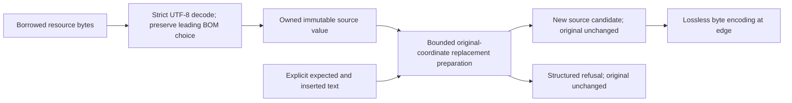

There is no publication, I/O, identity, permission, history or revision transition
in this model. Candidate construction grants no authority. Full engine admission
must bind candidates to actual identities, dependencies and current policy before
publication. Immutable values can already be disclosures; these helpers are not
the future authorized snapshot-release facade. They must never be mistaken for
a public backdoor to coordinator-owned state.

Decode rejects invalid UTF-8 without replacement characters. One leading BOM is
serialization metadata, not a document offset. Other BOM characters, mixed
newlines, trailing spaces, combining sequences and final-newline choice survive.
Preparation uses half-open original-source scalar-byte boundaries, exact expected
text and valid Rust UTF-8 insertion strings. It accepts unsorted disjoint edits,
allows adjacent nonempty replacements, and refuses overlap, coincident insertions
and insertions touching replacement endpoints. All checks precede candidate
construction. Equal source candidates do not classify whole-engine no-ops.

Explicit limits cover source bytes, edit count and total expected/inserted bytes;
checked arithmetic and fallible reservation refuse without changing the source.
They are logical preparation limits, not measured physical/global memory budgets.
No default deployment capacities or optional mapping policies are invented.

The optional observed-preparation path executes the same pure preparation and
captures only boundary/disposition afterward. Timing is explicitly unmeasured
unless supplied as a real measurement by an enclosing execution layer; zero is
not substituted for missing timing. Diagnostic capture never selects the result.
Default Debug output for source values and replacement records omits payloads.

## Next slice model: source coordination

Requirements §§3.2–3.4, 3.7, 5.1, 5.3, 5.7 and 15.5. One trusted local
embedding owns a non-cloneable source coordinator. Possession of that owner is
the local host authority; a document identifier alone is not a grant. Document
handles carry an unforgeable in-process owner namespace and a never-reused slot.
This is not a persistent ID scheme, multi-principal policy system or sandbox
against the embedding. New documents are unbound scratch objects.

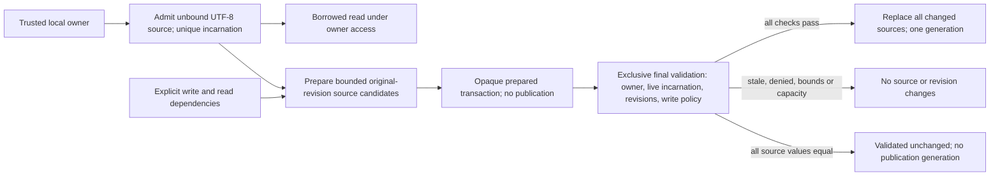

Source coordination alone does not supply the full command facade, invocation
deduplication, retained outcomes, history, annotations or view companions. Those
must join the coordinator before claiming complete v1 publication acceptance.
No recipient-safe public command error scheme is inferred from trusted-owner
diagnostics. Borrowed source access is already a disclosure and is not revocable
after a caller copies it; no retained release-context API is offered here.

Preparation validates unique explicit write participants, exact source revisions,
read dependencies, per-source edit bounds and total staged candidate bytes. The
first Rust source-coordination interface requires already grouped participants;
duplicate participant lowering remains a facade obligation, not silent merging.
Prepared values retain their owner namespace and all captured dependencies.
Final validation rejects foreign/disposed/stale targets and changed write policy,
even for source-equal edits. Read-only policy is host-controlled, not caller
authority metadata. Source changes increment revisions; all changed sources share
one new generation. A no-op validates all dependencies before avoiding counters.
No publication callback, I/O, exporter or parser runs at either phase.

Logical limits bound lifetime document admissions (including disposed slots),
participant/dependency count and each prepared transaction's staged bytes.
Counter exhaustion refuses before mutation and IDs never wrap. The embedding
owns retained prepared values; a global reservation/lifetime system is not yet
implemented. Disposal is limited to these unbound source-only objects; once
effect/history obligations are implemented, disposal must account for them.

Diagnostic boundaries distinguish preparation, final admission, publication,
queries and lifecycle. A validated unchanged result emits no source-publication
record. Records have no content or identity fields and timing is unmeasured.
Tests compare actual state/results with capture disabled, available and full.

## Invocation slice model

Requirements §§4.4/5.7; specification §§4.2.2/6.5–6.5.2. Source invocations
belong to the existing coordinator, not another engine or external workflow.
The trusted local owner issues opaque typed identities in its existing namespace.
Issuance bounds both lifetime IDs (never reused) and simultaneously retained slots;
pressure refuses without automatic eviction or a new admission epoch. Issuing an
ID alone neither grants permission nor admits an execution.

```mermaid
stateDiagram-v2
  [*] --> Issued: bounded issuance and result reservation
  Issued --> Pending: bounded copied canonical source intent
  Pending --> Finished: one source decision and retained terminal facts
  Pending --> Finished: accepted stop before execution
  Finished --> Finished: matching retry or observation
  Pending --> Pending: matching retry
  Finished --> Forgotten: discard detailed outcome only
  Forgotten --> Forgotten: matching retry; no fresh execution
  Issued --> Retired: explicit retirement
  Finished --> Retired: explicit retirement
  Forgotten --> Retired: explicit retirement
  Retired --> Retired: unavailable; identity never reused
```

Malformed/over-budget or changed intent refuses without changing the existing slot.
Canonicalization copies complete records, groups repeated source participants
only when expected headers agree, retains distinct participant order and sorts
each participant's edits without coalescing/elision. Range geometry is checked
without acquiring current source: replay cannot refresh revisions or rebuild a
candidate after source changes. Read dependencies retain their explicit descriptor
order in this source-only API; general read-set canonicalization is still separate.
The logical intent-byte ceiling applies to the incoming descriptor before grouping;
each grouped or partitioned representation must independently fit that input bound.

First submission prepares against the exact captured revisions and policy. Known
current precondition/preparation refusal is retained with that original execution,
not retried after a later grant or edit. Execution consumes the pending preparation
once and uses current final coordinator validation. Even source-unchanged execution
spends the identity. Result capacity is reserved before acceptance; the source
decision and terminal facts install under the same exclusive coordinator borrow.
Only state is returned from submit/run/retry; typed retained outcomes are accessed
separately through the trusted-owner facet. No original command response is a
replacement public result channel.

Pending retirement refuses rather than discarding accepted work. Stop in this
closed source-only profile settles local work before publication; it makes no
claim about external effects, which are absent from this profile. Forgetting a
terminal outcome preserves spent eligibility and immutable intent; retiring a
slot releases retained data but not the lifetime issuance budget. Old identities
remain unavailable without an unbounded set of external tombstones.

Invocation entry/observation/control and actual source publication have distinct
content-free diagnostic boundaries. No invocation ID or intent enters metrics.
The synchronous owner fences new execution before entering its source decision;
an unexpected unwind must not restore eligibility or allow blind restart. This
does not implement crash recovery, external-effect deduplication, recipient-scope
projection, decoded dynamic commands or the other retained-outcome kinds.
Trusted-owner usage gauges distinguish lifetime issuance, retained slots, pending
work, finished work, available detailed outcomes and faulted executions. Those
counts do not establish quiescence, authorize discharge or grant export access.

## Source history slice model

Requirements §5.8; specification §§14.1–14.4/28.13–28.14. Opt-in explicit
history limits add one group per source-changing commit to the existing owner.
There is no implicit typing coalescing. Each group retains complete changed-source
participants and exact forward/inverse edit journals, not historical document rows.
Source-equal participants create no source history in this source-only profile;
future annotation/view effects need their own complete semantic classification.

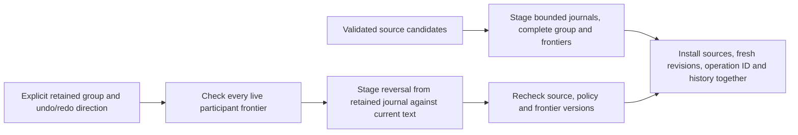

Undo/redo uses current source revisions, not the group's old numeric revisions.
Every reversal has a fresh operation ID linked to its original group; it moves
frontiers instead of creating an ordinary new group. Rights or frontier changes
between preparation and commit reject the complete reversal. Unrelated scopes do
not stale it. Ordinary source writes, including invocation execution, use this same
history installation path when enabled. History availability is advice, not a grant.

Inverse journals retain original record order. Adjacent deletions can yield
coincident inverse insertions: their ordering is explicitly resolved by the owned
forward journal, not guessed from caller arrival order. A private ordered-journal
path shares source validation/assembly, preserves every record and never changes
the ordinary public ambiguity rules. Source-only restoration changes edited spans
and preserves live serialization metadata; it cannot reinstall old document policy.
Final publication also streams the retained journal against its actual candidate
without allocating another source copy. Owned record/candidate drift is an internal
integrity fault: fence the owner, retain uncertain invocation state and do not
install source/history or fabricate a normal rejected outcome.

New work invalidates complete intersecting redo groups and dependent continuations
across their other scopes. Unrelated histories survive. Bounds cover retained
groups, logical journal bytes and active pins. Full history refuses new publication;
no automatic eviction or capacity increase occurs. Explicit retirement removes
the least frontier-dependency-closed set of complete groups and refuses atomically
when any member is pinned. Retained floors distinguish unavailable from established
empty history. No other retention-promise/floor profile is advertised yet.

Pins promise retained data, not continued undo eligibility or source permission.
Pin identities cannot be reused to release another pin. Disposal requires explicit
history retirement first rather than silently breaking a link or a pin. This
source-only policy does not settle later external-effect/annotation obligations.

Group and operation IDs are opaque, owner-scoped, never-reused typed roles backed
by checked publication generations. No-op creates neither. History queries,
preparation, retirement/pins, usage and publication are content-free instrumentation
sites. The existing invocation ledger also admits a closed source-reversal intent
(original group and direction), creates its actual prepared reversal once, and
retains that private preparation. Matching retries never recapture frontiers or
rebuild a journal; source and reversal intents cannot reuse one invocation ID.
The complete public F04/F14 recipient contexts and typing-group compatibility
remain separate work. Native annotation and current-view companions are described
in later slices. Retiring history invalidates
unpinned outstanding reversal plans through final dependency checks; pending
invocation records remain until their actual local disposition.

## Pinned source-save slice model

Requirements §§3.7/5.9–5.10; specification §§16.2–16.5, specifically the
already defined pinned-source-save subset. The existing coordinator owns resource
bindings and a bounded destination writer. Trusted provider ports issue inert
read/probe/evidence values; they are host truth attestations, not proof of OS I/O
or a sandbox against the embedding. Identity domains/keys are distinct from paths,
document IDs and permission. Providers sharing a declared domain/key share one
engine destination and cannot create alias owners. A known alias joins its existing
document without overwriting unsaved source or widening read-only policy.

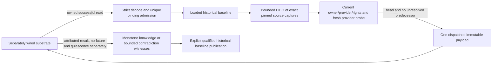

Capture requires exact current source revision, active original binding and actual
UTF-8/BOM encoding. It creates no authored edit/history entry. Later local edits
do not rewrite queued bytes. Pinned conditions never advance automatically through
prior writes; own-chain progression remains unimplemented, not renamed supported.
The first provider profile offers best-effort equality checks only; stronger atomic
conditional-write requests refuse before dispatch. Ordinary acknowledgment requests
synchronization when the provisioned provider supports it. No procedure implies
universal crash durability, non-ABA tokens or external-writer isolation.

Only the FIFO head may launch. Dispatched work retains its destination barrier
until application is known and no future effect is attested. Quiescence releases
an execution slot but does not prove no future effect or successful writing.
Undispatched stop is known nonapplication; post-dispatch stop is intent only.
Independent destinations and source editing remain available under limits.

Result knowledge retains application, observed-byte lower bound, synchronization
and optional validator independently. Compatible facts refine monotonically;
contradiction retains the canonical knowledge and two actual conflicting witnesses,
contests the destination and blocks further dispatch/baseline publication. Separate
no-future/quiescence intake remains possible even under contradictory results or
an authored-owner fault. Third distinct conflicting results refuse boundedly;
duplicates never erase facts. No automatic reconciliation/retry is advertised.

Baseline publication uses a qualified retained writer task for the exact current
binding, never caller bytes. A newer eligible dispatch prevents older acknowledgment
regression. Current output equality, write acknowledgment, synchronization, pending
work and external freshness remain separate. A baseline is historical evidence,
not proof of current external contents. A current baseline pins its producer until
replaced or its binding is safely disposed. Retirement requires real local/effect/
execution disposition and actual baseline-consumer discharge; IDs never become fresh.
Retirement also retains the newest qualified baseline-election producer even before
publication. A private attempt lease counts every owned dispatch/evidence delivery
capability; all must drain before retirement. That local lease is not physical
quiescence or proof of nonapplication. Regressions caught both missing holds.

Provider/blob/token/task/queue/execution bounds are caller-supplied, with no numeric
deployment defaults. All engine mechanisms remain I/O-free. The user selected
staged replacement with explicit safety refusals for the first filesystem adapter,
without in-place fallback. Annotation artifacts, ordinary own-chain progression,
rebind/SaveAs, scoped recipient release, deadlines and operational recovery remain
open parts of the full goal.

## Local-filesystem slice model

`crates/vellum-local-fs` is the first separate substrate module. Its initial
executable profile is macOS, not an inferred cross-platform promise. Host-supplied
limits cover retained resource bindings, source bytes, metadata bytes and stage
creation attempts. Directory descriptors anchor operations; path spellings and
inode observations stay out of the engine. A lifetime adapter slot names one
binding, holds its observed inode open, joins known aliases and survives its own
replacement. It is not a global or non-ABA filesystem identity authority.

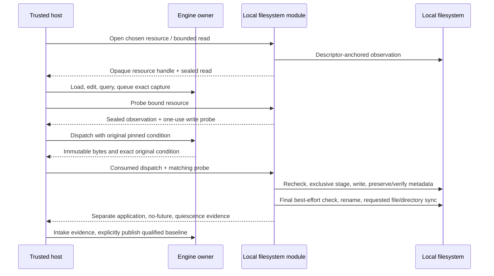

The dispatch carries its actual original pinned bytes/token; substituting a newer
probe cannot rebase that condition. Metadata checks preserve supported mode,
ownership and bounded enumerable xattr names/values, including native provenance;
source and stage equality is checked before replacement. Native ACLs, special
modes/flags, incompatible ownership, hardlinks, symlinks, nonregular/remote files
and unsupported/over-budget metadata refuse. Inode and creation/access/modification
timestamps intentionally change in this profile. ACL absence and attribute copy
use one isolated documented native seam; unsafe Rust remains forbidden in engine.
The host trusts the OS and a non-hostile staging directory. Final checks do not
close the external-writer check/rename race. No atomic CAS, non-ABA validator,
crash/power-loss durability, cleanup-after-process-crash or hostile-directory
security claim follows. Reads check pre/post descriptor stamps and resolved inode;
that is best-effort consistency, not an atomic read snapshot.

Known pre-replacement refusal preserves old contents; a failed replacement call
retains Unknown, not fabricated nonapplication. Post-replacement token failure
retains Written and independently observed sync facts. Sync failure cannot qualify
a synchronized baseline. Normal completion returns independent result/control
receipts; a panic/process loss or failure to construct the completion leaves the
engine unresolved rather than inventing receipts. Private fault hooks are test-only.
Owned stages are cleaned after ordinary pre-replacement refusal; cleanup failure
is reported separately. Existing colliding names are neither truncated nor removed.

Instrumentation records read, validation, staging, replacement, synchronization
and total substrate-write service time separately. These records contain only
closed phase/disposition/duration fields; source, attributes, paths and raw errors
are excluded. The engine records binding/admission/dispatch/evidence/baseline
boundaries and queue/outstanding/unresolved gauges independently. Timings are
adapter-local service measurements, not queue delay, wall-clock truth or evidence.

## Literal search/replacement slice model

Requirements §5.6; specification §§15.1–15.4/28.17–28.18. The trusted source owner
now implements the mandatory exact case-sensitive UTF-8 profile: no normalization,
regex, locale/fold heuristics, grammar dependency or UI highlight geometry.
Opaque sessions bind one document incarnation. Each accepted synchronous query
advances that session's checked generation without changing source publication
generation/history. Invalid or capacity-refused requests do not supersede current
work. An exhausted evaluation is an accepted known subset, explicitly not an exact
total, and supersedes previous work in that session. Other sessions stay independent.

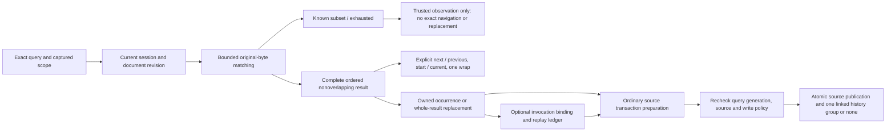

Overlap scopes normalize; adjacent captured scopes remain separate. Disjoint
contents never concatenate into a match. Empty queries produce complete zero
matches, not zero-width edits. Literal matches may address a combining scalar
without widening to a painted grapheme. Explicit current-match identities retain
their actual result origin and cannot index another result, even for equal text.
Navigation includes an exact start when current is absent, excludes current when
present, and reports at most one requested wrap. Both directions use the same set.

Root/scope/query, byte-comparison, match/output, replacement and retained-result
budgets are explicit. Each comparison spends a monotonic budget; scan position
strictly advances for a nonempty query, and empty queries terminate immediately.
Exhaustion preserves known ranges but advertises no exact total. Match handles,
prepared replacements and retained invocation intents keep their actual result
alive and count against result capacity. Weak result slots can recycle only after
all such owned references drain; session slots never recycle within an owner.
Closing a session invalidates engine actions but does not retract prior trusted
disclosures. Disposed document incarnations cannot attach to reopened documents.

Replacement uses owned original ranges/query bytes, exact source revision and the
current write policy. Preparation and final publication both validate the session
generation. Explicit current replacement may use one known partial occurrence;
replace-all requires complete results. No requery, implicit rebase, prefix publication or read-only skipping
is permitted. Ordinary no-op/history/reversal rules apply, including adjacent
deletions with ordered inverse insertions. Invocation intent retains actual
all/current selection identity and literal replacement spelling even on zero
matches; matching terminal retries observe original facts after supersession.

Search control/evaluation/navigation/replacement have separate content-free
diagnostic boundaries. Complete and partial results have distinct dispositions;
live/lifetime sessions and actual retained results expose bounded owner gauges.
Engine service time remains explicitly unmeasured unless supplied externally.
Capture-off/on/full equivalence includes composed search replacement and its
invocation/history path. Query strings, scope/match coordinates and result counts
are not diagnostic labels. No async cancellation, recipient-safe result release,
wire discovery, chunk-store performance or pinned
Unicode folding implementation is claimed. Search replacement now acquires/maps
actual annotation and current logical-view companions through the shared coordinator.

## Shared attachment candidate slice model

Requirements §3.8; specification §§4.3.1/13.2/13.9. The new `attachment` module
implements bounded candidate preparation over the existing source edit algebra.
This is an immutable-value mechanism, not an annotation registry, authorized
command, proof of complete companion acquisition or live publication entry point.
Its explicit point profile/affinity and content-range behavior correspond to the
existing native compound placement reference; no implicit UI selection policy or
plugin callback is introduced. Source context/authority remain the future owner's
responsibility, not a claim inferred from source/target value possession.

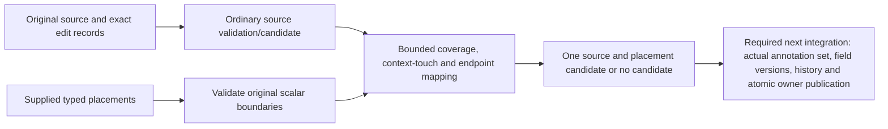

Position points collapse removed interior positions according to their explicit
before/after affinity; content points detach on strict interior context removal.
Replacement outer edges survive; insertion affinity does not override those edges.
Content ranges exclude pure insertion at their outer boundaries, include interior
insertion with affected evidence, and detach if the union of original replacement
intervals removes all original target bytes—including adjacent replacements with
equal inserted bytes. Collapsed ranges refuse: callers must supply one typed point,
not independently mapped endpoints or an implicit conversion. Document targets
stay document-wide rather than becoming whole-source byte ranges.

Mapping preserves previous affected evidence and never automatically turns
detached/unavailable evidence into a located target, including when source bytes
are restored. No quote matching, semantic applicability, proposal refresh, body
authoring, reattachment authority or persistence success is implied. Input source,
edits and placements remain unchanged. The candidate reports source and placement
changes separately, so later owner integration cannot use text equality alone as
the whole-operation no-op predicate.

Fanout and one shared edit-inspection budget cover the complete candidate, with
explicit refusal rather than a partial mapped prefix. Source preparation keeps
its independent byte/edit/payload limits. Mapping cost/evidence-kind counts are
explicit trusted-holder summary facts, not default telemetry labels or recipient
disclosure grants. The optional capture seam records source preparation and mapping
completion/refusal without coordinates, bodies, quotes or IDs; engine service time
is explicitly unmeasured. Capture off/on/full produces identical tested candidates.

Fourteen Rust scenarios cover these boundaries and a forward original-byte-origin
oracle over bounded Unicode sources with single/adjacent replacements. The oracle
does not reuse interval coverage or endpoint mapping to decide content survival.
This is finite implementation evidence, not a proof of all Unicode, physical
resource bounds, complete annotation history or independent assurance. The next
required slice remains authored records plus actual coordinator/history/lifecycle
companions; this prerequisite does not close that behavior family.
Attachment checkpoint: all 148 workspace tests pass in debug and release, and
`make check` passes formatting, strict Clippy and documentation tests offline.

## Authoritative annotations and mixed-history slice model

Requirements §§3.8/5.8; specification §§13.1–13.9/14.1–14.4. The existing owner now
holds opt-in bounded plain-text records. Create allocates a fresh opaque identity;
abandoned/failed preparations cannot recycle it. Body, authored target, derived
placement/source context and per-document set versions remain separate. Empty
text is content, not deletion. No rich-body execution, provenance grants or I/O.

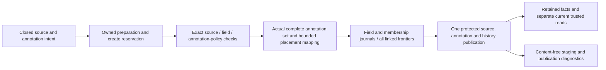

Source-read-only policy does not prohibit independently permitted comments.
Annotation policy has a separate checked generation; revoke/regrant invalidates
old preparation. Body-only plans depend on content version, not incidental source
or target freshness. Reattachment depends on target generation and exact source
context and preserves current body. One body and one target wish may compose for
a record; duplicate same-field or mixed membership/field wishes refuse. Target
bases explicitly select before-source coordinates or the actual source candidate
constructed in the same owned plan, not guessed future live revision numbers.

Every source candidate captures the private annotation-set generation. A later
new/private/changed record makes the old source plan stale rather than omitting
mapping. Final staging uses the actual current registry, not caller counts or
projections. Automatic mapping preserves bodies and explicit target generations;
placement/context changes advance the set version once in the root publication.
Equal source bytes with target-origin loss are a real mapping-only publication,
without a new source revision or fabricated authored/source history group.

Authored history is scoped to one annotation record across its body and explicit
target; automatic mapping is not an authored participant. Source-only undo maps
current records while preserving later bodies/target choices and detachment.
Compound groups link every actual source and authored scope: later work blocks
the entire reversal; new authored work after undo invalidates complete linked
redo continuations. Pins, closure retirement and lost frontiers cover both kinds.
Reversal uses field/membership journals, not whole old rows, policy/source snapshots
or replayed external effects. Membership restoration retains the logical identity
and assigns field versions above retained floors. Retained absence does not refund
record/body capacity; disposal refuses while records remain. Final retirement/
discard and annotation persistence remain required future lifecycle work.

Target restoration currently requires unchanged relevant source context, no live
coordinate for detached evidence, document-wide identity, or this group's validated
source journal. Missing general mapping proof refuses the entire group. Own-journal
restoration advances current placement context without relabeling historical
authored coordinates. General mapping across unrelated source history remains open.

Compound invocation admission retains complete normalized source intent and literal
annotation wishes. Matching retries never issue a second create identity or
reprepare current state. Source/annotation/history installation and terminal facts
use the same protected publication. Annotation-only/mapping-only changes emit real
publication diagnostics even with no source changes. Separate query, preparation,
final staging, publication and policy-control boundaries use closed content-free
records. Trusted gauges distinguish spent identities, retained/present records and
body bytes; they are not default labels or release grants. Off/on/full capture
equivalence covers source undo after later authored work.

Twenty external scenarios and three internal counter/integrity/interruption tests
cover this slice. Interrupted mixed publication leaves the owner fenced and its
invocation Unknown, not a retained known rejection; invalid private placements
also fault the owner. These tests do not establish complete recipient authorization,
coherent paginated/saved annotation snapshots, wire discovery, final retirement,
view companions, general mapping restoration, physical allocator/crash/concurrent
refinement or independent Cleanroom assurance.

Authored-annotation checkpoint: all 171 workspace tests pass in debug and release;
`make check` passes formatting, strict Clippy and documentation tests offline.

## Coherent annotation capture and reference-JSON slice model

Specification §§16.2.1/29.4–29.4.1. The owner captures exact document/source and
annotation-set versions plus its publication frame, complete live rows and actual
canonical source text under one exclusive read. It changes no authored generation,
history or saved baseline. Bodies/targets/placement are owned immutable data after
capture; later edits do not rewrite the snapshot. Retained absence is excluded,
not mistaken for a live storage row; detached bodies/authored context are preserved.
The profile separately bounds live snapshots and logical per-snapshot source,
record/header/body bytes. Weak slots recycle only after all actual strong holders
drain, including codec artifacts. This is a trusted-holder API, not the future
recipient/export-ceiling mechanism or a claim of physical memory bounds.

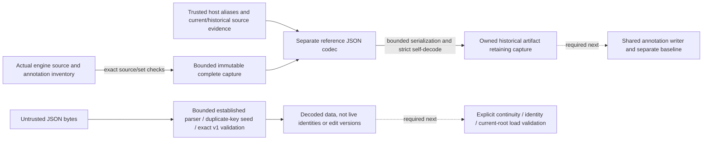

The new `vellum-annotation-json` crate implements the exact required fields of
`formal/annotation-snapshot.schema.json` under RFC 8259, keeping format/library
dependencies out of the engine. Host aliases must be complete and injective;
current text must equal the actual capture. Historical authored source requires
its own alias/text supplier; it cannot be inferred from current placement. Alias
tables are bounded inputs, not path-derived IDs, capabilities, cryptographic truth
or ordered external validators. No source body is emitted by the annotation file.

Both named point profiles and affinities survive in authored and located targets.
Document/range/point and attached/affected/detached forms remain closed sums;
unavailable placement refuses rather than becoming detached or silently dropping
a body. Exact ASCII decimal strings use the explicit Rust codec's u64 domain
and configured 1..20-digit bound, not a universal core integer representation.
Authored historical source syntax/bounds are distinct from current scalar checks;
decode reports remaining historical-evidence needs and never activates live IDs,
casts file counters into current preconditions, merges or deletes live rows.

Serde/serde_json supply lexical/Unicode parsing and serialization. A bounded seed
counts values, nesting and decoded string bytes including keys, rejecting duplicate
member names after escape decoding at every depth. Strict product validation then
rejects unknown/missing fields, unsupported versions, wrong types, ambiguous live
identities, noncanonical decimals, invalid geometry and current-source aliases that
try to hide changed lengths or invalid scalar boundaries. JSON BOM, invalid UTF-8,
unpaired surrogates, trailing data and partial-prefix acceptance refuse. The parser's
own recursion guard stays enabled; this profile accepts configured depth 1..64.

Serialization has an independent bounded writer and exact per-value accounting
before retaining each produced row. Repeated source aliases count at every wire
occurrence, avoiding intermediate alias amplification. An independent JSON-tree
counter checks exact node/string acceptance boundaries. The exact output passes
the same strict decoder before artifact delivery. This is encoding conformance,
not canonical-JSON signatures, actual provider application or persistence evidence.
Third-party parsing/allocations still require physical performance/overhead evidence;
per-call artifact limits do not enforce aggregate host artifact retention.

This slice also exposed and fixed the adopted §28.21 source-file output gap:
absent BOM metadata plus literal leading U+FEFF now refuses encoding/save issuance
without changing source or implicitly changing metadata. A following literal U+FEFF
under an actual consumed BOM round-trips. Host source aliases for annotation capture
carry canonical scalar text directly, never re-enter the file decoder and strip
its literal leading character. JSON itself still rejects a leading signature.

Capture/encoding/decoding have separate closed content-free diagnostics and no
record-time clock/export callbacks. Off/on/full capture produces identical tested
snapshots/artifacts; host-measured duration remains optional/unmeasured. Identity,
tokens, bodies, source text and coordinates do not enter observations or Debug.
Five native-capture scenarios, fourteen codec scenarios and two source/BOM save
regressions cover the slice. Actual annotation writer routing, distinct ordinary
destinations, independent saved baseline/comparison, initial native restoration,
retirement and recipient release remain required open deliverables.
Capture/codec checkpoint: all 192 workspace tests pass in debug and release;
`make check` passes formatting, strict Clippy and documentation tests offline.

## Shared artifacts and explicit annotation export

The next executable route is snapshot → strict external codec → privileged encoder
port → retained engine artifact → shared destination FIFO → provider dispatch →
separate application/synchronization/no-future/quiescence evidence. A macOS real-file
scenario runs that complete path with diagnostics disabled, available and saturated;
the destination decodes as the original JSON, source bytes remain unchanged, and
ordinary saved state is not advanced. This is explicit export, not ordinary save.

Source and annotation artifacts share bounded live/lifetime slots and retained-byte
charges. Chunks address raw bytes, not source coordinates. Stopping future delivery
does not recall owned copies, cancel admitted tasks or refund held bytes. Actual
task references and outstanding private dispatch/evidence leases must drain before
retirement; ordinary source artifacts are reclaimed with their retired task.
Artifact lifetime identities are never reused. Transient codec candidates and
caller-owned copies remain host obligations; this is not prepaid before-codec or
complete physical/global memory accounting.

Eight external engine scenarios cover original captures after later edits, shared
destination uncertainty barriers, protected stop/retention, actual task/nonce
holds, foreign identities, exact byte ranges, shared capacity and source-producer
election. Export outcomes carry their actual kind/purpose/set/encoder context, with
no fabricated ordinary binding or source-serialization generation. Export receipts
cannot publish a source baseline or supersede its eligible producer. The encoder
port is a trusted producer-validation seam; no JSON dependency enters the engine.

Ordinary source/annotation pairing still requires known distinct resolved resources:
different paths, provider/domain strings or unequal bytes are not sufficient proof.
At this checkpoint that gate, annotation baselines/comparison, native restoration,
final record retirement, before-codec funded capture and scoped recipient release
remained open; the subsequent initial-pair slice below implements the first gate
for its declared provider profile.
Shared-artifact/export checkpoint: all 201 workspace tests pass in debug and
release; `make check` also passes formatting, strict Clippy and documentation
tests offline. These tests establish the exercised implementation behavior, not
independent certification, complete engine coverage or universal platform truth.

## Initial ordinary destination pairs

Initial ordinary-pair slice: a destination read may prepare an opaque binding
plan, but only final serialized activation publishes a typed annotation owner and
metadata generation. The complete engine-owned inventory distinguishes actual
absence from omitted external metadata. A present source binding requires an
explicit provider-attested known-distinct relation for the exact plan; equal
resolved identities, unknown comparison, foreign evidence and stale old-empty
plans refuse. Different keys/domain strings/JSON bytes never establish distinction.
Unrelated source changes survive publication, and an identical binding is unchanged
even without an unused generation. No destination JSON is loaded or baseline set.

Source saves now require separate current exact-pair checks at admission, dispatch
and historical baseline publication. Existing source-only calls refuse missing
pair evidence once an annotation binding exists; explicit exports remain separately
authorized and do not acquire ordinary rights. Annotation-owned resources cannot
be loaded as source or stolen by another document. Disposal refuses a remaining
annotation binding until the future release contract discharges it. Pending effects,
no-future/quiescence and actual delivery-lease drain are separate activation gates;
safely settled retained export history is not itself a pending effect.

The first host-comparison profile supports one exact provider registration.
Cross-provider comparison, including two registrations in one identity domain,
refuses explicitly; generalized comparison remains open. Freshness/alias truth is
a host premise, as for provider reads, not established by a typed attestation.
The macOS adapter reopens both anchored entries, retains descriptors while comparing
device/inode identities and instruments the native boundary with host-measured
service time. External namespace changes can race this best-effort observation.
Neither native distinction nor later restored distinction refreshes the original
save precondition. No universal alias, atomic check/write or lasting guarantee is
claimed. Engine checks do no filesystem I/O.

Nine external BDD scenarios, one internal counter-exhaustion regression and two
native filesystem scenarios cover the initial pair path, including diagnostic
off/on/full equivalence and redacted Debug. At this checkpoint annotation
ordinary-save admission, baselines/comparison, rebind/unbind, load/restoration,
before-codec capture funding and scoped recipient contracts remained open.
Initial-pair checkpoint: all 213 workspace tests pass in debug and release;
formatting, strict Clippy and documentation tests pass with `make check` offline.

## Historical annotation baselines and exact comparison

An explicit export can now capture its exact ordinary annotation association at
admission, under current complete pair evidence and typed ownership. This remains
an export, not an ordinary save promising later baseline installation. Unassociated
exports never acquire baseline eligibility from a later binding; their provider
receipt metadata stays separate from the ordinary association. Actual dispatch
assigns a fresh private serial only after launch guards pass. Refusal/exhaustion
leaves the queued capture and serial budget unchanged. Source baseline election
uses this launch serial too, not receipt arrival or admission order by assumption.

Explicit baseline publication separately validates the current exact pair, captured
association/context, actual producer/artifact and acknowledgment strength. Select
the newest eligible associated launch before considering its encoder context;
there is no older-context fallback. Newer unqualified or unassociated exports do
not erase older historical evidence. Token enrichment requires another publication.
Only the annotation baseline and one publication generation change; identical
metadata requires no unused generation. Corrupted stored metadata refuses and
fences the owner, not silently repaired. Protected effect intake remains available.

The initial binding reserves an inline native baseline slot. Adoption bounds the
fixed native descriptor plus referenced artifact/key/token bytes under an explicit
caller budget; bytes remain shared with their actual retained artifact. This is
not the compact-JSON reference root-envelope formula, prepaid before-codec capture,
promised ordinary-save capacity, or physical/global allocator accounting. Those
ordinary-save obligations remained open at this checkpoint. Logical baseline occupancy gauges overlap
artifact gauges and must not be summed as independent allocated memory.

Current-output comparison validates a real transient producer candidate against
the current source revision/annotation set and original encoder context. It compares
exact bytes under a combined operand-work bound, not JSON equivalence, equal lengths
or version equality. A new set version can again produce identical empty output;
an old candidate does not thereby become current. Comparison and historical metadata
queries do not issue persistent artifacts or mutate authored state. Integrity faults
may fence health; contradictory receipts block comparison/adoption without undoing
authorship or rewriting the existing historical baseline. No external freshness is
established. Recipient-specific disclosure/revocation remains outside this trusted
owner API, as do native load/restoration and binding-history release.

The producing baseline and newest eligible unadopted producer pin actual tasks and
artifacts in addition to effect/quiescence/delivery holds. Only a newer eligible
associated producer can supersede eligibility, and a newer adopted baseline must
release the old baseline pin before retirement. Unassociated writes cannot release
those holds. No future rebind/unbind/history route is qualified by this initial
binding profile.

Nine external BDD scenarios cover original association, publication separation,
exact/current/context-bound equality, dispatch-vs-arrival order, token enrichment,
contradiction, retention, current pair checks and ordinary acknowledgment strength.
Three internal regressions cover exact native descriptor bounds, counter/serial
exhaustion and integrity fencing. A source-save regression also checks that an
ordinary request does not silently become synchronized merely because the provider
supports synchronization; the synchronized-request failure case remains explicit.
The real codec/filesystem scenario now additionally exercises explicit baseline
adoption/comparison off/on/full. New content-free boundaries distinguish baseline
publication/query/comparison; clocks and exporters remain outside engine execution.
Historical-baseline checkpoint: all 227 workspace tests pass in debug and release;
`make check` passes formatting, strict Clippy and documentation tests offline.
No independent certification, complete engine coverage or actual host-truth proof
is claimed by this checkpoint.

## Native ordinary annotation save and capacity obligations

Admission now consumes an issuer-validated current transient candidate, not an
already-issued engine artifact. It requires the exact current source/set/publication
frame, actual ordinary annotation binding and whole provider, known-distinct pair,
annotation write policy, present pinned destination, supported acknowledgment and
shared task/artifact limits. It stages all fallible reservations before installing
the artifact, task and private capacity claim under exclusive owner access. Success
issues both persistent identities together without publishing authored state;
expected refusal spends neither. Later dispatch checks current policy/pair and
original source binding but keeps the admitted bytes and destination condition.

Each pending claim charges its private bookkeeping plus the complete native
baseline descriptor, exact artifact/key bytes and maximum captured provider-version
width against `max_future_baseline_bytes`. Every claim reserves one publication
unit, including multiple saves of one document. The fixed native baseline slot was
already allocated at binding activation. Although baseline bytes can share the
retained artifact allocation, the native semantic-root profile independently
charges their adopted logical payload and now preserves pending root-slot demand
as described in the later persistence-capacity slice. The common generation guard
now protects every current Rust root-publication route, not unimplemented model
families. Ordinary baseline installation uses its admitted budget and consumes its
own credit; other publications must leave all pending credits intact. No-op
publication remains possible without an unused unit. New source/history/binding or
baseline mutation paths must use this guard too.

Admission stop leaves pending holds and floors active. Queued cancellation releases
only the capacity promise, not issued identities/artifacts. Dispatched cleanup
requires safe disposition and quiescence: unknown application cannot release a
promise; known nonapplication can. Written synchronized attempts with accepted
failed/not-requested synchronization can release an impossible future-baseline
claim. Qualified older claims need an actual validated newer adopted baseline,
not merely a newer ticket or caller label. Private inline claims export no hold
leases; writer receipt/dispatch leases are separate and still block task retirement.
Later contradictory receipts quarantine their retained destination without
resurrecting a released claim or reverting authorship. Protected cleanup works after
native fault, without content reads, provider contact or a root publication.

Seven new BDD scenarios cover atomic issuance/refusal, stale candidates, queued and
dispatched cleanup, admission stop, late contradiction, actual supersession and
frozen bytes under later authorship/policy changes. Four internal regressions check
cross-route publication-floor interference, two credits for two same-document holds,
fault-safe cleanup and forged supersession evidence. Real codec/filesystem ordinary
save now runs off/on/full through prepaid baseline installation and exact comparison.
Content-free admission/capacity-control observations and pending bytes/unit gauges
are distinct from outcome/effect/baseline evidence.

Limits: transient capture/encoding is still host-funded before this atomic owner
call. This is not the reference compact-JSON envelope/root-size law, a prepaid
before-codec preparation ledger, complete allocator/global accounting, scoped
recipient/invocation facade or native load/identity restoration. Generalized binding
history, rebind/unbind and recovery/release still need implementation. These remain
open deliverables, not implied by native ordinary admission.
Native ordinary-save checkpoint: all 239 workspace tests pass in debug and release;
formatting, strict Clippy and documentation tests pass with `make check` offline.

## Owned annotation reads and sealed decoding

The next load prerequisite is an actual engine-owned read task, not caller-supplied
replacement bytes. Admission captures original source/set, the complete ordinary
association and independent read registration, with current known-distinct pairing
and explicit read target. Read/write registrations may differ within their declared
identity domain; full original issuer identity is checked on submission and every
receipt. Unrelated peer publications do not stale the addressed source/set/binding.
Only captured-read is supported; atomic-resource-snapshot requests refuse before
issuance. No stronger consistency is inferred from equal version tokens.

Admission preallocates bounded candidate/chunk bookkeeping and charges a native
logical capture/two-witness envelope under explicit read limits. It issues one
non-reused origin only after all expected refusal checks. Root read/write launches
share execution headroom. Quiescence frees execution capacity, not unknown write
effects or destination barriers. Ordered start/chunk/end receipts supply exact
version, sequence, offsets and counts. Short or empty chunks do not imply EOF;
gaps/mismatched ends refuse without guessing missing content. Overflow disables
capture without publishing a valid prefix. Exact repeated receipts are idempotent;
contradictions retain the original and offending witness, disable new release and
refuse unbounded competing evidence. Failure cannot become successful EOF.

Quiescence is an independently attributed fact and may arrive before buffered
receipts. Stop disables future use and discards new content, not original evidence
or actual submitted work. Ready stopped tasks need no fabricated quiescence.
Submitted task retirement requires quiescence and actual dispatch/evidence drain;
capture/decoded copies independently pin the retained input. Copies already
disclosed cannot be recalled. Protected intake/control work after native fault;
charged retirement underflow fences without dropping evidence. Native consumers
and their eventual provenance pins are not implemented by this unconsumed-read path.

The macOS adapter performs an anchored captured read and emits separate data/failure
and quiescence receipts. It does not claim atomic resource revisions. Its ordinary
failure path emits no truncated successful EOF; no-data allocation failure still
returns quiescence and cannot create a complete capture. `decode_read` retains the
original immutable capture with a private, read-only strict decoded snapshot.
Syntax/host decode context are not native identity, historical association or
restoration grants. Parsing does no provider access and executes no document code.

Nine BDD scenarios cover ordering, empty/short chunks, duplicates/conflict bounds,
foreign issuers, independent reader registration, stale target vs unrelated peers,
atomic refusal, quota/lifetime bounds, stop, quiescence/drain and shared execution
headroom. Two internal regressions cover fault-safe control and accounting drift.
Existing native export/save scenarios now continue through actual read → attributed
capture → strict decoded input off/on/full, and reject invalid UTF-8 intact without
changing source, annotations or baselines. New content-free boundaries distinguish
read admission/submission/evidence/capture/control and native service timing;
occupancy gauges distinguish retained reads, shared active work and held charges.

At this checkpoint the raw-read/decoding prerequisite did not close initial
restoration or a loaded baseline. The native consumer still needed known-empty inventory,
including issued/retained-absent/retired ownership, original read provenance and
explicit identity/current/historical source association. Missing source witnesses
cannot be replaced by casting serialized counters into native edit versions.
Native restore/load-baseline adoption and pin transfer, public invocation/recipient
release, atomic read profiles and complete transient/global accounting remained open.
Read checkpoint: all 250 workspace tests pass in debug and release; formatting,
strict Clippy and documentation tests pass with `make check` offline.

## Initial annotation hydration and consumed-read provenance

The engine now consumes a separately provisioned restorer's immutable typed package
from an actual owned complete read. An encoder does not acquire restoration powers.
The reference boundary checks explicit document/record/source approvals, injective
aliases and exact incarnation, then re-decodes the original captured bytes under
this request's finite profile and actual current managed witness. Native authored
source references come from managed snapshots, never casts of file counters into
edit versions. The trusted host still attests persistent identity continuity and
selector applicability; matching names/lengths are not an external-history oracle.

Final native consumption rechecks the real read/issuer/context, complete original
binding/source/set, current known-distinct pair, annotation policy, healthy domain,
inactive destination writer and actual managed source witnesses. Unknown historical
source context refuses intact; a general cold-start historical-source import
protocol is not implemented. The current profile requires evidence-complete
historical selectors, even when placement is detached. No quote repair, clamping,
invented neighboring attachment or deletion of an unavailable body is performed.

Known-empty now includes lifetime ownership, not only visible rows: issued unused
and retained-absent slots retain their document association. Native consumers
refuse a target with any prior annotation slot or retained annotation history.
Source-only history is allowed. Damaged ownership bookkeeping fences the domain,
not repaired into apparent emptiness. Other objects and their latest state remain
framed unchanged. The full incoming set stages before native identity issuance;
bad last members, source mismatch, policy/capacity/counter refusal publish no prefix.

Nonempty hydration installs complete records/order, body/target floors, opaque
approved persistent key/incarnation and located/affected/detached evidence, advancing
the annotation set and publication once. It edits no source, activates no binding,
imports no permission and creates no authored undo group. Subsequent editing and
source undo preserve imported identity/authorship. Exhausted u64 floors refuse
increment without wrapping or storage-string rounding. Empty hydration is validated
unchanged without unused counters, but consumes the read once and retains provenance.

Read admission now pre-reserves a bounded native restoration companion; preparation
and retained result/provenance must fit it and the coordinator stage bound. Final
installation has no callback, await or expected fallible step between fresh native
issuance, complete publication and actual read consumption. This is a serialized
Rust/native guarantee, not crash atomicity or complete physical/global accounting.
Snapshots charge imported key metadata as well as body bytes. Metrics expose
restorer registrations and consumed reads without labels carrying their identities.

Consumed provenance pins the actual original input, source witnesses and result
across stop, quiescence, delivery drain and late contradiction. The historical
outcome reports original record floors plus current evidence contestation; it does
not relabel later authored edits as loaded. Contradiction neither undoes annotations
nor invalidates a later independent write baseline. Loaded-baseline adoption is
implemented in the following slice. Checkpointed discharge is described below;
pressure otherwise refuses rather than evicting required evidence. This is not a final
indefinite-retention policy or complete load/reload/merge lifecycle.

Nine BDD scenarios and two additional internal regressions cover hydration,
pending/retained-slot refusal, historical witness requirements/source undo, bad-set
atomicity, policy/pair/foreign/stopped guards, peer preservation, no-op/consumption,
late evidence, maximum floors and counter/integrity refusal. Real filesystem
scenarios now load into a fresh owner, restore document/range/both point profiles,
re-export accepted content and run ordinary save off/on/full. Imported incarnation
changes, unapproved identities and a changed restrictive decode profile refuse.
Native restoration preparation/publication/query have closed content-free capture.
Hydration checkpoint: all 261 workspace tests pass in debug and release; formatting,
strict Clippy and documentation tests pass with `make check` offline.

## Loaded annotation baseline slice

Specification §16.5.14. An explicit singleton attachment binds this owner's actual
read registry to its shared writer; it accepts no foreign read manager and charges
the retained relation. A separately provisioned restorer can bind an existing
encoding context before hydration. Unlinked hydration cannot retrofit that context
by comparing bytes later. Adoption names the actual consumed read, original raw
bytes/version/coherence, restoration context and restored source/set, reader and
full ordinary binding. It allows later authored changes and stopped delivery while
remaining a historical fact, not current external freshness or a write receipt.

The baseline slot is a closed Loaded/Written enum. The typed evidence query serves
both; the existing written-only query refuses Loaded rather than returning a false
absence. Initial adoption refuses competing destination writes, nonempty different
baselines, contestation and exhausted descriptor/counter budgets without partial
publication. Identical adoption is unchanged. Attachment and adoption have separate
content-free diagnostic boundaries; authoritative results never depend on recording.

Ordinary admission from Loaded requires the original encoding context, raw input
and token. Its artifact retains and charges the original loaded descriptor as an
independent condition, not a replaceable reference to the current baseline slot.
Dispatch revalidates that actual producer after later baseline replacement, even
when tokens and bytes are reused. A late read contradiction fences dependent queued
saves, but does not invalidate an independently completed written baseline or undo
authored records. Baseline replacement does not discharge consumed provenance.

Seven BDD tests and two internal capacity/counter regressions cover explicit and
delayed adoption, unchanged repetition, missing linkage, stale input/context,
competing work, late contradiction and retained original queued conditions.
Real filesystem/strict-codec scenarios exercise canonical and whitespace-prefixed
JSON through hydration, Loaded comparison, ordinary save and Written adoption with
diagnostics disabled, available and saturated. Exact output may be Modified after
semantic hydration; input is never silently normalized into a saved baseline.

Loaded-baseline checkpoint: 270 workspace tests pass in debug and release;
`make check` passes formatting, strict Clippy and documentation tests offline.
These are implementation regressions, not independent certification or complete
command-facade coverage.

## Superseded read discharge and attachment detach

Specification §16.5.15, trusted-owner implementation projection. Protected
`retire_superseded_annotation_read` derives its checkpoint from the actual native
Written baseline, not a supplied success label. It validates original full binding,
actual producer/artifact/acknowledgment, current source revision and annotation set,
destination contestation and disposition/quiescence. A dirty current set needs a
fresh checkpoint. Actual Loaded slots and live queued/unknown original capture
dependencies block retirement even after the root baseline has changed.

The original read must be quiescent, with its nonce held only by the ledger and
its capture held only by the task and consumed restoration package. Outside
copies and prepared packages therefore block release. No caller Boolean can
override those owned dependencies. Current history, snapshot and invocation
types retain authored values/source witnesses but no read-origin references;
they survive retirement unchanged. Future origin-bearing consumers must join this
closed native inventory before being supported. This is not general outside-host
retention authorization: possession of the privileged owner authorizes explicit
historical-result loss, not a new recipient command or grant.

Retirement removes the task and consumed restoration/adoption record together,
debits its retained charge once and preserves spent lifetime slots. Old handles
become unavailable and cannot hydrate or adopt again. Writer tasks, artifacts,
receipts, baseline claims, baselines, source/annotations/history and publication
counters are unchanged. Original read contradiction does not defeat an independent
valid checkpoint; current checkpoint contradiction refuses. Safe control remains
available after native fault and at exhausted publication counters.

The reader/writer attachment now owns both fixed native endpoints in one atomic
root relation. Each side is independently charged against its existing held-byte
limit before assignment; shared incarnation identity checks refuse half-links.
Detach requires no producing read or Loaded baseline and no live captured-read
launch dependency/quarantine. Both charges are removed together, preserving
unconsumed reads, writer evidence and lifetime IDs. Reattachment issues a fresh
private incarnation. These native fixed-descriptor bounds are not the reference
wire-envelope reservation or complete global/physical allocator accounting.

Six additional BDD scenarios cover current checkpoint discharge, original queued
dependencies, dirty-state renewal, independent old-read contradiction and contested
checkpoint refusal, and acknowledgment versus disposition/quiescence. Four internal regressions cover external capture pins,
fault/counter-safe cleanup, two-sided capacity/continuity, charge underflow and
half-link corruption. The real codec/macOS scenarios now retire and detach after
canonical/noncanonical input and late evidence, with diagnostics off/on/full.
Closed content-free discharge/detach boundaries and an attachment occupancy gauge
observe these transitions without identifying documents, readers or resources.
Uncheckpointed disposed-producer release is described below. Full lifecycle
companions/rebind, public recipient control and reference envelope/host truth
remain open deliverables.

Discharge checkpoint: 280 workspace tests pass in debug and release; `make check`
passes formatting, strict Clippy and documentation tests offline. This closes the
trusted-owner checkpointed-read path, not full lifecycle or recipient coverage.

## Retained disposal and initial binding release

Specification §§11.2.2, 11.2.5–11.2.6, trusted-owner native projection. An opaque
noncloneable disposal preparation captures the actual owner, source/set/lifecycle
and publication root. Final consumption rejects foreign/stale preparations, checks
actual current baseline obligations again and installs only retained-disposed
lifecycle plus one publication. Admission of a pending ordinary annotation promise
after preparation blocks consumption even without intervening root publication.
No promise transfer, cancellation or capacity release is invented by disposal.

Live validation is separate from retained inventory access. Current source,
annotation, search/history mutation, capture/serialization and save-launch paths
cannot treat retained payload as a live document. A prepared cross-object edit
with a disposed dependency refuses without publishing to its live peer. Existing
immutable disclosures, historical outcome queries, valid late provider receipts
and complete-group history retirement remain independently available. Records,
floors, source/settings/history, active binding reservations and peer work survive.
The original scratch-only `dispose` helper remains a restricted eager discard;
it is not silently expanded into retained effect ownership or the future public
command. These are trusted embedding primitives, not two UI editing modes.

Source and annotation key release require the exact retained lifecycle stamp,
known disposed state, exact unique active owner and actual destination-wide writer
disposition. Active queues, unknown application or contradictory evidence refuse;
stop or worker quiescence alone cannot substitute. A known noncontested application
with no-future-effects may release a key before worker quiescence. Move the whole
original binding/baseline into its fixed private archive, remove only its active
reservation, and advance lifecycle/pair/publication once. Either release order is
supported; exact current absent repetition is unchanged without counter capacity.
No file I/O, rename, deletion, identity reuse or producer discharge occurs.

Archive slots are preallocated in each lifetime-bounded native document. This
initial-only profile cannot append arbitrary rebind history. Source and annotation
archived baselines continue to pin actual save producers; archived Loaded slots
continue to retain read origins and prevent attachment detach. Reopening a released
key creates a new opaque incarnation, not resurrection. Occupancy gauges distinguish
live/retained lifecycle and active/archived bindings. All original byte charges and
writer/artifact/receipt ownership remain held; this is not global allocator proof.

Nine BDD scenarios cover content and compound/history preservation, current-path
fences, peer atomicity, both release orders, key reuse, active/unknown effects,
quiescence versus disposition, pending promise rechecks, producer pin retention,
late read receipts, exact-root staleness and telemetry disabled/available/full.
Four internal regressions cover lifecycle/pair/publication exhaustion, faulted
preparations and duplicate ownership integrity. Closed preparation/publication/
release/query boundaries capture no private labels or invented service time.
Explicit provenance release and uncheckpointed disposed-producer retirement are
implemented in the next slice. View/workspace companions, live rebind and recipient
invocation/event contracts remain open. The caller cannot install lifecycle state
by supplying a phase label.

Retained-disposal checkpoint: 293 workspace tests pass in debug and release;
formatting, strict Clippy and documentation tests pass with `make check` offline.

## Disposed provenance release and producer retirement

Specification §§11.2.2/11.2.6 and 16.5.16, trusted-owner native projection.
`release_disposed_provenance` requires the exact current lifecycle, known disposed
state, both active bindings absent, no retained source/annotation history, no
pending baseline obligation, safe original writer disposition and no destination
quarantine. It changes only phase/lifecycle/publication; current repetition is
unchanged without counter capacity. No save checkpoint, file write, payload purge,
automatic provider stop or worker quiescence is invented. New lifecycle publication
still requires a healthy owner and respects reserved publication floors.

The released root's archived baselines stop pinning its producers, while archive
bytes/attribution and authored records/floors remain bounded by their existing
owners. Current immutable snapshot/candidate/outcome types are self-contained
copies or have disposed mutation/use fences, not additional live-root leases.
Their retained costs/lifetimes do not disappear. Actual history groups are live
root consumers and must discharge. This trusted owner explicitly authorizes ending
that root's provenance dependency; no untrusted external-retention Boolean is
accepted. Future root-dependent consumer types must join this native inventory.
Outside-host retention/authority truth and recipient release are not proved here.

`retire_disposed_annotation_read` checks an actual provenance-released root,
original archived full binding, consumed restoration/capture identity, successful
read transcript and all current/retained peer baseline and live writer references.
Read quiescence, original nonce drain and capture-copy drain remain separate.
Its task/restoration/adoption record and read charge retire atomically, without
publication or changes to archives, authored state, writer evidence or spent IDs.
An unadopted restoration does not need a new writer attachment just to retire;
an adopted read missing its required relation is an integrity fault. Old read
contradiction does not undo authored state or prevent independent safe cleanup.

Ordinary claimed writer retirement checks actual artifact payload, source/set,
encoder context and native capture membership, destination quarantine, known
application/no-future disposition, worker quiescence, delivery drain and all actual
producer/shared-artifact references. After root provenance release it removes task,
claim and its serialized artifact in one callback-free native transition, debiting
the actual held charge once. Explicit unclaimed exports retain their separate
artifact lifecycle. Read-first/write-first order works; no cold handle, lifetime
origin or baseline receipt is recycled. Later native fault and exhausted publication
counters do not prevent already-authorized pure retirement/detach. Accounting or
owned-state drift fences the owner without partially removing retained evidence.

Nine new BDD scenarios cover no-checkpoint and unadopted cleanup, independent read/
write delivery holds, EOF versus quiescence, dirty retained history, late read/
writer contradiction, original peer/artifact dependencies, both retirement orders
and telemetry disabled/available/full. Four internal regressions cover release
counters/repetition, fault-safe control, external capture holds, retained peer
references with zero writer tasks, ledger/descriptor drift and atomic refusal.
The peer fixture deliberately injects a private known retained obligation; it is
not a public cross-document provenance-transfer feature. The real macOS/strict
codec path now covers noncanonical input → hydration → discard → key/provenance
release → read retirement/detach without changing source or annotation file bytes.
The acknowledged native-save path also exercises disposed writer-first cleanup,
including automatic claim/artifact retirement and retained cold archive framing.
Closed root-release/read-retirement/write-retirement observations have no private
labels or invented duration. Final record/source/archive reclamation, live rebind,
contested recovery, complete public invocation/events and global/physical/concurrent
assurance remain open—not inferred from these cleanup transitions.

Disposed-producer checkpoint: 306 workspace tests pass in debug and release;
`make check` passes formatting, strict Clippy and documentation tests offline.

## Canonical coordinates and bounded source queries

Specification §§4.1, 22.1.4, 26.1 and 29.2, trusted-owner native projection.
The pure `SourceCoordinates` value borrows already-disclosed immutable canonical
UTF-8. Explicit `BytePosition`, `ScalarIndex`, `Utf16Index` and `LinePosition`
types keep units distinct. Logical line/body byte indices start at zero. LF,
CRLF and lone CR delimit lines without rewriting content; other Unicode separators
remain body text. Empty text has a line, and every trailing delimiter introduces
a final empty line. Spans partition exact body/delimiter bytes in source order.

Conversions are partial, never rounding: scalar splits, surrogate interiors,
invalid line/body columns and unavailable CRLF-interior body projections refuse.
A CRLF-interior scalar boundary is still a valid canonical edit/range coordinate.
Native scalar/UTF-16 indexing counts CR and LF separately; it is not logical line,
grapheme, parser, file-BOM or display indexing. Imported one-BOM metadata stays
outside canonical offsets, while literal U+FEFF content remains ordinary text.

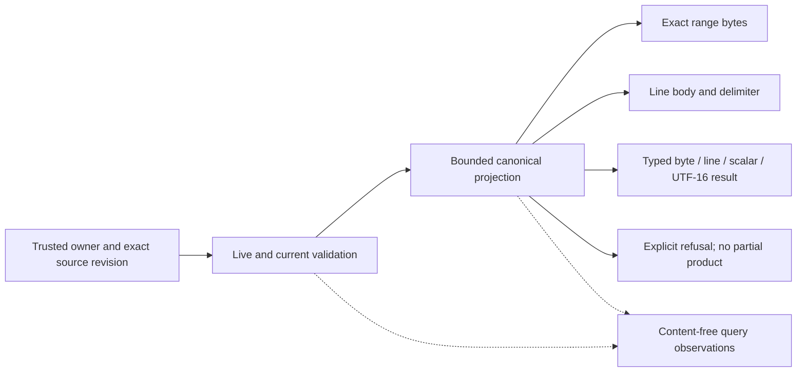

`CoordinateRequestV1` and `CoordinateResultV1` are exhaustive versioned executable
read vocabulary. Coordinator queries validate actual owner/incarnation, current
source revision, liveness and native fault before coordinate work, including empty
queries. Read-only source remains queryable. Results bind their actual requested
source version; later edits/disposal do not refresh that context or recall copies.
No source/annotation/history/publication transition or lifetime issuance occurs.
No total line count, document length or unrelated content is added incidentally.

Every linear conversion/line scan takes an explicit maximum inspected canonical
prefix extent in UTF-8 bytes, including CR lookahead. Prefix queries need not scan
the suffix. Range reads validate constant-time endpoints then copy only the requested
content. Complete line body plus delimiter must fit the result budget before any
reply is returned; allocation is fallible. These are logical scan/content bounds,
not exact instruction/service-time, full wire-envelope or global physical-memory
proofs. Returned/caller-cloned values are independent host-owned disclosures.
The current flat immutable source is scanned directly; no full-source materialized
copy, persistent index, rope choice or incremental performance claim is introduced.

Six pure BDD scenarios cover mixed/empty/trailing lines, native inverse laws,
surrogate/scalar refusal, CRLF interiors, literal/BOM distinction and exact scan
limits. An independent scalar-iterator oracle checks all 216 three-part sources
from a six-symbol Unicode/delimiter alphabet against the production byte scanner;
native indices are also checked against Rust's independent scalar/UTF-16 iterators.
Six owner BDD scenarios cover exact bounded products, complete versus refused
output, namespace/revision/disposal fencing, all six typed conversions, read-only
querying and diagnostics disabled/available/full with payload-redacted Debug.
Two internal regressions cover exhausted publication/lifetime budgets and native
fault without recalling previous disclosures. Range, line and conversion each have
a separate content-free observation boundary; no clock measurement is invented.

This is not the full authorized snapshot/version-set source-query facade: held
parents, current recipient release, complete whole-envelope acquisition and dynamic
discovery remain open. Logical view/selection and literal edit primitives are described below;
remaining ordinary-edit assembly, scope-aware editing and Unicode 18 grapheme/word conformance remain subsequent
deliverables. No scalar segmentation is relabeled as grapheme navigation, and no
available dependency may silently downgrade the adopted Unicode profile. Keymaps,
screen geometry, OS input and rendering remain above this engine projection.

Coordinate/query checkpoint: 320 workspace tests pass in debug and release;
`make check` passes formatting, strict Clippy and documentation tests offline.

## Headless logical views and current selection companions

Specification §§11.2.7/11.2.11, 26.1.1 and 28.45. The optional native registry is
explicitly configured once with live/lifetime view, total-selection, normalization
and mapping limits; omission means unsupported known-empty registry, not a hidden
UI mode. Repeated identical configuration is current; changing an active profile
refuses. Fresh typed process-local view IDs never reuse slots. Birth is detached,
with known-empty selections/primary zero and attachment/selection/viewport fences
one. The viewport fence here is an association ABA counter, not viewport geometry,
scrolling, layout or presentation implementation.

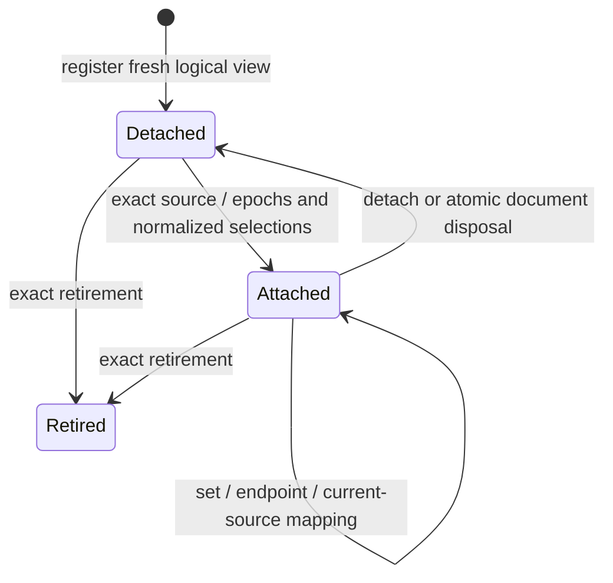

The explicit-positional-selection/1 normalizer validates canonical scalar byte
boundaries, preserves explicit primary/direction and merges overlapping nonempty
ranges transitively. Adjacent ranges remain separate. Same-position same-affinity
carets deduplicate; opposing-affinity and interior/boundary carets remain explicit.
A merged primary uses that input's direction/affinity, while another merged range
uses its earliest explicitly listed contributor. Work-bounded insertion sorting,
cluster merging and emission refuse before returning a partial set. These rules
never normalize an agent's explicit source batch or resolve insertion conflicts by
display order; coincident source insertions still fail the ordinary batch rules.

Attach requires an existing detached view, exact epochs and actual current source.
Detach and retirement neither dispose source nor stop effects. Attach/detach advance
all three association fences, so same-view/same-source ABA does not revive old
contexts. Set-selection and line/document endpoint movement check the exact view/
source/stamps and preserve affinity/extension intent. Readable read-only source can
support pure selection changes; they create no source revision or source history.
Invalid CRLF line projection and exhausted scan/selection budgets refuse wholly.
Identity validates but needs no unused publication/selection counter.

Every prepared source transaction captures complete affected view signatures,
including source revision, epochs, positions and primary. New, removed or changed
affected views refuse final consumption; unrelated view changes do not. Staging
uses the existing positional point mapper with explicit caret affinity and outward
nonempty boundaries, then normalizes under the actual candidate source. All view
maps and counters finish before source/annotation/history installation. One source
publication advances affected view source contexts even when positions stay equal;
selection generations advance only when selection values change. Equal-byte edits
can publish a view effect without source revision or source undo group.

Ordinary source edits, search replacement, invocations and undo/redo use this shared
path. Reversal maps actual current selections instead of reinstalling old cursor
snapshots. Native disposal stages exact affected view detachment before changing
document liveness; a last counter refusal leaves all participants live/unchanged.
Stored invalid selections or unchanged-epoch value drift are integrity faults, not
caller-stale rejection or implicit repair. Interrupted native publication keeps the
owner faulted and new queries unavailable, without inventing a known rejection.

Five pure scenarios include 375 generated input/primary combinations for normalized
idempotence and primary survival. Eight owner BDD scenarios cover registry/aggregate
capacity, non-reused identities, direction/affinity, endpoints, read-only changes,
affected-peer completeness, unrelated framing, current undo mapping, equal-byte
classification, association ABA, disposal and diagnostics disabled/available/full.
Five internal regressions cover unused/max counters, a last participant's overflow,
mapping budget refusal, owned drift, interrupted publication and actual source +
annotation + selection + history atomicity. Lifecycle/query/preparation/mapping/
publication boundaries and occupancy gauges contain no text or coordinate labels;
preparation is observed before publication and timing remains unmeasured.

These are trusted-owner native primitives, not complete F11/F12 command products.
Full retained operation facets, remaining ordinary-edit forms, occurrence
selection, Unicode 18 grapheme/word commands,
protected footprints, workspaces, recipient release and full discovery remain open.
Logical-view preparations/copies have finite family bounds; complete cross-family
wire-envelope, allocator, async/provider and independent assurance are not claimed.
UI keymaps, active focus, input routing, rendering and geometry stay above the engine.

Logical-view checkpoint: 338 workspace tests pass in debug and release;
`make check` passes formatting, strict Clippy and documentation tests offline.

## Literal selection editing

`prepare_literal_edit` derives exact original-snapshot replacements from the
initiating view's current normalized selections. Expected and inserted bytes share
the ordinary aggregate edit-payload bound, checked before copying. Literal U+FEFF,
newlines and other accepted scalar text are not file-decoded or normalized. The
ordinary source batch rejects ambiguous caret/range combinations rather than
silently choosing an order.

The exhaustive `SelectionAfterV1` policy either maps original endpoints or
collapses each selection to its inserted literal's end, preserving affinity and
primary through normalization. A private fallibly allocated singleton capture
freezes original view/source epochs, policy and text. Final staging verifies the
actual original selection-derived batch and complete affected view inventory.
Source, annotations, every affected view and history publish together, not as an
edit followed by a separately fallible caret command. Other views always use
ordinary mapping. Equal-byte caret changes can publish a view-only effect without
a source revision or undo group; a complete identity spends neither counter.

Six BDD scenarios cover multi-selection/peer mapping and undo, mapped versus
carets-after identity, stale selections/new peers/read-only changes, ambiguous
input refusal, aggregate payload and literal fidelity, and disabled/available/full
diagnostic equivalence. Three internal regressions cover frozen-intent corruption,
counter overflow atomicity and equal-byte/no-op behavior at exhausted counters.
`LiteralEditPreparation` is content-free with no invented timing; literal Debug
output is redacted. Existing shared commit instrumentation remains authoritative
for publication boundaries, not evidence of recipient authorization.

Literal-edit checkpoint: 347 workspace tests pass in debug and release;
`make check` passes formatting, strict Clippy and documentation tests offline.
Remaining selection forms, full retained operation results, configured settings
and Unicode forms, protected scopes and full discovery remain open.

## Retained literal-edit invocations

`submit_literal_edit` now admits exact original context, literal text and exhaustive
post-selection policy through the existing invocation table. The logical request
descriptor (headers plus text) is checked before copying. Source candidates and
view companions retain their separate finite preparation bounds; this is not a
complete cross-family wire-envelope or allocator-peak guarantee. Admission stores
the original preparation or known refusal, and matching retries compare intent
before reacquiring any current view/source. Other invocation kinds cannot alias it.

The existing runner, stop, forget, outcome and retirement APIs remain the only
execution/lifecycle path. At execution the private capture must still match the
ledger's original intent; loss or policy drift fences the owner and retains
Unknown, without publishing a prefix or fabricating rejected facts. Current view,
source and policy dependencies still govern an intact plan's ordinary validation.
Terminal no-ops and forgotten results stay spent. Source-changing and view-only
literal outcomes use the existing trusted-owner retained `CommitOutcome`; no new
recipient-authorized selection-result facade is claimed.

Six BDD scenarios cover pending/terminal retry, exact text/policy mismatch, forgotten
results, stale selections, retained preparation refusal after policy changes,
stop-before-publication, descriptor limits, cross-kind/foreign identities, spent
no-ops and view-only diagnostics off/on/full equivalence. One internal regression
injects missing capture and changed policy before execution. Admission, replay,
preparation, execution, publication and outcome remain separate content-free
observations; retained literal intent Debug is redacted and timing is unmeasured.

Literal-invocation checkpoint: 354 workspace tests pass in debug and release;
`make check` passes formatting, strict Clippy and documentation tests offline.
That checkpoint did not include the selection-only jobs described next. Complete
operation-specific result facets, recipient projections and remaining ordinary-
edit forms are still open.

## Retained selection-only commands

The exhaustive `SelectionCommandV1` vocabulary currently covers explicit set and
line/document endpoints. `submit_selection_command` checks the complete raw-list
descriptor (context/enum headers plus every selection) before copying. Original
list order, primary, endpoint, extension and scan budget remain retry intent, even
when another request would yield the same normalized set. Source/view preparation
bounds remain separate from this request bound; complete wire envelopes and peak
allocator accounting are not claimed.

The shared ledger retains the original native preparation or typed refusal.
Selection-only pending jobs use the existing issuance/state/run/stop/forget/retire
APIs, not another scheduler or ledger. Matching retries never acquire current
selections. The one eligible run compares frozen context/request to ledger intent,
revalidates target source/attachment/selection epochs and original values, and
verifies the derived candidate against the same source version. That bounded
integrity computation is not permission to choose a newer source or cursor.
Malformed owned intent/candidates fence Unknown; current stale/unavailable targets
and finite limits are known refusals.

Direct and retained commands share endpoint derivation and the same callback-free
selection publisher. Validation, capacity and counter checks precede publication;
the terminal fact is installed under the runner's existing fault sentinel before
diagnostic capture. `SelectionCommitted(LogicalViewUpdate)` and
`SelectionRejected(SelectionError)` are typed variants of the trusted-owner retained
outcome facet, not full retained selection snapshots or recipient-authorized release.
Pure selection commands need no source-write permission, source revision or undo
group, preserve compatible later comments/history, and leave terminal no-ops spent.

Six BDD scenarios cover read-only endpoint execution, raw-intent mismatch, typed
results/forgetting, stale selections, source changes/attachment ABA/retirement,
unrelated publication preservation, invalid preparations, pending retirement/stop,
spent no-ops and diagnostics off/on/full equivalence. Four internal regressions
cover exact request-byte boundaries, private request/derived-candidate drift,
exhausted publication counters and compatible later authored-comment/history
preservation. Preparation, replay, execution, outcome and logical/publication
boundaries remain content-free and timing remains unmeasured.

Selection-invocation checkpoint: 364 workspace tests pass in debug and release;
`make check` passes formatting, strict Clippy and documentation tests offline.
Occurrence commands, full retained selection snapshots, recipient/discovery
facets and remaining ordinary-edit forms stay open. UI keymaps/focus/geometry and
clipboard workflows remain outside the semantic engine.

## Explicit simple line editing

Specification §26.1.2 now has a trusted-owner Rust direct preparation path for all
three explicit actions: indent, outdent and generated newline. A one-time immutable
`LineEditBudget` bounds distinct targets, total whitespace prefix bytes, actual
before/after indentation columns, unit bytes, frozen context/request/budget plus
edit headers/payload bytes, and per-coordinate-scan prefix extent. Selection/line
counts bound the number of scans; this is not an aggregate instruction count,
wire-envelope or physical allocator/latency guarantee. Units/tab widths and newline
policy are supplied request values, not configured-service evidence.

Targets use exact logical-line endpoints, reject CRLF interiors, deduplicate shared
lines, exclude the nonempty upper line start and include empty EOF carets. Indent
prepends the explicit ASCII space unit or tab. Outdent floors tab-aware columns and
renders spaces or tabs/residual spaces while replacing only the differing suffix
after the longest common leading bytes. Actual output columns are checked; adding
the current and unit columns would be incorrect before existing tabs.

Generated LF/CRLF/CR replaces each selection with the explicit delimiter and optional
leading ASCII whitespace strictly before its lower endpoint. It neither copies
future whitespace nor normalizes untouched endings. A shared carets-after helper
uses each actual inserted length; other views use ordinary mapping. All derived
edits enter the existing source/annotation/all-view/history preparation and commit,
including ambiguity refusal and no-op classification. Frozen target context,
request and work profile are checked again against exact original-source derivation
before publication. Configured settings, interpretation-current truth and runtime
profile changes are not implemented by immutable explicit request values.

Seven BDD scenarios cover half-open/reverse/shared lines, tab-column limits, exact
history reversal, per-selection prefix/newline/caret fidelity, EOF, CRLF refusal,
stale/read-only gates, each work cap, empty outdent, redaction and diagnostics
disabled/available/full equivalence. Four internal regressions cover content-
annotation survival through minimal suffix edits and native undo, altered private
settings, selection-counter exhaustion with no source/history prefix, and an
independent expansion oracle over all 744 small prefix/width/unit/action cases.
Configuration and preparation have distinct content-free boundaries; existing
mapping/publication/history observations remain in force with unmeasured timing.

Explicit-line checkpoint: 375 workspace tests pass in debug and release;
`make check` passes formatting, strict Clippy and documentation tests offline.
Configured line/settings leases, production Unicode provider selection,
complete retained operation results, recipient/discovery and protected scopes
remain open. No UI input semantics or grammar service was moved into core.

## Retained explicit line-edit invocations

`submit_line_edit` now binds exact context, every original line setting and the
native work-profile snapshot to a shared invocation slot. The complete logical
intent header (context/request/optional profile) plus unit payload is bounded
before copying. Native derivation/companions retain their separate finite bounds;
this is not a complete wire-envelope or allocator-peak claim. Matching retries
compare context/request before any profile/source/selection acquisition. Equal
derived bytes do not erase a changed tab width, unit, action or newline policy.

Successful preparations use the existing source runner and all-companion commit.
Before publication, its original capture must independently match ledger intent
and the captured work profile. Preparation refusals remain typed and retained;
later profile activation cannot turn the old refusal into a fresh preparation.
The common runner now carries a closed private preparation-error sum so
`LineRejected(LineEditError)` preserves invalid-settings/work/native refusal
meaning without flattening it into unavailability. Later coordinator refusals
retain that typed line facet. Missing capture, altered profile, faulted preparation
or an impossible preparation-error kind keeps Running/Unknown and fences the owner,
never a fabricated known rejection.

Source changes still return the common retained commit facts. Stop, outcome query,
forget and retirement use the existing APIs; no scheduler/ledger was added. A
terminal no-op stays spent when selections later move, and replay after undo or
result forgetting cannot derive a new line action. Existing admission/preparation/
execution/publication/outcome/replay boundaries remain separate, content-free and
unmeasured; original line intent Debug remains redacted.

Six BDD scenarios cover original candidate replay through undo/forgetting, complete
settings identity, stale selections/peer inventory/write policy, typed preparation
refusal, descriptor limits, stop, spent empty-EOF no-op and newline caret intent
with diagnostics disabled/available/full. Two internal regressions cover the exact
descriptor boundary, absent-profile refusal surviving later activation, missing
capture, changed captured profile, faulted preparation and impossible error kind.

Line-invocation checkpoint: 383 workspace tests pass in debug and release;
`make check` passes formatting, strict Clippy and documentation tests offline.
Configured settings/interpretation leases, Unicode boundaries, complete retained
result snapshots and recipient/discovery/protected-scope products remain open.

## Runtime exact-source boundary captures and tables

The Rust owner now implements the runtime ownership prerequisite of specification
§26.1.3. This is engine state used to bind provider output to source, not another
proof archive. `configure_boundaries` activates one immutable finite native profile.
`begin_boundary_capture` reserves/copies the actual canonical text before issuing
a non-reused capture ID; `boundary_source` discloses that exact current input to a
trusted host. `accept_boundary_evidence` structurally validates and fallibly copies
the complete host-attested table, then returns a distinct ready-evidence ID.
Repeated acceptance cannot replace an earlier meaning. Host segmentation happens
outside editing; no provider callback, subprocess, I/O or segmentation algorithm
was added to authoritative publication.

The closed profile names Unicode 18/UAX #29 revision 49. Both full-extent grids
are strictly ordered scalar-safe byte endpoints, including singleton zero for an
empty source. Significant intervals are ordered, nonoverlapping exact adjacent
word-grid segments. Grapheme compatibility is checked per requested word-start/end
command, not as a global table requirement. Raw word
boundaries may still occur inside a grapheme; there is no universal subset claim
or silent intersection. Shape checks do not establish UAX rule correctness,
Alphabetic/Number classification, dictionary exclusion or provider truth. Hand-
authored test tables exercise ownership/shape only; no native Unicode conformance
is inferred from accepting their declared profile.

Bounds cover lifetime-issued metadata slots, all pending/ready live rows, canonical
source bytes, combined grid/interval endpoint count, significant-word count, native
record/source/vector bytes per row and total live retained bytes. Tombstone metadata
is bounded separately by lifetime issuance; retirement refunds only actual live
storage, not identities. Caller/provider working memory, wire envelopes, allocator
rounding and physical peak/latency remain outside these logical native charges.
Gauges expose pending/ready/issued/bytes as diagnostics, not authority or proof.

Every eligible read/accept checks current exact source revision and captured bytes.
Equal-byte undo does not revive an old revision. Source disposal makes evidence
unavailable but does not implicitly erase it; protected capture/evidence retirement
can free derived data after disposal/fault, without canceling a host job, claiming
provider quiescence or clearing the owner fault. Unexpected owned table/profile/
namespace drift fences mutation; malformed incoming tables are ordinary refusals.
Capture, input, retention, query, configuration and control have separate content-
free observation boundaries, with no source, offsets, tables or invented timing.

Six BDD scenarios cover exact immutable capture/table ownership, malformed vectors/
intervals, raw-word versus grapheme compatibility, stale revisions and undo,
retained disposal/cleanup, live/lifetime/source/byte limits, foreign/retired handles,
redaction and optional capture disabled/available/full. Four internal regressions
cover exact native byte/vector/word limits, live versus lifetime retirement, owned
shape/profile/namespace corruption with protected cleanup, and empty-source capture
at an exhausted publication counter. No source revision or history entry is created.

Boundary-registry checkpoint: 393 workspace tests pass in debug and release;
`make check` passes formatting, strict Clippy and documentation tests offline.
Movement/deletion replay integration, qualified
production/incremental Unicode provider selection, configured settings and recipient products
remain open. This slice neither downgrades Unicode data nor advertises a segmenter.

## Native Unicode movement and deletion consumers

Specification §26.1.3 now has direct native preparation/publication for grapheme,
word-start and word-end motion/deletion over retained host-attested tables. The
exhaustive v1 request fixes unit, direction, positive count and extension. A
one-time immutable `UnicodeCommandBudget` bounds requested count times original
selection count (including terminal identity steps) and native capture/derived
selection or replacement headers/payloads. Evidence vectors/source and source/view
companions retain their own finite family bounds; no full envelope, provider
complexity, allocator peak or measured-time guarantee follows.

Targets are strictly directional and saturate at BOF/EOF. Significant word starts
and ends remain distinct target grids; no raw-word/grapheme substitution occurs.
The first nonextending nonempty-selection collapse consumes one count; extension
preserves anchor, primary association and affinity through existing normalization.
Movement may leave an explicit scalar position inside a cluster. Implicit deletion
requires both ends on the grapheme grid; an explicit nonempty selection instead
deletes exactly its scalar-byte extent without another step. Delete+extend and
nonpositive counts refuse. Canonically colliding derived edits refuse wholly.

`PreparedUnicodeMovement` freezes before/after values, exact context, original
request, work budget and actual evidence ID. Final publication checks current
eligibility and derivation before the same selection publisher used by other
commands. Read-only source permits movement; no source revision/history is created.
`prepare_unicode_deletion` derives ordinary exact source replacements and stages
annotations, every affected view, carets-after and history through existing commit.
Retired evidence, stale view/source and peer changes cannot redirect a plan.
Undo retains actual bytes and maps current selections, not old cursor snapshots.

Private literal/line/Unicode edit captures now share one fallibly allocated typed
0/1 slot, an independent declared-kind seal and exhaustive publication dispatch.
Missing/altered owned meaning and
invalid multiple captures remain integrity faults, not fallback editing modes.
Preparation, final evidence/intent validation and Unicode publication have distinct
content-free boundaries. Changed direct movement emits a publication observation;
identity does not. Timing is unmeasured and authoritative results remain separate
from optional diagnostics.

Nine BDD scenarios cover cluster interiors, collapse/extension, significant-word
endpoints/edges and scoped incompatibility, exact explicit partial-cluster deletion, implicit cluster deletion,
native undo, collisions, stale/retired evidence, total work/byte/request bounds,
read-only motion, redaction and diagnostic off/on/full equivalence. Four internal
regressions cover 432 movement/216 deletion requests against an independent strict-
grid oracle, actual source/annotation/peer/history publication and last-peer counter
refusal, private candidate/intent/cardinality drift and exhausted-counter identity.

Unicode-consumer checkpoint: 405 workspace tests pass in debug and release;
`make check` passes formatting, strict Clippy and documentation tests offline.
These are command-consumer tests with supplied tables, not native Unicode
segmentation conformance. Production provider selection, full retained results, recipient/discovery and
configured settings remain open. No UI binding or subprocess entered publication.

## Unicode invocation/replay

`submit_unicode_command` now retains a closed `UnicodeOperationV1` (movement or
deletion), exact context, original evidence ID, every request field and the captured
optional native work profile in the common invocation table. Its fixed logical
intent header is bounded before binding or consulting current source/evidence.
Evidence table storage and native preparations retain their separate bounds;
complete cross-family wire/allocator accounting remains open. Matching retries
compare original intent before current-state lookup, including when the original
evidence is retired or the result is forgotten. An equal new table is not the
original evidence identity and cannot replace it under an existing invocation.

Movement uses a typed pending payload and the same native selection publisher
under the common runner's fault sentinel; deletion uses ordinary source pending
state and all-companion commit. These are closed job payloads, not separate
execution engines. Native original preparation/refusal is never reacquired.
Current source/view/evidence gates apply at the one eligible run. Terminal motion
retains `UnicodeMovementCommitted(LogicalViewUpdate)`, source deletion ordinary
commit facts, and either operation `UnicodeRejected(UnicodeCommandError)` on known
refusal. Root and terminal facts precede optional publication capture. No full
retained selection snapshot or recipient-authorized result release is claimed.

Stop, forget, query and retirement reuse the existing APIs and public states.
Pending work cannot retire, stopped work cannot run, terminal no-ops remain spent,
and undo/evidence retirement/late work-profile activation never enable a retry.
The shared source runner now admits only explicit legal kind/error pairings and
requires raw source jobs to have no derived-command capture. An internal fault
test demonstrated the previous permissive fallback executing a corrupted private
selection-intent/source-job pairing before this fix. Missing/mismatched captures,
wrong operation/phase/error kind and faulted owned preparation remain Running/
Unknown and fence the owner, with no known rejected fact or published prefix.

Seven BDD scenarios cover motion and deletion retry, evidence identity/retirement,
undo and forgetting, every command field, descriptor refusal, typed preparation
failure, stop/retirement, no-op/stale selections, read-only motion and diagnostics
off/on/full with exactly one preparation/publication. Three internal regressions
cover the exact intent-header limit, absent-profile refusal surviving activation,
and eleven private binding/profile/operation/phase/error/capture fault cases.
Preparation, validation, admission, execution, outcome and replay remain distinct,
content-free and unmeasured; direct and retained publishers do not double-count.

Unicode-replay checkpoint: 415 workspace tests pass in debug and release;
`make check` passes formatting, strict Clippy and documentation tests offline.
Production/incremental Unicode provider selection, configured settings, complete
result snapshots, recipient/discovery and protected-scope products remain open.

## Pinned reference provider and full-corpus native integration

`vellum-unicode-reference` is a separate headless adapter, not an engine dependency
or production/incremental provider selection. It reuses the existing pinned Java
reference source and ICU4J 79.1/Unicode 18 jar. The adapter snapshots and SHA-256-
checks bounded jar bytes and the embedded tool, then stages private temporary
copies. Source input travels only as bounded Base64 stdin; no document text is
interpolated into command arguments or program source. Fixed bounds cover batch,
source scalars, encoded line/input extent and output/row bytes. A 30-second worker
deadline attempts direct-child kill/reaping; pipe reads/writes are drained before
success. This is a trusted reference worker, not a general process sandbox,
descendant-quiescence, hard wall-time, VM-memory or cleanup/erasure guarantee.
The Java executable, OS and temporary-file isolation retain host premises.

Strict JSON/version/cardinality/scalar-byte validation returns a complete batch
or a fixed redacted error, never a partial accepted prefix or raw stderr. The
default word-rule result remains separate from ICU's dictionary diagnostic grid.
Qualification, input, execution (staging/worker/drain) and decode boundaries carry
actual local monotonic service durations, no source, paths, tables or arbitrary
error strings. Diagnostic off/available/saturated modes preserve real outputs.

The explicit `make check-unicode` gate requires `VELLUM_ICU4J_JAR` and Java; absence
was exercised as a failing negative control, not a silent skip. `make check`
compiles all feature-gated test code with strict Clippy but does not require Java
or claim this optional gate ran. Direct adapter dependencies are pinned and locked;
all Rust checks remain offline. No foreign runtime entered editor publication.

The gate verifies exact corpus/license hashes and all 853 official grapheme and
1,944 word expectations plus eight supplementary sources. Every provider input is
the actual `boundary_source` of an independent native fixture, not a substitute
file-decoded string. Initial U+FEFF remains literal canonical content. All 2,805
tables pass native retention and each exercises word-start/end behavior, replay,
grapheme traversal and grapheme deletion/undo, with 7,312 grapheme movements.
Thai/Japanese fixtures distinguish untailored default words from dictionary output;
other controls cover empty text, FEFF, canonical non-normalization, number/letter
significance and raw-word boundaries inside graphemes.

The corpus exposed an earlier overly broad engine refusal: eight valid combined
tables had some significant-word endpoints inside graphemes. Native retention now
preserves these valid tables; only the requested incompatible endpoint vector
refuses with `InconsistentProfile`. Eight word-start and five word-end commands
refuse, while every grapheme path remains usable. No intersection, rounding,
dictionary substitution or profile downgrade occurs. A focused native regression
checks incompatible word-end refusal with compatible word-start/grapheme execution.
This aligns the implementation with the adopted reference's unit-specific gate.

Reference integration checkpoint: 424 default workspace tests and both strict
reference-gate tests pass in debug and release; formatting, documentation tests and
strict all-feature Clippy pass. Eight adapter unit tests cover input/version/
protocol/scalar/cardinality limits, pins/redaction, direct-worker failure, output
caps and deadline cleanup. This is finite pinned reference qualification and real
native composition, not universal/independent conformance or selection of Java/ICU
as the production provider. Production/incremental/chunked provider selection,
configured settings, remaining command facets, recipient projections and complete
instrumentation/release contracts remain open.

## Owned search-occurrence selection

`SelectionCommandV1::SearchMatch` retains an actual owned occurrence, explicit
forward/backward direction, before/after affinity and one of replace-all-selections,
replace-primary or add-primary. It uses the existing one-shot selection invocation
ledger, frozen candidate and shared final selection publisher. No source-write
permission, source revision or undo entry is required. This is trusted-owner
behavior, not the complete recipient or discovery facade.

Preparation and publication validate actual retained result identity, session
generation, exact source revision and the captured view epochs. There is no caller
range, implicit requery or rebase. Positional normalization preserves the requested
primary/orientation but may merge painted ranges; replacement continues to use
the original occurrence extent. Known partial occurrences are eligible for explicit
selection and current replacement. Complete-set navigation and replace-all remain
ineligible for exhausted results.

Six public BDD scenarios cover the three modes, read-only source, normalization
versus replacement extent, partial results, supersession/view drift/session closure,
retry identity and disabled/enabled/saturated diagnostics. Three native regressions
cover complete retained-result descriptor cost, final selection capacity refusal
without a prefix and partial-current supersession at source publication. Optional
`SearchOccurrenceResolution` capture contains neither query text nor coordinates;
retries never emit a fresh search evaluation. Tests check authoritative state rather
than infer publication from instrumentation.

Occurrence-selection checkpoint: 433 default workspace tests pass in debug and
release; formatting, all-feature strict Clippy and doc tests pass. Both strict
reference gate tests also pass, including the full pinned corpora through native
commands/replay/undo. These counts do not qualify the remaining public facade.

## Exact bounded source-operation scopes

`SourceOperationScope` implements `bounded-source-scope/1` for one exact native
document/revision. Nonempty half-open replacement ranges and inclusive insertion
site intervals are independent permissions. Touching replacement records may
jointly cover a removed extent; holes cannot be filled by a convex hull. Every
zero-width record, even an identity, requires explicit site permission. Endpoints
and edits must be scalar-safe, including within a site interval. Scope and record
order may canonicalize, but records do not merge and edits never rewrite.

`prepare_scoped` and `prepare_scoped_compound` retain one matching scope per source
participant, including empty edit lists; no source participants require an empty
scope list. Missing, unused, duplicate, foreign, stale, malformed or exceeded
restrictions refuse wholly. All edits stay in original coordinates. Scope count,
aggregate records and ordering/validation work have explicit bounds. Each
canonicalization/validation pass gets the captured work allowance; record bounds
also constrain copying. These are logical limits, not a physical peak-memory or
CPU-time guarantee.

Final scope validation runs in the existing atomic source/annotation/view/history
publisher before no-op classification or root assignments. Existing authority,
read dependencies, read-only policy, all-view and journal checks remain mandatory.
Restrictions grant no rights, add no history participant and do not become standing
policy or an undo/redo grant. Native source and compound preparation use the same
predicate. General mapped scopes and recipient policy are not implemented here.

`submit_scoped_source` and `submit_scoped_compound` use the shared one-shot source ledger and typed retained
outcomes. Complete source-plus-scope descriptors are charged before binding.
Matching retries compare ordered original scope records and work settings without
current-source acquisition, including terminal and forgotten results. Source edits
retain the existing normalization. Scope changes, source-versus-scoped family
changes and profile changes are not retries. The runner compares actual retained
restrictions and source candidates with original intent; loss/widening/drift fences
Unknown. Compound replay also retains the original authored mutation intent;
invalid scope refuses before creating an annotation identity. No source writes
means an explicit empty scope list, including annotation-only work.

Ten public BDD scenarios cover all 7,680 single-edit cell/gap permission cases on
four ASCII cells, all 75 inclusive interval/site cases, Unicode interiors, holes,
malformed scopes, original-coordinate batches, stale policy/read dependencies,
compound annotation authority and undo/redo, exact empty conjunctions, replay,
stop/forget and diagnostic off/on/full equivalence. Three native regressions cover
descriptor thresholds, lost/widened/relabelled capture and final capture/limit
refusals without root assignment. These finite oracles are implementation tests,
not universal proofs or qualification of every command family.

`SourceScopePreparation` and `SourceScopeValidation` record bounded content-free
dispositions. They expose no raw identity, scope, coordinate, query or source text,
invoke no callbacks and invent no service time. Authoritative outcomes remain
separate from diagnostic capture and loss.

Source-scope checkpoint: 446 default workspace tests pass in debug and release;
formatting, all-feature strict Clippy and documentation tests pass. The strict
Unicode reference integration gate also passes. This closes native bounded source
and compound scope preparation/publication/replay, not recipient-authorized scopes,
mapped permissions or complete public command/discovery qualification.

## Closed compound read footprints

`ReadDependencyV1` names four exact native predicates: source revision,
annotation-set version, live annotation body version and live annotation authored-
target generation. All are assumptions about the actual starting root, not write
grants or instructions to discover semantic dependencies. A target-generation read
does not assert mapped placement or enumerate the annotation set; callers must
declare the corresponding source/set predicates when those assumptions matter.

`ReadDependencyRequest` has explicit predicate-count and ordering/validation work
bounds. Source reads already in the compound input join the same conjunction.
Repeated subjects reject, including conflicting expectations; body and target
predicates on the same record are distinct subjects. Canonical native ordering uses
fixed kind and opaque document/record ordinals; no public wire identifier encoding
is selected. Ordering never rewrites authored edits. Each ordering/validation pass
has the captured work allowance. Missing, disposed, foreign, deleted or stale
subjects refuse; equality of one predicate cannot satisfy another.

`prepare_compound_with_reads` and `prepare_scoped_compound_with_reads` validate the
footprint before ordinary compound preparation can reserve an annotation identity.
The existing atomic publisher rechecks the retained footprint before changes or
no-op classification. Same-object reads are checked before the command's own
authored changes. Read-only objects need no write permission, receive no version
allocation and do not enter authored history. Unrelated publication counters do
not stale a precise predicate. Undo/redo retain their independent current frontier
and policy contracts; forward reads are not an invertibility proof or future grant.

Read-enabled native invocation methods use the existing one-shot compound runner,
stop/forget/retirement and retained-outcome APIs. Complete intent descriptors charge
the bounded predicate data before binding. The new profile retains one canonical
conjunction, replacing its legacy source-read vector rather than duplicating it.
This keeps source predicates' input location and read order out of replay identity;
older request routes are unchanged. Dropping a predicate, changing its expected
value or work profile, or switching request families is not a retry. Final capture
loss, substitution or relabelling fences Unknown rather than claiming rejection.

`check_read_dependencies` runs the same predicate guard as read-only trusted-owner
advice. It leaves roots, invocation accounting, authored identities and retention
unchanged. Success is neither a reservation nor permission to bypass final checks.
Actual current recipient read/presence/equality grants are not implemented by this
privileged API. Configuration, workspace membership and general semantic/provider
dependency domains remain open, not silently accepted predicates.

Seven BDD scenarios include all 512 selected-set/mismatch/changed-no-op cases over
the four predicates; readonly participant/history framing; body-versus-source and
authored-target-versus-placement distinctions; set enumeration; same-object
publication; advice; duplicate/foreign/deleted/disposed subjects; canonical replay
through supersession/forgetting; limits and scoped composition. Three native tests
cover exact descriptor admission thresholds, malformed reads without binding,
capture loss/substitution/work-profile drift and final limit refusals with no root
assignment. These finite tests do not prove all dependency domains or policy truth.

Optional `ReadDependencyPreparation`, `ReadDependencyAdvice` and
`ReadDependencyValidation` observations carry only bounded dispositions, with no
identities, versions, predicate sets, grants, coordinates or source/body payloads.
Capture off/on/full equivalence uses authoritative state; loss remains explicit.
No callback, clock, I/O, write or observation grant is introduced by the guard.

Read-footprint checkpoint: 456 default workspace tests pass in debug and release;
formatting, all-feature strict Clippy and documentation tests pass. Both strict
Unicode integration tests also pass in debug and release. This is native
source/annotation read-footprint execution, not all dependency domains, a complete
recipient facade or independent certification.

## Logical workspace containers and versioned membership reads

The optional workspace registry belongs to the existing single source/annotation
coordinator. Workspace IDs are process-local typed opaque identities, never reused
within that owner, not paths or document owners. Several workspaces may contain the
same document without cloning its content or changing source authority. Membership
does not pick language/settings association, focus, source lifetime or file effects.
The immutable initial profile explicitly bounds issued/live containers, aggregate
membership edges and per-operation scan/copy work; no deployment defaults are chosen.

Birth is live, generation 1, empty membership. Membership operations require an
exact current container context and a live native document, even for idempotence.
Actual add/remove advances that container and one publication; idempotence advances
neither. Reversed membership does not restore generations. Container retirement
removes its row/edges and preserves all document sources, annotations, history,
bindings, baselines and producer obligations. Missing/foreign/stale targets refuse;
retirement is not implicit save, disposal, cancellation or provider quiescence.
All creation and changes use the current prepaid publication floor.

Both direct discard and retained document disposal stage every actual workspace
membership removal together with view detachments and source liveness changes.
Each affected container advances once; disjoint containers preserve generations.
An exhausted final peer counter, staging work or allocation refuses before any
root assignment. Usage gauges track live/lifetime containers and membership edges
without scanning payloads. Historical IDs/snapshots do not pin a live container or
promise later membership; actual retirement invalidates future current-root reads.

`ReadDependencyV2` is an exhaustive new profile with `Base(ReadDependencyV1)` and
`WorkspaceMembership { workspace, expected }`. The four-variant v1 enum remains
unchanged. Expected generation is explicit, including zero; zero is not a missing
value or a match for known generation-1 birth. The capture retains profile identity,
so even equal empty read sets cannot reinterpret an admitted v1 invocation as v2.
Whole read descriptors remain bounded and duplicate subjects reject.

Versioned advice, compound/scoped preparation, invocation replay and final
publication share the existing read guard. It resolves the actual live container
under the owner, never a caller membership report or global publication counter.
Membership ABA, member disposal and container retirement invalidate old predicates;
other workspaces, new container allocation and unrelated source publication do not.
Membership reads assert neither member content revisions nor complete registry/
filesystem/semantic discovery coverage. They grant no mutation or reversal rights
and add no authored history participant. Current recipient membership-observation
authority remains outside this privileged native API.

Six workspace BDD scenarios cover shared membership, retirement frames, nonreuse,
stale/foreign subjects, direct/retained disposal, limits, capture off/on/full and all
1,728 three-step traces over two containers and three documents against a separate
set model. Three native tests exercise last-peer counter exhaustion, publication/
membership overflow with valid no-ops, bounded staging refusal and accounting
contradiction fencing. Four v2 read scenarios cover all 2,048 five-predicate selected-
set/mismatch/changed-no-op cases, live interleavings, profile-bound canonical replay,
scoped direct/retained equivalence, explicit zero, foreign/duplicate subjects and
optional diagnostics. These are finite native tests, not universal proofs.

Workspace configuration/lifecycle/query/membership and disposal staging have
separate bounded content-free observations. No identities, member lists, generation
values, content, paths or ownership relationships enter ordinary diagnostic labels.
No callback, clock, network or filesystem operation runs in these publications.
Complete view/workspace recipient/discovery/event products, imported/durable
identity, settings association and actual external
membership/policy truth remain open. This does not qualify the full F17 family.

Workspace checkpoint: 469 default workspace tests pass in debug and release;
formatting, all-feature strict Clippy and documentation tests pass. Both strict
Unicode reference integration tests also pass in debug and release. The scope is
native logical containers, atomic disposal companions and versioned membership
read execution, not complete lifecycle/recipient/discovery qualification.

## Retained native container lifecycle invocations

`RelationCommandV1` has exactly create-view, retire-view, create-workspace and
retire-workspace forms. Retirement carries actual opaque identity and exact native
stamp/generation; creation has no caller-assigned target. `submit_relation` binds
one original request and compiler-owned native profile in the common invocation
table. Its fixed logical request/profile descriptor is checked before binding.
Known preparation refusals remain original retained refusals, following the existing
trusted-owner ledger pattern; this is not a qualified public admission encoding.
Matching retries never reacquire a profile, current target or newer meaning.

Preparation retains no replacement root and spends no container identity. Service
constructs a private native stage against the actual current root. Direct controls
use these same staging/install functions, rather than a parallel mutation path.
Current profile must exactly match; relevant root limits, lifecycle expectations,
global publication floors and capacity revalidate. Intervening unrelated source
changes survive. Exact stale retirement refuses; create allocates its actual fresh
identity only at execution, including reordered pending invocations and intervening
direct creation. An original admission refusal is not refreshed when capacity or
provider activation later changes.

The stage owns actual owner/before-root/profile checks and a typed historical
created/retired receipt. Result construction precedes installation; every expected
fallible validation/allocation precedes root assignments. Root and terminal outcome/
receipt install within one synchronous callback-free service boundary. Four
exhaustive receipt variants distinguish view/workspace and creation/retirement,
without paths, content, allocation counters or implicit current-target claims.
These are trusted-owner retained facts, not recipient release grants or wire frames.

All commands share run/stop/forget/outcome/retirement. Pending stop creates no
container effect. Forgetting loses result availability, not spent identity or
execution history. A retired target does not invalidate a truthful historical
receipt; future current-target operations still require liveness. Missing/altered
private capture, wrong job/error family or protocol contradiction fences the owner
and leaves Unknown. A real injected interruption after root installation proves
that a changed root without terminal installation is never labelled rejected or
given a success identity receipt. No rollback, producer cancellation or crash
durability is inferred from fault handling.

Eight public BDD scenarios cover all four forms, replay/forget/retirement, attached
last-view/populated-workspace frames, comments/history preservation, unrelated source
work, old source-view dependency fencing, fresh service-time creation, current and
admission capacity refusals, stale/dead targets, changed intent, stop, absent-profile
activation and diagnostic off/on/full equivalence. Four native regressions cover
exact descriptor thresholds, altered capture/job/error kinds, changed interpretation
profiles and interruption after actual publication. The remaining public lifecycle
context, observation ceilings, host policy, dynamic products and recipient projections
are not counted as qualified by these tests.

`RelationPreparation`, `RelationStaging` and `RelationPublication` separate capture,
fresh candidate construction and publication decisions. Retries expose replay, not
new staging. Observations are optional bounded dispositions with no raw identities,
stamps, profiles, paths, source/body text or fabricated timing. Missing diagnostics
cannot establish nonpublication; authoritative retained outcome/state is separate.

Container-invocation checkpoint: 481 default workspace tests pass in debug and
release; formatting, all-feature strict Clippy and documentation tests pass. Both
strict Unicode reference integration tests also pass in debug and release. These
are native trusted-owner execution/retention tests, not recipient result release,
dynamic adapter or complete F17 qualification.

## Semantic settings compiler and initial owner installation

The new `settings` module implements the adopted initial definition/resolution
contract as inert Rust data, not a generic JSON Schema interpreter, callback host
or UI preferences service. Declarations provide actual keys, defaults, sensitivity,
legal scopes and domains; no application setting names or deployment defaults are
selected. Closed domains are source/serialization/analysis. Host/language/workspace/
document/view scopes determine fixed precedence; a view-scoped engine setting does
not introduce keymaps or display preferences. Layer/target identity labels are
logical declarations, not grants or proof of actual document/workspace membership.

The six closed types are Boolean, bounded safe integer, text, finite enum, list and
declared-field map. Finite enums may contain structured inert values. Only finite
numbers enter compiled data; integer types reject fractional/out-of-range numbers
without coercion. Effective equality is mathematical numeric equality (including
zero/negative-zero), ordered lists and unordered map fields. Native float bits are
preserved; this is neither lexical wire/source equality nor completed retry evidence.

Absence inherits; explicit reset contributes the library default at its layer's
rank and retains that origin. Scalars/lists replace. Map replacement is explicit;
`MergeMap` composes only declared top-level fields and validates nested fields as
complete values, never generic recursive overlays. Every equal-rank disagreement
rejects, including disagreements masked by a higher layer. Equal peers contribute
all winning origins. Invalid, unknown or illegal-scope contributions reject even
from unused layers. Final values must satisfy finite typed allowed-value sets;
these restrictions do not become host authorization policy.

Caller-provided bounds cover keys/layers/targets, identifiers, aggregate schema/
value nodes, schema/value depth, retained logical bytes and structural work. Input
traversal, owned copying, type checking and equality use explicit stacks. Compiled
nodes hold indices into flat arenas; defaults, enum options and merged values share
only compiler-owned immutable data. Engine-owned destruction has no input-depth
recursion. Borrowed recursive Rust inputs still belong to their caller; deep test
fixtures dismantle those input trees iteratively too. Bounds are logical headers,
edges and UTF-8 bytes/steps, not a physical transient-memory or CPU-time measurement.

`install_initial_settings` consumes the private compiled product once, checks the
current publication floor and installs only into a known absent participant.
Interpretation/whole-state birth versions are one. It cannot reset live generations
by reinstalling an initializer. Source, annotations, views, history and effects are
preserved. Installing a compiler product does not select command consumers or
silently reinterpret already prepared explicit-setting edits. Actual mutable
activation and domain version transitions are covered by the subsequent slice;
owned retention leases are covered by a subsequent slice.

Native target lookup mints actual owner-local opaque handles. Privileged borrowed
value/origin reads validate owner and current target before key inspection. A copied
logical identity is data, not a preparation or authorization token. Sensitivity is
metadata; these reads are trusted composition, not recipient F07 projections.
Unknown keys, foreign/missing handles, malformed declarations and exhausted bounds
refuse with bounded errors containing no setting names or payloads.

Nine BDD scenarios cover all six types, input/compiled isolation, mathematical
zero equality with preserved sign bits, masked conflicts, map field origins and
nested completeness, finite restrictions, invalid unused layers, identities/
associations, all five scope ranks, 750 three-layer choice/association-order cases against an independent
oracle, exact logical-byte thresholds, 4,000-level successful data, limit refusals,
single owner installation and capture off/on/full equivalence. Two native tests
cover publication exhaustion with no installation and foreign/forged handle refusal
even for identically compiled schemas. This is finite implementation evidence,
not universal correctness or complete settings/profile/consumer qualification.

`SettingsCompilation` is outside publication; `SettingsInstallation` and
`SettingsQuery` distinguish owner birth and actual trusted reads. Optional bounded
records contain only dispositions: no keys, values, origins, identities, schema
contents, sensitivity data or invented timing. Compiled/value Debug products are
redacted. Funded retained interpretations, mutation invocation/replay, mutable
definitions/associations/layers, configuration dependency reads, actual command
consumer bindings and recipient/discovery/event products remain separate work.

Initial-settings checkpoint: 492 default workspace tests pass in debug and release;
formatting, all-feature strict Clippy and documentation tests pass. Both strict
Unicode reference integration tests also pass in debug and release. These results
qualify the bounded compiler/initial trusted-owner slice only, not mutable F16
activation, retention/consumer integration or recipient-safe F07 products.

## Direct semantic-settings activation

`configure_settings_activation` fixes an explicit bounded profile once; it is not
a UI preference or source command default. `prepare_settings_change` copies a
closed set/remove/reset request into flat owned data and retains the actual
immutable settings root. Exact written-layer generations and every contributor
of each affected target are captured, including masked contributors. Interpretation
epochs and that footprint revalidate at commit. The whole configuration generation
does not substitute for dependencies: disjoint layer publications may proceed.
Commit builds from the actual current root, not the original candidate. Both
preflight and final resolution validate types, conflicts and finite restrictions.

Authored metadata changes advance each changed layer once and the whole config
once. Explicit equal-default values and reset preserve their distinct origins;
only actual resolved key/value changes advance affected target/domain epochs.
Mathematically equal values are metadata no-ops, preserving existing float bits.
Identity never allocates a publication version or advances an unused counter.
All capacity/counter refusals precede installation. Unexpected internal failure
leaves the owner fault fence latched; no callback or I/O runs in publication.

Superseded contributions and derived values are omitted during compact rebuilding,
so repeated bounded updates do not retain an ever-growing arena. Request nodes,
depth, logical bytes and work plus individual retained-plan bytes have explicit
limits. These are not physical peak-memory measurements, shared parent funding
or a bound on arbitrary embedding-held preparations. No public interpretation
lease or command consumer is introduced.

Nine BDD scenarios include 125 independent three-operation traces, disjoint merge,
common-contributor stale refusal, ABA, source interleaving, all three domains,
invalid-last-participant atomicity, repeated-update stable space, bounds, foreign
plans and disabled/enabled/full capture equivalence. Four native regressions cover
exhausted metadata/domain counters, late global publication exhaustion and signed
zero identity. Preparation, validation, publication and activation-profile setup
emit bounded dispositions without keys, values, identities, origins or raw errors.

Shared invocation/replay is covered by the next slice. Mutable schemas/restrictions/associations/layer lifecycle,
caller extra-read conjunctions, funded interpretations, configured command bindings
and recipient/discovery products remain open. This slice does not close F16.

Activation checkpoint: 505 default workspace tests pass in debug and release;
formatting, all-feature strict Clippy and documentation tests pass. Both strict
Unicode reference integration tests also pass in debug and release. This is
finite implementation evidence, not universal correctness or complete F16
qualification. Overall rough planning estimate is 82%, not measured coverage.

## Retained semantic-settings jobs

`submit_settings_change` joins the existing once-only invocation table. The
activation profile must be explicitly configured before admission; no default
profile is invented. Structural capture has independent finite count/node/depth/
byte/work limits and the common intent ceiling, including the stored refusal
header. Invalid structural values leave the invocation unbound. A successfully
captured request must also fit a complete matching-retry comparison within the
declared per-pass work limit, including native preparation refusals. A successfully
captured request retains its native preparation or original typed refusal, even
when initial settings are absent. Matching retries never reacquire current state.

Flat intent copying does not require key registration. Change order and native
numeric bits are exact; map field order is insignificant. Remove/reset remain
distinct. Service compares the independent original capture with the actual native
plan, including owner/profile and exact set values, before current-state staging.
Known refusals retain a separate original error check. Drift fences Unknown.

Direct and retained settings mutations use the same staged candidate. All fallible
work and typed outcome construction precede root installation. The owner fence
stays latched until both root and terminal outcome are installed. Test interruption
after the actual root assignment leaves Running/Unknown, no fabricated refusal or
success receipt. Successful outcomes preserve original versions after later edits;
stop, forget, retirement, lifetime issuance and cross-family mismatch follow the
existing ledger. This is trusted retained-result access, not recipient authority.

Five additional BDD scenarios cover immutable retry intent, disjoint/stale service,
signed zero, reordered maps, change order, stop/forget/retire, source frames and
disabled/enabled/saturated instrumentation. The independent finite oracle now
compares 125 three-operation traces on each direct/retained route. Six native
regressions cover exact descriptor thresholds, malformed/deep input, missing
activation, original unavailable preparation, altered capture/family/preparation,
changed current profile and interruption after actual installation. Existing
invocation and settings boundaries carry content-free dispositions; no metric
labels contain values, keys, origins, identities or raw errors.

Funded interpretation leases/shared parent budgets, extra caller dependencies,
mutable definitions/associations/layer lifecycle, actual configured edit consumers
and dynamic/recipient/discovery F16 products remain open. No full F16 closure or
crash-durable/external-effect exactly-once claim follows from this slice.

Retained-settings checkpoint: 516 default workspace tests pass in debug and
release; formatting, all-feature strict Clippy and documentation tests pass.
Both strict Unicode reference integration tests pass in each profile. These are
finite native implementation results, not complete F16 or engine qualification.
The overall rough planning estimate is 83%, not measured coverage.

## Funded immutable settings interpretations

`configure_retention_budget` fixes an explicit owner-local logical reservation
ceiling. `configure_settings_retention` prepays its checked worst-case envelope:
pool headers, all lifetime slot headers and maximum retained snapshots. Funding
checks the actual parent's remaining headroom before slot allocation; installation
follows only after fallible work succeeds. Private reservation tokens bind the
actual owner and refuse foreign or repeated refunds. This account currently funds
this pool, not all legacy source/history/effect memory or arbitrary embedding-held
preparations. No physical peak-memory/allocator guarantee is inferred.

Opaque `SettingsInterpretationId` values designate actual immutable roots; cloning
an ID creates neither another lease nor another storage allowance. Trusted borrowed
reads resolve target/value/origin data from that root after later activation.
Current fault blocks acquisition and reads. Per-snapshot bytes, simultaneous rows,
lifetime issuance and the complete pool envelope have explicit limits. Release
frees live capacity but never refunds issuance or the pool reservation. Tombstones
prevent reuse. A pure `required_pool_bytes` calculation is not admission or a
funding promise.

Every successful settings preparation carries a counted lifetime hold, including
pre-pool and retained-job preparations. Dropping, committing or stopping the actual
plan releases that hold; a status label cannot fake discharge. Retirement requires
zero live leases and preparations, returns the original parent reservation once,
and leaves a spent closed marker. It never deletes semantic settings. Protected
lease release/pool retirement remain available after faults, without healing the
engine. Native preparation hold drift faults before semantic publication.

Six BDD scenarios cover historical values/bases, cloned and foreign handles, exact
parent/size/envelope thresholds, overflow, live versus lifetime limits, zero-prefix
refusals, pre-pool and invocation preparations, closed-pool semantics and capture
off/on/full equivalence. Four native regressions cover actual competing headroom,
owner-bound/double refund integrity, forged slots, protected faulted discharge and
foreign funding-token drift without issuance/refund/publication. An existing native
publication test also now checks preparation-hold corruption. Configuration,
acquisition, query, release and retirement emit only bounded dispositions; capacity
gauges expose held snapshots, issuance, funding and actual preparation counts.

Configured command consumers, additional configuration read conjunctions, mutable
definitions/layers/associations, recipient interpretation projections and complete
parent-budget/lifecycle integration remain open. Raw trusted preparations retain
their existing per-plan bounds; this does not claim a shared quota for arbitrary
embedding-held preparations.

Interpretation-retention checkpoint: 526 default workspace tests pass in debug
and release; formatting, strict all-feature Clippy and documentation tests pass.
Both strict Unicode reference integration tests pass in each profile. This is
finite implementation evidence, not full F16/retention/engine qualification.
Overall rough planning estimate: 84%, not measured coverage.

## Configured line consumer and retained interpretation discharge

`ConfiguredLineEditV1` is a separate closed executable profile for indent/outdent/
newline. It names an actual owner-bound settings target and exact role keys,
not caller-supplied resolved values or an implicit workspace search. Registered
values must belong to the source domain and have the accepted line meanings:
space/tab unit, positive bounded integral tab width, LF/CRLF/CR delimiter and
none/copy-prefix indentation. No public key names/defaults or UI preferences are
selected. The existing explicit line interface remains unchanged.

`submit_configured_line_edit` copies bounded original intent and constructs the
bounded explicit inner meaning before acquiring a charged interpretation. It
retains a native preparation or original typed refusal in the common one-shot
ledger. Separate original and prepared witnesses bind actual lease, context,
profiles, registered target/key map, interpretation epochs and target source-domain
generation. Matching retries never sample newer settings or acquire another lease.
A valid different configured plan cannot substitute for this invocation's plan;
ordinary explicit jobs cannot accept a configured participant through kind drift.

Configured source plans run through the existing source publisher and line
verifier, not a second editor. Final checks validate live retained interpretation,
original/current values, schema/restriction/association epochs, source-domain
generation and work profiles before source/annotation/view/history installation.
Configuration ABA, stale selection and tightened profiles refuse. Unrelated
targets/domains and metadata-only equal-value origins may proceed. No-op checks
still run but allocate no unused source/history/publication version. Native
allocation refusals remain known refusals; capture contradiction fences Unknown.

The invocation owns its lease beyond execution, stop and outcome forgetting.
`release_configured_line_retention` permits protected terminal/uncertain discharge;
normal invocation retirement also releases the actual lease. Neither action
refunds issuance, reopens execution or heals a fault. Interrupted native source
installation remains Running/Unknown and holds its lease until protected release.
Pool retirement still requires real discharge. The shared owner remains a trusted
embedding API; recipient read/use grants and dynamic codecs are not established.

Eight BDD scenarios cover all actions with exact undo, 32 independent prefix-column
oracle cases, historical retry, disjoint/metadata/ABA/selection frames, no-ops,
invalid keys/domains/types/values/foreign targets, quota/structural refusals and
capture off/on/full equivalence. Five native regressions cover exact outer/inner
intent thresholds before lease issuance, exhausted no-op publication capacity,
lost/stripped/replaced valid captures, profile tightening and actual interrupted
source installation with protected discharge. Optional configuration/preparation/
validation/retention and existing source/invocation/lease boundaries contain no
setting keys, values, origins, source text or arbitrary errors.

General configuration read footprints, other consumers, mutable definitions/
associations/layers, recipient policies and complete invocation/discovery/async/
lifecycle integration remain open. This is not full F11 or F16 closure.

Configured-line checkpoint: 539 default workspace tests pass in debug/release;
formatting, strict all-feature Clippy and documentation tests pass. Both strict
Unicode reference integration tests pass in each profile. The rough implementation
planning estimate is 85%, not measured coverage or whole-engine qualification.

## Versioned configuration read dependencies

`ReadDependencyV3` adds exactly the specified configuration-domain and
configuration-state predicates. The former binds an actual opaque target and one
source/serialization/analysis generation; the latter binds a distinct actual
settings registry handle and the whole configuration generation. Both include the
schema/restriction/association epoch triple. Minting a registry requires the actual
installed settings participant. Neither identity type is a recipient observation
grant. Invalid zero/unsafe versions reject structurally before invocation binding;
positive mismatches refuse against actual current owner state.

V1/v2 input enums stay closed. Their native captures normalize into the new flat
private representation with their original profile seals. V3 embeds older kinds
explicitly. Canonical subject ordering rejects repeated/contradictory subjects,
including implicit source reads, without reordering authored edits. Each profile's
descriptor charges its complete actual native captured rows; legacy single-step
predicate budgets remain unchanged. Unknown new kinds cannot be represented in an
older executable Rust enum, and private profile downgrade faults at publication.

Current trusted advice, direct/scoped compound preparation, shared source/annotation/
view/history publication and invocation replay use the same predicate kernel.
Checks precede no-op classification. Domain reads survive unrelated target/domain
progress and equal-value origin changes. State reads deliberately invalidate on
metadata changes. Value restoration does not restore old generations. None of
these reads authors settings, gains a history scope or reserves future validity.
An empty conjunction needs no settings/workspace service or unused lease. Existing
compound annotation participation is not waived by empty reads.

Seven BDD scenarios include 2,304 independent finite subset/layer/domain/effective-
versus-metadata cases, all three epoch guards and safe-version edges, source-domain
ABA/changed no-ops, mixed source/workspace/configuration scoped publication, retained
historical replay, profile separation, foreign/duplicate/bounded refusals and
disabled/enabled/saturated capture across actual nonempty and empty paths. Four
native regressions cover full descriptor thresholds, malformed-version admission,
both new kinds under older profile seals, original-capture drift and legacy
single-step work bounds. Existing preparation/advice/final-validation observations
stay content-free; authoritative results are never inferred from those records.

Recipient exact observation grants, dynamic codecs, semantic dependency discovery,
extra read conjunctions on other command families and actual mutable-definition/
association producer refinement remain open. This does not close F10/F11 or prove
the future producers merely by testing expected-epoch mismatches.

Configuration-read checkpoint: 550 default workspace tests pass in debug/release;
formatting, strict all-feature Clippy and documentation tests pass. Both strict
Unicode reference integration tests pass in each profile. Rough implementation
planning estimate: 86%, not measured coverage or whole-engine qualification.

## Settings changes with additional declared reads

`PreparedSettingsChangeV2` and the `*_settings_change_with_reads` entry points
add an explicit v3 read conjunction without changing v1's executable settings
meaning. The native settings kernel still captures every mandatory contributor;
additional reads never substitute for those guards. Direct and retained routes use
the same staged settings publisher. They validate original owner/profile/read
presence/count and current predicates before native candidate rebuilding and no-op
classification. Read-only source/annotation/workspace objects gain no writes or
authored history scope.

The outer intent ceiling checks the complete settings/read envelope before read
copying. The plan ceiling includes the actual opaque wrapper, settings core/root
capture and retained read headers/rows. Settings and read work have separate finite
per-pass budgets; this is not an elapsed-time or transient-memory guarantee. Native
settings preparations still carry their actual lifetime hold, and failed combined
bounds leave no spurious hold. Private count/profile/required seals prevent missing
reads from silently becoming unrestricted settings commands.

Retained jobs preserve independent original settings and canonical read captures,
work profiles and preparation/refusal meaning. Matching retries do not reacquire
current assumptions. Known read refusals and native settings refusals are distinct
under `SettingsChangeErrorV2`; success retains the actual settings update. Stop,
forget and retirement use the shared spent-identity rules. A replaced valid plan,
lost capture or interrupted actual installation fences Running/Unknown without a
fabricated rejection or success receipt. All fallible work precedes installation.

Six BDD scenarios include 1,792 independent read-subset/actual-producer/changed-or-
no-op cases across all supported read kinds, mandatory versus disjoint settings
frames, canonical replay, v1/v2 separation, readonly source behavior, foreign and
duplicate reads, empty conjunctions and capture off/on/full equivalence. Five native
regressions cover full outer/inner bounds before binding/copying, exact combined
plan thresholds and hold discharge, direct and retained footprint/profile/count
loss, valid-plan substitution, exhausted no-op publication capacity and actual
interrupted settings installation. Existing read/settings boundaries plus bounded
settings-dependency preparation/validation/publication events contain no payloads.

Recipient exact grants, dynamic codecs, mutable definition/association/layer
lifecycle, global funding of arbitrary embedding-held plans and remaining public
engine families stay open. This closes native settings read composition, not all
F16 or whole-engine qualification.

Dependent-settings checkpoint: 561 default workspace tests pass in debug/release;
formatting, strict all-feature Clippy and documentation tests pass. Both strict
Unicode reference integration gates pass in each profile. Rough implementation
planning estimate: 87%, not measured coverage.

## Stable native target identity prerequisite

Settings target handles now bind actual owner-local registration identities, not
the position of a target declaration in a compiled vector. The checked allocator
does not reuse registrations. Compiler construction and existing flat value-
activation copying carry the native identities/counter; normal value changes do
not allocate target registrations or need unused registration capacity.

Trusted current queries and configuration-domain predicates resolve the identity
in the actual root. Configured line validation resolves current and retained roots
independently; a retained root's vector position cannot be borrowed from a newer
root. Lookup is bounded by the installed target limit, not the lifetime identifier
counter. Missing bindings refuse; corrupt duplicate claims fault at lookup and
handle minting. The opaque ID stores no root/value snapshot, so querying/cloning
target handles cannot bypass the charged interpretation pool.

One BDD scenario exercises 32 actual value activations through existing handles,
reminted equality and independent target-domain counters without interpretation
issuance. Five native regressions cover real value-copy preservation under exhausted
registration allocation, duplicate binding refusal, physical target permutation
with conditional settings publication, missing/renewed registration and historical
interpretations, and configured-line consumption after disjoint target progress
plus differing current/retained layouts. Fixture-only removal/renewal/storage
transforms do not establish a live definition transition, reader revocation policy
or production lifecycle implementation. Full definition/association/layer activation
still needs its own original-context/current-epoch/counter/capacity checks.

This closes an identity-safety prerequisite, not another complete command family;
the rough overall planning estimate remains 87%, not measured coverage.

Target-identity checkpoint: 567 default workspace tests pass in debug/release;
formatting, strict all-feature Clippy and documentation tests pass. Both strict
Unicode reference integration tests pass in each profile. Definition/lifecycle
activation and the full engine goal remain open.

## Native live declaration and association activation

Specification §22.3.1.3 now has an executable trusted-owner transition, not a live
installation of an initializer with reset counters. A bounded flat original
declaration capture replaces schemas, restrictions and associations while retaining
every authored layer/value/identity/generation. Current complete settings basis and
additional v3 reads are revalidated together. All declaration/type/scope/reference/
resolution checks precede a shared root publication. Native recipient registry-role
gates, dynamic codecs and authored-layer lifecycle are not claimed implemented.

Changed facets advance their own epochs and the whole configuration generation.
Existing contextual domain counters compare effective key/value maps in both
directions, including key/domain additions and removals. Metadata-only changes
preserve unchanged domain counters. New targets use non-reused registrations and
domain counters at one; removed handles cannot revive when a logical target is
restored. Complete identity preserves original numeric bits and needs no unused
counter. Preparation captures the whole settings root, so any intervening settings
change stales; unrelated source publication alone does not.

Sixteen BDD scenarios cover all six closed types, authored/unused layers, metadata
and effective changes, association reorder/reassociation/removal/restore, key/domain
map changes, constraints/conflicts, no-op and ABA, source frames/additional reads,
original native refusal and historical replay, old interpretations, stop/forget/
retirement and disabled/enabled/saturated diagnostic equivalence. Seven native tests
exercise complete intent/plan envelopes, exact thresholds and hold accounting,
private read/count/profile loss or valid-plan substitution, actual post-install
interruption, signed-zero retry identity, exhausted changing counters and valid
identity with all unused counters exhausted, malformed expected-epoch admission
and exhausted no-op publication capacity. Definition signals distinguish
configuration, preparation, validation and publication without raw keys/values or
identities. These are executable regressions, not a universal refinement proof.

Definition/association checkpoint: 590 default workspace tests pass in debug and
release. Formatting, strict all-feature Clippy and documentation tests pass; both
strict Unicode reference integration tests pass in each profile. Rough planning
estimate: 88%, not measured coverage. The full engine goal remains active;
authored-layer lifecycle is the next settings transition, not UI or substrate work.

## Native authored-layer lifecycle

Specification §22.3.1.4 now has a trusted-owner create/remove/reassociate transition
and retained invocation profile. Tests began with the absent lifecycle API and
exposed an ordinary value-plan index dependency after unrelated layer removal.
Service now resolves original layer identities and generations against the actual
current root before remapping writes, preserving contributor checks without
storage-position coupling. The definition and lifecycle producers share target
installation, effective-domain comparison and non-reused registration handling.

Initial compilation records the maximum accepted layer incarnation, or zero.
Creation order must issue contiguous successors; removal and abandoned preparation
never refund or spend publication-backed issuance. Surviving layers retain authored
values/generations, while compact copying drops removed and obsolete nodes. Whole
settings proposals capture configuration/high-water and additional v3 reads.
Unrelated source progress is framed, not restored; stale settings/read captures
refuse even on no-ops. Complete identity needs no unused changing counter.

Twelve BDD scenarios cover atomic create/remove/reassociation, unused layers,
contiguous/nonrefundable issuance, incoherent candidates, unrelated removal/value
plans, all settings producers preserving high-water, compact repeated cycles,
additional reads, historical replay/refusal and exact numeric bits, stop/forget/
retirement, old interpretations and optional bounded diagnostic equivalence.
Six native regressions cover empty/non-unit initial high-water and exhaustion,
safe removal versus creation overflow, changing-counter limits, exact full intent/
plan thresholds and hold accounting, malformed versions, private read/count or
original-plan substitution and interrupted actual installation remaining Unknown.
Layer configuration/preparation/validation/publication signals contain no payloads.

This closes native owner lifecycle, not recipient registry authorization, dynamic
codecs or restoration across hosts/processes. Native created-value object and
request ceilings measure logical storage, not serialized-envelope byte policy.
Parent funding of arbitrary retained plans and physical crash/concurrent behavior
remain outside the implemented guarantee. No UI, clipboard or substrate behavior
has moved into the engine.

Layer-lifecycle checkpoint: 608 default workspace tests pass in debug/release;
formatting, strict all-feature Clippy and documentation tests pass, as do both
strict Unicode reference integration tests in each profile. Rough implementation
planning estimate: 89%, not measured coverage. The full engine goal remains active;
recipient-scoped inspection/mutation bases and other public contracts remain open.

## Recipient-bound conditional settings bases

Specification §22.3.1.5's retained basis primitive now has executable native capture,
uniform availability inspection, explicit stop and protected retirement. A basis
is not an interpretation or a mutation grant. Its complete seven-field context,
activation profile and actual selected/contributing-layer footprint are retained;
native versions/values are never projected through availability. The trusted host
selects a layer and supplies current facts; these APIs do not authenticate policy
or make editable/requester data authoritative.

Context/profile/grant-packet binding precedes stateful loss observation. Explicit
recognized authority/continuity/liveness/interpretation/write loss, known permission
absence and actual dependency loss close a basis. Foreign or malformed packets,
unknown facts, readiness/caller-stop refusals and work-budget failures alone do not.
Schema/restriction/association epochs and complete contributing-layer identities/
generations fence ABA; disjoint configuration/source progress can remain current.

Interpretations and conditional bases use one prepaid pool, live capacity and
non-refundable issuance counter. Distinct native ID types and actual row variants
prevent slot reinterpretation. Captured-root/context/footprint envelopes have full
logical byte bounds. Stop or observed closure retains the charge. Retirement
requires trusted owner-control, retention-released and delivery-drained facts, works
after fault, refunds no issuance and cannot reopen a closed pool.

Nine BDD scenarios cover shared capacity, all ten exact-current guards and their
unknown/loss distinction, all seven context fields, multiple recipients/owners,
foreign profiles/malformed grant packets, contributor/origin/ABA/schema changes,
disjoint/source progress, stop/drain/retirement, and diagnostic off/on/saturated
equivalence with redacted Debug forms. Five native regressions cover the complete
capture-byte threshold, failed issuance, forged/wrong-kind/spent slots, post-fault
discharge, actual foreign parent-reservation drift and a bounded inspection failure
after real unrelated layer growth that recovers without false irreversible loss.

This closes the conditional-basis primitive, not all scoped settings mutation.
At this checkpoint, first-party lowering, whole-proposal validation before loss
observation, exact basis-vector binding, service-time authority and shared replay
were next; the following scoped mutation slice implements that native path.
Dynamic normalization, recipient result codecs and real identity/policy truth
remain separate gates. The 89% checkpoint was a rough estimate, not coverage.

Conditional-basis checkpoint: 622 default workspace tests pass in debug/release;
formatting, strict all-feature Clippy and documentation tests pass, together with
both strict Unicode reference integration tests in each profile. The full engine
implementation goal remains active. The next slice is scoped proposal lowering
and service-time basis/authority revalidation, not another evidence-only pass.

## Native scoped ordinary settings mutation

Specification §22.3.1.5 now has direct preparation/publication and shared retained
invocations over actual conditional bases. Scoped changes contain only basis index,
key and closed set/remove/reset meaning; callers cannot substitute native layer or
generation fields. Every supplied handle must be unique, recognized and used.
Ordinary current authorization/readiness guards and selected-layer grants precede
semantic/current-read queries, preventing an unauthorized error oracle.
Invalid later references, duplicate keys or semantically invalid values cannot
observe loss on earlier bases or bind an invocation. The first-party gateway remains
an explicit current trusted fact, not data read from editable configuration.

Borrowed lowering inputs share the existing raw normalizer and flat original-intent
copy, without recursive engine cloning or another mutation algorithm. Pure whole-
proposal resolution/read validation and complete scoped/native wrapper limits
precede loss observation. Actual plan and parent descriptor ceilings independently
apply to direct and submitted preparations. Immutable original captures, exact
handle vectors and an independent seal reject refresh and valid-plan substitution.

Caller and mandatory host v3 reads form a canonical bounded conjunction, collapsing
identical overlap and refusing conflicting subjects. Service rechecks the original
mandatory set as well as actual predicate versions; a caller overlap cannot mask
dropped host requirements. Current context/profile/rights/gateway and all original
bases remain mandatory at publication, even on no-ops. Generic `run` refuses a
pending scoped job because it has no fresh facts. The scoped service entry uses
the same owner/fault fence, native settings staging and root/outcome publisher.
This is one engine with a fact-bearing service port, not a transport or execution
mode. Success returns only changed/unchanged; retained outcomes never apply again.

Eleven BDD scenarios cover admission-before-loss ordering, all references, atomic
multi-basis changes, native remove/reset semantics, disjoint progress, current
revocation, mandatory/caller reads and changed requirements, no-op/empty guards,
retired/stopped/contributing bases, exact retry vectors, caller mutation, raw/scoped
separation, cancellation/forget/retirement and optional diagnostic equivalence.
Six native tests cover full plan and parent wrapper thresholds independently,
failed admission/hold discharge, private read/count/native-plan/capture substitution,
actual post-install interruption, admission-time integrity faults latching the
owner without binding a slot, work-bounded layer-grant scanning without false loss,
protected basis release after fault and valid
no-ops/empty jobs with exhausted unused publication capacity. New scoped boundaries
separate preparation, validation and publication without raw keys, contexts or data.

This closes trusted typed scoped ordinary mutation, not dynamic wire normalization,
recipient outcome/interpretation projections, scoped registry/lifecycle variants,
real policy truth, shared funding of arbitrary embedding-held plans, physical crash
durability or all F16. Rough overall implementation estimate: 90%, not measured
coverage; the full engine goal remains active.

Scoped-mutation checkpoint: 639 default workspace tests pass in debug/release;
formatting, strict all-feature Clippy and documentation tests pass, together with
both strict Unicode reference integration tests in each profile. The next native
slice was owned document serialization metadata (§22.3.1.6), now implemented below.
Scoped registry/lifecycle products and remaining public recipient contracts stay open.

## Native intrinsic document serialization metadata

The document root owns a separately versioned closed strict-UTF-8/one-BOM output
intent. Typed trusted direct preparation/publication and retained commands use the
same publisher and ledger, not a new engine mode, settings key or storage procedure.
The dedicated immutable profile bounds dependency count, labels, logical request/
complete plan bytes and work; actual invocation-parent capacity applies even to
direct preparations. These are native logical bounds, not reference JSON/wire or
physical peak-memory equivalence. No settings registry or basis pool is required.

Every admission/service requires exact target-bound write permission and all
recognized context/readiness premises. Fresh mandatory and caller reads remain
conjunctive. Source progress is allowed unless explicitly read; format ABA and
stale no-ops refuse. Actual changes advance only serialization/publication counters.
Valid identity needs neither unused counter; exhausted changing operations refuse.
Source bytes/revisions, journals, annotations, views, bindings and save baselines
are untouched. Source undo does not restore older format intent. Source read-only
and ordinary-save permissions remain enforced by their own operations.

Metadata may describe temporarily unencodable output. Save capture applies the
owned format explicitly and refuses a lossless-preservation failure before issuing
artifacts/tasks or I/O. Each source artifact/task retains its original positive
format generation and intent, exposed in historical save outcomes. Dispatch and
baseline publication validate that pair, not the current document format. Old
acknowledgments do not refresh current encoded bytes or release a writer. Saved
state compares exact current output against the qualified historical baseline;
equal output does not require equal metadata generations.

Ten BDD and nine native regressions cover independent metadata/history, late old
save acknowledgment, ambiguous leading literal BOM, ten exact-true service guards,
context/profile/target binding, mandatory/read overlap and drift, ABA, one-shot
stop/replay, optional/saturated signals, exact request/plan/parent thresholds,
positive-safe/publication exhaustion, invalid admission, seals/count/state drift,
capture metadata corruption and interruption after actual metadata installation.
The latter stays Running/Unknown, not a fabricated receipt or retry. Signals at
configuration/query/preparation/validation/publication boundaries remain bounded
and content-free. Native tests are implementation evidence, not universal formal
proof, recipient authorization truth, public-codec conformance or crash durability.
At this checkpoint scoped format bases and registry/lifecycle products were open.
Scoped format bases are now implemented below. Rough overall
planning estimate after this slice: 91%, not measured command/test coverage.

Serialization checkpoint: 658 default workspace tests pass in debug and release;
formatting, strict all-feature Clippy and documentation tests pass. Both strict
Unicode reference integration tests pass in each profile. Frozen formal archives
and their hashes/censuses were not changed by this native implementation slice.

## Native metadata-only serialization bases and scoped mutation

The dedicated format-basis profile reserves the complete native pool/profile
frame, lifetime slot tombstones and worst-case context envelopes against the
actual shared owner retention budget. Bounds use checked native logical bytes,
not reference JSON/wire or physical heap charges. Capture needs no settings
registry, source payload/read context or old-root snapshot. Each private record
contains exact execution context, document incarnation and positive-safe format
generation. Pool occupancy and lifetime issuance are independent; release cannot
refill issuance, and final pool close refunds once without permitting reopening.

Exact owner/domain/context/profile/target-bound Boolean facts must match before
recognized loss closes a basis. False recognized authority/continuity/live/
interpretation/settings/basis/write permission is absorbing; unknown grants,
foreign contexts/profiles/targets and transient readiness do not establish loss.
Actual format change or disposal stales a condition; source-only work commutes.
Stop retains its charge. Protected owner-control/retention-release/delivery-drain
cleanup remains available after faults and does not require ordinary permissions.

Typed scoped requests expose no target or expected generation. Private lowering
derives both from the original opaque basis and retains its identity in the same
immutable native capture. Shared scoped/native fields have one owned normalized
representation, not duplicated wire envelopes. Complete native semantic/read and
request/plan/parent-bound preflight precedes stateful basis observation. Service
rechecks fresh first-party resolution and ordinary mutation facts, original basis,
mandatory/caller reads and the derived condition before the existing scalar
publication. Raw service/commit cannot bypass the scoped route. Both routes use
one exclusive invocation slot and the same publisher, outcomes and fault fence.
Matching historical replay neither rechecks nor refreshes the old basis; basis
replacement, even with an equal condition, is a different intent. Stop/forgetting
cannot rearm work or release the separately retained basis. Native no-op/counter,
source history/journal and immutable-save behavior remain unchanged.

Eight BDD and thirteen native tests cover these contracts: exact independent
pool/parent/context/whole-plan thresholds, actual competing parent reservations,
overflow, non-refilling issuance, seven context fields and recognized/transient
loss, foreign/retired references, new recipients, disposal, old saves/source undo,
raw/scoped exclusivity, current reads, invalid-input-before-loss, basis identity,
protected fault cleanup, private substitution and actual post-install interruption.
The last remains Running/Unknown without a fabricated receipt. Optional bounded
basis/scoped phase signals contain no identities, conditions or document content;
disabled, available and saturated capture preserve semantics and expose loss.
Prepared-plan debug formatting also redacts the private captured condition and
read set, so the shared native/scoped plan type does not become a disclosure path.

This closes native typed conditional format bases and scoped mutation, not public
wire tokens/codecs, recipient result projections, real host/policy truth, shared
funding of arbitrary embedding-held plans, crash durability or full F16. Scoped
registry/declaration and authored-layer lifecycle variants were open at this checkpoint.
Scoped declaration activation is now implemented below. Rough
overall planning estimate: 92%, low confidence, not measured command coverage.

Scoped-serialization checkpoint: 679 default workspace tests pass in debug/release;
formatting, strict all-feature Clippy and documentation tests pass. Both strict
Unicode reference integration tests pass in each profile, including after the
prepared-plan Debug redaction. Frozen formal archives/hashes/censuses are unchanged.

## Native declaration-role bases and scoped definition activation

A distinct opaque declaration basis shares the existing settings pool's prepaid
profile/context envelopes, occupancy ceiling, byte ceiling and lifetime issuance.
It retains only execution context/profile and the exact schema/restriction/
association triple, never source, an old root or authored-layer payload. Distinct
handle types and row kinds reject role substitution. Capture/inspection needs
separate declaration-basis permission, not ordinary layer grants/read authority.
Binding precedes loss observation. Recognized authority/scope/continuity/live/
interpretation/settings/basis-permission loss closes without revival; foreign
contexts/profiles and unknown/transient facts cannot poison a condition. Actual
facet change invalidates it; source and ordinary layer progress commute with it.
Stop retains charge. Protected owner-control/retention/delivery discharge works
after fault, without refunding issuance or reopening a closed pool.

Scoped typed requests carry the declaration and additional reads, but no native
expected tuple. First-party lowering derives that tuple from the original basis
and captures independent immutable context, basis identity, flat native declaration
and mandatory/caller read meaning. Full native semantic/read and request/plan/
actual-parent wrapper preflight precedes stateful loss observation. Changed facets
need their separate current native grants; no-op and unchanged facets do not need
unrelated rights. The native definition plan still captures full declaration,
authored-layer, association and interpretation dependencies. Layer progress before
preparation is preserved; later conflicting settings progress still refuses.
Disjoint source publication does not lose source revisions, journals or other
owner state. Only native declaration state and owner generation can be installed.

Direct and retained scoped service use the same native decision/publisher, common
invocation slot and root/outcome fault fence. Generic service has no fresh facts
and cannot execute the scoped pending job. Raw/scoped retries cannot reinterpret
the slot; equal conditions do not permit basis replacement. Native plan/capture/
read/profile/seal drift faults. Success releases changed/unchanged only, with
redacted Debug. Historical replay never refreshes native dependencies or resolves
the old basis again; cancellation/forget/retirement never rearm execution or
implicitly discharge its independently retained basis. Interrupted actual install
stays Running/Unknown. Valid no-op needs no unused publication capacity.

Ten BDD and six native tests cover distinct role/shared funding/spent issuance,
seven context fields and profiles, recognized versus transient loss, actual
source/layer commutativity, fresh changed-facet grants, no-op rights, malformed
proposal-before-loss, exclusive original intent, current/mandatory read conjunction,
cancellation/replay, exact independent request/plan/parent wrapper thresholds,
private drift and post-install interruption with protected cleanup. Optional
bounded basis/scoped preparation/validation/publication signals and usage preserve
semantics when disabled/available/saturated, with observable loss and no private
conditions/content. Changed read counts refuse before copying new requirements.

This is trusted native TDD/BDD evidence, not new universal formal proof, reference
JSON/wire equivalence, actual policy truth, physical peak-memory/crash guarantees
or whole F16/public-facade closure. Native logical envelopes and independent kernel
work ceilings are not aggregate measured production-cost bounds. Scoped authored-
layer lifecycle, recipient projections/codecs and broader async/provider/control
families remain open. Rough planning estimate: 93%, low confidence, not measured
command-level coverage. The full goal remains active.

Scoped-declaration checkpoint: 695 default workspace tests pass in debug/release;
formatting, strict all-feature Clippy and documentation tests pass. Both strict
Unicode reference integration tests pass in each profile. Frozen formal evidence,
hashes and censuses remain unchanged; these native gates retain their stated scope.

## Native conditional layer-lifecycle basis controls

The separate lifecycle-role handle and row capture only complete execution context,
activation/lifecycle profiles, configuration generation and incarnation high-water.
They retain no old root, source or layer-value snapshot. Existing settings-pool
funding, record-byte/occupancy ceilings and spent issuance apply across all roles.
Capture requires ordinary guards plus lifecycle-basis permission, not ordinary
layer grants/read authority, and does not grant create/remove/reassociation.
Inspection releases only current/unavailable. Full context/profile binding precedes
recognized absorbing loss; unknown/transient/foreign facts cannot poison a basis.
Source-only publication commutes; actual configuration progress invalidates the
pair. Zero and exhausted high-water remain valid conditional observations.
Stop retains its charge. Protected owner-control/retention/delivery discharge
works after owner fault and exhausted publication capacity, without refilling the
issuer or reopening the existing pool.

Six BDD and four native tests cover shared occupancy/issuance, all seven context
fields and profiles, recognized/unknown/transient loss, real source/configuration
progress, foreign/retired handles, exact native record-byte ceilings, wrong-row
role/slot forgery, valid zero/exhausted and corrupt actual pairs, protected fault
cleanup, redacted handle formatting and disabled/available/saturated bounded
signals. These controls expose no native condition and do not implement private
first-party resolution, scoped proposal materialization, mutation or receipts.

Closure prerequisite: §22.3.1.8 also requires actual whole-owner-root candidate
preflight, independently of configuration state/plan and parent intent ceilings.
The native owner currently has no aggregate-root budget/measure. Search root
limits bound a search capture, not the owner; `max_staged_bytes` bounds staged
source candidates, not the root. None is a substitute. An actual native aggregate
root guard and its publication/preparation tests must be implemented, then scoped
lifecycle lowering/service can be closed against it. No budget value/default,
host assertion or fake settings-only measurement has been invented here.

The full engine goal and lifecycle mutation remain open. Planning estimate stays
roughly 93%, low confidence, rather than advancing for a partial family. Native
tests do not add universal formal, wire/refinement or physical-memory/crash proof.

Lifecycle-basis checkpoint: 705 default workspace tests pass in debug/release,
alongside formatting, strict all-feature Clippy, documentation tests and both
strict Unicode reference integration tests in each profile. The zero-high-water
witness uses a fresh owner and genuinely empty compiled configuration, not a
counter reset under existing layers. Exhaustion/corruption tests remain explicitly
test-only injections. Frozen formal archives/hashes/censuses are unchanged.

### Aggregate-root accounting decision: native profile selected

The implementation audit confirms that this is not just a missing numeric limit.
The reference `prepareSettings` in `formal/engine-settings-state.mjs` measures
`JSON.stringify(candidate.state)` against `owner.limits.maxRootBytes`; its root
includes documents, history groups/frontiers, views and configuration, while the
invocation owner separately funds slots, intent/result envelopes and held roots.
Native `SourceCoordinator` instead co-locates current semantic state, history,
resource state, pending invocations, searches and retained interpretation/basis
pools. Charging the entire Rust coordinator or only compiled configuration would
not silently reproduce the reference-root contract.

Two explicit profiles are possible. Recommended: a versioned native logical-byte
measure over an explicit semantic-root projection, including owned history and
persistence state, while pending work/retained captures remain separately bounded.
The engine must compute the actual candidate measure; no host Boolean substitutes
for it. This follows existing native logical-envelope units, but exact root fields,
cost rules and all applicable publication/preparation checks must be implemented
and tested, not assumed. Alternative: exact canonical reference-root JSON bytes,
which first requires a selected compatible root projection and codec; it adds
representation coupling and cannot be claimed by native `size_of` accounting.
Neither option proves heap peaks or crash behavior. The user explicitly selected
**Native**: versioned engine-computed logical-root bytes, not canonical JSON bytes.
This resolves the accounting-profile decision; it does not select a numeric budget
or claim that candidate admission and publication enforcement already exist.
Implementation resumes with the semantic-root measure, then admission integration
and scoped lifecycle lowering/service. Other roadmap obligations remain open.
Overall planning estimate remains roughly 93%, low confidence.

Independent bounded-read hardening was completed while that choice remained open:
ordinary scoped settings and native/scoped serialization refuse a changed mandatory
count before copying/normalizing fresh descriptors. Serialization replay rejects
changed caller-read counts as intent mismatch without reinterpreting another input.
Equal-count descriptors still undergo full validation. Three native regressions
were observed failing on the prior paths and passing after the guard change; one
public BDD scenario checks unchanged publication/basis/held-state and bounded
disabled/available/saturated diagnostics. This establishes ordering behavior, not
physical allocation measurement or any aggregate-root policy. Estimate stays 93%.
Read-bound checkpoint: 709 default workspace tests pass in debug/release, plus
formatting, strict all-feature Clippy, documentation tests and both strict Unicode
reference tests in each profile. Frozen formal archives/hashes/censuses are unchanged.

### Managed source codec-edge instrumentation

Strict source decode at actual document creation/new resource loading and encoding
at actual save capture/current saved-state comparison now use private observed
helpers. Two bounded diagnostic locations carry completed/refused only, with no
payload, identity, offset, raw error or clock/subscriber/exporter invocation.
Helpers return the original codec result unchanged. Standalone immutable source
value codecs retain their recorder-free API; no global capture or new I/O is added.
Metadata-only changes, existing-binding reuse and pinned dispatch perform no new
conversion. Earlier policy/capacity admission refusals emit no fabricated codec
attempt. Successful decoding can precede a later publication refusal and therefore
is not authoritative publication/persistence evidence.

Five BDD scenarios first failed on missing runtime edge observations, then passed
after the actual paths were instrumented. They cover optional/saturated capture,
signature/Unicode/newline fidelity, invalid UTF-8/source limits, no issuance on
ambiguous output, immutable dispatch, read-only admission and current comparison.
One native exhaustion regression separates successful decode from refused owner
publication. These signals close the selected managed strict-UTF-8 edge gap, not
arbitrary future codecs, physical I/O timing or recipient diagnostic-release policy.
At this checkpoint the root-accounting selection was pending; the user subsequently
selected Native as recorded above. The planning estimate stays 93%.
Codec-edge checkpoint: 715 default workspace tests pass in debug/release, plus
formatting, strict all-feature Clippy, documentation tests and both strict Unicode
reference integration tests in each profile. Frozen formal evidence remains unchanged.

### Native current semantic-root measurement

The selected `native-semantic-root/1` profile is now executable as an allocation-free
trusted-owner gauge with checked aggregate arithmetic and component breakdowns.
It includes actual source, settings, history/frontiers, annotations, logical
view/workspace records and current/archived persistence binding/baseline payloads.
It excludes spare allocation capacity and separately funded pending/held work,
including old interpretation roots and pending save artifacts. An explicit owner
inventory prevents silently treating the entire coordinator as the semantic root.
The [profile](native-root-accounting.md) records ABI-local native units and exact
inclusions/exclusions. Optional bounded accounting diagnostics contain no payload,
identity, sizes or clocks and do not affect results when disabled/saturated.

Two initial BDD cases failed on the absent API, then passed with implementation.
Additional native/BDD cases cover checked overflow, spare capacity versus spent
slots, real UTF-8 lengths, component totals, selections/memberships, annotation
body changes with historical captures, current settings versus held roots, and
source history/current persistence baselines versus queued saves/preparations.
Measurement alone does not enforce a global ceiling. Candidate admission, final
publication revalidation and scoped lifecycle lowering/service remain open.
Overall planning estimate remains 93%, low confidence, not a measured coverage
percentage; no family or full-goal closure is claimed from this prerequisite.

Root-measurement checkpoint: 723 default workspace tests pass in debug/release,
plus formatting, strict all-feature Clippy, documentation tests and both pinned
Unicode reference integration tests in each profile. Eight new native/BDD tests
were added. Frozen formal archives/hashes/censuses remain unchanged.

### Shared settings whole-root admission and publication

The native logical-root ceiling is now explicit, immutable and embedding-selected;
there is no unlimited/default settings-preparation fallback. Configuration refuses
an undersized current-root ceiling without installing a prefix. Existing fixtures
select finite test ceilings explicitly; those choices are not production defaults.
Ordinary value, additional-read value, declaration and authored-layer plans capture
the actual compiler-computed candidate contribution and preflight it against the
measured whole root before returning/retaining a plan. Independent state/plan/
wrapper/parent limits remain. Initial trusted settings installation checks an
already configured ceiling; it can alternatively bootstrap before explicit budget
configuration checks the current actual root.

Shared service/publication recomputes the candidate and remeasures current unrelated
state instead of trusting preparation-time root headroom or bytes. Over-capacity
refusal publishes no settings/generation prefix and does not fault an intact owner.
No-ops require a fitting configured root but no unused publication counter. Retained
capacity refusal is terminal/replayable without rearming. Scoped ordinary and
declaration semantic preflight checks capacity before absorbing basis-loss
observation; refused proposals cannot poison otherwise current bases.

Six native and six BDD tests add absent/immutable/exact-boundary/overflow-related
arithmetic coverage, initial installation refusal, no-op exhaustion, four shared
preparation/publisher paths, late unrelated source growth while the current root
still fits, retained refusal/replay and scoped basis preservation. Optional,
available and saturated capture preserve outcomes. New bounded configuration/
admission locations emit no bytes, keys, identities, generations or clocks.
Four initial native tests first failed on the absent API and then passed.

This closes shared settings root-preflight/publication integration, not the global
capacity invariant: other source/annotation/history/view/workspace/persistence
growth paths still need candidate checks. Scoped lifecycle materialization/service,
remaining facade/recipient families and the full engine goal remain open. Overall
planning estimate stays roughly 93%, low confidence; it is not test-count coverage.

Settings root-admission checkpoint: 735 default workspace tests pass in both
debug and release, plus formatting, strict all-feature Clippy, documentation tests
and both pinned Unicode integration tests in each profile. Frozen formal archives,
hashes and censuses are unchanged; these tests are scoped native implementation
evidence, not a universal/global-memory/refinement proof.

### Compound whole-root capacity and annotation slot issuance

The common compound publisher now projects the complete staged source, annotation,
view, journal and frontier result into the native whole-root measure before any
installation. Component measurements share current/staged payload rules. This
includes retained absent annotation bodies, actual undo/redo frontier transfers,
new branch invalidation/replacement and mapped/deduplicated selections. Reclaimed
selection bytes may fund source growth within the same atomic candidate. Current
unrelated source/history/settings/persistence/workspaces remain charged, including
growth since preparation. No temporary owner installation or host estimate is used.

Annotation preparation now checks the actual spent-slot and issuer-document-handle
cost before issuing each identity. Earlier admitted slots remain spent if later
work refuses; no refund/rollback of issuance is invented. Final capacity refusal
publishes no source/body/selection/history/generation prefix. Retained refusal is
terminal and retry does not rearm it. Exact-boundary ordinary no-ops require no
unused publication counter. Existing optional bounded admission signals observe
the checks without data, identities, sizes or clocks.

Two initial BDD regressions were observed failing on the previous implementation
and passing after the guards were added. Eleven new native/BDD tests cover slot
refusal before issuance, exact aggregate boundaries with disabled/available/
saturated capture, no partial multi-document/compound publication, terminal replay,
undo/redo retained bodies, branch frontier replacement, late peer history growth,
selection reclamation, checked overflow/cached-total rejection and no-op exhaustion.
This closes the compound/standard annotation-issuer slice, not all root-growing
pathways. Source birth, standalone selection/view/workspace changes and persistence
still need integration. Scoped lifecycle and other roadmap families remain open.
The overall planning estimate stays roughly 93%, low confidence, not measured
test-count coverage. Frozen formal archives/hashes/censuses remain unchanged.

Compound root-admission checkpoint: 746 default workspace tests pass in debug and
release, plus formatting, strict all-feature Clippy, documentation tests and both
pinned Unicode reference integration tests in each profile. These are scoped
implementation checks, not universal/global-memory/crash/refinement proofs.

### Source birth, logical state and registration capacity

Configured native root admission now includes actual decoded source payload and
spent document slot before birth. Initial source resource loading adds its actual
binding/key/baseline/validator cost to the same check; reserved binding insertion
cannot introduce a later expected-refusal prefix after source installation. Known
aliases join unchanged without a second birth/decode/baseline charge. A refused
birth spends no incarnation, and a smaller candidate may subsequently fit.

Logical view/workspace birth validates slot headroom during preparation, staging
and installation. Membership replacement and selection attachment/detachment/
shared direct/retained publication check actual old/proposed logical payload.
Retained service remeasures competing/unrelated root growth; capacity refusal
remains terminal even after later release. Reclamation frees payload, not spent
issuer slots. Provider/encoder/restorer registration checks actual registry handle
plus registration-body cost before issuance; host port drop cannot erase that cost.
There is no UI keymap, geometry, filesystem or network policy added by these checks.

Five new BDD regressions first failed on the old code and passed after integration.
Twelve native/BDD tests add exact birth/load/container/registration boundaries,
no-spend/no-prefix refusal, smaller retry, alias reuse, retained relation/selection
revalidation and replay, exact selection/membership reclamation, spent slots after
empty-container retirement, bounded optional/saturated capture, and invalid internal
subtraction as a fault rather than capacity refusal. Existing fault-fenced
publication/result semantics remain. Successful admission is not a publication
receipt: later counter/allocation checks may still refuse.

This closes the listed birth/logical-state/registration slice, not remaining
persistence baseline/binding/activation capacity paths or the global invariant.
Scoped lifecycle and the other roadmap families remain open. Overall planning
estimate is now roughly 94%, low confidence, not measured test-count coverage.
Frozen formal archives/hashes/censuses remain unchanged.

Birth/logical-state/registration checkpoint: 758 default workspace tests pass in
debug and release, plus formatting, strict all-feature Clippy, documentation tests
and both pinned Unicode reference integration tests in each profile. These are
scoped native implementation checks, not global/physical/crash/refinement proofs.

### Persistence candidates and pending baseline root-slot floor

Source baseline replacement, initial annotation binding, written/loaded baseline
publication and initial sealed restoration now check complete native logical
candidates before installation. Restoration includes slots, issuer links, bodies
and imported identity keys. Expected refusal installs no root/generation/adoption
prefix; dropping a consumed transient package may independently release its witness.
Exports still do not promise ordinary-save capacity or invent write qualifications.

The existing ordinary-save retained-byte/publication-unit promises now compose
with the selected native root ceiling. Prospective admission reserves maximum
current/future slot demand per document, additive across documents, before task/
artifact issuance. Every hold pays its independent complete descriptor/retention
charge and counter unit. Provider-bounded future validator width is captured, not
refreshed from later state. Slot headers are already paid by the native binding;
only actual prospective payload growth is added to the root floor. All growing
guards, including settings preflight, preserve this demand. Installation substitutes
its actual slot and consumes only its own validated hold; remaining holds persist.
Late ceiling configuration must preserve already admitted obligations too.

Stopping an unknown dispatched effect does not release headroom. Actual protected
discharge can release it without refunding issuance or erasing write facts. Broken
private holds are faults, not capacity refusals. Mutable admissions latch faults
without issuing; protected stop remains available. A consumed hold cannot launder
an underreserved charge. Current and future sizing share one native sizing law.

Trusted-owner `semantic_root_capacity_usage` distinguishes current root, reserved
future growth, total demand and optional ceiling. Its bounded optional inspection/
admission records disclose no byte values, keys, identities, tokens or clocks.
Thirteen new native/BDD tests cover exact source/binding/written/loaded/restoration
boundaries, same-document maximum versus different-document addition, independent
retention charges, competing edits/settings, own-credit consumption, late profile
configuration, gauge saturation, unknown-effect discharge and corrupt/undercharged
holds. Five behavioral regressions first failed on the prior paths and passed
after integration; other new cases exercise the composed contract.

The [native route audit](native-root-accounting.md) maps current growth gates and
non-growing releases/fixed-width metadata. This closes the current trusted native
root-capacity integration prerequisite, not universal refinement, independent
Cleanroom assurance, future mutation routes, scoped lifecycle, facade assembly or
the other roadmap families. Estimate stays roughly 94%, low confidence, pending
full-goal closure; frozen formal evidence is unchanged.

Persistence/root-slot checkpoint: 771 default workspace tests pass in debug and
release, plus formatting, strict all-feature Clippy, documentation tests and both
pinned Unicode reference integration tests in each profile. Thirteen new tests
were added; native route coverage is not universal refinement or physical/crash
safety. Frozen formal archives, hashes and censuses remain unchanged.

### Native scoped lifecycle execution

The conditional lifecycle basis now drives typed first-party create/remove/
reassociation requests through the existing native layer kernel. Authority and
checked incarnation allocation are derived, not requester-supplied; private remove
generations are read only against the held configuration/issuer pair. Complete
target associations retain exact existing identities and zero-based create-index
forms. Fresh registry/association/full-identity layer grants cover actual changes;
unchanged referenced members and complete no-ops need no unrelated grants.

Whole semantic/read/root/plan/parent-wrapper preflight precedes stateful condition
loss. Retained execution binds original context, basis, reads and raw reference
intent without refreshing generations or reallocating on replay. The ordinary
runner cannot bypass fresh facts. Stop/forget/retire do not rearm work or retire
the separately funded basis. Direct and retained execution share the publisher
and fault fence, not a new execution lane.

Thirteen BDD scenarios and six native tests cover exact root and whole-wrapper
boundaries, malformed/denied preflight, changed mandatory reads, fresh grants,
foreign contexts, no-op exhaustion, distinct same-label incarnations, replay
substitution, source/history preservation, sealing, corrupt issuer state and an
actual post-install interruption. Optional disabled/available/saturated capture
exercises content-free lowering/preparation/validation/publication boundaries.
The first lifecycle scenario failed on the missing API before implementation;
the remaining cases exercise the composed contract, not nineteen claimed
independent red-to-green regressions.

This closes typed trusted-owner scoped lifecycle lowering/service, not public
codecs, created-reference result delivery, discovery or recipient policy
integration. Frozen formal archives and their proof scope remain unchanged.
Planning estimate after this slice: roughly 95%, low confidence, not a measured
acceptance denominator. The explicit open roadmap below governs remaining work.

Scoped lifecycle checkpoint: 790 default workspace tests pass in debug and
release, with formatting, strict all-feature Clippy, documentation tests and both
pinned Unicode reference integration tests in each profile. Nineteen tests were
added. Native implementation tests are not independent Cleanroom certification
or universal refinement proofs.

### Native lifecycle write-basis selectors

The §22.3.1.11 typed first-party selector consumer now accepts removals by basis
index and target members by existing identity, creation index or write-basis
index. Reject the selector vector above current maxLayers before copying it;
require every supplied handle to be used and every selected actual layer to be
distinct. Original owner/context/profile and complete layer dependency footprints
are checked purely before any stateful permission-loss observer. Full native
semantic/read/root/plan/parent preflight remains decisive. Fresh selected-basis
facts are independent of lifecycle and changed registry/layer/association grants.

Original handles, private selected identities, removal indices and raw reference
forms remain in the charged/sealed capture; replay uses them without sampling
new conditions or accepting an equivalent replacement handle/form. Host-native
and selected forms share the same admission implementation, prepared participant,
runner, outcome and publisher. Source-only edits commute; stopped/retired bases
fence pending work. Service drops its preparation, not the independent basis
holds. An empty-vector no-op needs no unused basis facts or registry rights.

Nine BDD scenarios and two native tests cover actual create/remove/reassociation,
replay substitution, source progress, malformed/unused/foreign/duplicate/oversized
selectors, every-selector structural preflight, fresh service facts, absorbing
versus temporary loss, stopped queued work, exact whole-wrapper boundaries,
post-install Unknown and protected cleanup. Disabled/available/saturated capture
uses existing content-free lifecycle/basis phases. The first new scenario failed
on the missing API before implementation; remaining tests check composed behavior.

This closes the native selector-consumption slice, not the optional historical
created-reference producer/result release, public codecs or whole-family proof.
Planning estimate remains roughly 95%, low confidence and not measured coverage.
Frozen formal evidence, hashes and censuses are unchanged.

Selector checkpoint: 801 default workspace tests pass in debug and release,
with formatting, strict all-feature Clippy, documentation tests and both pinned
Unicode reference integration tests in each profile. Eleven tests were added;
the accepted scope is native selector consumption, not complete public lifecycle
or independent refinement certification.

### Optional native created-layer results

The §22.3.1.10 native producer/result facet is executable for owned native and
scoped/basis-selected lifecycle preparations. The optional first-party port takes
an issued ticket and the already prepared plan, reserves a single nonreopening
hold, then admits it to the existing ledger/runner. Ordinary request replay remains
unchanged and cannot allocate another hold. Failed optional admission leaves the
ticket issued and permits an explicit retry or ordinary no-result submission.

Complete context/ordered identity capture and worst qualified native reply are
independently bounded by explicit max_result_bytes; their sum plus captured native
max_state_bytes staging allowance consumes actual remaining parent retention.
This is native inline-record/payload accounting, not reference JSON or physical
peak memory. The durable result hold owns no source/settings root; its plan
witness is weak. Private staging follows normal candidate/root/baseline checks and
validates actual count, full identities and candidate initial generations. The
successful common root/outcome/terminal transition alone publishes references.

Current full-envelope release requires the original context and all exact-true
result/outcome/history facts, under captured admission ceilings. These are trusted
host premises, not authenticated policy truth. References are opaque historical
metadata, not native identity disclosure or write authority. Fresh ordinary basis
capture rechecks current actual full identity and rights, spends normal funded
pool issuance, and cannot retarget same-label replacements. Protected forget
invalidates reference mappings/releases the parent hold once without revoking an
independently acquired basis. Generic outcome forget/retirement cannot bypass it;
pending cleanup refuses, while stopped or faulted/Unknown cleanup is protected.

Nine BDD scenarios and three native tests cover both invocation forms plus basis
selectors, source-only progress, historical replay, all release gates, fresh basis
capture and retention independence, reincarnation, failed admission/fallback,
no-op, stale/stop, exact result/parent boundaries, plan substitution and actual
interruptions before/after private reference construction and after root install.
Early faults leave the old root; post-install interruption does not promise
rollback. No references are released from either Unknown case. Bounded optional
admission/staging/publication/release/basis/forget signals have disabled/available/
saturated equivalence and no identities, stamps, values, arbitrary errors or clock.
The initial acceptance scenario failed on missing APIs before implementation;
other tests exercise the composed contract, not twelve separate red-green claims.

This closes the private native historical-reference producer/release and fresh
basis bridge, not public codecs, authentic host policy, other operation result
facets, complete async/discovery/events or independent refinement. Planning
estimate stays roughly 95%, low confidence, not measured catalog coverage.
Frozen formal archives, hashes and censuses remain unchanged.

Created-result checkpoint: 813 default workspace tests pass in debug and release,
with formatting, strict all-feature Clippy, documentation tests and both pinned
Unicode reference integration tests in each profile. Twelve tests were added.
The evidence is scoped native implementation conformance, not independent
Cleanroom certification or universal refinement.

### Context-bound pending invocation cancellation

§17.1.1 now has a typed native protected request port for jobs that already retain
the original seven-field execution context. Strict current owner/control-context/
scope/readiness facts bind the actual owned ticket, context and original intent/
prepared metadata witnesses. Ordinary content/read/write/observer grants are not
required or created. An exhaustive role match supports scoped ordinary, definition
and lifecycle settings plus intrinsic serialization; both serialization forms and
lifecycle selectors use their existing classes. Other trusted-owner jobs refuse
rather than borrowing a result context or inventing execution identity.

Acceptance sets one monotone prepaid inline flag. Phase remains pending; no plan,
result hold, basis, reservation or issuance is released and no root is published.
Repeated pending requests are idempotent. Actual healthy service, either through
the trusted-owner driver or original fact-bearing port, checks metadata again
and records stopped-before-publication in the existing terminal outcome slot.
Wrong service context cannot consume it. Private contradictions or owner faults
cannot become fabricated stopped outcomes. Publication-first facts, forgotten
terminal outcomes and spent tickets cannot be rewritten by late cancellation.
Independent eligible peer work stays live. The existing privileged immediate
stop is not this scoped request/actual-settlement boundary.

Eight BDD scenarios and five native tests cover every control flag/context field,
actual ownership, unsupported/unsubmitted/terminal jobs, both event orders, original
replay, denied ordinary service facts, generic/specialized service, all four current
classes and both serialization forms, peer progress, protected result retention,
independent bases, owner Unknown and metadata substitution before request/after
acceptance. Optional request/settlement signals have disabled/available/saturated
equivalence and expose no tickets, context labels, content, epochs or hidden clock.
The first scenario failed on missing control APIs before implementation; remaining
tests check the composed native contract, not thirteen independent red-green cases.

This closes the selected native context-bound cancellation path, not all F18
forms, generic async scheduling, service fairness/latency, external effect control,
deadlines, admission fencing or shutdown acceptance. Host policy and protected
readiness remain premises. Estimate stays roughly 95%, low confidence, not a
measured acceptance denominator. Frozen formal evidence/hashes remain unchanged.

Cancellation checkpoint: 826 default workspace tests pass in debug and release,
with formatting, strict all-feature Clippy, documentation tests and both pinned
Unicode reference integration tests in each profile. Thirteen tests were added.
This is scoped native implementation evidence, not all-job F18 qualification,
physical/concurrent refinement or independent Cleanroom certification.

### Funded mediated current-source read contexts

§12.8.4 now has an owned current-source-only acquisition/query/lifetime path in
the native coordinator. Its immutable finite pool reserves complete conservative
native context/hold/capture and independent request/copy/reply workspace against
actual remaining parent headroom, including workspace when context capacity is
zero. Contexts and internal holds share nonrefilling lifetime issuance. Limits
are native logical units, not JSON-byte, allocator or physical-peak equivalence.

Capture derives exact source/revision from the actual live document; no caller
snapshot or provider I/O can redirect it. Whole current semantic-root, scope,
capture, request and selector ceilings precede copying/issuance. Complete scope
includes actual document, seven execution-context fields and explicit accepted
policy binding. The selector alone grants no read; independently attributed current
facts govern each complete returned range/line envelope. The API fixes source-only
selection and canonical byte/reference-line semantics; it cannot silently request
annotations, combined scope or another interpretation.

Query shape, UTF-8/line boundaries and original handle/scope binding precede
accepted loss. Shape scans are bounded by captured source; separate delivery
scan/reply caps do not conceal recognized bound loss. Unknown/transient refusals
do not establish loss. Actual owner fault/disposal and recognized policy/read/
retention loss close delivery without resurrection. New publications leave old
captures exact; fresh acquisition sees the current revision. Range/line results
share trusted-owner materialization without redecoding a literal leading U+FEFF.

Stop drops an unheld snapshot, but actual internal holds preserve stopped data.
Protected release checks ledger/count consistency before mutation; a corrupt count
cannot drop a real snapshot or refund another obligation. Row retirement requires
closed delivery and discharged holds, and refunds neither fixed reservation nor
issuance. Only empty-pool retirement releases parent capacity once; it permanently
closes the issuer. Protected cleanup remains possible after owner fault without
claiming recovery, erasure or provider quiescence. Already disclosed copies remain
disclosed. Host policy/scope/readiness facts are premises, not proven identity truth.

Eight BDD scenarios and five native tests cover immutable old/new cuts, all six
recognized losses, unknown/transient facts, policy/context/document binding,
malformed/foreign requests, source disposal, actual holds/alias cleanup, shared
spent issuance, mixed delimiters/EOF/literal U+FEFF, actual parent/pool and complete
root/scope/capture/request/reply/scan boundaries, zero-context workspace, overflow,
owner fault and corrupt hold counts. Disabled/available/saturated instrumentation
checks safe capture/query/lifetime milestones without payload/identity/clock fields.
The first scenario failed on missing APIs before implementation; other tests check
composed behavior, not thirteen independent red-green regressions.

Annotation/combined, retained/version-set acquisition, F05 result-child integration,
discovery, public codecs and whole-engine physical/concurrent/independent assurance
remain open. Planning estimate stays roughly 95%, low confidence, not measured
command coverage. Frozen formal archives, hashes and censuses remain unchanged.

Current-source context checkpoint: 839 default workspace tests pass in debug and
release, plus formatting, strict all-feature Clippy, documentation tests and both
pinned Unicode reference integration tests in each profile. Thirteen tests were
added. The first post-slice debug/doc run passed the tests but failed an archive
build with ENOSPC, and the debug Unicode gate reported staging I/O refusal on the
full host volume. Cargo's scoped engine-package development-artifact cleanup
removed regenerable build outputs only; the rebuilt full debug/doc and Unicode
gates passed. Source, pinned inputs and frozen proof archives were not removed.
These are native implementation checks, not independent Cleanroom or universal
physical/concurrent refinement evidence.

### Retained source context acquisition

§12.8.6 now uses the same native source-context acquisition kernel for current
and retained selection. The retained port resolves an original available context
in its actual owner/pool, binds the exact original scope/profile and copies its
stored source/revision. It cannot accept arbitrary historical roots, look up by
revision number, fall back to current content or launch provider work.

Complete original-selector request and caller-scope validation precedes accepted
loss. Recognized authority/scope/continuity/liveness/retention/read loss closes the
original even when new context occupancy, lifetime issuance or ordinary resources
are exhausted. Unknown/transient refusals do not close it or spend issuance.
Current eligibility and actual document liveness remain independent of retention.

A successful copy spends one new context/issuance unit in the existing fixed pool,
without a hold on its original. Copies have independent stop/retirement lifetimes.
The source projection was already admitted: a newer whole root above the old
current-capture ceiling does not redirect or block the old-cut copy. Stored capture,
scope/request/reply and parent/profile bounds still apply. Retaining an old revision
cannot bypass current source editing dependencies or make stale edits valid.

Seven BDD scenarios and three native tests cover original/copy/current divergence,
original stop/retirement, stale edit refusal, all six accepted losses under each
exhaustion dimension, unknown/transient gates, foreign/full-scope/policy binding,
stopped-but-held data, actual disposal/fault, copy-chain issuance and independent
lifetimes, exact extra-selector request bytes, unchanged parent funding and newer
whole-root refusal versus old-cut success. Disabled/available/saturated retained-
capture/loss signals carry no context/content/identity fields or invented clock.
The first scenario failed on the missing API before implementation; remaining
tests check composition rather than ten claimed independent red-green regressions.

This closes native retained-source selection, not arbitrary historical publications,
annotation/combined or coherent version sets, managed F05 result ownership/F11–F12
consumer revalidation, discovery/public codecs or independent refinement. Estimate
stays roughly 95%, low confidence, not measured coverage. Frozen formal evidence,
hashes and censuses remain unchanged.

Retained-source checkpoint: 849 default workspace tests pass in debug/release,
with formatting, strict all-feature Clippy, documentation tests and both pinned
Unicode reference integration tests in each profile. Ten tests were added.

### Managed source-only literal-match ownership (partial F05)

§15.4.2 now has a native managed result pool attached to the actual source-context
pool, funded independently against parent headroom before evaluation. Conservative
native record/payload bounds include result lifetime tombstones, retained original
scope/request/matches and independent request/capture/reply workspace even at zero
result capacity. No JSON, allocator or physical-memory equivalence is claimed.

Full original scope, original request and scalar-range shape precede accepted
loss. Source-read facts and six independently attributed query facts remain
separate. Recognized source loss closes delivery even when result capacity is
exhausted; query grant/scope/continuity/retention/stop loss fences only its result.
Unknown facts and temporary capacity do not establish loss. Changed requests,
foreign handles and wrong complete scopes cannot poison an original result.

Actual original-context holds are reserved before shared-kernel evaluation.
Successful results retain the exact source/revision, including across later edits;
an opaque managed result never exposes a raw legacy SearchResult bypass. Every
release rechecks current facts and actual hold consistency. Protected result
retirement discharges once; it does not refund fixed funding or spent issuance.
Empty child-pool retirement refunds once and cannot reopen; parent-pool retirement
requires that child closed and preserves its spent issuance gauge. Protected
cleanup stays available after fault without healing the owner. Optional bounded
signals record configuration, evaluation/partial, release, invalidation and
retirement without source, query, identities or manufactured timing.

Seven native tests and five external BDD scenarios cover these paths, exact
request/capture/reply/source-ceiling and parent/local pool boundaries, zero-result
workspace, old-cut/current-edit separation, source/query fact loss matrices,
foreign/request/scope guards, Unicode/empty/partial matcher semantics, spent
issuance, actual hold corruption, fault cleanup and diagnostics off/on/full.
The initial two ownership scenarios failed on missing APIs before implementation;
remaining tests exercise composition, not twelve independently claimed red-green
cycles. Managed next/previous navigation, F11/F12 preparation/service revalidation,
other projection issuers and public products remain open. Frozen formal artifacts,
hashes and censuses remain unchanged. Planning estimate stays roughly 95%, low
confidence, not measured engine coverage; this ownership slice is complete only
within its explicitly stated literal-match scope.

Managed literal-result ownership checkpoint: 861 default workspace tests pass in
debug/release, plus formatting, strict all-feature Clippy, documentation tests and
both pinned Unicode reference integration tests in each profile. Twelve tests
were added. No frozen formal artifact/hash/census was regenerated.

### Managed next/previous navigation

The source-only native managed owner now navigates complete retained results through
the same finite ordering/wrap kernel as trusted search. Opaque occurrences bind to
one actual result and checked index; equal query/range/version values cannot retarget
them. Navigation checks complete request bytes (including a supplied occurrence),
original scalar start and actual occurrence/result binding before accepted loss.
Fresh source/query eligibility and actual hold validation share the existing result
release kernel, without copying the full match set or granting a legacy result.
Partial-result and complete reply-envelope refusals occur after recognized loss;
unknown/transient refusal does not invalidate. Both source and search profiles bound
native request/reply size. Complete empty navigation returns a known empty product,
not unavailable. Next/previous traversal excludes an explicit current occurrence,
includes a scalar start according to direction, and reports explicit wrap.

Navigation creates no new result/source issuance, hold, generation or history entry.
Retired or cross-result occurrences cannot bind an identical live peer. Returned
values are owned disclosures, not revocable byte copies. Bounded optional navigation
signals contain no query, range, occurrence, document or synthetic timing.

Five external scenarios and two native tests cover ordered/current/wrapped traversal,
original Unicode boundaries after current-source replacement, foreign/retired
occurrences, source/query loss and temporary pressure, partial/empty distinctions,
exact request/reply intersections, and disabled/available/saturated diagnostics.
The first scenario failed on the absent API before implementation. A separate finite
oracle materializes both directional walks across all 32 subsets of five positions,
all six starts, each valid current occurrence and both wrap choices. This finite test
is not unbounded induction or independent refinement. F11/F12 preparation and actual
invocation-service consumer revalidation, other issuers and public products remain
open; frozen proof inputs/hashes/censuses are unchanged. Overall planning estimate
remains roughly 95%, low confidence, not measured coverage.

Managed navigation checkpoint: 868 default workspace tests pass in debug/release,
plus formatting, strict all-feature Clippy, documentation tests and both pinned
Unicode reference integration tests in each profile. Seven tests were added;
frozen formal artifacts, hashes and censuses were not regenerated.

### Managed F11/F12 preparation and actual service

Source-only managed replace-all/current and match selection now freeze original
result/scope/query/closed command into the existing invocation ledger. Actual source
and selection publishers retain ordinary intrinsic policy, revision, view and
companion validation. Independently attributed mutation authorization is required
at admission and service; search/read eligibility alone never grants mutation.
The search profile explicitly bounds total expected/inserted replacement payload.
Managed occurrence lookup can issue an actual eligible partial-prefix occurrence;
partial results still cannot supply exact navigation or replace-all.

One closed fact-bearing pending phase represents these existing F11/F12 commands,
not a new semantic family/engine/runtime. Generic execution cannot substitute
admission facts. Exact replay does not prepare or refresh. Actual service checks
original private capture/plan identity and current managed owner/facts before the
common native publisher. Loss or result retirement settles known not-applied, not
cancelled/refunded. No additional source hold or issuance is created; retained
invocation values do not grant a replacement read lease. Context-bound protected
stop remains intent until settlement and does not require ordinary mutation rights.
Private plan drift and a trap after real source installation remain faulted Unknown,
without a fake rejection or second execution. Empty/equal edits use the existing
validated-unchanged contract. Bounded optional signals distinguish preparation,
fresh validation, refusal/actual publication and Unknown without payloads or clocks.

Twelve BDD scenarios and three native tests cover all three operations, source/query
fact matrices, independent mutation denial, replay/current packet mismatches,
protected retirement/stop, stale source/view/read-only guards, partial-current,
no-op behavior, exact native invocation capture envelope, private candidate drift,
post-install uncertainty and diagnostics disabled/available/saturated. The initial
replacement scenario failed on missing APIs; other cases check composition rather
than fifteen independent red-green cycles. Selection covers every closed direction,
affinity and mode. Native source-only consumer composition is executable;
annotation/combined/version-set issuers, discovery/public products,
host policy truth and independent refinement remain open. Frozen formal archives,
hashes and censuses remain unchanged. Overall estimate stays roughly 95%, low
confidence, not measured coverage.

Managed consumer checkpoint: 883 default workspace tests pass in debug/release,
plus formatting, strict all-feature Clippy, documentation tests and both pinned
Unicode reference integration tests in each profile. Fifteen tests were added;
frozen formal artifacts, hashes and censuses were not regenerated.

### Funded annotation/combined preparation cuts

§12.8.5's preparation component owns current-root cuts under a distinct native
parent reservation. Limits include cut tombstones, retained captures and independent
request/copy/scope workspace even with zero prepared capacity. Actual present
annotations must match complete unique native visibility/facet grant rows; host rows
select fields, not data. Only admitted values are copied from one actual root.
Hidden annotations retain no row; body/target omissions retain no such field.
Annotation-only captures contain no source value/revision capture or source profile.
A permitted location keeps its own placement revision. Combined captures copy
source and admitted annotations coherently, not through the raw trusted snapshot
that would retain unrequested source and authored metadata.

Complete native root/scope/request/capture/row/selector/source limits precede cut
issuance. Original identity, separately attributed cut facts and full scope precede
stateful handoff loss. Recognized authority/scope/continuity/liveness/stop/annotation/
whole-facet/retention loss, disposal or fault invalidates the cut; combined source
loss is also relevant. Unknown facts and ordinary resource/reply/transfer pressure
deny without invalidation. Validation does not consume or install a context. Later
edits do not refresh values. Protected discard frees the cut, not pool funding or
lifetime issuance. Empty-pool retirement refunds once and cannot reopen; protected
cleanup remains independent of content grants and owner health. Optional bounded
content-free signals are not authored publication, policy truth or real timing.

Six BDD scenarios and five native tests cover strict grant/fact matrices, facet/
source exclusions, exact native root/capture/scope/request/selector/source and local/
parent funding boundaries, zero-capacity workspace, coherent old values after
publication, original/foreign binding, actual retained disposal/fault, protected
cleanup and diagnostic off/on/full equivalence. The initial scenario failed on
missing APIs; the rest check composition, not eleven separate red-green cycles. The
disposal fixture uses actual retained disposal for annotated documents, not the
privileged source-only discard path.
Malformed owned located/detached revision evidence is fenced as a private fault,
not disguised as an ordinary unavailable location.

This closes preparation and nonconsuming validation, not installed ownership/F03:
separate installed funding, one-time transfer, selector/page transactions, combined
source/search, retained/version-set and full public products remain open. Frozen
formal inputs/hashes/censuses are unchanged. Overall planning estimate stays roughly
95%, low confidence, not measured coverage.

Annotation-preparation checkpoint: 894 default workspace tests pass in debug/
release, plus formatting, strict all-feature Clippy, documentation tests and both
pinned Unicode reference integration tests in each profile. Eleven tests were
added; frozen formal artifacts, hashes and censuses were not regenerated.

### Installed annotation/combined ownership and combined source reads

A distinct immutable installed pool now funds context slots, spent issuance,
retained projection/scope and independent request/copy/reply workspace. It binds
the actual preparation domain and actual parent headroom before transfer; zero
context capacity still requires independent workspace. Original cut/scope/input
checks precede fresh whole-projection validation, whose loss is not hidden by full
installed occupancy/issuance. Context/capture/row/reply and actual registry-capacity
checks precede consumption. An acquisition token/class reply is staged, then the
owned cut moves once into its installed row through local nonallocating assignments.
Ordinary refusal consumes nothing. A precommit trap or private registry drift
fences the engine with no partial installed row and the cut intact. Preparation
pool retirement can refund its own envelope while installed data remains owned.

Combined range/line requests use the captured source/version through the existing
native materializer. Whole-projection current rights include both admitted classes,
even for source-only queries. Original identity/scope, native request and UTF-8/line
shape checks precede accepted loss. Source-profile and installed request/reply
ceilings intersect; delivery scan/reply refusal does not conceal recognized loss.
Unknown/transient refusal does not establish loss. Annotation-only requests cannot
gain source or apply out-of-class loss. Stop fences aliases; protected retirement
cannot refund spent IDs or fixed funding. Empty-pool retirement refunds once and
cannot reopen. All registration/query/control activity preserves authored generation.

Six BDD scenarios and four native tests cover one-time transfer/independent funding,
capacity/loss order, coherent old source after publication/preparation retirement,
Unicode/CRLF/CR/U+FEFF line fidelity, whole-class fact matrices, out-of-class
denials, protected lifecycle, exact native/context/source-profile bounds, zero-
capacity workspace, private capacity/projection-identity drift/precommit interruption, and diagnostics
disabled/available/saturated. The initial transfer scenario failed on missing APIs;
other cases exercise composition rather than ten separately claimed red-green
cycles. F03 enumeration/inspection/location, selector/page transactions, combined
F05 holds/consumers, retained/version-set and complete public products remain open.
These native checks do not enlarge frozen formal claims/hashes/censuses. Overall
planning estimate stays roughly 95%, low confidence, not measured coverage.

Installed-ownership checkpoint: 904 default workspace tests pass in debug/release,
plus formatting, strict all-feature Clippy, documentation tests and both pinned
Unicode reference integration tests in each profile. Ten tests were added; frozen
formal artifacts, hashes and censuses were not regenerated.

### Native F03 current-context queries and whole-page selector handoff

The installed annotation/combined owner now supports enumeration, record inspection
and target location over its original admitted facet values. It never fills absent
facets from the current root. Actual record and continuation IDs are opaque and
context-bound; cursors bind exact page limit/position. Native request/scope/kind/
identity/cursor-shape checks precede accepted loss. Fresh whole-projection source/
annotation authority, actual liveness and fault checks apply to every valid release.
Unknown/resource pressure does not establish loss; combined reads still require both
classes. All aliases stop together. Public results contain only admitted fields.

The immutable native profile now funds selector slots and bounded staging, and sets
page, row and selector ceilings. Contexts and F03 selectors share nonrefilling
lifetime issuance; live-selector occupancy also counts contexts. Complete page
row/reply bounds, new-selector headroom and registry integrity checks precede any
registration. Reply allocation and all candidate descriptors finish first; the
commit uses bounded nonallocating assignments. Retries reuse equivalent live record/
cursor identities and work at full issuance if they need no new selector. Refusal,
an oversized later row or precommit interruption cannot publish a prefix. Owned
position/capacity surprises remain faulted, not ordinary unavailable data. Positive
page limits advance finite cursors; empty visible projections return complete empty
pages without new IDs. Protected context retirement removes all dependent lookup
paths without refunding spent IDs/fixed funding or erasing disclosed copies.

Eight BDD scenarios and five native tests cover all three variants, retained original
facets/values, exact request/reply/row/page/selector/lifetime boundaries, later-row
atomic refusal, full-budget retries, cross-context/kind/limit and foreign identity
guards, whole-projection fact matrices, empty pages, finite traversal, private
position/capacity/precommit faults, protected retirement and diagnostic off/on/full
equivalence. The first scenario failed on missing APIs; other cases exercise
composition, not thirteen claimed independent red-green cycles. Optional bounded
query/registration signals contain no bodies, targets, references, context labels
or invented clocks, and no authored publication event is generated.

This closes native current annotation/combined F03 semantics, not public discovery/
codecs, combined F05 holds/consumers, retained/version-set profiles, actual host
policy or independent refinement. Frozen formal artifacts/hashes/censuses are
unchanged. Overall planning estimate stays roughly 95%, low confidence, not measured
coverage.

F03 current-reader checkpoint: 917 default workspace tests pass in debug/release,
plus formatting, strict all-feature Clippy, documentation tests and both pinned
Unicode reference integration tests in each profile. Thirteen tests were added;
frozen formal artifacts, hashes and censuses were not regenerated.

### Native shared source/combined F05 and original-issuer consumers

The shared search owner is now independently retained in the coordinator, not
nested under its bootstrap source pool. It copies/funds the actual source or
installed combined domain. A closed first-party context/facts sum selects existing
owners; no caller provider, runtime callback, second matcher or publisher is added.
Results own their original issuer and real ledger hold. Installed funding includes
lifetime hold slots before configuration succeeds; live holds have a separate cap
and share nonrefilling issuance with contexts/F03 selectors. Stopped held contexts
cannot retire. Protected result retirement discharges only its own original hold
once, including after fault, without a new content grant or issuer refund.

Both source and annotation rights plus whole-projection currency govern combined
release/navigation/occurrence and F11/F12 preparation/service. Annotation-only and
wrong-issuer requests refuse before accepted loss. Existing source-only wrappers
use the same path. Source bootstrap retirement cannot close unrelated combined
results. Prepared invocations add no hold; actual source/selection publication
remains in the existing publishers with revision/view/companion checks.

Seven BDD scenarios and two native tests cover coexistence, direct combined
bootstrap and source/preparation retirement, hold occupancy/shared spent issuance,
wrong issuer/class attribution, current whole-projection loss at actual replacement/
selection execution, navigation/occurrence, count/missing-ledger corruption, protected
fault cleanup and diagnostic disabled/on/full equivalence. These composition tests
were added during implementation; they are not nine independently demonstrated
red-green cycles. Bounded optional existing hold/search/consumer signals contain
no source, annotation body, request labels or invented timing, and reads create no
authored publication event. Retained annotation/coherent-version-set/public
products, actual host policy and independent/universal refinement remain open.
Frozen formal artifacts/hashes/censuses are unchanged. Overall planning estimate
remains roughly 95%, low confidence, not measured coverage.

Shared-search checkpoint: 926 default workspace tests pass in debug/release,
plus formatting, strict all-feature Clippy, documentation tests and both pinned
Unicode reference integration tests in each profile (2805 native tables and 7312
grapheme movements). Nine tests were added; frozen formal evidence is unchanged.

### Native retained installed annotation/combined copies

Specification §12.8.7 now has an installed-owner native acquisition path. Its
explicit admitted classes permit only nonempty source/annotation subsets, never
widening or a newer-root content fallback. Whole-original scope/identity/subset/
request preflight precedes accepted current loss; original loss precedes new
capacity/issuance and independent exact-true preparation refusal. Copies retain
only selected source/profile/rows, get fresh selectors, own independent stop state
and add no hold on their original. All owned value/scope/reply staging completes
before nonallocating installation. Shared F05 and actual F11 publishers preserve
old read meaning but reject stale replacement.

Six BDD scenarios and four native tests cover class narrowing/isolation and no
excluded values, original retirement, fresh selectors, no widening/wrong-scope
poisoning, 24 false/unknown original-fact cases at exhausted admission, independent
preparation gates, exact retained-request boundaries, native narrowed byte units,
actual fault and malformed class fencing, private handoff failure without partial
installation, old-cut search/stale replacement, and disabled/on/full diagnostic
equivalence. First BDD failed on missing APIs; the others are composition checks,
not ten independently demonstrated red-green cycles. Optional retained-capture
records carry no source/body/labels, invoke no callbacks/I/O/clock, and create no
authored publication. No substrate/UI work or frozen proof regeneration is added.
Coherent version sets, arbitrary-history/public products, actual host authority
and independent/universal refinement remain open. Overall planning estimate stays
roughly 95%, low confidence, not measured coverage.

Retained installed-context checkpoint: 936 default workspace tests pass in debug/
release, plus formatting, strict all-feature Clippy, documentation tests and both
pinned Unicode reference integration tests in each profile. Ten tests were added;
frozen formal artifacts, hashes and censuses were not regenerated.

### Native coherent version-set preparation and whole-cut handoff validation

Specification §§12.8.9/12.10 now have one-cut private preparation in a separate
parent-funded pool. The existing source/annotation projection builder is shared
rather than calling public per-document acquisitions. One exclusive coordinator
borrow preserves the actual published cut throughout staging. Explicit unique
participants preserve request order and shared recipient/interpretation meaning;
per-member policies/continuities remain distinct. Only admitted classes/facets are
copied. Registration happens once after all stages; failure installs/spends none.

Configuration funds measurement workspace against the actual immutable parent
root ceiling, independent of a smaller local refusal threshold. Complete request,
aggregate scope/member/row/capture/selector bounds and nonrefilling preparation
issuance apply. Fresh handoff facts bind the original ID and full ordered scopes.
All-member evaluation makes recognized later-peer loss absorbing despite earlier
unknown facts or capacity pressure. No class grant substitutes for another.
Protected discard/pool retirement remain separate from read authority and cannot
refund spent identities or heal faults.

Five BDD scenarios and five native tests cover coherent old values/private cut
provenance after publication, admitted-class exclusion, later-member atomic refusal,
24 false/unknown member-fact cases, scope/original binding, exact request/context
and local/parent funding boundaries, actual-root workspace despite a lower local
limit, zero-capacity funding, private staging/provenance faults, protected cleanup
and diagnostic off/on/full equivalence. The first BDD failed on missing APIs; the
remaining tests cover composition, not ten independent red-green cycles. Signals
contain no member index/content/identity/labels or invented timing. No public
parent/member selector or child context is issued by this private preparation API.

Parent/member installation, member source/F03 products, coherent-parent F05 holds
and dependent consumers, retained-set copies and public products remain open.
Frozen formal evidence is unchanged; preparation checks are not whole-family,
universal or independent refinement. Overall estimate remains roughly 95%, low
confidence, not measured coverage.

Coherent-preparation checkpoint: 946 default workspace tests pass in debug/release,
plus formatting, strict all-feature Clippy, documentation tests and both pinned
Unicode reference integration tests in each profile. Ten tests were added;
frozen formal artifacts, hashes and censuses were not regenerated.

### Native atomic coherent parent/member installation

Specification §§12.8.9/12.10 now have a separately funded installed owner. Original
ID/scopes/request preflight precedes whole-preparation current validation, which
precedes target occupancy, shared lifetime issuance and complete reply/capture/scope/
row/selector refusal. The complete private alias batch and owned reply finish before
one nonallocating original-cut transfer. No partial parent, alias prefix or consumed
preparation is left by ordinary refusal or private precommit/capacity fault.

Ordered opaque aliases resolve exact parent/member indices; neither the token nor
the standalone-current reader supplies a grant or a bypass. Installed validation
uses the shared all-required-member gate with actual document liveness/owner fault.
Newer publication never refreshes values. Preparation-pool retirement cannot erase
installed ownership. Protected parent/member stop closes the whole set; complete
original controls govern alias/context retirement. Spent identities/fixed funding
remain, and empty-pool retirement refunds only its own reservation once.

Five BDD scenarios and five native tests cover one-time transfer and order,
preparation retirement, later-peer loss versus earlier unknown/pressure, 24 current
fact cases, cross-parent/control-scope guards, no peer cleanup, exact ten-coordinate
native frame/admission boundaries, exact local/parent funding, private staging/
capacity/alias faults, original source/common-cut preservation, actual peer disposal
and owner fault, protected cleanup and diagnostic off/on/full equivalence. First
BDD failed on missing APIs; other checks cover composition rather than ten separate
red-green cycles. Existing bounded optional signals add no content, member index,
identity, invented timing, authored publication or UI/substrate/network path.

Member F02/F03 delivery, actual whole-parent search holds/consumers, retained-set
copies and public products remain open. No frozen proof was regenerated or promoted
to whole-family/independent/universal refinement. Overall planning estimate remains
roughly 95%, low confidence, not measured coverage.

Coherent-installed-owner checkpoint: 956 default workspace tests pass in debug/
release, plus formatting, strict all-feature Clippy, documentation tests and both
pinned Unicode reference integration tests in each profile. Ten tests were added;
frozen formal artifacts, hashes and censuses were not regenerated.

### Native coherent member source range/line handoff

Specification §§12.8.9/12.10 member source products now resolve only an original
source-admitted member and its complete parent scope/facts. Wrong-parent, foreign,
out-of-class or malformed query packets refuse before accepting loss. Existing
source-context shape resolution uses the finite captured source; every valid
release then checks actual all-required-member eligibility. Peer loss, disposal or
owner fault closes the parent before any tighter delivery scan/reply refusal.
Newer root publication and preparation retirement cannot refresh or erase values.

Complete inner source and outer parent/member query/reply native frames have
independent ceilings. The installed facts frame uses the actual installed selector
width, not an assumed prepared-ID width. Existing canonical source reply constructors
preserve exact original UTF-8 ranges and logical line body/delimiter bytes. Reads
mint no new selector/hold, spend no issuance and create no authored publication.

Five BDD scenarios and four native tests cover old cuts, Unicode/newline fidelity,
class exclusion, scalar/shape/foreign binding guards, fresh false/unknown/pressure
peer frames, four-coordinate exact inner/outer bounds, scan/reply loss ordering,
actual disposal/fault as first handoff observer, protected cleanup and optional
disabled/on/full content-free diagnostics. First BDD failed on the missing API;
other tests are composition checks, not nine separate red-green cycles. This
implements two of five member-query forms (range/line), not the three F03 forms,
whole-parent search holds/consumers, retained-set copies or public products.
Frozen formal evidence is unchanged; tests are scoped native coverage, not
independent/universal proof. Overall estimate stays roughly 95%, low confidence.

Coherent-source-read checkpoint: 965 default workspace tests pass in debug/release,
plus formatting, strict all-feature Clippy, documentation tests and both pinned
Unicode reference integration tests in each profile. Nine tests were added;
frozen formal artifacts, hashes and censuses were not regenerated.

### Native coherent member F03 handoff and atomic selector pages

Specification §§12.8.9/12.10 now have annotation enumeration, inspection and
target-location reads through the all-required-peer gate. The standalone and
version-set owners share a pure finite paging/facet kernel, not authority or registry
publication. Distinct opaque record/cursor types bind original member aliases,
page limits and positions, and cannot become parent/member control selectors.
Original permitted facets are not widened/refreshed by current root lookup.

Complete scope/class/request/selector shape precedes accepted loss. Fresh whole-
parent eligibility precedes row/reply/new-selector pressure. The installed profile
funds lifetime descriptors and complete page staging before configuration; context,
member and query selectors share spent issuance/live caps. All keys and owned reply
values finish before one nonallocating registration. Later-row refusal or private
staging/capacity fault installs no prefix. Equivalent retries need no new ID even
at full issuance. Positive pages advance finite positions; empty pages issue none.
Parent retirement removes associated query lookups but not spent IDs/disclosed copies.

Seven BDD scenarios and five native tests cover all three forms, original values/
facets after publication and preparation retirement, full-budget retry/finite pages,
cross-parent/member/class/cursor-limit/kind guards, exact six-coordinate native
bounds, later oversized-row refusal/loss ordering, current peer unknown/false frames,
precommit/capacity/position faults, actual disposal/fault as first observer, protected
cleanup and optional disabled/on/full content-free diagnostics. First BDD failed on
missing APIs; other tests cover composition, not twelve separate red-green cycles.
Two native fixture bodies were corrected to fit authoring limits while still exceeding
the intended read-row cap. Signals contain no body/identity/member index or invented
timing; no authored publication, UI/substrate or network path is added.

All five member-query forms are native. Whole-parent F05 holds/consumers,
retained-set copies and public products remain open. Frozen formal evidence is
unchanged; native tests are not independent/universal proof. Overall estimate
remains roughly 95%, low confidence, not measured coverage.

Coherent-member-query checkpoint: 977 default workspace tests pass in debug/
release, plus formatting, strict all-feature Clippy, documentation tests and both
pinned Unicode reference integration tests in each profile. Twelve tests were
added; frozen formal artifacts, hashes and censuses were not regenerated.

### Native coherent-parent search holds and dependent F11/F12 use

Specification §12.8.9 now has a closed version-set-member issuer in the existing
managed search service. Engine-derived original parent/member attribution and
stable selected scope are distinct from the complete current-host peer frame.
All preflight input frames are bounded before loss; selected-source and full native
request envelopes remain independent. Source-only/combined/set results coexist,
and bootstrap-pool retirement cannot erase unrelated ownership. No second matcher,
navigation algorithm, invocation runtime or publisher was added.

Each result holds its entire actual parent through a preallocated ledger. Live
holds have an independent cap; lifetime hold slots share spent issuance with
contexts/member/query selectors. Held parents cannot retire. Published result
retirement requires the complete ordered original protected parent frame through
a closed control sum, not single-document controls or new content grants. Actual
original bindings/counts are verified before one discharge; private unpublished
cleanup creates no result and refunds no issuance/fixed funding. Faults cannot
silently discharge unknown obligations or heal the owner.

F11/F12 capture/service reuse the actual shared source/selection publishers and
reauthorize original result/peers independently from mutation authority. Bounded
copied peer scopes retain immutable attribution, not a new lease; their bytes are
charged by the complete request/capture envelope. Wrong frames cannot consume
pending intent, including after protected retirement. Valid retired dependencies
settle known not-applied. Ordinary actual revision/view/companion guards remain.

Eight BDD scenarios and four native tests cover three F05 forms, actual replace-all/
current/selection with peer loss after preparation, original attribution/retirement,
separate live/spent/search issuer ceilings, protected control denials, independent
source/set results and bootstrap retirement, annotation-only/wrong-parent guards,
three-coordinate exact native request boundaries, private hold drift/unpublished
cleanup, actual peer disposal/fault and optional disabled/on/full redacted signals.
First BDD failed on missing APIs; other checks cover composition, not twelve separate
red-green cycles. No source/peer/index labels, fabricated timing or new authored
publication/UI/substrate/network path was added. Retained-set copies and full public
products remain open. Frozen formal evidence is unchanged; native coverage does
not prove host truth or independent/universal refinement. Overall estimate remains
roughly 95%, low confidence, not measured coverage.

Coherent-search checkpoint: 989 default workspace tests pass in debug/release,
plus formatting, strict all-feature Clippy, documentation tests and both pinned
Unicode reference integration tests in each profile. Twelve tests were added;
frozen formal artifacts, hashes and censuses were not regenerated.

### Native retained coherent member/class subsets

Specification §12.8.10 now copies only an original available installed parent in
the same owner/pool. Explicit ordered unique participants must match original
incarnations/scopes and nonempty admitted-class subsets. Unknown, duplicate,
rebinding or widening requests refuse before observing loss. Current authority,
continuity/dependency, liveness and retention for the entire original set precede
new capacity/preparation gates, even when the request omits peers/classes.

Shared projection narrowing removes excluded source/profile/rows/facets and keeps
old common-cut provenance without consulting newer root values or providers.
Current/retained installation share complete admission and alias/reply staging;
owned values/scopes and fresh registry candidates fit before one nonallocating
publication. Fault/refusal installs/spends nothing. Copies have independent values,
selectors, stop state and holds, so original retirement cannot erase them. Subsequent
queries gate only the new explicit members/classes. Existing F02/F03/F05 and F11/F12
paths remain in use, with stale native writes still refused.

Six BDD scenarios and four native tests cover member order, class/data exclusion,
original retirement, omitted-peer loss/unknowns at full capacity, malformed scope/
duplicate/member/widening and preparation gates, fresh record selectors, old-cut
search/stale replacement, four-coordinate native admission boundaries, independent
held-parent/cut provenance, private staging/capacity faults, actual disposal/fault
and diagnostic off/on/full equivalence. First BDD failed on the missing API; other
checks cover composition, not ten independent red-green cycles. No authored
publication, sensitive labels, fabricated timing, UI/substrate/network path or
frozen proof regeneration is introduced. Full public products, host truth and
independent/universal refinement remain open.

The inherited ~95% whole-engine estimate is withdrawn: whole unfinished families
remain and no complete command-level denominator supports it. This slice is 100%
complete against the stated native scope; whole-engine completion is unmeasured.

Retained-set checkpoint: 999 default workspace tests pass in debug/release, plus
formatting, strict all-feature Clippy, documentation tests and both pinned Unicode
reference integration tests in each profile. Ten tests were added; frozen formal
artifacts, hashes and censuses were not regenerated. Next native work is the closed
read-result contract (§§22.1.14–22.1.17), not UI or transport implementation.

### Native source producer-result invariant guards

The native producer portion of specification §22.1.14 now validates final source-
only, combined and coherent-member range/line products before handoff. Expected
captured reference and original resolved geometry do not come from the reply.
The shared guard checks alias/kind/stamp, endpoints/index/span, exact lengths,
adjoining line fields and empty/LF/CR/CRLF delimiters. Rust types enforce native
closed variants and byte/integer fields; wire-safe numeric shadows and dynamic
outer-object validation remain facade work, not implied by the Rust type system.

Validation adds constant metadata, no payload copy or retained context. Actual byte/
line correctness remains with existing source constructors/oracles; a same-length
altered payload control explicitly does not claim to be a shape failure. A malformed
native product releases only unavailable and latches owner fault plus the bounded
NATIVE_SOURCE_RESULT_INVARIANT trusted-owner cause. Capture off/full cannot change
that decision. Protected cleanup does not clear the fault; no source publication,
registry/issuance advance or funding change occurs on selected faults.

One BDD scenario and four native tests cover all three producer paths and old-root
stamps, 36 actual postconstruction alias/reference/extent/length/variant/delimiter/
line-index corruptions, fault persistence, protected cleanup, disabled/on/full
content-free capture and nonpanicking malformed expected geometry. First BDD failed
on missing API; the other tests are composition checks, not five independent
red-green cycles. Test-only Debug/lint fixes are not counted as mutation evidence.

Decoded facade/late-fault frames and complete
read metadata/discovery/public codecs remain open. Frozen formal evidence is
unchanged; native shape/binding checks are not independent/universal refinement or
whole-engine completion. Source-producer slice scope is 100%; overall completion
remains unmeasured.

Source-producer-result checkpoint: 1,004 default workspace tests pass in debug and
release, plus formatting, strict all-feature Clippy, documentation tests and both
pinned Unicode reference tests in each profile. Five tests were added. Frozen
formal artifacts, hashes and censuses were not regenerated.

### Native F03 producer-result guards

Both native annotation/combined and coherent-member owners now validate final
page/record/location products against actual staged/existing mappings before
selector publication. The common borrowed validator checks identity, kind, exact
requested record slot, page size/fullness, continuation binding, unique aliases
and optional facet presence, body version/length and retained location metadata.
It uses no payload copy and constant auxiliary state. Existing construction
limits and the native closed type vocabulary remain unchanged.

Five native tests exercise 32 postconstruction fault cases across both owners,
unchanged root/registry/issuance/funding, persistent owner fencing and protected
cleanup; capture disabled/on/full on both accepted and malformed paths; and absent
facet, same-length altered body and malformed expected-geometry controls. This is
composition/fault-injection evidence, not five independent red-green cycles or a
new independent content oracle. Native guard instrumentation is optional and does
not decide health. Decoded/facade guards, late-fault frames, acquisition facade results,
metadata/discovery and public codecs remain open. Frozen formal evidence is not
regenerated. This native producer slice can close independently of those gates;
whole-engine completion remains unmeasured.

Native F03 producer-result checkpoint: 1,009 default workspace tests pass in debug
and release, plus formatting, strict all-feature Clippy, documentation tests and
both pinned Unicode reference tests in each profile. Five native tests were added.
This native prepublication slice is complete (100%); frozen formal artifacts,
hashes and censuses were not regenerated.

### Native acquisition producer-result guards

Current and retained paths for all three native owners validate final handoffs
before registry installation, issuance or prepared-cut consumption. Source-only
keeps its existing opaque ID/Option API; annotation/combined checks classes against
captured/requested and copied-candidate meaning. Coherent replies bind ordered
documents/classes and unique member identities to the actual candidate and staged
alias batch. Retained copies also match the requested roster/classes and require
a distinct original parent. Parent/member roles are distinct native types, not a
promise of different numeric slot values.

Ten native tests cover 23 malformed constructions over six paths, unchanged
root/native/prepared/funding/issuance frames, protected cleanup after fault, and
36 accepted/malformed capture-off/on/full combinations. The first source test
failed before refusal wiring; remaining composition checks are not ten independent
red-green cycles. Test-only field/lint and stop-before-retire fixture corrections
are not semantic mutation kills. Checks add no payload/participant copy or lease;
bounded uniqueness scanning uses constant auxiliary state. Optional bounded
ReadAcquisitionResultValidation observations do not decide health. Ordinary
unsupported requests keep their existing nonfaulting behavior.

This closes only native preinstallation validation, not decoded facade products,
late installed-obligation/refund frames, metadata/discovery/public codecs or
independent/universal refinement. Frozen formal evidence remains unchanged;
whole-engine completion remains unmeasured.

Native acquisition producer-result checkpoint: 1,019 default workspace tests pass
in debug and release, plus formatting, strict all-feature Clippy, documentation
tests and both pinned Unicode reference tests in each profile. Ten native tests
were added. This native preinstallation slice is complete (100%); frozen formal
artifacts, hashes and censuses were not regenerated.

### Native inert-data capture prerequisite

The decoded facade's shared plain-data copier now has a dependency-free native
implementation. Nine public BDD scenarios and two unit tests cover owned UTF-8
after caller data is gone, closed scalar values/signed zero/empty containers,
nonfinite numbers, duplicate fields, exact independent byte/node/depth limits,
explicit zero ceilings, shared acyclic values versus static Rust cycles, optional/
saturated redacted diagnostics, checked counter overflow and synthetic impossible
allocation capacity. The first public scenario failed on the missing module before
implementation; remaining tests are composition checks, not eleven red-green
cycles. Capacity-overflow refusal is not an actual allocator-OOM experiment.

Iterative traversal and a flat output arena avoid recursive native execution/drop.
The byte profile measures native logical output plus live traversal workspace, not
JSON serialized size, physical capacity or global headroom. It does not accept or
authenticate opaque capabilities. No numeric product default, transport, decoder
or token codec is selected. Route normalization, safe operation-specific numeric
domains, complete native handoff, independently captured current facts and actual
parent reservation/busy/refund/late-fault handling remain open integration work;
the copier is not an implemented decoded facade. Frozen formal evidence remains
unchanged and whole-engine completion is unmeasured.

Native inert-capture checkpoint: 1,030 default workspace tests pass in debug and
release, plus formatting, strict all-feature Clippy, documentation tests and both
pinned Unicode reference tests in each profile. Eleven tests were added. This
standalone copier prerequisite is complete (100%); decoded-facade integration and
the full engine goal remain open. No frozen formal hashes/censuses were changed.

### Native fixed-port source-read facade adapter

Two public BDD scenarios and thirteen native tests compose inert capture, actual
coordinator-parent classification/seven-frame reservation and all three original
native source ports for range/line queries. They exercise old-root stamps after
publication, separate actor/recipient roles without inferred grants, shared-parent
headroom boundaries, caller/parent copy limits, arithmetic overflow, malformed/
foreign packets without loss poisoning, complete peer facts, absorbing recognized
loss despite resource refusal, reentry, existing native causes, capture off/on/full
and protected temporary refund without native retirement or issuance refill.

Thirty-six selected fault cases cover classification/workspace/pre-native/post-
native/result-shape/finalizer stages across three ports and two forms. The finalizer
regression first failed because an otherwise valid reply could escape after cleanup
latched a fault; final release now checks health after cleanup. Other checks are
composition, not fifteen independent red-green cycles. A busy/debt surprise is
fenced without erasure. Ordinary refusals do not fault or heal contexts. Final
release observations follow refund and report the actual final decision.

This is a native typed adapter, not the complete decoded source-query/1 envelope.
Opaque handles remain original native identities outside inert capture; public
document/profile projections, exact typed/dynamic route normalization, JSON-safe
result shadows, hostile ingress, discovery and public codecs remain open. Native
byte units and actual coordinator retention are not frozen-model JSON-byte or
physical/global equivalence. Unwind cleanup does not contain host panic hooks or
panic-abort/crashes. Frozen formal evidence is unchanged; engine closure remains
unmeasured rather than inferred from test totals.

Native source-adapter checkpoint: 1,045 default workspace tests pass in debug and
release, plus formatting, strict all-feature Clippy, documentation tests and both
pinned Unicode reference tests in each profile. Fifteen tests were added. This
selected native typed adapter slice is complete (100%), not the decoded facade or
full engine. Frozen formal artifacts, hashes and censuses were not regenerated.

### Native fixed-port annotation facade adapter

Two public BDD scenarios and twelve native tests compose the same read guard with
single annotation-context and coherent-member enumerate/inspect/target-location.
They cover annotation-only data with no source grant, retained ownership after
original retirement, fresh record/location/continuation round trips, retry selector
reuse, independently withheld facets, full peer facts and absorbing loss despite
transient refusal, source-only promotion refusal, malformed limits, shared-parent
boundaries, same/cross-family reentry, native versus facade causes and optional/
saturated content-free diagnostics. Pure controls reject duplicate aliases and
retargeted record replies while keeping optional facets independent; shape checks
are deliberately not alias authentication or a current-authority oracle.

Thirty-six selected fault cases span six stages, two owners and three operations.
Pre-handoff faults install nothing. Late enumeration faults retain both the native
record and continuation selectors and spent issuance; they cannot claim rollback.
Protected retirement remains possible after fencing and never refunds issuance.
Temporary refund/final-health checks and source/annotation busy exclusion use one
guard, not separate execution modes. Family-specific events keep their release/
pressure populations separate. These are composition/fault-injection tests, not
fourteen independent red-green cycles; a fixture field-name correction is not a
semantic mutation kill.

This closes the selected native typed adapter, not the exact decoded F03 envelope,
JSON-safe result shadows, public document/profile/selector/event codecs, discovery,
physical/global/hostile-ingress or panic-abort/crash/independent gates. Frozen formal
evidence remains unchanged and whole-engine completion is unmeasured.

Native annotation-adapter checkpoint: 1,059 default workspace tests pass in debug
and release, plus formatting, strict all-feature Clippy, documentation tests and
both pinned Unicode reference tests in each profile. Fourteen tests were added.
This selected native typed adapter slice is complete (100%); the full decoded
facade and engine goal remain open. Frozen formal hashes/censuses are unchanged.

### Native fixed-port read acquisition facade adapter

Two public BDD scenarios and eleven native tests cover all six current/retained
source, annotation/combined and coherent-set paths using the shared read guard and
actual parent classification/eight-frame reservation. They cover preparation-
selected roots after publication, retained copies after original retirement, exact
class/scope/ordered cross-document binding before loss, once-only cut consumption,
whole-original host facts, unknown versus false, copy/parent bounds, actual shared
headroom, reentry, native versus facade causes and bounded optional diagnostics.

Thirty-six selected fault cases distinguish pre-handoff unchanged native/prepared
state from post-install retained contexts/issuance and consumed cuts. Source-only
current success is an opaque native ID: its unrepresentable bad-product probe is
an internal unwind surprise, not a malformed JSON/native-object shape refusal.
Representable retained/class/roster faults use the facade invariant cause. One
production binding-guard removal was assertion-detected when false facts wrongly
invalidated a mismatched cut; the guard was restored before qualification. Other
checks are composition, not thirteen independent red-green cycles.

Actor labels are not grants, native handles are not copied as inert data and no
public preparation verb, ticket, transport or numeric default is selected. This
native typed adapter does not close exact decoded envelopes, document/profile
projection, JSON-safe shadows, public selector/event codecs or full owner shutdown/
undelivered-acquisition recovery. Late retained obligations are not rolled back
or claimed reclaimable without that separate contract. Physical/global/hostile-
ingress/panic-abort/crash/independent gates remain; frozen formal evidence is
unchanged and whole-engine completion remains unmeasured.

Native acquisition-adapter checkpoint: 1,072 default workspace tests pass in debug
and release, plus formatting, strict all-feature Clippy, documentation tests and
both pinned Unicode reference tests in each profile. Thirteen tests were added.
The selected six-port native typed adapter slice is complete (100%), not the full
decoded facade or engine. Frozen formal hashes/censuses were not regenerated.

### Native scoped history-metadata basis prerequisite

Thirteen native tests and two public BDD scenarios cover selected group identity,
validity, complete actual source/annotation participants, both ordered frontier
stacks, missing metadata and lost-floor flags. Set-like input/member order is
normalized; stack order is not. Hidden participant work invalidates comparison;
unrelated publication within declared global metadata bounds does not. Exact
byte/group/scope/participant boundaries, duplicate/foreign input, corrupt actual
metadata, read-only reversal refusal, retirement without pins, optional bounded
instrumentation and redacted diagnostics are exercised. Payload length does not
change the metadata charge. One semantic mutant that skipped hidden-participant
comparison was assertion-detected and restored; these are not fifteen independent
red-green cycles.

This trusted-owner primitive compares endpoints, not intervening history: undo/redo
can restore equal metadata. It neither owns absorbing context invalidation nor
establishes current grants, recipient aliases, reversal permission or inverse
availability. The subsequent native owner slice below adds retained F04 lifecycle
and advice; decoded/public composition remains open. Native logical units are not JSON bytes, allocator usage or a global
reservation. Frozen formal evidence remains unchanged.

Native history-basis checkpoint: 1,087 default workspace tests pass in debug and
release, plus formatting, strict all-feature Clippy, documentation tests and both
pinned Unicode reference tests in each profile. Fifteen tests were added.
The selected metadata-basis prerequisite is complete (100%); full history contexts
and whole-engine completion remain unmeasured.

### Native owned history inspection and guarded advice

Twenty-three native tests and two public BDD scenarios exercise actual parent-funded
configuration, independent alias capture, opaque issuance, all eleven acquisition
gates and seven release gates with false/unknown cases, scoped complete-participant
basis validation, absorbing bound loss, stop and protected entry/pool retirement.
Foreign handles, wrong scopes, unknown aliases and duplicate targets/aliases do not
poison valid entries or spend issuance. Tests distinguish registry pressure from
declared global metadata pressure; native pool/capture/basis/frontier reply ceilings
have exact/minus-one probes. Integer overflow refuses before parent admission.

Frontier/availability/detail cover retained group selection, undo/redo, retained
presence, complete/lost floors, withheld/invalid groups and missing evidence. Actual
hidden participants determine blocking but never enter permitted detail; detail
permission/count/reply pressure refuses whole results. Non-BMP labels test exact
reference UTF-16 ordering. Mutating caller projections or replies cannot retarget
retained aliases. Current private alias bridges neither authorize nor reserve a
reversal. Public BDD proves an admitted reversal survives inspection retirement;
other tests prove advice is not a write grant or inverse-history pin.

The absorbing-lifecycle test explicitly proves both stacks return to exact captured
metadata after undo/redo. Removing mismatch invalidation made this test return
eligible incorrectly; the mutation was assertion-detected and restored. A separate
original-context guard assertion exposed value-derived `Arc<()>` equality; handles
now compare allocation identity and slot. These are concrete test findings, not
twenty-five independent red-green cycles or independent certification.

Every successful product passes a retained operation/context/alias/order/count/byte
guard. Twelve selected injections (four fault kinds, three recorder capacities)
fence malformed native results without erasing entries, live flags, reservations or
issuance. Sticky content-free invariant diagnosis survives disabled/saturated
telemetry; protected cleanup still works and cannot heal the native fault fence.
The guard is not an independent frontier/evidence/policy oracle. Event assertions
separate validation, invalidation, release/refusal and protected discharge with no
payload labels or invented timing.

This closes the selected native owner/lifecycle/advice/result-guard slice, not exact
decoded facade assembly, public history acquisition/control/identity codecs,
discovery, physical/global/crash/concurrent or independent refinement. Frozen formal
artifacts, hashes and censuses are unchanged; whole-engine completion is unmeasured.

Native history-owner checkpoint: 1,112 default workspace tests pass in debug and
release, plus formatting, strict all-feature Clippy, documentation tests and both
pinned Unicode reference tests in each profile. Twenty-five tests were added.
Selected native owner/lifecycle/advice/result-guard slice: 100%. The full engine
goal remains active; this is not decoded/public F04 or independent proof closure.

### Native fixed-port history facade adapter

Fourteen native tests and two public BDD scenarios compose all three history queries
with the shared read guard. Original handles and exact eight-field actor/scope
bindings survive independent native inert captures. Seven release facets exercise
false versus unknown; wrong actors, foreign fact scopes and unknown aliases do not
lend accepted loss to a valid context. Byte-boundary search with exact/minus-one
probes, exact 23-node/three-depth facts, arithmetic overflow, owner-held headroom and
actual parent pressure refuse without leaking workspace or revoking valid entries.
The profile tests deliberately set settings intent bytes to zero and history
capture bytes below caller request bytes: neither substitutes the history request
ceiling. Shared source/history reentry and stopped/unowned-workspace guards execute.

Unrelated work preserves advice; hidden linked work and observed endpoint mismatch
invalidate it permanently. Advice cannot authorize writes, pin inverse history or
cancel an independent reversal. Eighteen selected faults span six stages and three
operations; three additional pre-/post-native stale-context probes distinguish
unobserved state from preserved native invalidation. Late faults refund only
temporary frames, preserve entries/issuance/base reservation and allow protected
retirement under the fault fence. Original native invariant diagnosis is never
overwritten. Optional/disabled/saturated diagnostics preserve behavior and separate
history event populations without aliases, raw handles, authority labels or timing.

Removing actual actor binding let foreign false facts revoke a valid entry; the
regression assertion detected the mutation, and the binding was restored before
qualification. Other tests are composition/fault-injection evidence, not sixteen
independent red-green cycles. This native adapter does not close exact decoded
envelopes, JSON-safe result shadows, public history discovery/control/identity
codecs, raw ingress, physical/global/crash/concurrent or independent gates. Frozen
formal artifacts/hashes/censuses are unchanged; full engine completion is unmeasured.

Native history-adapter checkpoint: 1,128 default workspace tests pass in debug and
release, plus formatting, strict all-feature Clippy, documentation tests and both
pinned Unicode reference tests in each profile. Sixteen tests were added. Selected
three-port native adapter slice: 100%; exact decoded/public F04 and the full engine
goal remain open.

### Native measurement values and actual diagnostic stages

Fifteen native tests and three public contract/BDD scenarios cover all 32 adopted
descriptor literals and finite dimension dictionaries, typed value/population/unit
separation, observed zero versus off/unavailable/unknown, exactness/coverage,
saturating counters, bounded nonrenewing ordinals, same-series continuous deltas,
monotonic clock/epoch conversion and completed/pending/censored duration semantics.
First-result classification excludes progress/quiescence/duplicates; actual attempt
state and clock truth remain supplier obligations, not proved by that predicate.

Opt-in Recorder probes count actual offered/captured/drained/dropped stages with
separate fixed native-state/snapshot ceilings. Tests cover exact/minus-one state
ceilings, failed allocation/invalid profiles, disabled queue versus disabled metrics,
saturation/inexactness, atomic four-point snapshot refusal, and separate recorder
generations. Real source edits agree with metrics off/available/saturated. A dropped-
as-captured mutation failed the stage-counter assertion and was restored before
qualification; other checks are not eighteen independent red-green cycles.

At this checkpoint only four diagnostic stages were newly instrumented. Other descriptor sites
are not observed zeros or claimed complete; full series/provenance/collection/
recipient release/retention ownership, actual clock/workload/physical and independent
gates remain. Existing boundary-marker/1 event shape/loss policy is unchanged. No
histogram buckets, exporter, UI metrics or numeric default are selected. Frozen
formal artifacts/hashes/censuses remain unchanged; the engine goal remains active.

Native measurement checkpoint: 1,146 default workspace tests pass in debug/release,
plus formatting, strict all-feature Clippy, documentation tests and both pinned
Unicode reference tests in each profile. Eighteen tests were added. Selected native
value-kernel/four-stage diagnostic slice: 100%; the remaining installed measurement
populations and the full engine goal remain open.

### Actual native transaction-publication dispositions

Thirteen native tests and three public BDD scenarios instrument the actual shared
source/annotation candidate-publication kernel, not caller/event/participant counts.
Compound source/annotation, linked undo/redo and derived line publication count once;
no-op, known refusal and invariant fault remain distinct. Replay, preparation
refusal and stopped pending jobs do not enter or inflate this final-phase population.
Public BDD verifies counts with diagnostic capture disabled/available/saturated,
independent actual owner generations despite a shared recorder, and edits continuing
after observer stop/retirement. No duration or useful-throughput denominator is
inferred from fast refusals, zero durations or event totals.

Actual parent reservation and exact/minus-one profile limits are tested separately
from unchanged semantic-root accounting. Configuration is immutable/nonrenewing;
counter saturation and ordinal exhaustion do not reject edits. Stop yields off,
not fresh zero. Protected retirement waits for actual probe release and strict
owner/drain/retention facts, refunds once and cannot rearm. Native Send/Sync remains
compile-checked. Snapshot/refusal does not mutate source/history or confer authority.

Returned-integrity and unwind fault tests record one fault without healing the
engine fence or claiming rollback; the injected partial assignment is inspected
explicitly. A no-op-as-success mutation failed the disposition assertion and was
restored. Other checks are not sixteen independent red-green cycles. The private
guard adds no publication-time allocation/callback/clock/mutex/retry loop. Native
logical accounting is not a physical overhead or unbounded refinement proof.

This population is the shared source/annotation transaction kernel only. Lifecycle,
settings and other publishers, current recipient/provenance projection, actual
duration/overhead/workload and independent gates remain open. Frozen formal
artifacts/hashes/censuses are unchanged; the full engine goal stays active.

Native transaction-measurement checkpoint: 1,162 default workspace tests pass in
debug/release, plus formatting, strict all-feature Clippy, documentation tests and
both pinned Unicode reference tests in each profile. Sixteen tests were added.
Selected native transaction-kernel disposition slice: 100%; other populations,
protected recipient measurement assembly and the full engine goal remain open.

### Actual native invocation cohorts and dispositions

Twelve native tests and three public BDD scenarios cover actual first logical
admission, pending/terminal replay, no-op/success/refusal/stop and retained faulted
execution. Shared installers now serve 24 current native admission sites and sixteen
known terminal sites; all existing library tests retain their behavior. New active-
collector tests exercise source, settings and relation paths. This is shared-kernel
composition, not a new standalone proof for every operation family or fifteen
independent red-green cycles.

Late activation excludes old admitted work but includes old issued/unbound tickets
on first binding. A cohort-bypass mutation wrongly counted an old completion without
an admission; the regression assertion detected it and the gate was restored.
Result forgetting/retirement does not erase counters or permit reexecution. Native
pool/profile/actual-parent boundaries and unchanged semantic-root accounting are
tested separately. Saturation and atomic seven-series ordinal refusal do not reject
jobs. Stopped/retired collection cannot rearm and pending work can still finish.

Returned and unwind faults preserve the actual native engine fence and irreversible
faulted slot. Repeated census/snapshot does not double count, erase or reclassify it
as known nonpublication. An injected partial assignment is inspected explicitly.
A separate nonconsuming control-protocol failure remains pending until its later
actual stop, rather than contributing two terminal dispositions. The current fault
census relies on the audited nonretirement/nonreexecution of consumed faulted slots;
future uncertain-job reclamation must preserve/transfer this history first.

The population is the native first-admission cohort, not all request offers, event
volume, engine publishers, provider quiescence or cross-population useful throughput.
Full current-recipient/provenance projection, ingress classification, durations,
physical/overhead/workload and independent gates remain open. Frozen formal evidence
is unchanged and the full engine goal remains active.

Native invocation-measurement checkpoint: 1,177 default workspace tests pass in
debug/release, plus formatting, strict all-feature Clippy, documentation tests and
both pinned Unicode reference tests in each profile. Fifteen tests were added.
Selected native ledger-cohort/disposition slice: 100%; general ingress, durations,
protected recipient measurement assembly and the full engine goal remain open.

### Passive native typed/dynamic history arguments and dispatch

Ten native tests and two public BDD scenarios implement the exact existing
history-query/1 outer/header/argument vocabulary over passive decoded Rust values.
Typed family index 3 and dynamic inspect-history/version 1 share canonical owned
meaning and original opaque handle identity. Reordered fields normalize alike;
original packet/strings can drop while owned ordinary data survives. Malformed,
duplicate/extra/missing/type/tuple/version/contract/operation/profile cases refuse
without repair or alias authority. Foreign actual handles and unsupported profiles
survive pure normalization but cannot lend current loss to a valid native context.

Independent whole/actor/canonical capture frames have exact/minus-one native
byte/node/depth and tighter-caller bounds. The integrated path uses one actual
classification/seven-frame reservation and the shared finalizer, not nested facade
admission. Eighteen selected stage/operation faults preserve entries/issuance/base
charge and permit protected cleanup. Disabled/saturated capture and reentry preserve
meaning. Empty, whole-group hidden blocking, permitted-empty detail and absorbing
loss come from actual native history, never decoder defaults. Removing the profile
gate allowed an unsupported request's denial to revoke a valid context; the
assertion detected the mutation and the gate was restored. Compile/lint corrections
are not semantic kills or twelve independent red-green cycles.

Native values have no arbitrary getters/prototypes/reflection, raw parser or wire
codec. Invalid UTF-8/lone-surrogate inputs are unrepresentable here, not proved safe
at hostile ingress. This closes selected passive-native F04 arguments/dispatch, not
public identity/acquisition/control/result/discovery codecs, JSON-safe shadows,
physical/global/crash/concurrent or independent gates. Frozen formal evidence is
unchanged and the full engine goal remains active.

Native decoded-history checkpoint: 1,189 default workspace tests pass in debug and
release, plus formatting, strict all-feature Clippy, documentation tests and both
pinned Unicode reference tests in each profile. Twelve tests were added. Selected
passive-native F04 arguments/dispatch slice: 100%; wire/result/discovery products,
other facade families and the full engine goal remain open.

### Native source argument binding and typed/dynamic dispatch

The existing F02 range/line forms now have a passive Rust argument adapter and
actual dispatch through the source, combined and coherent-member fixed ports.
Typed family index 1/dynamic `read-document`, version 1, exact fields, contract and
operation agreement are closed. Both native snapshot and document roles retain
original capability identity. Document is deliberately a native binding, not the
reference model's serialized authority/id/incarnation record: that codec and full
reference-decoder equivalence remain open. No public wire syntax is selected.

Thirteen internal tests plus two public BDD scenarios cover route equality, owned
ordinary-data lifetimes, original borrowed roles, malformed vocabulary/numbers/role
substitution, independent byte/node/depth limits and inclusive node/depth bounds,
all three native owner routes, separate actors, unsupported profile/foreign document
non-poisoning, absorbing accepted authorization loss, exact actual parent headroom,
lowered owner ceiling, reentry, optional/saturated diagnostics and eighteen injected
faults with protected original-context cleanup. Profile-gate removal was detected
by an assertion when unsupported targeting poisoned a valid context; restored.
Compile corrections are not counted as semantic mutation kills or TDD cycles.

The existing seven-frame source workspace is unchanged: validation shadows now drop
before native/facts staging, permitting the normalized owned frame to coexist within
the same admission. No duplicate reservation, root publication, new retained pool,
transport, parser, UI, substrate or independent assurance is claimed. Frozen formal
artifacts are unchanged.

Native source-binding checkpoint: 1,204 default workspace tests pass in debug and
release, plus formatting, strict all-feature Clippy, documentation tests and both
pinned Unicode reference tests in each profile. Fifteen tests were added. Selected
native F02 argument-binding/dispatch slice: 100%. Serialized document identity,
remaining facade families and full engine acceptance stay open; no whole-engine
completion percentage is inferred from test count.

### Native annotation argument binding and typed/dynamic dispatch

F03 now normalizes passive Rust arguments and dispatches the existing enumerate,
inspect and target-location operations for single and coherent-member owners.
Typed family 2/dynamic `read-annotations`, version 1, exact contract/variant fields,
positive safe-integer page limits and nonempty actor/profile are closed. Snapshot,
document, record and continuation roles remain original native capabilities; null
continuation is explicit. Native document binding does not implement the reference
serialized identity triple or a public wire codec; full decoder refinement remains
open. Normalization is not selector authentication or a facet grant.

The route-equality acceptance test failed against the refusal-only normalizer, then
passed after implementation. The native dispatch acceptance test separately failed
against the absent dispatch and passed after fixed-port lowering. Fifteen internal
tests and two public BDD scenarios cover those paths, all three operations and both
owners/routes, original borrowed selectors and owned ordinary-data lifetimes,
nonnull paging, optional facet withholding, malformed vocabulary/numbers/role
substitution, independent capture bounds and inclusive node/depth edges, foreign
document/selector and unsupported-profile non-poisoning, unknown versus absorbing
loss, complete coherent peer currentness, exact parent headroom, reentry/lowered
owner ceilings, optional/saturated diagnostics and 36 injected fault combinations.
Late-fault assertions preserve committed selector counts and lifetime issuance;
protected retirement remains usable. Removing the profile gate was assertion-
detected when unsupported targeting poisoned a valid context; the gate was restored.

Actual source/annotation guard admission is shared, not nested. Early validation-
shadow discharge makes room for normalized output and bounded fixed native lowering
inside the existing seven-frame envelope. Result guards, current facts and owner
lifetimes remain authoritative. No new pool, wire/parser, UI, substrate or independent
assurance is claimed; frozen formal artifacts are unchanged.

Native annotation-binding checkpoint: 1,221 default workspace tests pass in debug
and release, plus formatting, strict all-feature Clippy, documentation tests and
both pinned Unicode reference tests in each profile. Seventeen tests were added.
Selected native F03 argument-binding/dispatch slice: 100%. Serialized identity,
remaining facade families and full engine acceptance remain open; test counts do
not establish an engine-wide completion percentage.

### Native acquisition argument binding and typed/dynamic dispatch

F02 snapshot-handoff now binds passive native arguments to all six existing
source/annotation/coherent current/retained ports. Documents/references remain
opaque; class sets and participant fields are closed native enum/row types, not
wire class arrays or identity triples. Exact native forms are checked but complete
wire/reference-decoder refinement is not claimed. Route equality preserves ordered
participants, original identities, selection, actor, profile and limits.

Thirteen internal tests and two public BDD scenarios cover normalizer/dispatch
acceptance red-to-green, all six ports/both routes, exact/malformed vocabulary and
selection shapes, duplicate/order/class participants, copied-data lifetimes,
independent bounds and inclusive node/depth edges, pre-loss class/profile matching,
unknown/absorbing loss, exact eight-frame parent admission, reentry/pressure,
once-only cut consumption, optional/saturated diagnostics and 36 injected faults.
Late installs/consumed cuts/lifetime issuance remain; retry cannot execute again
through a faulted owner. BDD verifies a retained copy preserves the original source
after later publication and survives original retirement. Removing the profile
gate was assertion-detected through retained-authority poisoning and restored.

The existing eight-frame reservation is unchanged; validated actor-shadow discharge
before facts staging admits normalized output without nested admission/new pools.
No UI/substrate/transport/parser or independent assurance is added. Frozen formal
evidence is unchanged.

Native acquisition-binding checkpoint: 1,236 default workspace tests pass in debug
and release, plus formatting, strict all-feature Clippy, documentation tests and
both pinned Unicode reference tests in each profile. Fifteen tests were added.
Selected native snapshot-handoff argument-binding/dispatch slice: 100%. Wire class/
identity codecs, remaining facade families and whole-engine acceptance stay open;
test totals do not determine an engine-wide completion percentage.

### Managed search native product guards (F05 facade prerequisite)

Eight internal tests and two public BDD scenarios cover native creation, literal
release, occurrence and navigation products. The candidate guard checks bounded
UTF-8 range shape/order/scope/caps and checkable status contradictions without
matching again. Explicit limitation tests show that shape alone proves neither
literal equality nor completeness. Release compares actual retained identity,
version, status and ranges; occurrence/navigation retain their original selected
identity/index/range/wrap/empty meaning. Available-empty and retained exhausted
prefixes remain usable as specified; incomplete navigation is ordinary unavailable.

The release-fault acceptance test failed semantically before its guard and passed
after installation. Later bypass of that guard was assertion-detected and restored.
Earlier root-field-census compile fixes are not semantic red/green cycles. A matrix
injects fifteen producer/release/occurrence/navigation corruptions across all three
actual issuer owners (45 combinations). Prepublication faults discharge the
unpublished original hold and install no result, without refunding evaluation
issuance. Late faults retain original results/holds; protected retirement works
through the owner fence without refilling issuance. Generation and parent funding
are unchanged. Optional/off/saturated diagnostics preserve fault and discharge and
carry no content, coordinates, IDs or clock sample. BDD exercises successful
boundary observations/no extra holds and an exhausted nonempty retained prefix.

This is native implementation coverage of a required prerequisite, not completion
of decoded F05 facade/arguments, public wire products, independent matcher
refinement or full engine acceptance. Frozen formal artifacts are unchanged.
Native search-product checkpoint: 1,246 default workspace tests pass in debug and
release, plus formatting, strict all-feature Clippy, documentation tests and both
pinned Unicode reference tests in each profile. Ten tests were added. Selected
native managed-search product-guard prerequisite: 100%. The F05 facade/arguments,
wire products and full engine acceptance remain open; overall completion is not
derived from test totals.

### Fixed native managed-search adapter

The four existing native evaluation/release/occurrence/navigation methods now share
bounded admission, independent command/current-query copies, original opaque issuer/
result/occurrence binding, complete restored host/peer facts, final native product
checks and protected refund. These ports do not add catalog verbs or close decoded
F05 arguments/public products; no wire/profile/generation codec is selected.

Thirteen internal tests and two BDD scenarios cover the real adapter. Acceptance
failed against the refusal-only scaffold and passed after implementation. Tests
cover all three issuers/four ports, retained lifetimes/no extra holds or issuance,
captured-scope empty navigation, independent current scope/arguments, foreign issuer/
result/occurrence non-poisoning, unknown/capacity versus absorbing stop/source loss,
malformed numeric/range/actor inputs, copy/owner ceilings, exact eight-frame parent
headroom, shared reentry and preserved unowned workspace debt, optional/saturated
diagnostics and 72 fault/port/issuer combinations. A non-first coherent member test
checks selected scope restoration and complete peer loss before capacity refusal.
Native lower invariant causes remain first; facade corruption has its own sticky
cause. A final-guard bypass was assertion-detected and restored. Earlier compile
repairs are not counted as semantic mutation kills.

Late evaluation faults retain actual native results/holds and spent issuance;
test-only privileged original identity lookup demonstrates protected retirement,
not public recovery/discovery. BDD checks original source/navigation after later
publication, nonnull current occurrences and explicit wrap, plus absorbing stop
and independent retirement. No matcher/navigation rerun, result-sized validator,
new pool, caller/provider callback, UI or substrate behavior is introduced. Frozen
formal evidence is unchanged.

Fixed native search-adapter checkpoint: 1,261 default workspace tests pass in debug
and release, plus formatting, strict all-feature Clippy, documentation tests and
both pinned Unicode reference tests in each profile. Fifteen tests were added.
Selected fixed native managed-search adapter slice: 100%. Decoded F05 arguments/
profiles/generation/public assembly, other facade families and full engine
acceptance stay open; test totals do not establish an overall completion percentage.

### Explicit native search outcomes

`try_search_facade_v1` exposes the existing closed native error vocabulary without
collapsing lower evaluation/release/occurrence/navigation failures to absence. The
old API forwards to it. Five unit tests and one public BDD scenario cover all three
issuers/four successful ports, adapter invalid-input/copy budgets, native navigation
invalid-input and query limits, retry without spent issuance, unknown/false current
premises, busy owners and preserved unowned debt. The existing 72 fault combinations
and exact parent-admission matrix now assert typed errors. Diagnostic off/zero/full/
available capture leaves the authority refusal class and cleanup unchanged; faulted
admission is observed as `Unknown`, never successful work or ordinary capacity loss.

Acceptance failed against an unavailable-only scaffold. A mutation collapsing the
native evaluation error to `Unavailable` was assertion-detected and restored. These
tests prove native classification/preservation, not serialized result products,
undelivered-result recovery or completion of decoded F05 assembly. Authority premises
remain indistinguishable and a late `Faulted` is not evidence of rollback. No new
retained pool, public verb, clock/provider callback, UI or substrate behavior is added.

Explicit native search-outcome checkpoint: 1,267 default tests pass in debug/release,
plus formatting, strict all-feature Clippy, documentation and both pinned Unicode
reference tests in each profile. Six tests were added; existing fault/admission tests
now check exact typed errors. Selected native outcome-delivery slice: 100%; decoded
F05 and full engine acceptance remain open. Overall coverage remains unmeasured.

### Consistent read-facade outcome delivery

All eight existing native/decoded source, annotation, history and acquisition
entry points now have result-returning `try_` forms. Together with search they use
one private admission/unwind/refund/final-health executor, not an extension hook.
Existing source/annotation read and acquisition producers retain actual native
errors through private result paths. The history producer's semantic unavailable
reply remains unavailable; no detailed authority-failure reason is invented.

Nine unit tests cover all three source issuers, both annotation issuers, all three
history forms, all six acquisition ports and both decoded routes. They distinguish
invalid requests, native source-context ceilings and adapter budgets, then verify
retry, original identities, native issuance and temporary reservation cleanup. One
public BDD scenario composes typed acquisition/refusal/retry, later source mutation,
original-snapshot read and independent stop/retirement. The existing 119 facade
tests also exercise the new executor through compatibility calls, including fault,
peer-loss, capture off/full, original-result and exact parent-boundary behavior.

The unavailable-only executor scaffold failed existing acceptance. A native-error-
collapse mutation failed the new capacity test, and a post-refund health-gate bypass
failed the existing late-fault test at refund drift; both were restored. These are
native integration checks, not proof of decoded F05, public discovery, full async
shutdown, recipient event codecs or universal implementation refinement.

Read-facade outcome checkpoint: 1,277 default tests pass in debug/release, plus
formatting, strict all-feature Clippy, documentation and both pinned Unicode
reference tests in each profile. Ten tests were added. Selected native read-outcome
slice: 100%. User-requested overall engineering estimate: approximately 66%, up
from 65%, low confidence; this is a judgment against the full engine goal, not
measured coverage or a percentage derived from test counts. Wider facade/discovery,
lifecycle/control, instrumentation integration and end-to-end acceptance remain open.

### Actual read-release disposition measurement

The optional native collector now binds the existing `release.dispositions` value
contract at the shared read executor's final result, after protected cleanup and
health fencing. It observes whole attempts through the nine supported native/
decoded adapter paths, not diagnostic offers, hidden peer rows, direct trusted-owner
reads, all engine releases or invocation admissions. Compatibility wrappers execute
and count once. Success/refusal/fault are native classifications; no detailed
authority failure, stop/quiescence or timing is inferred.

Ten unit tests and one public BDD scenario cover prospective start, exact typed
series/dimensions/generation/ordinal binding, four search ports across three issuers,
early busy/unowned-debt refusals, six late/early fault classes across issuers,
native off/on and diagnostic off/zero/full/available equivalence, counter saturation,
whole-snapshot exhaustion without partial ordinal advance, invalid/unauthorized/
nonrenewing configuration, exact/minus-one real parent/profile funding, unchanged
semantic-root usage, stopped collection and protected one-time retirement. Eight
existing native/decoded facade acceptance tests now also assert actual disposition
totals, covering all source/annotation/history/acquisition forms and both routes.

The no-op collector failed semantic acceptance before recording was implemented.
A deliberate double-record mutation failed the whole-attempt test and was restored.
No formal artifacts or new command/transport meanings are introduced. Metrics remain
privileged native diagnostics, not result-delivery authority or independent Cleanroom
assurance. Additional release populations, authorized recipient metrics, durations/
clock/span wiring and physical/overhead evidence remain open.

Read-release measurement checkpoint: 1,288 default tests pass in debug/release,
plus formatting, strict all-feature Clippy, documentation and both pinned Unicode
reference tests in each profile. Eleven tests were added and eight existing
facade tests gained actual metric assertions. Selected native read-cohort counter
slice: 100%. Overall engineering estimate: approximately 67% (+1 point from 66%,
low confidence), not measured coverage or a percentage derived from test totals.

### Coherent stop is not protected discharge

The native version-set stop path accidentally reused the retirement/hold-discharge
predicate, requiring drain and retention release before it could close delivery.
It now checks only the complete ordered original member scopes and exact-true
owner control. Retirement and hold release retain their stronger predicates and
actual-hold checks. The existing native reference already separates these roles;
no new contract or vocabulary is selected.

Five unit tests and one public BDD scenario cover all 81 combinations of drain/
release facts across two members and all three parent/member selectors, idempotent
stop, full parent pressure, editing faults, diagnostic off/full/available capture,
all nine original scope fields, missing/unknown owner facts, malformed/reordered
rosters, foreign selectors, actual live holds and independent retained copies.
They verify no refund, issuance or publication change on stop, retained payloads
until discharge, denied subsequent reads, and the impossibility of recalling
already delivered bytes. The initial three acceptance tests failed on the original
implementation. Weakening retirement to use stop-only controls was assertion-detected
and restored. Generic F19 dispatch and broader control/lifecycle work remain open.

Coherent-stop checkpoint: 1,294 default tests pass in debug/release, formatting,
strict all-feature Clippy, documentation and both pinned Unicode reference tests
in each profile. Six tests were added. The native stop/discharge coupling defect
is closed; the full engine goal remains active. Overall estimate remains about
67% at whole-percentage resolution, low confidence: this correctness repair does
not justify inflating the broader completion estimate.

### Native protected observation-stop facade

One closed typed facade now dispatches source, annotation, coherent parent/member
and history stop through their original native controls. It borrows original
capabilities and immutable Rust metadata rather than decoding or reconstructing
selectors. No new command, pool, ordinary read admission, result grant or retirement
is added. Result-returning native stop paths preserve actual errors under an
existing fault; the old boolean methods forward without changing their semantics.

Eight unit tests and one public BDD scenario cover local routing/idempotence,
unknown/denied control, original/foreign/wrong-scope references, independent contexts,
ordinary pressure, existing editing faults, unrelated workspace debt, native-history
metadata, separate retirement, off/zero/full/available diagnostic capture and no
read-release counts. Early/late stop faults fence without rollback or refund; late
stopped state remains real. Redacted Debug and fixed markers expose no content or
identity. The initial three tests failed against a refusal-only scaffold. A mutation
blocking control under the global editing fault was detected and restored.

The protected port preserves the current four native owner families, not complete
F19. Broader wire arguments, generic attachment resolution, unsupported stream/
discovery/settings families, revocation and external protected ingress remain open.
Native borrowing is not a hostile-object decoder or a physical/independent proof.

Native protected-stop checkpoint: 1,303 default tests pass in debug/release, plus
formatting, strict all-feature Clippy, docs and both pinned Unicode reference tests
in each profile. Nine tests were added. This selected four-owner native interface
slice is complete; full F19 and the full engine goal remain open. Overall working
estimate: approximately 68% (+1 point from 67%, low confidence), not measured coverage
or a percentage calculated from test totals.

### Exact passive-native stop arguments

The selected native stop facade now accepts the existing typed family index 18 /
dynamic `control-observation`, version 1 `stop-observation` envelope. Records have
exact 2/4/3 field sets and `read-context/1` arguments with only contract, operation
and original opaque context. Trusted native control/owner/scope lowering is separate
and must bind that exact target role, including distinct parent/member identities.
No owner injection, alias repair, new verb, wire codec or general selector resolver
is introduced.

All accepted ordinary values are constants. The normalizer therefore uses bounded
shallow validation without allocation or arbitrary-data copying; ordinary packet
strings can die while the normalized original target remains borrowed. Rust metadata
borrowing and the fixed grammar—not an unimplemented generic capture reservation—
establish this native bound. Caller buffers, hostile/wire parsing and external ingress
funding remain outside this claim.

Seven unit tests and one public BDD scenario cover typed/dynamic/order equivalence,
packet lifetime separation, all native target roles, ordinary exhaustion/faulted
owners, preserved workspace debt, twenty malformed shapes/tuples across both routes
and four targets, safe rejection of cyclic nested data, cross-role/parent-member/
foreign-history mismatches before native handoff, optional/full capture and rejected
owner injection followed by successful stop. Initial three tests failed on a
refusal-only scaffold. An original-target binding bypass was assertion-detected
and restored. Normalization acceptance is not control permission; valid requests
delegate once to the native protected port. Full F19 remains open.

Passive stop-argument checkpoint: 1,311 default tests pass in debug/release, plus
formatting, strict all-feature Clippy, docs and both pinned Unicode reference tests
in each profile. Eight tests were added. This selected native envelope/binding slice
is complete. Overall engineering estimate: approximately 69% (+1 point from 68%,
low confidence), not measured coverage or a percentage derived from test counts.

### Opt-in native synchronous service timing

The caller recorder now supports default-off `ProcessMonotonicV1` timing at the
nine native/decoded read adapters, native protected stop and passive stop-argument
normalization. Read terminal or early-admission markers measure the actual selected
service episode, including cleanup. Stop normalization and native control remain
distinct phases; rejected lowering never fabricates a native control measurement.
Inner markers remain untimed. These samples are not host queue, CPU, asynchronous
span, wire round-trip or external-effect measurements.

Five new unit tests, one public BDD scenario and eight strengthened existing tests
cover opt-in/off behavior, actual ports, refusal/fault/debt cleanup, target binding,
full capture and deterministic clock semantics. A real zero interval is `Some(0)`;
missing, regressed or panicking clock reads produce no duration. An initial no-op
scaffold failed, and a deliberate saturating-duration mutation was detected and
restored. Clock panic isolation is tested in the private helper, not as injected
OS clock failures at every engine boundary. No subscriber or public clock callback
is introduced; record/drain and disposition counters remain clock-free.

Native timing checkpoint: 1,317 default tests pass in debug/release, plus formatting,
strict all-feature Clippy, docs and both pinned Unicode reference tests in each
profile. This selected synchronous timing slice is complete, not whole-engine
instrumentation. Overall engineering estimate: approximately 70% (+1 point from
69%, low confidence), not measured coverage or a percentage derived from test totals.

### Native invocation service timing

All seven native invocation service entries now attach opt-in elapsed time to their
existing execution/replay markers; source-search compatibility delegates once.
Internal family dispatch, publication and terminal-cohort counters remain untimed.
A successful service attempt is not necessarily a committed job. Terminal replay
is separately classified and does not publish or count the logical job again.
An engine panic still unwinds/fences normally and produces no completed sample.

Two new public BDD scenarios cover default-off/enabled/disabled/full-at-entry
equivalence, execution/refusal/replay and endpoint loss when inner markers fill the
queue after entry. One new unit test covers foreign/unsubmitted ticket refusal with
unchanged cohort, authority, generation and retention. Nine existing tests now
exercise timing across generic settings/relation, noop/stale/stop, returned faults,
post-install unwind, both serialization forms, scoped definition/settings/lifecycle
and managed search. The first BDD scenario failed on absent native samples before
implementation. No timing threshold, external-effect or cross-platform proof is
claimed. Broader admission, resource, result-delivery and async timing remain open.

Invocation service timing checkpoint: 1,320 default tests pass in debug/release,
formatting, strict all-feature Clippy, docs and both pinned Unicode reference tests
in each profile. Three tests were added and nine existing tests strengthened.
This native synchronous service slice is complete. Overall engineering estimate:
approximately 71% (+1 point from 70%, low confidence), not measured coverage or a
fraction derived from test totals. Full engine behavior and instrumentation remain
the active goal; timing does not close the remaining public contract families.

### Final native annotation retirement

`retire_absent_annotation` now implements §13.9.1's internal final-release boundary.
Ten exact-true host gates do not override actual retained journals (including
invalidated groups), registered captures/clones containing the record, exact
version floors or live membership. Discharged empty captures do not falsely pin
unrelated records. Counter exhaustion refuses before payload movement; inconsistent
bookkeeping faults/fences. Successful cleanup preserves the original identity,
floors and restoration key in a separately prepaid slot, frees current record/body
capacity, and never refunds lifetime issuance or revives the identity. Publication
advances once; source/live-set versions and unrelated frontiers are not rewritten.

Five new public BDD scenarios and three unit tests cover actual history/capture
holds, invalidated journals, all twenty false/missing gate cases, stale floors,
foreign identities, absorbing cleanup, capacity reuse versus lifetime exhaustion,
maximum floors, counter exhaustion, inventory drift and off/on/full diagnostics.
The initial positive BDD scenario failed on a refusal-only implementation. A
strengthened actual restoration scenario checks that body release retains the
restoration-key root charge and original read-provenance/result ownership. The
new marker has no content/identity fields. These tests do not prove host attestations,
physical erasure, global memory accounting, arbitrary history planning or whole-
document reclamation; no formal snapshot/hashes are changed by this native slice.

Retirement checkpoint: 1,328 default tests pass in debug/release, formatting,
strict all-feature Clippy, docs and both pinned Unicode reference tests in each
profile. Eight tests were added and one restoration scenario strengthened. This
native record-retirement deliverable is complete. Overall engineering estimate:
approximately 72% (+1 point from 71%, low confidence), not measured coverage or a
percentage computed from test totals. Remaining public contract families, whole-
document reclamation and broader instrumentation remain active goal work.

### Preflight-bounded source-output comparison

`saved_state_with_budget` now enforces independent encoded-output and combined
current/baseline limits before the intrinsic codec runs. The compatibility query
shares this producer and derives its caps from the existing resource blob limit;
an explicit larger inspection does not widen save admission. Checked addition
rejects combined-size overflow. No new artifact, task, retained reservation or
root change is used. Unbound, exact equal and different meanings are unchanged;
invalid/ambiguous output is never guessed or repaired. Query/SourceEncode markers
expose refusal/encoding/completion without payload fields.

Six new BDD scenarios cover exact/below/above limits, BOM/multibyte/mixed newlines,
equal-length differing bytes, undo to equal bytes at a new revision, empty/unbound
state, ambiguous BOM, repeated comparison without writer issuance, the compatibility
limit and off/on/full capture. One unit test covers zero and native-size arithmetic
boundaries including overflow. The initial positive BDD scenario failed on a
refusal-only scaffold. This closes native per-call comparison preflight, not scoped
recipient/baseline-lineage result assembly, shared-parent/global temporary funding,
provider freshness, physical allocation or universal proof obligations.

Comparison preflight checkpoint: 1,335 default tests pass in debug/release, plus
formatting, strict all-feature Clippy, docs and both pinned Unicode reference tests
in each profile. Seven tests were added. This boundedness deliverable is complete;
the overall working estimate remains approximately 72% (low confidence, unchanged
at whole-percent precision for this supporting slice), not measured coverage.

### Prepared native source artifacts

The native codec now has prepare/retain/protected-discard operations over original
opaque preparation capabilities. Exact source/serialization and output sizing
precede capture. Preparation reserves shared live/lifetime artifact credit and
held bytes without issuing an artifact/task or publishing authored state. Other
artifact routes preserve the credit and vector space. Retention transfers the
charge once without encoding; failed retention keeps the original for discard.
Actual aggregate-charge drift faults/fences rather than erasing unrelated debt.

Five BDD scenarios and three unit tests cover BOM/Unicode fidelity, frozen output
after later edits, stale/disposed/foreign/spent handles, competing annotation
capture, exact credit/byte transfer, lifetime nonrefund, protected faulted cleanup,
debt drift, invalid/oversize/ambiguous input and capture off/on/full. Initial
acceptance failed on a refusal-only scaffold. Fixed safe markers distinguish
preparation/retention/discard; privileged usage gauges include pending codec work.
This closes the native codec prerequisite, not export destination permission,
writer-task admission, Save As activation, complete facade or global/physical proof.
No frozen formal artifact or hash is changed.

Prepared-source checkpoint: 1,343 default tests pass debug/release, formatting,
strict all-feature Clippy, docs and both pinned Unicode reference tests in each
profile. Eight tests were added. This native codec lifecycle is complete; source
export destination admission, shared-writer task binding and Save As activation
are not. Overall engineering estimate: approximately 73% (+1 point from 72%, low
confidence), not measured coverage or a percentage calculated from test counts.

### Explicit source-export admission, dispatch and reservations

Native copy/Save As admission now commits the prepared artifact, shared-writer
task and destination reservation after current-fact, capability, ownership,
structured-pair, root and counter preflight. Absence has no token; create,
conditional existing writes and synchronization are independent capabilities.
Fresh launch facts cannot be omitted through legacy dispatch. Original captures
and target conditions survive later edits; all artifact kinds share FIFO/effect
barriers. Per-origin release cannot imply acknowledgment, quiescence or activation,
and root-changing release remains fenced under faults. Load/annotation binding,
retirement and disposed provenance cannot orphan or bypass a reserved identity.

Twelve public BDD scenarios cover creation/overwrite, all 34 missing/false admission
gates and 30 control gates, independent capabilities, structured Save As distinction,
real ordinary/export FIFO, immutable capture, original conditions, alias reservations,
root boundaries, safe effect/control/producer separation, late contradiction,
disposal and diagnostic off/on/full equivalence. Three unit tests cover publication
exhaustion, reservation-role drift and faulted-root release. The initial acceptance
scenario failed on an Unsupported scaffold. One real macOS adapter scenario now
copies a scratch capture through staged replacement, preserves BOM/Unicode and
permissions, cleans staging and leaves the document unbound.

This is not Save As activation/archive, full public invocation/replay/receipt
assembly or proof of exclusive-create/conditional-write host behavior. The macOS
adapter currently refuses those unsupported conditions/guarantees; no downgrade,
new filesystem procedure, transport or formal snapshot/hash is introduced.

Source-export checkpoint: 1,359 default workspace tests pass in debug and release,
plus formatting, strict all-feature Clippy, documentation tests and both pinned
Unicode reference tests in each profile. This adds sixteen executable tests, not
sixteen closed engine-wide requirements. Estimated overall engineering completion
is approximately 75% (+2 points from 73%, low confidence); the full goal stays active.

### Native acknowledged Save As activation

Local Save As activation now consumes actual qualified task evidence and an
attested current present-destination probe, separately from provider execution.
It rechecks original binding intent, current whole registration, applicable
create/overwrite authority, structured ordinary-pair evidence and both old/new
effect barriers. Cancellation, unsafe effects, old distinct-key reservations,
pending same-document annotation baseline promises and capacity cannot be hidden
by a successful physical write. No compensating write or callback is introduced.

Changed contexts archive the exact old binding/baseline under an explicit host
row envelope and native root/promise bounds, preserving producer pins. Scratch
first-save creates generation 1 without old history; same-context activation
preserves generation and history. Later authored edits remain modified against
the acknowledged older capture. Only the named reservation is released. Retained
outcomes report activation separately from release, write and quiescence. Applied
Save As producers join ordinary baseline election, late version refinement and
actual current/archive retirement checks. Repeated healthy completed activation
does not publish again while its binding remains current.

Ten new public Rust scenarios exercise these branches, all missing/false current
activation gates, independent create/overwrite and synchronized acknowledgment,
tokenless postwrite observations, stale/foreign probes, cancellation, final pair
and archive refusal, competing effects/reservations, late contradiction and
diagnostic disabled/available/full equivalence. Two unit scenarios check exact
below/at/above root headroom, archived row fidelity, publication exhaustion,
faulted-root fencing, stale original intent and reservation drift. Initial positive
acceptance failed with Unsupported on the refusal-only scaffold. One real macOS
test writes a scratch capture through staged replacement, then activates using
the adapter's real receipts and fresh postwrite observation; scripted host grants
are explicitly not independent policy/authentication evidence.

Explicit source binding-history release, pure rebinding, full public task-bound
invocation/replay/recipient schemas and stronger filesystem procedures remain
open. These tests are executable native implementation evidence, not a new formal
proof, frozen JS qualification/hash refresh or concurrent/crash refinement.

Save As checkpoint: 1,372 default workspace tests pass in debug and release,
alongside formatting, strict all-feature Clippy, documentation tests and both
pinned Unicode reference tests in each profile. Thirteen executable tests were
added. Estimated overall engineering completion is approximately 77% (+2 points
from 75%, low confidence), not a test-count percentage. This native activation/
archive slice is complete; the full engine implementation goal stays active.

### Explicit native source association-history release

The live owner can now release exactly its known source association archive under
the current expected binding, explicit archive-row profile, structured ordinary
pair and all twenty-four exact current control/coverage/discharge facts. Unbound
expectations are distinct from native loaded generation zero. Archive row/producer
drift fences rather than turning unknown provenance into empty history. This
control does not require file-write/content-disclosure grants or perform I/O.

Five public scenarios cover empty/stale distinction, release of an actual archived
Save As producer, all 48 missing/false gate cases, profile/pair refusal, separate
quiescence/drain/retirement and diagnostic disabled/available/full equivalence.
Two unit scenarios check nonempty counter exhaustion versus unchanged empty
history, faulted roots, native row drift, insufficient root capacity and a real
unrelated annotation baseline promise's publication floor even while bytes shrink.
The initial empty-history acceptance failed on a refusal-only Unsupported scaffold.
Current binding/baseline, edit/annotation history, task facts, reservations and
producer/artifact charges are preserved. This is native implementation evidence,
not a new formal/hash qualification. Pure source rebinding and full public
invocation/replay/recipient assembly remain open.

Association-history release checkpoint: 1,379 default workspace tests pass in
debug/release, plus formatting, strict all-feature Clippy, documentation tests
and both pinned Unicode reference tests in each profile. Seven tests were added.
Estimated overall engineering completion is approximately 78% (+1 point from
77%, low confidence), not measured coverage. This native control slice is complete;
the full engine implementation goal stays active.

### Pure native source rebinding and explicit baseline absence

The native association transition now checks all twenty exact current facts,
current expected binding and complete target registration, actual ownership and
structured ordinary-resource distinction, both old/new effect barriers, all
same-document export reservations and bounded archive/root/promise envelopes.
Same-context is unchanged; otherwise the exact old binding/optional baseline is
archived and the new current baseline is absent. No writer, provider I/O, implicit
load baseline, file rename or compensation occurs. A bound owner without a
baseline returns MissingEvidence for compatibility saved-state comparison and
ordinary pinned-save admission; an explicit qualified Save As may establish it.

Seven public scenarios cover scratch association, real prior Save As producer
retention, source-edit undo across rebinding, later explicit baseline establishment,
same-context/no-op and binding-cycle staleness, all forty missing/false current
gates, foreign ownership, current pairing/archive refusal, pending export and
unknown-effect barriers, and capture disabled/available/full equivalence. Three
unit scenarios check exact scratch/bound root headroom, archived byte fidelity,
publication/binding exhaustion versus counter-free same-context behavior, faults
and refusal to transfer a real pending annotation baseline promise. The initial
scratch acceptance failed on an Unsupported scaffold. Source/annotation baseline,
retirement and root-accounting paths now represent optional baseline absence
explicitly rather than constructing empty data. Native control boundaries are
not actual-publication count series. Full public invocation/replay/recipient
assembly and own-chain save progression remain open; frozen formal artifacts and
hashes are unchanged.

Pure-rebind checkpoint: 1,389 default workspace tests pass in debug/release,
plus formatting, strict all-feature Clippy, documentation tests and both pinned
Unicode reference tests in each profile. Ten tests were added. Estimated overall
engineering completion is approximately 80% (+2 points from 78%, low confidence),
not measured coverage. This native association/baseline-absence slice is complete;
the full engine implementation goal stays active. Queued source-condition origin
retention and own-chain writer progression are the next persistence deliverables.

### Queued source baseline-origin and written-record retention

The actual source retirement boundary now retains original queued baseline origins
and required same-destination written records after older/equal queued anchors.
A newer root baseline cannot remove those consumers. Strictly newer anchors do not
pin older records; stopped queued consumers stop pinning without clearing producer
evidence or replacing quiescence/drain. Actual anchor task, document/binding/whole
registration, artifact bytes and issued launch serial are validated; drift fences.
No pin registry, allocation or publication unit is added.

Four public BDD scenarios cover original acknowledged origins after baseline
replacement, loaded-anchor intermediate records without exact origin references,
newer-anchor nonretention and bounded optional private retirement diagnostics.
One internal test drives missing origin, changed binding, payload and serial drift
through actual retirement and verifies no task/artifact loss. Initial acceptance
failed because the original producer incorrectly retired despite a queued origin
consumer. Scripted repeated opaque-version probes are explicitly not causal or
non-reuse evidence. The new SaveProducerRetirement boundary observes the real
retirement call, not a synthetic effect result. Own-chain advancement and typed
epoch/causal receipt/provider capabilities remain open; frozen formal artifacts
and hashes are unchanged.

Queued-consumer retention checkpoint: 1,394 default workspace tests pass in
debug/release, plus formatting, strict all-feature Clippy, documentation tests
and both pinned Unicode reference tests in each profile. Five tests were added.
Estimated overall engineering completion is approximately 81% (+1 point from
80%, low confidence), not measured coverage. The native retention gap is closed;
the full engine goal stays active, with causal evidence/epoch profiles and
own-chain condition advancement still open.

### Native typed causal source evidence foundation

Explicit epoch/token read/result/edge factories and independent causal/non-reuse
provider declarations now compose with actual source load, pinned capture/dispatch,
baseline publication, Save As probes/activation, root accounting and protected
evidence intake. Opaque compatibility cannot strip a typed epoch or parse an opaque
validator into one. condition_v2 is lossless; condition_v1 is now fallible and the
legacy expected_validator getter cannot expose a typed token without its epoch.
Annotation write admissions and the native-filesystem procedure explicitly refuse
typed causal conditions they do not implement. No own-chain advancement is claimed.

Nine public source-save scenarios cover all 24 receipt arrival orders, independent
result/edge/disposition/quiescence, disagreements in either order, same-token/different-
epoch result conflicts, mixed result/edge shared witness exhaustion and duplicates,
independent/off capabilities, per-field bounds, tokenless result refinement, factual
epoch changes/equal tokens, compatibility refusal and disabled/available/full private
capture. A tenth public scenario exercises actual typed Save As activation with the
result epoch and wrong/opaque postwrite-probe refusal. Two internal tests cover
schema downgrade refusal/protected original intake under a root fault and exact
below/at/above epoch-funded source birth. Initial acceptance failed on an Unsupported
factory scaffold. One real macOS test verifies pre-write refusal of a typed causal
condition even under a fixture host's capability overclaim, preserving the old file,
no staging and actual non-write/disposition/quiescence receipts.

Present-source causal evidence is implemented, not actual provider truth or an
independent proof. Own-chain derivation, expanded receipt/derivation admission
budgets, absent-create causal receipts and full public invocation/replay/recipient
profiles remain open. Frozen formal artifacts/hashes are unchanged.

Causal-foundation checkpoint: 1,407 default workspace tests pass debug/release,
plus formatting, strict all-feature Clippy, documentation tests and both pinned
Unicode reference tests in each profile. Thirteen tests were added. Estimated
overall engineering completion is approximately 83% (+2 points from 81%, low
confidence), not measured coverage. This present-source causal evidence slice is
complete; own-chain advancement is not, and the full engine goal stays active.

### Native own-chain source launch and continuity credits

Own-chain admission/launch now share the existing source codec, ordinary save kind,
destination FIFO and protected effect intake. The original typed anchor is verified
and frozen; a separate launched condition advances only through retained matching
own source writes. Known nonapplication is skipped, written steps require current
progression permission, both capabilities, exact context, safe disposition and
matching causal/result versions. Epoch/equal-token/multi-edge reuse, missing facts,
foreign registrations, bad final probes and legacy launch bypass refuse without
recapture or serial issuance. Actual causal ingress checks the launched head.

Explicit one-time native edge/derivation/receipt/aggregate credit limits preflight
minimum expanded metadata before artifact issuance, then actual launch growth.
Stop does not refund credit; actual drained retirement does. These are native
logical metadata projections, not physical or public wire-envelope budgets.
Typed current root anchors retain later write prefixes until a newer eligible
baseline is actually published, not merely acknowledged. Same-context copy exports
preserve real source generations for derivation while remaining non-baseline copies.

Eleven new public scenarios cover original versus launched captures, chained writes
with later authored text, immutable ordered receipts, safe-nonapplication/unknown/
missing-edge distinctions, capability/permission/probe/legacy refusal, epoch and
multi-edge token reuse, minimum/expanded/aggregate funding, stop versus retirement/
drain, opaque refusal, diagnostics and unpublished-root retention. A strengthened
typed Save As scenario exercises nonzero-generation same-context copy continuity.
Three internal scenarios test exact per-product/total minimum byte boundaries,
expanded receipt/derivation refusal, launch-counter exhaustion and debt/fault
integrity. Initial acceptance failed on the refusal-only scaffold. Optional bounded
setup/admission/derivation markers and actual retained-credit usage contain no
private labels or invented timing. Full public invocation/replay/recipient and
wire-envelope composition, absent-create causal receipts and host/physical proof
remain open; frozen formal artifacts/hashes are unchanged.

Own-chain checkpoint: 1,421 default workspace tests pass debug/release, plus
formatting, strict all-feature Clippy, documentation tests and both pinned Unicode
reference tests in each profile. Fourteen tests were added; the strengthened
existing typed Save As/copy scenario was additionally rerun in debug/release.
Estimated overall engineering completion is approximately 85% (+2 points from
83%, low confidence), not measured coverage. This native present-source own-chain
and metadata-credit slice is complete; the full engine goal stays active.

### Native absent-create typed after-result receipts

`SourceExportOptionsV2` explicitly selects the after-result profile independently
of absence. V1 absence stays opaque even for causal-capable providers; present
destinations cannot switch schema. Admission preserves independent causal and
exclusive-create capability/current-grant checks and consumes the original
preparation on safe refusal, before issuing artifacts/tasks. Typed after-results
retain the actual epoch/token; a tokenless result can later be refined, never
silently downgraded through the opaque factory. Legacy condition v1 refuses these
tasks although condition v2 correctly remains Absent.

Five new public scenarios cover typed Save As activation followed by zero-edge
own-chain launch, legacy absence, independent capabilities/schema mismatches with
no issuance, contradictory before-version observations in either result order,
fixed witness exhaustion/duplicates, copy non-binding, version refinement and
disabled/zero/full diagnostics. One internal test rejects captured profile drift
without overwriting accepted facts. Initial typed-create acceptance failed at
protected intake before implementation. Existing SourceExportAdmission/SaveEvidence
and CausalSaveEvidence classifications remain bounded and content-free. Actual
filesystem exclusive-create, full public invocation/replay/recipient/wire profile
assembly and host causal/non-reuse truth remain separate gates. Frozen formal
artifacts/hashes are unchanged; this is executable native implementation evidence.

Typed-create checkpoint: 1,427 default workspace tests pass debug/release, plus
formatting, strict all-feature Clippy, documentation tests and both pinned Unicode
reference tests in each profile. Six tests were added. Estimated overall completion
is approximately 86% (+1 point from 85%, low confidence), not measured coverage.
This engine receipt slice is complete; the full implementation goal stays active.

### Native writer-owned ordinary source save operations

`request_owned_source_save_v1` binds a complete bounded original origin, request
and native execution context in the shared writer alongside one actual ordinary
source task. Matching currently permitted lookup returns that same task without
codec work, dispatch, terminal-result replay or root publication. Changed semantic
input/scope refuses; first admission independently checks all twenty current
native premises and actual source/format/binding/registration/pair/codec conditions.
Pinned and own-chain captures use the existing queue and continuity credit logic.
Raw tasks cannot be retroactively adopted. Guarded actual child retirement drops
the parent payload into a prepaid non-reusable operation tombstone; cancellation,
quiescence and metadata recovery do not erase external effect uncertainty.

Nine public scenarios cover exact matching/no issuance, origin/request/context
changes, later authored edits/admission fences, all twelve current-release checks,
stopped/tombstoned/unknown-effect behavior, all twenty strict fresh-admission facts,
shared own-chain credits, child refusal/raw non-adoption and disabled/zero/full
private diagnostics. Two unit scenarios cover exact below/at/above capture/reply/
lifetime-store envelopes, arithmetic overflow and parent/child/reservation drift
without erasing retained obligations. Initial matching acceptance failed on an
Unsupported scaffold before implementation. One-time explicit native limits fund
the complete lifetime parent store independently of codec payloads; no numeric
deployment default or physical/wire-memory claim is introduced.

Actual issued/owned/retired/reserved-store gauges and bounded optional operation
configuration/admission/recovery/retirement markers distinguish metadata release
from effects. Annotation operation parents, full public typed/dynamic envelopes,
invocation/observer/event integration and permission-filtered terminal receipts
remain open. Frozen formal artifacts/hashes are unchanged.

Owned-source operation checkpoint: 1,438 default workspace tests pass debug/release,
plus formatting, strict all-feature Clippy, documentation tests and both pinned
Unicode reference tests in each profile. Eleven tests were added. Final whole-
workspace gates include the unconfigured-store linkage guard and its regression.
Estimated overall completion is approximately 87% (+1 point from 86%, low
confidence), not measured coverage. This native source-parent slice is complete;
annotation parents and the full engine implementation goal remain open/active.

### Native writer-owned ordinary annotation save operations

Annotation parents now share the actual source operation namespace, lifetime
envelope, codec/writer/FIFO and spent tombstones. Complete native annotation intent
captures source/set, encoding-context identity, full source/annotation association
and pinned destination bytes/version. First admission couples the original parent
with the actual existing artifact/task/baseline-capacity claim; refusal spends none.
Matching currently permitted lookup needs annotation disclosure, not source-read
permission, and never re-encodes or replaces a candidate/claim after edits or an
ordinary admission fence. Source absence is explicit; typed causal and annotation
own-chain conditions refuse without fallback.

Nine public scenarios cover original-task/claim recovery, all twelve strict current
metadata-release facts, all twenty-nine fresh host premises, complete changed
intent/context/registration/condition refusals, later edits/replacement candidates,
unknown effects, claim/nonce/artifact discharge and tombstones, child/root-budget
refusal, shared namespace/envelope, diagnostics off/zero/full and unbound-source
annotations. Two internal scenarios cover exact below/at/above full annotation
capsule tails and role/encoding/set/condition drift without obligation loss. Initial
matching acceptance failed on an Unsupported scaffold before implementation.
The scripted privileged producer fixtures are not real JSON or host-truth proofs;
real codec/provider conformance remains separately scoped in the workspace gates.

Existing bounded SaveOperation/AnnotationSaveAdmission markers and actual parent,
codec/claim gauges instrument the native paths. Parent capsules conservatively
fund the widest inline header, pinned condition and both association-key incidences
under explicit native limits; no wire/physical allocation claim follows. Full
public typed/dynamic invocation, observation/events and permission-filtered retained
terminal results remain open; frozen formal artifacts/hashes are unchanged.

Owned-annotation operation checkpoint: 1,449 default workspace tests pass debug/
release, plus formatting, strict all-feature Clippy, documentation tests and both
pinned Unicode reference tests in each profile. Eleven tests were added. Estimated
overall completion is approximately 88% (+1 point from 87%, low confidence), not
measured coverage. This native annotation-parent slice is complete; public facade/
retained-result integration and the full engine implementation goal remain active.

### Native save observation, retained evidence and bounded waits

The source-save/annotation-save portion of §23.1.11 now has actual-domain-funded
native observation contexts, independent of publication execution receipts. Only
an actual retained owned parent with its complete original context can attach.
Status/retained evidence share ordinary projection progress; protected minimal
control uses only stop/quiet bits and at most four separately funded references.
Late actual evidence changes permitted facts without dispatch or baseline adoption.
Captured/current ceilings intersect, explicit scope loss closes absorbingly and
temporary capacity/receipt denial withholds without reviving or stopping work.
Observers do not pin producers; retired producers become unavailable, not rejected.

Nine public scenarios cover both owned save kinds, no execution/root changes,
all sixteen strict effect-enabled admission checks, separate disclosure, immutable
ceilings, late application/disposition/version/synchronization/control facts,
zero ordinary credit/protected control, raw/foreign progress refusal, producer
retirement and protected cleanup, finite nonrenewable epoch-bound wait steps,
ended slot/drain ownership, source/observer stop separation and off/zero/full private
instrumentation. Three internal scenarios cover exact context/reply/reference/
wait/store boundaries and real shared funding refusal, overflow, busy/unowned
reference refusal, retained reply-bound drift and local panic/wrong-kind quarantine
without producer mutation or debt loss. Initial acceptance failed on an unavailable
configuration scaffold. The default Rust unwind profile supplies caught-panic
behavior; allocator/process aborts are not recoverable context faults.

Shared retention reserves the pool inventory and every whole child ceiling, not
only currently occupied reference slots. The checked native declaration is
5R + 2C + 3X + (W+1)B + (I+4)N; physical/wire bytes are not proved. Actual pool/
context issuance, references, waiting/ended slots and declared/reserved demand
have trusted-owner gauges. Bounded native observation configuration/admission/
snapshot/validation/query/wait/close/retirement markers add no private labels or
invented clocks. Host clock evidence bounds monotonic finite steps, not elapsed
wall time or a native timer guarantee. Native opaque/typed result versions remain
lossless; portable/default acknowledgment/version mapping is not qualified here.
Read-parent observation, public F06 codecs/discovery, publication receipt facets,
full event/shutdown and host/physical/concurrent qualification remain open. Frozen
formal artifacts/hashes are unchanged.

Native-save observation checkpoint: 1,461 default workspace tests pass debug/release,
plus formatting, strict all-feature Clippy, documentation tests and both pinned
Unicode reference tests in each profile. Twelve tests were added. Estimated overall
completion is approximately 89% (+1 point from 88%, low confidence), not measured
coverage. This native save-observation/wait slice is complete; the full engine goal
and read/public-profile/receipt/event/shutdown deliverables remain active.

### Native annotation-load operation ownership

Nine public scenarios exercise actual reader admission and exact matching recovery,
all fifteen strict current/fresh fact checks, immutable scope and intent, stale
metadata recovery without renewed applicability, independent reader/writer ports,
admission fencing, real EOF/stop/quiescence/capture drain, spent origins, protected
store retirement and off/zero/full private instrumentation. Raw tasks cannot be
adopted, and refused child admission spends no parent. Three internal scenarios
check exact capsule/reply/combined sponsorship bounds and real shared funding,
integrity drift with retained debt, and actual superseded/disposed cleanup after
external pin drain. Initial acceptance failed on an unsupported scaffold.

The new parent follows actual child retirement, not caller-reported completion.
Prepaid lifetime inventories and shared retention precede issuance; no fallible
lookup follows child issuance and unexpected linkage unwind fences the owner.
Native static configuration/admission/recovery/retirement markers and usage gauges
contain no private origin/context labels. These are implementation tests, not new
formal proofs, physical allocation guarantees or independent certification.
Load observation, actual asynchronous source-read execution, complete public
codecs/discovery/receipts and event/shutdown assembly remain open.

Native annotation-load ownership checkpoint: 1,473 default workspace tests pass
debug/release, plus formatting, strict all-feature Clippy, documentation tests and
both pinned Unicode reference tests in each profile. Twelve tests were added.
Estimated overall completion: approximately 90% (+1 point from 89%, low confidence),
not measured coverage. This ownership slice is complete; the full engine goal
remains active. No JavaScript qualification rerun or new formal proof is claimed.

### Native annotation-load observation through the shared lifecycle

The save-only observation kernel is now one closed operation kernel, with distinct
save and annotation-load targets/receipts and provisional `NativeOperation...`
API/marker names. Existing save scenarios use that same kernel. Ten new public
scenarios cover metadata-only ready/submitted/late states, chunk conflicts without
payload release, two unique end/failure witnesses with original coherence/version,
capture refusal/counts, all sixteen strict admission facts, seven original scope
fields, foreign/raw-parent refusal, read/source/disposition permission separation,
temporary denial versus absorbing scope loss, zero ordinary credit with protected
control, shared finite waits, actual producer retirement without observer pins and
off/zero/full private diagnostics. Two internal scenarios check exact native
read reply/shared funding bounds and local malformed-result/unwind quarantine
without owner faults, producer changes or lost debt. No new model proof is claimed.

Original native opaque versions are not assigned invented portable epochs. Source
async-read execution/observation, complete public codecs/discovery/receipts and
event/shutdown assembly remain open. Frozen formal artifacts/hashes are unchanged.

Native annotation-load observation checkpoint: 1,485 default workspace tests pass
debug/release, plus formatting, strict all-feature Clippy, documentation tests and
both pinned Unicode reference tests per profile. Ten public and two internal tests
were added; existing save-observation scenarios run through the generalized kernel.
Estimated overall completion: approximately 91% (+1 point from 90%, low confidence),
not measured coverage. This native branch is complete; the full engine goal and
source-reader/public-profile/receipt/event/shutdown deliverables remain active.

### Native source-reader transcript and explicit initial activation

Twelve public scenarios exercise actual ready/submitted/evidence/EOF/candidate/
activation/stop/quiescence/drain/retirement stages, every byte split of a BOM/
Unicode/mixed-newline sample, typed and opaque versions, invalid prefix/incomplete
EOF refusal, exact sequencing/end facts, wrong issuer, duplicate/conflicting
chunks, dirty-owner join without publication, independent reader/writer ports,
nonreusable lifetime/live slots, overflow refusal, shared worker capacity,
protected sponsorship retirement and disabled/zero/available private diagnostics.
The separate-reader join regression reproduced a stale reactivation defect before
activation captured the actual writer association rather than reader registration.
Two internal scenarios check exact task/store/shared-retention boundaries,
publication-generation exhaustion, integrity fencing with preserved debt and
protected late quiescence intake. SourceRead static markers/gauges are native
execution evidence, not provider truth, caller authority or certification.

This closes the privileged raw source-reader/candidate/initial-load path, not
owned source-load admission/recovery, source-load observation, current recipient
facade grants, portable profiles, filesystem worker integration, reload/replacement
or full public/event/shutdown assembly. Atomic snapshot strength refuses explicitly.
Frozen formal artifacts/hashes are unchanged; no new formal proof is claimed.

Native source-reader checkpoint: 1,499 default workspace tests pass debug/release,
plus formatting, strict all-feature Clippy, documentation tests and both pinned
Unicode reference tests per profile. Twelve public and two internal tests were
added. Estimated overall completion: approximately 92% (+1 point from 91%, low
confidence), not measured coverage. This raw-reader/initial-activation slice is
complete; source-load owned-parent recovery/observation and the full engine goal
remain active. No JavaScript qualification rerun or new formal proof is claimed.

### Owned source-load recovery and four-kind native observation

Eight new public source-operation scenarios cover one actual ready child,
matching metadata-only recovery, fourteen strict current/fresh facts, ten release
facts still required on retry, all seven original scope fields, target/registration/
strength/effect/attempt drift, raw labeled-history refusal, nonadoption of unlabeled
legacy tasks, refused-child atomicity, actual EOF/activation/stop/quiescence/drain,
spent identities, separate protected registry/reader retirement and private optional
diagnostics. The first acceptance failed on an unsupported configuration scaffold.
Two native tests check exact capsule/reply/store/shared funding, overflow,
root-fault metadata recovery and detected parent/child drift with preserved debt.

Seven new public observation scenarios cover the fourth actual target kind:
source-load. Status/receipt share progress without executing; typed end versions
and late chunk conflicts release no source/candidate/activation result. Tests check
source/read permission separation, all sixteen admission gates, original scope,
raw/foreign target refusal, absorbing loss versus temporary withholding, protected
control with zero ordinary credit, producer retirement without observer pins,
finite waits and private diagnostics. Two native tests check exact reply bounds
for two complete typed end witnesses and malformed-result/unwind quarantine that
preserves minimal control, actual producer state, parent metadata and funding.
All four native kinds now use one bounded observation lifecycle. This is not
complete recipient authorization/typed-dynamic profile assembly, portable mapping,
general publication-receipt facets, event/shutdown, filesystem workers or physical/
concurrent/crash refinement. Frozen formal artifacts/hashes remain unchanged.

Owned source-load/four-kind observation checkpoint: 1,518 default workspace tests
pass debug/release, plus formatting, strict all-feature Clippy, documentation tests
and both pinned Unicode reference tests per profile. Nineteen tests were added:
eight public/two native ownership checks and seven public/two native observation
checks. Both slices qualified together. Estimated overall completion: approximately
94% (+2 points from 92%, low confidence), not measured coverage. The two native
slices are complete; public-profile/receipt/event/shutdown deliverables and the
full engine goal remain active. No JavaScript rerun or new formal proof is claimed.

### Native F06 typed/dynamic gateway and prepaid decoding

Seven public scenarios now cover route-equivalent normalization preserving opaque
roles, explicit enablement, all four forms across both routes and all four native
kinds (32 selected deliveries), current native grant separation, wrong target/
profile/facet/scope refusal before absorbing release, malformed contract/version/
field/role and unsafe numeric budgets, fixed reservation/observer inventory through
queries/waits, actual context release and disabled/zero/available diagnostics.
The first pure-binding acceptance failed on an unavailable normalization scaffold.
Three internal scenarios check exact byte/node/depth bounds, independent declared/
actual shared funding, idempotent enablement, busy native/decoder exclusion and
decoder-local versus native-receipt fault quarantine with preserved protected
control and producer/debt. Input handles are never inert-copy traversal inputs.

The decoder is opt-in on the actual native context; it prepays eight input frames
plus native bookkeeping. Private policy/facts are bounded before dispatch; native
u64 measurement stays lossless and selects no wire epoch codec. Queries allocate
no new parent reservation or observer admission. Decoder funding returns only
through protected actual native context retirement after waiter cleanup. This
closes native in-process F06 input binding, not accepted-registry schemas/discovery,
portable result normalization, complete normalized admission-pool refinement,
generic publication receipts, hostile/wire ingress or full event/shutdown. Frozen
formal artifacts/hashes remain unchanged; no new formal proof is claimed.

Native F06 gateway checkpoint: 1,528 default workspace tests pass debug/release,
plus formatting, strict all-feature Clippy, documentation tests and both pinned
Unicode reference tests per profile. Seven public and three internal tests were
added. Estimated overall completion: approximately 95% (+1 point from 94%, low
confidence), not measured coverage. Native input binding/prepaid gateway is
complete; accepted-registry schemas/discovery, portable result normalization,
generic receipt facets, event/shutdown and the full engine goal remain active.
No JavaScript qualification rerun or new formal proof is claimed.

### Native discovery ownership and scoped queries

Eight public scenarios exercise explicit base-profile selection, unsupported/later
profile refusal, callback-free attested cut preparation, scope/
publication-bound single use, empty permitted domains, all fifteen authority/
preparation gates, independent acquisition gates, all eight original scope fields,
stale publication refusal, visibility/facet/target capture, unknown advice versus
false, bounded live slots/fresh opaque markers, consumed-cut capacity refusal,
protected stop/drain, irreversible spent registry and off/zero/available private
instrumentation without authored publication. Two internal scenarios exercise
exact native declared/shared/packet/scope/capture/reply bounds and local integrity
fencing with original-handle cleanup and retained uncertain debt. Registry/schema/
visibility/order truth is independently attested, not proved by Boolean fields.

Thirteen additional public scenarios exercise native list/inspect/advice, fresh
single-use cuts, stable lazy context-scoped entry/variant/cursor issuance, exact
cursor page-limit binding, no raw hidden-row pagination, all eight authority/loss
facts and four temporary readiness gates, foreign-scope noninterference, original
target/variant correlations, unknown packet advice/target truth, false advice,
captured visibility ceilings, narrowed/changed permitted values, stopped admissions
with continuing existing queries, exact native page-reply boundaries, selector/
issuance/reply capacity refusal without partial publication, and diagnostic
off/zero/available invariance. An additional internal scenario checks bounded
iterative metadata equality: unordered object fields, ordered arrays, scalar
distinctions, signed zero and exact pair-work boundaries. This remains descriptive
discovery, not handler registration, executable schemas, UI policy or invocation.

Five further internal scenarios exercise the actual pre-install result guard,
not just detached post-query checking. A private version-corruption regression
failed before wiring and now fences discovery before tentative selector issuance.
Page/descriptor/schema/advice tables cover 36 cases: malformed versions, context/
role/cursor substitution, duplicates, unexpected metadata, original approved
payload identity, all schema facets, node caps, independent visibility, unused
tentative selectors and valid controls. Guard failure retains prior issuance and
parent debt without faulting the editor root; original cleanup remains available.
Public off/zero/available diagnostics also exercise the new content-free actual
result-validation marker. Native shape is not policy/schema or wire truth.

Seven more public scenarios exercise composite native root identity: all three
registration kinds, nine same-size administrative changes, attachment ABA and
idempotent reattachment, stale acquisition nonconsumption, queued-work exclusion
versus dispatch-serial inclusion, five idempotent profile/fence controls and fresh
query continuation without authored revision changes or false context stop, and
absent → attached → absent ABA. Both registration and absent-ABA regressions failed
before their respective fixes. One native
identity test distinguishes original owners with equal gauges/publication counters,
repeated same-root capture, separate retention configuration and actual authored
publication. Two more native tests exercise private attachment generation bounds,
reserved detach under global exhaustion/fault, no-op controls, and impossible local
generation corruption retaining endpoints/debt. Existing packet/declaration boundary tests use the widened actual
packet header. Off/zero/available diagnostics exercise the new static root-
currentness marker without recording stamp values.

Eleven additional public scenarios exercise the native F01 gateway: shared actual
field/role declarations, typed/dynamic three-form meaning, original cursor/entry/
variant/target roles, full native epoch range, real list/inspect/false-advice and
pagination, explicit once-funded enablement, exact native argument byte/node/depth/
caller and declared/shared-parent bounds, 42 malformed refusals, scope/profile/
context noninterference, all eight known/unknown authority/loss facts, continuing
prepaid queries after admission stop and protected retirement/credit invariance.
Three native scenarios cover capture/post-native unwind (retaining late issuance),
busy/uncertain workspace cleanup and impossible owned profile fault classification.
Diagnostic off/zero/available paths retain native results and exclude raw labels.
These are native contract/control tests, not independent red/green cycles, JSON/
hostile-object validation, accepted-registry/schema truth or physical proof.

Full F01 closure still requires actual schema/accepted-registry integration and
complete facade composition. The cut now uses current native payload
identity, exact scope and the independent semantic-root size bound. External
accepted-registry currentness and normalized JSON/native-byte correspondence
remain qualification gates. No new formal proof or
JavaScript qualification is claimed; frozen formal artifacts/hashes are unchanged.
The overall estimate is held at 95% while this discovery integration remains open.

Native scoped-discovery checkpoint: 1,581 default workspace tests pass debug/
release, plus formatting, strict all-feature Clippy, documentation tests and both
pinned Unicode reference tests per profile. Discovery has 39 public and eleven
internal scenarios, with one native root-identity and two attachment-generation
tests alongside them. The decoder slice adds eleven public and three native tests.
Typed/dynamic native query handoff, shared field declarations, independent prepaid
workspace ownership and fault-preserving protected retirement are implemented;
accepted-registry/schema integration and full F01 remain incomplete. Estimated overall progress
remains approximately 95% (low confidence, not measured coverage). Schema release,
complete facade assembly, accepted-registry truth/currentness, receipt/event/shutdown and
other acceptance-plan gates remain open. The full engine goal stays active. No new
formal proof or JavaScript rerun is claimed.

## Coverage roadmap

### Current engine closure reconciliation

This working native implementation worklist supersedes stale “still open” claims
in the chronological slice records below; it does not alter frozen specification
evidence or close the 71-variant facade inventory. **The inherited 95–96%
completion estimate is withdrawn.** It had no measured denominator and must not
be carried forward from the historical slice records. Seven remaining closure
gates are listed below; they are not equally sized tasks or a percentage of the
whole engine. Report named gates closed, remaining acceptance failures and any
decisions required, not accumulated tests as a completion score.

### Fixed remaining v1 acceptance gates

Fresh source/combined/coherent context pools, preparations, installations, retained
copies and internal holds, annotation snapshots, managed search and serialization
registrations/bases/plans now respect shutdown fencing. Settings profile/retention,
interpretation and three basis kinds, initial installation, native/scoped plan
capture and changed/unchanged final admission also respect the fence. Catalog setup/
plans, fresh registration-basis issuers/records and discovery owner/context
establishment are now fenced. Matching original bases and fresh visibility
evaluation for retained discovery queries remain service; refused establishment
does not consume their evaluation, and a retired basis cannot be renewed.
Fresh providers/codecs, save/continuity profiles, source/annotation artifacts,
annotation exports and initial restoration (including empty hydration) are also
fenced. Qualified adoption from an already-restored read now uses the protected
counter calculation without consuming another save's promised publication unit.
The resource-factory follow-up adds seven cases, all initially failing on bypasses
or incorrectly blocked eligible adoption. All 227 native resource cases pass;
affected public targets pass eight export, 21 restoration, 23 loaded-baseline and
80 source-save cases. The annotation-load discovery guard also passes. Strict
all-feature production-library Clippy and formatting pass. Original read/evidence
delivery, exact replay and protected discharge remain available, with prior
registry/settings/context checks separate evidence. Other factories, full owner
inventory, complete disposition and shutdown drain remain open; this does not close C5 or
claim a full-suite run.

Native shutdown document disposition executes original independent source/comment
choices under their original fence. Save branches require original native
allocations, qualified acknowledgments and matching installed baselines; discard
branches use current separate discard authority. Tests cover sequential disposal,
stale expectations, pending-save settlement, retained resources/funding and unknown
interrupted publication. Bounded post-fence reports distinguish unknown application,
no-future-effects, quiescence and retained owners, preserve immutable historical
cuts and reauthorize release independently. Capture/release limits and diagnostics
off/on/timed/saturated are exercised without UI/substrate I/O. Public native API
coverage connects the two save branches, disposition and outstanding represented
effects. Already-activated Save As and explicitly adopted annotation exports are
recognized through their exact installed baselines, not export success alone.
Complete owner coverage, controller acceptance/drain/cutoff, public F18 and control
retirement remain open. These are
working native behaviors, not an expansion of frozen reference-proof assurance.

Reader shutdown implementation now captures actual source/annotation tasks,
reader-owner lifetime, restoration provenance and both reader/writer attachment
endpoints. Original deliveries and safe retirement survive the admission fence;
new readers and operation registries cannot enter. Annotation-reader whole-owner
retirement now requires actual task/capture/provenance discharge, separately
retired owned-operation storage and detached endpoints. Its root-stamped closed
state is absorbing, without closing semantic editing or writer services. Tests
exercise strict control, active empty stores, live delivery/capture pins, attachment
charges, unrelated parent credit, orphan occupancy, fault/counter-exhausted cleanup
and bounded optional timing. The public save/dispose/report scenario now retires
the reader while honestly reporting the still-active writer and its retained
effects. Source-reader and owned-annotation-operation parent validation reject
incorrect reservation amounts. A reproduced producing-read drain regression now
requires valid inventory after provenance release and real producer retirement:
released historical bindings do not resurrect dead producer rows, while original
reports remain unchanged. Shared pending-writer retirement now requires the original
funded fence/current domain control and actual producer, artifact, preparation,
association/provenance and reader/observer discharge. Tests distinguish empty active
stores from closed owners, preserve unrelated/fence credit and fault/counter state,
and exercise bounded optional timing. Fresh operation-observer storage/contexts are
fenced while existing query/control service survives. The public save/dispose path
now settles and retires both original write producers, closes the writer, then
reports the remaining engine-owned state without asserting complete owner coverage.
Provider/encoder/catalog metadata is not implicitly discharged. The installed fence
now owns one finite cooperative wait: retry/poll nonrenewal, invalid-clock cutoff,
an immutable reauthorized report (or explicit capture failure) and exactly-once
protected wait/report retirement. The public two-save scenario ends waiting while
both effects are unknown, then settles/disposes/retires them without refreshing the
cutoff. Optional off/timed/saturated capture preserves execution. Native reports
now include publication/command/receipt, catalog/discovery/decoder, history-inspection,
measurement and fence/wait stores, including original child funding and captured
hidden history participants. Real configured-state tests distinguish empty/stopped
from retired owners and preserve native usage. Remaining root/producer families
keep complete-owner coverage false. C5 controller
reports additionally expose actual invocation phases/outcome availability and core
history/search/annotation ownership. Tests follow original inputs through stop,
outcome loss and retirement, retain search results after session close, and observe
actual snapshot drop without retaining payloads in reports. The public scratch
scenario now stops a queued edit under current fence control before disposition,
with off/timed/saturated instrumentation. C5 controller
reports now include resource declarations/preparations/export reservations, owned
origin stores, continuity credit and semantic-root gauges, separating local credit
from shared-parent reservations and payload. A reproduced source-read registry
defect allowed retirement against an unrelated zero-byte reservation; its native
guard now requires the exact original envelope and preserves fault/credit state.
Native disposition acceptance now preflights original save allocations before
fencing, funds immutable consent/inspection/bindings once, rejects changed retries
and continues from engine-owned metadata after host handle loss. The public paired
save scenario uses this accepted path through cutoff, settlement, document disposal
and producer retirement. Interrupted accepted progress preserves fault/fence/funding
and emits unknown at both interfaces. Completed accepted plans now release their
exact metadata charge under current control and explicit release/drain premises;
live documents block retirement. Retirement is absorbing across both accepted and
raw disposition paths, leaves the fence/wait/effects independent and is instrumented
with capture-off/on/timed/saturated behavior coverage. Invocation reports now include
the twelve native holder families' validated original funding, per-ticket holder
counts/bytes and their owner total. Native tests exercise each family and retention
across its actual forgetting/cleanup policy; zero-credit substitution refuses even
without documents. Context/search lineage now refuses duplicate native hold claims
and a mismatched coherent parent, while independent issuer slots and standalone
holds remain valid. Its linear visited-slot workspace is work/byte bounded before
allocation; report validation does not acquire/release holds or change funding.
The current 38-role inventory additionally projects logical views, workspace
containers/membership edges, boundary retained captures/evidence and actual open
settings preparation references. Tests cover those native lifetimes, boundary
retirement, nonpublication plan drop and exact owner-record/capture-byte bounds.
Host-owned invocation observation contexts now have a funded engine registry and
bounded original-ID/charge/host-object-retention rows. Explicit retirement removes
one claim/refund; close/drop do not, and dropped-handle debt remains after original
policy/ticket retirement. Tests cover private slot reuse and post-fence refusal
with protected cleanup under an existing integrity fault. Native inventory
reconciliation is now executable: exhaustive field classification, one original
row per closed role, role-specific parent attribution and exact aggregate ledger
balance gate complete native coverage. Unknown credit remains explicit/incomplete;
over-attribution faults. Native-operation decoder funding is included and validates
its exact original envelope. Tests distinguish complete inventory from unknown
writes/undrained owners, and preserve as-of coverage across later state changes.
Full drain/control retirement and public assembly remain open; no full-suite,
formal/physical certification or whole-C5 closure is inferred.
Accepted cancellation now executes through a bounded original-table cursor:
pending local invocations and replaceable queued writes stop through their native
owners; required source/comment saves and already-dispatched effects survive.
Native capture-off/on/timed/saturated traces check one-slot advancement, zero-work
and missing-control refusal, absorbing finished scans and unchanged publication/
retention. The public paired-save scenario runs the cursor before dispatch and
still settles both original save choices. This closes queued-work cancellation,
not the still-unselected normal completion retention boundary or whole drain.

Scoped F18 cancellation ingress now joins exact typed/dynamic borrowed arguments
and sealed installed discovery to the existing native stop owner. Red-first tests
cover current control denial, malformed/forged input, copied-descriptor refusal,
retry without settlement/refund and actual later stopped settlement. Discovery
loss does not disable direct protected control. Optional off/on/timed/saturated
recording preserves behavior. The affected library lane passes 78 tests and the
unchanged public discovery integration lane passes 83. Strict all-feature
production-library Clippy and formatting pass. Cancellation/revocation preparation
uses the larger of their mutually exclusive staging frames, preserving existing
discovery budgets rather than double-charging synchronous workspace. This closes
this cancellation route, not the whole C1 or C5 gate.

Binding inspection now includes current, disposed-retained and archived source/
annotation associations, original provider/destination identity and native save/
read baseline dependencies. Historical loaded-baseline validation does not require
current editing eligibility or erase contested evidence. Referenced identity-key
bytes and binding rows have explicit capture bounds; duplicate binding identities
fault instead of being merged. New lazy reader/writer attachment acquisition is
fenced, while an existing attachment is not renewed. A reproduced regression also
fixed the artifact ledger's omission of that attachment's prepaid writer endpoint.
Other owner families and complete shutdown acceptance/drain remain open.
Verification: 20 shutdown, four source-preparation and 11 loaded-baseline unit
scenarios pass; the new endpoint regression failed before the ledger fix. Strict
all-feature production-library Clippy and formatting pass. No full-suite claim.

Shutdown pre-acceptance inspection now captures actual document expectations,
writer/artifact IDs and dependent-to-required edges. It records independent write,
quiescence, technical-delivery and baseline-claim state; revalidation detects
nonpublication evidence/lease progress. Bounded historical release has separate
current disclosure authority. Exact acknowledged document records bind source and
annotation save/discard choices; missing choices yield NeedsDecision without a
fence or implicit effect. This is host-held bounded metadata, not a subscription
or producer hold. Coverage explicitly excludes other owner families, and no
acceptance/completion API treats this partial cut or captured intent as readiness.
Full owner/dependency coverage, save readiness, acceptance and disposition/drain/
report/control retirement remain C5 work.
Verification: all 15 affected shutdown tests pass, including nine new inventory/
decision cases and scratch prose without a configured writer/filesystem. Strict
all-feature production-library Clippy and formatting pass. No full-suite or
complete shutdown qualification is inferred.

The Rust owner now implements the separately funded exact-root shutdown admission
fence. It guards source birth/preparation/final publication, new ordinary saves/
exports, ordinary publication counters and first admission through 57 existing
invocation submission methods. Original retries, pre-admitted source/annotation
settlement and protected retirement remain separate. Six native scenarios cover
atomic refusal, original/foreign/stale/busy roles, strict current control, exact
parent funding, once-only fault-preserving replay, corrupted credit and both save
completion orders with optional/saturated capture. This is a native control
primitive, **not** accepted shutdown: complete owner-acquisition fencing, actual
inventory/consent, disposition, drain/cutoff/report and control retirement remain
C5 implementation work. Do not call this flag/fence whole-controller closure.
Verification: six shutdown scenarios, 260 invocation and 44 lifecycle unit tests,
and the 80 save/54 owned-operation/55 export integration tests pass. The unit
filters overlap; these are affected-path checks, not a whole-suite total. Strict
all-feature production-library Clippy and formatting pass.

Source command/receipt native ingress and installed discovery are implemented.
Focused scenarios cover typed/dynamic establish, protected replay, resync, original
historical result release, copied-metadata/cross-kind refusal, bounded capture and
output identity checks. This is executable interface work, not whole C1/C2/C4
closure. C5's source-save reservation is now implemented below; the next priority
is the actual shutdown controller, not expansion of the proof inventory.
All 27 affected publisher and 48 discovery-ownership tests pass, as do strict
all-feature production-library Clippy and formatting. No full-suite claim.

Native source-command historical receipts are now implemented under the actual
publisher command table with separately prepaid bounded storage/reply space. Exact
command/result/context/current-root correlation precedes independent current
whole-result authorization. Weak basis identity is not a disclosure grant or
managed payload hold. Authorized delivery preserves the original snapshot/error
after source changes, without another command or stream transition. Stale/foreign/
admission-role bases and missing evidence do not apply loss; confirmed current
denial closes just the receipt. Stopped receipts still claim commands until actual
retirement, and actual document-pin/reclamation and parent-discharge guards include
the receipt pool. Protected cleanup works without data rights under an editing
fault and does not heal it.

Six new scenarios exercise original allocation/version, captured ceilings, current
grant/root/role checks, absorbing loss, frame/live/lifetime bounds, real claims,
source/producer non-mutation, optional/saturated timings, weak-basis lifetime,
actual reclamation and orphan/charge corruption. A known-returned-native-error
producer fixture covers typed error delivery; it is not an actual allocator-failure
test. All 23 affected native publisher tests pass; strict all-feature production-
library Clippy and formatting pass. Basis validation and policy closure have
separate bounded static observations. This advances native C2/C4 ownership; source
F06 public ingress/installed discovery, source command ingress, heterogeneous
receipt controls, facet/collection adoption and release workloads remain open.
Fixed whole-gate closure remains 1/7 (C3). No new decisions are required here.

Source publication original-command execution/ownership is now implemented in its
existing native publisher with an explicitly configured funded command table and
shared Issued/Executing/Settled/Faulted lifecycle. Scope, root, stream/generation,
bounded reply and current permissions gate the first native call. Protected replay
returns original identity without new work or a refreshed result, including after
stream retirement/editing fault. Interruption retains uncertainty and actual
funding; ordinary publisher service is fenced while protected control remains.
Actual document pins include issued and settled commands after stream retirement,
and parent pool retirement requires command-table discharge. Seven new scenarios
cover those behaviors, stale root/generation, denied/missing authority/data,
reply/parent/live/lifetime capacity, foreign/scope/operation roles, accounting/phase
corruption, optional/saturated capture and actual final document reclamation.
All 17 affected native publisher tests pass; strict all-feature library Clippy and
formatting pass. The 12-cohort observation release workload completes all 6,144
measured iterations after the new ordinary gate; its refreshed exact binary
checkpoint is in `docs/performance/observation-events-2026-11-06.csv`. That workload
leaves command configuration disabled and does not qualify command/replay latency.
Recipient F06 authorization/claims, source command ingress and facet/collection
adoption remain open. This is implementation progress, not full C2/C4 closure or
another proof campaign. The fixed whole-gate count remains 1/7 (C3).

Native save service instrumentation now measures actual dispatch, authenticated
result/disposition/quiescence intake, outcome query, source baseline publication,
source output comparison, stop and producer retirement. Annotation baseline
publication/query/comparison use the same optional local timer. Existing static
boundary/disposition records remain bounded; saturated/disabled capture suppresses
clock reads through the existing recorder contract. Contradictory evidence keeps
Unknown rather than becoming completed settlement. Timings cover engine service,
not provider I/O, worker lifetime or admission-to-completion waiting.

Three new scenarios exercise off/capture/timed/saturated equivalence, accepted and
refused dispatch, retained producer refusal, stopped-task cleanup, idempotent
baseline publication, source/annotation comparison, independent effect/quiescence
facts, contradiction and exact annotation comparison budgets. The two source
scenarios failed on missing service timings before wiring; the annotation fixture
was corrected to use the baseline's original encoder, not a new incarnation.
All 80 affected external save scenarios and eight native annotation-baseline
tests pass, alongside formatting and strict all-feature production-library/save-
test Clippy. No full-suite or performance qualification is inferred. C6 advances;
C5 still lacks its native controller; the source-save reservation prerequisite
identified at that checkpoint is now implemented below.

The source observation-event facade now has an executable release workload at
`crates/vellum-engine/examples/observation_responsiveness.rs`, with per-phase
service distributions, complete external populations across off/capture/timed/
saturated modes, exact generation/payload checks and actual stream/parent cleanup.
Four focused example tests pass. The 12-cohort release run completes 6,144 measured
iterations; results and limitations are in `docs/performance.md`. This addresses
one previously unmeasured actual interface population in C6. It changes no engine
semantics and closes neither C6 nor shutdown. The two C4 scope recommendations
remain unapproved; C5's native full controller remains implementation work, not
blocked by those choices. Fixed status remains 1/7 gates closed (C3), not a new
estimated completion percentage.

The invocation timing pool now uses a parent-funded admitted-member index, rather
than scanning never-admitted lifetime capacity on every snapshot. First-admission
hooks remain allocation-free; retired terminal history, missing clocks and
interrupted membership remain represented. Two new cases cover sparse 100,000-slot
capacity, full reverse-order admission, duplicate/out-of-range hooks, no index
growth and incomplete malformed index entries. All 19 native measurement tests
and the public responsiveness BDD pass; the existing release invocation workload
again completes every population and cleanup. See the indexed follow-up in
`docs/performance.md`. This is an instrumentation implementation change, not C6
closure or a reinterpretation of publication-observer commands as authored results.

Current C6 execution checkpoint: the required existing source, invocation and
retained-search workloads have been rebuilt once in offline release mode and run
sequentially against the current implementation (512 measured/32 warmup per
cohort). All 33 cohorts completed with complete populations and applicable cleanup;
raw distributions, binary hashes, diagnostic losses and CPU/process times are in
the 2026-11-06 artifacts linked from `docs/performance.md`. No latency SLO was
supplied, so exit success establishes workload correctness/completeness, not
product latency acceptance. Remaining interface/population coverage, new-interface
workload qualification, physical/overhead limitations and explicit budget selection
keep C6 open. This run does not close other gates or requalify frozen proofs.

These gates organize the existing scope, not a new assurance programme. Their
acceptance clauses are conjunctive: a prerequisite or selected native port does
not close its parent gate. Current status is **7/7 fixed gates closed** after the
terminal C7 qualification recorded above. Historical checkpoints retain their
original scope; they do not reopen completed implementation.
The variant/contract matrix in `docs/public-contract-matrix.md` supplies the
71-engine-variant crosswalk; its scoped-reference/design acceptance is not Rust
implementation evidence. Conditional facilities must be explicitly classified as
enabled with conformance evidence or disabled/not advertised under the existing
requirements, not silently omitted. A genuine change of scope or semantics needs
an explicit recorded decision, not another inherited estimate.

| Gate | Remaining deliverable and binary acceptance condition | State |
| --- | --- | --- |
| C1 Public in-process behavior facade | Reconcile every engine variant in the existing matrix to its actual Rust entry, owning guards, registered input/result declaration and dispatch route (or an explicitly permitted disabled conditional capability). Exercise discovery → authorized request → actual owner → result for the supported routes. Cover malformed/unknown arguments, original intent/replay and current registry/authority changes. Descriptors alone, trusted getters and routing labels do not qualify an executable route. Lifecycle discovery integration is part of this gate; a new `/4` API is not itself an acceptance requirement. | Closed — approved v1 native crosswalk and installed owner bindings, including F05, binding-only F16 and installed F18. Disabled conditional facilities stay unadvertised. Final C7 qualification passed. |
| C2 Retained result integration | Connect the existing family producers and F06 retained-outcome facet through the C1 routes. Verify original invocation/allocation binding, typed family matching, separate current result authorization, replay without re-execution, bounded ownership and exactly-once cleanup including fault paths. Reuse the existing native V1–V6 products; do not re-prove them merely to add a wrapper. | Closed — actual native producer/result crosswalk, original allocation/invocation binding, independent current release, replay and once-only cleanup qualified. Final C7 qualification passed. |
| C3 Lifecycle and retained-target completion | Finish whole-document final reclamation and general retained-target mapping/pin invariants at their actual owners. Verify source/annotation/view/workspace dependencies, retained-result and save holds, stale/foreign target refusal, and final discharge without premature reclamation or leaked funding. Retained disposal is not physical erasure. | Closed — actual owner reclamation, retained-target mapping and pin/lifetime invariants qualified; disposal is not physical erasure. Final C7 qualification passed. |
| C4 Observation and event integration | Complete heterogeneous F19 dispatch, revocation and authorized resynchronization, with original command/result/event correlation. Verify loss/overflow, current release, stop versus producer cancellation and protected retirement across the supported observer families. Diagnostic records cannot substitute for the observable products. | Closed — supported four publication families, installed command/receipt/control, typed heterogeneous events and approved adapter-owned generic-ID boundary qualified. Final C7 qualification passed. |
| C5 Cooperative control and shutdown | Implement the complete engine-owned obligation inventory, admission fence, disposition, settlement/quiescence and retained report/control retirement. Exercise actual owned resources, pending work and cleanup failures, preserving stop intent versus completion. Resolve any genuinely blocking consent/report choice explicitly; no executor, OS preemption or network runtime is required. | Closed — actual source/annotation effect settlement, consent/disposition, historical report lifecycle, reclamation and final control retirement qualified, including installed F18 continuation. Final C7 qualification passed. |
| C6 Actual-path instrumentation and performance | Complete interface/path population coverage and capture off/on/saturated equivalence; separate synchronous service, engine-owned waiting/pending age and substrate time where applicable. Apply MELT, golden signals, RED, USE, STRIDE and LINDDUN to the owning boundaries with explicit non-applicability reasons. Run the existing responsiveness/source, invocation and search workloads in release, record distributions, losses and overhead/resource limitations. Enforce only adopted budgets; if a product latency threshold is still unselected, report that decision rather than inventing one or claiming performance acceptance. No telemetry exporter, UI timing or external scheduler is required. | Closed — optional actual-path spans, original-owner queue/first-result populations, capture/privacy/security checks and declared release workloads qualified with explicit limitations. Numeric product SLO remains unselected, not silently certified. Final C7 qualification passed. |
| C7 Integrated engine qualification | After C1–C6, run the milestone workspace formatting, strict all-target/all-feature Clippy, debug and release tests, documentation tests and declared pinned-provider conformance gates. Record actual terminal results and external prerequisites. Review changed contracts/model claims once for consistency; reference/model passes are not implementation qualification. A failing required gate remains open. | Closed — final formatting, strict workspace lint, 88-target debug and release runs (2,880 tests each), documentation command, explicit pinned Unicode/provider and release experiments, current boundary/model review and runnable handoff all passed; scope and limitations recorded above |

Current C1/C2 increment: borrowed typed/dynamic F06 receipt ingress now reaches
the existing native V10 retained-result release after exact original invocation,
context, profile and facet/index validation. Native request/authority stay on
independent trusted edges. Current qualification: 81 affected observation/discovery
library tests, 83 public discovery tests and ten public retained-release observation
tests pass; strict all-feature library Clippy and workspace formatting pass. The
integration scenario checks malformed/foreign requests cannot absorb supplied
loss, valid requests do enforce loss, repeat queries do not execute, retained
funding stays unchanged and capture off/on/timed/saturated is behaviorally equal.
The four observation forms and the separate receipt contract now also have sealed
installed F06 discovery/dispatch. Copied descriptors cannot acquire a handler;
current discovery release and native authority remain independent. The existing
observer, wait and V1–V10 receipt producers are reused, not replaced or re-proved.
Complete C1/C2 across the remaining family matrix is still open.

Instrumentation for this connection uses fixed ingress/dispatch/native endpoint
tags and Completed/Refused/Unknown with optional service duration (RED/golden
signals); capture loss stays separate from operation completion. Native context/
wait occupancy and exact retained funding supply the applicable USE controls.
Tests cover saturation and capture-off equivalence. STRIDE cases include tuple,
role, original identity, selector, copied-origin and current-grant substitution;
LINDDUN coverage includes redacted opaque roles and no recipient/profile/content
telemetry labels. No exporter, UI latency, network service, wall-clock wait SLO,
physical-memory claim or automatic producer execution is introduced.

Execution order: finish C1 and C2 as integrated behavior, then C3–C5 with
instrumentation at each changed owner; finish C6 and run C7 once at the milestone.
The F07 recipient reader is now implemented at its native Rust owner, not as a
wrapper exposing privileged `settings_read`. Its projection component provides:
complete/unique registered key facts; independent value/origin/declaration flags;
actual effective-origin subsets (including merge-map fields); schema order;
owned flat nested values/types with iterative copy/nonrecursive drop; no default
declaration field; checked byte/work/depth bounds and optional fixed-tag timing.
Source state is immutable and no engine
context, execution, retention grant or identity is issued by this helper. The
native reader separately funds cuts, captures, lifetime tombstones and synchronous
workspace from the actual parent. It binds scope/currentness, replaces private
origins with opaque context-local references, enforces captured ceilings and
absorbing invalidation, and provides protected stop/discharge/pool retirement.
Queries compare bounded semantic payloads without recursive traversal or native
index/map-order dependence. Live occupancy counters avoid scanning lifetime
tombstones on the hot path; the shutdown projector verifies actual rows against
those counters and reconciles the new 39th owner role. Fixed optional service
timing and off/on/timed/saturated scenarios cover actual reader boundaries.
F07 configuration-query/1 typed/dynamic envelope ingress and installed
discovery/dispatch now join this owner, with original context/target/key result
frames. Decoder classification plus seven maximum native-request frames are
leased from the actual parent and refunded independently of retained pool
capacity. Unexpected pre-dispatch faults fence this reader pool, not execution;
busy entry/retirement and protected fault cleanup are distinct. Complete input,
scope and canonical capture obey native byte/node/depth ceilings; these are not
reference-model JSON bytes or physical memory. Release performance qualification,
other F07 profiles and whole C1/C2 closure remain open.
Qualification: four projection tests and nine existing public settings behavior
tests pass, with strict all-feature library Clippy and formatting. The deep case
checks 4,000-level value/type capture, depth refusal, root independence and drop
on a 64 KiB test stack. Recursive caller-owned input stays at the edge; engine
outputs use flat graphs. No F07 recipient access, full gate or performance SLO
is claimed by that earlier component-only qualification.

Native reader qualification (2026-11-07): 27 focused reader, semantic-comparison
and shutdown-inventory unit tests and the public recipient consumer scenario
pass on the integrated reader. The cleanup case was then strengthened and
re-run successfully with actual outstanding reader obligations during successful
shutdown-fence installation, followed by protected cleanup while faulted; its
refund leaves the independent fence reservation intact. Earlier in the slice,
89 affected settings/inventory tests and all ten public settings tests passed.
Strict all-feature Clippy for the library and public settings test passes, as
does workspace formatting. Semantic comparison checks unordered map fields,
different local graph indices/construction charges, changed payloads, work/scratch
refusal and 4,000-level nonrecursive comparison/drop on a 64 KiB test stack.
Reader scenarios cover all eight permission combinations/eight scope fields,
unknown/current-loss distinctions, non-widening and absorbing narrowing/value ABA,
unrelated-target publication, one-use/stale cuts, exact parent funding, separate
live capacity versus lifetime issuance, opaque origin correlation, protected
discharge and off/on/timed/saturated capture equivalence. These are native
implementation checks, not F07 envelope/discovery closure, release-performance
qualification, a whole-engine C7 run or renewed formal-proof certification.

F07 envelope/discovery integration qualification (2026-11-07): 80 affected reader
and discovery-owner unit tests and the public settings recipient consumer pass;
the consumer exercises direct native plus both decoded routes. Strict all-feature
Clippy for the library/public settings test passes. All three products preserve
original result roles; copied descriptors and cross-operation selectors cannot
install handlers or attribute supplied native loss. Independent discovery denial
does not revoke direct native release. Checks cover exact actual-parent decoder
headroom/refunds, byte/node/depth thresholds, owned key capture, complete reply
frame bounds, unknown-key attributed loss, malformed/foreign role isolation,
three pre-dispatch fault/reentry checkpoints, absorbing pool-local decoder faults,
otherwise-empty pool retirement while busy and protected final discharge.
Capture modes preserve products and cleanup. This is functional closure of the
accepted configuration-query/1 route bundle, not a closed whole-engine gate,
JSON/wire conformance, a release performance result or formal refinement proof.
The focused installed-route follow-up also passes: normalization, decoded
dispatch, installed dispatch and native release emit the expected fixed tags;
their stored service durations are present only in timed mode. Off/on/timed/
saturated capture preserves the same products and final cleanup. Final workspace
formatting passes. No whole-suite or performance-SLO qualification is inferred.

Native resource-catalog recipient slice (2026-11-07): the actual catalog now has a
separately funded read owner with complete tuple visibility and approved order,
actual engine-root-bound one-use preparations, captured-permitted contexts,
stable paginated entry/continuation selectors, whitelisted inspect products and
protected cleanup. Whole-page reply/selector/issuance bounds precede alias
publication. Current whole-ceiling loss is absorbing; hidden/private changes and
later permission broadening do not expand or stale table-only captures. Result
types cannot carry private locators, identity keys/domains or registration stamps.
Writer metadata includes identity-known independently of runtime provider authority.
The 40th shutdown owner row reconciles actual preparations, contexts, selectors
and its original parent reservation. Optional fixed service and invalidation tags
distinguish ordinary loss from unknown interrupted native release without raw data.
Qualification: 21 affected catalog-reader/shutdown-inventory unit tests plus the
public resource-catalog recipient BDD pass; strict all-feature library/public-test
Clippy passes. Cases include exact parent headroom, visible coverage/order errors,
actual engine-root staleness and cut-slot ABA, all nine current release gates,
metadata/value ABA, captured ceilings, context/limit-bound selectors, no partial
alias installation under pressure, early versus late failure issuance, sibling
isolation, protected fault cleanup and off/on/timed/saturated capture equivalence.
The public scenario preserves text, publication and provider-work state and owns
its permitted descriptor after registry discharge. This is native implementation
progress, not yet this profile's decoded/installed ingress, release performance,
C1 closure or renewed formal certification. That same integration bundle is now
completed below at its decoded and installed boundaries.

Resource-catalog envelope/discovery integration (2026-11-07): closed F07
`capabilities` / `resource-catalog-query/1` inputs now reach the existing recipient
reader on typed and dynamic routes. Separate original context, entry and
continuation roles are excluded from inert-data traversal; null first-page
continuation stays distinct. Complete envelope/scope/canonical captures have
independent native byte/node/depth ceilings. Classification is funded first;
actual `InvocationLimits` intent bytes then cap the request bound before the
seven-frame parent lease. Every exit releases exactly its temporary reservations. Native-only behavior
remains independent of enabling decoding. Busy preparation/acquisition/query and
retirement refuse reentry; unexpected decoder faults fence only this read pool.
A post-native fault preserves published aliases, consumed visibility and lifetime
issuance. Final native reply validation checks original frame roles, installed
entry/cursor maps and captured whitelisted table/descriptor values. Installed
discovery uses a private handler origin and the existing prepaid source frame;
the configuration /9 source is unchanged. Metadata release cannot grant catalog
read authority, and metadata denial does not revoke direct current native access.

Qualification: 76 affected catalog-reader/discovery-owner unit tests plus the
public resource-catalog BDD pass. The public consumer exercises native and both
decoded routes without changing text/publication/provider work. Strict all-feature
Clippy for the library/public catalog test passes. Cases include all three query
products, stable retries, exact actual-parent headroom, parent intent intersection,
independent native capture thresholds, malformed nested products and wrong roles/
profiles, absorbing bound loss, four decoder fault/reentry checkpoints, retained
post-publication aliases, otherwise-empty busy retirement, incorrect reply tables,
copied descriptors, independent metadata/native release, optional fixed-tag timing
and off/on/timed/saturated behavior and cleanup. This closes functional integration
of this adopted F07 profile, not whole C1/C2, release-performance qualification,
physical/global bounds or formal refinement. Next, reconcile the fixed C1/C2
variant checklist to actual Rust routes and existing tests once, then implement
only genuinely missing required behavior. Do not restart working F07 bindings.

Concrete C4 descriptor alignment gap closed 2026-11-07:
registry observation rows now include the writer's `identity_known` companion
metadata only under the existing descriptor permission conjunction. Permitted
flag changes queue an event; withheld flag changes do not disclose a change;
previously released projections remain immutable. Existing scope/receipt bindings
and automatic row-size accounting are preserved. Qualification: 51 focused
registry observation/command/receipt tests pass, strict library all-feature Clippy
and workspace formatting pass. This closes this defect, not C4 as a whole.
Dependency clarification after the installed F20/F21 routes: the remaining F18
shutdown and F19 stream/control routes require the actual C4/C5 owning behavior;
more facade wrappers cannot close them. Continue the missing C3–C5 owners and
join their public routes as those owners become executable. This changes neither
the seven acceptance gates nor the engine scope.
Fix true regressions when found. Do not rerun the whole suite per prerequisite.
Any additional test must address an acceptance clause, a demonstrated defect or
a changed invariant. No new proof campaign, convenience facade, public profile or
version is a closure prerequisite unless the existing contract actually requires
it (including preservation of already published exhaustive executable enums).

Reset verification: the unfinished lifecycle discovery test failed compilation
on seven missing-symbol diagnostics for a speculative `/4` interface. That was a
new red-first test, not an existing-behavior regression. The test and its module
registration were withdrawn before selecting the actual C1 integration shape;
the lifecycle discovery acceptance obligation remains in C1. This is not a
completed implementation or a closed gate.

After withdrawing that unfinished test, the existing discovery integration target
passes all 68 tests (`cargo test -p vellum-engine --all-features --offline --test
discovery_behaviors`, exit 0), and `cargo fmt --all -- --check` exits 0. This
re-establishes that focused lane only, not a new full-engine qualification. No
test was ignored and no production behavior was removed or implemented by this
reset. The deleted test was agent-authored unfinished work, not an accepted
regression test; its desired lifecycle registration behavior remains required.

### Current implementation evidence by gate

#### C3 closure against its existing acceptance clauses

| Acceptance | Authoritative implementation / executable coverage |
| --- | --- |
| Final disposed-document removal | `lifecycle/reclamation.rs`: exact provenance-released state, native discharge recomputation and one guarded publisher; seven removal scenarios include all four interruption cuts, stale/foreign/unknown inputs, exhausted publication, payload drop and non-reused identities |
| General native retained-target mapping | Resource, read/history and context/invocation censuses traverse their actual closed owners; orphan/counter drift refuses. Final publisher exhaustively classifies coordinator fields and does not accept copied counts as discharge |
| Source/annotation/view/workspace dependencies | Real source hold, annotation context and coherent-parent retirement now compose with removal. Existing view/workspace disposal and peer-framing tests verify only affected edges drain; independent snapshot/context/history/inspection/preparation lifetimes remain accounted |
| Retained results and saves | Scratch result-hold retirement leaves its separate terminal identity counted until forgotten; original input survives outcome forgetting. A real stopped owned save keeps task/parent/artifact incidences, blocks final removal and refunds once only on actual retirement |
| Stale/foreign refusal and final discharge | Exact native owner/lifecycle gates, whole-document tombstone floors and root absence, retained native hold refusal despite positive host claims, no lifetime-slot refund and no peer-root change are exercised at the actual publisher |

Qualification passes: 89 selected library tests (`-- lifecycle document_
root_accounting annotation::retirement`) and 265 integrations across history,
logical views, retained lifecycle, saves, search, source export/read and workspaces.
The audit added missing real read/save composition checks and found one missing
fail-closed structural check: orphaned/mismatched invocation capture/funding pairs
after outcome forgetting. That guard is now implemented and the 89-test unit set
passes after the fix. Final strict all-feature library Clippy and workspace format
check pass. No skipped acceptance clause, new public cleanup verb or new proof
programme was used to close C3. This is native implementation qualification, not
C7 workspace/debug-release/provider qualification, a frozen formal refinement,
physical erasure or a promise to reclaim unmanaged disclosed copies. Older C3
pending notes below are historical slice snapshots, superseded by this ledger.

#### C4 source publication stream foundation (partial)

The Rust `publication_stream` owner now supplies raw technical source-only
establishment, explicit committed-state sampling, exact queued-frame release,
fresh authorized baseline resync and protected stream/pool retirement. This
refines the existing sampled full-projection pattern, not every `/2` facet or
the F19 original-command/replay facade. Named annotation/view streams are now
implemented by the native facet owner below. Complete collection annotation
streams, registry streams/commands/receipts, heterogeneous lookup/routing,
correlation and explicit revocation remain required C4 work; no capability is
advertised merely because these raw native helpers exist. U06 remains the
unapproved context-local versus grant-cohort revocation scope decision.

The actual parent reservation pays bounded context/projection/reply/queue and
lifetime-slot envelopes. Opaque generations are observer-local; native source
version equality skips payload copying and issues nothing for hidden companion
changes. Capacity/issuance refusal precedes doomed replacement allocation.
Queue/projection pressure creates an explicit gap and clears old frames; only
fresh baseline authority resumes a gapped context. Native disposal or attributed
current-policy loss stops delivery absorbingly. A wrong original claim cannot
apply supplied loss to another context; current reply pressure retains the exact
head. Frame document, generation chain and latest-baseline binding are checked
before handoff. The red-first foreign-frame test found the draft missing this
last check; it now refuses, without faulting an unrelated source owner, while
protected stop/retirement remain available. Issuance is never refunded/reset.

The new owner is included in exhaustive coordinator classification and the C3
context census, including stopped rows until actual retirement. A real disposal/
reclamation test verifies that integration. Fixed-tag bounded optional service
timing covers configure/open/sample/release/resync/stop/retirement. A separate
untimed gap-transition marker is not an invented second duration or missing-event
count; trusted usage reports queue, gap, stopped, issuance and parent pressure.
No subscriber, I/O, diagnostic exporter or callback is added to editing.
Eight new stream scenarios and the affected document set pass: 45 selected library
tests total; strict all-feature library Clippy passes. This is not all-F19,
C6 performance/signal-population acceptance, C7 integrated qualification, a
lossless intermediate-publication audit or a new frozen formal/hash claim.

#### C4 native named-facet and logical-view publication streams

`facet_publication` now owns bounded single-document sampled full-state streams
over any explicit combination of source, exact named annotation membership/body/
target facets and attached semantic views. It copies the original scope under an
actual parent retention reservation. Current named grant coverage is exact and
ordered; missing/misbound facts refuse without inventing authorization loss.
Explicitly attributed required-facet withdrawal closes the original stream.
Named membership is not collection discovery. Unknown/foreign handles do not
become empty membership; native authored-absent tombstones preserve absence.

The projection omits unselected source/revision, global annotation-set/publication
generations, raw annotation/view IDs, UI geometry and other unselected fields.
Native immutable source/content versions avoid payload copying/scanning on an
equal permitted sample. Queue/issuance pressure is checked after borrowed equality
but before replacement allocation. Visible replacements retain exact observer-
local chains; gaps clear old frames and require a newly authorized fitting resync.
Reply pressure retains the exact head rather than substituting newer state.

The red-first view-reattachment test exposed a draft release bug: queued old frames
could survive actual attachment to another document without sampling. Every native
release now checks actual selected view attachment and absorbingly closes that
observer; positive host liveness cannot override it. Damaged/foreign queued frames
refuse without a new editing fault, while separately authorized protected cleanup
remains available. Stop does not release retention or cancel a producer. Retired
rows preserve lifetime high-water, and a spent pool cannot be reconfigured.

The native C3 context census includes these rows, including stopped rows. Actual
disposal/reclamation tests verify that copied positive discharge claims cannot
override the row, and that final removal succeeds only after its retirement.
Fixed-tag optional service timings cover configure/open/sample/release/resync/
stop/retirement; gaps have an untimed transition marker and trusted bounded
queue/gap/stopped/issuance/charge gauges. Capture disabled/enabled/saturated does
not change the delivered projection or retained owner obligations.
View integrity checks retain the existing bounded normalization workspace; the
source/content version shortcut is not a claim of allocation-free view polling or
whole-engine latency/observer-overhead acceptance. Thirteen new native scenarios
and affected owner regressions pass: 52 selected library tests, strict all-feature
production-library Clippy and formatting. The tests observed the reattachment
release defect red before its native correction.

These are raw native technical ports, not matching-command/replay APIs or a new
advertised F19 profile. The existing exhaustive stop facade is not silently
widened. Complete collection, multi-document observer composition, registry
streams/commands/receipts, original command/result assembly, heterogeneous attached
owner resolution, correlation and explicit grant revocation (U06) remain C4 work.
No whole-engine performance, frozen formal refinement or C7 claim is made here.

#### C4 exact-root collection visibility preparation prerequisite

`annotation/projection/collection.rs` now reuses the actual funded annotation
preparation pool for separately typed collection-visibility packets. No new
registry/job/store is introduced. The shared private stage preserves ordinary
F02/F03/coherent-read behavior with no collection mode, while collection mode
intersects body/target ceilings before copying and filters hidden rows before
capture. Complete facts must be a bijection with actual present native records;
approved visible order comes from the attested host facts, not native slot order.
Missing/duplicate/foreign facts cannot stand for an empty complete collection.

The original scope, actual native root publication and exact facet ceiling bind
each retained packet. Cloned IDs address the same single-use slot. Ordinary
annotation projections and collection packets are not interchangeable even under
private-role substitution. Root changes make old packets stale; they remain
native document incidences until authorized consumption or protected retirement.
Current whole-projection authority is independently attested rather than inferred
from root equality. Wrong scope cannot apply supplied loss. Real attributed loss
invalidates absorbingly; unknown authority or temporary transfer pressure refuses
without consuming. A red-first scenario exposed and verified that invalidation fix.

Successful native staging consumption moves the captured rows once. Its raw native
IDs are trusted engine/host inputs for a future stream binding ledger, not
recipient collection references, F03 selectors or new grants. Returned technical
copies are not managed read contexts or recallable payloads; an installed stream
must separately fund its frame and persistent observer-local bindings. This does
not yet implement the collection stream/binding ledger or advertise F19 support.

Current packet counts/bytes/issuance use the existing preparation usage and C3
annotation-preparation census. Native disposal/reclamation, protected cleanup under
editing fault, nonrefilling lifetime limits and capture-off/on/saturation scenarios
exercise those actual owners. Bounded optional timings cover preparation,
validation, consumption and retirement; invalidation has a distinct untimed
transition marker without raw identities/values. No source/body copies occur for
unselected facets. Native observer-local references and collection event delivery
are now implemented below; registry streams, original commands/replay and U06
remain C4 work.
Ten new packet scenarios and affected owner regressions pass: 93 selected library
tests, strict all-feature production-library Clippy and formatting. Ordinary
annotation and coherent-read preparation/installation remain in that regression
set; no whole-workspace, frozen formal or performance qualification is inferred.

#### C4 native bounded collection ledger and event delivery

`collection_publication` now implements single-document annotation-collection
baseline/sample/exact-head delivery/resync over the actual collection-visibility
preparations. The independently funded stream owner retains the original source
scope/facet ceiling, a bounded persistent native-identity-to-observer-reference
ledger, local generation and full-state queue. References expose no native ID,
global slot/tick or hidden-row offset and are not F03/read-context selectors.
The adopted visible order is preserved. Visibility removal does not prove author
deletion; unchanged native incarnations keep references across removal/return,
while a new native allocation cannot reuse an old reference.

Fresh root-bound preparation consumption filters hidden data before reference
allocation. Equal visible projections spend no stream generation, binding or
queue unit, even after hidden-only native changes. Packet/preparation issuance is
separate trusted native work. New binding count/bytes, shared stream/reference/
generation issuance, projection and reply bounds are preflighted before frame
installation. Queue/binding/issuance pressure creates an explicit gap and clears
queued data without installing partial bindings or refunding spent issuance.
Fresh authorized resync stages the ledger, frame and charge together; a red test
found the draft missing the new-binding resync installation and verifies its fix.
Exact old heads survive transient reply pressure; resync drops old queued frames.

Current original-scope binding precedes attributed policy loss. Each queued release
requires independent current permission for that exact whole historical head;
membership in the latest root is not itself authorization for old data. Native
host attribution remains a premise, not a proved Boolean oracle. Actual disposal
or observed required-authority loss stops the old stream absorbingly. Protected
stop clears delivery/active bindings but keeps its retained row; retirement needs
actual owner/retention/delivery discharge. The C3 publication-context incidence
includes these rows and a real disposal/reclamation test verifies the fence.

The parent reservation includes two bounded binding workspaces as well as context,
projection, queue/reply and spent-slot envelopes. Existing preparation funding is
not replaced or implicitly discharged. Fixed optional timings cover actual stream
configuration/open/sample/release/resync/stop/retirement, with a separate untimed
gap transition and trusted queue/binding/gap/issuance/charge gauges. Capture-off/on/
saturation preserve behavior and native obligations. Native source and facet stream
handle equality was also corrected: `Arc<()>` identity now uses `Arc::ptr_eq`, not
derived unit-value equality. A red typed-stop scenario demonstrated the same-slot
foreign-envelope alias before the fix; both owner profiles now reject that alias.

Thirteen new collection-stream scenarios plus two identity regressions and affected
owners pass: 64 selected library tests, strict all-feature production-library
Clippy and formatting. These are native technical owners, not advertised F19
command/replay/retained-result assembly. Combined/multi-document observer
composition, registry streams, heterogeneous attached-owner control, correlation
and explicit revocation (U06) remain C4 work. Existing exhaustive stop profiles
are unchanged. No C4/C6/C7 or whole-goal closure is inferred.

#### C4 native resource-registry observation owner

`resource/catalog/observation` now supplies bounded native registry baseline,
snapshot preparation/sample, historical-head delivery certificate, resync and
protected observer/preparation/pool retirement. It reads the actual healthy native
catalog and original profile, without registration mutation rights, source access,
provider calls or publication-path callbacks. Both native tables require exact
coverage. Captured-policy/current membership is intersected before reference
allocation; descriptor decisions are additionally intersected with fixed read/write
ceilings. Only the closed capability declaration whitelist is copied, never native
tuple labels, locators, identity keys, registration stamps or the global floor.
Approved visible order and the truthful `captured-policy-current` coverage survive.

The one actual parent reservation funds profile/scope, live preparation packets,
spent slots, stream projection/queue/reply and two binding workspaces. The ledger
preserves logical-slot references across same-tuple removal/reinstallation; changed
provider/resource incarnations receive distinct references. Hidden/private-only
changes spend no observer generation/binding/queue unit. Preparation issuance is
separate trusted native work and never refunded. Pressure stages no partial ledger
and cannot reject an already committed catalog change. Fresh authorized resync
installs the fitting frame/ledger/generation together, without historical replay.

Historical release is not inferred from current membership. A separate single-use
certificate binds the actual current root, original scope and exact queued head
identity. Its complete per-head membership/descriptor facts are independently
attested; old slots may be absent from the current catalog. Denied membership or a
descriptor actually present in the frame gaps and clears the queue instead of
narrowing the same generation. Table-only frames still need membership permission.
Transient handoff pressure retains the exact frame and certificate. Snapshot/
certificate preparation needs outside-guard resources, not recipient reply/transfer
readiness, so preparation need not wait for an unrelated delivery bottleneck.

Native `inspect_resource_registry_head_v1` and
`resource_registry_historical_address_v1` are explicitly privileged host
classification inputs, analogous to existing raw catalog metadata. They are NOT
recipient disclosure endpoints, control-authorized disclosures, F07 selectors or
F19 results. The latter borrows the native historical slot from the actual ledger;
the head token binds that classification input to the current root. Ordinary
handoff uses only certificate-checked `ResourceRegistryDeliveryV1`. Future facade
assembly must not forward either privileged input product to recipients.

Red scenarios exposed and verified corrections for spent/obsolete certificates
being treated as empty delivery, foreign head/packet claims applying loss before
original binding, and historical classification inputs being accepted after root
change. Original identity/kind/root/head checks now precede attributed loss.
Certificate-free polling can report empty/gap but cannot disclose a queued frame;
supplied spent/foreign/wrong-head certificates refuse. Same-root resync cannot
revalidate an old head. Real accepted authority/profile/continuity loss stops
absorbingly; wrong claims cannot stop another observer. Protected cleanup survives
editing/catalog faults and retires separately charged packets before pool refund.

The owner stores catalog metadata, not document IDs/payload holds, and is classified
explicitly outside the authored root and C3 document incidence. Fixed bounded
optional timing covers actual setup, preparation, sample, host classification,
certificate, delivery, resync and cleanup paths; gaps have untimed transition
markers and trusted queue/binding/preparation/issuance/charge gauges. Capture-off/
on/saturation and native catalog/root/reclamation regressions cover the changed
paths. Original native registry command/replay is now implemented below; F06
receipts, heterogeneous attached-owner dispatch, combined observers, explicit
revocation (U06), C6 performance qualification or C7 integrated qualification.
No frozen formal or full-family/goal completion claim is made.
Sixteen new registry scenarios and affected catalog/root/reclamation owners pass:
70 selected library tests, strict all-feature production-library Clippy and
formatting. The spent-certificate, original-claim-before-loss and classification-
root scenarios were observed red before their native corrections. No whole-suite,
release/performance or pinned-provider qualification is inferred from these runs.

#### C4 original native registry command execution and identity-only replay

`resource/catalog/observation/commands.rs` now implements the two closed native
`registration-observation-command/1` operations: establishment and authorized
resynchronization. Commands occupy the same actual parent-funded packet vector
and lifetime issuance as technical preparations, not another owner/job/map. Issuing
captures the complete original scope, actual `NativeRootIdentity` and, for resync,
exact native stream/generation. Identity is not execution/admission. At least two
possible packet slots and the complete worst-phase command/key plus original reply
and historical-binding envelope must fit before reference issuance. Logical costs
use native layouts, not a claimed wire representation or allocator/RSS bound.

Technical command snapshots are separately issued, one-use native preparations with
that original engine-root basis. Changed root (including unrelated source
publication), wrong operation/scope/role or changed resync generation refuses
without refreshing intent or consuming a replacement native transition. Issued
intent survives denied/unknown admission or exhausted native capacity. A private
busy phase precedes fact/admission checks; execution/retirement cannot reenter it.
Immutable borrowed facts and the exclusive safe-Rust owner borrow preclude mutable
supplier reentry in this native profile. This does not qualify arbitrary FFI/host
callbacks; the typed/dynamic adapter below likewise takes immutable native facts,
not arbitrary mutable suppliers.

The existing raw establishment path and command establishment now share one native
installation kernel; resync calls the existing native resync transition. Before
the one call, projection/binding/issuance headroom and bounded historical storage
are preflighted. Native return is retained exactly once, including a returned
unavailable, under the original result identity. The actual allocated stream,
generation, retained projection identity and private historical slot association
are validated at settlement. Control returns only settled/observe-existing plus
the original command reference, never baseline rows or a producer-success claim.

Matching settled requests require original scope/operation and exact-true protected
control only. They inspect no newer root, require no fresh ordinary headroom/facts,
consume no preparation and do not reopen/resample/reset a queue. This remains true
after source/catalog publication, stream stop/retirement and editing fault.
`resource_registry_command_facts_v1` is a privileged first-party fact seam, not
F06 disclosure or permission inferred from stream control. Original baseline bytes,
order, opaque roles and native historical tuples remain retained for the separate
receipt relation implemented and installed separately below. This does not install
the F19 original-command envelope or heterogeneous stream dispatcher.

Unexpected protocol/native exceptions return a closed protocol-fault panic marker,
not their private cause. Fault before native start invents no unknown effect and
permits separately authorized abandonment. Started-but-faulted commands derive an
absorbing registry ordinary-admission/delivery fence by bounded scan of the funded
record. Protected stream cleanup remains available, but neither generic preparation
retirement nor command retirement can erase this uncertainty. No repair/restart or
faulted-owner reclamation is fabricated, and source editing is not newly faulted.
Command, preparation and live-stream lifetimes remain distinct and issuance never
refunds. No new public executable variant is added to an existing receipt enum.

Ten new native command scenarios plus changed owner regressions pass: 80 selected
catalog/root/reclamation library tests, strict all-feature production-library
Clippy and formatting. Capture-off/on/saturation preserve results, root and parent
charge. Fixed optional timings distinguish issue, preparation, first request/native
service, protected lookup, privileged facts, protocol fault and retirement without
tokens/scope/content labels. No whole-workspace, release/provider, C6 performance,
frozen formal, F19 facade/F06 receipt or C4 gate closure is inferred.

#### C4 native historical registry receipt owner

Native implementation now binds a separately admitted receipt context to one
settled successful original registry command/result in the existing funded packet
pool. The context holds a real command-retention claim even after stop; retirement
requires protected authorization, stopped state and no outstanding certificates.
Denied command control is checked before disclosing that claim. No receipt query
executes a command, refreshes a baseline, consumes an event or infers historical
authorization from present registry membership.

The privileged original-slot input carries an opaque context/command/result and
whole-engine-root basis. A red regression accepted pre-change classification
after a native root change; preparation now rejects stale or foreign input before
applying current loss facts or allocating a certificate. This mirrors the native
event-head correlation precedent, without adding a persistent issuer/store.
External authorization truth remains an explicit trusted-host premise. Complete
original-row authorization, captured ceiling and current receipt rights gate one
exact original result; any denied row refuses the entire result. Certificates
are one-use/root-bound; observed authorization invalidation is absorbing for that
certificate, while receipt-grant loss closes only its context. Malformed result
correlation quarantines that context, not unrelated source editing.

Eleven receipt scenarios cover historical removal/live-stream retirement, retained
command claims, explicit admission/ceiling, complete-result refusal, stale root,
foreign basis/context, absorbing grant loss, certificate invalidation/backpressure,
protocol identity and protected cleanup. Capture off/on/saturated and native timing
off/on exercise actual admission, host-basis, preparation, release, reply validation,
stop and retirement, preserving results, semantic root and owner charges. Static
observations contain no tokens, native addresses, scope or content labels.

This is a native owner slice, not public F06/F19 routing/discovery adoption, complete
heterogeneous events/revocation, shutdown inventory, physical bounds, a latency SLO
or final C6/C7 qualification. The fixed closed-gate count remains 1/7 (C3).

Qualification: 68 affected catalog library tests pass, including all eleven receipt
scenarios; strict all-feature production-library Clippy and workspace formatting
pass. The full workspace suite is reserved for the integrated milestone.

#### C4 native receipt typed/dynamic delivery binding

The historical receipt decoder is implemented separately from the existing
exhaustive receipt enums. Both exact typed F06 and dynamic `inspect-execution`
routes lower to the same actual native release followed by original-result
identity validation. A fixed passive 2/4/6/1-field grammar accepts constant text,
typed native command/context roles and no arbitrary data subtree, so normalization
allocates no frame and invokes no supplier. Original port/envelope handle matching
precedes current loss evaluation. Foreign native issuers remain unavailable at the
actual owner. This is not a public wire codec or a claim of hostile plugin safety.
Three decoder scenarios cover both routes, one-use delivery, malformed/extra/
duplicate/unknown/wrong-role fields, foreign handles before supplied loss, and
capture off/on/saturated with optional native timing. Actual normalization/facade
signals use static boundaries. Accepted discovery is installed separately below;
this decoder alone does not close C1/C2/C4.
Fourteen targeted receipt/decoder library tests pass; strict all-feature
production-library Clippy and workspace formatting pass. The earlier 68-test
catalog qualification covers the native owner before adding this decoder.

#### Installed registry receipt discovery and actual F06 dispatch

The existing scoped /1 discovery owner now has a private native registry-receipt
source and funded fixed metadata workspace. Source preparation requires the actual
native parent and matching host authority/engine. Metadata declares the six exact
roles plus a closed JSON Schema 2020-12 outer shape; it grants no native identity,
permission or historical policy truth. Original installed selectors and current
discovery release lead through the same typed/dynamic decoder to actual historical
release and original-result validation. Generic copied metadata cannot become the
installed source. Original request/port roles are checked before discovery loss;
discovery and receipt denial have separate effects and preserve native certificates
unless the native release actually consumes them. No new owner/store/profile sum
or producer execution path is added. A static dispatch boundary captures complete
service time and all returned success/refusal/fault dispositions; nested boundaries
retain the owning preparation/query/release phases. Capture saturation is optional
and cannot authorize delivery or alter semantic root/parent charges.

Four installed-binding scenarios cover actual discovery → both request routes →
original result, closed schema, capture off/on/saturated, generic source lookalikes,
independent denials and actual native-parent correspondence. Other C1/C2/C4 families,
F19 command/heterogeneous stream assembly and U06 revocation remain open.

Qualification: 42 affected discovery library tests pass, including the four new
installed-binding scenarios. Those four pass again after the final dispatch timing
boundary change; strict all-feature production-library Clippy and workspace
formatting pass. This is focused implementation qualification, not C7 release/
provider or frozen formal qualification. Installed registry receipt slice: complete.

#### C4 versioned protected observation control

Closure boundary requiring a decision: §12.3.4's untyped context lookup describes
a domain attachment inventory from the reference model. Current Rust control
accepts a closed sum of opaque native handles with exact owner checks; it has no
corresponding runtime domain attachment list. Do not create a second identity
registry or claim the untyped algorithm implemented. A user decision is pending
between preserving typed engine handles with adapter-owned untyped resolution
and requiring erased-context cross-owner lookup inside the engine. This does not
block other engine implementation or performance work.

Current receipt-control slice: complete. Stop V4 and exact-context revocation V2
join source, named-facet and collection receipts to the existing control sum and
sealed installed discovery. Each target binds the original command/context pair;
separate revocation authority and current native control are both required.
Malformed/foreign/copied input refuses before native closure. Tests cover both
routes, original authority, sibling preservation, repeat stop, protected cleanup
under fault/fence, unchanged command retention and capture off/on/timed/saturated.
The 80 affected control/revocation/discovery library tests and 83 public discovery
compatibility tests pass; strict all-feature production-library Clippy and
workspace formatting pass. This closes the
missing receipt-control wiring, not untyped attachment lookup or the whole C4
gate. Earlier checkpoint residuals below must not reopen this completed slice.

C6 receipt-control workload is now executable and explicitly release-qualified:
`receipt_control_release_workload` passes all 48 family/operation/route/capture
cohorts and 6,144 measured first closures. The test checks actual closed/sibling
receipt state, stable retained funding, capture population/timing and saturation
loss independently of external samples. Raw distributions, maxima, build identity
and exclusions are retained in `performance/receipt-control-2026-11-06.csv`;
`performance.md` gives the exact command. This closes direct receipt-control
workload coverage only, not discovery performance, whole C6 or a product SLO.

The additive native `ObservationStopPortV2` composes the existing exhaustive V1
owners and the actual source-publication stream. Passive typed/dynamic envelopes
use fixed 2/4/3-field records and the existing `read-context/1` logical stop
contract. Normalization and exact role/identity matching happen before current
control; matching first-party lowering never bypasses the actual native issuer.
Invocation context identities share their existing unique marker without a new
registry, allocation or lifetime charge, and cannot be confused with ordinary
progress or terminal control references. V1 remains unchanged.

Focused scenarios cover exact/foreign/sibling targets, all currently composed
owner classes, repeated stop, unknown/duplicate/extra/missing/wrong-role fields,
rejected revocation spellings, producer non-cancellation, retained debt, editing
fault preservation, local stream fault cleanup and disabled/enabled/saturated
capture. Optional actual-path timings cover normalization and dispatch; an
envelope refusal has no fabricated native duration. This is protected stop
composition, not C4 closure: U06 explicit revocation scope, other publication
projection classes, registry streams/commands/receipts and correlation remain at
that historical checkpoint; the V3 completion below supersedes its stop gap.
The missing API was observed red before implementation; 21 selected native
control/publication-stream tests pass, with strict all-feature production-library
Clippy and formatting. No whole-workspace, performance or frozen proof claim is
inferred from this slice.

Current C4 stop completion: Rust V3 now dispatches the existing V2/V1 owners plus
named-facet, collection, registry-stream and registry-receipt controls. Five new
cases exercise both routes, exact/sibling roles, strict control, idempotence,
fault-preserving cleanup, retained command claims and optional/saturated capture.
All 77 affected stop-filtered native tests pass; strict all-feature library Clippy
and formatting pass. This changes wiring, not native stop semantics or old enums.

C4 remains open for (1) heterogeneous establishment/resync/event ingress and
original-command/result/event correlation, (2) required observation classes without
native owners and opaque attachment/installed ingress composition, and (3) U06
revocation scope, implementation and conformance. Existing loss/overflow/current
release and protected-retirement tests will be reused when connecting those paths,
not reproved as separate campaigns. The fixed closure count remains 1/7 (C3).

Human choices resolved 2026-11-06: adopt exact-context v1 revocation and owner-local
bounded publication commands/results with shared lifecycle machinery and separate
receipt authority, following the registry precedent. Generic authored invocation
outcomes are not extended for observation establishment. These are now selected
implementation contracts, not pending questions or evidence of completed C4 work.

The named-facet publisher now implements that native original-command owner:
bounded exact-root/scope/generation admission, once-only native execution, retained
baseline/error and identity-only replay. Its shared lifecycle preserves unknown
interrupted effects; protected retirement, document pins and shutdown inventory
use actual command funding. Native service constructs a projection once, not a
preview plus another copy. New executable cases cover replay, resync/event-chain
correlation, stale requests, denied named grants, retained native refusal, actual
retirement/refund, acknowledgment interruption and capture off/on/timed/saturated.
Named-facet F06 receipts now have independent current authority, exact historical
mixed-projection/allocation bases, absorbing attributed loss and retained command
claims until actual cleanup. Direct and sealed installed typed/dynamic routes
execute establishment/resync, replay without re-execution and deliver the separately
authorized original receipt. Native/ingress cases cover all nine authority gates,
stale/foreign bases before loss, malformed/mismatched roles, exact reply pressure,
unchanged independent contexts, actual shutdown funding and optional capture.
Source/facet declaration staging shares one mutually exclusive prepaid frame;
existing discovery budgets are not increased. Broader heterogeneous attachment/
control composition remains open; C4 and the fixed
whole-gate count are unchanged. The current affected library lane passes 102 tests
and the unchanged public discovery integration target passes 83. Strict all-feature
production-library Clippy and formatting pass. No full-workspace,
release-performance or formal-refinement claim.

Collection original-command/receipt ownership and direct/installed typed/dynamic
routes now execute as well. Each command binds the original opaque preparation;
issuance validates without consuming, first execution consumes once, and retained
baseline/error replay never reruns or substitutes another packet. Tests exercise
post-consumption refusal, interrupted acknowledgment, stable observer-local
references across resync/events, historical receipt authority, actual pins/funding
and protected cleanup. New collection admission and unexecuted establishment are
shutdown-fenced, preserving existing receipt/replay access. The collection/discovery/
pin/inventory lane passes 96 tests; 83 discovery, 11 retained-lifecycle and two
shutdown integration cases also pass. Strict all-feature production-library Clippy
and formatting pass. Collection command assembly is no longer a C4 residual.
Broader heterogeneous attachment/control composition and C5 still remain.

The publication-admission gap is now closed for source/named-facet/collection/
registry owners, new commands/streams/receipts and fresh unbound collection
visibility packets. Nine red-first cases reproduced actual post-fence admissions
before the fix. Refusal now precedes funding/issuance and unexecuted establishment;
original packets, reauthorized existing receipts, settled identity-only replay and
fault-preserving protected cleanup remain usable. Off/on/timed/saturated capture
preserves source/facet outcomes and bounded service diagnostics. The affected
publication/registry/shutdown library lane passes 266 cases; strict all-feature
production-library Clippy and formatting pass. The public discovery (83) and
shutdown (2) targets also passed during this slice. This closes that admission
slice, not whole C5 drain/termination or C7 qualification. Complete inventory alone
remains insufficient evidence of a complete admission fence across other families.

The native `revoke_observation_context_v1` entry now composes that selected scope
with the existing opaque target roles and protected native closure. It validates
separate exact-target current revocation facts before any native control, keeps
the native owner's independent scope/control requirements, and records optional
bounded service/disposition diagnostics. It creates no new grant registry or
retention pool. Two scenarios cover queued-payload invalidation, rejected absent/
false revocation authority, mismatched original roles, native control refusal,
absorbing retry, unchanged sibling delivery/funding, unavailable retired targets,
fresh regrant identity and protected closure without healing an editing fault.
The nine existing observation-control tests still pass; original stop grammars
continue to reject revocation spellings. This is native composition, not a stop
verb alias or completed public revocation ingress. Installed discovery/closed
input declarations and the selected publication-command/result integration remain
open. No whole-C4 or formal-proof completion is claimed.

The direct bound revocation SDK ingress now implements the exact passive 2/4/3
typed/dynamic envelope for `revoke-observation-grant`. It shares only structural
normalization with stop; neither stop's accepted operation nor its public enums
are widened. It validates arguments before calling the existing independently
authorized revocation transition. Two additional scenarios exercise both routes,
unknown/mismatched operation, missing/extra/duplicate and null fields at all three
object levels, scalar context forgery, absent authority, retry and optional timed/
saturated capture. Malformed requests produce no native control or fabricated
native duration. All four native revocation and nine affected stop tests pass;
strict all-feature library Clippy and formatting pass. Installed discovery,
complete attachment resolution and publication-command/result assembly remain
open. Fixed gate status remains 1/7 closed (C3); this closes direct SDK grammar/
dispatch work, not C1/C4 as a whole.

Installed context-local revocation discovery is now implemented in the existing
owner: first-party read-context/1 descriptor, closed JSON Schema 2020-12 outer
shape, private native handler origin and original selector matching. Its temporary
metadata/command strings are included in the existing parent's checked staging
bound; no new target/grant registry or pool is introduced. The actual route binds
the original context/port/revocation-fact roles before current discovery release,
then invokes the same separately authorized native revocation operation. Copied
metadata, stale discovery permission and mismatched original targets cannot close
the native context; loss of discovery does not disable protected direct control.
Two end-to-end scenarios cover both envelope forms, independent native refusal,
absorbing retry, original funding and off/timed/saturated diagnostics. The fixture
initially refused its undersized discovery budget; it now uses the exact declared
budget rather than weakening admission. All 46 affected discovery-owner tests
pass, alongside strict all-feature library Clippy and formatting. Complete untyped
attachment resolution, publication command/result assembly and C5 remain open;
fixed whole-gate closure remains 1/7 (C3), not a whole-F19 completion claim.

C5's authority-local scope is already selected in `docs/shutdown-composition-review.md`.
Its Rust accepted-control/inventory/consent/fence/disposition/drain/report relation
is still unimplemented. This is implementation work; the resolved C4 choices
do not block it. A standalone admission flag or usage-count
report must not be relabeled as that complete controller; the existing plan requires
actual ownership/dependencies and positive protected-disposition/drain cases.

Native C5 source-save prerequisite: ordinary source admission now installs a real
baseline claim before task/artifact issuance, reserving bounded native storage,
source-root growth and a publication unit. Its admission fence covers ordinary
source saves and source exports but leaves already-admitted dispatch/settlement
available. First installation consumes only its own promise; unknown effects keep
it. Protected release requires actual terminal/superseding evidence; source task
retirement can discharge a proven terminal claim without changing failed-retirement
state. Seven new scenarios cover refusal before issuance, exhaustion, queued stop,
exact root/last-generation post-fence installation, bounded optional timings and
fault-preserving protected release, actual intact supersession and fenced copy/
Save As refusal with existing once-only preparation consumption. The pre-existing root replacement scenario now
checks later optional token enrichment, which correctly still requires fresh space.
The native full shutdown controller remains unimplemented; these primitives alone
are not shutdown acceptance.
Focused verification passes: resource-owner scenarios, ordinary bindings, native
root accounting, source saves, owned save/read operations and source exports,
including explicit release before rebinding a settled nonapplication's promised
slot. Strict all-feature production-library Clippy and formatting pass. No full
workspace or new reference-proof qualification is claimed.

Registry-specific establishment/resync ingress is now implemented through the
existing installed discovery owner and an exact passive typed/dynamic 2/4/5-field
request grammar. Original command/operation/stream/preparation matching precedes
current facts; one existing native request settles or returns identity-only replay.
It creates no new command store and never returns baseline data through F19.
Six new scenarios cover both forms/routes, original F06 result connection,
fault-preserving protected retry, closed-schema mutations before any attempt,
generic metadata/cross-variant refusal, and closed native protocol-fault propagation
with Unknown interface diagnostics. Capture off/on/saturated preserves behavior;
actual normalization, complete facade and installed dispatch boundaries are timed
optionally with static labels. Remaining C4 ingress work refers to other required
observer classes and heterogeneous attachment/event composition, not this registry
path. Existing native loss, settlement and release tests are reused.

Qualification: all 120 affected catalog/discovery library tests pass, including
the four decoder and two installed-command scenarios; strict all-feature library
Clippy and workspace formatting pass. Registry-specific command ingress is done;
the C4 gate and other gates retain their stated remaining obligations.

Heterogeneous bound event delivery now reaches all four implemented publication
owners through their actual release kernels. Six new cases verify source/mixed/
collection/registry payload and generation identity, original-role-before-loss,
current denial, Empty/Gap, capture off/on/saturated and complete reply bounds.
The common header consumes the existing funded reply envelope; exact native-parent
pressure refuses before popping an event or consuming a certificate, while the
original raw API remains eligible at its own bound. All 88 affected owner library
tests, strict all-feature library Clippy and formatting pass. This closes common
bound event delivery for those owners, not other required observer classes,
original establishment/resync commands for those classes, opaque attachment
resolution, revocation, C6 performance or C7 integrated qualification. Host-owned
invocation contexts confirm that a complete actual attachment registry is not
currently present in Rust; no caller inventory has been relabeled authoritative.

#### Earlier C3 owner contributions

Retained-document removal (C3 native owner path):
`reclaim_disposed_document_v1` now implements actual absorbing root removal for
an exact provenance-released lifecycle under current trusted-host cleanup facts.
It recomputes all three native incidence contributions under exclusive mutation,
validates root/frontier/annotation integrity and publication headroom, and refuses
any remaining managed target. No caller-provided zero or positive discharge flag
overrides a native hold. Source and authored annotation payload are dropped behind
one fault fence; annotation last facts/version floors/restoration identities and
document/annotation lifetime issuance remain spent. Whole-document tombstones do
not invent an authored delete. Root accounting verifies that such a tombstone has
no retained document owner, within its existing annotation traversal. All four
publication interruption cuts leave the owner faulted with Unknown diagnostics,
never an invented terminal nonpublication or identity reset. Bounded optional
service timing covers the actual publisher; no callback, I/O, provider deletion,
secure erasure, allocator/RSS bound or reclamation of unmanaged native copies is
claimed. This is the retained-lifecycle cleanup path; the existing constrained
legacy direct `dispose` contract is not silently changed to this stronger
wait-for-all-incidences policy. Complete gate qualification remains distinct
from this trusted native implementation; no new public cleanup verb or facade
profile is made a closure prerequisite.

Invocation target contribution: the closed native intent, pending-phase and
terminal-outcome variants are now traversed at the one ledger owner. Each slot
counts once per referenced document, including original source/read/scope and
view contexts, required/caller dependencies, prepared native plans and allocated
candidate/result identities. Forgetting an outcome does not retire its original
intent; retiring a scratch result hold does not erase its separate terminal
outcome. Faulted/running phases and retained-slot gauge drift refuse, not zero.
`DocumentContextPinsV1.retained_invocations` composes this contribution into the
existing diagnostic and the actual removal guard. Registry/container/settings
labels are not fabricated document targets; historical opaque group handles do
not recreate participants after their independently retired native group.
Verification: five new ledger-lifetime units and five new removal units pass.
The ledger slice also passed 29 selected document units and all 57 invocation
integration tests. After adding removal/tombstone accounting, all 13 root-accounting
units, three annotation-retirement units and 11 retained-lifecycle integration
tests pass. Final strict all-feature library Clippy and workspace formatting pass.
These are focused native implementation checks, not C7 whole-engine qualification
or a new frozen formal-refinement/hash claim.

Native context lifetime contribution (C3/C5): `document_context_pins_v1` now
maps attached logical views, actual workspace memberships, pending/accepted
boundary records, live issued annotation snapshot allocations and retained
serialization bases to exact document incarnations. Detached/empty containers
do not pin unrelated documents; stale evidence, closed bases and cloned snapshot
holders count until real retirement/final drop. Workspace live/membership gauge
drift and duplicate target membership refuse rather than manufacture zero.
The allocation-free census has bounded optional label-free timing, no I/O and no
editing-path scan or funding/publication mutation. Settings roots/bases and
catalog registration bases carry no native document identity and are not
fabricated all-document pins; document-bound plans belong to their invocation
owners. Authored annotation payload and identity tombstones are document-owned
cleanup responsibilities, not undrainable external snapshot pins.
This context contribution now composes with the invocation traversal and retained
document removal described above; it is not itself a reclamation grant.
Verification: all four targeted lifetime units and all 28 affected-owner
integration tests (logical views, workspaces, boundary evidence and annotation
snapshots) pass with all features. Strict all-feature library Clippy and workspace
formatting check pass. No full-suite or final reclamation qualification claimed.

Read/search/history document incidences (C3/C5 owner contribution):
`document_read_pins_v1` now maps exact retained source contexts/holds, annotation
preparations/contexts/holds, coherent preparations/parents/holds, managed-search
rows, legacy search sessions/live issued result holders, history groups/pins and
inspection bases to their original document incarnations. A member search holds
its whole coherent parent; a linked history group/pin counts for every referenced
document without splitting the group or hiding private basis participants.
Stopped, invalidated and superseded retained products are not silently omitted.
Actual hold-counter/orphan, managed-search gauge and history-pin parent drift is
an error rather than an empty contribution. Source/native state variants are
handled explicitly; counts are incidences, not unique allocations or byte charges.
The allocation-free trusted-owner projection has bounded optional label-free
timing and changes no funding, root, alias, producer or native retention state.
New scenarios cover independent preparation/context/hold retirement, coherent
peer retention, hidden inspection participants, real undo/branch invalidation,
stale live result holders, unrelated/foreign documents, faults and capture
off/on/zero/one/available equivalence. This does not authorize reclamation or
cover the separate context or invocation owner contributions. Final
whole-engine mapping and fenced owner removal remain C3, not an inferred zero
subtotal or caller-provided discharge witness.
Verification: eight new pin unit scenarios, all 36 history and 21 search
integration tests pass. A broader coordinator-unit check passed 876 of 877 and
exposed one obsolete search timing assertion: four whole-facade plus four existing
native-owner durations were being counted as four total. The corrected exact
population/intermediate-marker assertion passes its focused rerun; production
timing was not weakened or removed. Strict all-feature library/search/history-
target Clippy and workspace formatting check pass. No fresh full-workspace
runtime/performance or complete C3 reclamation qualification is claimed.

Resource-owner document pins (C3/C5 owner contribution):
`document_resource_pins_v1` now projects actual retained incidences for an exact
live/disposed native document: source/annotation bindings, write tasks and owned
parents, artifacts, temporary source preparation, export reservations, annotation
reads and owned parents, and activated source reads. The top-level resource-state
census is exhaustive; doc-agnostic catalog/provider/domain metadata is classified
separately, and indirect observer/continuity targets remain with their actual
producer. Existing artifact funding and parent/child integrity checks precede
the projection; invalid owner/fault/drift/overflow is an error, never an invented
empty inventory. Counts are not bytes or unique allocations. Unrelated healthy
documents do not become pins merely because another object has work.
The bounded allocation-free native query carries optional label-free actual-path
timing. Tests cover independent preparation/task/parent/artifact/reservation drain,
annotation reads and activated source reads after provenance release, stop versus
retirement, foreign/fault/drift, and capture off/on/zero/one/available equivalence.
This is resource-owned mapping and USE-style diagnostics, not a new public release
grant or complete reclamation predicate. The separate retained-document publisher
now composes the native owners and drops document-owned payload only after its
own discharge checks; no owner is freed by this diagnostic slice itself.
Verification: all 147 resource unit, 54 owned-operation integration, 55 source-
export integration and 48 source-read integration tests pass. Strict all-feature
library/these three integration-target Clippy and workspace formatting check pass.
Eight new scenarios exercise the changed owner mapping and actual retirement
edges; no full-workspace runtime or reclamation/physical-memory proof is claimed.

Shared protected observation stop (C4 selected native composition):
`stop_observation_facade_v1` dispatches one closed typed port to the existing
read-stop composition (source, annotation/combined, coherent parent/member,
history), invocation observer, native-operation observer or discovery context.
Each actual owner retains its exact original context/scope/authority checks and
error type. There is no trial-call issuer lookup, new registry, producer stop,
payload release, refund or implicit retirement. Native observer-local faults
remain local; an existing editing fault is never healed. Unexpected unwind is
captured as Unknown and fences the engine before being resumed. The actual
facade has optional bounded, label-free service timing. New tests cover all
implemented port branches, denied/unknown control, foreign/wrong scope, stopped
observer versus pending producer, unchanged funding/publication, protected stop
under faults, local discovery containment, and timing off/on × zero/one/available
capture. This does not implement the full F19 opaque attachment resolver,
registration/publication stream owners, grant revocation or resynchronization;
C1/C4/C5 remain open.
Verification: 35 observation-filtered, 37 discovery and 13 existing read-stop unit
tests pass. The 81 annotation unit tests also pass after two mechanical test-lint
repairs (one-element borrowed slice and test-module placement). Strict all-feature
library/all-engine-test-target Clippy and workspace formatting check pass. These
checks do not execute or qualify the C7 whole-workspace runtime milestone; no
full-suite runtime run or performance acceptance is claimed.

Installed read admission/recovery (C1/C2 selected F20 assembly): the two effect-
request variants on scoped discovery /1 dispatch to existing source/annotation
reader parents, with private-origin/exact family/kind recognition and separate
current discovery/native guards. Original task types and catalog provenance
remain intact; no new reader, buffer, executor, parser, invocation or receipt
profile is introduced. A native end-to-end scenario crosses source/annotation,
raw/catalog targets and capture zero/one/available: wrong-family refusal spends
no native work; actual submission/terminal/quiescence evidence is independently
observed; edits/catalog withdrawal preserve original-child recovery without
rereading; changed attempts and retired identities refuse. Producer EOF does not
activate/restore content, and observer cleanup releases exactly its own funding.
Existing bounded owner timing/diagnostics remain actual-path and label-free. A
separate native unit scenario rejects identical generic metadata as installed
authority without poisoning the real source. Complete F19/event and other
C1/C2/C6/C7 gates remain open; no frozen formal requalification is claimed.
Verification: all 52 owned-operation, 83 discovery, seven catalog-source-read and
seven catalog-annotation-read integration tests pass, as do all 35 discovery unit
tests. Strict all-feature library/owned-operation Clippy and workspace formatting
check pass. These are affected-lane implementation checks, not the C7 whole-
workspace milestone or provider/physical/performance qualification.

Installed ordinary-save routes (C1/C2 selected F21 assembly): both existing native
parent owners now join one fixed source on scoped discovery /1. Exact private
origin, selector, family and EffectRequest kind precede current discovery release;
old local-command matching remains restricted to LocalCommand. Dispatch preserves
original optional catalog bindings and calls the existing source/annotation owner,
not a new executor/store/parser. Original native permissions, shared-writer guards
and independent result release remain required. Matching recovery retains one
actual capture/task after edits or catalog withdrawal; changed attempt refuses.
The original child joins existing native-operation observation for status/evidence
and protected observer control. No publication receipt profile, provider dispatch
or saved-baseline adoption is added. One end-to-end scenario crosses source/
annotation, raw/catalog bindings and capture zero/one/available; it covers wrong-
family refusal without admission, independent evidence denial, actual historical
queued/Unknown receipt, unchanged task/claim funding and protected exact observer
cleanup without stopping the producer. A second unit scenario refuses spoofed
installed metadata without poisoning its real origin. Other C1/C2/F19 gates and
whole-engine performance qualification remain open.
Verification: all 51 owned-save, 83 discovery and 18 catalog-writer integration
tests pass, as do all 34 discovery unit tests. Strict all-feature library/owned-
save/catalog-writer Clippy and workspace formatting check pass. The existing
SaveAs catalog diagnostic assertion now expects four currentness checks on
successful preparation/final commit and three on withdrawal during preparation;
the exact populations reflect the already-adopted two-stage native owner, not a
weakened currentness guard. No full-workspace milestone suite was run.

Native ordinary-save parent installation (C1/C2 owning-boundary prerequisite):
the existing source/annotation parent owners and original-request recovery are
reused, not replaced by another task store. Both now stage the complete parent
before native child issuance, validate exact future task/capture correspondence,
and install artifact/charge, task/linkage, optional continuity credit and parent
under one fault fence. All refusal/copy/capacity work remains before installation;
no callback, provider dispatch or authored-root publication occurs inside it.
Interruption retains installed obligations and fences the owner instead of
returning successful admission or claiming rollback/nonapplication/quiescence.
Actual child admission and original parent admission/recovery now carry bounded,
optional, label-free synchronous timing, including Unknown on interruption.
Source/annotation five-cut tests pass; own-chain credit cuts and capture timing/
saturation equivalence are included in the affected-lane verification. This is
not installed discovery, a new invocation issuer, whole F21/C1/C2 closure,
external persistence atomicity or frozen formal qualification.
Verification: all 142 resource unit, 50 owned-save integration, 78 save integration
and 54 source-export integration tests pass. Strict all-feature library/owned-save
target Clippy and workspace formatting check pass. Three new interruption
scenarios cover source, annotation and own-chain credit installation; the two
existing diagnostic scenarios now cross timing off/on with disabled, zero, one
and available capture capacity. No whole-workspace milestone run was required.

Installed SaveAs/F06 join (C1/C2 selected route): the existing scoped discovery /1
owner now installs the native activation declaration and dispatches its original
opaque task authority/request to owned admission. Private-origin and exact
selector recognition precede current discovery release; owner admission and fresh
native service facts remain independent. No second write, substrate lookup,
transport grammar or issuer registry is introduced. F06 V10 adds the historical
document/changed result under original lifecycle capability, full reply envelope,
current common release and native release. Its Existing prefix delegates actual
V9 delivery without executing a producer. Published V1–V9 enums/profile guards
remain intact. Targeted acceptance covers original replay, later edits, complete
cleanup, current denials, short/overflow envelopes, old/masked observers, bounded
capture and installed-origin spoof refusal. Other C1/C2 routes remain open; this
is not a full-family, performance, physical/RSS or frozen formal qualification.
Verification: all 54 source-export, 21 annotation-restoration and 83 discovery
integration tests pass; all 250 invocation and 33 discovery unit tests pass.
Strict all-feature library/affected-source-and-restoration-target Clippy and
workspace formatting check pass. These are focused affected lanes, not the C7
whole-workspace milestone. Four new scenarios cover the installed SaveAs route,
F06 profile/funding/capability refusals, actual V9 result delegation through V10,
and installed-origin spoof refusal; existing passing tests were not weakened.

Owned SaveAs activation (C1/C2 native binding): original opaque authority, exact
probe/pair/history bound, context/profile and independent result ceilings now join
the existing invocation ledger. Service prepares against actual current state and
installs its preconstructed historical document/changed terminal result inside
the native activation fence. It dispatches no second write and does not mark
intervening edits saved. Exact replay, separate current release, protected stop,
forget and exactly-once capsule retirement preserve actual producer obligations.
All six installation interruption cuts withhold staged results and retain the
acknowledged external write; capsule cleanup does not refund the producer.
Optional admission/service/release/retirement capture is bounded and content-free.
Five public scenarios cover applied/unchanged history, exact funding and original
intent/ceilings, producer versus invocation stop, forty independent admission/
service denial vectors and current release/off/on/saturated capture equivalence.
Focused verification passes: 52 source-export integration, 57 invocation
integration, 250 invocation unit and seven native activation unit tests. The
installed discovery/F06 join is covered above; this does not close C1/C2 or qualify
whole-engine performance, physical/RSS or frozen formal claims.

Native SaveAs activation/authority (C1/C2 prerequisite): the existing native path
now prepares without publishing and commits through one fault fence after exact
root/record and repeated actual native fact/registration/acknowledgment/writer/
promise checks. Binding/history, reservation, producer flags and publication
generation are covered together; validated repeats retain the original early
unchanged/no-reprobe behavior. Optional whole-service timing reports interruption
as Unknown without treating the acknowledged external write as rolled back.
A stable opaque authority binds weak registration/original export-record identity
under three independent known control/preparation/resource facts. It copies no
payload and adds no issuer/producer pin; ordinary save/copy-export/foreign tasks
cannot substitute. Real reservation/quiescence/anchor obligations remain required
for actual task retirement, which revokes live authority handles. The owned
invocation/result/terminal and F06/discovery joins are covered above; no
full-family, performance, physical/RSS or frozen formal qualification is claimed.
Six new native scenarios pass: read-only prepare/repeat, paused stop/root/facts/
funding/record/writer refusal, all five installation cuts, stable weak authority
and real retirement, independent facts/foreign/record/kind separation, and optional
off/on/zero/one/available private-label-free timing. Eleven existing native export
units, 47 source-export and 78 save integration tests pass. Strict all-feature
library/both-integration Clippy and formatting pass. No full workspace suite was run.

Installed annotation-load/F06 join (C1/C2 selected route): one fixed source on the
existing discovery /1 owner now declares the original restore/adopt-baseline
native forms. Exact private-origin/phase selector matching precedes current
discovery release and native owning admission; generic identical metadata cannot
claim the installed source. F06 V9 adds original historical identity/status under
original capability/complete-envelope/current common and native release checks,
preserving V1–V8 exhaustive enums/profiles. V9 Existing delegates actual V8 delivery,
not reexecution or reconstructed results. Both phases retain exact four-outcome
meaning, historical results after edits/replay, bounded capture and exact cleanup.
This is native SDK-role metadata, not a new wire grammar, decoder, registry,
producer or execution mode. Other C1/C2 routes remain open; no full-workspace,
performance, physical/RSS or frozen formal qualification is claimed.
Verification: four new scenarios pass (two annotation facade, one actual V8
source-load-through-V9 compatibility, one installed-origin anti-forgery). The
phase route scenario covers all four outcomes with capture zero/one/available,
wrong-phase selectors before admission, separate current native denial, original
replay, historical results after source edits, exact cleanup and real optional
service timing without private labels. Complete-envelope short/overflow, original
capability masking and old-profile refusal are exercised. Focused targets pass:
20 restoration, 47 source-read, 83 discovery and eight scratch-receipt integration
tests; 250 invocation and 32 discovery unit tests. Strict all-feature Clippy for
the library/these four integration targets and formatting pass. No whole-engine
completion percentage follows from these selected route counts.

Owned annotation load (C1/C2 native binding): both closed restore and adopt-baseline
products now use the existing invocation ledger and native preparers/installers.
Original weak read authority, sealed artifact identity or read/pair/bound, exact
context/profile and separate result ceilings are immutable and explicitly funded.
The pending proof is a real charged consumer, not a second reader; terminal
publication discharges that proof and retains weak original roles/fixed historical
identity/status only. Caller artifacts and actual producer provenance remain
separate pins. Native commit stages preconstruct receipt/outcome before producer
mutation and install the terminal tuple before clearing the same fault fence.
All four outcomes remain explicit; unchanged empty restoration still consumes
the read, and historical adoption preserves later source edits. Current phase
facts, actual read/writer guards, exact context and native capacity remain required.
Known native refusal is terminal; matching replay never reexecutes. Protected
stop/forget/retirement, measurement cohorts and bounded optional content-free
admission/service/result/retirement timing reuse their actual existing owners.
F06/installed annotation discovery now join that binding above; full C1/C2 remain open. No full-workspace,
performance, physical/RSS or frozen formal qualification is claimed.
Verification: eight new public scenarios and one new native composite fault-cut
scenario pass. Coverage includes all four outcomes, 74 false/unknown common/phase
fact vectors, original intent/bounds/ceilings, pending-proof discharge, stopped/
conflicted reads, writer refusal, source-edit preservation, protected stop,
independent release, off/on/zero/saturated timing and authoritative cohort counts.
All six restoration and five adoption composite cuts keep faulted/Running with
no releasable staged result; protected capture cleanup preserves producer usage.
Focused checks pass: 18 restoration, 23 loaded-baseline and 57 invocation
integration tests; 250 invocation units, eight native annotation commit units
and four authority units. A completed annotation transcript missing its capture
now faults rather than looking merely incomplete; that private-drift case passes.
No test was ignored or existing native behavior removed. Full F06/discovery and
milestone qualification remain distinct.
Strict all-feature library/these three integration-target Clippy and formatting
pass. Only affected groups were run, not the entire workspace suite.

Annotation-load authority (C1/C2 prerequisite): a stable opaque native handle now
binds the actual complete read task, original registration, nonce and capture via
weak markers. Factory/currentness require independent known control/preparation/
resource facts and exact native stream/capture coherence, without copying source
or decoded data, retaining a new producer pin or adding an issuer registry.
Unconsumed stop, contradiction and actual retirement revoke access; consumed stop
preserves the existing restoration/provenance association. Native transcript drift
faults before publication. This is not restoration approval, decoded-package
authority, an operation permission or shared-writer override. The owned binding
above now joins intent/terminal/result ownership; F06/discovery remain open.
Borrow/currentness timing is optional, bounded and free of private labels;
this adds no UI, storage adapter, read dispatch, new epoch or cleanup verb.
Verification: four new native scenarios pass across timing off/on and capture
zero/one/available. They check six independent false/unknown fact denials,
foreign owners and substituted registration/record/capture witnesses, unchanged
root/usage/strong capture counts, unconsumed retirement with live handles,
consumed stop followed by real checkpoint discharge, and conflict/corruption.
Thirteen existing read-owner units, nine annotation-read, ten restoration and
23 loaded-baseline integration tests pass. Strict all-feature library/these three
integration-target Clippy and formatting pass. No physical control-block/RSS,
timing-privacy, full-engine, performance or frozen formal qualification is claimed.

Native annotation-load publication (C1/C2 composition prerequisite): existing
restoration and loaded-baseline adoption now reuse private read-only preparations
and fenced native installers. Restoration preconstructs document handles before
mutation and includes their vector payload in its staging bound. Commit rechecks
the exact root, actual read/current writer predicates and current root/promise
funding; baseline commit additionally matches its original historical candidate.
Records/set/root/read consumption and baseline/consumed-marker/root updates remain
under the fence through completion. Expected refusal does not consume or partially
publish; interruption leaves faulted/Unknown without inventing rollback. Empty
restoration still consumes the read, while stop after consumption preserves
adoption eligibility. Whole-service restoration/adoption timing is optional,
bounded and private-label-free. The authority/owned binding above now joins
admission/service/result/terminal ownership; F06/discovery remain open. This closes neither
C1/C2 nor a whole family. No new frozen formal or performance claim is made.
Verification: seven new native scenarios pass, including the exact staging
boundary, read-only preparation, paused-plan refusal, all five restoration and
four adoption cuts, empty consumption and stop-preserving adoption, plus optional
off/on/zero/saturated timing. Existing focused checks pass: thirteen native read
owner tests, ten restoration integration and 23 loaded-baseline integration tests.
Strict all-feature library/both-integration Clippy and formatting pass. Actual
integration semantics remain unchanged; no full suite was run for this slice.

Installed source-load/F06 join (C1/C2 selected route): the fixed source on the
existing discovery /1 owner binds original private-origin selectors to native
source-load admission. Identical generic metadata does not gain an installed
handler. Native authority and execution rights remain independent of discovery.
F06 V8 adds the historical source-load identity/disposition and preserves V1–V7
exhaustive enums/profiles. V8 Existing delegates actual V7 delivery, not a new
execution or reconstructed result. Complete reply bounds, original capabilities,
current common release and independent native release all remain mandatory.
End-to-end created/joined/already-activated cases preserve original results after
later edits and matching replay; exact cleanup never refunds the read producer.
Optional zero/saturated capture changes no behavior or private labels. This
closes the selected source-load assembly, not annotation activation or full C1/C2.
No full-workspace, performance or frozen formal requalification is claimed.
Verification: four new scenarios pass (two source-load facade, one actual V7
rebind-through-V8 compatibility, one installed-origin anti-forgery). Focused
targets pass: 46 source-read, 47 source-export, eight scratch-receipt and 83
discovery integration tests; 250 invocation and 31 discovery native unit tests.
Strict all-feature Clippy for the library and these four integration targets,
plus formatting, pass. End-to-end capture includes real optional service timing;
recognition retains its existing untimed event rather than inventing a duration.
The initial route fixture attempted to resize an already-funded retention pool;
startup funding was corrected before reader configuration, with no production
relaxation. No test was ignored and no existing semantic behavior was removed.

Owned source-load invocation (C1/C2 selected native binding): existing ledger
admission captures weak task/codec authority, native profile, context and result
ceilings under exact logical shared funding, not a queued root/source copy.
Actual service resolves the current owner under independent creation/owner-access
facts and the real shared writer guard. It preconstructs the historical candidate
and terminal outcome before native publication; one fence spans birth, binding,
original producer marker and terminal installation. Created/joined/already-activated
remain distinct. Matching retries and result release never reactivate, even after
actual producer retirement. Native refusal is terminal; common host denial before
service is retryable. Protected stop and exact invocation cleanup are separate
from producer control, quiescence and retirement. Bounded optional content-free
admission/service/result/retirement timing reuses the existing measurement cohort;
log saturation does not decide execution. F06 and installed discovery are now
joined above; this is not whole-family or C1/C2 closure. No new frozen formal
qualification is claimed.
Verification: nine new public scenarios and one new native fault-cut scenario
pass (all six composite cuts, with protected non-refunding cleanup). Focused
targets pass: 44 source-read integration, seven native activation, 250 shared
invocation unit, 57 invocation integration and 46 source-export integration tests.
Strict all-feature library/source-read Clippy and formatting pass. These include
34 independent common-fact denials, conditional current-owner resolution,
historical replay after real task retirement, exact funding/result ceilings,
actual writer refusal, independent release and optional/saturated instrumentation
with authoritative cohort counts. No full-workspace or performance claim follows.

Native source activation commit (C1 prerequisite): raw loading and completed-read
activation now share one private materialization preparation and fenced installer.
Preparation builds document birth, binding, return and original read marker before
mutation. Commit rechecks the exact root, live task/witness, original marker,
destination barriers and current root funding; joins preserve existing content.
The fence remains held across birth, binding and marker installation. Optional
whole-service `SourceReadActivation` / direct-import `ResourceBinding` timing
reports unexpected interruption as Unknown even with bounded/saturated capture.
Grouped source loading no longer emits a separate `DocumentBirthPublication`
episode: that boundary remains for standalone birth; composite durations must
not be synthesized by adding nested decode/capacity observations. The owned-load
bindings above now compose this prerequisite through F06/discovery.
Six original native scenarios pass, including
all five installation cuts and instrumentation off/on/zero/saturated capture.
The affected 118-test resource unit group, five birth units, 35 source-read,
seven catalog-source-read and six scratch-document integration scenarios pass;
the final six-scenario activation rerun includes the last timing-equivalence case.
Strict all-feature library/affected-integration Clippy and formatting pass.
No full-suite, performance or frozen formal requalification claimed.

Source-load authority prerequisite (C1): a native factory now binds the actual
complete submitted task, provider registration, record nonce and codec witness
under strict current owner-control/preparation/resource facts. Repeated borrowing
is stable; foreign owners/tasks and old witness identities do not substitute.
Weak markers retain neither a second source buffer nor a producer/task payload
pin. Stop/conflict/retirement revoke old handles without a new issuer registry or
cleanup verb. Existing read-task retirement eligibility remains authoritative.
The direct activation path shares the same complete stream/BOM/candidate checks;
private transcript/codec drift faults before any document publication.

Scenarios cover complete/incomplete reads, every independent fact false/unknown,
stable repeated identity and unchanged native funding/usage, foreign/task
separation, stop/late conflict, task retirement with live authority handles,
witness substitution and impossible candidate/transcript corruption. Borrow and
currentness timing populate actual optional off/on/saturated observations without
private labels. Applicable MELT/golden/RED service/refusal, USE task/funding,
STRIDE role/replay/currentness and LINDDUN payload minimization are exercised.
No physical allocation/lifetime or timing-privacy theorem is claimed. This closed
the authority prerequisite only; the owned native activation binding above now
adds paired-writer checks, joint publication and original replay; the installed
source/F06 join is above. It adds no UI, storage adapter, read dispatch or document permission.
Verification: 47 distinct focused Rust tests pass (35 source-read integration,
seven catalog-source-read integration and five native source-read tests), including
four new scenarios. Strict all-feature Clippy passes for the library and both
affected integration targets; formatting passes. The initial tests observed the
missing authority API. Existing incomplete/stopped/conflicted activation refusal
classes remain unchanged while impossible private drift now fails before loading.
No full-workspace/release/performance or frozen formal requalification is claimed.

Installed rebind/F06 join (C1/C2): the fixed native rebind source now binds original
private-origin selectors and fresh discovery release to the existing owned native
request/admission. No new discovery registry, profile, publisher or operation
semantics are introduced. F06 V7 adds the native rebind result while preserving
V1–V6 exhaustive enums and original observer profiles. Its `Existing` prefix
delegates V6's actual native delivery, not a reconstructed or newly executed result.
Original policy/capability, complete native envelope and current common/native
release checks remain separate, and exact family/invocation matching is required.

Actual applied/no-op scenarios cover discovery through native execution, matching
replay, withheld pending/common/native delivery and final original F06 result in
capture off/enabled/saturated modes. Old-profile and capability-masked observers
refuse; a one-byte-short complete envelope leaves funding untouched; wrong-family
requests yield no placeholder and do not poison subsequent valid delivery.
Prior scratch delivery through V7 allocates no second document. Protected observer/
capture/policy/invocation cleanup returns the original credits. A native challenge
rejects identical generic descriptors and cross-source loss poisoning. Existing
discovery/native/F06 timing, bounded funding, exact role/authority checks and
label minimization cover applicable MELT/golden/RED/USE and STRIDE/LINDDUN concerns;
no external telemetry exporter, timing-privacy proof or performance acceptance is
claimed. The selected rebind join is complete; C1/C2 and the overall goal stay open.
Verification: 224 distinct focused tests pass (46 source-export integration,
eight scratch-receipt integration, 57 common-invocation integration, 83 discovery
integration and 30 native discovery tests), including four new scenarios. Strict
all-feature Clippy passes for the library and all four affected integration
targets; formatting passes. Existing receipt profiles and inventories remain
green. No full-workspace/release/performance or frozen formal requalification is
claimed; loaded-candidate activation remains the next F17 route gap.

Owned native source rebind (C1/C2 prerequisite): the existing invocation ledger
now captures complete original native roles/options, context, explicit capture/
result bounds and immutable result ceilings. Service uses fresh original-context
native facts and the one shared preparer/publisher, not a captured replacement
root. Native publication stages a fixed candidate against the original ticket and
complete target/registration/options before installation. Historical result release
requires a matching terminal commit and independent current authorization; no
binding/provider payload, source content or savedness is returned.

Scenarios cover real rebind and same-association no-op after unrelated authored
edits, changed-intent refusal, exact capture boundary, fresh-right denial, terminal
writer refusal that cannot revive after drain, protected stop, original result-
ceiling attenuation, independent current result denial, forget versus funding,
and once-only protected retirement. Nine native interruption histories (three
installation cuts by three capture modes) withhold the staged result and preserve
faulted/Running; capture retirement refunds only its hold, not unknown execution.
The shared admission/disposition/optional pending-age accounting and protected
control remain in use. New admission/service/result/retirement observations are
bounded, optional and content-free under capture disabled/enabled/saturated.
Applicable MELT/golden/RED, USE funding and STRIDE original-role/current-grant
controls are populated without private metric labels (LINDDUN minimization).
This completes the native invocation/result owner; the join above supplies its
selected F06/discovery assembly. Neither establishes physical performance,
arbitrary-recipient authorization or complete C1/C2 qualification.
Verification: 123 distinct focused tests pass (43 source-export integration,
57 common-invocation integration, six native rebind and seventeen native
invocation-measurement tests), including four new scenarios. The applied/no-op
cases also enable the actual shared measurement owner and verify exactly one
admission/disposition after replay, forget and retirement. Strict all-feature
Clippy passes for the library and both affected integration targets; formatting
passes. No full-suite/release/performance or new frozen formal proof is claimed.
The eleven existing native export/rebind tests also pass after the invocation
publisher hook, including same-context/counter exhaustion and exact root growth:
**134 distinct focused tests** for this slice (the new-scenario count stays four).

Native rebind preparation prerequisite (C1): the direct publisher now shares a
private service-time preparer and exact-owner/root guarded commit, implementing
the extraction required by §11.2.14 without a second mutation owner. All existing
binding/pair/identity/history/growth/counter and destination-writer guards remain.
Final commit repeats actual writer checks because a new ordinary queued save can
leave the native root stamp unchanged. Preparation is semantically read-only but
may reserve vector capacity; no physical allocation-purity claim is made.

The installation is now fault-fenced. Tests interrupt before the ownership moves,
after binding/archive installation and after publication acknowledgment, requiring
faulted/Unknown rather than a known rejected result or continued editing. Original
archived baselines remain retained where installed. Actual optional preparation/
commit/whole-service durations cover off/on/full capture with no private labels;
these overlapping populations are not additive latency. They support applicable
MELT/golden/RED service/refusal and USE bound observations; exact owner/role/current
grant and writer checks preserve STRIDE controls and label omission LINDDUN
minimization. No filesystem, provider effect or UI behavior is added. Full
F06 and installed discovery assembly remain open; the preparer alone is not a
substitute for those C1/C2 obligations or performance qualification.
Verification: 56 distinct focused Rust tests pass (five new native rebind
scenarios, eleven existing native export/rebind tests and forty source-export
integration tests). The new queued-save scenario confirms the root identity
actually remains unchanged before the fresh writer guard refuses. Strict
all-feature library/source-export-target Clippy and formatting pass. Existing
same-context no-op, exact growth, counter exhaustion and baseline-promise rules
remain green. No full-suite/release/performance or new frozen proof is claimed.

Installed retained-release substeps (C1/C2): all three existing native source-
binding, annotation-binding and provenance release forms now dispatch from a
fixed installed source on the existing scoped `/1` discovery owner. This adds no
parser, executable operation, public profile, writer or changed built-in inventory.
Descriptors derive from the typed request declaration; private producer origin
and exact original selectors remain distinct from metadata/permission claims.
The unchanged native owner captures the invocation/intent, enforces original
funding and requires fresh service facts; generic service still refuses.

The integrated scenario exercises every substep with capture off, saturated and
available/timed, independent admission/service/result denial, immutable original
replay and changed-substep rejection. F06 V3 returns the actual historical result;
forgetting, observer discharge, native capture/policy retirement and invocation
retirement return the original credits without double refund. A native selector
challenge rejects identical generic metadata and cross-source known-loss poisoning.
The new fixture prepays discovery capacity explicitly; existing fixture budgets
remain unchanged. Existing native/discovery/F06 observations carry applicable
MELT/golden/RED service and refusal evidence; actual bounded holds support USE,
original roles/current grants support STRIDE, and no new private telemetry labels
are added (LINDDUN minimization). No production latency, timing noninterference,
substrate quiescence, final payload reclamation or C1/C2 gate closure is inferred.
Verification: 127 distinct focused Rust tests pass (83 discovery integration,
seven retained-release invocation, eight retained-release observation and 29 native
discovery tests), including two new scenarios. Strict all-feature Clippy passes
for the library and all three affected integration targets; formatting passes.
The new test first observed the missing dispatch APIs. Fixture correction retained
the existing immutable budget contract rather than allowing reconfiguration.
This three-form wiring slice is complete; no milestone/full-suite qualification
or new frozen formal proof is claimed. The seven overall gates remain open.

Installed F17 containers (C1/C2): both `view-container` and `workspace-container`
now connect their existing create/retire normalized forms to the actual relation
owner, one-shot service and F06 historical result. A separate fixed producer uses
the existing scoped `/1` owner/private provenance; no new registry, discovery
profile, executable enum variant or changed built-in inventory is introduced.
Metadata derives from the actual four accepted native declarations. Shared source
staging is prepaid by the existing discovery reservation. This is trusted-native
execution, not arbitrary-recipient authorization or a new result authority.

Acceptance exercises all four forms, independent captured/current result release,
matching replay without another container/publication, original no-result refusal
to upgrade, and observation/policy drain before final invocation retirement.
It rejects wrong variants before observed loss and byte-identical generic-source
lookalikes; cross-source current cuts cannot poison an original context. Capture
disabled/enabled/saturated modes retain native meaning and populate existing
native preparation/admission/result/F06 timing. UI and substrate behavior stay
outside these logical container operations. This closes four additional F17 route
forms, not all fourteen forms or the complete C1/C2 gates.
Verification: 131 distinct focused tests pass (83 discovery integration, 20
relation-invocation integration, 28 native discovery tests), including three new
scenarios. Strict all-feature Clippy passes for the library and both integration
targets; formatting passes. The initial new test observed the missing route APIs.
Corrections used the existing metadata shape and explicitly drained observer/
policy ownership rather than weakening native retirement. This four-form slice
is complete; no full-suite, release, performance or formal requalification is
inferred, and all seven remaining acceptance gates remain open.

Owned-load timing gap (C6): actual source/annotation operation configuration,
admission, matching recovery and protected registry retirement now populate the
existing optional native service duration. The source labeled-admission path and
both admission fences are covered too. Native child retirement measures once and
reuses that duration for its existing operation-discharge/native-control records;
do not sum overlapping populations or interpret this as substrate time or pending
age. No event fields, APIs, policy defaults or retention rules were added.

Two boundary scenarios exercise timing off/on crossed with disabled, zero-sized,
saturated and available capture (sixteen execution histories). They verify current
denial, one original task on retry, no replay publication or added funding, refused
early registry retirement, actual child discharge and returned parent credit.
Source also exercises explicitly labeled raw admission without adopting owned work.
Recorded fields contain no original operation/resource labels. This is selected
service instrumentation, not full C6 population/performance qualification or a
claim of timing-side-channel noninterference.
The existing boundary/disposition/duration records support MELT metrics and
golden/RED request/error/service populations; retained usage and blocked discharge
are the applicable USE saturation evidence. Existing strict grant checks and
opaque original targets remain the STRIDE controls; label omission and explicit
capture opt-in apply LINDDUN minimization. Engine-side network latency, tracing
export and substrate utilization are not measured by these synchronous calls.
Verification: both affected integration targets pass, 82 distinct scenarios
(50 save-operation and 32 source-read), including the two new tests. The final
raw-admission identity assertion also passes its focused rerun. Strict all-feature
Clippy passes for the library and both targets; formatting passes. This targeted
load-operation timing slice is complete, not a closure of C6 or the other gates.

Installed F16 context/configuration dispatch now has a closed, exhaustive V1 sum
over all ten existing native/scoped normalized input forms: values, layer
lifecycle, serialization, definition and registration. Private installed origin
and exact operation-family selectors are recognized before observed loss; fresh
discovery release precedes the original guarded admission. Facts, native/scoped
bases, profile checks, parent funding, service and publication remain with their
owners. No new registry profile, opcode evaluator, publisher, UI, substrate or
worker is added. Native lifecycle now additionally has an explicit normalized /
discovered created-result admission port, sharing the same guarded input and
original result owner. This closes that previously recorded C2 wiring gap, not
the complete C2 assembly. Opt-in is issued-only; ordinary replay preserves the
original reference and cannot upgrade a no-result invocation. Observation policy
must be captured before admission; F06 delivery rechecks independent current
release. The targeted scenarios cover capture limits, profile mismatch, denied
result admission/release, original reference stability, exactly-once cleanup and
equivalent execution with instrumentation disabled, enabled and saturated.

Created-layer facade wiring verification: 24 distinct focused Rust scenarios
passed (seven context-dispatch, five native-lifecycle, twelve created-result),
including two new boundary scenarios. Strict all-feature Clippy passed for the
library and settings/native-registration/scoped-registration integration targets;
formatting passed. This result-path slice is complete. No full-suite, release or
performance qualification is inferred; the seven acceptance gates remain open.

All ten arms have actual native consumer scenarios, including applied values/
layers, committed definitions, lossless serialization-only metadata changes,
and applied native/scoped registration with original historical results. Tests
exercise original basis roles, denied/unknown native rights, wrong operation
before observed loss, actual optional timing and capture disabled/enabled/full.
The private-origin selector challenge rejects identical generic descriptors and
cross-operation/entry substitution. Existing native replay is preserved: scoped
registration resubmission is current service and can refuse its now-stale basis
after publication, while original historical results remain readable. This is an
existing owner rule, not a changed failure or a guarantee of uniform replay.

Only the new fixture path prepays additional discovery/pool capacity; the existing
fixture paths retain their previous exact budgets via zero additional headroom.
Independent role/authority/profile guards remain required; descriptors cannot
register executable handlers or grant settings rights. Existing content-free
discovery and owning-port observations supply applicable MELT/golden/RED service
evidence; USE funding/control limits, STRIDE substitution and LINDDUN minimization
are exercised at these interfaces. No new exporter or sensitive labels are added;
whole-engine populations and physical/latency/overhead qualification remain C6.

This closes the ten-form installed F16 command join. All **5/5 currently installed
command families** now have dispatch joins (F11/F13/F14/F16/F17), not complete
coverage of the 71-variant inventory, recipient policy/results, conditional
capabilities or C1–C7. The initial missing-API test was observed red before the
dispatcher was implemented. No full-suite or new formal-proof run is claimed.

Final F16 verification passes seven public context-dispatch scenarios (covering
all ten execution arms), ten native builtin source/selector tests, nine existing
settings-basis regressions and the five-test scoped-registration target. The
scoped-registration target includes one of those seven new scenarios: **30
distinct passing tests**, not 31. Eight tests are new. Strict offline all-feature
Clippy for the library and three affected integration targets and formatting
checks pass. Test-only corrections preserve the existing stale-basis registration
rule and assert the actual typed definition-committed outcomes/schema advances;
no owner semantics were changed to manufacture green results. The batch is
complete for its ten-form dispatch scope; full engine completion is not claimed.

Installed F14 batch: both undo and redo now dispatch original native requests
through the fixed installed selector and existing read-aware/result-producing
history owner. The request preserves invocation, group/frontier, direction,
declared reads and explicit result admission. No new profile, execution machine,
publisher, target issuer or transport is added. This is trusted-native embedding;
host caller authorization remains a premise, and discovery or disclosure grants
do not establish mutation authority for arbitrary scripts.

Acceptance covers group and source-frontier targets, two-document atomic undo/
redo, unrelated declared source reads, original replay without reexecution,
historical F06 decisions and original/current target-disclosure intersection in
capture disabled/enabled/saturated modes. A dependency changed after admission
prevents actual publication and returns the existing not-published decision.
Wrong-direction selectors reject before observed loss. The private-origin test
now also rejects generic F14 lookalikes and foreign entry/variant pairing.
Existing actual discovery, native history and F06 observations are reused; no
content/identity telemetry label or observer callback is added. Applicable
MELT/golden/RED service, USE bounded ownership, STRIDE substitution/replay and
LINDDUN target minimization use those existing contracts. Operational overhead,
recipient authorization and all-family assembly remain open.

Verification: the missing-API red test preceded implementation. Both new public
reversal scenarios and all nine native builtin source/selector tests pass (eleven
focused tests, two new; the native selector challenge was extended). Strict
offline all-feature library/discovery Clippy passes. No full-suite, operational
performance or independent formal-proof run is claimed. This completes **2/2
installed F14 routes** for the selected trusted-native contract. Four of the five
currently installed command families now have dispatch joins (F11/F13/F14/F17);
the F16 context/configuration join remains, along with the previously declared
uninstalled routes and recipient-policy/result work. This count is not a
whole-engine completion percentage and does not close C1–C7.

Installed F13 annotation routing is now implemented for all four existing
mutations. The original opaque selector/private origin is checked before observed
loss, and fresh discovery release precedes actual scoped annotation admission.
Independent execution facts, funding, immutable intent and optional result
admission stay with the existing owner. Ordinary-edit and annotation routes reuse
one private original entry/variant/contract matcher; allowed installed origins
remain explicit per family. No new public profile or publication path is added.

Acceptance exercises create, update-body, reattach and delete through discovery,
denied/valid native admission, native publication, original replay and F06
captured/current/native result release. It verifies wrong-variant rejection before
loss, no second annotation allocation on replay, independent result denial and
later valid delivery, unchanged read-only source text, and rejection of a replay
that tries to upgrade an original no-result invocation. Actual discovery/native
admission/F06 timing is present with capture enabled and behavior is unchanged
when disabled or saturated. A native selector test rejects generic lookalikes
and cross-variant/entry substitution. These close the selected F13 integration,
not all C1/C2 routes or host-policy authentication. Applicable MELT/golden/RED
service episodes, USE owned funding, STRIDE role/grant/replay and LINDDUN separate
disclosure/minimal telemetry reuse existing mechanisms; operational overhead and
whole-engine performance qualification remain C6 work.

F13 batch completion: **4/4 installed mutation routes integrated** through actual
invocation and F06 delivery, with no-result replay non-upgrade also exercised.
Verification passes 81 public discovery scenarios and nine native builtin source/
selector tests (90 distinct; two new tests with finite mutation/capture cases),
plus strict offline all-feature library/discovery Clippy. The initial missing-API
test was observed red before implementation. Test-only follow-up corrections set
an explicit adequate descriptor reply limit and share one observation fixture;
no existing owner behavior was changed to satisfy them. This is selected C1/C2
implementation closure, not full facade, full-suite or formal certification.

Rough batch estimates may be reported when their named scope and uncertainty are
clear. The withdrawn inherited whole-engine 95–96% figures must not be resumed
mechanically; neither test totals nor selected native routes measure the remaining
whole-engine contracts. The C1–C7 acceptance denominator is unchanged.

Current C1/C2 delta: all five native forms of the four installed lifecycle
variants now have end-to-end discovery/admission/publication/F06/retirement
coverage. Live results preserve the original operation/document; disposal checks
actual view/workspace detachment. Pending queries withhold, separately denied
receipt release withholds without poisoning later valid delivery, and retired
outcomes remain unavailable. Native retirement returns its hold once; repeated
retirement refuses with no second refund. Test assumptions were corrected to
these existing contracts, not used to change working cleanup behavior.

The four existing ordinary-edit native forms now have real installed dispatch
through `submit_discovered_native_ordinary_edit_v1`, after original selector and
private `/3` or `/4` source recognition and fresh discovery release. The closed
V1 executable sum delegates to existing literal/line/boundary/configured owners;
it adds no preparation, jobs, identities, public discovery version or publication
path. This is trusted-native integration, not recipient authentication or command
authorization: neither discovery nor a logical view context confers edit rights.
Independent host authorization and future recipient-policy/result integration
remain explicit. Do not claim this native route closes those public contracts.

Acceptance covers all four actual edits, original replay, retained boundary and
settings roles, stale cuts, foreign scope before loss, revocation before admission,
and off/on/saturated diagnostics. A native selector challenge rejects matching
generic metadata and foreign entry/variant pairing. Existing timed discovery and
native admission observations are reused; no new telemetry callback/exporter or
raw identity/content label is introduced. Applicable MELT/golden/RED service
observations, USE bounded ownership, STRIDE substitution/replay and LINDDUN
disclosure boundaries are covered at this scope, not whole-engine qualification.
No operational latency threshold or dispatch overhead qualification is claimed.
The full C1–C7 gates remain open; selected route closure does not change their
denominator or turn a trusted native API into a recipient facade.

Verification: 80 discovery integration tests and the focused native installed-F11
selector test pass (81 distinct, seven new). The ordinary dispatcher was added
after an observed missing-API red test; all four execution arms now have native
consumer scenarios. The selected library/discovery target passes strict offline
all-feature Clippy. Development failures in lifecycle scenarios were test API and
retirement-error assumptions, not demonstrated regressions in the owners. No
full-suite, operational performance or new formal proof run was used for this
integration. Remaining C1/C2 work includes other installed families and the
recipient-authorized ordinary command/result boundary; do not count privileged
native getter access as that boundary.

Native lifecycle C1/C2 integration now has an actual installed-source dispatch
path, not just a declaration producer. `/4` is additive because the prior
discovery profiles' closed inventories must remain unchanged; it is not a new
remote protocol or execution mode. The four variants derive their five native
forms from the existing owning guards. Opaque original entry/variant recognition
requires private builtin origin and the selected operation before any current
loss can act. Fresh existing discovery queries revalidate scope/root/current
release, then unchanged native admission owns authorization, intent funding and
replay. Advice and schema visibility do not authorize commands. Caller-funded
normalization remains explicit and is not claimed as an engine reservation.

Acceptance now exercises scratch discovery → native dispatch → publication →
separately authorized F06 V6 retained outcome, including replay without a second
allocation and result denial without publication. Focused challenges cover foreign
roles, wrong variants, stale cuts, current revocation, transient release refusal,
bounded source capacity and diagnostic off/on/saturation. The exact generic
lookalike test checks private origin across all five native operation selections.
This advances C1/C2 without closing either gate; the remaining family routes,
other lifecycle variants/results and whole-engine qualification remain open.
Existing bounded content-free discovery, native admission/service and F06 release
observations are reused. MELT/golden signals/RED cover those actual episodes;
USE covers declared owner/capture capacity refusal, not physical RSS; STRIDE
covers selector/origin/replay/authority substitution; LINDDUN covers content-free
diagnostics and independent result disclosure, not every privacy threat. No new
latency SLO, operational performance pass or formal certification is claimed.

Verification for this implementation: 74 discovery integration tests, seven native
lifecycle argument tests and eight scratch F06 receipt tests pass; the focused
private-origin test also passes (90 distinct tests, seven new). Strict offline
all-feature Clippy for the engine library and these three integration targets,
and workspace formatting checks, pass. The final discovery/private-origin runs
include the complete source-staging accounting change. Development failures were
test setup/shape errors (immutable retention-budget reconfiguration, presentation
object shape and selector capacity), not demonstrated regressions of existing
working operations. No full-suite, release/performance or independent formal
qualification is claimed. C1–C7 remain open; this closes the selected lifecycle
discovery-to-admission integration and demonstrates the scratch retained-result
path, rather than changing the whole-goal denominator.

| Required closure bundle | Current implementation evidence and remaining acceptance |
| --- | --- |
| Facade and accepted discovery | All ten F16 envelopes and all four /3 ordinary-edit envelopes have actual owning guards. /2 and /3 compose the fixed source prefixes with one shared /1–/3 owner, profile/origin isolation, current release and protected retirement. Ordinary-edit's four-form schema is exact and handler-derived; F16 retains its ten descriptive forms. Native values/definitions/lifecycle share a sealed context/dependency carrier; legacy trusted APIs remain separate. Later accepted-registry profiles, remaining schema/result codecs and full facade assembly remain open. These selected integrations do not close the 71-variant inventory or all discovery. |
| Retained results | `invocation_outcome` remains a trusted native getter. F06 V1 composes six native receipt families through funded original-policy/observer ownership, captured family ceilings and native release checks; V2 adds retained disposal, V3 retained releases, V4 original-index compound annotation results, V5 live attach/detach/membership and V6 the original scratch allocation identity, preserving prior exhaustive enums/contexts. Coarse status/outcomes and bounded waits are executable. Native producers capture actual historical decisions with fresh service/release guards, protected cleanup and shared funding. Complete public decoder/discovery/facade integration remains open. Host scope/epoch/registry truth remains a premise. |
| Lifecycle and retained targets | Disposal reaches retained/provenance-released states. Original-ticket source-binding, annotation-binding and provenance release recheck existing writer/lifecycle guards and capture applied/unchanged decisions in their actual publishers; F06 V3 composes their historical native results. Owned live attach/exact-detach/membership use the same native publishers with funded immutable intent, fresh applicable rights, private candidate/terminal correlation and independent historical result release/cleanup; F06 V5 composes these products. Logical scratch adds parent-funded immutable owned invocation, exact publisher-allocation result binding, independent historical identity release and protected once-only hold retirement; F06 V6 now composes that actual result without upgrading older contexts. Complete lifecycle public ingress remains open. Whole-document final reclamation and general retained-target mapping still need their complete owning/pin invariants and tests. |
| Observation and events | Current/retained source families and selected settings/discovery/resource observers have bounded ownership/control. Heterogeneous F19 dispatch/revocation and complete command/result/event correlation remain open. Optional diagnostic records cannot substitute for these products. |
| Effect control and shutdown | Reader/writer evidence, original task recovery, stop versus quiescence and selected protected cleanup are native. Complete cooperative engine-owned shutdown inventory/disposition/report/control remains open; no executor, OS preemption, network transport or timer runtime is implied. Unresolved consent/report decisions must remain visible. |
| Instrumentation completeness | Actual bounded optional capture, timing and selected installed cohorts are executable. The versioned native invocation timing cohort now independently reports pending ages, terminal maxima and interrupted/unknown populations even when diagnostics saturate. The descriptor catalog alone does not install every population. Whole-engine capture-equivalence, actual interface/path coverage, queue/service separation and operational signal/overhead qualification remain open. |
| Engine qualification | Focused native slices do not replace milestone debug/release, documentation, strict build checks and the declared pinned-provider conformance gates. The last full checkpoint remains 1,639; recent focused additions are not a new full run. |

V1 scope correction: requirements §17.4 requires registered **in-process** dynamic
invocation alongside typed Rust APIs and explicitly excludes remote invocation,
scripting and binary plugin ABIs. Earlier slice notes carried remote/wire identity
projection too broadly as closure wording. Those projections remain compatibility/
reference-refinement notes, not a requirement to build a transport or wire codec
to finish this v1 engine goal. This does not waive native semantic preservation,
typed/dynamic in-process guards, authoritative registered-contract/schema/origin
checks, descriptor/currentness/release integration or the other closure bundles.
The lifecycle native role guards and selected `/4` installed dispatch are
implemented; remaining lifecycle registry routes and complete dynamic facade
assembly remain unfinished work.

The trusted-native document lifecycle facade now delegates scratch, live attach/
detach/membership and prepared disposal to their existing owners with matched
admission/fresh-service sums and separate native result/cleanup paths. This closes
native behavior dispatch, not the reference string-ticket/disposition envelope or
full accepted F17 discovery. It must not be counted as completing five public wire
variants or the entire 71-variant facade inventory.

The separate explicit native disposal profile now seals full original versions,
binding presence and disposition choices with fresh applicable coverage and actual
pre-install checks. It closes the native expectation/authority gap without
upgrading legacy service or collapsing legacy bound-zero into unbound. The
reference string/value/counter projection and full F17 decoder/discovery remain
separate unfinished work, not an assumed mapping.

The native V2 lifecycle facade now composes that explicit disposal profile alongside
unchanged V1 forms with matched admission/service facts, original ownership and one
outer observation/fault boundary. It does not add semantic variants to the 71-item
inventory or imply that the remaining public data/discovery contracts are installed.

The data-first native request entry now covers those five operations without
caller-retained disposal artifacts. Original replay precedes metadata access;
fresh disposal preparation is authorized and actually parent-funded inside the
same admission owner. This closes that SDK/automation behavior gap, not reference
identity/value/counter codecs or accepted data-envelope/discovery installation.

Typing coalescing is conditional (“if supported,” specification §14.1), not a
mandatory implementation merely because an old README listed it. UI/keymaps and
clipboard workflow integration are not engine deliverables. Additional filesystem
platforms/providers are not the selected first local-filesystem target. Enabled
optional analysis/timer facilities need their declared bounded engine contracts
and conformance; do not advertise them or add their mechanisms speculatively.
Transport/JSON role-token codecs are not silently required by passive Rust values.
Existing required engine behavior and native/profile-specific acceptance are not
removed by this boundary clarification.

The selected /2 and /3 sources and shared profile/origin/current release guards
are implemented. The next discovery obligation is the later accepted source
profiles, beginning with /4 literal search, without weakening common ownership or
substituting descriptors for handlers. Its passive argument guard is now present;
native source-reference binding and exact reply products still precede enablement.
Nested schemas, result facets and other
families remain distinct obligations. Metadata grants no execution authority.

### Lossless F13 authoring argument prerequisite

The four annotation-authoring/1 inner products now have a native passive Rust
guard driven by the actual mutation owner's existing field/operation declarations.
The first four-form public test failed on missing authoring-specific APIs before
implementation. Existing annotation-query types/markers are unchanged and are
not reused as authoring roles. Original invocation/document/dependency handles
remain explicit; annotation/target owner-document agreement is mandatory.
Bounded plain UTF-8 body/profile text, empty bodies, full-width positive typed
versions, all native targets, both point profiles and original source basis survive.
Inert numbers/strings do not substitute for native versions or opaque roles.

Six new public scenarios cover all four forms; malformed/missing/duplicate/unknown
fields and roles; owner disagreement and version coercion; target/profile/data
preservation; independent body/profile/dependency/output limits, exact and short
boundaries/overflow; and off/disabled/timed/full capture with unchanged source,
annotation issuance/records, invocation state and publication generation.
`AnnotationAuthoringArgumentNormalization` times actual success/refusal without
content/identity/profile labels. Golden-signal/RED service and outcome capture,
USE logical input/capture bounds, STRIDE role/field/substitution refusal and
LINDDUN redaction have targeted coverage; full populations, waits/tails/loads,
physical and observer-overhead/regression qualification remain open.

This checkpoint closed only the lossless guard prerequisite. There was deliberately no
decoded submit wrapper that drops requested profile or original dependencies to
call the legacy compound API. Actual complete context/finite profile/limits,
funded canonical capture, owned create allocation/preparation, current strict
service gates and receipt ownership/publication/release still precede standalone
F13 execution assembly and discovery enablement. Successful normalization is not
live-reference validation, supported-profile evidence or authoring authority.
No frozen formal artifacts/hashes or full-family proof are changed.

Verification: all 19 public annotation behavior tests pass, including the six new
guard scenarios. Formatting and strict offline all-feature library/changed-target
Clippy pass. No full suite, performance run or frozen formal qualification was
rerun. Overall planning completion remains approximately 95%, inherited and low
confidence; passing normalization is not counted as standalone execution closure.

### Funded scoped native F13 execution

The separate scoped invocation path now implements actual four-form native
execution, beyond the passive guard above. It captures original context, explicit
normalizer/execution limits, host-selected profile, canonical caller/required read
conjunction, one original allocation and exact prepared plan. Actual configured
annotation/history limits and root ceiling are mandatory; no unbounded defaults
or second retention pool are introduced. Admission reserves the existing shared
ledger before preparation, with checked native logical charge
`3C + 2M + 2R + 2*max(0,N-M)` (capture C, parent intent M, root ceiling R,
construction N). These are native frame units, not transport bytes or RSS.
Host identity/policy/profile truth remains an explicit premise, not issuer proof.

Equivalent retries retain one allocation/hold. Fresh strict service facts, current
native configuration, actual read dependencies and exact private owner/plan/hold
seal precede the existing common publisher. Source-write permission is not
required for annotation-only work. Known refusal is retained once; protocol drift
fences the owner before publication. Forget and stop do not refund the capsule.
Protected retirement checks original context and separate control/release/drain
facts, releases only its own hold once and leaves a spent lifetime tombstone.
Faulted pending payload discharge retains an unknown phase, never a fabricated
execution, clean stop, outcome or quiescence claim. Its pending-age population is
unclassified/incomplete; the fault census counts uncertainty, not physical work.

Eight new public scenarios cover four-form actual handoff/replay; exact/short
funding and protected retirement; all ten strict admission facts; seven context
dimensions and late service refusal; caller and required read staleness;
independent body/target merging; protected stop settlement; and off/disabled/
timed/full instrumentation equivalence. Four private scenarios challenge prepared
identity, foreign capture, same-parent wrong-size funding and no-op execution at
exhausted counters. The first scoped composition test was compiled red before
implementation; these are not twelve independent red/green cycles.

The three actual admission/service/retirement timings carry no content, labels or
identities. Golden signals/RED apply to service attempts plus the existing shared
logical outcome cohort; completed service does not imply useful publication.
USE covers actual logical shared funding/bounds, STRIDE covers substitution and
authority/control refusals, and LINDDUN covers diagnostic non-disclosure. Full
population/wait/tail/load, physical memory and observer-overhead qualification
remain open. No new performance threshold or formal/hash result is asserted.

Remaining: filtered F13 and atomic annotation receipts, actual F06 owner/policy/
facet assembly, full facade/discovery and wider closure bundles above. The raw
native outcome getter remains privileged. New-annotation identity is allocated
during funded preparation, not available to a pre-admission recipient grant;
future receipt composition must preserve original ownership and cannot invent
wildcard grants or retrofit an admission ceiling. This slice does not complete
the whole §14.6.2 contract or standalone F14 envelopes.

Verification: 199 invocation unit tests, 80 annotation unit tests, the retention
unit test, 27 public annotation scenarios and seven adjacent public cancellation
scenarios pass (314 distinct tests). Strict offline all-feature library and
changed annotation-target Clippy and workspace formatting checks pass. No full
suite, release performance benchmark or frozen formal suite was rerun. Overall
planning completion remains approximately 95%, inherited and low confidence;
the concrete closure is native scoped annotation execution, not filtered receipts.

### Original native F13 receipt producer at the publication cut

Scoped annotation service now supplies original-ticket receipt storage to the
actual shared publisher. The no-op exit and changing-root exit both stage the
private closed decision before installation; the latter stages after all
root/history checks. Reversal and annotation receipt modes are mutually exclusive.
The resulting receipt is installed with the coarse terminal product under the
same exclusive serialized service boundary. Unknown/interrupted work is never
converted into not-published. Known stop/refusal captures no candidate record.

The private receipt contains only original invocation/operation, an applied
publication anchor or unchanged decision, opaque native annotation identity,
historical membership and content/target versions. No body, target, source,
placement or authority-wide counters are retained. Versions come from the actual
staged merged value, not the original wish or a later lookup. One bounded scalar
header/current-slot lookup suffices; no new lifetime scan, parser, callback, pool,
provider, UI or network component is introduced. The existing admission capture
bound explicitly includes the hold/inline receipt header; the reservation formula
and host-selected capacities are unchanged. Forgetting clears coarse and private
receipt products together; protected retirement discharges the original hold.

Six new private scenarios cover historical stability after a later edit and
forgetting; merged independent target changes plus create/reattach/delete; no-op
at exhausted content/publication counters; known stop/refusal with no record facts;
wrong-ticket staging failure before root installation with unknown-safe discharge;
and off/disabled/timed/full receipt and publication equivalence. The first
historical-result test was compiled red on missing receipt implementation, then
passed after implementation. The merged-target fixture initially selected the
existing target (a real no-op); it was corrected to select a different range,
without changing the engine's no-op semantics.
One additional native plan-correlation test covers all four original mutation
forms, changed field values and cross-operation substitution. Receipt staging
also forbids unchanged membership operations and checks exact original mutation
correspondence, not only a matching prepared-plan copy.

`AnnotationDecisionStaging` adds optional bounded content-free actual-path timing.
Golden-signal/RED service disposition is distinct from useful publication; USE
coverage is logical capture funding, not physical memory; STRIDE coverage includes
original-ticket/plan substitution refusal; LINDDUN coverage checks absence of
private values from diagnostic/receipt Debug products. Population completeness,
tail/load/overhead qualification and privacy threat completeness are not asserted.

This closes private receipt production only. Admission-bound disclosure ceilings,
current scoped release, public result framing, create-identity grant composition,
atomic annotation receipts and actual F06 ownership/facets remain required. No
new public result API or implicit grant is added, and no frozen formal/hash claim
is changed. The full engine goal remains active.

The user subsequently approved the third, precedent-backed baseline: authorize
disclosure only for this invocation's one newly created annotation, under its exact
owner/document/recipient/context and field ceiling, then bind that authority to the
engine's original allocation. This is not authority over existing or unrelated
annotations. The owning requirements and §13.6.4 now reflect that explicit choice.
Captured/current disclosure intersection, original allocation, retained-outcome
delivery, funding, replay and protected cleanup remain mandatory. The native typed
facet is implemented below. Funded two-step preparation and separate identity
reservation were not selected. Public command fields remain unchanged under
§14.6.2; no caller allocation field or publisher-time host callback is added.

Precedents: [PostgreSQL INSERT RETURNING](https://www.postgresql.org/docs/current/sql-insert.html)
separates insertion rights from SELECT rights on returned columns while returning
generated identities; this motivates permission separation, not our retained receipt
delivery protocol or an exact security refinement proof.
[SQLite prepared statements](https://www.sqlite.org/c3ref/stmt.html) support opaque
preparation/execution/cleanup, but not our exact-identity grants or once-only rules.
[PostgreSQL sequences](https://www.postgresql.org/docs/current/functions-sequence.html)
do not reclaim allocated values on transaction abort; this supports spent allocation
semantics, not a claim that every sequence configuration prevents all identity reuse.
[Neovim creation](https://neovim.io/doc/user/api/#nvim_create_buf()) returns a new
buffer identity directly, supporting create/result ergonomics rather than proving
per-recipient authorization. These are scoped design precedents, not adopted code
or independent completion evidence for the implemented Rust variant.

Verification: 205 invocation unit tests, 81 annotation unit tests, 27 public
annotation scenarios, 35 public history scenarios and seven public cancellation
scenarios pass (355 distinct tests, including seven additions in this slice).
The ten scoped invocation tests were rerun after the final receipt guards.
Strict offline all-feature library and changed public-target Clippy pass; Rust
formatting is applied and checked. No full suite, release performance run or
frozen formal suite was rerun. Overall completion remains approximately 95%, an
inherited low-confidence planning estimate, not measured engine coverage.

### Existing native document lifecycle service timing

The implemented document lifecycle endpoints now report optional actual service
duration through their existing six boundary markers: Lifecycle (native birth and
immediate disposal), DisposalPreparation, RetainedDisposal, LifecycleQuery,
DisposedBindingRelease (source and annotations) and DisposedProvenanceRelease.
Birth/immediate-disposal coverage here is the direct trusted `create` /
`create_with_insertion_policy_v1` and `dispose` APIs, not all F17 load/SaveAs ports.
No new labels, queue, timer runtime, provider, UI or operation family is added.
Default-off/disabled/already-full capture does not start a service clock; bounded
diagnostic drops do not change admission, publication, release or replay. Spans
cover synchronous engine work only, exclude host/provider waits and may nest;
they are not additive end-to-end measurements.

Two new public scenarios exercise successful and stale disposal, source and
annotation release, provenance release and idempotence, unchanged peer state,
native source/lifetime bounds, foreign ownership refusal and non-reused document
identity, each with off/disabled/timed/full capture. One new private scenario
challenges disposal preparation/commit and binding/provenance release with actual
inconsistent inventory or lifecycle state, checking unknown timing, unchanged
root/usage and existing mutating-owner fencing. All three scenarios went red
before their corresponding implementation changes. The private red case exposed
a shared-observer classification bug: nested Resource(Faulted) was marked refused.
It now reports unknown, like direct coordinator/history faults. Read-only
preparation still cannot mutate/fence the owner; no authority change is inferred.

Golden-signal/RED latency and attempt disposition now cover these existing cuts;
this does not install a complete lifecycle rate/error denominator or promise
durations after panic/unwind. USE perspective tests existing logical capacity and
spent identities, not physical memory/CPU utilization. STRIDE perspective covers
foreign identity, stale root and integrity confusion; LINDDUN perspective checks
that records contain no private source/key/identity values. Full threat/privacy
coverage, queue/saturation populations, tail/load/regression/observer-overhead
qualification and whole-document final reclamation remain open. No frozen
formal suite, hashes or specification decisions are changed.

At this instrumentation checkpoint create-result selection was awaiting the user;
the later explicit adoption and implementation below supersede that pending state.

Verification: eleven public retained-lifecycle scenarios, sixteen public source
coordinator scenarios, four resource-lifecycle unit tests, two retained-lifecycle
unit tests and two native clock-policy unit tests pass (35 distinct tests,
including three additions). The updated resource-fault scenario was rerun with
all four fault cuts. Strict offline all-feature library/changed-public-target
Clippy and formatting checks pass. No full suite, release performance benchmark
or frozen formal suite was rerun. Overall completion remains approximately 95%,
an inherited low-confidence planning estimate, not measured coverage.

### Existing created-settings result owner service timing

The six existing CreatedResults markers now time actual native owner work:
admission, staging, publication, release, forget and basis capture. Admission
covers prepared layer, scoped lifecycle and native lifecycle attachment routes.
Unrequested result staging starts no timer/emits no result marker; no result
publication timer starts for an absent stage. Off/disabled/already-full recorder
semantics are preserved. No new label, reference issuer, hold/pool, public command,
UI, substrate action, callback or worker is introduced. Nested spans measure
their own synchronous service cuts, not additive end-to-end or host-wait time.

Four existing scenarios were strengthened rather than duplicating their behavior
fixtures: optional result capture now exercises all four diagnostic modes, current
denial, repeated original-reference identity and protected cleanup; scoped and
basis-selected preparation check timed result admission/publication/release;
native lifecycle checks attachment admission and release; and private interruption
checks absent unwind endpoints, unknown subsequent release and timed protected
discharge. The main public and private interruption cases went red on missing
timing before implementation. The native-route test initially kept its original
disabled recorder while expecting records; the fixture was corrected to use a
bounded enabled recorder, without changing engine behavior.

Golden-signal/RED service duration and attempt disposition cover these actual
result interfaces, not an installed complete error/rate or useful-publication
denominator. USE checks preserve existing logical funding/discharge and lifetime
issuance; no physical-resource claim follows. STRIDE checks preserve authority,
original reference and uncertain-execution boundaries; LINDDUN checks keep settings,
native identities and payloads out of diagnostic records. Diagnostic saturation
does not alter the producer, result visibility or cleanup. Tail/load/overhead,
queue/saturation, full F06 owner/policy/facet and annotation create-result lifecycle
selection remain separate open work. No frozen proof/hash suite is rerun or
upgraded, and no choice pending user review is adopted.

Verification: ten public created-result scenarios, five public native lifecycle
scenarios, six public settings-read dependency scenarios, three private created-
result tests and three settings-retention unit tests pass (27 distinct tests).
Four existing scenarios were strengthened; no new test-count increase is claimed.
The public created-result/native-lifecycle subsets and private interruption subset
were rerun after their final assertions. An initially empty settings-read unit
filter is not counted; the six actual public dependency scenarios were run.
Strict offline all-feature library/changed-public-target Clippy and formatting
checks pass. No full suite, performance benchmark or frozen formal suite was
rerun. Overall completion remains approximately 95%, an inherited low-confidence
planning estimate rather than measured engine coverage.

### Adopted invocation-scoped create-result authority and native F13 release

The explicit user selection is implemented, not inferred assent. Result admission
freezes complete context/policy epoch/publication and the five-set field ceiling.
For create, the trusted grant names only the original invocation and document; the
engine instantiates it with the one retained original allocation. Existing-record
operations require their exact native annotation. Current create release may use
that original scope or the exact allocated identity; no unrelated/existing record
can be substituted. No two-step host handshake, separate allocator lifecycle,
publisher callback, caller plan/allocation field or new public operation is added.

`submit_scoped_annotation_with_result_v1` uses the same funded admission/publisher
as ordinary scoped F13. Its fixed native reply frame is counted in the original
capture/parent/construction checks before preparation; unknown/short/overflowing
profiles refuse without allocation. A missing detailed grant captures no identity
or version right. Replay compares original result admission meaning and cannot
retrofit a legacy invocation or widen a ceiling. Native result retrieval requires
matching current context/epoch/common gates, actual terminal retention, original
owner/plan/funding and private receipt/coarse-fact correlation. It applies the
captured/current capability meet and reads no newer row. Known stop/refusal exposes
no candidate record; pending, unknown, forgotten or retired is unavailable, not
not-published. Valid historical facts survive later domain fault under current
grants. Native observer-side integrity refusal does not mutate the producer.
Forget and protected retirement preserve existing once-only/nonrefunding behavior.

Eight public scenarios cover original create allocation/no extra handshake;
all 25 actual captured/current release pairs plus the closed five-set algebra
(125 triples including distributivity); fourteen malformed/short admission cases;
legacy/replay widening and cleanup; 23 current-release refusals including all
seven context dimensions; all four operations/no-op and independent field merge;
known stop/refusal/missing authority and frozen coarse-publication ceiling; and
off/disabled/timed/full actual admission/release equivalence. Three private tests
challenge receipt ticket/operation/publication/identity/version correlation,
historical release after later fault, unpublished fault/drain, and a full-width
u64 no-op at exhausted publication capacity. The first public API scenario was
compiled red before implementation; these are not eleven independent red/green
cycles or an independent security certification.

`AnnotationResultAdmission` and `AnnotationResultRelease` time actual bounded
content-free endpoints. Golden signals/RED distinguish service return/denial from
producer publication; USE covers actual logical funding/frames and no query-time
issuance, not RSS; STRIDE covers original binding, substitution and elevation;
LINDDUN covers field minimization and no private diagnostic values. Full rate/wait/
tail/overhead/physical and threat/privacy completeness remain open.

This closes the native standalone F13 result admission/filter/release port under
explicit trusted-host policy/issuer premises. Actual F06 owner/policy/decoder/
facets, atomic-annotation/lifecycle receipt families, public wire/alias mapping and
later accepted discovery remain open. The older frozen annotation-result artifact
still models exact-target grants; it is not proof of this new create variant.
The new finite actual Rust checks do not upgrade frozen formal/hash claims.

Verification: 208 invocation unit tests, 81 annotation unit tests, 35 public
annotation scenarios, the retention unit test and seven adjacent public
cancellation scenarios pass (332 distinct tests). Eleven tests were added: eight
public and three private; the final scoped subset has thirteen tests. Offline
strict all-feature library/annotation-target Clippy and formatting checks pass.
No full suite, release performance run or frozen formal/hash suite was rerun.
Overall planning completion is approximately 96%, low confidence, not measured
coverage. The goal remains active with the closure bundles above still required.

### Native original invocation observation-policy ownership

The original invocation ledger now owns an opt-in immutable observation policy
before producer admission. The selected local-command profile explicitly requires
grant and rejects details; the seven-label context, recipient, epoch, flags and
declared limits cannot change through replay. Ten host facts must be exactly true.
Length-only preflight bounds both supplied contexts and policy before string
comparisons or copying. The actual shared retention owner reserves the declared
context envelope once; identical retry reuses it. Late binding and rebinding a
spent policy refuse without granting mutation or result authority.

Protected retirement requires the original context and three explicit control/
drain facts. Actual private capture users prevent discharge. Retirement releases
only this metadata hold, never issuance, producer state or other reservations;
raw ticket retirement remains blocked while the hold exists. Unknown execution
after publication fault does not become settled through policy cleanup. Private
tests reject wrong-size same-parent funding and swapped same-owner ticket capture.
The private Arc-user fixture models a capture user, not an implemented F06 child.

Six public scenarios and four private tests extend actual owning paths. The first
public scenario was compiled red against the missing API; the remaining tests are
not claimed as ten independent red/green cycles. The public suite also corrected
one stale timing expectation to include its already-instrumented retained-outcome
and source-query calls. Optional binding/usage/retirement timings preserve behavior
with capture off, disabled, timed or full and expose no context label values.

These checks cover actual MELT/Golden/RED attempt duration/outcomes, USE logical
funding/headroom and spent lifecycle, STRIDE original provenance/control checks,
and LINDDUN diagnostic redaction where applicable. They do not prove host identity,
physical memory/latency bounds, queue/tail populations or whole-engine overhead.
`max_result_bytes` is declared future projection metadata, not a funded/validated
coarse-result buffer or evidence of F06 result delivery. Full observation contexts,
current policy/facet assembly, references, waits and facade/discovery remain open.

Focused validation passes: 212 invocation unit tests, 27 public invocation tests
and one shared-retention test (240 distinct; ten new policy tests). Strict offline
all-feature library/public-invocation Clippy and formatting checks pass. No full
suite, frozen model/hash run or performance qualification was performed for this
slice. Overall goal estimate remains approximately 96%, low confidence; this
policy-ownership foundation does not close the full F06 delivery bundle.

### Native F06 owning context and protected phase-only status

The original-policy capture now has an actual native observation child. Admission
reserves the full declared two ordinary replies, protected reply, context, wait and
reference envelope from the actual shared parent before metadata copying. Checked
arithmetic and length preflight precede comparisons/copying. Original ticket and
private capture identity are independently correlated, including an actual scoped
producer context when present. This is trusted-host native construction, not a
public acquisition verb or completed recipient facade.

Protected status reads only phase/policy metadata, never retained outcome payloads.
Two preallocated opaque references cover pending/terminal and remain usable when
ordinary issuance is zero. Equal phase reuses identity; forgetting outcome facts
does not advance it. Every release requires current exact-true facts and the meet
of original, captured and current control rights. Unknown facts, context/epoch/
recipient mismatch and transient transfer/readiness loss refuse without poisoning
the context. Explicit authority loss closes it absorbingly. Foreign coordinators
cannot invalidate another owner's context. Protected stop and discharge operate
only on the observer, and successful release is not producer success/quiescence.

Eight public tests and three private integrity/fault tests cover actual paths:
twenty admission-gate refusals, fourteen release unknown/false cases, nine current
context/policy mismatches, independent control ceilings, exact/one-byte-adjacent
parent/context limits, overflow/refusal, foreign/issued tickets, absorbing closure,
forgotten outcomes, cleanup and diagnostic off/available/timed/full equivalence.
The first scenario compiled red on missing APIs (and also needed its source-read
helper spelling corrected); subsequent positive/integrity checks are not eleven
independent red/green claims. Private same-owner ticket substitution and same-parent
wrong-size funding cannot disclose or refund; actual publication interruption stays
Unknown after both observer and policy cleanup.

MELT/Golden/RED use optional actual admission/control/close/retirement attempt timing
and disposition. USE covers logical parent pressure and separate holds; STRIDE
covers provenance, scoped control and foreign-owner isolation; LINDDUN covers
content/context-free diagnostics and phase/outcome separation. These are applicable
local checks, not whole-engine population, physical memory, latency or overhead
qualification. Host identity/registry/drain facts remain premises.

Ordinary outcomes/facets, ordinary reference issuance, waits, decoder/discovery and
complete F06 assembly remain open. Prepaying their declared maxima does not validate
or expose an unsupported product. Native handles require explicit host retention
and retirement: dropping an unretired handle does not refund its parent hold;
global registry/shutdown reconciliation is not established by this scoped port.
The overall goal planning estimate remains approximately 96%, low confidence.

Focused validation passes: 215 invocation unit tests, 35 public invocation tests
and one shared-retention test (251 distinct; eleven new tests). Strict offline
all-feature library/public-invocation Clippy and formatting checks pass. No full
suite, frozen formal/hash recertification or performance qualification was run.

### Native F06 ordinary local-command status and outcome

The owning context now supports ordinary status and retained-outcome over actual
retained invocation facts. A fixed-size metadata-only Rust projection validates
the declared original result bound and full native frame/reference bounds before
context exposure. Its publication/control/effect/recovery fields meet the original,
captured and current ceilings. Native public causes are absent, so reasons remain
unavailable; participants, counts and correlation are withheld. Coarse recovery
permits inspection/reconciliation only, not effect retry or a new command.

The existing exhaustive terminal classification was extracted into a pure shared
semantic function, preserving the measurement cohort's classifications. Projection
does not consume measurements or diagnostics as authority. Native producer faults
remain Unknown: an interrupted producer cannot become known nonpublication through
an outcome query or protected cleanup.

Ordinary identities use an opaque per-context origin and monotone bounded lifetime
index; no per-query allocation, dynamic outcome traversal, tombstone scan or global
publication signature is introduced. Equal permitted projections reuse a reference
across status/outcome forms. Absent outcomes refuse without issuance; ordinary
exhaustion preserves protected control. Unknown/mismatched policy facts do not
invalidate real contexts; explicit authority loss remains absorbing.

Five public tests cover actual apply/no-op/refusal/stop, historical forgetting,
cross-query reference agreement, unrelated publication, ordinary exhaustion,
sixteen ordinary unknown/false fact combinations, independently withheld control,
native result/frame/reference exact/one-byte-adjacent bounds, and optional query
timing under off/available/timed/saturated diagnostics. Two private tests cover all
163,840 original/captured/current five-bit disclosure/template combinations and
160 hidden-rejection-kind comparisons. The existing actual-publication-interruption
test now checks ordinary and protected observers independently. The first new
public scenario compiled red for missing APIs; the remaining checks are not
independent red/green-cycle claims or independent Cleanroom certification.

MELT/Golden/RED cover actual query attempt duration/disposition, USE covers the
shared envelope and bounded ordinary issuance with independent protected control,
STRIDE covers current authority and projection provenance, and LINDDUN covers
reason/detail noninterference and diagnostic redaction. Queue/tail populations,
host-fact truth, physical bounds and measured latency/overhead remain unqualified.
Waits, operation-receipt assembly, public decoder/discovery and complete native
registry/shutdown reconciliation remain open. The original engine goal remains
active; its planning estimate stays approximately 96%, low confidence.

Focused validation passes: 217 invocation unit tests, 40 public invocation tests
and one shared-retention test (258 distinct; seven new tests). Existing invocation
measurement tests exercise the extracted classification path. Strict offline
all-feature library/public-invocation Clippy and formatting checks pass. No full
suite, frozen formal/hash recertification or performance qualification was run.

### Native F06 bounded waits and protected row discharge

Actual native observation contexts now preallocate wait rows under their existing
shared-parent envelope and validate complete native wait-record/reply bounds.
Admission uses an issued ordinary reference from the same context, current ordinary
control permission, positive finite budget and exact capacity/clock/retention facts.
Control references have a distinct native type. Each wait binds context origin,
slot and fresh marker, so retired/reused rows do not alias old handles.

The closed event vocabulary matches the existing native owned-operation profile:
poll, logical epoch/tick, expire and stop. Poll reads current actual status without
executing the producer or consuming time. Same-epoch strictly newer valid ticks
decrease rank by one until cutoff; invalid clock service ends unavailable. Poll
delivery/refusal, explicit stop/expiry and context invalidation consume eligibility.
Unknown ordinary facts can end a wait without poisoning its context. Foreign
context/identity cannot consume it. All observer-close paths now end all waiters.

Ended rows retain capacity until separate protected owner/retention/delivery-drain
discharge; context retirement cannot bypass them. Protected stop/expiry works after
ordinary readiness loss. Ordinary issuance exhaustion ends the affected wait but
does not consume protected terminal control or settle execution. A trusted usage
query reports retained/waiting capacity; it is not a recipient phase product.

Ten new public tests cover cutoff without producer execution, twenty no-progress
polls, actual terminal delivery to two waiters, single delivery, invalid clock
cases, strict wait gates/budgets, foreign ordinary references/waits/owners, stale
handles after slot reuse, four all-waiter closure paths, protected controls and
discharge, transient denial, native record exact/adjacent bounds, ordinary issuance
exhaustion and diagnostic off/available/timed/full equivalence. Three private tests
check exact rank for budgets one through four with seventeen polls before every
tick, unissued/forged identities and impossible live-zero-rank corruption. The
first scenario compiled red for missing APIs; these are not thirteen independent
red/green cycles or independent Cleanroom proofs.

Hot poll/tick service uses an opaque row slot with no waiter scan; admission,
all-waiter closure and trusted inventory are bounded configured-capacity scans.
MELT/Golden/RED cover optional actual wait admission/service/discharge/usage timing
and disposition, USE covers retained/waiting occupancy and held parent funding,
STRIDE covers reference provenance/clock replay/control, and LINDDUN covers
projection separation and content/context-free diagnostics. Logical rank is not
wall-clock latency, a fairness guarantee or proof of actual host clock/drain facts.

The SDK handoff reflects native wait support without advertising a timer, public
acquisition/wire format or complete F06 facade. Receipt assembly, decoder/discovery,
global registry/shutdown and physical/operational qualification remain open. The
overall engine goal estimate remains approximately 96%, low confidence.

Focused validation passes: 220 invocation unit tests, 50 public invocation tests
and one shared-retention test (271 distinct; thirteen new tests). Strict offline
all-feature library/public-invocation Clippy and formatting checks pass. No full
suite, frozen formal/hash recertification or performance qualification was run.

### Native F06 composition of six typed receipt families

The actual native observer now composes annotation, reversal, relation, host
registration, scoped registration and created-settings getters as typed facets of
retained outcome. Explicit family ceilings are captured before the context is
exposed. Separate current receipt permission and original/captured/current
publication rights precede native current-context, grant, provenance and lifetime
checks. Coarse details permission does not install a ceiling. Native annotation/
reversal epochs must match the observation policy epoch.

Admission checks complete native wrapper/payload bounds, enabled fixed frames,
applicable original registration maxima and actual created-reference frame bounds.
Native copy ceilings are clipped to the original funded maximum before allocation;
borrowed created references still need their full frame bound. Actual tickets are
correlated before release. No command/replay, ordinary reference issuance, new
write authority or retirement bypass is introduced. Unsupported atomic-annotation/
document-lifecycle ceilings refuse admission; selectors get no placeholders or
alternate-family values. Expanding the exhaustive output enum needs an explicit
API/version decision, not a same-profile silent extension.

Six public invocation scenarios cover original pending/terminal/repeated release,
all 64 supported family-ceiling masks across three current permission states
(192 combinations), eight publication-rights meets, twelve native unknown/false
release gates, separate native context/budget, unsupported/refused admission,
combined-frame exact/one-byte-adjacent/overflow bounds, no details retrofit and
actual off/available/timed/saturated capture equivalence. Seven focused producer
scenarios exercise all six real native families, including annotation field
filtering, reversal target withholding, scoped issuer reauthorization, historical
created-reference reuse and insufficient registration/borrowed-frame bounds.
The first scenario compiled red on missing APIs; its initial relation fixture also
needed explicit workspace configuration before it could produce a success receipt.
These are not fourteen independent red/green cycles.

One private seal-substitution test verifies absorbing receipt-only fault without
producer publication changes, refund, ordinary issuance or loss of protected
control. Ordinary/status/wait authority faults retain common context closure.
MELT/Golden/RED cover actual receipt admission/release attempt timing/disposition;
these timings include nested native phases and are not additive exclusive CPU.
USE covers shared funding/complete bounds, STRIDE covers family/ticket/epoch/native
grant correlation and LINDDUN covers field filtering and content-free diagnostics.
Host-registration metadata remains trusted-host delivery, not a public codec.

Remaining receipt producers, public codecs/discovery/facade integration, global
registry/shutdown and physical/operational qualification remain open. The overall
goal planning estimate remains approximately 96%, low confidence.

Focused validation passes: 221 invocation unit tests, 56 public invocation tests,
seven receipt-specific scenarios across five producer test targets and one shared
retention test (285 distinct; fourteen new tests). Strict offline all-feature
Clippy passes for the library and all six touched public test targets; formatting
checks pass. No full suite, frozen formal/hash recertification or performance
qualification was run.

### Native retained lifecycle publication unwind fences

Tracing the remaining lifecycle receipt producer exposed a native publisher gap:
an unexpected unwind after retained disposal's document root changed could leave
the owner usable while view/workspace/publication roots were not fully installed.
The first regression compiled and reproduced that unfenced state after actual
partial installation. Retained disposal, source/annotation binding transfer and
provenance publication now fence before the first installation and clear that
fence only after complete normal publication. Unexpected service unwind records
an optional content-free Unknown attempt and resumes the original panic; it is
not rollback, known nonapplication or a new executable input verb.

Four new tests cover the reproduced fault, five document/view/workspace/publication
cuts under four diagnostic modes (20 combinations), four cuts for each source/
annotation transfer and three provenance cuts under the same modes (44 combinations),
plus successful/stale normal publication. The source-transfer fixture establishes
an actual source binding; absent binding remains the existing safe no-op rather
than being forced into the fault path. Retry/fresh mutation refuses under the
fault fence. Tests inspect actual partial roots, preserved task/parent funding,
Unknown versus completion and diagnostic content redaction. Three supplemental
tests are not claimed as independent red/green cycles or whole-engine proof.

MELT/Golden/RED cover actual interrupted attempt disposition and opt-in duration,
USE checks unchanged retained task/hold responsibility, STRIDE challenges partial
publication and unsafe retry, and LINDDUN checks that no panic/content payload enters
the bounded recorder. Normal success/refusal/no-op semantics and existing protected
read/write cleanup through fault remain executable. Native unwind does not prove
process-abort/kill behavior, crash durability, host-effect truth or latency/overhead.

This closes a safety prerequisite, not the lifecycle invocation/receipt producer.
Atomic-annotation and document-lifecycle receipts, public facade integration,
registry/shutdown and operational qualification remain open. The overall goal
planning estimate remains approximately 96%, low confidence.

Focused validation passes: 22 lifecycle-related unit tests, 11 retained-lifecycle
consumer tests and two protected disposed-read/control unit regressions (35
distinct; four new tests). Strict offline all-feature library/retained-lifecycle
Clippy and formatting checks pass. No full suite, frozen formal/hash recertification
or performance qualification was run.

### Native original-ticket retained disposal and historical result

`invocation/disposal.rs` adds a specific native producer around the existing
exact-root retained-disposal preparation. Its first public scenario failed on
missing APIs before implementation. It binds the original ticket, complete context,
immutable plan, epoch and independent publication/result ceilings under an actual
shared reservation before copying labels. Replay compares that interpretation;
fresh service facts and the original publisher's current root/writer checks remain
mandatory. Generic run cannot bypass fresh facts. Stale plans settle a known
rejection rather than being refreshed. This is not the reconstructed broader
lifecycle envelope or its other native operations.

The actual publisher stages a fixed private candidate against the running ticket,
exact plan, marker and parent hold before any root write. The typed applied result
contains only invocation/document identities and requires a matching actual
committed terminal outcome plus captured/current disclosure checks. Later provenance
release cannot rewrite its history. Stop/rejection/forgetting disclose no result;
interruption retains Running/Unknown even with a staged candidate. Protected capture
retirement checks owner context, retention release and delivery drain, releases only
its exact hold, and never refunds issuance or settles Unknown execution.

Six new public scenarios exercise original history, replay, stale preparation,
14 fresh-service denials/unknowns with protected stop, eight disclosure ceilings,
14 current release denials/unknowns, epoch/context mismatches, exact/short native
bounds, foreign plans and pending retirement refusal. Four native tests challenge
20 publisher fault-cut/capture-mode combinations, exact parent headroom, marker or
same-parent wrong-sized reservation substitution, unrelated hold preservation,
protected Unknown discharge and actual-path capture equivalence/redaction.
MELT/Golden/RED cover actual admission/service/release/retirement attempts and optional
duration; USE covers bounded parent holds, STRIDE original ownership/substitution/
unsafe retry, and LINDDUN metadata/content redaction. These are not physical-memory,
latency-SLO, crash-recovery or frozen-model qualifications. F06 lifecycle composition,
other lifecycle producers and the remaining closure bundles stay open.

Focused validation passes: 225 invocation unit tests, 56 public invocation tests,
11 retained-lifecycle tests and six new disposal-invocation consumer tests (298
distinct; ten new). Strict offline all-feature library/new-consumer Clippy and
formatting checks pass. No full suite, frozen proof/hash recertification or
performance qualification was run. Overall planning estimate remains approximately
96%, low confidence; this closes the standalone disposal producer, not the entire
lifecycle family or engine goal.

### Explicit native V2 receipt composition for retained disposal

The first V2 consumer scenario failed on absent APIs before implementation.
`observation/receipts_v2.rs` now composes the existing funded native disposal result
with ordinary F06 ownership and current authorization. The exhaustive V1 enum
stays unchanged: V2 wraps existing V1 products and adds retained disposal only.
Admission captures a closed private profile and capabilities before exposure,
checks the original payload ceiling and complete V2 wrapper, and uses the actual
shared observer reservation. No retrofit or cross-profile query upgrades a context.
Existing V1 native products delegate to the same release implementation rather
than copying or weakening their checks. The lifecycle capability enables only the
implemented disposal selector, not other lifecycle producers.

Current disposal delivery requires original/captured/current publication permission,
current operation-receipt permission, exact native context/epoch, actual retained
terminal outcome and all native historical-result release checks. It neither runs
the producer nor issues ordinary progress references. Private native-seal corruption
closes only receipts, preserving global owner health, protected terminal control,
publication and retention; cleanup still releases each independent hold.

New behavior scenarios cover pending/terminal/forgotten outcomes, V1 isolation,
existing relation delivery through V2, all eight publication meets, common versus
native release denial/unknown/epoch checks, unsupported atomic capability, absent
captured lifecycle capability, wrapper short bound/overflow and optional actual
admission/release timing under four capture modes. MELT/Golden/RED cover these actual
interfaces, USE checks refused admission leaves funding unchanged, STRIDE checks
profile/authority/seal substitution and LINDDUN checks content-free diagnostics.
Atomic multi-create result authority is a separate pending user choice; atomic
publication/results, other lifecycle producers and full facade assembly remain open.

Focused validation passes: 226 invocation unit tests, 57 public invocation tests,
ten disposal-invocation consumer tests and seven receipt-specific regressions
across annotation, history, settings and host/scoped registration targets (300
distinct; six new). The two final strengthened assertions were rerun by focused
filter. Strict offline all-feature library/two-consumer Clippy, formatting and SDK
handoff links pass. No full suite, frozen proof/hash recertification or performance
qualification was run. Overall planning estimate remains approximately 96%, low
confidence; this closes disposal's native observation composition, not the complete
engine goal.

### Native original-ticket source annotation and provenance release

`invocation/retained_release.rs` implements a closed three-operation producer over
the existing native binding/provenance publishers. The first public scenario failed
on missing APIs before implementation. It binds the original invocation, exact
document/expected lifecycle/operation, complete context and independent disclosure
ceilings under a checked actual shared reservation before copying. Fresh service
requires exact current premises; normal generic run cannot bypass them. Native
writer/baseline/inventory/contestation guards are reused, not simulated or replaced
by stop/quiescence facts. Unrelated publication is compatible; targeted lifecycle
change is not. A known refusal remains spent after late evidence.

The actual native success/no-op decision stages its private fixed result against
the running original ticket and funded marker before root installation or no-op
return. Typed historical delivery requires the matching committed terminal facts
and captured/current release checks; it never reconstructs from newer binding rows.
Forgetting clears result evidence but not funding or spent issuance. Protected
capture retirement refunds only its exact reservation, including under owner fault,
without settling Running/Unknown, provider tasks or unrelated obligations.

Seven public scenarios exercise real source/annotation binding transfers and
provenance release, all three applied/unchanged histories after later operations,
matching replay, late known write disposition versus an original refused attempt,
stale targeted versus unrelated publication, 14 admission/fresh-service denials with
protected stop, eight disclosure ceilings and 14 current result denials, protected
retirement gates, forgetting, exact/short native bounds, unknown ceilings, foreign
targets and changed operation/epoch. Two native units cover exact parent headroom,
marker/wrong-sized same-parent hold corruption, unrelated funding and optional
actual-path timing/redaction. A resource-owner regression covers all four source
transfer cuts, four annotation transfer cuts and three provenance cuts across four
diagnostic modes (44 combinations), preserving Unknown execution, responsibility
and protected one-hold discharge.

MELT/Golden/RED cover actual admission/service/result/retirement attempts and optional
duration; USE checks funding/capacity and retained responsibility, STRIDE checks
original target/hold substitution, stale replay and false quiescence, and LINDDUN
checks content-free bounded capture. No physical-memory, latency, crash-recovery or
frozen proof/hash claim is added. These producers do not extend the exhaustive
F06 V1/V2 result enums; their typed observer assembly, other lifecycle producers,
atomic annotations and the other closure bundles remain open. Overall planning
estimate remains approximately 96%, low confidence.

Two additional native guards reject another operation at the actual publisher's
ticket-bound staging point and permit safe stop/discharge of a valid never-started
request through an already faulted owner. The latter does not settle an entered
Unknown attempt or heal the owner.

Focused validation passes: 228 invocation unit regressions plus the two additional
native guards, six resource-lifecycle units, 57 public invocation tests, ten disposal
consumers, 11 retained-lifecycle consumers and seven release consumers (321 distinct;
12 new). The final strengthened boundary/context case passes its focused rerun;
same-sized context substitution separates authorization mismatch from capture-bound
refusal. Strict offline all-feature library/release/retained-lifecycle Clippy,
formatting and SDK handoff links pass. No full suite, frozen proof/hash
recertification or performance qualification was run.

### Explicit native V3 receipt composition for retained releases

`observation/receipts_v3.rs` now composes the three existing native retained-release
results with F06 ownership and disclosure. The first public scenario failed on
missing APIs before implementation. V3 wraps prior typed products and adds the
closed release result; the exhaustive V1/V2 enums remain unchanged. Profile and
enabled family ceiling are fixed at observer admission, with the complete V3
wrapper and all enabled native fixed-frame bounds checked before funding/exposure.
Queries cannot reinterpret an older context or use an older query version on V3.
No atomic-create authority choice or public wire format is selected.

Disposal and release facets now use the same actual common lifecycle release guard
for observation ownership, current operation permission, original/captured/current
publication meet, native context/epoch, original result bound and retained terminal
facts. Each still calls its original native getter, preserving its immutable
producer/candidate/funding and captured/current rights. Legacy products delegate
through the same original release implementation. A result fault closes only
receipts, preserving protected control, owner health and independent reservations.

Seven public scenarios cover six ordered applied/unchanged source/annotation/
provenance results, historical delivery after later releases, pending/forgotten/
stopped/refused availability, protected complete cleanup, all eight common
publication meets and eight original native disclosure ceilings, fourteen current
native denial/unknown gates, current operation denial/unknown and epoch mismatch,
unsupported atomic capability, absent captured lifecycle capability, short wrapper
and overflow, actual disposal/relation delegation, cross-version refusal and four
diagnostic modes. A new native test corrupts the actual retained candidate and
proves absorbing receipt-only fault behavior with protected terminal control and
once-only independent cleanup. Shared release fixtures avoid importing or rerunning
another integration test file as a helper.

MELT/Golden/RED reuse actual bounded optional receipt admission/release timing;
USE checks refused admission and independent ownership, STRIDE challenges profile/
grant/candidate substitution, and LINDDUN checks content-free diagnostics. Focused
validation passes: thirteen observation/policy unit regressions, the new native
receipt-fault unit, 57 public invocation regressions, ten disposal consumers, seven
release consumers and seven new release-observation scenarios (95 distinct; eight
new). Strict offline all-feature library/four-consumer Clippy, formatting and SDK
handoff links pass. No full suite, frozen proof/hash recertification or performance
qualification was run. Overall planning estimate remains approximately 96%, low
confidence. Other lifecycle producers, atomic authority/publication/results, full
facade/discovery and the remaining closure bundles remain open.

### Native view relation and workspace membership publication fences

Two new fault-injection regressions compiled and failed after actual target-row
installation because the owner remained usable: view attachment had a newer
association with the old publication generation, and membership had a newer row
with old aggregate accounting/publication. The attach/detach and membership
publishers now fence before their first write, clear only after complete normal
installation, and catch unexpected unwind across the whole service to retain the
fence, record optional content-free Unknown timing and resume the original panic.
Known refusal and validated no-op remain non-faulting and consume no unused
counter. No rollback or safe retry is implied after the final-write cut.

Six new tests include those two reproduced failures, 24 attach/detach cut/capture
combinations and 32 membership add/remove combinations, plus public normal
success/refusal/no-op timing scenarios under four diagnostic modes. They inspect
actual partial rows/counters/publication, source revision and peer framing,
preserved independent parent holds and blocked fresh mutation/retry. Normal
consumers verify stale-before-no-op checking, unchanged source/history/lifecycle,
expected generation consumption, redaction and capture equivalence. Actual timing
uses existing LogicalViewLifecycle/WorkspaceMembership boundaries; unrelated
native view/workspace methods retain their existing capture behavior.

MELT/Golden/RED cover actual service duration/disposition, USE retained responsibility,
STRIDE partial publication/unsafe retry and LINDDUN content-free bounded capture.
This closes a native publisher-safety prerequisite, not the still-open owned
attach/detach/membership invocation/result producers. Process abort/kill/crash
durability, physical accounting and latency/overhead qualification remain open.
Focused validation passes: seven view units, five workspace units, nine public
view consumers and seven public workspace consumers (28 distinct; six new).
Three adjacent interrupted-publication unit regressions also pass. Strict offline
all-feature library/two-consumer Clippy and formatting pass. No full suite or
frozen proof/hash recertification was run. Overall planning estimate remains
approximately 96%, low confidence; the full engine goal stays open.

### Original-component-scoped native compound annotation results

The explicit user selection is implemented in `invocation/compound_results.rs`,
not inferred from generic continuation. A separate exhaustive grant profile binds
each create to its original annotation component, immutable native plan and exact
allocation. Standalone create grants and F06 V1–V3 result enums are unchanged.
Admission charges the existing parent for checked `2B + 3nM` before copying or
native preparation; matching replay preserves the original hold/ceilings and does
not allocate again. The existing publisher stages the complete ordered vector
from its final candidate before root assignment. Body/target components on the
same record share final versions. Applied/unchanged describes the whole compound,
not a per-field change count. Equal-byte source replacement can still detach an
annotation and publish; an initial no-op test fixture was corrected to omit that
replacement rather than weakening the established attachment behavior.

Native release checks original owner/plan/funding/terminal correspondence and the
captured/current capability meet, without later-row lookup. Missing grants do not
prevent authoring. Known stop/refusal retains no record identity; interrupted
installation remains fault-fenced Unknown with no deliverable success vector.
Generic forgetting/retirement cannot bypass the hold. Retention/drain forgetting
clears coarse/vector evidence without refund; separate strict owner control retires
only its hold, once, preserving other charges and spent/Unknown execution.
Protected stop and observer context validation use the actual compound context;
stop intent still requires actual service before known stopped results.

MELT/Golden/RED reuse actual admission/staging/service/release/control timing and
dispositions; USE checks exact shared headroom/once-only refunds, STRIDE challenges
component/plan/grant substitution and unsafe replay, and LINDDUN checks content-free
bounded capture. Tests cover all four operations, cross-component isolation, all
25 capability meets, replay, historical results, strict gates, funding, cleanup,
substitution before installation and interrupted installation under four capture
modes. This is native implementation/refinement evidence, not new frozen hashes,
physical/performance qualification, independent assurance or public mixed authority.
Atomic F06 assembly and the other closure bundles remain open. Overall planning
estimate stays approximately 96%, low confidence.

Focused validation passes: 46 public annotation scenarios, 20 annotation-history,
16 coordinator, 36 source-history and 57 invocation consumers, plus two new native
compound units, seven private-plan validation units and ten protected-control
units (194 distinct; 12 new). The native units exercise 16 substitution/capture
combinations and four interrupted-installation modes. Strict offline all-feature
library/annotation-consumer Clippy, formatting and all 15 local SDK handoff links
pass. The existing full-suite checkpoint is unchanged; no full suite, frozen
proof/hash recertification or performance qualification was run for this slice.

### Explicit native V4 compound annotation receipt composition

`observation/receipts_v4.rs` wraps V3's existing products and adds original-index
atomic annotation delivery through the actual retained compound producer. The
first consumer failed on missing V4 APIs before implementation. Admission fixes
the version and independent atomic-family ceiling, preflights all enabled native
floors and the complete wrapper, and funds the existing observer owner. V1–V3
contexts cannot upgrade; the old grant-less selector remains unavailable. Existing
product delegation uses private native helpers, preserving their original checks
without duplicate outer receipt episodes.

Atomic delivery intersects common original/captured/current publication and
current receipt permissions with native component/context/epoch/hold/terminal/
grant checks. It never executes or reconstructs a result from current rows.
Known stop/refusal yields only not-published component facts. Forgotten/pending/
Unknown cannot become success. A native receipt integrity error latches only the
observer's receipt facility; protected status, engine health, producer ownership
and separately protected cleanup survive even after the injected corruption is
repaired. This closes native atomic receipt composition, not public mixed ingress,
accepted public decoder/discovery/wire assembly or the entire retained-result row.

Eight public scenarios exercise sibling isolation and historical retention,
independent cleanup, all 32 common/native disclosure ceiling combinations,
18 current denial/unknown gates with later valid delivery, prior-profile/family/
wrapper/overflow isolation, short original frames, actual V3 release/V1 relation
delegation, stopped/refused results and four diagnostic modes. One new native
unit verifies absorbing receipt-only fault behavior and protected complete cleanup.
MELT/Golden/RED cover real bounded optional admission/release duration/disposition;
USE checks original envelope funding and nonrefunding refusal; STRIDE challenges
profile/grant/candidate substitution and LINDDUN content-free diagnostics. No
transport, executor, new authoring grant, physical bound, latency qualification,
full-suite or frozen proof/hash recertification is implied. Overall planning
estimate remains approximately 96%, low confidence; the full engine goal is open.

Focused validation passes: 54 public annotation scenarios, 57 invocation,
ten retained-disposal and seven retained-release-observation consumers, thirteen
native observation/policy regressions and the new atomic receipt-fault unit
(142 distinct; nine new). Strict offline all-feature library/annotation/release-
observation Clippy, formatting and all 16 local SDK handoff links pass. No full
suite, frozen proof/hash recertification or performance qualification was run.

### Owned native live view/workspace relation producers

`invocation/live_relation.rs` now implements the three existing attach, exact-
document detach and workspace-membership operations over the original native
publishers. The first public membership consumer failed on missing APIs before
implementation. Actual shared funding precedes copying and native validation;
immutable intent/context/target/lifecycle/native-profile/epoch/result ceilings
bind to the actual issued ticket. Admission retains no candidate root or view
snapshot. Service requires fresh common facts and only applicable family rights;
generic invocation service cannot reuse admission premises. Attach normalization
runs once in actual service, and membership validates stale context before no-op.
Unrelated source publication does not introduce a coarse dependency. The owned
detach is stricter than the raw API's unattached no-op: only its exact document
association can be detached.

The actual native success/no-op decision stages the historical changed fact
against the original request/ticket/funded marker before installation or return.
Typed result release requires matching committed terminal facts plus independent
captured/current context/epoch/disclosure/bound/readiness checks, never current
relation lookup. Known refusal is spent; pending/stop/refusal/Unknown/forgotten
state cannot yield a successful identity. Protected stop waits for actual service;
protected retention/drain retirement refunds only its hold once, preserving spent
issuance, Unknown execution and unrelated obligations. Nested history/resource
integrity faults remain Unknown instead of ordinary view refusal.

Seven public scenarios cover all three operations, caller-input independence,
canonical selections, wrong-document/empty detach, no-op versus stale membership,
unrelated source compatibility, 82 applicable unknown/false admission and fresh-
service gate combinations plus 14 irrelevant-right cases, eight independent result
ceiling masks per operation, 17 current result denials, replay/forget/protected
stop/refund and twelve normal diagnostic-mode combinations. Three native units
cover 40 real installation cuts/capture modes, exact actual-parent headroom and
publisher ticket/target substitution. An additional view-unit guard covers nested
owner-integrity error classification. MELT/Golden/RED cover actual bounded optional
admission/service/release/control timing; USE checks shared headroom/retained
responsibility, STRIDE target/hold/replay substitution and LINDDUN content-free
diagnostics. This closes these native producer/result ports, not their F06/public
decoder/discovery composition, scratch/rebind, the entire JavaScript writer-
inspection lifecycle envelope, physical/performance qualification or crash rollback.
Overall planning estimate remains approximately 96%, low confidence; the full
engine goal remains active.

Focused validation passes: seven new live-relation consumers, nine existing view,
seven workspace and 57 invocation consumers; three new native live-relation units,
eight view (one new), five workspace, ten protected-control and thirteen native
observation/policy units (119 distinct; eleven new). The final service path rerun
confirms single normalization and original document correlation. Strict offline
all-feature library/live-relation/view/workspace Clippy, formatting and all 17 SDK
handoff local links pass. No full suite, frozen proof/hash recertification or
physical/performance qualification was run.

### Explicit native V5 live-relation receipt composition

`observation/receipts_v5.rs` wraps V4's existing products and adds the actual
historical attach/exact-detach/membership result. The first public consumer failed
on missing APIs before implementation. V5 and its lifecycle-family ceiling are
fixed before observer exposure, with all enabled native payload floors and the
complete wrapper preflighted under original bounds before shared funding. V1–V4
products/contexts stay exhaustive and unchanged. Old contexts and grant-less
selectors do not upgrade; prior products delegate through private native helpers
without duplicating the outer receipt episode.

Delivery meets common original/captured/current publication and current receipt
permission with the native original request/context/epoch/hold/candidate/terminal
correspondence and independent result rights. It neither executes nor reads a
newer relation to reconstruct history. Valid unchanged membership is a result;
stopped/refused/pending/Unknown/forgotten work yields no successful identity.
Receipt-integrity failure latches only that observer's receipt facility, even
after injected corruption is repaired; protected status, healthy producer/engine
and independent cleanup remain usable.

Eight public scenarios cover all three real native products, historical retention
and complete cleanup, all 64 common/native ceiling combinations, 19 current denial/
unknown gates with later valid delivery, old-profile/family/wrapper/overflow
isolation, short original bounds, stopped/refused/unchanged distinctions, actual
atomic-annotation/retained-release delegation and four capture/timing modes.
One new native test corrupts the actual retained candidate/terminal correspondence
and verifies absorbing receipt-only fault plus protected cleanup. MELT/Golden/RED
reuse real bounded optional receipt admission/release timings; USE covers envelope
funding/nonrefunding refusal, STRIDE profile/grant/candidate substitution and
LINDDUN content-free bounded capture. This closes native live-relation composition,
not the whole F06/public decoder/discovery/wire facade, other lifecycle producers,
crash/physical/performance qualification or frozen proof/hash recertification.
Overall planning estimate remains approximately 96%, low confidence; the full
engine goal stays active.

Focused validation passes: fifteen live-relation consumers (eight new V5),
54 annotation/atomic, 57 invocation and seven retained-release-observation
consumers; thirteen native observation/policy regressions, the existing V4 receipt-
fault regression and the new V5 receipt-fault unit (148 distinct; nine new).
Strict offline all-feature library/live-relation/annotation Clippy, formatting and
all 18 local SDK handoff links pass. No full suite, frozen proof/hash recertification
or physical/performance qualification was run.

### Lossless native logical scratch birth and shared owner publication

`coordinator/birth.rs` now supplies `create_scratch_document_v1` over strict logical
UTF-8, explicit serialization and generated-newline intent. The first consumer
failed on missing APIs before implementation. Logical construction preserves
every leading U+FEFF, mixed delimiter, NUL, decomposed scalar and grapheme sequence;
it does not interpret file signatures or normalize text. Scratch source/annotation/
lifecycle/pair/serialization start at the specified generation one. Existing
privileged import keeps its revision/set/lifecycle-zero baseline and one-signature
decoding; no migration or wire/reference-counter mapping is silently selected.
Source lifetime capacity, logical payload/root headroom and publication/promise
floors refuse before scratch source copying; the common publisher performs final
admission again before any identity installation.

Both paths use one actual allocator/root publisher, with all fallible checks and
capacity before its callback-free row/generation installation. Unexpected unwind
fences Unknown, including final-write/before-acknowledgment, propagates the original
panic and preserves independent responsibility. No implicit view/workspace,
binding/baseline, edit history or I/O is created. Valid logical text can remain
unencodable under absent-signature intent: the existing actual byte encoder refuses
ambiguity rather than dropping content or silently changing intent.

Six public scenarios cover exact mixed prose/code/Unicode, all 24 delimiter/BOM/
content combinations, invalid scalar UTF-8 and full literal byte ceilings, caller
input independence/distinct identity/spent slots, initial-history separation with
fresh-version edit/undo, and four diagnostic modes. Five native units verify the
actual encoding edge, known-empty ownership, exact root headroom for both births,
early root/counter refusal before logical construction and 24 real interruption/
capture combinations. MELT/Golden/RED separate logical validation, scratch service
and actual shared publication attempts/timing; USE covers actual headroom/lifetime
limits and retained responsibility, STRIDE signature confusion/unsafe retry and
LINDDUN content-free capture. This closes a required scratch kernel prerequisite,
not owned scratch invocation/result/discovery, complete load activation or
physical/concurrent/crash/latency qualification. The full engine goal stays active;
overall planning estimate remains approximately 96%, low confidence.

Focused validation passes: six new scratch consumers, thirteen source, sixteen
coordinator, 31 source-read, eight resource-registration and 78 save consumers;
five new native birth units and three coordinator counter/integrity regressions
(160 distinct; eleven new). The final scratch reruns verify early root/counter
refusal before construction. Strict offline all-feature library/scratch/source
Clippy, formatting and all local handoff links (19 SDK, seven filesystem) pass.
No full suite, frozen proof/hash recertification or physical/performance
qualification was run.

### Owned native scratch invocation and original-allocation result

`coordinator/invocation/scratch.rs` adds one actual parent-funded immutable intent
per original ticket, with complete context/text/serialization/newline/limit/epoch
capture and independent original result ceilings. Initial admission neither
allocates a document nor retains a source root. Actual service checks fresh
creation/lifecycle premises and current native birth capacity; the existing shared
publisher stages the exact candidate before its first row write. Matching replay
cannot substitute intent or create again, including after result forgetting.
Separate release returns only historical invocation/document identity under the
captured/current meet, not a later row or present liveness assertion. Protected
retirement releases only that hold once after release/drain, preserving the
document, unrelated holds, spent ticket and Running/Unknown interruption state.

Seven public scenarios cover immutable caller input/full replay comparison,
all 13 admission/service premises under unknown/false, all eight original result
ceiling combinations, current result denials, historical identity after disposal,
malformed/short/unknown admission with provisional refund, stop before lost edit
authority, late real capacity refusal, forgetting/spent replay, protected cleanup
and four capture modes. Three native tests cover exact actual parent headroom,
publisher rejection of substituted source/serialization/newline before row write,
and all 12 publication-cut/capture-mode interruption combinations. Interruptions
produce no deliverable success and permit only independent protected hold cleanup.

MELT/Golden/RED distinguish the four actual optional timed boundaries (admission,
service, result release and retirement); disabled/saturated diagnostics cannot
change execution. USE covers shared parent pressure and held responsibility,
STRIDE original-allocation substitution/replay and separate disclosure, and LINDDUN
content/identity-free diagnostics. These are functional/guard checks, not a latency,
RSS/CPU/energy or whole-engine signal-coverage qualification. Scratch F06 composition,
complete public F17 decoder/discovery and remaining closure bundles stay open.
This slice is complete; the overall low-confidence planning estimate remains
approximately 96%, not a test-count-derived completion score.

Focused validation passes: seven new owned-scratch consumers, six logical-scratch,
57 invocation/observation/policy, 15 live-relation and 31 source-read consumers;
three new native scratch units, five birth, four protected control, nine native
observation and four policy units (141 distinct; ten new). Strict offline
all-feature library/owned-scratch/logical-scratch Clippy, formatting and 20 SDK /
seven filesystem local handoff links pass. No full suite, frozen proof/hash
recertification or physical/performance qualification was run.

### Explicit native F06 V6 scratch receipt composition

The first scratch receipt consumer failed on missing APIs before implementation.
`InvocationReceiptRequestV6` / `InvocationReceiptV6` add only a typed native scratch
facet and explicit V5 delegation; prior exhaustive profiles/contexts are unchanged.
Admission checks captured lifecycle capability, each enabled native result floor,
the complete V6 wrapper, and the existing actual shared observer funding. Release
meets original/captured/current common publication, current receipt permission and
the original/native current result rights. It returns the publisher's historical
identity, never executes creation or reads a later document row. Private V5
delegation retains existing native guards and one outer receipt timing record.
Legacy grantless forms remain unavailable even nested inside V6. Receipt integrity
faults absorb only receipt delivery, preserving protected status and independent
cleanup; no producer fault, refund or new allocation is inferred.

Eight public scenarios cover pending/forgotten nonexecution, historical identity
after disposal, all 64 common/native disclosure-ceiling combinations, 19 current
native/common receipt denials with later valid delivery, all five older profiles
and missing family, short wrapper/hold/unknown admission, short original native
result bound, stop/late capacity refusal with protected status/cleanup, actual live
relation and retained-release delegation, and four bounded optional capture modes.
One native fault-injection test detects candidate corruption, verifies receipt-only
fault absorption after restoring the fixture, preserves control and independently
discharges observer/producer/policy responsibility. MELT/Golden/RED distinguish
actual receipt admission, one outer receipt service and native result release;
USE checks original/shared reply/hold bounds, STRIDE original allocation/replay/
profile isolation and LINDDUN redacted saturated/disabled capture. These tests do
not qualify latency, full-engine instrumentation or the public F06/F17 facade.

This native receipt slice is complete; overall planning remains approximately 96%,
low confidence. Complete public lifecycle ingress/discovery, the rest of the
71-variant facade and the other closure bundles remain mandatory. No full suite,
frozen proof/hash recertification or physical/performance qualification is implied.

Focused validation passes: eight new V6 receipt consumers, 57 invocation/
observation/policy, 15 live-relation and seven owned-scratch consumers; nine native
observation, four policy, the existing V5 receipt-fault and four scratch units
including the new V6 receipt-fault test (105 distinct; nine new). Strict offline
all-feature library/V6-receipt Clippy, formatting and all 20 SDK / seven filesystem
local handoff links pass. The last full-suite checkpoint is unchanged.

### Closed trusted-native document lifecycle behavior facade

The first facade consumer failed on missing APIs before implementation.
`coordinator/invocation/document_facade.rs` now supplies closed native command,
admission and fresh-service sums over scratch, the three existing live relations
and original prepared disposal. Matching families delegate to the same owners;
six mismatched command/admission pairs refuse before native work. No second job,
ticket, captured intent, prepared plan, executor or result owner is installed.
Existing immutable admission, fresh checks, replay, result release/F06 V6 and
protected cleanup retain their owning APIs. Separate optional inclusive facade
admission/service observations do not replace or add to native service duration.
The outer service propagates native publisher panic as Unknown, preserving the
original panic, fault fence, retained responsibility and independent cleanup.

Five public scenarios exercise all five operations, admission without publication,
actual historical native results, direct/facade replay interoperability, exactly
one ticket/publication, mismatched families and fresh creation denial, original
cleanup, and four capture modes. One native fault-injection scenario exercises all
three actual scratch publisher cuts through the facade, with Running/Unknown,
no refund or retry, retained independent hold and protected cleanup. Golden/RED/
MELT distinguish actual outer admission/service from native service; USE checks no
duplicate responsibility and preserved holds; STRIDE family mismatch/original
owner/replay/fresh denial; LINDDUN bounds optional redacted diagnostics.

This closes the trusted-native behavior dispatch slice, not reference F17 data
decoding or accepted discovery. The reference's string invocation and explicit
disposal version/binding/retain-discard fields are not represented by native opaque
roles or an already prepared disposal; no mapping or authority is silently inferred.
Full public F17, complete facade/discovery, instrumentation/performance qualification
and the other closure bundles remain open. Overall planning remains approximately
96%, low confidence; no full-suite/frozen-proof/hash/physical qualification is claimed.

Focused validation passes: five new native-facade scenarios, 15 live-relation,
ten retained-disposal and seven owned-scratch consumers; one new native facade
fault unit plus four scratch, four live-relation and five disposal units
(51 distinct; six new). Strict offline all-feature library/native-facade Clippy,
formatting and all 21 SDK / seven filesystem local handoff links pass. No full
suite or physical/performance/frozen-model qualification was run.

### Explicit native disposal expectations, disposition coverage and legacy isolation

The first explicit disposal consumer failed on missing APIs before implementation.
The new `disposal/explicit.rs` prepares complete original source/annotation/full
lifecycle/serialization/source-binding expectations and two closed retain/discard
choices. The same native disposal owner captures the exact preparation and request
under its actual parent reservation, with an independent private expectation
witness. Fresh service checks every applicable common/selected coverage premise;
legacy and explicit execution profiles cannot upgrade each other. The actual
publisher verifies explicit metadata before first installation. Matching replay
cannot change choices or reprepare after stale refusal/forgetting. Protected stop
remains independent of lost semantic/disposition rights; existing original result
release and exact once-only protected cleanup remain separate.

Code inspection found that privileged legacy loaded bindings start at generation
zero. Native expectation therefore preserves presence with `Option<u64>`: unbound
`None` and bound `Some(0)` are distinct. No numeric/string wire projection is
inferred. Both dispositions follow the reference's disposed-retained transition;
discard permission is not physical erasure or released evidence responsibility.
Capture floor includes the enlarged actual native capture/hold headers, not a
claim about allocator/RSS. Explicit preparation adds an actual optional timed
boundary; admission/service reuse the existing native boundaries without duplicate
outer observations or a new executor/job/result owner.

Seven public scenarios cover all four disposition combinations and original typed
results, 160 applicable/unknown/false admission and service coverage cases including
ignored unselected branches, seven stale version/presence expectations, foreign
owner refusal, legacy bound-zero versus unbound, changed-choice replay refusal,
known stale service without refresh, forgetting/spent retry, both profile-upgrade
directions, protected stop after coverage loss, independent cleanup and four
capture modes. Four native units check exact actual parent headroom, injected
untracked serialization damage at the actual publisher, independent expectation
witness corruption, both-discard payload preservation and all five real publisher
interruption cuts with Unknown/once-only independent hold cleanup.

MELT/Golden/RED distinguish actual preparation/admission/service success/refusal/
Unknown and optional timing; USE covers parent pressure/held responsibility,
STRIDE full original expectations/applicable authority/profile isolation/replay,
and LINDDUN content-free disabled/saturated capture. Native coverage is truthful
host input plus existing actual engine checks, not authentication or proof of
external coverage truth. Wire identity/counter projection, complete reference F17
envelope/discovery and the other closure bundles stay open. This native slice is
complete; overall planning remains approximately 96%, low confidence. No full
suite, frozen proof/hash or physical/performance qualification is implied.

Focused validation passes: seven new explicit-disposal, ten original retained-
disposal, five native lifecycle-facade and eight V6 receipt consumers; all nine
native disposal units including four new explicit guards (39 distinct; eleven
new). Strict offline all-feature library/explicit-disposal Clippy, formatting and
all 22 SDK / seven filesystem local handoff links pass. The enlarged real native
capture/hold floors and old V1/result behavior are covered by the focused owner
regressions. No full-suite or frozen-model/physical/performance gate was run.

### Native lifecycle facade V2 includes explicit disposal without extending V1

The first V2 consumer failed on missing APIs before implementation. Closed V2
command/admission/service sums now include unchanged V1 and explicit prepared
disposal with matched native facts/applicable coverage. V1 remains exhaustive and
can only lift its existing forms; private legacy dispatch never calls public V1
again. The original native owner still admits and executes once. There is no
second ticket, capture, preparation, result, authority, executor, effect or UI/
substrate route. Historical result disclosure, stop, forgetting and protected
cleanup retain their existing owning APIs and cannot be inferred from dispatch.

Both versions share one optional inclusive facade admission/service boundary;
native boundaries retain their separate meaning. Four new public scenarios cover
all four explicit choices, original result/replay/once-only cleanup, outer family
mismatch, missing current coverage and legacy-service refusal without execution,
result denial followed by valid release, protected stop after lost semantic and
coverage rights, known stale refusal with no reprepare, spent forgetting, V1
compile-time exhaustiveness, and both old/explicit paths under all four capture
modes. The existing native explicit interruption scenario now exercises V2 at all
five publisher cuts plus success, preserves payload/independent debt, and requires
exactly one outer and one native Completed/Unknown service record. The existing
V1 scratch facade interruption still traverses the same fault boundary.

MELT/Golden/RED retain actual attempts/disposition/service timing without duplicate
wrapper records; USE checks no duplicate ownership or refund, STRIDE matched
families/original authority/replay/stop-versus-execution and LINDDUN bounded redacted
disabled/saturated capture. These functional/bounds checks are not measured latency
or whole-engine signal coverage. Native V2 composition is complete; reference
string/value/counter projection, data-envelope decoding/accepted discovery and
the other closure bundles remain open. Overall planning remains approximately
96%, low confidence; no full suite, frozen proof/hash or physical/performance
qualification is claimed.

Focused validation passes: eleven explicit-disposal/V2 consumers including four
new, five unchanged V1 facade consumers, all nine native disposal units (including
the strengthened explicit V2 interruption case) and the existing V1 facade
interruption unit (26 distinct; four new). Strict offline all-feature library/
explicit-disposal/V1-facade Clippy, formatting and all 22 SDK / seven filesystem
local handoff links pass. No full suite or frozen-model/physical/performance gate
was run.

### Data-first native lifecycle requests with original-only disposal replay

The first data-disposal consumer failed on a missing API before implementation.
`NativeDocumentLifecycleRequestV1` now covers scratch, attach/detach/membership and
explicit disposal without requiring SDK/automation callers to retain an opaque
prepared disposal. The data facade uses the same matched V2 admission and fresh
service/native result/control ports; V1/V2 prepared APIs remain unchanged. There
is no new job, owner, result, executor, resolver or execution mode.

The closed internal prepared-or-request admission path checks applicable rights,
context/limits/epoch/ceilings and original full intent before metadata preparation.
Matching replay returns the original phase without refreshing a later root, even
after disposal or result forgetting. Only a first issued unsubmitted request
reserves actual parent capture and prepares exact expectations before context/
intent copy and installation. A declared preparation refusal releases only its
provisional reservation and leaves the ticket issued; an unexpected product fences
Faulted rather than inventing a known refusal. Already prepared inputs retain
their exact-root comparison and explicit/legacy profile isolation.

Five new explicit-data scenarios check replay after publication/forgetting without
a caller plan, pending replay after intervening publication (still known stale at
service), nine changed expectation/disposition fields without re-preparation,
rights/ceiling/limit refusal before metadata access, failed first-preparation refund
and all four capture modes with one outer/native admission/service plus a first-
preparation record and no replay preparation. Two new facade scenarios cover
scratch and all three live relations and all nine mismatched admission families.
Two native units prove actual parent shortage precedes stale metadata validation,
refund after funded failed preparation, and closed declared-refusal versus surprise
error classification. Existing actual publisher/fault/retention tests remain in
the focused regression set.

MELT/Golden/RED distinguish actual first preparation/admission/service from replay;
USE checks real parent pressure and no duplicate holds, STRIDE original intent/
authority/profile isolation/no silent refresh, and LINDDUN bounded content-free
off/saturated capture. This closes data-first native admission for the five
operations, not reference string/value/counter projection, envelope decoding,
accepted discovery, complete facade/events/shutdown/reclamation or whole-engine
instrumentation/performance qualification. Overall planning remains approximately
96%, low confidence; no full suite or frozen-model/physical gate is claimed.

Focused validation passes: sixteen explicit/data-disposal consumers including five
new, seven native lifecycle-facade consumers including two new, ten original
retained-disposal consumers, all eleven native disposal units including two new,
and the existing facade interruption unit (45 distinct; nine new). Strict offline
all-feature library/explicit-disposal/native-facade/retained-disposal Clippy,
formatting and all 22 SDK / seven filesystem handoff links pass. No full suite,
frozen proof/hash, physical resource or performance gate was run.

### Exact native lifecycle argument guards for in-process invocation

The first argument consumer failed on missing APIs before implementation.
`document_facade/arguments.rs` now owns one exact five-field lifecycle wrapper
and the five supported request declarations. Its actual guards enforce their
field names and fixed contract/operation/profile markers. Source bytes/native
selections are fallibly copied under checked logical output/source/selection
limits; opaque identity/version/lifecycle/view/workspace and optional binding
roles remain native rather than guessed from strings or rounded numbers.
Redundant document/source and workspace/context roles must agree. Unknown,
duplicate, missing, private and wrongly typed fields refuse without publication.
The normalized immutable request delegates to the same existing data-first owner;
it does not bypass authority, actual funding, semantic validity, currentness,
independent result release or protected cleanup.

Seven public scenarios cover all five actual native owner paths, mixed prose/code/
leading-FEFF byte preservation and caller mutation independence, owned selection
copy, exact header/source/selection bounds, full u64 counters and None/Some(0)
binding presence, disposed/forgotten replay, unknown/duplicate/missing/private/
coerced headers and values, contradictory native roles, invalid byte values,
shape-valid malformed UTF-8 refused by native admission, current authority denial
and four diagnostic modes. One native unit checks overflow-safe logical output
floors and the five actual declaration field counts. All checks distinguish local
normalization success from engine permission, enablement or publication.

Golden/RED/MELT record actual normalization disposition/timing separately from
native facade/admission; USE covers declared output/source/selection pressure,
STRIDE exact roles/closed operations/no coercion/native authorization and LINDDUN
bounded redacted off/saturated capture. Returned normalization data is explicitly
caller-owned/funded, not an engine shared reservation, borrowed-input/stack/RSS
bound or installed accepted-registry capability. Fixed-depth shape inspection and
bounded payload loops add no evaluator, callback, UI or substrate work.

Requirements §17.4 confirms that v1 dynamic invocation is in-process. Remote/wire
identity projection is not a v1 engine closure gate; in-process registered-contract/
schema/descriptor/origin/current-release installation and complete dynamic dispatch
remain required and open. This guard slice is complete, not the 71-variant facade,
accepted discovery, whole-engine signal coverage or performance qualification.
Overall planning remains approximately 96%, low confidence. No full suite or
frozen proof/hash/physical gate is claimed.

Focused validation passes: seven new native lifecycle argument consumers, sixteen
explicit/data-disposal and seven native facade regressions, plus the new native
logical-output floor unit and existing facade interruption unit (32 distinct;
eight new). Strict offline all-feature library/native-argument Clippy, formatting
and all 22 SDK / seven filesystem handoff links pass. Normalization remains
caller-owned; this run does not qualify shared argument sponsorship, accepted
registry installation, a full suite, frozen models or physical/performance gates.

### Four native F12 selection/navigation argument adapters

All four accepted F12 inner forms now have exact declaration-driven Rust guards
and handoff to the existing actual one-shot native handlers: selection-edit/1
set-selection, endpoint logical-movement and select-search-match, plus
boundary-command/1 logical-movement. The first public integration test failed on
the missing APIs before implementation. No keymap, visual movement, file access,
query/name resolver, segmentation, new invocation owner or authorizer is added.

The normalized request preserves original opaque invocation/view/document context,
raw list order/primary, endpoint budget, owned occurrence identity/mode/direction/
affinity, and original borrowed boundary evidence/unit/direction/count/extension.
Closed headers/nested selection fields and noncoercing safe numbers are validated
before owned copying. Explicit row/header/payload bounds include retained native
occurrence descriptors, independently of handler preparation/intent limits.
Malformed arguments do not issue or bind a ticket; semantic currentness stays with
the original producer. Read-only source, source/history preservation, replay,
changed endpoint intent, incompatible edit/selection reuse and stopped jobs keep
the existing native behavior.

Eight new public scenarios exercise all four forms, exact/one-byte-short and row
bounds, malformed roles/fields/numbers, closed logical vocabularies, retained
occurrence and Unicode movement semantics, plus optional timed/off/disabled/full
capture. Actual normalization and native admission service markers are static and
content-free. Golden-signal/RED service and refusal/success classification, USE
logical input/capture bounds, STRIDE role/substitution/replay isolation and LINDDUN
redacted/bounded capture have targeted evidence; full populations, wait/tail/load,
physical accounting and observer/regression qualification remain open.

These are trusted native adapters, not the complete recipient-authorized F12
facade, prepaid canonical capture of every ingress limit, outer typed/dynamic
registration, filtered result/event codecs or the later F12 discovery source.
F06 still needs its own invocation-phase/outcome projection; the effect-specific
save/load stop/quiescence observer is not an interchangeable execution observer.
No frozen formal artifact/hash changes or whole-engine proof follows.

Verification: all 12 public selection-invocation, seven search-selection and 13
Unicode-invocation tests pass: 32 distinct focused tests, including the eight new
adapter scenarios. Formatting and strict offline all-feature Clippy for the
library and all three changed integration targets pass. No full suite, frozen
formal or performance qualification was rerun. Overall planning completion remains
approximately 95%, inherited and low confidence, not calculated from test counts.

### Ordinary annotation private-plan publication guard

Two actual publisher regressions first failed because a foreign annotation owner
namespace could be installed by a corrupted private create plan, and duplicate
no-op body components were accepted. The native publisher now checks actual owner,
issued slot/document and live-record identity coherence before annotation staging;
it rejects contradictory ledgers, unissued/substituted owner/document identities,
invalid private body/version bounds, reversal-only restore wishes and conflicting
same-record field sets. One body plus one target component remains valid in either
order. Existing stale and permission refusals retain their staging semantics.

Seven new Rust scenarios cover those two regressions, additional closed-vocabulary/
field contradictions, valid independent fields, known later refusals, optional
capture equivalence and actual compound invocation publication. Unexpected private
identity drift must leave source/annotation state unchanged and invocation outcome
unknown, not retained as a known rejected job. `AnnotationPlanValidation` reports
actual optional service duration/disposition without payloads or identity labels.
The guard copies no bodies/targets, scans no lifetime inventory and uses bounded
scalar headers/sorting only for multi-component plans; one component allocates no
guard workspace. It does not establish whole-publisher complexity or latency.

STRIDE integrity/substitution, golden-signal/RED service outcomes and LINDDUN
content-free capture have targeted evidence; USE covers bounded participant
workspace/capture behavior, not physical/global accounting. Full rates, tails,
waits, resource/observer overhead, exact original-intent sealing and ticket-bound
annotation receipt ownership/funding/publication/release remain open. No frozen
proofs or hashes change, and no public forgeable-plan API is added.

Verification: 80 annotation units, 195 invocation units, 13 public annotation
behavior tests and 20 public annotation-history tests pass: 308 distinct focused
tests, including the seven new scenarios. Formatting and strict offline
all-feature library Clippy pass. No full workspace, release-performance or frozen
formal qualification was rerun. Overall completion remains approximately 95%,
an inherited low-confidence planning estimate, not a test-count-derived measure.

### Native outcome and control service timing

The actual native status/outcome queries, immediate stop, forget and retirement,
scoped stop request and stopped settlement now use the existing optional service
timer. Six new Rust scenarios exercise issued/pending/terminal/forgotten/retired
and running-unknown meanings, four scoped job families, malformed private metadata,
and off/disabled/timed/saturated capture. The initial timing assertions failed on
the unmeasured endpoints before wiring. No-stop polls and already-settled stops
produce no settlement episode or clock reads. Existing event categories and
authorization/retention/settlement behavior are preserved, without extra labels
or callback/exporter mechanisms.

Verification: 194 shared invocation unit tests (including the six new scenarios)
and seven adjacent public cancellation tests pass: 201 distinct focused tests.
Formatting and strict offline all-feature library Clippy pass. This is not a new
full-workspace or release-performance qualification. Overall planning estimate
remains approximately 95%, low confidence and not derived from test counts.

Golden-signal/RED service duration and completion/refusal/unknown classification
are covered for these paths; independent per-operation rates, stop-wait cohorts,
load-qualified tails and overhead remain open. USE capture capacity/drop behavior
is tested, not physical memory/CPU. STRIDE tests retain denied/mismatched control
and broken-witness fencing; LINDDUN retains content/identity-free bounded records,
not a full telemetry export-policy implementation. Native result preparation for
annotations remains separate: it needs a ticket-bound private plan/hold and actual
funded invocation headroom before pending admission, not an independently supplied
receipt target list or an uncharged external prepared transaction.

### Native reversal decision receipt integration

The optional native result admission now pre-funds a private receipt and maximum
target-bearing projection, captures original ticket/target/direction, complete
context, immutable publication/target ceilings, host-attested publication epoch
and explicit bounds. Both direct-group and existing V3 read/frontier routes keep
their original handler, read conjunction, currentness, stop and replay semantics.
Legacy jobs cannot opt in retroactively. The first public scenario compiled red
on absent APIs; seven source-history and one annotation-history receipt scenarios
now exercise applied undo/redo, confirmed refusal, all three target forms, grant
meet/absence/substitution, publication ceiling/epoch and all context dimensions,
unknown admission/current facts, bounds, stale independent reads, historical target
retirement, annotation absence/redo, stop/forget/replay and capture saturation.

Actual publisher wiring prepares applied scalar/opaque-header receipt data only
after the original plan, complete frontier decision and outer-root/resource checks,
before any installation. Common native service installs receipt/terminal outcome
in the same exclusive synchronous turn. Confirmed refusal retains only original
invocation and undo/redo decision; no unchanged or inferred cancelled/unknown form
exists. Applied publication is the executing invocation's causal anchor, not the
authored group/root counter. No roots, source/body/inverse trees or participant
graphs are retained in the receipt. Query never reconstructs missing data or
reexecutes. Original/current publication authority and epoch remain mandatory;
target-only grants cannot supply them. Applied target uses the captured/current
Boolean meet; absent current grant withholds it, invalid supplied grant denies
applied release. Not-published has no target/publication/existence fields and does
not consult an unused target grant, matching the accepted reference branch order.

Five new native units cover exact/one-byte-short complete funding for both routes,
final resource refusal, original-capture/causal-anchor substitution, prepublication
frontier fault and actual mid-installation unwind without a receipt. All 188 shared
invocation units, 35 public source-history scenarios, 20 annotation-history scenarios
and six retained prepublication-guard units pass (249 distinct focused tests; the
13 reversal invocation units are included in 188, not counted twice). Formatting
and strict offline all-feature library/changed integration-target Clippy pass.
No whole-workspace, optimized benchmark or frozen formal rerun is claimed.

Golden/RED are **partial/open** (actual separate admission/staging/release service
outcomes, not complete populations/tails); USE is **partial/open** (complete logical
metadata/private-receipt/projection bounds, not allocator/RSS/global/overhead proof).
STRIDE/LINDDUN are **covered for selected scenarios**, not certification: original
opaque ownership/capture, complete scope/epoch, independent mandatory/target grants,
no retrospective widening, minimal refusals and content-free diagnostics. Actual
F06 opaque policy context/epoch ownership, retention/delivery/busy admission and
recipient codec assembly remain open. Native trusted-host Boolean/epoch facts
must not be exposed as recipient-supplied authorization. Other receipt families,
event/shutdown/lifecycle and performance qualification remain in scope. Frozen
formal artifacts/hashes are unchanged; no new machine-checked proof is claimed.
Overall estimate remains ~95%, inherited/low confidence, not measured coverage.

### Prepublication reversal invariant guards (earlier completed prerequisite)

A real red Rust regression found that an internally incomplete linked reversal
plan could publish successfully. The native publisher now checks complete original
source membership, exact forward/inverse journals, stamp scope sets and immutable
annotation membership/body/target inverse meaning before staging can mistake a
missing inverse for ordinary no-change/refusal. Existing captured-version/policy/
permission checks retain their own known refusal semantics; the guards do not
refresh current counters or reinterpret a request.

After history staging, a second guard checks the exact original group/state/outcome
and all participant frontier deltas: unique complete scopes, original from-prefix
minus one group, original to-prefix plus that group, exact version increment and
unchanged loss flags, with no new group or unrelated invalidation. Both checks run
before root installation; original root-size/resource and compound validation
still apply. Unexpected meaning/shape yields Faulted/Unknown, not a known rejected
receipt. Guards use bounded borrowed comparisons and no source/body tree copies;
optional actual phase timing is static and content-free, with ordinary work skipped.

Six new native scenarios cover incomplete/retargeted source plans, missing/duplicate/
changed annotation membership/body/target plans, eleven actual staged-history
faults, complete permuted undo/redo, off/available/saturated timing and legitimate
later-body stale refusal. The initial source regression failed on accepted malformed
publication, not merely an absent API. The staged faults preserve all source/root/
history state and report Unknown; synthetic data are used, not a claim of safe
external callers forging private preparations. The new guards are prerequisites
for F14 receipts, not a new receipt or read-permission mechanism. Causal publication
anchors, captured/current target grants and F06 publication-ceiling/epoch composition
remain open. Frozen formal artifacts/hashes are unchanged.

Golden/RED are **partial/open** (actual separate plan/candidate service outcomes,
not complete populations or tails); USE is **partial/open** (preflighted existing
participant/journal/frontier bounds and no payload duplication, not RSS/latency/
overhead qualification); STRIDE/LINDDUN are **covered for the selected scenarios**,
not certification (no partial contradictory publication or payload/identity labels,
original frame and known current-loss semantics preserved). Final verification:
15 native reversal-related units and 47 public source/annotation history scenarios
pass (62 distinct focused tests), with formatting and strict offline all-feature
library/changed integration-target Clippy. No whole-workspace rerun is implied.
Comparison work is bounded by existing group/participant/journal/frontier caps,
including participant-squared set checks; a finite bound is not interactive latency
or observer-overhead qualification. Overall estimate stays ~95%, inherited/low
confidence; all remaining closure bundles and the unanswered search-binding choice
stay in scope.

### Admission-bound native relation receipt facet

The new optional native relation result admission captures the original opaque
ticket, complete host-attested context, immutable identifier ceiling and explicit
result bound before returning an admitted job. It is disclosure metadata over
trusted-owner execution, not recipient execution authorization. Legacy jobs cannot
opt in later; replay cannot replace context/ceiling/limits. The complete context
copy, private capture/seal and native interpretation have a checked combined byte
bound; the native base charge also includes its new optional-capture header.

Service checks capture/ticket/command/result correspondence and current bounds
before root publication, prepares the duplicate private receipt seal beforehand
and installs it with the terminal outcome in the same exclusive native turn.
Release requires captured ceiling, complete original current context, six separate
exact-true release facts, actual applied terminal outcome, original receipt/target
correlation and original/current/owner bounds. It performs no lookup, execution,
reference issuance or new retention acquisition. Targets stay historical after
container retirement. Forget drops receipt/outcome, not immutable replay meaning.
Unknown publication exposes neither a fabricated receipt nor known rejection.

The first public scenario compiled red on absent APIs. Five new scenarios now cover
all four result forms, historical reads, replay/forget, twelve false/unknown release
gates, all seven context substitutions, admission denial, no late widening/legacy
upgrade, exact/short result bounds, stop and off/available/saturated timing/privacy.
Four new native units check exact/one-byte-short complete capture funding and final
current bound, cross-ticket seal substitution, changed original ticket and actual
post-root interruption. The 18 public relation scenarios and all 183 shared native
invocation units pass (201 distinct focused tests); the eight relation native units
are included in 183, not counted again. Formatting and strict offline all-feature
library/changed integration-target Clippy pass. No whole-workspace rerun is claimed.

Golden/RED are **partial/open** (actual admission/release outcomes and optional
service timing, not complete populations/tails); USE is **partial/open** (exact
logical capture/result limits, retained ownership and release, not RSS/overhead).
STRIDE and LINDDUN are **covered for these selected scenarios**, not certification:
original ticket/context/ceiling and independent current grants prevent substitution
or retroactive widening, private seal checks withhold bad delivery without producer
rollback, and diagnostics/Debug disclose no context or target values. Host identity/
policy truth remains an explicit premise. Complete F06 observation/facet assembly,
recipient execution authority, other receipt families and physical/performance
qualification remain open. Frozen formal artifacts/hashes were not changed. The
unanswered search-binding choice is unchanged. Overall estimate remains ~95%,
inherited/low confidence rather than measured coverage.

### Checked constant-time managed-search result gauges

Hot result-capacity admission and live/invalidated usage now use exact private
gauges instead of scanning nonrefunding lifetime slots. The three closed mutation
sites are installation, first absorbing query loss and protected row removal;
the actual larger native header remains in declared funding. Cold pool retirement
still reconciles against actual rows before removing any reservation. Contradictory
bounds, underflow or inventory drift fault without erasing original holds/results.
The initial gauge tests were red on absent state. Four new native tests compare a direct row oracle
across all three issuers and temporary/repeated-loss/peer-release/retirement paths,
and inject contradictions at admission, row retirement and cold pool retirement.
The producer-fault regression also checks unchanged exact gauges after unpublished
failure. All twelve native search contract units pass at this checkpoint.
The 46 adjacent source/combined/version-set search/consumer scenarios and five
search experiment tests also pass: 63 focused tests total. Formatting and strict
offline all-feature engine library/changed integration-target Clippy pass. No
whole-workspace or new optimized benchmark qualification is claimed.

Golden/RED/USE are **partial/open**: exact selected resource pressure is cheaper,
but complete populations, physical resources, tails and budgets remain open.
STRIDE and LINDDUN are **covered for selected scenarios**: original identity/loss/
discharge boundaries persist and no new content/identity field is observed; this
is not whole-engine security/privacy certification. Source-level closed-transition
invariant reasoning is not a new machine-checked proof. No speedup is claimed from
an old smoke or fewer source-level operations. Other inventories still scan; the
earlier CSV predates this representation change. The unanswered search-binding
decision and other closure bundles remain open. Overall estimate remains ~95%,
inherited/low confidence rather than measured completion.

### Native relation envelope integration

The four existing view/workspace create/retire forms now have actual guarded
five/seven-field `relation-invocation/1` native adapters and delegate to the existing
one-shot relation job. Public declarations drive exact field validation; closed
kind/action/profile, original opaque invocation/target and native expectation
roles are required. Creation rejects a caller-supplied target. Workspace target/
expected identity must agree. Normalization does not look up a current target,
repair a stale generation, issue identities, grant recipient authority or publish.
Its fixed-size logical bound is checked before handle cloning. Existing native
job preparation/service/replay/stop/outcome-retention semantics remain authoritative.
Full-width native expectations are preserved: this is not their safe-number wire
codec or a filtered receipt-release facade.

Five new public scenarios cover all four delegated forms, replay/forget, malformed/
extra/missing/duplicate fields and roles, exact/one-byte-short bounds, cross-kind/
target mismatch, foreign/stale native refusal, full-width expectation preservation,
original tickets, and off/available/saturated optional timing/capture. The first
test compile was red on the absent adapter APIs; normalization and admission now
have actual bounded, payload-free service observations. Golden/RED are **partial**
(selected service outcomes, not full populations/tails); USE is **partial** (fixed
logical guard/capture bounds and native lifetime behavior, not RSS/overhead); STRIDE
and LINDDUN are **covered for these selected scenarios**, not whole-engine claims
(closed roles, no foreign rebinding, no grant inference, redacted observations).
Performance qualification and current permission-filtered relation receipts remain
open. No discovery profile, formal proof or broad-suite qualification is implied.
The five new plus eight prior public relation scenarios pass (13), as do four
native relation integrity/profile/interruption units: 17 focused tests. Formatting
and strict offline all-feature Clippy for the library/changed integration target
pass. The unanswered search-binding decision is unchanged; this independent slice
does not select it or treat automatic goal continuation as assent.
Estimated overall completion remains approximately 95% (inherited, low confidence).

### Retained-search instrumentation and performance gate

The native `search_responsiveness` release gate now exercises twelve fixed
workload/capture cohorts: Unicode prose, captured-scope code and 1.1-MiB mixed
content under off/capture/timed/saturated diagnostics. An independent standard-
library oracle, exact original version, complete result/navigation and per-step
hold/issuance/root invariants must pass; final protected cleanup must discharge
both pools to zero parent reservation. Five example tests pass, including a new
cohort test first red on the absent implementation and explicit bounded-lifetime/
empty-population checks, plus existing parser/distribution/budget tests. Formatting,
targeted strict all-feature Clippy and the optimized build pass. All twelve smoke
cohorts completed; an impossible-budget negative control reported all twelve then
exited 1. See `docs/performance.md` for endpoints, raw smoke and limitations.
Golden/RED have complete external phase populations for this successful-work
experiment; USE has logical lifetime/cleanup controls, not physical RSS/allocation
qualification. Capture invariance and static output preserve scoped STRIDE/LINDDUN
properties, not certification. Qualified budgets, refusal/overload cohorts,
controlled regressions/overhead and other engine pathways remain open. This is a
working native performance gate, not `/4` binding or overall goal closure.
Estimated overall completion remains approximately 95% (inherited, low confidence).

The subsequent actual-path instrumentation slice adds optional process-monotonic
service timing to seven native retained-search boundaries: configuration,
evaluation, release, occurrence resolution, navigation, result retirement and
pool retirement. Two new public scenarios first failed on missing timing and now
pass alongside 27 existing search/consumer/navigation scenarios (29 focused).
They exercise complete/partial/refused service, protected cleanup, Unicode results,
capture off/available/saturated, original holds/issuance/generation/reservations and
redacted observations. The existing producer-fault unit additionally requires an
unknown service observation without weakening integrity fencing or hold cleanup.
Golden signals/RED gain actual service observations, not complete populations or
tails; USE and STRIDE gain capture/lifetime/fault invariance, not physical resource
qualification; LINDDUN retains static content-free capture and no new disclosure
grant. Search workload budgets, physical/observer-overhead/regression acceptance
and `/4` remain open. See `docs/performance.md` for span endpoints and overlap.
All eight native result-contract units pass, including the augmented fault test:
37 focused tests total. Formatting and strict offline engine library/changed
integration-target Clippy with all features pass. No broad suite was rerun.
Estimated full-goal completion remains approximately 95% (inherited, low confidence).

### /4 prerequisite: lossless passive literal-search arguments

The Rust guard now implements all three `literal-search/1` logical request forms
with their exact nine header fields and closed reference/scope/navigation fields.
The exposed declarations drive actual validation. Original opaque read context
and actor are borrowed, not resolved or reconstructed. Logical reference labels
do not mint a native identity or establish source correspondence. Caller generation,
unsupported nonempty matching profiles, empty query/scopes, UTF-8 content, scope
ordering and operation-specific navigation remain intact; there is deliberately
no lossy conversion to the older native `SearchRequest`.

Explicit query/label/range/aggregate owned-byte limits, safe naturals, checked
arithmetic and complete validation precede fallible string/range copies. No source
lookup, evaluation, issuance, callbacks, schema loader or native publication occurs.
Six public scenarios cover all three positive forms, malformed/missing/extra/
duplicate headers, role substitution, closed nested objects, reversed ranges,
unsafe/coerced numbers, operation-specific navigation, exact byte limits/overflow,
UTF-8/empty-scope preservation, original borrowed roles and retained-usage invariance.
Optional actual normalization timing covers success/refusal; off, available and
saturated capture preserve results and diagnostic records omit query/identity data.

| Perspective | Evidence / remaining scope |
| --- | --- |
| Golden signals / RED | Actual success/refusal service observations and capture-loss checks; full populations, tail budgets, wait/delivery remain open |
| USE | Explicit logical limits, exact/one-byte-short and overflow refusal, bounded capture and unchanged source-context usage; physical CPU/allocation/RSS and observer overhead remain open |
| STRIDE | Closed fields/roles, foreign authority refusal and unsafe numeric/substitution controls; logical description is not native authentication or query authority |
| LINDDUN | Borrowed original roles, payload-redacted Debug and static observations; no query execution, result disclosure or new retention grant |
| Performance | Fixed-size header/nested guards, bounded scope walks and preflight before copies; actual optional timing is not a benchmark, qualified latency budget or whole-engine performance acceptance |

This closes the passive guard prerequisite only. Native logical-reference binding,
current-query agreement, exact accepted reply products, result guards and the /4
fixed source remain open. `/4` stays disabled. No frozen formal artifacts/hashes
were changed and no new formal proof, broad suite or provider qualification follows.
The remaining binding decision is explicit: logical authority/document/incarnation
labels have no specified correspondence to native opaque `DocumentId` identity.
Do not stringify allocation slots, resolve caller labels inside the engine, or
claim equality of labels authenticates a source. The recommended boundary reuses
the catalog precedent: the host establishes correspondence and the engine binds
it to the original opaque context/version/scope. Whether this adds an engine-owned
binding or instead keeps logical naming at the integration edge needs selection
before the complete search facade is implemented. Neither choice changes matching
semantics or supplies current query/read permission. This is a functional contract
decision, not a missing benchmark or reason to add more detached evidence.
The six new argument scenarios and twenty adjacent search scenarios pass (26
focused tests); formatting and strict offline all-target/all-feature engine Clippy
also pass. These are not a new whole-workspace qualification checkpoint.
Estimated full-goal completion remains approximately 95%, inherited/low confidence,
not a measured denominator; all seven closure bundles remain in scope.

### /3 ordinary-edit source and shared discovery integration

The fixed /3 source now appends only F11 ordinary-edit after the identical /2
F13/F14/F16 prefix, retaining /1's two rows and every older profile's interpretation.
It reuses the same authority/engine owner, reservation, context/selector/packet
capacities, root-current cuts and spent lifetime issuance. Explicit /3 factory/
scope and private BuiltinV3 origin are required; wrong-profile or generic cuts
cannot consume/poison a captured context even when carrying alleged policy loss.
Captured/current schema intersection and protected retirement remain shared.

The source derives its four branch declarations and fixed profiles from the
actual literal/line/boundary/configured normalizers. Input, qualified outcomes,
requirements/non-establishment, owning limits and cancellation are inert metadata,
not nested codecs, authority, enablement, segmentation truth or full result codecs.
The exact known schema permits empty literal text, safe natural revision/selection
fields, positive count and Boolean extend, with runtime semantics still deciding
acceptance. No new verb, UI mode, provider, transport or publication is introduced.

The recognizer uses a fixed 32-pair nonrecursive frontier over the already bounded
capture, with no heap staging or external schema loading. A failing adversarial
scenario exposed a general-F16-schema fallback that could bypass exact ordinary
matching; the ordinary product is now checked first, and actual ingestion rejects
that substitution before any packet installation. Nine schema mutations refuse;
object-property order remains irrelevant. Arrays and the accepted declaration
remain exact. Generic source/handler truth still has its original external premise
and cannot replace built-in source origin.

The owner conservatively prepays source plus simultaneous expected-schema/matcher
workspace. This raised the minimum logical declared charge beyond the shared
private 256-KiB fixture, producing resource-refusal test failures; the fixture now
explicitly funds 512 KiB. No production default or guard was weakened to make the
tests pass, and that charge is not physical stack/allocator/RSS evidence. Actual
source preparation and schema recognition use existing optional content-free
timing; off/full capture leaves results and authored generation unchanged.

| Perspective | Integration evidence / remaining scope |
| --- | --- |
| Golden signals / RED | Actual source/recognition success/refusal timing, bounded diagnostics and off/saturated invariance; complete populations, tails, wait/delivery and SLOs remain open |
| USE | Complete source/metadata capacities, shared nonrefunding limits, explicit prepaid matcher staging and corrected fixture funding; physical resource/overhead qualification remains open |
| STRIDE | Exact schema substitution regression at grammar and ingestion, nine mutation controls, both origin directions, wrong-profile loss/consumption and no partial cut; not whole-engine certification |
| LINDDUN | Captured/current disclosure ceilings, no retroactive widening, narrowing cleanup and content-free diagnostics; previously delivered data is historical, not revocable |
| Performance | Fixed frontier and no intermediate schema-tree allocation or resolver, actual optional timing; no physical/latency-budget or regression-baseline acceptance claimed |

Current completed native evidence: five new /3 public scenarios plus 63 existing
discovery scenarios pass (68), 23 discovery units pass including three new /3
substitution/origin cases, and one exact-schema mutation unit passes: 92 focused
tests. Formatting and strict offline all-target/all-feature engine Clippy pass.
No broad suite, frozen formal verifier, provider qualification or independent
certification is inferred. Full-goal estimate remains approximately 95%, inherited
and low confidence rather than measured coverage. Later discovery profiles and
the other closure bundles remain open. Earlier checkpoint records below retain
their counts and then-open /3 statements, superseded by this integration record.

### /3 prerequisite: native boundary ordinary-edit envelope (earlier checkpoint)

The fourth required envelope now implements boundary-command/1 ordinary-edit,
with its own thirteen-field declaration and fixed unicode-logical-edit/1 profile.
It binds actual borrowed invocation/view/document/evidence roles to the complete
original view context through the existing common guard and a fixed private
stack projection. No table copying/lookup, segmentation, provider call, public
identity encoding or refreshed context is introduced. The standalone exhaustive
value enum does not extend the earlier literal/line/configuration enums.

Units are closed to grapheme/word-start/word-end and directions to forward/
backward. Count must be a positive safe integer fitting native usize; extend
must be an actual Boolean false for ordinary deletion. Missing/extra/duplicate/
UI fields, forged data roles, unsupported names and unsafe numbers refuse.
The output is a fixed-size normalized header with borrowed roles and a native
UnicodeCommandV1; explicit header bounds apply without allocating a table or
payload. Caller/referent/stack/RSS and later native work remain separate.

Decoded submission delegates to the existing UnicodeOperationV1::Deletion job.
Original evidence identity, exact intent/replay, current evidence, native work
limits, current permission, source/view/history publication and protected control
remain native. Differential tests cover all three units, both directions and
multiple counts against the existing deletion route. They also cover exact header
bounds, no boundary-inventory change at normalization, retired-evidence replay,
foreign/retired evidence, excess native steps and current write-policy refusal.
The tests use existing host-attested fixture grids; they do not qualify the
semantic truth of those grids or a Unicode provider. Normalized/envelope Debug
and optional actual normalization/admission timing expose no evidence/source labels.

| Perspective | Slice evidence / remaining scope |
| --- | --- |
| Golden signals / RED | Actual normalization/admission success/refusal timing and off/full/timed execution; eligible populations, wait/delivery and SLO qualification remain open |
| USE | Exact fixed header bound, no table/payload allocation or new boundary issuance, original native step-limit refusal; logical bounds are not physical measurements |
| STRIDE | Closed deletion vocabulary/false extension and real evidence roles, original intent replay, foreign/retired evidence and current write policy; no remote authorization or whole-engine proof |
| LINDDUN | No table/root in normalized record, redacted values and no evidence/source diagnostic labels; recipient-filtered result delivery remains separate |
| Performance | Bounded thirteen-field/scalar recognition, no resolver/tree work and actual optional service timing; no measured budget/tail/overhead acceptance claimed |

This closes 4/4 required /3 request envelopes. The exact four-form source/schema,
finite recognizer and shared profile/origin/release integration must still pass
before /3 is enabled. The full goal remains active at approximately 95%, inherited
and low confidence rather than measured coverage. Earlier checkpoint records
below retain their individual counts and then-open work.

Verification: the first wired boundary scenarios failed on the absent API. All
five new envelope scenarios plus seven existing Unicode-invocation behaviors
pass (12), along with four native Unicode consumer/integrity units: 16 focused
tests total. The unit bank includes an independent strict-grid oracle, real
annotation/peer/history mapping and counter/integrity refusal checks. Formatting
and strict offline all-target/all-feature engine Clippy pass. No full suite,
Unicode provider qualification, physical/SLO acceptance or formal refinement
claim is made by this slice.

### /3 prerequisite: configured native line-edit envelope (earlier checkpoint)

The third required /3 envelope now implements configured-line-edit/1 ordinary-edit
with its ten-field owning declaration and configured-prefix-line/1 discriminator.
This native projection supplies a closed Configuration value with a real borrowed
SettingsTargetId and inert key data, not a target label or assigned public wire
identity. Its separate exhaustive value enum does not widen the existing literal/
line enum. A fixed stack-only projection reuses the common original view header
binding; specialized configuration must independently match its own typed branch.

The key-role object is exactly unit/tabWidth for indent/outdent or delimiter/
autoIndent for newline. Two nonempty key names are copied only after explicit
per-key and combined normalized-header/payload preflight and checked arithmetic.
No intermediate tree, settings resolution, schema/provider lookup, interpretation
issuance or retained root occurs during normalization. Cloning the opaque target's
namespace/slot token does not read or grant use of its settings. Logical owned
accounting excludes referents, stack projection, caller ingress, allocator/RSS
and later job/interpretation/preparation storage.

Decoded admission delegates to submit_configured_line_edit with the original
context, target and names. The original job owns actual source-domain lookup,
type/value/currentness checks, bounded interpretation retention, exact replay,
complete source/view/history publication and protected release/retirement.
Tests exercise all three actions under off/full/timed capture, unchanged retention
at normalization, one actual interpreted admission, non-reissuing replay and
cleanup. They also cover closed headers/key objects, malformed key values,
exact copy limits/overflow, foreign targets, non-source/unknown keys, and a
settings change that invalidates the original prepared footprint rather than
silently resolving a newer value. Actual optional normalization/admission timing
includes known refusals without exposing target/key/value labels; Debug is redacted.

| Perspective | Slice evidence / remaining scope |
| --- | --- |
| Golden signals / RED | Actual normalization/admission success/refusal timing and off/full/timed behavior; full populations, tails, wait/result delivery and SLOs remain open |
| USE | Exact two-key/owned bounds and checked size sums; no normalization interpretation/lease and protected native cleanup; physical/peak/overhead qualification remains open |
| STRIDE | Closed profile/action/key roles and native target tokens; foreign/domain/currentness and replay checks remain native; no remote authorization or whole-engine certification claim |
| LINDDUN | No resolved values/root in normalized data, redacted values and label-free diagnostics; scoped recipient result delivery remains separate |
| Performance | Fixed ten/two-field scans, two bounded key copies, no tree/resolver work at normalization, optional actual timing; not workload-budget acceptance |

This closes 3/4 required /3 envelope paths. Boundary must precede the complete
four-form schema/source and /3 enablement. The full goal remains active at an
approximately 95% inherited/low-confidence estimate, not measured coverage.

Verification: the initial wired scenarios failed on the absent configured-line
envelope API. Six new configured-envelope scenarios and the existing 21 line/
configured scenarios pass (27), along with six configured native integrity/
retention units: 33 focused tests total. The unit bank covers original-target
identity after storage reordering, exact interpretation quotas, capture/plan
substitution, runtime profile change and interrupted publication fencing.
Formatting and strict offline all-target/all-feature engine Clippy pass. These
are native implementation checks, not a broad-suite, physical-performance/SLO
qualification, frozen formal pass or independent certification.

### /3 prerequisite: explicit native line-edit envelope (earlier checkpoint)

The second required /3 envelope now implements line-edit/1 ordinary-edit with
the owning ten-field declaration and fixed explicit-prefix-line-edit/1 profile.
Literal and line paths share the same original invocation/view/document binding
guard, including exact numeric source/selection conditions. The existing native
role value enum is reused by alias; its closed variants and literal behavior are
not widened. No live view/settings lookup or implicit context refresh is added.

The settings object has exactly two scalar fields per action. Indent/outdent
accept a nonempty all-space unit or one tab and a positive safe integer tabWidth
that fits native usize. Newline accepts only explicit LF/CRLF/CR and none/copy-
prefix. Unknown actions, fields, defaults, nested values and incompatible role
types refuse. Explicit argument unit and owned-header limits precede scanning
and copying. There is one bounded prefix-unit copy, no unit allocation for a
newline, and no intermediate schema/inert tree. Checked arithmetic refuses
overflow; accounting excludes borrowed referents, caller ingress, allocator/RSS
and the separately bounded native job/preparation.

Decoded submission delegates to submit_line_edit; original intent, captured
preparation/refusal, current service permission, replay and complete companion/
history publication remain that job's responsibility. Tests compare both prefix
actions and every explicit newline/auto-indent combination against the existing
native route. They include exact argument bounds, malformed/extra/duplicate/UI
fields, invalid widths/units/defaults, different-setting replay mismatch, current
read-only refusal and native work-budget refusal. Normalized and envelope Debug
remain redacted. Actual optional LineArgumentNormalization/LineDecodedAdmission
service records cover success/refusal; off/saturated capture cannot change output.

| Perspective | Slice evidence / remaining scope |
| --- | --- |
| Golden signals / RED | Actual normalization/admission success/refusal timing, off/timed/saturated equivalence; full eligible populations, wait/result delivery and numeric SLOs remain open |
| USE | Exact owned/unit limits and overflow refusal; fixed ten/two-field scans and bounded unit scan; native preparation bounds remain separate, not measured physical usage |
| STRIDE | Closed action/profile/settings and opaque-role binding, no fallback/evaluation, current service refusal and exact replay; privileged native owner is not remote authorization |
| LINDDUN | Redacted values, no settings/identity labels, no provider fetch; recipient-filtered results and previously handed-off copies remain separate |
| Performance | One bounded unit copy or none for newline, no tree staging or current settings/context lookup, actual optional timing; overhead/latency/RSS qualification remains open |

This closes 2/4 required /3 envelopes. Configured-line and boundary adapters must
precede the four-form /3 schema/source. /3 remains disabled, and the full goal
remains active at approximately 95% (inherited, low-confidence estimate rather
than measured coverage). Earlier checkpoint records below retain their own counts.

Verification: the first wired scenarios failed to compile on the absent line
API. Seven new line-envelope scenarios plus the existing line/configured-line
behaviors pass (21), all fourteen literal-invocation scenarios pass after shared
header factoring, and four line-preparation/integrity units pass: 39 focused
tests total. The unit bank includes the existing independent prefix-column
oracle and annotation/history identity checks. Formatting and strict offline
all-target/all-feature engine Clippy pass. These runs are not broad-suite,
physical-performance, SLO or formal-refinement acceptance.

### /3 prerequisite: native literal ordinary-edit envelope (earlier checkpoint)

Inspection found the four native editing behaviors but no Rust guards for the
four request-envelope products required by specification §22.1.8. Do not emit /3
metadata as if those guards already exist. The first path now implements the
selection-edit/1 ordinary-edit envelope with the owning ten-field declaration,
fixed explicit-positional-selection/1 profile, safe-natural revision/selection
fields and mapped/carets-after post-selection intent (§26.1.1).

This is a passive native projection, not a JSON parser or identity codec. The
complete original LogicalViewContext is supplied as a separate native binding;
opaque invocation/view/document roles and numeric header conditions must match
that original context. No attachment/viewport stamp is guessed and no fresh
context is acquired. Normalization checks representation only. Foreign native
invocations may remain syntactically well-typed but cannot execute through the
wrong engine owner. Zero is a valid natural; a test that mistakenly rejected
revision zero was corrected instead of changing existing source semantics.

LiteralEditArgumentLimitsV1 supplies explicit text and normalized-owned-byte
bounds, without invented defaults. Only scalar data is accepted. Fixed header
scans reject missing/extra/duplicate/UI fields and wrong nested types without
walking arbitrary data. Both limits and checked size arithmetic precede one
literal String copy; no intermediate inert/schema tree is allocated. The
required-owned-byte calculation includes the normalized header, not role
referents, caller ingress, allocator capacity, physical memory or subsequent
native job/source preparation. Admission still enforces its existing bounds.

Decoded submission delegates to submit_literal_edit and the existing one-shot
ledger/preparation/publisher. It adds no job kind, state, provider call or policy
bypass. Tests cover exact role/header binding, lossless multiline prose/code,
empty deletion, reordered headers, mapped versus caret-only publication, exact
byte bounds and overflow refusal, foreign invocation, stale original selection,
changed read-only policy, terminal replay and intent mismatch. Actual optional
LiteralArgumentNormalization and LiteralDecodedAdmission service records include
known refusals and no literal/identity labels; off/saturated capture cannot select
the result. Envelope and normalized Debug remain redacted.

| Perspective | Slice evidence / remaining scope |
| --- | --- |
| Golden signals / RED | Actual normalization/admission success/refusal service records and off/on/saturated equivalence; no complete population, queue-wait or result-delivery latency claim |
| USE | Exact owned/text bounds, checked overflow, fixed header scans, one normalized literal copy and no tree staging; logical accounting is not allocation/RSS measurement |
| STRIDE | Exact closed header/profile/post-selection vocabulary, opaque-role rejection, foreign engine refusal, stale-context and current write-policy checks; native owner is still privileged, not remote authorization |
| LINDDUN | Redacted envelopes/normalized values and metadata-free diagnostics; authorized recipient result projection remains separate from the trusted retained-outcome getter |
| Performance | No unnecessary intermediate tree or current-context lookup, optional actual service timing; workload budgets, tail/overhead regression and physical qualification remain open |

This closes one of the four required /3 envelope paths, not /3 discovery or all
F11 variants. Line, configured-line and boundary envelopes/declarations must
precede the complete /3 fixed source and guard. Estimated full-goal completion
remains approximately 95%, inherited/low confidence, not measured coverage.

Verification: the first wired scenarios failed to compile on the absent API.
All eight new public scenarios and six existing literal-invocation scenarios
pass (14), as do six literal-edit public scenarios and six filtered engine units:
26 focused tests total. The six unit selections include four literal-preparation/
integrity cases and two adjacent catalog/search cases matching the filter; they
are not six new literal scenarios. Formatting and strict offline all-target/
all-feature engine Clippy pass; no broad suite, SLO or formal refinement is claimed.

### Shared /1+/2 accepted discovery integration

The existing owner now admits the two exact supported scope profiles, not a
separate registry or selected editing mode. Authority/engine ownership, parent
reservation, preparations, contexts, selectors and lifetime issuance remain
shared. Idempotent configuration from another supported profile cannot rearm
budgets or change limits. Unsupported profiles still refuse. Each packet/context
retains its exact full scope and private Generic/BuiltinV1/BuiltinV2 origin;
owned origin/profile corruption is an integrity fault. Wrong-profile queries
cannot consume packets or apply policy loss to the original context.

The unchanged /1 API supplies exactly F13/F14. The explicit /2 factory adds F16's
two variants and ten outer forms, reusing the actual declaration source through
a private immediate borrowing handoff rather than an intermediate allocated
schema tree. Native/scoped registration still maps to supported-registry metadata
with its actual activate-context request operation. Conservative combined
legacy/context staging is included in the same owner's declared logical funding;
no physical stack/RSS or new serialized-byte guarantee is inferred.

Both built-in sources establish only their source/schema-origin premises. Current
authority, complete visibility/order, resources, retention, target/advice and
captured/current projection remain independent. The shared recognizer interprets
outer schemas only for an explicit /2 cut; a /1 cut still refuses them. Identical
generic /2 metadata cannot replace a built-in /2 current cut, or vice versa, even
when submitted with apparent authority loss. Root-stale cuts refuse; fresh
unchanged fixed metadata survives unrelated authored edits. Narrowed disclosure
stops old captures; later grants cannot enrich them. Protected stop/retirement
releases selectors/capacity, never spent lifetime issuance.

Verification so far: nine new public scenarios plus the existing 54 discovery
behaviors pass (63), twenty discovery units pass including two new origin/
integrity scenarios, and all four standalone descriptor scenarios pass: 87
focused tests. The first public scenarios failed on absent /2 interfaces before
implementation. Formatting and strict offline all-target/all-feature engine
Clippy pass. The broader suite and frozen formal verifiers are not claimed.

| Perspective | Integration evidence / remaining scope |
| --- | --- |
| Golden signals / RED | Actual optional source preparation success/refusal timing and off/saturated invariance; full eligible populations, tails and end-to-end wait accounting remain open |
| USE | Shared context/selector/issuance limits, retained prepaid funding and independent metadata/capture refusals; logical charges are not physical memory or CPU measurements |
| STRIDE | Both directions of generic/builtin substitution, wrong-profile loss/consumption, owned origin corruption, root staleness and strict independent source premises; not whole-engine certification |
| LINDDUN | Captured/current schema intersection, no retroactive widening, narrowing cleanup and content-free diagnostics; previously delivered copies are historical, not revocable |
| Performance | No intermediate schema-tree copy, bounded closed recognition and actual timing with saturation checks; numeric workloads/budgets, overhead and physical qualification remain open |

Estimated full-goal completion remains approximately 95%, inherited and low
confidence rather than measured coverage. This closes the selected /2 source,
shared-owner and release/origin integration, not the 71-variant facade inventory,
later discovery profiles, nested/result codecs or the other closure bundles.

The following records retain earlier checkpoint evidence. Their then-open /2
availability statements are superseded by this integrated record; historical
test counts and partial-coverage qualifications are not rewritten as full passes.

### Native F16 context descriptor source (earlier checkpoint)

`capture_native_context_declaration_v1` implements the fixed descriptive product
in specification §22.1.7 / `formal/context-engine-descriptor.mjs`, without running
the reference code or claiming its checks as Rust evidence. Six semantic-settings
and four supported-registry branches derive fields and contract/operation literals
from the ten actual normalized types' private declarations. Registration branches
retain activate-context and the actual native/scoped fixed profile constants.
Outer type constraints and safe serialization epoch bounds are descriptive;
opaque-role identity, nested semantics, conditional bases and current authority
still belong to the runtime handlers. The other four metadata facets retain the
qualified local terminal/control pairs, non-enablement and release limitations,
owning limit profile and prepublication stopping semantics.

The parameter-free source accepts only capture limits and a recorder, not caller
metadata or executable registration. Fixed stack arrays precede budgeted inert
copying; capture accounting does not claim stack/allocator/RSS accounting. Unknown
future fields or declaration growth refuse rather than truncate or infer a type.
Its actual source/copy boundary emits optional success/refusal service timing;
default-off and saturated capture cannot change the returned descriptor.

This closes the F16 descriptor-source deliverable only. It does not connect the
descriptor to the accepted registry, accept /2 contexts, recognize caller schema
cuts, establish advice or qualify all-family/result/nested codecs. The active
goal remains approximately 95% (inherited low-confidence estimate, not measured
coverage); the finite milestone is two variants / ten outer forms / five facets.

Verification: the new public scenario initially failed to compile because the
producer API was absent. All four completed public scenarios now pass: exact
ten-form/outer-type inventory, five-facet limitations and terminal-pair meanings,
exact capture bounds plus saturated output equivalence, and actual timed success/
refusal without metadata labels. The two existing handler declaration/header
scenarios and fourteen adjacent discovery units also pass: 20 focused tests total.
Formatting and strict all-target/all-feature engine Clippy pass offline. No full
suite or frozen formal verifier is claimed by these runs.

| Perspective | Slice acceptance and remaining scope |
| --- | --- |
| Golden signals / RED | Actual source/copy completion/refusal timing and diagnostic-loss behavior; whole discovery eligible populations and workload-qualified latency acceptance remain partial/open |
| USE | Capture byte/node/depth exact boundaries and failures, fixed workspace and no caller-sized metadata staging; physical resources and parent-funded retained registry integration remain open |
| STRIDE | Fixed source with no caller-selected schema, callbacks, refs or registrations; authority/current release and hostile /2 schema-cut recognition remain open |
| LINDDUN | Static content only, redacted captures and metadata-free diagnostic labels; recipient-policy intersection remains with the unconnected scoped discovery boundary |
| Performance | Bounded native generation and actual optional timing; no numeric SLO, observer-overhead, RSS or regression qualification claimed |

### Bounded discovery input-schema recognition

The actual `rows_copy` ingestion path now bounds and owns the complete five-facet
metadata unit before recognizing its input description and before installing a
retained row. A failing ordering scenario demonstrated the previous behavior:
malformed input refused by shape before an independently exhausted metadata
budget was checked. Byte/node/depth exhaustion now refuses before recognition;
an in-budget malformed description remains InvalidRequest. No authored state or
selector issuance follows either refusal.
These are native capture budgets, not a new serialized JSON-byte or wire codec
profile; their existing logical accounting and physical-accounting limits remain.

The private finite grammar implements specification §22.1.7 and the accepted
`formal/input-schema-profiles.mjs` vocabulary, not a general JSON Schema engine.
It checks exact descriptor/schema/branch/property keywords; the explicit dialect
and outer-only coverage; nonempty branches with disjoint nonempty contract
constants; exact required/property sets; closed types and integer bounds; and
fixed/nonempty profile forms. It scans the existing bounded capture without
recursion, heap staging, references, callbacks or external loading. This recognizes
metadata shape, not actual handler truth, nested values, authority or enablement.

The /1 runtime uses the same guard with schema-profile support disabled. Tests
exercise the private /2 grammar against both real F16 descriptor inputs and
eleven malformed products. Supplying /2-shaped metadata to /1 cannot enable it.
DiscoverySchemaRecognition records actual optional service timing and a bounded
success/refusal disposition, with no raw metadata/identity labels; capacity loss
does not select the result. Metadata capture timing and ingress wait remain
distinct, and this does not supply an eligible-population denominator or SLO.

At this checkpoint, remaining integration was: a shared /1+/2 owner must preserve context/cursor/retained
capacity and lifetime issuance across profiles, with full profile binding,
fixed accepted /2 source, private origin isolation, current/captured disclosure
intersection and protected retirement. Do not substitute separate registries or
reset budgets. /2 remained disabled pending the integrated slice recorded above.

Verification: four new scenarios plus fourteen adjacent discovery unit scenarios
pass (18 units), and all 54 public discovery behavior scenarios pass: 72 focused
tests total. The first wired grammar tests failed on the absent recognizer; the
separate bound-before-shape regression then failed against the original ingestion
path before the production correction. Formatting and strict offline all-target/
all-feature engine Clippy pass. The initial unwired test-file command selected
zero tests and is not counted as TDD or acceptance evidence. No full-suite,
performance-budget or formal-refinement pass is claimed. Estimated whole-goal
completion remains approximately 95%, inherited/low confidence rather than a
measured coverage percentage; this closes the bounded input-recognition slice.

| Perspective | Slice evidence / remaining scope |
| --- | --- |
| Golden signals / RED | Actual timed shape success/refusal and diagnostic loss; complete eligible populations and admission/service/result accounting remain open |
| USE | Bound-before-recognition regression across bytes/nodes/depth; no new recognizer heap work; physical CPU/RSS and workload budgets remain open |
| STRIDE | Closed grammar, eleven refusal cases, profile-controlled interpretation and retained-row gating; generic-vs-builtin and current release guards remain separate |
| LINDDUN | No raw schema/identity diagnostic labels or external fetch; scoped recipient projection/retention remain the owner boundary's obligation |
| Performance | Fixed-depth traversal over bounded nodes, reused owned capture and optional actual timing; bounded scans are not measured latency or overhead acceptance |

The ten-form inner declaration/decoder binding slice is complete. Native/scoped
registration, serialization, ordinary settings, definition and layer lifecycle
each use their owning normalized type's private declaration constant for the
actual fields/contract/operation guard and expose that same static description.
A shared native argument description replaces the native-settings-only shape;
the old name remains a compatibility alias. The common guard preflights cardinality,
accepts field reordering and refuses missing/extra/duplicate/UI headers without
allocation or role decoding. Nested codecs, borrowed opaque referents, conditional
bases, current grants, original preparation identity and parent accounting are
unchanged. Metadata does not select handlers or enable discovery /2.

Two new metadata scenarios first failed on missing declarations. Independent
expected contracts/operations/field sets cover all ten; malformed/reordered headers
and a huge-count iterator exercise finite preflight. Actual decoder fixtures check
declaration identity, while existing shadow-role, nested-value, exact-budget and
service tests exercise the final bindings. Verification passes 582 focused tests:
two declaration, 179 invocation and 16 serialization units, plus six native
registration, three scoped registration, 78 save and 298 settings-activation public
scenarios. Formatting and strict engine all-target/all-feature Clippy pass. No
whole-workspace/release/Unicode/formal checkpoint or whole-facade closure is claimed.

| Applicable testing perspective | Status within this header-binding slice |
| --- | --- |
| Golden signals / RED | Partial/open: existing actual normalization/admission timing and disposition boundaries plus off/saturated public scenarios are reused; no new complete signal population, ingress denominator or F16 latency SLO is established |
| USE | Covered for header work: cardinality preflight, fixed declaration scans, no new retained/allocated header state and unchanged exact native capture/parent checks; physical allocation/RSS qualification remains open |
| STRIDE | Covered for the selected binding: unknown/duplicate/shadow fields and wrong contracts/roles refuse; the real native/scoped intent/current-grant service regressions remain intact; metadata cannot register an executable |
| LINDDUN | Partial/open: static descriptions contain no source/identity values and normalized Debug remains redacted; recipient-filtered registry disclosure and wider privacy coverage remain separate obligations |
| Performance | Partial/open: a maximum-nine-field bounded guard replaces duplicated scans and introduces no callback or heap work; functional/bounds checks are not a measured F16 overhead or latency-budget qualification |

Overall estimate remains approximately 95%, low confidence; 10/10 inner bindings
is the exact completed inventory, not a percentage of the full engine goal.

The invocation observer now has a runnable performance experiment rather than
only correctness tests. Five focused example tests, formatting, strict engine
linting and release build pass; the scenario tests first failed on missing
harness bindings. Nine real cohort/capture combinations measure all 4,608 default
samples, including an observer query per operation. Coherent source/result checks,
exact native counter denominators, diagnostic loss and zero residual job/observer
holds are verified. The impossible-budget Make control fails after all cohorts.
`docs/performance.md` states endpoints, the experiment's finite work limit, golden-
signal/RED/USE coverage and limited STRIDE/LINDDUN applicability, and retains the
warm CSV. This closes the absence of an executable observer-overhead path, not
approved budgets, controlled overhead attribution, physical allocation/RSS or
whole-engine performance qualification. Overall estimate remains approximately
95%, low confidence; no full-workspace or formal rerun is claimed.

The native invocation pending-age slice closes the selected cohort's completed-
only blind spot through its existing first-admission/terminal hooks and a separately
versioned, explicitly opted-in timing profile. Prepaid finite storage is independent
of Recorder saturation. Unknown clocks, interrupted execution and native membership
loss stay explicit; replay, stop, no-op, refusal, aggregate retention and protected
discharge preserve their original meanings. Four new units and one public scenario
cover the implementation, with existing counter and non-source participant tests
reused: 179 focused invocation units and ten public measurement scenarios pass,
plus formatting and strict engine all-target/all-feature Clippy. First compilation
failed on the missing V2 APIs. A legacy test helper incorrectly treated all timed
query records as invocation episodes after the preceding source-timing change;
it now asserts the actual invocation boundaries while separate source timing
tests remain intact. `docs/performance.md` records concrete golden-signal, RED,
USE, STRIDE and LINDDUN evidence and remaining applicability limits for this slice.
This is not a generic measurement-series producer, recipient release surface,
queue-only duration, runtime scheduler or whole-engine performance qualification.
Overall estimate remains approximately 95%, low confidence; the goal stays active.

The responsiveness slice now measures actual trusted-source preparation, commit
service and queries through the existing optional native timer. Two scenarios
first failed because those durations were absent; they pass after wiring, with
capture off/available/saturated equivalence and refused/stale operation coverage.
The release example and Make targets separate build from warm execution, sample
every operation independently of diagnostic capture, report p50/p95/p99/max and
diagnostic loss, and enforce an explicit caller budget without inventing an SLO.
All 25 targeted tests pass (16 coordinator, three capture, two timing and four
benchmark); strict engine linting and formatting pass. A real impossible-budget
run exits 1. The retained smoke CSV and endpoints/limits are documented in
`docs/performance.md`. This does not close independent runtime queue/pending-age
measurement, allocations/RSS, operational budgets or whole-engine performance.
The obsolete broader debug batch was stopped explicitly after source changes;
its exit 143 is not a failing engine test or a completed checkpoint. No new full
workspace/release/Unicode/formal qualification is claimed. Overall estimate remains
approximately 95%, low confidence, and the full engine goal remains active.

The ten required F16 outer forms now all have passive Rust paths: native/scoped
registration, serialization, ordinary settings, definition activation and layer
lifecycle. This is 10/10 of this fixed envelope inventory, not 100% of F16 or the
engine: declaration/schema assembly, retained results
and the other closure bundles remain distinct obligations. Discovery /2 stays off.

The raw native ordinary-settings API remains explicitly privileged. Its passive
adapter now enters a separate context-bearing port into the same ledger/publisher,
retaining full caller context, native conditions and original preparation identity
and rechecking current grants and required reads at service. Generic service cannot
bypass this gate. No basis-observation permission or conditional lease is inferred
from native labels. Remaining native envelope/discovery work must preserve this
distinction; profile-string equality alone is not context/permission proof.

Native lifecycle completes §22.3.1.4's nine-field passive envelope and extends the
same sealed carrier with the third closed participant. Contribution and target
codecs are shared, not separately reimplemented. Six new unit tests and five public
scenarios cover native conditions, duplicate/shadow refusal, exact joint/parent
bounds, current registry/full-identity/association grants, source framing, no-op
counter identity, required-read withdrawal, protected stop/replay and optional
timed off/saturated diagnostics. Existing created-reference funding/staging/
publication/discharge is wired to the native path, including staging and post-
install interruptions. Typed, decoded and optional-result tests first failed on
missing APIs. One test initially expected a returned error from an existing panic
injection; the corrected catch-unwind test verifies the actual unknown fence.
The ten-form milestone requires broader workspace debug/release/documentation and
pinned Unicode qualification, not an assumed whole-engine closure.

The next implementation slice binds the three native settings inner argument
declarations to their actual decoders. One fixed, allocation-free header guard
consumes each declaration's exact fields, contract and operation; successful
normalized products expose that same static declaration. Nested native validation,
borrowed invocation/dependency roles, current permissions and publication remain
with their existing owners. These are inner argument descriptions, not the full
five-facet discovery schemas, a host registration mechanism or discovery /2
enablement. Missing/extra/duplicate fields, reordering and cross-contract tests
exercise the guard, and existing decoder fixtures check declaration identity.
Focused verification passes 319 tests (21 native settings unit tests and all 298
public settings-activation scenarios), formatting and strict engine all-target/
all-feature Clippy. The new exact-header regression and existing decoder fixtures
exercise the final source; this slice does not claim an observed red-first cycle.
The broader debug batch began before these declaration edits and was deliberately
stopped after subsequent source changes; it is not current-tree qualification.
Release and pinned Unicode qualification remain pending. Overall estimate remains approximately 95%,
low confidence, not measured coverage. At that checkpoint the other seven F16
argument descriptions remained open; the later ten-form binding slice closes
those inner descriptions, not complete five-facet schemas or accepted discovery
assembly.

Native definition now implements §22.3.1.3's exact epoch-conditioned envelope and
shares native values' sealed context/dependency/cancellation carrier through a
closed participant branch. Native/scoped definition share one declaration codec.
Five new unit tests and four public scenarios cover positive-safe epoch products,
exact envelope/joint bounds, complete parent thresholds, original preparation
identity, no-op counter/grant requirements, all three changed-facet grants, current
service permission, source framing, required-read withdrawal, protected stop and
post-install unknown fencing, plus off/saturated/available timed diagnostics.
Typed and decoded scenarios initially failed on missing APIs. Large-enum lint
findings led to boxed native/preparation payloads with complete enum/payload costs;
enum headers are preflighted before native copying. Raw/scoped/value/definition
intents cannot reinterpret a ticket; no new family or execution runtime is added.

Final verification passes 461 focused tests: 168 invocation unit and 293 settings-
activation public scenarios, plus formatting and strict engine all-target/all-
feature Clippy. No full-workspace/release/Unicode/formal rerun or refinement is
claimed; 1,639 remains the full checkpoint and no formal artifacts were edited.
Nine of ten required F16 envelope paths is a directly countable milestone, not
whole F16 or engine closure. The goal stays active at approximately 95% (inherited
low-confidence overall planning estimate, not measured acceptance coverage).

Native ordinary-settings closure adds nine unit tests and five public scenarios.
Initial typed/decoded scenarios failed on missing APIs. A real failing test accepted
an equal-but-different preparation; immutable preparation identity with a weak seal
now faults that substitution before publication without retaining an old root after
settlement. Coverage includes full context/intent exclusivity, exact joint argument
and complete parent thresholds, safe versions and contradictory native conditions,
finite complete grant scans, caller/required dependency non-erasure, disjoint state
framing, current service grants, empty identity with exhausted publication capacity,
protected stop/forget/retirement, post-install unknown fencing and optional timed
refusal/success diagnostics. Because the shared ledger/control state changed,
verification covers all 163 invocation unit and 289 settings-activation public
tests: 452 focused tests pass, as do formatting and strict engine all-target/all-
feature Clippy. No full-workspace/release/Unicode/formal rerun or refinement is
claimed; 1,639 remains the full checkpoint and no formal artifacts were edited.
The full goal remains active at approximately 95% (inherited low-confidence overall
planning estimate, not measured coverage); eight of ten envelope paths is a
separate countable milestone, not whole-family closure.

Scoped definition passive admission now implements §22.3.1.7's six-field product.
Four new unit tests and three public scenarios cover the six closed types, iterative
nested type/value conversion, metadata/number/field refusal, ordered restrictions,
exact inert/joint bounds, native value-budget separation, original roles and basis,
validation-before-loss, current facet grants, source framing, shared typed/adapter
replay and optional timed refusal/success diagnostics. The first public scenario
failed on missing APIs before implementation. Semantic schema compatibility and
candidate/root/plan limits remain the existing compiler/job's responsibility;
structural normalization grants no authority or discovery /2 enablement.

Verification passes 36 focused tests: ten scoped-definition unit, eleven adjacent
scoped-settings unit, two native definition compiler and thirteen public scoped-
definition scenarios. Formatting and strict engine all-target/all-feature Clippy
pass. No full-workspace/release/Unicode/formal rerun or formal refinement is claimed;
the last full checkpoint remains 1,639 and no formal artifacts were edited. The
goal stays active at the inherited approximately 95% low-confidence overall
estimate, not measured acceptance coverage; seven of ten F16 envelope paths is a
separate, directly countable implementation milestone.

Native registration passive admission is now implemented against §22.3.4's exact
registration-invocation/1 contract. It shares the existing closed configuration
parser with scoped registration, preserves ordered addresses and explicit absent/
present-zero expectations, and rejects duplicate slots, unsafe identity/stamp
numbers, wrong tables/configurations and extra/shadow fields. Joint inert/typed
preflight precedes typed output allocation; original invocation roles remain
borrowed, and decoded submission still checks the native profile and typed handler's
current context/authority/intent. Three new unit tests and three public scenarios
cover these guards, all 72 complete configuration products, same-job replay and
off/saturated/available timed normalization/admission. The initial public scenario
failed on missing APIs (and a result-accessor typo, corrected before verification).
This closes one missing passive native path, not discovery /2 or wire/recipient
admission. Focused verification passes 34 registration unit tests and nine native/
scoped public scenarios, plus formatting and strict engine all-target/all-feature
Clippy: 43 focused tests. No full-workspace/release/Unicode/formal run was performed;
the last full checkpoint remains 1,639 and frozen formal hashes are unchanged.

Native/scoped serialization passive admission now implements the exact eight-/six-
field contracts of §22.3.1.6/9. Original invocation/document/dependency roles stay
borrowed and the scoped basis stays separate. Closed format/Boolean, positive safe
generation, shadow/duplicate/role rejection, exact inert/joint bounds and dependency
cardinality are covered before output allocation. Decoded profile/authority/basis
checks reuse existing jobs; replay does not rerun publication. Borrowed referent
storage is explicitly outside transient normalization bounds. Three new unit tests
and three public scenarios cover these paths, source-edit commutation and optional
off/saturated/available timed instrumentation. The first public scenario failed on
missing APIs before implementation. Final focused verification passes 31 selected
serialization unit tests and 26 save serialization scenarios (57 total), formatting
and strict engine all-target/all-feature Clippy. No full-workspace/release/Unicode/
formal run was performed. Discovery /2 remains unavailable pending its complete
handler/declaration assembly; the overall goal remains active at the inherited
approximately 95% low-confidence estimate, not measured acceptance coverage.

The scoped-semantic-settings/1 passive adapter implements §22.3.1.5's six-field
product with original borrowed invocation/dependency roles and separately supplied
basis handles. Four new unit tests and three public scenarios cover strict schema/
index/null/duplicate guards, all inert value forms, order/signed-zero/UTF-8 meaning,
exact workspace limits, reference refusal before basis loss, service permission
revalidation, once-only replay and disabled/saturated/available timed diagnostics.
A regression first failed because envelope fields incorrectly spent native set-
value node/depth budgets; independent normalization limits now preserve empty and
non-set request meanings. Full native value/request/plan accounting remains the
existing typed handler's responsibility. This closes one more passive path, not
discovery /2 or the remaining closure bundles. The estimate remains approximately
95% (low confidence, not measured acceptance coverage); the full goal stays active.

Scoped adapter verification passes 26 focused tests: eleven native scoped-settings
unit tests and fifteen public scoped-settings scenarios, including the four new
unit/three public tests. Formatting and strict engine all-target/all-feature Clippy
pass. No full-workspace/release/Unicode/formal rerun was performed; 1,639 remains
the last full checkpoint and frozen formal inputs/hashes are unchanged.

Scoped lifecycle passive admission now implements §22.3.1.8's eight-field product
using the same bounded iterative value conversion as scoped ordinary settings.
The initial public scenario failed on missing APIs before implementation. Four
new unit tests and three public scenarios cover exact outer roles and nested
creation/contribution/reference products, safe indices/identities, duplicate/shadow
refusal, equal labels with distinct native incarnations, exact inert/joint bounds,
validation-before-basis-loss, fresh grants, source-progress framing, once-only
allocation/replay and off/saturated/available timed diagnostics. Normalized data
grants neither native identities nor permission. Native value/request/candidate/
root/plan limits retain their existing meaning; normalization budgets are separate.

Lifecycle adapter verification passes 63 focused tests: twelve lifecycle unit,
eleven adjacent scoped-settings unit, twenty-five public lifecycle and fifteen
adjacent public scoped-settings scenarios. Formatting and strict engine all-target/
all-feature Clippy pass. No full-workspace/release/Unicode/formal rerun was performed;
1,639 remains the full checkpoint and frozen formal inputs/hashes are unchanged.
This closes one passive envelope path (six of ten required F16 forms now exist),
not schema/discovery assembly or the overall goal. The inherited approximately 95%
overall planning estimate remains low confidence and is not measured acceptance.

The approved catalog boundary is host-established correspondence with engine-issued
immutable bindings, not an engine locator resolver or named-port registry. The
native source-read implementation captures the complete original row/profile and
opaque native registration/identity. Admission, dispatch and activation check row
currentness independently from historical evidence integrity. Unrelated catalog
publications do not stale the row; removal/reinstallation cannot revive a capture.
Strict host facts, exact capture bounds, identity-known activation, separate native
read guarantees, late original transcripts, dispatch-handle retention and owned
recovery are covered by focused native tests. Optional disabled/saturated/available
binding/currentness observations preserve behavior; opt-in timing is content-free.
Reader task and owned-operation envelopes include full logical capture charges.
Native-only targets remain a distinct privileged profile. Annotation reads now
share the immutable closed-kind capture with independent annotation permission,
annotation-profile validation and currentness at admission/dispatch/new capture/
restoration. Previously captured packages cannot restore after withdrawal; late
evidence, original held captures, successful restoration outcomes and owned
recovery remain valid historical evidence. Unknown identity permits capture, not
restoration. Native capabilities cannot be upgraded by advertised atomic-read
metadata. Complete capture bytes participate in task/owned-intent bounds; static
task charge validation is independent of currentness. Ordinary source/annotation
writers now retain host-established, engine-issued exact writer bindings through
the existing task and artifact. Currentness gates admission, dispatch and new
baseline installation; static integrity preserves original receipt intake and
installed historical baselines. The existing artifact hold includes the full
capture. Mismatched destinations refuse without owner fault. Catalog metadata
does not grant native capabilities, and native-only artifact export cannot drop
a catalog dependency. Optional bounded binding/currentness observations preserve
behavior when disabled or saturated. Owned catalog source/annotation jobs now
preserve complete binding intent and task/artifact correlation inside the existing
ledger/capture ceilings. Historical matching recovery survives withdrawal without
launch/candidate/claim/issuance, but cannot drop or change the binding. Native-only
and catalog origins cannot reinterpret each other. Catalog own-chain adds explicit
continuity/causal/nonreuse declarations to the existing actual capability, chain,
probe, permission and credit checks; conditional-write/sync support remains separate.
Source copy/Save-As (including typed after-results) now retain catalog capture
through prepaid artifact transfer, dispatch and final Save As activation. Extra
catalog bytes precede issuance; refusal discards only the owned preparation.
Independent create/conditional/typed-after declarations cannot manufacture native
capabilities. Catalog annotation exports retain separately bounded export-owned
artifact envelopes without retargeting reusable inputs; complete payload/condition/
catalog charges and artifact slots precede issuance. Bound-input dependencies cannot
be dropped or changed. Original receipts, historical baselines/outcomes and protected
release/retirement survive withdrawal. Optional capture preserves these pathways
when disabled or saturated. Native document birth now retains an explicit immutable
LF/CRLF/CR generated-newline default: compatibility creation/load use LF, host-aware
birth/load accept a supplied policy and catalog source activation consumes its
captured row's policy. Existing-owner joins preserve their default and bytes.
The current-version query and document-default newline facade reuse existing bounded
line-edit/publication/history machinery. Literal and explicit/configured newline
requests remain literal/explicit; undo/redo and Save As do not mutate the default.
No new setter/generation or executable command/wire variant is implied. Optional
bounded policy/default-newline observations support opt-in timing. Recipient/wire/discovery /2 remain
open. No new formal refinement or whole-suite qualification is claimed.

Source-read binding verification: 24 catalog/basis/consumer unit tests, four
adjacent source-reader/owned-operation unit tests, six new public binding scenarios
and 31 existing source-read BDD scenarios pass. This is focused debug verification,
not a new full-workspace/release/Unicode checkpoint; the last full checkpoint
remains 1,639. Frozen formal inputs and hashes are unchanged.
Formatting and strict engine all-target/all-feature Clippy also pass.

Annotation-read binding verification: 26 catalog/basis/consumer unit tests, 16
annotation-reader/owned-operation unit tests, four source-reader unit tests and 51
focused public scenarios pass (seven new catalog annotation, six catalog source,
nine annotation transcript, ten restoration, nine owned annotation read and ten
read observation). Formatting and strict engine all-target/all-feature Clippy pass.
These 97 focused tests are not a new full-workspace/release/Unicode/formal run;
the last full checkpoint remains 1,639 and frozen formal inputs/hashes are unchanged.

Ordinary writer binding verification: 100 resource unit tests (including two new
writer binding/hold tests), eight new catalog-writer BDD scenarios, 75 existing save
scenarios, five source-artifact scenarios and 49 owned-operation/observation
scenarios pass: 237 focused tests. Formatting and strict engine all-target/
all-feature Clippy pass. The shared task/artifact shape justified the broader
resource/save regression scope. No full-workspace/release/Unicode/formal rerun or
new formal refinement is claimed; the last full checkpoint remains 1,639.

Owned catalog/own-chain verification passes 79 focused tests: three writer binding/
hold unit tests, four parent/child unit tests, twelve catalog-writer BDD scenarios
(four owned/own-chain scenarios), 49 existing owned-operation/observation scenarios
and eleven causal-continuity scenarios. One parent test checks exact catalog bytes
at the intent ceiling; the own-chain scenario follows an actual v0→v1 predecessor
edge before dispatch/recovery, not only a zero-edge base case. Optional capture
is exercised disabled, saturated and available through actual fresh/refused/recovery
paths. Formatting and strict engine all-target/all-feature Clippy pass. No new
full-workspace/release/Unicode/formal checkpoint is claimed; the last full remains
1,639, and frozen formal inputs/hashes are unchanged.

Catalog export/Save-As verification passes 241 focused tests: 103 resource unit
tests, 18 catalog-writer BDD scenarios (six export scenarios), 40 existing source
export/Save-As scenarios, 75 save scenarios and five source-artifact scenarios.
Two new unit tests check under/exact/above catalog transfer and annotation-clone
headroom before issuance. Public cases cover stale preparation cleanup, original
receipt/release/retirement after withdrawal, current versus stale Save As activation,
historical baselines, reusable annotation inputs, bound-export baseline installation,
independent create/conditional/typed-after declarations and off/saturated/available
timed capture. Formatting and strict engine all-target/all-feature Clippy pass.
This is focused debug verification, not a new full-workspace/release/Unicode/formal
checkpoint; the last full remains 1,639, and frozen formal hashes are unchanged.

Insertion-policy verification: 70 focused tests pass (13 root-accounting unit,
four line unit, four source-reader unit, four new policy BDD, seven catalog source
read BDD, seven line-edit BDD and 31 existing source-read BDD). New coverage checks
new-file LF, all explicit birth defaults, lossless mixed endings/BOM, host-loaded
policy, alias preservation, explicit versus literal insertion, undo, stale/read-only
refusal and optional timed capture off/saturation/available. Catalog birth consumes
each LF/CRLF/CR value; joining preserves the existing owner's default. Formatting
and strict engine all-target/all-feature Clippy pass. No full-workspace/release/
Unicode/formal suite was rerun; 1,639 remains the last full checkpoint and frozen
formal hashes are unchanged. No mutable policy-setting or command/wire variant is
implied by these native APIs.

Passive/dynamic native scoped registration admission is now executable: exact
five-field envelope constants, original opaque invocation role, bounded inert
capture, closed action/configuration fields, noncoercing safe numeric indices and
lossless property-order-independent typed output. Separate actual basis references
and fresh native scope/profile/permission checks still govern the common invocation
handler. Six new native tests cover malformed/shadow/duplicate/null input, unknown
profiles/actions, unsafe indices, complete permutations, strict Boolean presence,
joint/capture exact limits and original/foreign/retired tickets or lost current
authority. A new BDD scenario checks 72 complete configuration combinations against
the same typed intent and one retained job. The existing optional/saturated capture
scenario now exercises decoded admission/refusal/replay and timed normalization
without changing its actual once-only invocation cohorts. The new public scenario
failed on missing decoder APIs before implementation; other cases are composition
checks. This is passive already-decoded native data, not a JSON/opaque-role wire
codec or globally sponsored hostile ingress. Registered consumer currentness,
recipient/wire/discovery /2 and whole-engine acceptance remain open. Estimated
overall progress remains approximately 95% (low confidence, not measured coverage).

Focused passive-admission verification passes: 31 registration unit tests and three
scoped BDD scenarios, formatting and strict engine all-target/all-feature Clippy.
No full workspace/release/Unicode/formal suite was rerun; the last full debug/
release checkpoint remains 1,639.

Typed native scoped registration composition (§22.3.6 selected native slice) now
uses the existing registration job/stage/publisher, not a second task family.
Original issuer/scope, opaque-reference array, complete index permutation and
normalized action/configuration meaning bind admission. Current re-preparation,
service and final staging revalidate basis and native facts; historical result
delivery reauthorizes current scope/issuer without re-testing staled input rows.
Native/scoped routes cannot reinterpret jobs or release the other receipt flavor.
Thirteen new unit tests cover exact/overflowing envelopes, permutation/slot/type
errors, all nineteen basis/private gates at admission/service/release, empty batches,
stale/retired predicates, replay/ref bindings/ceilings, raw-route separation,
protected stop/forget, private protocol corruption and pre/post-publication unknown
faults. A replay regression failed because identical re-preparation skipped fresh
native companion checks; native preparation now precedes original-plan comparison.
Two external BDD scenarios cover index-order publication with unrelated edits and
disabled/saturated/timed diagnostics plus real once-only success/unchanged/refused/
stopped admission/disposition cohorts. The initial public scenario failed on missing
APIs; other cases are composition checks, not independent red-green claims.
Passive/dynamic scoped wrappers, registered consumer currentness, public wire/
discovery /2 and whole-engine acceptance remain open. No formal hashes changed or
full §22.3.6/formal/physical/concurrent/crash refinement is claimed. Overall estimate
remains approximately 95% (low confidence, not measured coverage).

Focused scoped-registration verification passes: 25 registration unit tests,
19 catalog/basis unit tests, four protected-control tests and twelve BDD scenarios
across the four affected external targets, plus formatting and strict engine
all-target/all-feature Clippy. The last full debug/release checkpoint remains
1,639; workspace-wide, release, Unicode and formal suites were not rerun here.

Conditional registration bases (§22.3.5) now execute in Rust: full original scope/
native-profile/owner binding, exact present-row currentness (zero included), absent
predicate semantics, equal active recapture, finite live/lifetime issuance and
shared-parent sponsorship. Separate current basis/presence/equality/slot permissions
guard even status-only inspection; raw host resolution needs its own explicit grant.
Protected retirement works after domain fault, does not refund issuance, and cannot
reopen a retired issuer. Nine native tests and three public BDD scenarios cover
strict false/unknown facts, foreign/reconstructed handles/scope/profile, full-row drift/ABA,
native envelope boundaries/overflow, original retention discharge, root/provider
frames and optional disabled/saturated/timed diagnostics. The first public scenarios
failed on missing APIs before implementation; other cases are composition coverage,
not separately claimed red-green cycles. Scoped mutation composition and registered
consumer currentness remain open. This does not qualify full F16 or public wire /
discovery /2. Verification is focused for this slice; the last full debug/release
checkpoint remains 1,639, not a claim that the new total has run workspace-wide.
Focused verification passes: catalog and owned-registration unit filters, the
basis/catalog/registration BDD targets, root and shared-retention unit filters,
formatting and strict engine all-target/all-feature Clippy. Release, Unicode and
the full workspace suite were not rerun for this metadata-authority slice.
Overall estimate remains approximately 95% (low confidence, not measured coverage).

Owned native resource registration (§22.3.4): the existing invocation ledger now
captures complete ordered request/context/profile/ticket, first validates without
retaining an old-root candidate, then reconstructs and stages the native catalog
at service under fresh facts. Root/floor and a sealed terminal outcome publish
under one local exclusive guard. Replays only compare meaning/status; original
protected stop remains independent of edit rights. The typed retained-result facet
checks original capture/value identity, captured/current disclosure, exact context
and native receipt bounds before copying. Native stamps are trusted-host-only.
Twelve native tests and three public BDD scenarios cover unrelated edits/fresh
stamps, same-slot rejection, replay/ceiling immutability, request/receipt bounds,
fresh service/release facts, stop, original ticket/capture/result binding, pre-stage
and post-publication faults, forgetting/retirement, optional bounded capture/time
and actual once-only admission/success/unchanged/refused/stopped counters. Native
direct catalog tests remain unchanged and executable through the shared stage.
Catalog consumer captures/staleness, scoped registration bases, recipient/wire
products, events and discovery /2 remain open. This is not whole F16 or formal/
physical/crash refinement. Overall estimate remains approximately 95% (low
confidence, not measured coverage); the full engine goal stays active.
Owned-registration checkpoint: 1,639 default workspace tests pass debug/release;
formatting, strict all-feature Clippy, documentation tests and both pinned Unicode
reference gates per profile pass. This slice adds twelve native and three public
tests. Frozen formal artifacts/hashes were not changed; no new formal or JavaScript
qualification is claimed.

Native resource-catalog activation primitive (§22.3.3): explicit initial known
metadata, bounded typed source/annotation read and writer configurations, atomic
install/remove expectations, zero-as-present, owner-wide nonreuse floor and owned
root-bound preparation/final reconstruction are implemented inside the existing
resource owner. Changed batches advance publication once; no-ops preserve the
exact root/clock. Ten native tests cover all fourteen strict facts at admission
and commit, mismatches/duplicates/unsupported table products, shared/reinstalled/
exhausted stamps, exact request/result/staging/label limits, root capacity, final
table capacity, stale/foreign certificates, no-op publication exhaustion and local
protocol corruption. Four BDD scenarios cover source/history/provider-work frames,
cross-table seed clocks, stale competing preparations and bounded optional stage
capture/timing. One discovery test covers bootstrap/idempotent root identity.
Advertised booleans remain declarations, not actual provider capability grants.
Current provider ports/queues are not replaced. Catalog-backed consumer captures
and staleness, owned/scoped invocation/results/bases and discovery /2 remain open;
direct trusted-owner plan bounds are not global retained-work sponsorship.
Estimated overall progress remains approximately 95% (low confidence, not measured
coverage). Frozen formal artifacts/hashes are unchanged; no new formal proof is
claimed. The full engine goal remains active.
Native catalog checkpoint: 1,624 default workspace tests pass in debug and release;
formatting, strict all-feature Clippy, documentation tests and both pinned Unicode
reference tests per profile pass. The catalog adds ten native tests, four public
BDD cases and one discovery-root case. No new formal/JavaScript qualification is
claimed; consumer/invocation composition remains open.

Native discovery role-recognition correction: the red regression demonstrated
that a foreign entry plus known-loss facts stopped another original context.
Allocation-free native recognition now checks closed scalar shape, original
entry/variant/target/cursor roles, entry/variant correlation and original cursor
limit before loss effects or cut consumption. Current page-capacity limits remain
after recognized loss, not part of identity recognition. Six public tests cover
all forms/direct and typed/dynamic paths, all eight loss facts, nonconsumption,
unchanged issuance/funding, positive absorbing-loss controls, optional diagnostics
and actual opt-in query service timing. One native corruption case requires an
original bad index to fault locally without clearing obligations as ordinary loss.
Two prior expectations now explicitly require malformed scalar/cursor requests to
leave their cuts available. The existing frozen reference uses the older evaluation
order; its reconciliation is an open gate, not a claimed new native/formal proof.
Outer-schema /2 remains unavailable. The original missing-registration-handler
prerequisite has since been implemented, including native/scoped passive admission;
the remaining required F16 envelopes/declarations and complete schema producer/
guard assembly are not established by those handlers. This is not permission to
advertise a partial replacement profile. Overall estimate remains approximately
95% (low confidence, not measured coverage); the engine goal stays active.
Role-recognition checkpoint: 1,609 default workspace tests pass debug/release;
formatting, strict all-feature Clippy, documentation tests and both pinned Unicode
reference tests in each profile pass. Discovery has 53 public and fourteen native
tests. No new formal proof or JavaScript rerun is claimed.

Native selected builtin discovery source (§22.1.6): immutable logical declarations
live in the F13/F14 handler modules, with exhaustive native variant-to-declaration
mapping. The fixed producer releases six operations through existing scoped list/
inspect/advice machinery and carries a private builtin origin through single-use
cuts and retained contexts. Identical generic lookalikes refuse in both directions
without consuming the foreign-source cut or poisoning the original context, even
with supplied known-loss facts. Only source/schema-description origin is discharged;
authority, interpretation, complete visibility/order, resources and advice remain
strict. Fixed staging is included in shared sponsorship; original protected
retirement and spent issuance are unchanged. Eight public and two native tests
cover facets/field declarations, origin, bounds, ceilings/loss, stale/fresh roots,
inspection, lifecycle and optional bounded diagnostics with native opt-in timing.
These are logical declarations, not executable JSON schemas or complete value/
recipient codecs. Later discovery profiles and full facade assembly remain open.
Overall estimate stays approximately 95% (low confidence, not measured coverage).
Builtin-source checkpoint: 1,602 default workspace tests pass in debug and release;
formatting, strict all-feature Clippy, documentation tests and both pinned Unicode
reference tests per profile pass. Discovery now has 47 public and thirteen internal
tests. No new formal proof or JavaScript rerun is claimed.

Native dependent-reversal slice: the original regression demonstrated an undo plan
reclassified as an ordinary edit returning `Finished`. The service guard now
requires the original history group/direction and exact declared read capture.
The owner API admits explicit groups and expected source/annotation frontiers
with V3 source/annotation/workspace/configuration dependencies; canonical replay
retains target kind, direction and read budget without reacquiring a frontier.
Malformed/capacity-limited input stays unbound; ordinary stale preparation is a
retained refusal. Eight native tests cover identity, budget, drift, stale reads,
stop and original-intent replay. Three public BDD cases cover linked undo/redo,
all-or-none stale refusal and annotation creation reversal/restoration. Diagnostic
off/saturation/on behavior and actual admission/read-validation/history/service/
publication markers are exercised. This is a handler prerequisite, not an F14
wire/recipient/discovery-completeness claim. Overall estimate remains approximately
95% (low confidence); the full goal remains open.
Verification checkpoint: 1,592 default workspace tests pass in debug and release;
`make check` passes formatting, strict all-feature Clippy and documentation tests.
Both pinned Unicode reference tests also pass in each profile. Frozen formal
artifacts/hashes were not changed; no formal or JavaScript rerun is claimed.

| Engine behavior | Rust acceptance focus | Instrumentation placement | Status |
| --- | --- | --- | --- |
| Diagnostic capture/drain | Disabled, bounded loss, order, no growth, explicit reservation failure | Actual offered/captured/drained/dropped counters plus existing queue gauges | Legacy queue and opt-in diagnostic-stage, invocation, source/annotation-publication and read-facade-release cohorts executable; all 32 descriptor/value semantics native, additional installed populations and protected recipient measurement ownership pending |
| Source fidelity | Strict decoding, reversible BOM, exact newline/Unicode bytes | Decode/encode edge, outside publication | Executable pure values and independently versioned intrinsic output intent; bounded managed strict decode/capture/comparison codec signals executable; funded source-only mediated current/retained capture/range/line release and protected holds executable; future codecs and broader recipient products remain open |
| Original-snapshot preparation | Expected content, bounds, overlap/ties, permutation, unchanged original | Preparation/refusal, separate from commit | Executable pure-value slice with optional capture |
| Ownership, authority and lifecycle | Incarnations, stale/denied requests, disposal, no second writer | Admission/lifecycle interfaces | Trusted local owner, retained disposal/current fences, key/provenance release, logical views and optional workspaces with disposal companions and shared retained create/retire invocations executable; final storage reclamation and full lifecycle recipient/event companions pending |
| Atomic coordinator publication | All participants/dependencies, stale race, no-op, no partial commit | Validation/publication and actual parent-funded transaction-kernel disposition counters; no callbacks | Source/annotation/history/current-view coordination, audited native candidate capacity and pending-slot floors, exact source scopes and source/set/body/authored-target/workspace/configuration domain/state read footprints executable; complete public invocation/profile assembly and future mutation-route conformance pending |
| Invocation protocol/discovery | Typed/dynamic equivalence, version refusal, replay and retained outcomes | Actual first-admission cohort/local-disposition counters, result delivery and protected release | Current/retained-source mediated acquisition/range/line queries plus source, literal/line/Unicode operations, selection-only set/endpoint/occurrence and semantic-settings mutation replay with trusted typed retained facts executable; remaining operation result facets, public versioned/dynamic discovery and recipient projections pending |
| Selections, coordinates and navigation | Logical coordinate conversions, Unicode, protected ranges | Query/edit pathways; no UI geometry | Coordinates/queries, owned selections, mapping, endpoints, literal/explicit and configured line/Unicode operations and replay plus boundary-table ownership and exact source-operation scopes executable; other configured behaviors, protected-region policy and full facade assembly pending |
| History | Linked frontier, new revisions, refusal and retention | Undo/redo/publication, scoped basis, owned advice/release/invalidation/discharge | Linked source/annotation journals, reversal invocations, pins/retirement, scoped bases, parent-funded contexts, guarded advice, fixed facade and exact passive-native typed/dynamic history arguments/dispatch executable; general target mapping/typing and public/result/discovery codec composition pending |
| Annotations | Bodies, both point profiles, anchors, source companions | Query/mutation/mapping/serialization | Authored records, spent-slot/compound/restoration capacity, codec/save/baseline/hydration and funded current/retained annotation/combined/coherent-set acquisition, class narrowing, source/F03 member queries and protected ownership executable; arbitrary historical lookup, public products and general target restoration remain open |
| Search/replace | Original snapshot, scopes, exact replacement, bounded results | Query/evaluation/navigation/occurrence/preparation/publication | Trusted exact UTF-8 search and funded current/retained source/combined/coherent-set issuers, whole-parent holds, matches/navigation/occurrences and F11/F12 preparation/service checks through shared publishers executable; full public/async profile qualification remains open |
| Resource requests and saved state | Exact capture, binding, conflict/unknown/late/duplicate evidence | Binding/dispatch/completion; substrate time separate | Source saves, explicit source export/common writer/reservations, acknowledged Save As activation with bounded prior-binding archive, explicit association-history release and pure source rebinding with optional baseline absence, annotation export/save, baseline claims/floors, pairing, owned read/decode, hydration/provenance pins, loaded baselines, checkpointed/disposed read discharge, claimed-writer retirement, typed causal receipts, own-chain progression/metadata credits and typed-after absent-create receipts executable; public invocation/replay/recipient assembly, generalized envelopes and contested recovery remain open |
| Async work/control | Deterministic schedule/clock fixtures, cancel ≠ quiescence, shutdown | Queue/service/effect/control and loss | Context-bound stop intent and actual pending settlement executable for current scoped settings/serialization classes; context-free facade roles, generic async scheduling, deadlines, external control and full shutdown remain open |
| Settings and optional analysis | Captured versions, absent providers, stale results, no hidden I/O | Compilation/activation/provider/basis/scoped boundaries | Typed semantic-settings compiler, owner installation/trusted reads, direct/retained value, declaration/association and authored-layer lifecycle, funded interpretation/ordinary/declaration/lifecycle basis controls, typed scoped ordinary/declaration/lifecycle mutation and basis selectors, optional native created-layer results/fresh-basis bridge, native/scoped intrinsic format mutation with separately funded metadata-only bases, configured-line consumer, declared configuration domain/state reads, native root/current-future demand gauges and shared settings capacity/slot-floor checks, and Unicode reference adapter/conformance gate executable; other consumers, public lifecycle codecs/recipient delivery, recipient registry roles/results, analysis/provider registration and production/incremental selection pending |
| Observation security | Current authority, revocation, safe errors, bounded projections | Capture/release/protected stop/drain; no sensitive labels | Capture field restriction, source-context current release/absorbing loss, permission-filtered optional created-layer results and original-handle native protected stop across source/annotation/coherent/history executable; full F19, generic recipient projections and revocation coverage remain open |
| Packaging/conformance | Headless builds, exhaustive consumers, substrate boundaries | Build checks; adapter-specific evidence | Dependency-free engine; separate macOS filesystem, reference-JSON codec and pinned Unicode reference modules; explicit full-corpus native gate executable, other profiles/conformance open |

UI rendering/keymaps and clipboard workflows require their own conformance above
the engine, not engine mutation implementations. Local filesystem mechanisms
belong to the first substrate module. This table groups obligations; it does not
claim every catalog variant has a test. Expand into exact command scenarios as
the corresponding production contracts are implemented, not another proof census.

## Instrumentation acceptance

At each real execution pathway add tests for disabled/enabled/saturated equivalence,
safe fields, correlation, phase separation and observable loss. Use deterministic
clock/schedule input for tests; measure actual overhead separately. MELT, RED,
USE, golden signals, STRIDE and LINDDUN guide coverage, not additional runtime
subsystems. Source bytes and arbitrary errors never become default diagnostics.
Authoritative outcomes must be inspected directly rather than inferred from logs.
Selected native synchronous episodes now use a declared process-monotonic profile.
Broader signal schemas, duration-series provenance/recipient delivery, other
execution pathways, correlated async spans and overhead qualification remain open.

Historical planning estimate after lifecycle-basis controls: roughly 93%,
low confidence (47% at owned read/decoding, 44% at native ordinary save, 40% at historical baselines/comparison, 37% at initial ordinary pairing, 35% at shared artifacts/export, 32% at capture/reference JSON, 29% at authored records/mixed history, 24% at attachment prerequisite,
23% at search, 20% at native filesystem, 18% at pinned saves). Actual annotation
generalized persistence/release and the other open families are not counted as complete.
This is not measured test coverage or accepted command-catalog completion: whole
families remain unimplemented and many others have partial facade/instrumentation coverage. A defensible
coverage percentage requires the complete command-level acceptance denominator.
Completed behavior and explicit remaining work take precedence over the estimate;
the historical design percentage is not engine implementation progress.

Completed source-preparation slice: 12 executable Rust scenarios, including an
independent symmetric-range oracle over all 225 two-edit geometries on a four-byte
source, all six permutations of a three-edit request, strict fidelity/refusal and
diagnostic off/on/full equivalence. The payload-redaction regression failed on
derived replacement Debug output before the explicit redacted implementation.
Those 20 tests alone do not constitute coordinator acceptance.

Completed source-coordination slice: trusted owner/foreign incarnation separation,
exact read/write dependencies, stale final-target atomic refusal, policy-generation
revalidation including toggles, validated unchanged, non-reused disposal slots,
staging/lifetime bounds, counter exhaustion and cross-thread host serialization.
Capture disabled/available/full leaves tested authoritative publication unchanged;
stale refusal and source no-op emit no publication record. This is not acceptance
of history, annotations, invocation replay or general recipient authorization.
This adds 16 external BDD scenarios and three internal exhaustion tests; all 39
workspace tests pass in debug and release, with formatting and strict Clippy.

The source-invocation slice adds bounded identity issuance, immutable canonical
intent, one eligible execution, retained typed results, safe status forgetting,
explicit retirement and local pre-execution stop. Tests also inject an integrity
failure after the first participant installation: the uncertain owner stays
fenced, including through direct source commits, and no known rejection or
completed-publication event is fabricated. This regression failed before the
direct-commit fence fix. The test-only trap is not compiled into production.
The slice has 19 external BDD scenarios and four internal reservation/identity/fault
tests. The historical design percentages remain unrelated to Rust engine coverage.

Linked source history now has 18 external scenarios, including generated Unicode
edit-pair round trips, and three internal counter/integrity/no-op tests. A separate
invocation regression checks that detected candidate drift retains uncertainty,
not fabricated rejected facts. Source/history updates and terminal reversal facts
use the existing exclusive publication path. This does not close annotation/view
companions, complete F04/F14 recipient schemas, typing coalescing, generalized
retention promises, or physical performance/resource evidence.
The linked-history checkpoint had 84 passing workspace tests in debug and release.
The pinned-save core adds 16 BDD scenarios: original captures, linked source-history
independence, baseline election/retention, delivery drain, unknown/contradictory/late
facts, task budgets and diagnostic equivalence. Native filesystem scenarios exercise
real replacement and metadata refusal/preservation plus private fault injection.
Current check results are reported with the completed slice; these are executable
coverage of implemented behavior, not engine-wide acceptance or independent assurance.

Native-save checkpoint: 113 workspace tests pass in both debug and release;
`make check` also passes formatting, strict Clippy and documentation tests offline.
This comprises 100 engine tests and 13 native-filesystem scenarios. The native
seam follows the platform contracts for [extended ACL retrieval](https://developer.apple.com/library/archive/documentation/System/Conceptual/ManPages_iPhoneOS/man3/acl_get.3.html),
[ACL entry inspection](https://developer.apple.com/library/archive/documentation/System/Conceptual/ManPages_iPhoneOS/man3/acl_get_entry.3.html)
and [descriptor-based attribute copy](https://developer.apple.com/library/archive/documentation/System/Conceptual/ManPages_iPhoneOS/man3/copyfile.3.html).
These API references are mechanism premises, not independent certification.

Search checkpoint: 20 external BDD scenarios and one internal generation/fault
test; all 134 workspace tests pass in debug and release, alongside formatting,
strict Clippy and documentation tests via `make check` offline. A standard-library
oracle checks all 945 pairs of binary sources through
five bytes and queries through three bytes; empty-query semantics are checked
separately from that library's zero-width behavior. This is finite test coverage,
not a proof over all strings or independent Cleanroom assurance.
