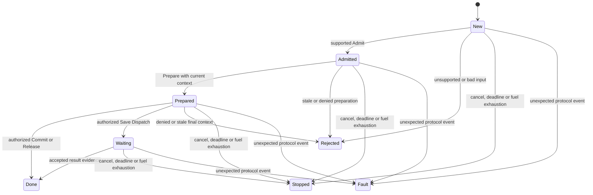

# Executable design model and proof obligations

Draft 0.207 §6.5.2.4/model 0.271 binds explicit source-only F11 batches through
canonical public intent and once-captured private annotation-set dependencies.
Fourteen controls, seven omissions, sixteen service-permission cases and six
coherent-graph mutations pass; bounded review found no must-fix. Atomic mixed
F11/F13 composition remains separate required work. See exact-batch-binding.md.
The earlier publication-clause global requirements hash is reconciled after
verifying all ten selected source units/41 fragments are unchanged; all sixteen
sensitivity controls remain. Full frozen qualification/adoption is still required.

Draft 0.206 §4.2.2 also joins repeated consistent source entries before immutable
owner capture/F10 advice. The existing invocation checker now has 27 controls,
37 semantic mutations and ten repeated-participant/profile/route cases, alongside
its unchanged prior ordering/gate/trace populations. First-occurrence grouping
preserves complete records; conflicting headers/ambiguous edits refuse and owned
arrays prevent alias self-extension. This adds no module/operation/proof program;
full frozen qualification and public/native/physical refinement remain required.

The primary-only accepted composition binding (draft 0.206/model 0.270,
§20.1.1) refines the existing F11 variant without adding engine IME state.
The original explicit replacement, primary identity and full intent survive the
native facade/common-publication composition; secondary and peer selections map
normally. Sixteen focused controls, ten omitted fields, eight service-permission
cases and six coherent-graph mutations cover this binding. See
composition-binding.md; full frozen qualification/adoption, concrete Rust/native
input integration and independent assurance remain required.

The closed engine-measurement/1 design profile (draft 0.205/model 0.269,
§23.3.1) defines 32 descriptors across eleven engine instrumentation sites,
excluding the two UI-only sites. Its logical reference checks nine controls,
804 point cases, 24 tagged-coordinate cases, 286 bounded counter steps and ten
semantic mutations. Per-offer refusal/replay, ordinary derived refusal and the
once-only first-result endpoint remain distinct. A bounded challenge review
found and corrected those three initial semantic gaps. This is not installed
instrumentation or proof of actual scopes, clocks, provider classification,
episode tracking, capture accounting or numerical service claims. See
engine-measurements.md and engine-measurements.json; the old marker queue is unchanged.

Modular resource substrates (draft 0.205/model 0.269, §§1.2/25) preserve the existing
engine ports, evidence meanings and ordinary best-effort baseline. Local filesystem
is the first module; S3 is only a possible later profile. No new executable verb,
reference runtime module or provider-truth theorem is introduced. Existing scoped
engine/UI and substrate checks remain relevant boundary evidence, not proof of
actual packaging, OS behavior or a replaceable module implementation. Requirements
and model reconciliation require current frozen qualification before adoption.

Actual analysis query release (draft 0.204/model 0.268, §18.8.2) borrows two
construction-sized logical frames from remaining owner capacity before input inspection.
The existing result validator and original packet correlation run before delivery.
Query faults fence new data work without losing protected evidence or retirement;
temporary query frames return once on normal or caught-fault exit. Five controls,
ten fault cases, seven reentry seams, three capacity boundaries, four tiny-delivery assembly probes and eight semantic
mutations cover this integration. See analysis-query-values.md for the conditional
accounting argument and physical/global/hostile-ingress limitations. No public
verb, profile or module is added. Full frozen qualification remains required.

The 0.203 qualification exposed obsolete discovery mutation construction anchors:
they assumed the reply-size guard was adjacent to selector installation. Draft
0.204 gives that existing query-size guard a named byte count and retargets ten
existing mutation files. Mutation meanings, oracles and populations are unchanged;
construction failures are not semantic detections or qualification passes.

The running 0.204 qualification also exposed a surviving copied-target mutation.
In the mutated producer, the result guard rejects a mismatched reply while
incorrectly faulting the owner for known invalid caller input. The 0.205 successor strengthens the existing
context-local identity control: rejection preserves usage, and the original
authentic target remains usable. The same bank's eight mutations pass against a
coherent baseline; no mutation or production behavior is changed by that oracle
repair. Full successor qualification remains required.

Native discovery result publication (draft 0.203/model 0.267, §22.1.24) runs the
existing structural checker before tentative selector/issuance installation in
the shared native core. Invalid results and validator exceptions fence only the
discovery owner, with original maps/issuance, consumed cuts and protected cleanup
retained. The existing reply/selector staging funds the logical operation; input
workspace is not reused as a reply reservation. Twenty-seven cases and three
semantic mutations cover the selected native/typed/dynamic routes. No module,
verb, profile or solver condition is added. Full frozen qualification, other
products and operational/independent gates remain.

Parent-funded resource-catalog queries (draft 0.202/model 0.266, §22.2.2.5) use
the existing native read owner, private registry reservation and bounded shared
decoder borrowing. See registration-reads.md for 28 controls, 49 mutations in
seven banks, four decoder fault stages and the separately guard-blocked issuer
reset control. Existing argument/result/substrate checks remain, and the shared
invocation checker has 24 controls/34 mutations. The graph stays 118 with no new
module/command/profile/solver condition. Full frozen adoption, profile discovery
and broader product/implementation/operational gates remain.

Shared compound normalization (draft 0.201/model 0.265, §4.2.2) precedes owned
intent/retry comparison and view preparation on the existing invocation path.
F10 advice reuses it without publication. See invocation-publication.md for
60 permutation/profile/route cases, 22 controls and 28 semantic mutations; old
gate/trace populations remain. No new module, command, profile or solver condition
is added. Frozen qualification, public facade completion and implementation/
operational/independent gates remain.

Existing F08 replies (draft 0.200/model 0.264, §18.8.2) retain captures, summary and
unavailable distinctions. See analysis-query-values.md for 2,019 native replies,
2,189 total cases and 24 pure checker mutations. Original authority/currentness
and native release/fault integration remain separate from structure. No request,
codec, profile or runtime pathway is added; full frozen adoption remains required.

F08 query intersections (draft 0.199/model 0.263, §18.8.1) exclude empty ranges
without bypassing original current authority or capacity checks. See
analysis-work.md and analysis-range-laws.smt2 for pinned native regression cases,
the conditional integer proof and the old-guard counterexample. The existing
analysis corpus now has 88 controls and 21 semantic mutants. No public verb,
component or instrumentation pathway is added; frozen adoption remains required.

F01 self-description (draft 0.198/model 0.262, §22.1.27) exposes the three existing
queries through explicit discovery /13 without changing /1–/12 or the default.
See discovery-self-descriptor.md for native/schema non-authority, independent
bounds, mutations and selected shared-substrate evidence. The graph/cold-entry
census is 118 and ownership stays 76/11. No issuer, evaluator or transport is added.
Full frozen qualification and broader implementation/operational gates remain.

F10 advisory metadata (draft 0.197/model 0.261, §22.1.26) describes existing native
current checks through explicit discovery /12 while preserving /1–/11. See
advisory-descriptor.md and advisory-discovery.md for schema/native non-authority,
independent bounds, mutation, selected substrate and cold-entry evidence. Advice
reserves nothing and grants no execution. Graph/entrypoints are 117 and ownership
remains 76/11; complete products and full frozen/operational/independent gates
remain open.

Presentation-owned geometry source replies (draft 0.196/model 0.260, §19.4.1) must fit their
reply byte budget before a new persistent target is installed. See
geometry-reply-admission.md for exact boundaries, lifetime controls and native
mutation evidence. Previously installed references remain owned; this is not a
rollback, engine route, public gateway or physical-accounting guarantee. The helper
stays outside the selected symbolic engine dependency graph. Full qualification,
endpoint adoption and broader operational/independent gates remain.

Existing F16 released values (draft 0.195/model 0.259, §23.1.9) distinguish native
host registration stamps, scoped decisions and original opaque created-settings
references. See registration-result-values.md for finite native/malformed/mutation
and validation-only substrate evidence. Public mapping, combined-reply integration
and operational/independent gates remain; no runtime graph component is added.

Existing F13/F14 projected values (draft 0.194/model 0.258, §23.1.8) have a
separate closed-value checker for partial annotation disclosure and target-hidden
undo/redo results. See projected-edit-results.md for native, malformed, mutation
and validation-only substrate evidence. Public retrieval/F06 mapping and native/
observer integration remain unselected; the selected static engine/reference graph stays 116. Full frozen
adoption and broader operational/independent gates remain.

The F12 declaration/discovery integration (draft 0.193/model 0.257, §22.1.25)
describes existing selection semantics under explicit /11 without a new behavior
or UI policy. See selection-descriptor.md and selection-discovery.md for native,
schema, independent-boundary, mutation and selected substrate/fault checks.
Profiles /1–/10 are unchanged. The graph/entrypoint census is 116; full frozen
qualification and broader product/operational gates remain open.

Decoded F01 native-owner integration (draft 0.192/model 0.256, §22.1.24)
reserves local temporary workspace, preserves original handles/cuts and reads only
named current facts. See discovery-gateway.md for native/fault/reentry/mutation
and selected substrate evidence. Native selectors and spent issuance survive late
faults; result-validator workspace is not folded into input charges. The graph
is 115; full frozen adoption and broader integration/operational gates remain.

Closed F01 native results (draft 0.191/model 0.255, §22.1.23) describe existing
page/descriptor/advice/unavailable products with original request-role binding
and bounded inert metadata. See discovery-results.md for native/mutation/cost and
selected validation-only substrate evidence. Selector/facade fault integration
remains open. The selected static engine/reference graph is 114. Smaller mutation
banks retain complete baselines and unchanged oracles/timeout; failed earlier
qualification is not promoted to a pass.

Exact F01 discovery arguments (draft 0.190/model 0.254, §22.1.22) preserve all
original opaque roles across bounded typed/dynamic capture. See
discovery-arguments.md for native compositions across ten profiles, exact
boundaries and semantic mutation evidence. The selected graph is 113 modules;
actual-parent gateway and complete public product obligations remain separate.

Lifecycle discovery (draft 0.189/model 0.253, §22.1.21) describes fourteen native
forms/eight F17 variants under explicit /10, preserving /1–/9. It does not add
public result queries, events or authority. See lifecycle-discovery.md for scoped
schema/native/ownership/boundary and qualification obligations. The selected
static graph/entrypoint count is 112 including discovery and its descriptors.

Closed native lifecycle results (draft 0.188/model 0.252, §11.2.13.6) share four
receipt shapes across construction/current release without choosing a public query
or wire profile. See lifecycle-results.md for 48 native results, 24 mutants and
28 malformed-construction fault/discard cases. The graph/entrypoint count is 96.

Activation envelope integration (draft 0.187/model 0.251, §11.2.13.5) connects
nine forms to existing native jobs/authority ports with the shared preparation
guard. See lifecycle-activation-envelope.md for eighteen fresh publications,
twelve mutations and 36 fixed faults with original-ticket prepared-map discharge.
The graph is now 95 modules; its entrypoint controls expand accordingly.

Native lifecycle initialization (draft 0.186/model 0.250, §11.2.13.4) reads
native declarations after module evaluation. See lifecycle-entrypoints.md for
94 clean-process imports, two graph orders and the explicit eager-read failure
control. This is not behavioral mutant detection or production initialization proof.

Additional F17 activation/rebind/container arguments (draft 0.185/model 0.249,
§11.2.13.3) share native field/profile declarations without serializing authority
handles. See lifecycle-activation-arguments.md for eighteen native compositions,
36 disjoint pairs and fifteen mutations; complete products and qualification remain.

Selected F17 envelope owner integration (draft 0.184/model 0.248,
§11.2.13.2) reuses the existing owner, preparation guard and ticket cleanup.
See lifecycle-envelope.md for fresh native, reentry, fault and mutation evidence.
It does not establish shared-parent temporary reservation or physical bounds.

Selected F17 lifecycle argument capture is specified in lifecycle-arguments.md.
Five forms under four existing variants preserve native invocation values and
typed/dynamic meaning; capture is not authority or an installed decoded gateway.

Resource-catalog acquisition (draft 0.181/model 0.245, §22.2.2.4) checks closed
reply/candidate/installation meaning and retains late inaccessible contexts under
original-cut cleanup receipts. Five controls cover six native products, 24 malformed
refusals and three boundaries. Fifteen stages cover 45 faults, three early cuts,
fifteen late contexts and ninety protected-drain refusals; 24 mutations and selected
substrate probes supply scoped evidence. See registration-acquisition.md. Reader
registry fencing does not fault the execution domain or refund issuance. Full
frozen qualification and endpoint reconciliation remain adoption gates; actual-
owner gateway, complete discovery and operational/independent obligations remain.

Closed resource-catalog query results (draft 0.180/model 0.244, §22.2.2.3) bind
existing F07 reply frames, captured descriptor meaning and original staged/installed
selector roles. Six controls cover 73 native products, 66 malformed refusals and
sixteen binding cases; thirteen stages cover eighty faults, ten retained early cuts
and twelve late-spent cases. Thirty-three mutations and selected substrate probes
supply scoped evidence; earlier reader/registration/argument controls remain.
See registration-query-results.md. Full frozen qualification and endpoint
reconciliation remain adoption gates. Acquisition, actual-owner gateway charging,
complete discovery and operational/independent obligations remain open.

Exact resource-catalog arguments (draft 0.179/model 0.243, §22.2.2.2) preserve
existing F07 capabilities outer/nested native declarations, original context/entry/
continuation identities and immutable ordinary meaning across typed/dynamic routes.
Eight controls cover six native compositions, 120 malformed refusals, 36 exact
capture boundaries and eleven role cases; 27 mutations and the earlier full native
reader's forty mutations pass. See registration-query-arguments.md. Full frozen
qualification and endpoint reconciliation remain adoption gates. Actual-owner
gateway charging, complete results/discovery and operational/independent gates
remain open; no whole completion row closes.

Native settings discovery (draft 0.178/model 0.242, §22.1.20) appends existing
F07 metadata under explicit /9 while preserving eight audited older profiles.
Three input/reply schemas describe the existing six-constructor type syntax with
fixed local references, not remote loading or runtime authority. Scoped evidence
covers 391 validator cases, fourteen native and twelve additional type/route
products, fourteen discovery controls, 71 schema denials, 39 exact boundaries and
51 semantic mutations. Selected substrate probes use eighteen discovery/two reader
fixtures with no baseline calls and three detected injections. See settings-discovery.md.
Full frozen qualification and endpoint reconciliation remain adoption gates; other
F07/all-family products and operational/independent obligations remain.

Actual parent settings decoding (draft 0.177/model 0.241, §22.2.1.4) charges
classification/seven-frame workspace to the invocation owner and dispatches only
captured F07 meaning, scope and facts. Eight controls cover fourteen native
compositions, 66 refusals and twelve boundaries; three checkpoints cover 42 faults,
84 reentries, fourteen capture-independence and 42 early-refusal cases. Twenty-nine
mutations and selected substrate probes pass. See settings-query-gateway.md.
The selected engine graph has 92 modules; native-only compatibility is scoped to
fourteen products and ledgers. Full frozen qualification and endpoint reconciliation
remain required; complete public/discovery and operational/independent gates remain.

Closed settings query results (draft 0.176/model 0.240, §22.2.1.3) separate F07
frame/binding checks, transient reply pressure and affected-context invalidation.
Seven controls cover 28 native products, 71 malformed refusals and nine origin
binding cases. Ten fixed stages cover 98 faults while preserving neighboring
readers, retained charge/issuance and protected cut/context/pool discharge.
Twenty-six mutations and selected substrate probes supply scoped evidence; see
settings-query-results.md. The observed selected engine graph has 90 modules.
Full frozen qualification and endpoint reconciliation remain required; decoded
dispatch, complete public/discovery and operational/independent gates remain.

Exact settings query arguments (draft 0.175/model 0.239, §22.2.1.2) share three
existing F07 native declarations and preserve distinct original context/target
roles in typed/dynamic capture. Nine controls cover fourteen native compositions,
92 malformed refusals, six role cases and 36 boundaries; 26 semantic mutations and
the older 22 native reader mutations pass. See settings-query-arguments.md.
Actual-parent decoded dispatch, complete result/discovery products and operational/
independent gates remain; full frozen qualification and endpoint reconciliation
remain adoption gates.

Native observation discovery (draft 0.174/model 0.238, §22.1.19) appends existing
F06 under explicit /8 while preserving /1–/7. Four input/reply schemas and one
private continuation schema distinguish structure from native authority, prepaid
decoder support and public event transport. Scoped evidence covers 1,038 validator
cases, 37 native and 708 projector products, fourteen discovery controls, 69 schema
denials, 33 boundaries and 54 mutations. Selected post-import probes preserve
native role separation. See observation-discovery.md. Full frozen qualification
and endpoint reconciliation remain adoption gates; complete public/operational/
independent obligations remain.

Prepaid observation decoding (draft 0.173/model 0.237, §23.1.7) binds existing F06
typed/dynamic requests to actual shared reservations. Explicit bootstrap metadata
and native-plus-eight-frame admission preserve protected control without ordinary
spare headroom. Twelve controls cover 23 native compositions, 29 refusals and
eighteen boundaries; twelve faults, 24 reentries, 23 mutations and selected
substrate probes pass. See observation-decoder.md. Native-only support, current
authority and producer separation remain; complete public/operational/independent
gates and full frozen qualification remain required.

Closed native observation results (draft 0.172/model 0.236, §23.1.6) validate six
selected F06 result statuses with staged opaque binding and nested native outcome
structure. Seven controls cover 519 products, 84 malformed result and forty nested
outcome refusals. Eight fault stages plus one actual shared-reservation fault
composition retain issuance/wait capacity and separate producer ownership; 29
mutations and selected post-import substrate probes pass. See
invocation-observation-results.md. Complete products, protected decoder integration
and operational/independent gates remain. Full frozen qualification is required.

Exact invocation observation arguments (draft 0.171/model 0.235, §23.1.5) derive
four existing F06 forms from the native guard, preserving original context and
ordinary after-reference identities across typed/dynamic routes. Eight controls
cover sixteen native compositions, 122 refusals and 96 exact boundaries; 21
argument mutations pass. Native authority, waiter capacity, outcome retention and
host-clock truth remain separate. See invocation-observation-arguments.md.
Actual-parent decoder charging and complete products remain open; full frozen
qualification and endpoint reconciliation are required before adoption.

Native history query discovery (draft 0.170/model 0.234, §22.1.18) adds explicit
/7 metadata for three existing F04 queries while preserving /1–/6. Three input
and three result schemas have 354 validator cases and 24 native products; actual
context/currentness/alias/eligibility authority remains native. Sixteen discovery
controls, 51 schema denials, thirty boundaries, 51 semantic mutants and selected
post-import substrate checks supply scoped evidence. See history-discovery.md.
No transport, operation, signal or numeric product default is added. Full frozen
verification and endpoint reconciliation remain required before adoption.

Actual-owner history decoding (draft 0.169/model 0.233, §14.5.4) connects existing
F04 typed/dynamic requests to the fixed native owner, reserving/refunding actual
owner-local classification and seven-frame workspace. Eleven controls cover
24 native cases, twelve packet/headroom boundaries and 77 refusals; 36 faults,
24 reentries, three classification boundaries, 27 mutants and selected substrate
checks accompany existing history regressions. See history-query-gateway.md.
Host/global reservation truth and complete public/operational/independent gates
remain. Full frozen verification and endpoint reconciliation are required before
adoption; no whole completion row closes.

Closed native history results (draft 0.168/model 0.232, §14.5.3) validate existing
F04 values, original context, captured aliases and copied meaning. Owner faults
fence delivery/admission without dropping retained contexts or refunding issuance;
protected retirement remains available. Seven controls cover twelve native and
114 malformed products, three boundaries and 29 fixed fault cases. All 31 mutants
run both complete shape/fault corpora; selected substrate probes also pass. See
history-query-results.md. Full frozen verification and endpoint reconciliation
remain required before adoption; no whole completion row closes.

History query argument capture (draft 0.167/model 0.231, §14.5.2) uses actual
F04 field declarations and preserves original context identity across typed/dynamic
routes. Ten controls cover 24 native compositions, 98 malformed refusals and
36 exact boundaries; 24 semantic mutants and existing history banks pass. See
history-query-arguments.md. Actual-parent gateway dispatch, complete public
products and operational/independent gates remain. Full frozen verification and
endpoint reconciliation are required before adoption; no whole row closes.

Native read result discovery (draft 0.166/model 0.230, §22.1.17) adds result
metadata to the existing two read descriptors under explicit /6, preserving /1–/5.
Six schemas describe native value shadows; actual request/identity/authority and
publication checks remain runtime obligations. The corpus has 862 validator cases,
78 positive native products, thirteen discovery controls and 27 boundaries.
Six full-corpus mutation banks and selected substrate probes are registered;
see read-result-discovery.md. No operation, wire codec, numeric default or engine
component is added. Full frozen verification and endpoint reconciliation remain
required before adoption; no whole completion row closes.

Captured verifier input retention (draft 0.165/model 0.229, §24.4.1) keeps full
snapshots while reclaiming disposable checker/descendant scopes only after the
existing result validation passes. Run capture-retention-mutations.mjs; see
capture-retention.md for seventeen controls, nine mutants and actual run-function
coverage. Cleanup failures remain tool failures, and retained failures, historical
garbage, other scratch data and abrupt termination are separate obligations.
This is assurance infrastructure, not an engine resource/profile change. Full
frozen verification and endpoint reconciliation remain required.

Closed acquisition results (draft 0.164/model 0.228, §22.1.16) retain existing
single/coherent F02 products with actual native staged identities, candidate
rosters and requested class sets. Run read-acquisition-result-mutations.mjs,
read-acquisition-result-fault-mutations.mjs and
read-acquisition-result-substrate-checks.mjs. See read-acquisition-results.md for
31 mutants and the distinction between preinstallation refusal and late facade
faults that retain actual contexts, issuance and consumed cuts. Discovery /1–/5
is unchanged. Complete products and operational/independent gates remain; full
frozen verification and endpoint reconciliation are required.

Closed annotation results (draft 0.163/model 0.227, §22.1.15) retain existing F03
products, optional facets and canonical target profiles. Native owners validate
staged aliases before publication; the facade validates returned value shape.
Run annotation-query-result-mutations.mjs,
annotation-query-result-fault-mutations.mjs and
annotation-query-result-substrate-checks.mjs. See annotation-query-results.md for
27 mutants and the distinction between prepublication faults and later facade
faults that retain native issuance. Discovery /1–/5 is unchanged. Full frozen
verification and endpoint reconciliation are required; complete public products
and operational/independent gates remain.

Closed source results (draft 0.162/model 0.226, §22.1.14) check existing F02
content/line/unavailable shapes at construction, coherent member rebinding and
northbound release. Run source-read-result-mutations.mjs,
source-read-result-fault-mutations.mjs and source-read-result-substrate-checks.mjs.
See source-read-results.md for 27 mutations, eight fixed fault probes and the
independent source oracle's five assertion and two typed-invariant detections.
Discovery /1–/5 remains unchanged. Complete result codecs, acquisition/annotation
products and operational/independent gates remain. Full frozen verification and
endpoint reconciliation are required.

Read declaration discovery (draft 0.161/model 0.225, §22.1.13) adds F02/F03 to
explicit /5 while preserving /1–/4. Run read-discovery-mutations.mjs,
read-discovery-substrate-checks.mjs and standard-schema-validator.mjs. See
read-discovery.md for 209 standard-validator cases, 27 exact boundaries, 32
mutations and tool/protocol failure separation. The 87-module suite expectation
is corrected to the independently checked 89-module reference graph. Complete
public products and operational/independent gates remain; full frozen verification
and endpoint reconciliation are required.

Decoded annotation queries (draft 0.160/model 0.224, §22.1.12) preserve original
snapshot/record/continuation roles across current and retained native owners. Run
annotation-query-argument-mutations.mjs, annotation-query-gateway-mutations.mjs,
annotation-query-gateway-fault-checks.mjs and
annotation-query-gateway-substrate-checks.mjs. See annotation-query-gateway.md for
37 mutations, 96 gateway cases, exact logical workspace and complete-page evidence.
Complete public products and operational/independent gates remain. Full frozen
verification and endpoint reconciliation are required.

Decoded snapshot handoff (draft 0.159/model 0.223, §22.1.11) binds current
prepared cuts and retained original capabilities to existing native owners. Run
read-acquisition-argument-mutations.mjs, read-acquisition-gateway-mutations.mjs,
read-acquisition-gateway-fault-checks.mjs and
read-acquisition-gateway-substrate-checks.mjs. See read-acquisition-gateway.md for
43 mutants, eighteen gateway cases, logical workspace and exact scope. Full
public products and operational/independent gates remain. Full frozen verification
and endpoint reconciliation are required.

Decoded source reads (draft 0.158/model 0.222, §22.1.10) preserve original opaque
snapshots and native currentness across both range/line routes and three current/
retained owner classes. Run source-read-argument-mutations.mjs,
source-read-gateway-mutations.mjs, source-read-gateway-fault-checks.mjs and
source-read-gateway-substrate-checks.mjs. See source-read-gateway.md for logical
workspace accounting, 31 mutants, 24 native cases and exact boundaries. Acquisition,
complete public products and operational/independent gates remain. Full frozen
verification is required.

Search product discovery (draft 0.157/model 0.221, §22.1.9) adds existing F05
metadata under explicit /4 without changing /1–/3. Run search-discovery-mutations.mjs
and search-discovery-substrate-checks.mjs; the bank includes native reply shapes,
sixty standard-schema cases and 24 exact boundaries. See search-discovery.md for
forty mutants, 94 nested-validator cases/188 normalizations and actual scope. Complete nested codecs, async and operational/
independent gates remain; full frozen verification is required.

Decoded synchronous search (draft 0.156/model 0.220, §15.4.4) preserves original
opaque context identity and independently captured current facts across both F05
routes. Run search-argument-mutations.mjs, search-current-input-checks.mjs,
search-gateway-mutations.mjs, search-gateway-fault-checks.mjs,
search-gateway-issuer-checks.mjs and search-gateway-substrate-checks.mjs. See
search-gateway.md for logical workspace accounting, exact boundaries, 31 mutants,
160 dependent-consumer cases and scope limits. Complete public products, async and
operational/independent gates remain. Full frozen verification is required.

Retained coherent projection copies (draft 0.155/model 0.219, §12.8.10) resolve
an original available parent, validate its full current scope before narrowing,
and independently own only selected old members/classes with fresh aliases.
Run native-retained-version-set-mutations.mjs, native-source-search-consumer-mutations.mjs
retained-version-set, native-retained-version-set-fault-checks.mjs and
native-retained-version-set-substrate-checks.mjs. See native-retained-version-set.md
for issued-width boundaries and lifecycle evidence. Arbitrary historical roots,
public/async/physical/global and independent assurance remain gates. Full frozen
verification is required.

Current native coherent sets (draft 0.154/model 0.218, §12.8.9) capture one actual
owner root, stage parent/member aliases together and share all-required currentness
across F02/F03/F05 and dependent F11/F12 use. See native-version-set.md for the
preparation/installation/query/lifecycle/search mutation banks, exact boundaries,
fault probes and selected substrate evidence. Historical/async/complete public,
host and physical/global/concurrent/crash/independent obligations remain. Full
frozen verification is required; these reference checks do not close a C/D row.

Read class retention isolation (draft 0.153/model 0.217, §12.8.8) removes
unrequested source bytes/revisions from abstract annotation-only candidates and
installed version-set members. Run read-class-isolation-mutations.mjs for three
class profiles, a mixed set and three semantic regressions; read-contexts.mjs and
version-set-contexts.mjs retain their scoped lifecycle banks. See read-contexts.md.
Native coherent-root acquisition/ownership and physical/global assurance remain
gates. Full frozen verification is required.

Native retained projection acquisition (draft 0.152/model 0.216, §12.8.7) copies
original annotation/combined contexts and supported nonempty class subsets without
widening or current-state fallback. Run native-retained-annotation-mutations.mjs,
native-source-search-consumer-mutations.mjs retained-combined, and
native-retained-annotation-substrate-checks.mjs. See native-retained-annotation.md
for fifteen controls, twelve exact boundaries, actual lifecycle/protected cleanup,
21 mutations, dependent consumers and three staging-I/O probes. Whole historical/
version-set/public and operational/independent gates remain. Full frozen
verification is required.

Native retained-source acquisition (draft 0.151/model 0.215, §12.8.6) resolves
an original available context in the same owner/domain/pool without current-state
fallback. Run native-retained-source-mutations.mjs,
native-source-search-consumer-mutations.mjs retained-source, and
native-retained-source-substrate-checks.mjs. See native-retained-source.md for
ten controls, eighteen loss/twelve unknown/four transient cases, nine boundaries,
actual lifecycle cleanup, thirteen mutations and twelve consumer cases/seven
mutations. The selected post-import probe wraps 143 callables and detects three
hidden I/O/process variants. Broader historical/combined/version-set/public and
operational/independent gates remain. Full frozen verification is required.

Combined search ownership (draft 0.150/model 0.214, §15.4.3) extends the same
synchronous service to source-only and combined current contexts with a closed
first-party issuer sum. Run native-combined-search-mutations.mjs and
native-source-search-consumer-mutations.mjs combined, and
native-combined-search-substrate-checks.mjs. Eight ownership controls,
eighteen exact boundaries, two actual lifecycle cases/eighteen protected denials,
eighteen ownership mutations and twelve consumer cases/seven mutations per issuer
check original ownership, shared issuance and dependent current use. A selected
143-callable post-import probe has zero baseline calls and detects three injected
read/rename/process calls with protected ownership frames. See
native-combined-search.md. Historical/version-set/async/public and host/measurement/
physical/global/concurrent/crash/independent gates remain. Full frozen verification
is required.

Native annotation/combined contexts (draft 0.149/model 0.213, §12.8.5) connect
actual-root preparation, staged one-time ownership transfer, opaque F03 paging/
inspection/location and combined source range/line products. See
native-annotation-contexts.md for profiles, focused checkers, explicit gate roles
and bounded evidence. Preparation/installation reservations discharge separately;
current class/facet grants remain required. Candidate staging, native lifecycle,
whole-page boundaries, hidden-record pairs and 4,681 traces narrow selected
obligations, not all-profile/public/host/physical/concurrent/crash/independent
refinement. Full frozen verification is required.

Native source-search ownership (draft 0.148/model 0.212, §15.4.2) composes the
actual F02 owner with synchronous F05 results and dependent F11/F12 consumers.
Run native-source-search-mutations.mjs, native-source-search-disposal-checks.mjs,
native-source-search-retirement-mutations.mjs,
native-source-search-consumer-mutations.mjs and
native-source-search-substrate-checks.mjs. See native-source-search.md for
reservations, currentness, protected cleanup, 2,801 traces/10,738 edges and scoped
mutation evidence. This does not introduce an independent prepared lease or prove
async/public/host/physical/concurrent/crash/independent refinement. Full frozen
verification is required.

Native current-source contexts (draft 0.147/model 0.211, §12.8.4) bind existing
F02 capture/range/line products to the actual parent owner. Run
native-source-context-mutations.mjs, native-source-context-disposal-checks.mjs,
native-source-context-fsm-checks.mjs and
native-source-context-substrate-checks.mjs. Thirteen controls, 33 exact boundaries,
28 semantic mutants, actual disposal/two mutants and three hidden-I/O cases cover
selected binding, reservation, loss and hold/discharge frames. See
native-source-contexts.md for authority roles and remaining native F02/F05/public/
host/physical/independent work. The separate finite oracle covers 4,681 traces/
18,056 edges through horizon four with three mutants, not unbounded induction.
Full frozen verification is required.

Retained-source search composition (draft 0.146/model 0.210, §15.4.1) connects
existing F02 registry capture to native F05 without a second source argument.
Run read-search-mutations.mjs; see read-search-composition.md for twelve direct/
observer native cases, 54 denials, nine exact packet boundaries, version-set
independent-access/stop checks and eleven mutants. Separate source/query grants,
captured ceilings and original current request remain necessary. Native issuer,
absorbing loss and asynchronous result-child lifetime remain open. Current full
frozen verification and actual host/physical/public/independent gates are required.

Decoded literal replacement (draft 0.145/model 0.209, §6.5.2.3) retains original
requests/results through common publication with separate canonical/reply charges.
Run replacement-argument-mutations.mjs, replacement-footprint-checks.mjs,
replacement-gateway-mutations.mjs and replacement-substrate-checks.mjs. See
replacement-gateway.md for 25 controls, 108 permission cases, 24 capture boundaries,
twelve argument/three footprint/twelve gateway mutants, six faults and six
hidden-I/O cases. F18 now covers 38 forms/twelve kinds and 9,842 traces/27,588 edges.
The preceding 0.144/0.208 batch passed 566 checks/569 inputs and endpoint/hash audit;
this batch requires its own complete frozen-input pass. Broader public/F05 lifetime/
host/physical/independent gates remain.

Decoded selection/navigation (draft 0.144/model 0.208, §6.5.2.2) adds four forms
without source-write authority or a new owner. Run selection-argument-mutations.mjs,
selection-gateway-mutations.mjs and selection-substrate-checks.mjs. See
selection-gateway.md: 45 omissions, 72 argument boundaries, 32 gateway controls,
156 permission cases, 48 capture boundaries, eleven argument/ten gateway mutants,
eight faults and twelve hidden-I/O cases. F18/context/observer coverage has 36
forms/twelve kinds and 9,324 traces/26,136 edges. These are scoped reference checks;
current full frozen verification and broader public/host/physical/independent
evidence remain required.

The preceding 0.143/0.207 batch completed 563 checks/562 inputs and passed its
endpoint/hash audit; this revision requires its own frozen-input pass.

Decoded ordinary edits (draft 0.143/model 0.207, §6.5.2.1) connect four existing
forms to original issued tickets. Run ordinary-arguments-mutations.mjs,
ordinary-gateway-mutations.mjs and ordinary-gateway-substrate-checks.mjs. Their
scope includes 35 gateway controls, 162 permission cases, 48 complete capture
boundaries, thirteen argument/eleven gateway mutations, two post-lease faults and
three hidden-I/O variants. See ordinary-gateway.md for logical reservation and
remaining public/physical/host/independent gates. The preceding 0.142/0.206 batch
passed 560 checks/555 inputs/295 SMT conditions and endpoint/hash audit; current
full frozen verification is required.

Ordinary-edit discovery (draft 0.142/model 0.206, §22.1.8) adds an opt-in /3
metadata profile for four existing request forms. Run editing-discovery-mutations.mjs
for sixty validator cases, fourteen controls and seventeen mutations; run
editing-discovery-substrate-checks.mjs for fourteen post-fixture controls and three
hidden-I/O cases. See ordinary-edit-discovery.md. Existing profiles and execution
semantics remain unchanged; no public wire/all-F11/host/physical/independent proof
is claimed. The last audited batch was 0.141/0.205 (558 checks/549 inputs);
current full frozen verification is required.

Mixed read composition (draft 0.141/model 0.205, §13.9.5) adds no runtime product.
Run mixed-reads-mutations.mjs: nine fixed footprints, 262,144 mismatch/selection
pairs, forty native cases, 28 actual interleavings, 96 advice observations and
thirteen mutations. See mixed-reads.md for finite lattice scope and remaining
discovery/provider/host/physical/independent gates. The old lifecycle mutation
region excludes the newer normalizer while retaining all eleven identities.
The stopped 0.140 run is incomplete; the next full run must verify both batches.

Fresh-basis lifecycle selectors (draft 0.140/model 0.204, §22.3.1.11) reuse
ordinary write bases and separate lifecycle conditions in common settings execution.
Run basis-lifecycle-mutations.mjs: seventeen controls, six wrapper/root boundaries
and twelve mutations. See basis-lifecycle.md. The substrate probe adds both routes/
six hidden-I/O cases. Discovery has eleven forms/105 validator cases; cancellation
has 32 forms/twelve kinds. Public codecs, complete consumers, host/policy, physical/
concurrent/crash and independent gates remain. Full frozen verification is required.

Created-layer results (draft 0.139/model 0.203, §22.3.1.10) use an optional
charged profile within common settings publication. Run
settings-created-result-mutations.mjs: 21 controls, six boundaries, thirteen
mutants and two late fault points. See settings-created-results.md for historical
opaque references versus fresh native write authority and protected release.
Cancellation has 31 forms/twelve kinds; the substrate probe adds both routes/six
hidden-I/O cases. No wire/Rust ABI, new mode/job, physical or independent proof is
selected. Existing 295 conditions/fourteen manifests retain scope. Full frozen
verification is required.

Mutation evidence (draft 0.138/model 0.202, §24.1) separates source/module
construction from semantic assertion detection in 63 existing harnesses. Run
mutation-harness-contract-checks.mjs for eight control-flow/four lexical/three target
checks; see mutation-harness.md for scope and three repaired stale targets. Mutation
identities and engine predicates remain unchanged. Full frozen verification also
carries the 0.137 serialization batch; interrupted runs do not verify either.
Lexical guards are not arbitrary-code, cardinality or independent-assurance proofs.

Scoped serialization (draft 0.137/model 0.201, §22.3.1.9) adds metadata-only bases
and private lowering into the common settings job. See scoped-serialization.md
for the six executable entry points: eighteen basis/six reservation controls,
sixteen scoped controls, nine budget boundaries, actual disposal/native writer
composition and twelve assertion-killed mutants after coherent baselines. Ten
outer forms/94 validator cases and thirty cancellation forms retain prior controls.
No configuration registry, source read, new job kind or filesystem mechanism is
required. Public codecs, full family/consumer, actual host/policy, production,
physical/concurrent/crash and independent gates remain. Existing 295 conditions/
fourteen manifests retain scope; full frozen verification is required.

Scoped lifecycle (draft 0.136/model 0.200, §22.3.1.8) retains native allocation and
per-identity/association authority behind a separate conditional basis. Run
settings-lifecycle-basis-mutations.mjs and scoped-lifecycle-mutations.mjs: 42 basis
cases/thirteen mutants, 26 controls/eleven mutants and three wrapper/three known-root
boundaries. See scoped-lifecycle.md. Private host proposal identities and creation
indices do not select public/scoped created-reference result encoding. Nine outer
forms/85 validator cases and 29 cancellation forms retain earlier controls. Public
products/events/remaining profiles, policy/host/physical/concurrent/crash and
independent gates remain. The 295 conditions/fourteen manifests retain scope;
full frozen verification is required.

Scoped declaration activation (draft 0.135/model 0.199, §22.3.1.7) separates retained
conditional bases from actual native changed-facet write grants. Run
scoped-definition-mutations.mjs: 35 basis cases, 22 controls, three wrapper
boundaries and fifteen assertion-killed mutations after coherent baselines.
See scoped-definition.md for shared pool ownership, complete native dependencies,
source journals, malformed-before-loss testing and protected cleanup. Discovery
now covers eight forms/74 validator instances; cancellation covers 28 forms/twelve
kinds. engine-substrate-checks.mjs adds both metadata routes and six hidden-I/O
cases. Scoped lifecycle, public codecs/events, host/policy, physical/concurrent/
crash and independent gates remain. Existing 295 conditions/fourteen manifests
retain scope; full frozen verification is required.

Intrinsic document serialization (draft 0.134/model 0.198, §22.3.1.6) uses the
existing F16 settings job without a configuration registry, hidden I/O or source
edit. Run source-serialization-checks.mjs for owned native publication, target/
dependency guards, finite budgets/counters, journal framing, actual old/new writer
composition, fault fencing and eleven assertion-killed mutations. See
source-serialization.md. The selected discovery check now covers seven forms and
65 standard-validator cases; cancellation covers 27 forms/twelve kinds. Existing
295 solver conditions/fourteen manifests retain their scopes. Full frozen
verification and public/host/policy/physical/concurrent/crash/independent gates remain.

Complete preparation envelopes (draft 0.133/model 0.197, §17.2.4) move selected
whole-parent capacity refusal before plan/interpretation retention. Run
preparation-envelope-checks.mjs with the pinned VELLUM_ICU4J_JAR: eight paths,
48 boundary cases, 32 preparation/32 pending retries, sixteen refusal recoveries,
four successful lease cases and eight assertion-killed source mutations. The
checker instruments only fresh coherent test copies. See preparation-envelopes.md
for byte units, independent retained-reference bounds and remaining all-product/
physical/host/concurrent/crash/independent gates. Existing 295 conditions/fourteen
manifests retain their scope; full frozen verification is required.

Handler-bound outer discovery (draft 0.132/model 0.196, §22.1.7) adds the explicit
/2 profile without changing the /1 producer. Run schema-discovery-checks.mjs with
VELLUM_JSONSCHEMA_PYTHON naming the pinned verification environment: six actual
forms under two F16 variants, 54 standard-validator instances, eleven controls and
seven assertion-killed mutations. See schema-discovery.md. These are outer schemas,
not full value/result/event codecs, current enablement or all-family dispatch.
Both profiles share ownership, bounds and nonrefunding issuance. Existing
295 conditions/fourteen manifests retain their scope; full frozen verification
and actual host/policy/physical/concurrent/crash/independent gates remain.

Scoped ordinary settings (draft 0.131/model 0.195, §22.3.1.5) separates opaque
conditional mutation bases from recipient inspection and interpretation leases.
Run settings-write-basis-checks.mjs and scoped-settings-checks.mjs with Node:
22 basis controls/eleven mutations, 21 invocation controls/seven mutations,
retaining 24 activation controls. See scoped-settings.md for recipient binding,
full preflight, complete-wrapper budget measurement and protected retention.
Cancellation covers 26 forms/twelve kinds. Existing 295 conditions/fourteen
manifests retain their scope. Full scoped declaration/lifecycle and multi-contract
handler discovery, public codecs/events, actual host/policy and Rust/physical/
concurrent/crash/independent refinement remain; full frozen verification is required.

Native layer lifecycle (draft 0.130/model 0.194, §22.3.1.4) uses F16's existing
settings job for atomic create/remove/reassociation with nonrefunding bounded
incarnation issuance. Run `node formal/engine-settings-layer-checks.mjs`:
22 controls, 25 malformed/22 grant/five budget/ten version/six argument cases and
seven coherent source mutation kills, retaining 24 activation/27 definition
controls. See engine-settings-layers.md. Cancellation covers 25 forms/twelve kinds.
Eight conditional BASE-LAYER laws bring totals to 295/fourteen manifests,
81 baseline. Complete consumers/applicability/policy, public registry/results/
events/codecs, Rust/physical/concurrent/crash and independent gates remain.
Full frozen verification is required; no complete v1 or F16 claim follows.

Configured line consumption (draft 0.129/model 0.193, §26.1.2.1) binds actual owned
semantic settings to F11 ordinary-edit without new jobs or callbacks. Run
configured-line-checks.mjs with the pinned ICU4J reference: 28 controls, seventeen
malformed/sixteen budget/ten argument/ninety current-fact cases, eleven mutation
kills and sixteen retained legacy editing controls. See configured-line.md.
Common cancellation covers 24 forms/twelve kinds; the reference dependency graph
now reaches 68 modules. Existing 287 conditions/fourteen manifests retain their
scope. Complete consumers/applicability/policy, catalogs/codecs and Rust/physical/
concurrent/crash/independent gates remain; full frozen verification is required.

Native definition activation (draft 0.128/model 0.192, §22.3.1.3) uses the existing
settings owner/job for closed schemas, restrictions and target associations.
Run `node formal/engine-settings-definition-checks.mjs`: 27 controls, 480 native
resolution cases, 23 malformed/six budget/seven version cases and five semantic
mutants after a coherent baseline. Prior settings/reader controls and mutation
banks remain; shared cancellation covers 23 forms/twelve kinds. Native reader
target absence is absorbing after bound current observation without requiring
an impossible visibility packet. See engine-settings-definitions.md. Nine BASE-DEF
conditions bring totals to 287/fourteen manifests, 73 baseline; actual consumers,
applicability/policy, new layers, all registry/discovery/events and physical/
concurrent/crash/independent refinement remain gates. Full frozen verification
is required; no complete v1 or F16 claim follows.

The engine/substrate boundary (draft 0.127/model 0.191, §1.2) separates semantic
contracts and evidence from resolver/codec/platform mechanisms. Run
`node formal/engine-substrate-checks.mjs` in its own process. It checks 59 existing
controls plus source-load activation and save-evidence processing with intercepted
filesystem/process exports; six interception controls and three dispatch mutants
challenge the selected post-import behavior. See engine-substrate-boundary.md.
Reference catalog/provider/tool imports are not a host-free package proof. Actual
production dependencies, complete routes, host procedures/truth and physical/
concurrent/crash/independent gates remain. Existing solver totals are unchanged;
full frozen verification is required.

Current workspace read batch (draft 0.126/model 0.190) adds a fixed membership
generation predicate over the actual native owner, with scope/current grant and
whole-candidate refusal. Run workspace-read-checks.mjs with Node: fifteen controls,
nine predicate mutants, two native routes and six interleavings, including actual
membership before disposal and mixed configuration reads. See workspace-reads.md
for exact boundaries. Four BASE-WSREAD cases bring totals to 278 conditions across
fourteen manifests, 64 baseline, without a general refinement claim. Membership
generation is not a source version, filesystem snapshot or complete discovery
proof. Full frozen verification is required; remaining C1–C9 and real host/physical/
concurrent/crash/independent gates remain.

Current owned reader lifetime batch (draft 0.125/model 0.189) extends observed
invalidation to native F01 discovery, F04 history and F06 invocation observation.
Run discovery-invalidation-checks.mjs, history-invalidation-checks.mjs and
invocation-invalidation-checks.mjs with Node. They add eight/eight/thirteen
assertion-killed mutants with unmodified baselines. Existing release-vector counts
are preserved through independent contexts and explicit cleanup. See
read-invalidation.md for observed/unknown/transient/isolation/discharge counts,
all-waiter and producer/outcome frames, and remaining reader/owner work. Existing
274 solver conditions/fourteen manifests retain abstract scope. Actual policy/
events/clock/retention, aggregate/physical/concurrent/crash and independent gates
remain; full frozen verification is required.

Current configuration dependency slice (draft 0.124/model 0.188) adds two closed
predicates over coherent settings in the actual owner root. See
configuration-reads.md and configuration-read-checks.mjs: sixteen current/stale
predicate cases, 32 permission masks, five native interleavings, ten controls
and five assertion-killed weakened-version mutants. Legacy read/source scopes
retain their profiles. Full frozen verification is required; existing 274 solver
conditions are unchanged. Actual policy/membership, complete consumer discovery,
remaining native products and physical/concurrent/independent gates remain.

Current resource-read invalidation (draft 0.123/model 0.187) closes delivery
permanently on an observed bound loss or changed current permitted projection,
without early discharge or issuance refund. See read-invalidation.md for five
gap/four transient/ten unknown-fact cases, eight controls/eight assertion-killed
mutants with baseline and the unchanged legacy 21 controls/forty mutations.
Independent frontiers keep release-gate vectors from assuming regrant revival.
Other native owner/event integration and actual host/physical/independent gates
remain; solver totals remain 274/fourteen manifests. Full frozen verification is
required, not whole F07 or all-reader closure.

Current native settings inspection (draft 0.122/model 0.186) uses actual owner
state and parent-charged read contexts, private cuts, captured disclosure ceilings,
opaque origins and current release. See engine-settings-reads.md: six products,
fifteen gate/eight scope cases, twelve budget cases, twenty-two controls and
twenty-two semantic mutation kills with baseline. Static imports cover 67 modules;
four REL-SETTING step conditions bring totals to 274/fourteen manifests, 60
baseline, without a native refinement claim. Real policy/consumer/membership
truth, mutable definitions/associations, complete F07/F02/F19/events, wire/Rust,
physical/concurrent/crash and independent gates remain. Full frozen verification
is required; no whole family/decision/goal closes.

Current native settings slice (draft 0.121/model 0.185): accepted initial
declarations, closed types/scopes, actual owner/ticket preparations and context
leases, contributing dependencies and common native root/outcome publication.
See engine-settings-state.md for two routes, six types, 42 malformed declarations,
eleven budget/four hold cases, 24 controls and seventeen semantic mutation kills
with a coherent baseline. Eight conditional solver cases bring totals to 60
baseline/270 across fourteen manifests. Shared cancellation covers 22 forms/twelve
kinds; the static engine graph covers 66 modules. Mutable definition/policy/
association activation, actual consumers/membership, recipient F07 projections/
events, public codecs/Rust and host/physical/concurrent/crash/independent gates
remain. Full frozen verification is required; no whole F16/D-row/goal closes.

Current selected built-in discovery source (draft 0.120/model 0.184): six existing
F13/F14 handler declarations, private source binding through current release,
and no generic lookalike substitution. See builtin-discovery.md: six products,
49 missing-field refusals, eight facets, thirteen controls and nine assertion-
killed mutants after a coherent baseline. Actual all-family/value-type/Rust/wire,
policy/host/physical/concurrent/crash and independent correspondence remain gates.
No new solver condition is introduced; full frozen verification is required.

Earlier semantic-settings argument slice (draft 0.119/model 0.183):
engine-only structural normalization, no preference store or publication authority.
See semantic-settings.md: 24 products, ten byte/node/depth cases, 46 controls,
a 10,000-level value and eleven assertion-killed mutations with unchanged baseline.
The engine import graph covers 65 modules. Actual registered keys/types/scopes,
permissions, required/current dependencies, owned state and native activation
remain open. No new solver condition or full F16 closure is claimed.

Ownership correction first recorded in specification draft 0.118/model revision 0.182:
keymaps/chords/modes belong to frontend/reference-example support, not engine
semantic settings. The prior combined executable fixture remains evidence for
its stated normalized editor integration only. Relocated frontend modules and
the 76/11 engine/presentation reference projection have scoped boundary evidence
in engine-ui-boundary.md; all-native gateways and semantic-settings resolution/activation
remain open. Do not treat the pre-correction full pass as current proof. See
specification §1.1 and the current
residual queue. Required frontend adapters/examples remain in scope.

Draft 0.117 §5.2 adds explicit native compound `/3` source scopes, preserving
exact `/1` and `/2`. Original-revision replacement cells and pure-insertion gaps
have independent constraints; holes, missing scopes, stale bases and out-of-scope
no-op records refuse before authored candidate changes. Scope is not a grant,
new owner, shifted document or external-save restriction. Shared native command/
F10 decisions retain separate read/policy/annotation/view/history obligations.
Focused evidence: 2,560 command/query cases, 1,056 publications, 42 managed query
states/84 queries, fourteen controls and sixteen assertion-killed mutations with
a coherent graph baseline. Ten BASE-SCOPE conditions add eight nonvacuous laws/
two weakened-rule witnesses: 52 baseline conditions, 262 across fourteen manifests.
See [source-scopes.md](source-scopes.md). Full frozen verification is required.
Other dependency domains, mapped scopes, actual policy/visibility, public codecs,
physical/global/concurrent/crash and independent refinement remain gates. No whole
family, decision row or all-sections goal closes.

Draft 0.116 §5.1 adds the selected native compound F10 advisory-validation
profile through the actual typed/dynamic catalog router and local owner. Shared
pure source/annotation/view decisions issue no invocation, install no current root
or result and prepare/commit/carry no source journal. Exact current host facts bind
proposal readability and whole-predicate observability to request, root and caller
context. Advice is neither later authority nor a reservation; unavailable/faulted
evaluation gives no Boolean verdict. Focused evidence covers 2,048 query-gate/128
routing cases, 42 native states/84 queries, twelve controls and thirteen mutations
after a coherent graph baseline, including journal spies and actual body/target/
create/delete comparison. See [proposal-validation.md](proposal-validation.md).
Existing 252 solver conditions/fourteen manifests remain unchanged; no new SMT
condition or whole F10/D-row/goal closure is claimed. Other native validation
profiles, provider evidence, full companions, host visibility truth, wire products,
physical/concurrent/crash and independent refinement remain gates. Full frozen
verification is required for this batch.

Draft 0.115 §13.9.2 adds versioned native compound declared read dependencies.
Four closed source/set/body/authored-target predicates validate the actual starting
root under complete current permission/context facts before candidate changes or
no-op classification. Read-only objects stay outside authored history. `/1` remains
exact; only the read conjunction is canonicalized, not authored edit records.
Focused evidence: eight predicate/eight permission cases, 24 permutations, fourteen
controls and twelve assertion-killed mutations after a coherent module-graph
baseline. See [read-dependencies.md](read-dependencies.md). Existing 252 solver
conditions/fourteen manifests are unchanged; no new SMT condition is claimed.
Standalone F10, other dependency domains, complete managed lifecycle/reversal, host
truth, public codecs, physical/concurrent/crash and independent refinement remain
gates. Full frozen verification is required; no whole family, D-row or goal closes.

Draft 0.114 §23.2.2 connects F26 authorized-diagnostic-drain to the actual owned
optional queue through the existing typed/dynamic catalog router. Bounded task
issuance/admission, one local service attempt, retained terminal facts and current
copied result/protected control release remain separate. An actual parent hold
blocks queue retirement until known task/result consumers discharge; stop, payload
release and true supplied discharge flags cannot bypass it. Cancellation is not
retroactive; malformed or exceptional private drain results remain unknown and
fence the optional bridge rather than inventing nonperformance or retrying.
Evidence covers 42 native frames/84 typed-dynamic drains, 128 open/4,096 issue/
4,096 submit vectors, 64 readiness/64 dispatch/512 result/96 control cases, 1,555
action words/5,910 edges through horizon four, sixteen controls and forty mutants
with coherent module-graph baselines. Eight added baseline solver conditions give
six nonvacuous laws/two weakened-rule witnesses, for 252 conditions/fourteen
manifests total. The original queue's 32 mutations remain. Requirements, 28 families/
87 labels, eleven native kinds and shared cancellation are unchanged. This is
local drain, not export/transport/durability/audit success. Actual host grants/
clock/scheduling/retention/milestones, installed hooks, complete F26/F06/events/wire,
measurement/physical/global/concurrent/crash and independent gates remain.
See formal/diagnostic-drain.md; no whole family, decision row or goal closes.

Draft 0.113 §23.2.1 adds an owned optional diagnostic marker/capture/loss profile.
Preparation bounds/copies approved primitive markers outside critical sections;
single-use capture preserves FIFO on drop-new, while separately authorized drain
stages a whole reply and protected health survives zero optional capacity. Saturating
counters preserve exact/inexact meaning, logical retention discards on expiry or
invalid clock, and fresh reset generations cannot refund lifetime issuance.
Evidence covers 42 native state frames, 512 preparation/4 capture/64 drain/32 health
vectors, 78 markers, 1,555 action words through length four/5,910 edges, thirteen
controls and 32 semantic mutants with baseline. Ten added baseline solver conditions
bring the total to 244 across fourteen manifests: eight nonvacuous laws and two
weakened-rule witnesses. These are optional diagnostic records, not authoritative
outcomes, application traffic or proof of caller milestone truth. Requirements,
28 families/87 labels, eleven kinds and shared cancellation are unchanged. Actual
installed instrumentation, clocks/host grants, complete measurement schemas,
measured overhead, global/physical/concurrent/crash and independent gates remain.
See formal/diagnostic-capture.md; no whole D36–D39/F26 or goal closes.

Draft 0.112 §22.1.5 adds bounded owned F01 discovery contexts over an explicitly
attested accepted-catalog producer port. Actual native domain/root ownership,
captured/current metadata ceilings, opaque entry/variant/cursor/target references,
current target-bound advisory release and protected nonrefunding retirement are
checked without registering handlers or creating an authoritative command store.
Evidence covers 42 native stages, 252 traversals, 504 inspections, 924 advice
releases, 16,384 preparation/32 acquisition/48 release vectors, 32 selected paired
worlds, 23 controls and 32 semantic mutants in four exact eight-case banks with
passing baselines. Accepted-registry/schema/handler truth and actual target
projection/evaluation remain explicit producer obligations, not consequences of
attestation flags. The older normalized F01 checks remain. Requirements, 28 families/
87 labels, eleven internal kinds, shared cancellation and 234 SMT conditions/fourteen
manifests are unchanged. Wire/remote, all-family types/handlers, host truth,
measurement/packages/apps/physical/global/concurrent/crash/independent gates remain.
See formal/native-discovery.md; no whole family, decision row or goal closes.

Draft 0.111 §12.3.3 adds actual native resource-catalog full-state observation,
following the accepted collection observer pattern outside publication guards.
Captured-policy/current membership and descriptor intersections precede opaque
slot-reference allocation; native stamps/identities remain private. Queued historical
frames need exact current root/head/scope authorization even after slot removal.
Narrowing/pressure creates an explicit gap; authorized baseline recovery and protected
stop/retirement preserve spent issuance and producer ownership. Evidence covers
42 stages/84 streams, 65,536 preparation vectors, 32 acquisition/32 delivery vectors,
96 selected paired worlds, sixteen facet cases, twenty-five controls and forty
mutants in five exact eight-case banks with passing baselines. This is sampled
permitted state, not a lossless activation audit or host grant-policy mutation.
Requirements, 28 families/87 labels, eleven internal kinds, shared cancellation and
234 SMT conditions/fourteen manifests remain unchanged. Wire/remote, complete
command/schema discovery/other registries, actual host policy/historical release/
scheduling, measurement/packages/apps/physical/global/concurrent/crash/independent
gates remain. See formal/registration-events.md; no whole F19/D-row or goal closes.

Draft 0.110 §22.3.6 connects actual scoped registration bases to the existing
owned F16/native batch path. Closed indexed changes, copied opaque bindings and
current scope/profile/condition checks govern preparation, service and final commit.
Scoped indexed receipts omit native identities/stamps and use captured/current
release grants without requiring original row freshness after publication. Evidence
covers 42 stages/1,428 typed-dynamic publications, 256 admission/207 strict service/
136 release cases, twenty-one controls and 32 mutants in four exact eight-case banks
with coherent module-graph baselines. Existing native mutation targets are preserved.
Shared cancellation now covers 21 forms/eleven kinds, 336 gate/168 context cases,
42 races and 5,439 traces/15,246 edges; ten controls/twelve mutants remain.
Requirements, 28 families/87 labels and 234 SMT conditions/fourteen manifests are
unchanged. Public wire/remote, full discovery/events/other registries, imported/
recovery and host/measurement/packages/apps/physical/global/concurrent/crash/
independent gates remain. See formal/registration-scoped-invocations.md; no whole
F16/D-row or all-sections goal closes.

Draft 0.109 §22.3.5 supplies scoped conditional registration basis authority,
separate from F07 read selectors and the later F16 mutation adapter. Actual native
domain/profile/scope ownership and independent current slot/presence/equality
permissions govern opaque bases. Present requires the same native row/generation;
absent is current nonexistence, not an absence epoch. No public native stamp,
global-clock invalidation or mutation right is introduced. Evidence covers
42 stages/252 captures, 131,072 authority vectors, 54 strict-fact cases, 48 selected
paired worlds, seventeen controls and 32 mutants in four exact eight-case banks
with passing baselines. Protected discharge preserves lifetime issuance and fences
issuer reset; native roots/floors/producer ledgers remain framed. Requirements,
28 families/87 labels, eleven internal kinds and 234 SMT conditions/fourteen
manifests remain unchanged. Scoped mutation composition/payloads, wire/remote,
discovery/events/other registries and host/measurement/packages/apps/physical/
global/concurrent/crash/independent gates remain. See formal/registration-bases.md;
no whole F16/D-row or goal closes.

Draft 0.108 §22.2.2 adds owned scoped F07 resource metadata inspection over actual
native catalogs, using complete current-root visibility, captured permitted slot/
facet ceilings, opaque context-local selectors and staged bounded pages. It omits
native identities/locators/stamps and ignores hidden-only changes while current
narrowing still refuses rich envelopes. Captured slot selectors are not native
epoch, freshness or mutation preconditions. Evidence covers 42 stages, 378
traversals/2,268 inspections, 2,048 preparation/512 acquisition/1,024 release vectors,
96 selected hidden-world pairs, twenty-one controls and forty mutants in five exact
eight-case banks with baselines. Native roots/floors/producer ledgers remain framed;
protected stop/retirement preserve spent issuance and prevent issuer reset.
Pinned parser checks add a distinct private-tree assertion before edits, retaining
all thirteen mutations and later preservation checks; native crash freedom is not proved.
Requirements, 28 families/87 labels, eleven internal job kinds and 234 SMT conditions/
fourteen manifests remain unchanged. Wire/remote/mutation-precondition encoding,
complete discovery/events/other registries and host/measurement/packages/apps/
physical/global/concurrent/crash/independent gates remain. See
formal/registration-reads.md; no whole F07/F16/D-row or goal closes.

Draft 0.107 §22.3.4 composes existing native resource-registration batches with
owned F16 invocation and current trusted-host result release. The same native
candidate/floor reconstruction governs atomic local floor/root/outcome/receipt;
stale same-slot intents refuse while unrelated source/catalog changes survive.
Raw owner-wide stamps remain restricted native host results, not public or
unprivileged encodings. Evidence covers 42 stages/1,176 typed-dynamic publications,
256 admission/135 service/112 release cases, twenty-one controls and 32 mutants in
four exact eight-case banks with baselines. Two named combined mutants remove
redundant owned/native identity fences together. Shared cancellation covers twenty
forms/eleven internal kinds, 5,180 traces/14,520 edges. Requirements, 28 families/
87 labels and 234 SMT conditions/fourteen manifests remain unchanged; one private
registration job kind is added. Public scoped encoding/discovery/events, other
registry classes, imported/legacy/recovery and host/measurement/packages/frontends/
physical/global/concurrent/crash/independent gates remain. See
formal/registration-invocations.md; no whole F16/D20/D33/D35 or goal closes.

Draft 0.106 §11.2.18 composes owned initial annotation restoration and separate
loaded-baseline adoption with actual task-bound read authority and existing native
candidate rules. Completed restoration preserves provenance after cancellation;
conflict/retirement still fence authority. Actual shared-writer inspection grants
no effect authority. Producer/root/outcome/phase receipt commit in one synchronous
reference turn. Evidence covers 42 stages/252 typed-dynamic publications, 256
admission/150 strict service/24 release cases, twenty controls and 32 mutants in
four exact eight-case banks with baselines. Shared cancellation covers nineteen
forms/ten kinds, 4,921 traces/13,794 edges. Requirements, family/job labels and
234 SMT conditions/fourteen manifests remain unchanged. Nonempty replacement/
reload/merge, missing-history/contested recovery, all binding/history/legacy/host
profiles, complete events/registration/remote products and host/measurement/
physical/global/concurrent/crash/independent gates remain. See
formal/annotation-load-invocations.md; no whole F17/D20/D33/D35 or goal closes.

Draft 0.105 §11.2.17 composes owned initial source-load activation with the actual
read task, live codec candidate and paired writer. Current native creation/join/
repeat frames govern atomic local read-marker/pairing/root/outcome/receipt; native
disposition remains explicit even when the document root is unchanged. Evidence
covers 42 stages/252 typed-dynamic publications, 256 admission/153 strict service/
24 release cases, twenty-one controls and 30 mutants in three exact ten-case banks with baselines. Actual read
retirement revokes its authority; native commit preconstructs marker/return values.
The 36 native read mutation names remain with retargeted marker/consumption checks.
Shared cancellation covers seventeen forms/ten kinds, 4,403 traces/12,342 edges.
Requirements, family/job labels and 234 SMT conditions/fourteen manifests remain
unchanged. Annotation-load invocation, nonempty replacement/reload/recovery,
complete events/registration/remote products and host/measurement/physical/global/
concurrent/crash/independent gates remain. See formal/load-invocations.md;
no whole F17/D20/D33/D35 or all-sections goal closes.

Draft 0.104 §11.2.16 composes task-bound native SaveAs activation with owned
lifecycle invocation, current-root native validation and atomic local producer/root/
outcome/receipt settlement. Evidence covers 42 stages/84 typed-dynamic publications,
256 admission/63 strict service/eight release cases, eighteen controls/24 mutants
with baseline. Current target registration is independently rechecked; the native
destination suite now has nineteen controls/21 mutants. Shared cancellation covers
sixteen forms/ten kinds, 4,144 traces/11,616 edges. No external write is issued or
made atomic with local activation. Requirements, family/job labels and 234 SMT
conditions/fourteen manifests are unchanged. Load activation/paired authority,
complete events/registry/remote products, actual host/measurement and physical/
global/concurrent/crash/independent gates remain. See formal/saveas-invocations.md;
no whole F17/D20/D33/D35 or all-sections goal closes.

Draft 0.103 §11.2.15 adds task-bound native SaveAs activation authority and checked
current-root preparation without producer/root commit: eleven controls, 9 strict
borrow/63 activation cases and twelve mutants with baseline. Owned activation/outcome
composition and load authority remain open; no whole F17 or goal closes. See
formal/source-saveas-authority.md. Requirements, existing family/job labels and
host/physical/concurrent/crash/independent gates remain unchanged.

These are formal design assets, not production editor code. They refine selected
parts of [model.md](../model.md); they do not model the entire editor, certify
native code or constitute source-isolated Cleanroom development.

The presentation-independent symbolic-kernel reconciliation is architectural:
requirements §§3.4.1/5.2.1 and model §4.3 classify authored state, contextual derived
evidence and consumer projections. The RDF remains an architecture graph, not
the proposed runtime content twin. No semantic indexer, discovery algorithm,
universal ontology or Git promotion implementation has been added. The existing
TLA+/SMT models were unchanged by that reconciliation; subsequent scoped extensions
are listed below. Current-input revalidation establishes only their
declared properties plus structural traceability, not semantic discovery or edge
conformance. See the explicit boundary in [slices.md](slices.md) and reconciliation
audit in [completion-audit.md](completion-audit.md).

## Languages and authority

| Artifact | Role | Claim boundary |
|---|---|---|
| `../model.md` Mermaid and catalogs | Canonical human architectural model and scope/status | No execution proof from diagrams |
| `../specification.md` draft 0.114 | Semantic contracts/retained lifecycle and concrete mutation fences, causal source-save continuity and baseline/output attribution, acknowledged annotation baselines, pinned source-save admission and layered evidence, owned source read and initial lifecycle activation, streaming source codec and immutable serialization, live native analysis binding, owned analysis admission/current shared-view release, pinned native language reference, committed parser-source bridge, owned geometry provider work, viewport intents and geometry reveal, accepted geometry and visual selection, Unicode logical commands, simple line edits, owned search selection/current-view replacement, native view-aware reversal, retained annotation membership, source range/line, discovery, configuration/keymaps, execution observation, annotation/history and owned single/multi-document products, editor-precedent baseline (§27), v1 defaults and annotation snapshot schema (§29) | Not a frozen Rust/wire API or completed clause-level specification; actual integrations and measurement gates remain. Hashing prose does not prove refinement |
| `invocation-control.json/.mjs/.md`, `invocation-control-checks.mjs` | §17.1.1 scoped stop across all ten admitted native kinds/seventeen forms, clipboard provider/pin/quiescence separation; 272 gate/136 context cases, 34 races, 4,403 traces/12,342 edges, ten controls/twelve mutants with rewired baseline and conditional arguments | Not all payload/command variants, actual policy/protected service, external provider control, complete shutdown, public schema/concurrency/physical/production/independent refinement |
| `observation-admission.json/.mjs/.md`, `observation-admission-checks.mjs` | §17.2.3 actual dual-envelope capacity helper/native producer charge/owned shared pool/protected promise/context retirement: 30 boundaries, 24 orderings/96 edges, twelve controls/fifteen mutants with baseline and conditional arguments; existing solver laws unchanged | Not physical global/all-owner/origin accounting, actual policy/clock/discharge, unknown recovery, public reservation/encoding or concurrent/native/production/independent refinement |
| `invocation-observation.json/.mjs/.md`, `invocation-observation-checks.mjs` | §23.1.4 actual admitted ledger F06 status/outcome/minimal/wait; owned contexts/references, phase-only protected reserve and discharged retirement: 7,168 admission/21,504 release/4,096 ceiling cases, 585 traces/836 edges, thirteen controls/fourteen mutants with baseline and six local conditions | Not global registry/reservation/policy/clock/retention truth, delegated/all-provider gateways, public acquisition/encoding or physical/concurrent/native/decoder/production/independent refinement |
| `reversal-results.json/.mjs/.md`, `reversal-result-checks.mjs` | §14.6.1 actual owned native undo/redo decision cache/root/coarse facts and optional original-target captured/current disclosure: 224 receipt/512 release cases, thirteen controls/fourteen mutants with passing baseline, conditional arguments and six local SMT conditions | Not public wire/history-alias bridges, actual grants/aliases/retention, full retirement/general mapping/point persistence, other results or physical/concurrent/native/decoder/production/independent refinement |
| `binding-pairs.json/.mjs`, `binding-pair-profile.mjs`, `binding-pair-checks.mjs`, native source writer/lifecycle | §16.2.4 explicit initial inventory, typed annotation ownership, activated source/save-as/rebind guards, actual read/export/provenance fences: 168 gate cases, 23 controls/26 mutants with baseline | Not every legacy/root creation path, annotation rebind/unbind/baselines/ordinary save/load, actual host identity/coverage/discharge, native installation/companions, shared preparation/global/physical accounting, invocation/events, production/concurrency or independent assurance |
| `ordinary-binding-laws.smt2`, `ordinary-bindings.md` | §16.2.3 user-approved distinct ordinary destinations; current identity and complete-pair gates, explicit export frame: eleven conditions (nine laws/two counterexamples), 252 conditions/fourteen manifests including §23.2.1–§23.2.2 diagnostic laws | Not actual host identity/coverage/authorization truth, native pair/save/load/baseline/SaveAs enforcement, physical/concurrent/production or independent assurance |
| `history-retirement.json/.mjs/.md`, `history-retirement-checks.mjs` | §14.8 actual registry least closure, linked scopes, pins/permissions/floor segments and owned coherent root/retention candidates: 32,768 closure cases, 42 native states, ninety gate checks, 108 source-history states/864 candidates and 1,962 explored states/6,576 reversal attempts at depth six with signature deduplication; eighteen controls/eighteen mutants | Not unbounded all-kind reversal equivalence, actual host/obligation/reservation truth, native root/weak-journal transfer, complete retirement/invocation lifecycle, physical reclamation/defaults, public protocol, production/concurrency or independent assurance |
| `history-contexts.json/.mjs/.md`, `history-context-checks.mjs` | §14.5.1 owned native history contexts/current complete participant basis/F04/F14/shared invocation: 56 native cases/112 history stages, 8,192 acquisition/1,536 release cases, eight hidden pairs, fourteen controls/fourteen mutants with passing baseline and six local SMT conditions | Not public history acquisition/encoding, actual alias/policy/coverage/retention/evidence truth, unobserved ABA audit, all reversal results, full retirement/point storage or physical/concurrent/native/decoder/production/independent refinement |
| `annotation-read-checks.mjs`, `annotation-reads.json/.md` | §12.8.2 actual native F13/same-ledger F14/current-root/F02/F03 composition: 448 native cases/896 history stages, 2,048 read-admission/8,192 release cases, 32 hidden pairs, thirteen controls/fourteen mutants with passing baseline and conditional arguments | No direct reference conversion, public wire, actual host truth, all lifecycle/multi-document products, full retirement/point storage or physical/concurrent/native/decoder/production/independent refinement; existing solver totals unchanged |
| `../specification-coverage.md` | Top-level v1 area worklist and completion gate | Not an exhaustive clause-level audit; drafted, agreed, checked and implemented states remain distinct |
| `../specification-decisions.md` | All 48 topics classified as policy, technical specification and/or evidence work; partial baseline adoptions explicitly identified | Original recommendations are not blanket-approved; no full D-row closes through precedent alone |
| `editor-precedents.md` | Nine adopted baseline mechanisms with scoped proof support, controls and residual gates | Prior art is not proof; five new SMT laws do not close nine whole contracts or concrete implementations |
| `precedent-proofs.md`, `precedent-laws.smt2` | General abstract construction/preservation arguments for all nine adoptions, with 19 local SMT laws and 10 controls | Authored list/trace inductions, not proof-assistant-checked induction or implementation/platform refinement; no unsupported profile made true |
| `assumption-audit.md`, `precedent-assumptions.json`, `precedent-assumptions.mjs` | 18 selected premises, existing owners, 11 open handoffs and 25 structural sensitivity controls; all 29 local conditions and 25 PS-CH cases linked | Fingerprints/links/acyclic support do not prove premise truth or semantic composition; PH-09 remains concretely unbound |
| `ContextHandoff.tla`, `context-handoff.md` | One shared reference pathway for configuration/captured interpretation/publication, with actual finite edit/map/inverse operators; 25 cases including diagnostic perturbation | One text-changing command/document, two contexts, six steps; no complete temporal-module, schema/compatibility, native, timing or concrete refinement |
| `evidence-harness.mjs`, `evidence-harness.md` | Captured-input worker, endpoint inventory/digest checks and 43 freshness/output/status controls | Not atomic filesystem capture, source-history/ABA detection, toolchain isolation, an execution sandbox or an editor correctness theorem |
| `text-oracles.mjs`, `text-oracles.md` | Three byte-edit constructions, 59,058 finite evaluations, 72,901 coalescing comparisons, 16 invalid-domain and ten mutation controls | Same-author executable expectations, not independent certification, unbounded induction, actual backend refinement or public no-op/tie/BOM/grapheme policy |
| `publication-clauses.json`, `publication-clauses.mjs`, `publication-clauses.md` | Requirements §5.3's ten bullets partitioned into 41 review clauses with exact fragments, contract/evidence/scenario/residual/risk records and 16 controls | Selected partition/reference integrity, not semantic indivisibility, whole-document decomposition, proved-clause counts or conformance execution |
| `resource-profiles.smt2`, `resource-profiles.md` | Six conditional local admission/refinement/discharge/transfer/quota/lattice laws and four SAT controls; exact `resourceCases` manifest | Not actual unit/profile/schema/default adoption, allocator/charging/provider/rights/service refinement, certificate replay or a lattice/termination proof for the whole editor |
| `NoOpPublication.tla`, `noop-laws.smt2`, `noop-publication.md` | Adopted D01 frame/validation/completeness: 43 bounded configurations (12 positive, 11 controls, 20 witnesses) and eight local SMT conditions | One request/document, nine reference kinds/six transitions and conditional array laws; not actual classifiers, default mappings/grouping, schemas, replay retention, provider effects or general implementation refinement |
| `replay-reference.mjs`, `replay-reference.md`, `replay-laws.smt2` | Adopted D03 conditional replay/retirement argument; 48,664 finite states / 2,092,552 transitions, seven witnesses, nine sensitivity controls and nine local SMT conditions | Private two-incarnation/two-generation/one-slot fixture and opaque publication; not actual identity/intent encoding, clock/retention/resource/provider or D01/D02/coordinator refinement, crash durability or independent certification |
| `mapping-profiles.mjs`, `mapping-profiles.md`, `mapping-laws.smt2` | Adopted D04 profiles: 2,338 batches / 18,056 point / 88,504 target cases, original-byte provenance and 15 direct controls; nine local SMT conditions | Representative point/replacement rules, not actual schemas, history/geometry, D45 interaction defaults, semantic identity, whole coordinator refinement or independent certification |
| `outcome-projection.mjs`, `outcome-projection.md`, `outcome-laws.smt2` | Adopted D05 layers: 9,216 protected-world / 3,456 order / 3,456 release cases and 19 controls; nine local SMT conditions | Nine templates/64 fixed masks, private codes/precedence and policy/retry-basis premises; not full products, actual fields/policies/queues/providers or independent implementation certification |
| `capacity-admission.mjs`, `capacity-admission.md`, `capacity-laws.smt2` | Adopted D06: 6,561 profiles; 157,464 admissions / 118,098 activations / 59,049 optional plans and 18 controls; ten local SMT conditions | Private declared charges, not defaults, actual allocator/RSS, clock/service/fairness or implementation refinement |
| `identity-residency.mjs`, `identity-residency.md`, `identity-residency.smt2` | D07/D08: 96 evidence decisions, 1,920 serialized registry scenarios, 1,088 finite lifecycle states, 14 controls and seven local SMT conditions | Supplied identity/retention/witness facts, not actual resolver truth, complete obligations, reclamation or whole implementation refinement |
| `scoped-release.mjs`, `scoped-release.md`, `scoped-release.smt2` | D09–D12/D42: 34 masks, 2,312 paired projections, 19,652 handoffs, 1,156 frames; 28 stream states/168 transitions, 18 controls and nine original local SMT conditions plus six annotation receipt, six owned history, six reversal receipt and six actual invocation observation conditions (33 total) | Supplied host policy/visibility/context, not secure token encodings, actual queues/transfers, historical lookup, timing privacy or implementation refinement |
| `baseline-contracts.mjs/.md/.smt2`, `baseline-decisions.json` | All D01–D48 assigned contracts/evidence/gates; remaining §28 mechanisms have 5,861 cases, 18 controls, 16 original local SMT conditions plus eight retained-membership, ten queue and eight drain conditions (42 total) and 11 inventory controls | Baseline traversal only; actual operation/settings/format profiles, assets/Unicode/native integrations, measurements and processes remain required gates; inventory is not semantic closure |
| `operation-families.json`, `operation-catalog.mjs/.md/.smt2` | D33 family structure: 28 families/87 design variants, 12 facade-bullet links, 44,544 routing cases, 28 controls and ten local SMT conditions | Private decoders/context gates, not public vocabulary/schemas, actual handlers, effect execution, all-operation totality or physical evidence retention |
| `source-edit-contracts.mjs/.md` | F02/F11 semantic context bridge, 512 bounded source reads, 64 source-only edit decisions and 29 controls; conditional composition argument | Not full family/companion closure, public decoder/type/event schemas, ordinary-command profiles, actual concurrent publication or physical snapshot retention; §22.1.4 adds scoped line/range product composition |
| `batch-normalization.mjs`, `batch-normalization.md`, `normalization-laws.smt2` | Adopted D02 ordering/record preservation: authored finite-list argument, 8,008 permutation evaluations, 15 invalid-domain/eight mutation controls, one context-separation fixture and seven local SMT conditions | Same-author reference constructions and trusted solver; not production sorting, actual budgets/schema, all mapping profiles, atomic multi-document publication or general implementation refinement |
| `structural-targets.mjs/.md` | §26.3 target/candidate claim contract; 1,024 private claim cases, three literal prose/code/fence source fixtures and 26 controls | Not real grammar/schema validation, provider truth, arbitrary target lowering, full companions, actual concurrency or public schema closure |
| `validation-reports.mjs/.md` | §26.4 source/candidate subjects, named assertions/definitions, verdict versus coverage and four-way satisfaction; 64 report cases, 260 order/duplicate cases, 24 controls | Normalized trusted fixtures, not public decoder, actual schema validation/provider truth, issuer authentication, definition closure, candidate construction or contradiction retention |
| `preparation-boundary.mjs/.md`, `definition-closure.mjs` | §§26.5–26.6 owned candidate/descriptor binding and normalized required intake: 256 admission cases/30 controls; authorized preloaded closure: 1,536 cases/six controls | Not public encoding/decoding, actual authentication, definition-version truth, physical retention, full companions, dynamic schema semantics or validator termination |
| `annotation-records.mjs/.md` | §13.5 separate authored content/target versions, dual-version deletion and frames: 48 cases/18 controls | Not full history/mapping, metadata, serializer/location, physical retention or recipient projection |
| `reference-profile.json/.mjs/.md` | §29 eight adopted defaults; 3,906 generated line cases, 33,594 byte-position cases, 256 normalized staging cases and 17 controls | Not Unicode conformance, hostile JSON decoder, streaming/index implementation, host association, physical persistence/retention or whole API refinement |
| `annotation-restoration.mjs/.md`, `annotation-restoration-checks.mjs`, actual native owner | §16.5.11 known-empty initial hydration, exact semantic projection, current proof/target/frame/floor and parser carry: 42 native stages, 144 round trips, 65,536/16 gates, eighteen controls/twenty-two mutants with baseline | Not provider read/loaded-baseline adoption, nonempty replacement/missing-history profiles, actual registry/history/package/global/physical/concurrent/crash or independent assurance |
| annotation-resource-read.mjs/.json/.md, annotation-resource-read-checks.mjs | §16.5.12 owned ordinary annotation-read transcript, actual pair/decoder, exact bytes, stop/quiescence/conflicts: 4,096/4,096/256 gates, twenty controls/eighteen mutants with baseline | Not native read-to-restoration, loaded-baseline adoption/pins, actual host/provider truth, shared/global/physical/concurrent/crash or independent assurance |
| annotation-native-load.mjs/.md, annotation-native-load-checks.mjs | §16.5.13 actual-domain private read to initial restoration, charged original-producer retention, late knowledge without rollback: 42 native stages, 65,536/256 gates, fourteen controls/thirteen mutants with baseline | Not loaded-baseline adoption/comparison, producer-pin discharge, nonempty replacement/missing-history, all lifecycle/public/global/physical/concurrent/crash or independent assurance |
| native-live-lifecycle.md, native-live-lifecycle-checks.mjs, actual lifecycle/root owner | §11.2.7 scratch and registered view/workspace publication, allocator/selection/journal composition and native floors: 210 transitions, 16,384/18 gates, seventeen controls/twelve mutants with baseline | Not native registration/source/resource/export/rebind/SaveAs, public products, host/frontend truth/global/physical/concurrent/crash or independent assurance |
| disposed-annotation-producers.md, disposed-annotation-producers-checks.mjs, actual read/write/codec owners | §16.5.16 actual released-root read/write retirement, known consumers and peer/native pin fences: 168 scenarios/168 read/84 write retirements, 16,384 gates, fourteen controls/sixteen mutants with baseline | Not all lifecycle/export/legacy/rebind/history profiles, active contested recovery/promise transfer, host retention/coverage/global/physical/concurrent/crash or independent assurance |
| diagnostic-drain.json/.mjs/.md, diagnostic-drain-checks.mjs | §23.2.2 actual F26 typed/dynamic router and queue, at-most-once local drain, current copied result/control and actual parent hold; 42 native frames/84 drains, 128/4,096/4,096 admission vectors, 64/64 service-dispatch/512 result/96 control cases, 1,555 words/5,910 edges, sixteen controls/forty mutants and eight solver conditions | Not export/delivery/audit or host truth, full F26/F06/events/wire, physical/global/concurrent/crash or independent refinement |
| diagnostic-capture.json/.mjs/.md, diagnostic-capture-checks.mjs | §23.2.1 bounded optional marker queue, drop-new, protected saturated health, current staged drain and logical retention/reset; 42 native frames, 512/4/64/32 vectors, 78 markers, 1,555 action words/5,910 edges through horizon four, thirteen controls/32 mutants and ten baseline solver conditions | Not installed instrumentation/milestone truth, physical/clock/host truth, full measurement schemas, export/audit guarantees or concurrent/independent refinement |
| native-discovery.json/.mjs/.md, native-discovery-checks.mjs | §22.1.5 actual native owner/root plus attested catalog cuts, bounded contexts/selectors/current release and protected retirement; 42 stages/252 traversals/504 inspections/924 advice releases, 16,384 preparation/32 acquisition/48 release vectors, 32 paired worlds, 23 controls/32 mutants in four banks | Not registry/schema/handler or evaluator truth, all-family types, wire/remote, physical/concurrent/crash or independent refinement |
| registration-events.json/.mjs/.md, registration-event-checks.mjs | §12.3.3 actual native catalog live projections and queued historical-head authorization: 42 stages/84 streams, 65,536 preparation/32 acquisition/32 delivery vectors, 96 paired worlds, sixteen facets, twenty-five controls/forty mutants in five exact banks | Not lossless audit/policy mutation, wire/complete discovery/other registries, host truth, physical/concurrent/crash or independent refinement |
| registration-scoped-invocations.json/.md, registration-scoped-checks.mjs; registration-invocation-state.mjs; invocation-publication.mjs | §22.3.6 actual basis-to-native owned publication/current scoped receipt: 42 stages/1,428 typed-dynamic publications, 256 admission/207 service/136 release cases, twenty-one controls/32 mutants in four exact coherent-module banks | Not wire/remote/full discovery/events, actual host truths, physical/concurrent/crash or independent refinement |
| registration-bases.json/.mjs/.md, registration-basis-checks.mjs | §22.3.5 current native scoped basis authority: 42 stages/252 captures, 131,072 vectors, 54 strict cases, 48 paired worlds, seventeen controls/32 mutants in four exact banks with baselines | Not scoped mutation adapter/payloads, wire/remote, host truth, physical/concurrent/crash or independent assurance |
| registration-reads.json/.mjs/.md, registration-read-checks.mjs | §22.2.2 actual native root/visibility, captured ceilings, opaque scoped pagination/current release/retirement: 42 stages, 378 traversals/2,268 inspections, 2,048 preparation/512 acquisition/1,024 release vectors, 96 paired worlds, twenty-one controls/forty mutants in five exact banks with baselines | Not native epoch/freshness/mutation preconditions, wire/remote/full discovery/events, host truth, physical/concurrent/crash or independent assurance |
| registration-invocations.json/.md, registration-invocation-state.mjs, registration-invocation-checks.mjs | §22.3.4 owned native F16 registration intent/floor/root/outcome and trusted-host receipt: 42 stages/1,176 publications, 256 admission/135 service/112 release cases, twenty-one controls/32 mutants in four exact banks with baselines | Not safe raw-stamp public encoding, complete discovery/events/other registries, host truth or physical/concurrent/crash/independent assurance |
| annotation-load-invocations.md, annotation-load-activation-state.mjs, annotation-load-invocation-state.mjs, annotation-load-invocation-checks.mjs | §11.2.18 owned initial restore and separate baseline adoption: 42 stages/252 typed-dynamic publications, 256 admission/150 service/24 release cases, twenty controls/32 mutants in four exact banks with baselines; actual read task/shared writer/current bounded phase receipt | Not joint restore/adopt, nonempty replacement/recovery/all-host, complete events/registration/remote, physical/concurrent/crash or independent assurance |
| lifecycle-invocations.json/.md, lifecycle-invocation-state.mjs, lifecycle-invocation-checks.mjs, lifecycle-writer-inspection.mjs | §§11.2.13–11.2.14 nine owned native lifecycle products including pure rebind, actual read-only writer inspection and current result release: 42 stages/756 publications, 256 admission/477 service/72 release cases, twenty-two controls/28 mutants in two exact banks with baseline | Not all F17 effects/activation/events, registry/remote encoding, actual host/retention truth, physical/concurrent/crash or independent assurance |
| relation-invocations.json/.md, relation-invocation-state.mjs, relation-invocation-checks.mjs | §11.2.12 owned native relation invocation and current result release: 42 stages/336 publications, 256 admission/174 service/32 release cases, fifteen controls/23 mutants with baseline; shared stop now covers nine kinds | Not all F17, registry/event/remote reference products, actual host/compiler/retention truth, installed measurement, physical/concurrent/crash or independent assurance |
| relation-lifecycle-state.mjs, relation-lifecycle-checks.mjs, relation-lifecycle.md | §11.2.11 native view/workspace creation/retirement, existing allocator, exact frames and current promise/capacity fences: 42 stages/252 publications, 49,152 vectors, 162 strict cases, thirteen controls/twenty mutants with baseline | Not public lifecycle/events, all consumer/host/retention truth, imported recovery, UI allocation, physical/concurrent/crash or independent assurance |
| resource-registration-state.mjs, resource-registration-checks.mjs, resource-registration.md | §22.3.3 actual native atomic resource metadata activation, monotone generation floor and stale-work/late-evidence fences: 42 stages/126 publications, 16,384 vectors, 42 strict cases, twenty-nine controls/thirty mutants in two exact fifteen-case banks with baseline | Not view/workspace/command/callback registration, public products, imported lifetimes, provider revocation, actual host truth, physical/concurrent/crash or independent assurance |
| native-annotation-export-checks.mjs, native-annotation-export.md, native destination/codec/writer owners | §16.3.5 native annotation artifact-ticket-origin-reservation commit, capability-separated identity, shared FIFO/evidence and release/retirement: 42 stages, 524,288/256/524,288 factorized vectors, 138 strict cases, thirty controls/twenty-nine mutants with baseline | Not implicit binding/baseline, all registration/public/recovery/history profiles, host/provider/global/physical/concurrent/crash or independent assurance |
| native-source-save-checks.mjs, native-source-save.md, actual source/read/writer/root certificates | §16.3.4 ordinary artifact-ticket-origin native admission and actual qualified baseline election/reconstruction/frame/floors: 42 stages, 1,048,576/65,536 vectors, 108 strict cases, thirty controls/twenty-seven mutants with baseline | Not future source-baseline capacity, external/local write atomicity, all persistence/public/recovery/registration, host/provider truth, global/physical/concurrent/crash or independent assurance |
| native-source-read.mjs/.md, source-read-state.mjs, native-source-read-checks.mjs | §11.2.10 domain-bound source work, actual decoded birth/alias/root-producer commit, paired writer/current effects, post-enrichment/floors and native read retirement pins: 42 creations/42 joins/84 stage retirements, 8/2,048/2,048/65,536/8 vectors, 120 strict cases, twenty-seven controls/thirty-six mutants with baseline | Not all persistence/public/imported or contested recovery, host/provider/coverage/retention truth, physical/global/concurrent/crash or independent assurance |
| native-source-history-checks.mjs, native-source-history.md | §11.2.9 actual native source history release/exact frame, independent discharge/current pair/floors and source peer/queued-producer pins: 42 releases/retirements, 16,384/72 cases, fifteen controls/twenty-two mutants with baseline | Not all source-read cleanup, host retention/coverage truth, remaining persistence/recovery/public products or physical/concurrent/crash/independent assurance |
| native-source-destinations.mjs/.md, source-destination-state.mjs, native-source-destinations-checks.mjs | §16.3.3 actual native source export admission/release/SaveAs activation, private codec preparation/atomic local commit and actual-root fences: 168 transitions, 131,072/32,768 vectors, 63/117 strict refusals, eighteen controls/twenty mutants with baseline | Not external-write/local-binding atomicity, all persistence/recovery/history/public profiles, actual host/global/physical/concurrent/crash or independent assurance |
| native-source-rebind-checks.mjs, native-source-rebind.md | §11.2.8 actual native pure rebind/exact archive, final pair/old-new writer checks, journal/promise floors: 42 stages, 16,384/18 gates, seventeen controls/thirteen mutants with baseline | Not native export/SaveAs admission, registration/history release, all recovery, actual host/global/physical/concurrent/crash/public or independent assurance |
| native-retained-lifecycle.mjs/.md, retained-lifecycle-state.mjs, native-retained-lifecycle-checks.mjs | §11.2.6 actual owned-root four-substep installation, exact frames/writer guards/native floors and journal carry: 168 transitions, 16,384/84 gate cases, sixteen controls/eleven mutants with baseline | Not all native lifecycle/export routing, disposed pin discharge/promise transfer, live rebind/recovery, public products, host truth/global/physical/concurrent/crash or independent assurance |
| annotation-binding-release.md, annotation-binding-release-checks.mjs, lifecycle-products.mjs | §11.2.5 normalized disposed annotation-key release, actual selected writer barrier and exact retained history: 42 native-derived stages, 65,536 gates, fifteen controls/fourteen mutants with baseline | Not native installation/disposed pin discharge, live rebind/SaveAs, contested recovery, host coverage/retention/global/physical/concurrent/crash or independent assurance |
| annotation-read-discharge.md, annotation-read-discharge-checks.mjs, actual reader/writer/native owners | §16.5.15 actual superseding checkpoint, known-consumer retirement and bidirectional charged attachment detach: 42 native stages, 16,384/16,384 gates, fifteen controls/sixteen mutants with baseline | Not full disposal/rebind/history, uncheckpointed/contested recovery, actual host/retention/global/physical/concurrent/crash or independent assurance |
| annotation-loaded-baseline-state.mjs, annotation-loaded-baseline.md, annotation-loaded-baseline-checks.mjs | §16.5.14 actual consumed-read baseline, shared writer attachment/guards/comparison and acknowledged replacement: 42 native stages, 32,768/16 gates, nineteen controls/seventeen mutants with baseline | Not complete pin discharge/detach, contested recovery, all lifecycle/public/global/physical/concurrent/crash or independent assurance |
| `annotation-terminal-holds.md`, `annotation-terminal-hold-checks.mjs`, actual claim/native pool | §16.5.10 terminal-ineligible future capacity cleanup without evidence erasure: 42 native stages, 72 fact cells, 16 release gates, 32 receipt-lattice cases, twelve controls/twenty-four mutants with baseline | Not unknown/contested abandonment, all routes/load/public products, actual host/global/physical/concurrent/crash or independent assurance |
| `ordinary-annotation-save.md`, `ordinary-annotation-save-checks.mjs`, actual writer/codec/native pool | §16.5.9 serialized ordinary active-binding admission, unpublished refusal cleanup, real artifact/ticket/origin/claim/hold, actual-root dispatch and baseline install: 42 native stages, 81 single-gate cases, nineteen controls/twenty mutants with baseline | Not concurrency/crash atomicity, all profiles/load/legacy/cross-context routes, public products, complete global/physical costs or independent assurance |
| `annotation-capture-preparation.md`, `annotation-preparation-checks.mjs`, shared codec | §16.5.8 private prepare/commit/discard, shared byte/slot/issuance reservations: 42 native stages, 16,384 prepare/16,384 commit gates, twelve controls/fifteen mutants with baseline | Not composed atomic ordinary-save admission, parent/global/physical costs, actual policy truth, public products or production/independent assurance |
| `annotation-baseline-installation.md/.json`, `annotation-installation-checks.mjs`, actual writer/native pool | §16.5.7 native baseline/hold transfer, retained producer ownership, current/superseded transfer, metadata refresh, exact root frame/parser carry: 42 native stages, 65,536 gates, seventeen controls/fourteen mutants with baseline | Not atomic ordinary-save admission, unclaimed/cross-context/failed holds, all routes, provider/package truth, global/physical accounting, production/concurrency or independent assurance |
| `annotation-write-claims.mjs/.md`, `annotation-claim-checks.mjs`, actual writer/native pool | §16.5.6 actual ticket/artifact/domain coupling, bounded writer charge, launch/fault/retirement fences and nonapplication discharge: 42 native stages, 8/32/16 gates, sixteen evidence cells/six orders, sixteen controls/eighteen mutants with baseline | Not atomic ordinary-save admission/qualified-baseline installation/transfer, all supplied-root routes, actual provider/policy truth, production package visibility, global/physical accounting, production/concurrency or independent assurance |
| `baseline-reservations.json/.mjs/.md`, `baseline-reservation-checks.mjs`, actual native invocation | §16.5.5 unique bounded pool, actual copied charges/root-slot/counter floors and shared final guard: 42 native stages, sixteen positive/refusal cells across eight job kinds, 8/32/16 gate cases, twelve controls/twenty mutants with baseline | Not ordinary-save admission/atomic baseline installation/hold transfer, every non-invocation route, actual host discharge, global/origin/physical accounting, production/concurrency or independent assurance |
| `annotation-baseline-capacity.mjs/.md`, `annotation-baseline-capacity-checks.mjs`, actual native/writer fixture | §16.5.4 future evidence envelope and complete current-root replacement bound, exact-limit witnesses: 42 native cases/504 evidence combinations, ten controls/twelve mutants with baseline | Not actual reservation ledger, all-publication floors, ordinary-save admission/load, authority, global/physical accounting, production/concurrency or independent assurance |
| `annotation-baselines.json/.md`, `annotation-baseline-checks.mjs`, actual native producer/codec/source writer/binding pair | §16.5.3 original ordinary association, explicit newest eligible baseline, exact current-output comparison and actual evidence pins: 42 native cases, 8,192 publication/32,768 comparison gates, 27 controls/27 mutants with baseline | Not ordinary-save/load admission, all history routes, native installation, actual host truth, external freshness/durability, complete public/invocation/events, physical/global accounting, production/concurrency or independent assurance |
| `annotation-comparison.json/.md`, `annotation-comparison-checks.mjs`, actual `source-codec.mjs` | §16.5.2 exact retained annotation bytes, independently current two-operand release, full historical bases, shared work bound and state frames: 42 native cases, 8,192 release decisions, twenty basis negatives, ten controls/twelve mutants | Not ordinary binding policy, saved baseline/freshness/restoration, actual host truth, physical/global accounting, timing, public query, production/concurrency or independent assurance |
| `annotation-write.json/.md`, `annotation-write-checks.mjs`, actual `source-save.mjs` | §16.3.2 native annotation export/shared source writer, destination FIFO/quotas/receipts, current payload release and distinct effect/work/retention discharge: 42 native cases, 72 admission/57 dispatch checks, 2,048 release masks, twenty controls/fifteen mutants | Not ordinary annotation binding/baseline/load, combined writes, actual host truth, full lifecycle/invocation/replay/events, global/physical accounting, production/concurrent or independent refinement |
| `annotation-retention.json/.md`, `annotation-retention-checks.mjs`, actual `source-codec.mjs` | §16.2.2 shared codec/native retention, full original basis/current chunks, kind isolation and stop/discharge separation: 42 native cases, 2,048 release masks, fourteen context/six other basis negatives, five chunk widths, thirteen controls/fourteen mutants | Not host truth, global/physical accounting, streaming encoder, provider writer/receipt/baseline/destination coordination, native restoration, production/concurrency or independent assurance |
| `annotation-artifact.json/.mjs/.md`, `annotation-artifact-checks.mjs` | §16.2.1 actual native inventory/context/source/set-bound complete storage projection and immutable validated bytes: 150 captures, 8,192 gates, seven context checks, three source-history stages, ten controls/eleven mutants and conditional arguments | Not actual host alias/policy/historical truth, shared physical reservation, production streaming, native restoration/migration, provider writes/receipts/baselines, concurrency or independent refinement |
| `annotation-snapshot.schema.json`, `annotation-snapshot.mjs/.md` | §29.4.1 exact snapshot/profile/decimal/source/placement checks: 828 accepted values/23 target shapes, 256 staging decisions, four mapping witnesses, 75 controls/five mutants with baseline and 28 pinned schema cases | Not production encoder/decoder, native restoration, full schema/parser equivalence, migration, host truth, physical persistence or atomic publication refinement |
| `annotation-operations.json/.mjs/.md` | §§13.6–13.7 native F13 products/dependency union/result frames: 1,024 first-admission gate cases/86 controls | One logical record/representative point targets, not full target/companion/history handling, registry truth, replay/load planning or Rust/wire/refinement proof |
| `annotation-editing.json/.mjs/.md`, `annotation-editing-checks.mjs` | §13.6.1 native body/reattachment, all live target forms and actual compound/history/invocation composition; 1,280 admission/1,280 publication/640 release cases, 3,600 traces/21,600 edges, 118 target cases, sixteen controls/seventeen mutants | Field-only scope; membership evidence separately below. General mapping history, point storage, decoded gateway, full events and actual host/physical/native/concurrent/production/independent refinement remain |
| `annotation-membership.json/.mjs/.md`, `annotation-membership-checks.mjs`, `annotation-targets.mjs` | §13.9.1 retained create/delete compound and actual native F14/current-view/invocation composition; 4,096 publication/8,192 reversal/1,024 retirement cases, six target forms, 42 states/71 edges at depth three, seventeen controls/fifteen mutants with passing baseline, six positive SMT conditions/two SAT controls | Compound-only scope; native bridge separately below. Actual issuance, inventory activation/full retirement planner/general target restoration, point storage, full events, physical/concurrent/production/independent refinement remain |
| `annotation-membership-editing.json/.md`, `annotation-membership-editing-checks.mjs`, shared `annotation-editing.mjs` | §13.6.2 native create/delete original allocation/request/limits, actual producer/adapter/ledger/native F14; 512 admission/8,192 publication/256 release cases, 1,440 permutations/8,640 edges, 118 targets, fourteen controls/fourteen mutants with passing baseline | Not actual issuer/reservation/policy truth, lifecycle activation, complete results/events, general target restoration/retirement, point storage, wire decoding or physical/concurrent/production/independent refinement |
| `annotation-observation.json/.md`, `annotation-observation-checks.mjs` | §13.6.3 actual native four-variant/shared-ledger F14/current collection observer composition; 112 variant/facet/visibility cases, 224 reversal stages, 1,792 release cases, eight paired histories, nine controls/fourteen mutants with passing baseline | Not complete F13 result-reference products or event/query selectors, actual issuer/visibility/order/retention, other lifecycle/effect profiles, full retirement/general mapping/point storage or physical/concurrent/timing/decoder/production/independent refinement |
| `annotation-results.json/.mjs/.md`, `annotation-result-checks.mjs`, shared producer/adapter/ledger | §13.6.4 bounded immutable native F13 receipts, current scoped capability meet, paired root/fact/receipt installation and eviction; eight capability candidates, 100 projection/512 release cases, fourteen controls/eighteen mutants with passing baseline, six local SMT conditions | Not public wire/alias/query integration, actual issuer/grant/retention, other result families/full retirement/general mapping/point storage or physical/concurrent/native/decoder/production/independent refinement |
| `annotation-queries.json/.mjs/.md` | §13.8 F03 native query products, visible-domain pagination/current release: 96 release cases, 512 paired comparisons, 18 traversals/51 controls | Normalized scoped rows, not actual policy truth, token/context issuance, physical retention/transfer, all locations or complete family refinement |
| `read-contexts.json/.mjs/.md` | §§12.8–12.9 F02/F19 acquisition/stop, typed selector registry and held retirement; composes source/annotation query references. 128 acquisition cases, 64 paired cases, 630 edges/222 states, 57 controls/eight rejected mutants | Serialized normalized registry, not actual host roots/history/policy, native token encoding/ownership, physical accounting/concurrency or complete implementation refinement |
| `native-source-contexts.mjs/.md` and its four focused checkers | §12.8.4 actual current-source owner, parent reservation, range/line release, disposal and holds; thirteen controls, 33 boundaries, 28 semantic mutants, native disposal/two mutants, three hidden-I/O cases and 4,681 traces/18,056 edges through horizon four/three mutants | Not other required F02 issuers, native F05 child lifetimes/current use, host policy/identity, all-I/O isolation, unbounded induction, public/physical/concurrent/crash or independent refinement |
| `version-set-contexts.json/.mjs/.md` | §12.10 native single-cut/all-required version-set products and parent/member registry composition; 256 admission, 32 cut/order, nine scope/eight paired cases, two edit compositions, 270 edges/116 states, 59 controls/nine rejected mutants | Two representative normalized documents, not actual atomic host roots/policy/history, concurrent native parent-gate routing, token encoding, physical accounting or whole implementation refinement |
| `annotation-compounds.json/.mjs/.md` | §§13.9/14.4 owned source/body/target composition and field-journal reversal; 128 gate cases, eight target/two field-order cases, 29 controls/eight rejected mutants | Not membership history, general mapping restoration, point-profile persistence, all companions/native/replay or physical resource refinement |
| `history-queries.json/.mjs/.md` | §14.5 three F04 inspection products, actual compound-registry composition; 192 release cases, 24 paired cases, 49 controls/five rejected mutants | Not history-context issuance, actual coverage/policy truth, full reversal eligibility, native codecs or physical accounting |
| `history-reversal.json/.mjs/.md` | §14.6 F14 requests/owned target and required-dependency admission; 512 gate cases, 52 controls/six rejected mutants | Not actual invocation/receipt truth, full replay/reply composition, membership/general target restoration, complete companions or physical/native refinement |
| `contract-discovery.json/.mjs/.md` | §22.1.3 F01 list/inspect/advice and selected native-catalog/actual-router composition; 192 release/216 paired cases, 18 traversals, 57 controls/six mutants | Not actual registry/schema truth, all-family types/handlers, context issuance, identifier/codec/compatibility or physical/concurrent refinement |
| `execution-observation.json/.mjs/.md` | §23.1.2 F06/F19 status/outcome/minimal/bounded wait; 192 release/64 projection cases, four actions, 2,801 traces/6,136 observer edges, 56 controls/six mutants | Not actual registry/fact/clock truth, live scheduler guarantees, complete invocation/provider/native refinement or physical ownership |
| `configuration-products.json/.mjs/.md` | §§22.2.1/22.3.1 F07 inspection/F16 settings subproduct; 128 activation gates, 18 resolution cases, 192 query gates, 24 paired cases, 63 controls/eight mutants | Not public defaults, complete native keymap/registry/provider activation, actual applicability/policy truth, native/replay or physical refinement; §22.3.2 adds scoped keymap composition |
| `keymap-products.json/.mjs/.md`, `keymap-activation.mjs` | §22.3.2 bounded keymap/chord and actual settings-coordinator composition; 341 finite traces/1,252 steps, 23 core/15 activation controls/eight mutants | Not default bindings, physical key/IME/clock/identity truth, argument/replay/native/physical refinement or registry/provider activation |
| `literal-search.json/.mjs/.md` | §15.4 F05/F11 exact search/replacement; 3,168 finite matching-oracle cases, 64 release/64 navigation compositions, 53 controls/seven mutants; actual read/publication/annotation mapping/undo composition | Not caseless profiles, context/policy/async truth, hostile/native decoding, replay/events/outcomes, physical ownership or full companion/implementation refinement |
| `source-products.json/.mjs/.md`, `source-product-checks.mjs` | §22.1.4 F02 source products and actual registry/parent composition; 1,869 line/10,819 range oracle cases, 32 direct/64 registry/128 parent gates, 48 paired cases, 45 controls/seven mutants | Not actual issuer/policy/root truth, hostile/native decoding, raw trusted handoff, incremental index, concurrent/physical or implementation refinement |
| `selection-products.json/.mjs/.md` | §26.1.1 explicit F12 set/endpoint subset and F11 ordinary literal edits; 1,536 normalization/1,024 gate/48 movement cases, 49 controls/eight mutants; actual mapping/source/annotation composition | Raw reversal is deliberately shown not view-aware; §14.7 now supplies its native positional bridge. Full motion/indentation, other view profiles, equal-byte annotation/nontext identity, replay/native/physical/all-companion refinement remain gates; no global UI default |
| `history-views.json/.mjs/.md`, `history-view-checks.mjs` | §14.7 actual F14 native admission and retained source/annotation transforms with current positional views; 1,024 gate/1,010 point-oracle cases, 14 multi-edit traces, 42 controls/eight mutants. §15.5 reuses bounded participant machinery for forward replacement, separately checked below | Not historical cursor restoration, all view/provider profiles, membership/general target restoration, all-profile equal-byte annotation classification, native/replay/physical/concurrent or all-companion refinement |
| `search-occurrences.mjs`, `search-selection-checks.mjs/.md` | §15.5 actual F05/F12/F11 composition: cached owned occurrence rows, current query/view selection and current annotation/view replacement; 36 selection/32,768 gate/six replacement cases, 42 controls/eight mutants | Not full movement/Unicode/geometry, wire token/actual issuer/policy/retention, all-profile equal-byte annotation classification, native/replay/physical/concurrent or all-companion refinement; trusted internal helpers are not plugin ABI |
| `line-edits.json/.mjs/.md`, `line-edit-checks.mjs` | §26.1.2 F11 explicit prefix shifts and generated newlines through actual ordinary source/annotation/views and native undo/redo; 256 prefix-oracle/96 newline/512 gate cases, 55 controls/eleven mutants | Not grammar indentation, full movement/Unicode/geometry, actual settings/native/replay/physical/concurrent or all-companion refinement; no global numeric indent or keybinding default |
| `UnicodeBoundary.java`, `unicode-boundaries.json/.mjs`, `unicode-conformance.mjs`, `unicode18-*-test.txt`, `unicode-LICENSE.txt`, `unicode-commands.md` | §26.1.3 pinned ICU4J 79.1/Unicode 18 reference: all 853 grapheme/1,944 word corpus cases, eight controls/five compiled mutants; supplementary dictionary and raw word/grapheme-grid distinctions | Not a production dependency/provider choice, universal/independent Unicode proof, incremental/chunk/native/physical refinement; Java is a verification tool outside the engine path |
| `boundary-commands.json/.mjs`, `boundary-command-checks.mjs` | §26.1.3 actual F12/F11 composition: 19,200 grapheme movements/4,800 deletions, 96 prose-word movements/48 deletions, 2,048 gates, 43 controls/eight mutants; current source/annotation/views and native undo | Not page/visual/width/bidi, actual issuer/policy/retention, replay/outcome/event/physical/concurrent or all-companion refinement; no global keymap/tailoring choice |
| `geometry-products.json/.mjs/.md`, `geometry-product-checks.mjs` | §19.4 F09 accepted-relation queries and actual F12 pure-selection consumer; 2,550 synthetic oracle/128 query/65,536 publication gate cases, 87 controls/nineteen mutants, authority-before-traversal controls | Not actual provider/issuer/policy/retention, shaping/bidi/font/cell-width, richer visual-caret identity, F25/F28/native/replay/physical/concurrent or all-companion refinement; viewport evidence is separately scoped below; no native callback, implicit scroll or guessed hit |
| `viewport-products.json/.mjs/.md`, `viewport-product-checks.mjs` | §19.5 F15 raw scroll/set/owned projection reveal; 648 alignment/512 scroll/65,536 reveal-gate cases, 44 controls/thirteen mutants; owned viewport/context generations prevent ABA; actual geometry and intervening selection composition | Not native scroll/paint acknowledgment, F25/F28 provider admission, richer selection identity, actual policy/provider truth, hostile decoding, replay/all-companion or physical/concurrent refinement |
| `geometry-work.json/.mjs/.md`, `geometry-work-checks.mjs` | §19.6 geometry F25/F28 capture/submission/receipt/current acceptance; 32,768 admission/32,768 dispatch/256 acceptance/16 intake cases, selected reachable closure of 101 states/909 transitions, 100 controls/twenty-two mutants; actual issued-query/prepared-reveal revocation | Not analysis F24/F28, actual owner/provider/authentication/policy/quiescence/drain/retention truth, native measurement, hostile decoding, full effect/invocation/observer/companion or physical/concurrent refinement |
| `parser-source.json/.mjs/.md`, `parser-source-checks.mjs` | §18.5 actual source/ordinary/current-view F14 references mint/carry owned transformation receipts; exact LF-only native parser byte points/input, descending multi-edits, coalesced chains and bounded fresh fallback; 930 point/996 single-edit/22,770 paired-edit/27 chain/64 capture-gate cases, 51 controls/21 mutants | Not native parser/tree/grammar/query/regions/highlights, full analysis F24/F28, all publication/companion paths, actual policy/capture/retention, hostile decoding, physical/concurrent or independent implementation refinement |
| `tree-sitter-reference.json/.py/.md`, `tree-sitter-checks.mjs` | §18.6 Tree-sitter 0.26.0/Markdown 0.5.4/JavaScript 0.25.0 native reference; 195 incremental/one fresh/14 mixed cases, 32 controls/one fingerprint control/13 semantic mutants; actual tree copies, block/inline/independent child queries, source maps, fallbacks, aggregate budgets and display precedence | Tested CPython 3.13.11/darwin arm64 only; not universal grammar/locals semantics, full F24/F28/lifetime/sharing/child reuse, production ABI/dependencies/bundling/frontends/host matrix, native halting or physical/concurrent/independent refinement |
| `analysis-work.json/.mjs/.md`, `analysis-work-checks.mjs` | §18.7 owned F24/F28 and selected F08: actual source capture, submission lease, evidence/current acceptance, cancellation/quiescence/base holds and shared-view reads; 14 actual native packets, 512 admission/512 submission/128 acceptance/128 release cases, 87 controls/twenty mutants and conditional trace arguments | Not actual native base identity/parser ownership/concurrency/child reuse, real host/authentication/policy, physical retention/hostile decoding, full invocation/events/companions or production refinement |
| `native-analysis.json/.mjs/.py/.md`, `native-analysis-checks.mjs` | §18.8 live serialized native host: exact accepted snapshot/task/session binding, retained block/inline/child forest, copy edits/query-only exact-tree reuse, native/retained packet matching and held retirement/close/drop fences; fourteen mixed cases/fifteen controls/eleven protocol scenarios/fourteen mutants | Not production transport/topology, concurrent native ownership, physical reclamation/halting, incremental child reuse, real authentication/policy, full invocation/events/companions or production/independent refinement |
| `lifecycle-products.json/.mjs/.md`, `lifecycle-product-checks.mjs` | §11.2.2 actual codec/selection/read/write/compound composition, scratch/registered view/workspace/retained disposal and internal key/provenance release; 7,168 gate cases/seven subproducts, 22 controls/eighteen mutants and conditional arguments | Not whole F17/rebind/SaveAs/initial export, actual policy/identity/coverage/retention truth, full native companions/invocation/events, physical/concurrent/production or independent refinement |
| `annotation-lifecycle.json/.md`, `annotation-lifecycle-checks.mjs`, shared membership/lifecycle/read evaluators | §11.2.4 actual scratch/source construction, known-owner joins and relation/disposal/release inventory framing; 7,168 lifecycle/2,048 activation cases, fourteen controls/fifteen mutants with passing baseline and conditional arguments | Not legacy migration/annotation snapshot activation/point storage, actual host/coverage/discharge, full retirement/general mapping, complete invocation/results/events or physical/concurrent/production/independent refinement |
| `editing-invocations.json/.md`, `editing-invocation-checks.mjs`, `editing-intents.mjs`, producer intent facets | §6.5.2 owned selection/literal/line/Unicode/replacement preparation replay, bounded complete private intent and original candidate identity; 1,024 admission/512 publication/512 release cases, 2,880 traces/17,280 edges, sixteen controls/fifteen mutants | Not decoded-request gateway, clipboard local task/root/fact commit, other families, actual host policy/retention, all profiles, native/concurrent/physical/timing/resource/decoder or independent refinement |
| `clipboard-invocations.json/.md`, `clipboard-invocation-checks.mjs`, clipboard/ledger staging facets | §6.5.3 acknowledged original cut/paste continuation, owned single-ticket pin and staged task/root/outcome installation; 512 admission/1,024 publication/256 release cases, 1,440 traces/8,640 edges, sixteen controls/eighteen mutants | Not decoded request/dispatch replay, copy/provider gateways, live execution/events, native acknowledgment/retention, actual concurrent/crash/physical/decoder/production or independent refinement |
| `invocation-publication.json/.mjs/.md`, `invocation-publication-checks.mjs` | §6.5.1 owned bounded invocation replay with actual compound/current-view/native reversal/journal/outcome composition; 512 admission/256 publication/128 release/1,024 policy/64 paired cases, 720 permutations/4,320 edges, seventeen controls/25 mutants | Not actual host uniqueness/policy/reservation, all complete intents/family/effect/wait/event gateways, native/concurrent/physical/crash/timing/resource/decoder/production or independent refinement |
| `observation-reads.json/.mjs/.md`, `observation-read-checks.mjs`, shared observer/read registry | §12.8.1 fresh-current acquisition/F03 composition, annotation-only and facet ceilings, separate selectors/lifetime and observer-state preservation; 512 read-gate/2,048 release/16 facet/64 paired cases, twelve controls/ten mutants | Not historical event lookup/direct selector conversion, host truth, all lifecycle/multi-document/invocation/replay/native/concurrent/physical/timing/resource or independent refinement |
| `collection-observation.json/.md`, `collection-observation-checks.mjs`, shared `publication-observation.mjs` | §12.3.2 shared observer `/2`, complete permitted collections, root-bound single-use visibility preparation, visible-only incarnation references and staged ledger/frame commit; 4,096 gate/64 pair/16 facet cases, ten controls/twelve mutants | Not actual host visibility/order/live preparation reservation/retention, native F13/history, F03 query selectors, all lifecycle/event/effect/outcome/replay/native/concurrent/physical/timing/resource or independent assurance |
| `publication-observation.json/.mjs/.md`, `publication-observation-checks.mjs` | §§12.3.1/23.1.3 actual publication/annotation/D05 composition, explicit recipient facets, visible-only generations/full-state events, gap/resync and minimal local outcomes; 768 gate/24 release cases, 256 selected paired worlds, two traces, ten controls/twelve mutants | Not host policy/visibility/issuance, all collection/lifecycle/event/outcome/effect profiles, replay/F06/native/concurrent ownership, hostile decoding, physical/timing/resource noninterference or independent/production assurance |
| `equal-byte-companions.json/.md`, `equal-byte-companion-checks.mjs` | §6.4.1 shared compound/ordinary/search/clipboard classification and publication, source/authored/history frames and native F14/parser composition; 8,060 independent single/paired-edit oracle cases, 256 gate decisions, thirteen controls/eleven mutants and arguments | Not every profile, all outcome/event/status/cache/timing recipient noninterference, general target restoration, full invocation/replay, native/concurrent/physical/production or independent assurance |
| `clipboard-products.json/.mjs/.md`, `clipboard-product-checks.mjs` | §21.1 owned literal/session transfer, exact original target, declared acknowledgment before current cut, actual source/annotation/all-view and native F14 composition; 1,536 admission/768 dispatch/1,024 publication/128 release decisions, 25 controls/fifteen mutants and conditional arguments | Not native clipboard ownership/acknowledgment/retention/release, joint external/local atomicity, all equal-byte companion profiles, complete invocation/replay/events, hostile decoding, physical/concurrent/production or independent refinement |
| `source-export.json/.md`, `source-export-checks.mjs`, shared `source-save.mjs` | §11.2.3 explicit destination copy/SaveAs, shared FIFO and per-origin reservation, create/overwrite guards, current binding activation, pure rebind and actual historical read/write pins; 131,072 admission/131,072 dispatch/16,384 activation cases, 21 controls/seventeen mutants and conditional arguments | Not provider identity/capability/continuity/filesystem/durability, joint external/local atomicity, annotation/combined persistence, native companions, full invocation/replay/events, hostile decoding, physical/concurrent/production or independent refinement |
| `source-save-continuity.json/.md`, `source-save-continuity-checks.mjs` | §16.5.1 actual read/codec/write composition, original versus derived conditions, acknowledged anchors/current-binding baselines/exact temporary output comparison and retained dependency pins; 4,096 publication/2,048 comparison cases, 24 receipt orders, 27 controls/twenty mutants and conditional arguments | Not actual provider causality/non-reuse/freshness/filesystem/durability, annotation/combined writes, full public query/invocation/replay/events, retry/reconciliation/rebind/SaveAs/hold transfer, physical/concurrent/production or independent refinement |
| `source-save.json/.mjs/.md`, `source-save-checks.mjs` | §16.3.1 actual codec/read-provenance composition, pinned source-save capture/current FIFO dispatch, independently attributed application/synchronization/disposition/quiescence; 4,096 admission/4,096 dispatch/eight intake/128 recipient cases, 25 controls/eighteen mutants and conditional arguments | Not causal progression, acknowledged-write anchors/baseline election/current-output comparison, annotation/combined integration, retry/reconciliation, complete invocation/events, actual provider/policy/coverage/filesystem/durability, physical/concurrent/production or independent refinement |
| `source-codec.json/.mjs/.md`, `source-codec-checks.mjs` | §16.1.1 actual strict-UTF-8/one-signature streaming, owned source candidate, file/source coordinates and actual source/settings immutable output capture/comparison; 2,304 transitions/nine EOF/65,810 raw cases, 9,195 splits/9,195 positions, 512 import/128 capture/128 release masks, 43 controls/twenty mutants; actual source publication/undo | Not coherent resource/token/binding truth, full F20/F21/F27 admission/replay/events, atomic load/all companions, optional codecs, filesystem guarantees, production/physical or independent refinement |
| `resource-read.json/.mjs/.md`, `resource-read-checks.mjs` | §§16.1.2/11.2.1 actual codec/resolver/serializer/source-publication composition; owned source read, current complete binding registry, dirty alias joins/fresh whole-root creation, historical loaded baseline and independent work/provenance holds; 2,048 admission/2,048 submission/2,048 activation/eight intake cases, 60 controls/twenty mutants | Not actual provider/identity/policy/snapshot, concurrent installation, physical/hostile decoder, annotation-load/reload/write, full invocation/replay/events/all companions or production/independent refinement |
| `../specification-audit.md`, `specification-audit.mjs` | All 1,115 source units in requirements §§1–19 mapped manually; required full census/fingerprint/reference validation and eight sensitivity controls | Includes context/table scaffolding, not 1,115 closed/proved requirements. Atomic-clause schemas, user decisions and general refinement remain open |
| `relations.json` | Canonical typed interface/dependency overlay referencing model IDs | Contract dependency design, not implemented crate imports; proposed/optional components retain status |
| `architecture.ttl` | Generated RDF projection of catalogs plus semantic overlay | Regenerate, do not independently hand edit |
| `shapes.ttl` | SHACL structural constraints | Supplied-graph validation, not open-world/system completeness |
| `Execution.tla`, `Execution.cfg` | One bounded execution with atomic abstract participants, policy/context gates, late evidence and fuel | Abstract operation families, not real text, full undo, annotations, subscriptions or every public verb |
| `Evidence.tla`, `Evidence.cfg` | Finite evidence powerset lattice laws | One fixed scope/attempt; facts are observations, not truth or authority |
| `NoRevalidation.cfg`, `NoFuel.cfg` | Intentionally unsafe variants | Must produce property-specific counterexamples, not merely tool errors |
| `check.mjs`, `results.json` | Regeneration, validation and recorded bounded evidence | Tooling for the design model only; hashes and result scope matter |
| `slices.md`, `obligations.json`, `slices.mjs` | Four base contracts plus shared-state bridge, partial requirement links and executable case configurations | Model horizons are not production limits; slice coverage is not whole-invariant proof |
| `Transactions.tla`, `History.tla`, `Disclosure.tla`, `Persistence.tla` | Competing publication, frontier history, paired disclosure and captured effect/receipt models | Finite-prefix safety exploration plus explicitly checked existential witnesses |
| `Bridges.tla` | Shared publication/history/annotation/capture/projection state and imported execution steps | Restricted finite safety/control correspondence, not full observable refinement or inherited fairness |
| `ConcurrentSaves.tla`, `concurrent-saves.md` | Multiple attempts on one resource; conditional writes, token causality, receipt ordering and dispatch-policy comparison | User review selects single-flight/bounded FIFO; concrete provider/service contracts remain open; equality tokens are not automatically causal/order evidence |
| `SaveAdmission.tla`, `save-admission.md` | Candidate busy/bounded-FIFO policies, immutable queued captures, cancellation/deadline races, symbolic cost/completion reservations and independent resource eligibility | Not policy approval, fairness, real retained-byte/clock bounds or a storage/provider refinement |
| `DispatchGate.tla`, `dispatch-gates.md` | Final local authority/fence gates; exact historically attributed observations; provenance versus safe-disposition semantics | Oracle-based supplier assumptions, not cryptography, post-launch physical revocation or general composition |
| `SaveComposition.tla`, `save-composition.md` | Actual admission/gate Next-or-stutter correspondence; shared refund/outcome/baseline/reference-read checks | Restricted candidate profile and typed success-result extension; no complete lifecycle, physical-write, Persistence/Disclosure or liveness refinement |
| `SaveExecution.tla`, `save-execution.md` | Actual composite actions plus execution Step sequences, rank, terminal cleanup, late facts and neutral quiescence grade | One request; no host preemption or unconditional service/liveness theorem |
| `StorageBridge.tla`, `storage-bridge.md` | Actual Persistence host/result transitions determine composite outcome grades and baselines | One source attempt/fixed profile; no actual filesystem/codec/durability proof |
| `RecipientBridge.tla`, `recipient-bridge.md` | Actual storage/disclosure transitions, paired annotations, queued/current release gates and evidence erasure | Fixed deletion/view profile; not all metadata/history/timing or release surfaces |
| `EditorContracts.tla` | Actual finite sequence splice/inverse, start-coordinate batch composition, point mapping/chunk laws and staged scope/discovery/current-root snapshot/gap boundaries | 18 cases: three positive profiles, nine controls, six witnesses; event delivery rechecks grant/retention after resync. No historical receipt lookup, actual storage, all Unicode or full API refinement; see PS-EC |
| `DerivedRetention.tla` | Shared immutable allocations, cancellation versus worker release, bounded live-cell admission, stale context/revision/grant rejection and provider ownership isolation | 15 cases: two positive profiles, six controls and seven witnesses. Exact abstract ledger for two cells/one worker; no allocator, grammar, native lifetime or general implementation refinement proof; see PS-DR |
| `remaining-slices.md` | Finite goal worklist and residual classifications | Work status, not an additional verification result |
| `completion-audit.md` | Objective-to-evidence audit and explicit residual gates | Goal closure must also inspect the current full results and input hashes |
| `parametric.smt2` | Symbolic rank, lattice, projection and composition verification conditions | Trusted-solver results for the encoding, not automatically a TLA+/implementation refinement or independent proof certificate |
| `observability.json` | 89 observation plans/14 semantic MELT/golden profiles for execution, identity, connections, flows/assets, interfaces and contract sources | Design intent, authoritative-source/scenario links and limits; not frozen runtime metric schemas, numeric SLOs, installed telemetry or complete semantic coverage |
| `baseline-0.38.json` | Historical passing-run input hashes, result digest, tools and counts captured before this review | Compact assurance manifest, not archived full tool output/source or an independent proof certificate |
| `AccountingBridge.tla` | Actual SaveAdmission transitions plus independent ghost count/cost bookkeeping | Nine cases; four one-shot requests/two resources/five-step horizon, not actual telemetry or total physical memory |
| `PrivacySignals.tla` | Actual Disclosure transitions plus paired diagnostic prepare/drain, frozen delivery facts, causal witnesses and four false-positive regression paths | Sixteen cases: five positive profiles, three controls and eight witnesses; fixed same-schedule output profile, not statistical anonymity, all LINDDUN risks or timing side channels |
| `UsefulProgress.tla` | Finite-state closed cooperative backlog, terminal partition/current disposition and weak-fair eventual drain | Ten cases; two/three jobs, no transition cutoff; not an actual scheduler, open-load fairness, numeric SLO or native preemption |
| `review-lenses.md`, `assurance.json` | Selected USE/RED/privacy/loss/failure review and four typed claim/argument/evidence mappings | Conditions/limits and exact configured properties required; only current complete passing results establish check execution, not semantic completeness/certification |

The generator requires full observation coverage of the nine declared catalog
families and preserves existing interface placements. SHACL checks the typed
observation graph plus missing identity placement, valid-but-wrong release-family
placement and observation-as-authority controls. These structural/sensitivity
checks do not establish actual instrumentation behavior or supplier truth.

The selected assurance graph additionally validates positive property/check/slice
links and distinguishes controls/witnesses. Removing a progress assumption or
substituting diagnostic instrumentation for proof evidence must fail SHACL. These
are consistency/sensitivity checks, not evidence that a real host supplies fairness.

Static AlgebraSpec/BatchSpec evidence separately records SourceLimit=3,
InsertLimit=2, two alphabet symbols and BatchInsertLimit=1 where applicable.
Their inherited Bound parameter is unused, not a transition horizon. Both graph
and result configurations record selected-specification exploration metadata;
wrong-role and missing-domain-limit SHACL controls test its sensitivity.

The symbolic text additions remove finite source-length/alphabet limits for
pointwise splice inversion, two-edit composition and two-chunk read refinement.
UTF-8 additions check RFC 3629 encoding/decoding over all scalar values and valid
byte tuples, not a grapheme algorithm or file/OS implementation. See slices.md's
residual-reduction section for exact premises, controls and remaining input gates.

## Formal state machine

The execution model has a declared finite verb/event vocabulary and a total
decision function with an explicit fallback. `UnsupportedVerb` and `Surprise`
are finite representatives of unrecognized input categories, not an enumeration
of all possible malformed bytes. `granted` and `current` abstract current access
and all relevant dependency/frontier checks; proving the real checks remains work.
`contents` represents a two-value atomic participant vector, not actual text.



The diagram omits guarded self/observation transitions; `Decision`/`Step` are the
authoritative kernel. Terminal control does not mean all external effects ended.
Late evidence may accumulate after terminal control; it does not restart that
execution or change the terminal control label. Reconciliation is a distinct
obligation. Receipt identity/authentication is abstracted by the accepted-event
boundary: do not treat this model as a proof of cryptographic validation.

## Proof arguments and their status

### FM-01: total dispatch on the declared domain

`Decision(s,e)` is an if/else expression with a final result for every typed
`s ∈ StateSpace` and declared `e ∈ Events`. `Step` similarly covers terminal,
exhausted and active cases. Each branch preserves field types and returns one
record; ordinary input rejection differs from the internal surprise fault.

Status: inspected construction argument; TLC checks `TotalOnReachable` and
`TypeOK` for the checked configuration. This is not a proof of all real schemas
or a proof-assistant-checked universal theorem over every possible profile.

### FM-02: termination of control, conditional on service

For a run with initial budget B > 0 and `HonorFuel = TRUE`, define

    ρ(s) = 0 if terminal, otherwise s.fuel ∈ {1,…,B}.

Every nonterminal `Next` transition decrements fuel, or reaches a terminal
condition. If the last unit would leave control active, `Step` stops it instead.
Thus ρ strictly decreases in the natural numbers on every active processing
transition. There are at most B such transitions. Infinite idle stuttering is
excluded only by the stated weak-fair local service assumption in `Spec`.

Consequently control eventually halts under that service assumption; this is
not a wall-clock bound, external-success guarantee, native preemption proof or
termination claim for a continuously running editor admitting new operations.
Late evidence transitions are not charged as resumed control; for this fixed
finite fact domain there are only finitely many strict evidence increases.

Status: well-founded proof sketch for this parametric construction; bounded TLC
checks `RankDecreases` and `Termination`. A proof-assistant-checked general theorem
and implementation refinement are pending. The `NoFuel` control demonstrates
that a finite vocabulary alone admits an infinite Tick loop even with fair service.

### FM-03: scoped finite evidence is a bounded complete lattice

Let F be a fixed finite set of observation atoms for one effect/attempt/scope.
Take E = P(F), order ⊆, bottom ∅, top F, join ∪ and meet ∩. Union/intersection
are closed, associative, commutative and idempotent and obey absorption. They
are respectively least upper and greatest lower bounds. For an arbitrary family
of elements, union/intersection are still subsets of F, including the empty
family with union ∅ and intersection F. Hence E is a complete Boolean lattice.
Its height is |F|+1; a strictly increasing evidence chain adds at most |F| facts.

In the corresponding thin category, objects are evidence sets and a unique arrow
a→b exists iff a⊆b. Products/limits are meets, coproducts/colimits are joins,
initial object is ∅ and terminal object F. Top means all observations accumulated,
not "successful". An OK receipt plus a Failed receipt is conflicting evidence,
not a reason to erase one or fabricate an outcome. Facts need not be truthful
merely because the algebra admits them.

Status: standard set-theoretic proof sketch; TLC exhaustively checks the listed
binary/ternary lattice laws on the configured 16-element domain. It does not
machine-prove the arbitrary-family argument or that real evidence extraction is
authenticated/sound. Removing contradictory sets can break join closure. Joining
different attempts is a type/scope error, not the union law applied correctly.

### FM-04: execution composition is not categorical completeness

Fix a profile and form the graph of admitted state transitions. Its free path
category has states as objects, finite typed traces as morphisms, empty traces
as identities and concatenation as composition. Composition is associative and
identity laws follow from sequence concatenation. Stuttering can be quotiented
as identity only under an explicit observational equivalence; do not hide real
effect or release transitions that way.

This does NOT make the category complete. In this kernel there are distinct
absorbing Done and Rejected states for an edit, neither with an outgoing path to
the other or to a common final object. Therefore the trace category has no
terminal object and cannot have all small limits. Do not add a meaningless
business-state merge to manufacture one. The evidence thin category is complete
in the precise sense above; the editor/execution category is not claimed to be.

For interfaces, compositional safety requires an explicit obligation:

    Pre_f ∧ Exec_f ⇒ Post_f;  Post_f ⇒ Pre_g
    therefore Pre_f ∧ Exec_f;Exec_g ⇒ Post_g.

This must preserve types, resource budgets, effects, authority and disclosure
assumptions. A typed RDF edge/path alone does not establish that implication.
Implementation refinement must map concrete transitions to allowed abstract
steps/stuttering while preserving observable guarantees. That proof is pending.

### FM-05: structural closure is relative to the supplied graph

RDF is open-world. The generated graph enumerates the model's catalog IDs;
SHACL and the generator impose a declared finite validation boundary: unique
IDs, resolved typed references, acyclic architectural dependencies, isolated
document primitives, and source/target/data/boundary/instrumentation/requirement
coverage for every declared interface. `mentions` means textual reference only;
`dependsOn` and typed interface relationships come from the reviewed overlay.

Conformance does not prove the graph includes every real interface/threat, that
its manually modeled relationships are correct, that category limits exist, or
that any code conforms. The negative graph removes IF-03's instrumentation link
and must fail shape validation.

## Feedback into requirements

Requirements §14.5 records REQ-FM-01 through REQ-FM-09. The formal construction
requires explicit event charging, non-refillable budgets across descendants,
deadline/service assumptions, and a boundary between halted control and retained
external outcome evidence. They are not implied merely by a closed verb catalog.

The intentionally unsafe controls are not evidence that a production bug was
found: no editor implementation exists. The [four slice contracts](slices.md)
extend bounded checking to competing publication/private staging, frontier linked
history, paired annotation disclosure and persistence/receipt evidence. Their
explicit residuals and compositional bridges remain open; geometry, full
instrumentation schemas, fair admission and concrete implementation refinement
cannot inherit a proof merely from related slice coverage.

The symbolic SMT layer checks 22 labeled conditions: 17 positive verification
conditions each require satisfiable premises and an unsatisfiable negated
conclusion; five weakened/ambiguity controls require satisfiable countermodels. These
cover a parametric rank base/step, pointwise lattice laws and arbitrarily indexed
joins/meets (including the empty family), projection preservation, finite-closure
rank, conditional pre/post composition, shared-root frame/projection conditions,
non-reused-version conditional-write consumption and trusted order merge. There is no finite-domain exploration
bound on those formulas. The correspondence from these encodings to richer
TLA+ models is authored reasoning, not a machine-checked translation. Mathematical
induction/well-foundedness still supplies the trace/ranking arguments; the SMT
file does not independently prove temporal fairness or real execution termination.

## Reproducing validation

The checker has no production dependency. Supply tooling explicitly; it never
downloads packages, starts a policy/telemetry service or installs a global SDK.
It captures the supported project inputs before importing local proof modules,
runs the worker from that temporary tree and publishes current evidence only
after live inventory/digest comparison. `results.json.snapshot` records the
capture and comparison boundary; source/history/host/toolchain limits are in
[evidence-harness.md](evidence-harness.md). The internal worker flag is not a
supported user entry point. Recheck inventory and hashes after later edits.

```sh
node formal/check.mjs --write
VELLUM_TLA_JAR=/path/to/tla2tools.jar VELLUM_SHACL=/path/to/pyshacl VELLUM_Z3=/path/to/z3 VELLUM_JSONSCHEMA_PYTHON=/path/to/python VELLUM_ICU4J_JAR=/path/to/icu4j-79.1.jar VELLUM_TREE_SITTER_PYTHON=/path/to/pinned-native-parser-python node formal/check.mjs
```

Use the official TLA+ v1.7.4 `tla2tools.jar`, SHA-256
`936a262061c914694dfd669a543be24573c45d5aa0ff20a8b96b23d01e050e88`, and
pySHACL 0.30.1, Z3 4.15.4 (Python distribution `z3-solver==4.15.4.0`) and
Python jsonschema 4.25.1 for the annotation schema artifact checks. The explicit
`VELLUM_JSONSCHEMA_PYTHON` interpreter must have that pinned package installed.
The complete run also requires ICU4J 79.1 via VELLUM_ICU4J_JAR, SHA-256
`28b292e60d0d00c496bae88a15b2615f89f781be13670aeac9dc90f189570e07`,
for the separate Unicode reference/command checks. Its Java source, raw corpus and
license pins are included in the frozen project; the jar is an explicit external
verification tool, not a selected production dependency. See unicode-commands.md.
Native Tree-sitter reference checks require VELLUM_TREE_SITTER_PYTHON with the
exact CPython/native library/query fingerprints in tree-sitter-reference.json.
The tested verification tuple is CPython 3.13.11, darwin arm64, Tree-sitter 0.26.0,
Markdown 0.5.4 and JavaScript 0.25.0; see tree-sitter-reference.md. This is not a
production dependency choice or a broader host-support claim. Python verification
sources join frozen capture, while external native files are checked before/after
each worker. The 49 infrastructure controls include parser-only nongeneration.
Verification tools are explicit external inputs, not production dependencies or
part of the frozen source copy. Task-owned tool directories may be temporary or
workspace-local; retain the exact tool paths, versions/hashes and transitive
Python inventory for the qualified run. Missing tools make a run incomplete;
preserve its failed report before a fresh qualification. Replacing a tool
environment does not establish byte identity with the previous environment.
TLC uses one worker, a fixed fingerprint polynomial and a bounded heap. Its
internal RMI mechanism may require sandbox permission for a temporary listener;
`java.rmi.server.hostname` specifies its advertised loopback hostname, not a
universal guarantee of bind-interface isolation. Do not run it in an environment
whose network policy does not permit that behavior.

`--write` regenerates `architecture.ttl`; without it, stale output is an error.
Tool variables absent means those checks are skipped, NOT passed. Ordinary full
validation exits unsuccessfully and records incomplete evidence if a required
tool is missing. `--write` with no tools is explicitly generation-only and makes
no verification claim. A complete run
records inputs/hashes, tool invocations/output and counterexample controls in
`results.json`. TLC fingerprint collision risk and all abstraction/service bounds
remain part of the evidence limits. Machine-checked deductive proofs require a
separate proof-assistant/TLAPS workflow; none is claimed here. The SMT results
trust the pinned solver; proof objects have not been independently replayed.
`--slice=History` (or another exact module name) supports diagnostic partial runs;
they explicitly record `completeToolRun: false`, never full-suite success. TLC
witnesses intentionally exit nonzero on the named negated reachability invariant.
The eight-step two-artifact witness is scripted, not exhaustive at that horizon.
Input hashes are checked again before results are recorded; changes during a
run make the result fail and require a fresh run on stable inputs.

References: [TLA+ safety/refinement](https://lamport.azurewebsites.net/tla/proving-safety.pdf),
[TLAPS](https://tla.msr-inria.inria.fr/tlatoolbox/doc/prover/prover.html),
[well-founded induction](https://lean-lang.org/theorem_proving_in_lean4/Induction-and-Recursion/),
[RDF](https://www.w3.org/TR/rdf11-concepts/), [SHACL](https://www.w3.org/TR/shacl/)
and [pinned TLA+ release](https://github.com/tlaplus/tlaplus/releases/tag/v1.7.4).
SMT tooling references: [official Z3 guide](https://microsoft.github.io/z3guide/docs/logic/intro/)
and [pinned solver distribution](https://pypi.org/project/z3-solver/4.15.4.0/).
