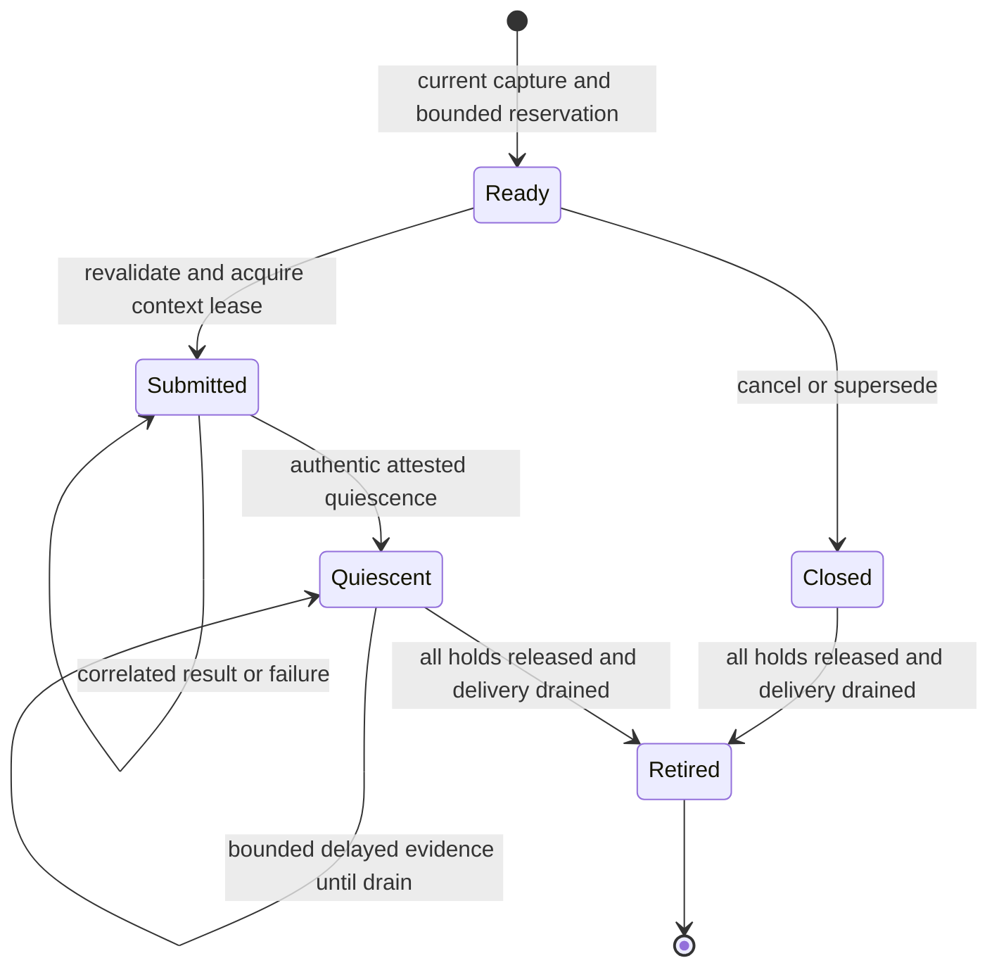

# Owned analysis work and current shared-view reads

Specification §18.7; requirements §§5.6, 6.1–6.2, 7.3–7.4 and 12.5.2.
This is serialized normalized reference evidence for F24, the analysis variant of
F28 and selected F08 products. It is not a native execution service, public wire
ABI, production parser owner or whole-family proof.

Draft 0.204 §18.8.2 separately connects actual F08 query result validation,
two-frame actual-owner workspace borrowing and an absorbing owner-local query
fault fence. Busy excludes owner mutation/retirement until temporary refund;
afterward protected evidence/control/discharge remain. See analysis-query-values.md
for its five controls/eight mutations and conditional bounds. The original
producer/evidence scopes below are unchanged; no external success, native
quiescence, global accounting or physical reclamation is inferred from this guard.

## Products and trust boundary

analysis-work.json closes request, captured context, evidence, query and limit
field sets. Requests name an exact document/source revision, analysis identity,
provider incarnation, grammar/highlight/discovery/registry/configuration generations,
language profile and operation/effect/attempt origin. Strings label evidence;
they do not select commands, paths, modules or network endpoints. The normalized
host registry contains the actual documents, analysis bindings and view attachments.
Opaque task/snapshot ownership lives in private maps; serializing/copying their
visible descriptions does not reproduce ownership. This is an accidental-misuse
boundary, not security against arbitrary malicious code in the same process.

Admission obtains the actual current source, not request-supplied replacement
bytes. parse-query composes the existing owned parser-source compiler/journals;
query-only requires an owned valid base with exactly the same source revision and
bytes and parse dependency key. The latter contains document and analysis identity,
grammar, discovery, registry, configuration and language profile; highlight query
generation is deliberately separate. A highlight-only change may reuse a parse
fact under new current authorization. A grammar/discovery/configuration/registry
change cannot silently reuse that fact. A missing source journal instead admits
an independently bounded fresh parse, never an inferred diff.

Submission returns an immutable logical input and owned base reference; it does
not invoke a callback. One submission lease per analysis identity prevents two
submitted tasks from concurrently claiming that context's mutable parser. Other
analysis identities can progress. Multiple bounded ready tasks are permitted;
this is neither FIFO nor a fairness/service-time promise. A real host must bind
the logical lease to every native parser access and copy/retain trees correctly.

Evidence requires supplied authentic/current ingress authority before retained
packet traversal and exact task/provider/origin correlation. The closed variants
are result, failure and separately attested quiescence. A result packet contains
captured context/source, host parse state, coverage, mapped region observations
and resolved display captures. Fallback categories stay distinct. Range endpoints
must be UTF-8 scalar boundaries; included ranges are ordered, nonempty, disjoint
and within their body. Child captures, including resolved display fragments,
cannot cross a host-prefix hole or claim prose outside parsed child ranges.
Resolved captures are sorted nonoverlapping positive spans. These checks establish
shape and source binding, not that a provider's syntax observations are true.
Host syntax errors and child hasError are separate observations, not conformance.

## Lifecycle and conditional preservation argument

Cancellation, supersession, terminal evidence, applicability and accepted snapshot
are independent flags/facts, not extra execution modes. Cancel/supersede disables
query use immediately. For submitted work it does not release the execution slot
or parser lease. Attested quiescence releases only those work resources; retained
capture/witness/snapshot charge persists until retirement. A repeated old
quiescence receipt cannot release a successor's lease. Retiring a producer is
forbidden while a retained child task owns its snapshot as a base, even if that
child is cancelled. Child retirement releases the logical hold. Contradictory
evidence invalidates the parse fact and every dependent snapshot through the
bounded owned base chain; mere cancellation disables query use without rewriting
an already immutable parse fact. Reuse still needs new admission/current authority.

At most two distinct terminal witnesses are retained. Equal duplicates are
idempotent; a second distinct witness contests the task and invalidates its
snapshot; a third distinct witness is explicitly refused as evidence-full.
This store is **not** a bounded lattice closed under arbitrary receipt union.
Ingress/drain/authentication and any policy for required evidence beyond the cap
remain host obligations; the reference does not call the third witness recorded.

Conditional induction over serialized calls gives:

- Only owned admission creates tasks; only current, ready, unstopped submission
  creates a context lease. The lease key is unique. Only attested quiescence of
  its exact owner releases it; cancel and result intake do not.
- Only one uncontested, valid, currently bound result can create an accepted
  snapshot. All read releases recheck authority, actual source/context, owned
  base validity and actual view attachment. A stale generation/version, equal
  bytes at a newer revision or forged/copy reference cannot restore currentness.
- Acceptance/read/control mutate private derived bookkeeping only. They never
  publish source, annotations, history, selections, viewport or authority.
- Each retained base points to an earlier owned accepted task. Retirement cannot
  remove a live parent; bounded chain traversal rejects cycles/invalid ancestors.
  Thus accepted descendant reads cannot bypass a known base contradiction.
- Admission bounds tasks, outstanding work, issued origins and aggregate logical
  bytes before insertion. A task reserves its captured JSON size plus three
  envelope capacities (two witnesses and an accepted packet copy). Source,
  journals, regions, included ranges, aggregate captures, scalar strings and
  query/reply bytes have independent finite caps. Origins remain spent until
  owner destruction; task retirement does not reopen replay identity.

These are authored conditional trace arguments, not machine-checked induction.
Each reference call has finite catalog/array/map/string work under validated
profiles and terminates or refuses. Native work or a missing quiescence receipt
has no derived wall-clock termination bound. The trusted normalized host boundary
does not prove predecode allocation limits, native memory accounting, parser
preemption or supplier truth. Allocation/transient copies require separate
physical refinement; logical JSON byte charges are not RSS measurements.

## Acceptance, sharing and release

Acceptance rechecks current authorization, continuity/liveness/stop, provider,
actual context/source and parse-base validity, independently of recording evidence.
Only one accepted current snapshot per analysis identity is exposed. A new current
result disables older query refs without destroying independently retained parse
facts. Equal source/configuration alone does not unify different analysis identities.

Both matching views query the same snapshot. F08 supported-analysis returns
bounded resolved captures intersected/clipped to the requested scalar-boundary
source range. This clipping is for display only, never edit-target lowering.
An authorized current empty range succeeds with no captures; it is not a point
query. For query [a,b) and positive accepted capture [x,y), emit only when a<b,
x<b and a<y, then clip to [max(a,x),min(b,y)). This excludes empty intervals and
boundary-only contacts. Original snapshot/view/current authority, scalar-byte
boundaries and query/reply limits still apply before empty delivery. No source,
view, lease or retained-evidence state changes.
supplied-evidence-inspection returns context, host parse state and coverage only;
it supplies no AST, semantic completeness, hidden topology or edit permission.
No native parsing or source mutation occurs during these reads. Other semantic
providers/full evidence inspections require their own specified products.

## Executed scope and controls

analysis-work-checks.mjs composes all 14 actual pinned native mixed-language
packets with the owner, not merely a fabricated highlight fixture. It executes
512 admission/512 submission/128 acceptance/128 release gate cases, 88 named
controls and 21 load-success/assertion-failing mutants. Cases include actual
source-publication journals through incremental submission/fresh fallback, two
view sharing, independent contexts, lease retention, stale attempt correlation,
query-only dependency separation, base holds/contradictions, source and UTF-8 hole
checks, reply/aggregate budgets, replay and source-frame preservation. Mutants
must import successfully; runtime/import/timeout failures are not semantic kills.
These finite cases are not exhaustive reachable-state exploration or independent
Cleanroom certification. formal/results.json plus matching frozen/live input
hashes determine whether the current whole suite was executed successfully.

The accepted snapshot stores normalized native observations, **not a TSTree**.
The native packet bridge proves checked transport/current release of those
observations. It does not bind that opaque base to the actual native tree identity,
run query-only native work under this lease, prove native concurrent ownership or
incrementally reuse native child trees. Real authentication/policy/context truth,
physical capture/retention, F06 invocation observation and generic event integration, full host
envelopes/decoders, proposal/publication composition, every state companion,
Rust/ABI/production host and measured service guarantees remain explicit gates.

## Query range proof and regression

The native fixture regression covers 872 scalar-boundary empty queries, 858
adjacent-scalar queries and four invalid UTF-8 interior positions across all
fourteen pinned mixed-language inputs. Expected nonempty intersections are
computed independently with max/min and a positive-span test. Empty requests
still refuse under missing release/context authority. State and owner usage
remain unchanged. A dedicated mutant restores the old nonempty-capture-only
intersection test and fails an assertion, not an import or tool error.

analysis-range-laws.smt2 has four conditions over mathematical integers: the
emission predicate is equivalent to positive intersection, emitted clips stay in
both ranges, empty queries cannot emit, and the old [3,3)/[2,7) zero-width output
is a satisfiable counterexample. Legal queries satisfy 0<=a<=b and accepted
captures satisfy 0<=x<y. These conditional laws are not parser correctness or
production numeric/resource refinement. Full frozen qualification and endpoint
adoption remain required.

## Existing owner F08 query facade

Specification §18.8.4 binds the two existing queries, not F24 admission or F28
producer evidence. analysis-query-arguments.mjs captures the existing inner
request and seven-field domain context under separate byte/node/depth limits.
Typed/dynamic forms share canonical meaning; original snapshot identity is kept
outside the copied record. The actual owner rejects foreign/copied references
before native request sizing, so an arbitrary opaque object's JSON hooks cannot
be reached through that restoration. The fixed accepted-analysis token adds less
serialized width than the canonical record's omitted context/limits/role metadata;
the restored producer request therefore fits that record's construction frame.
This is not a general serialized-reference or hostile-object guarantee.

queryDecodedInvocationAnalysis uses the existing actual domain and current native
query, preserving source/provider/analysis/view and independent release checks.
It performs no parsing, provider submission, source publication, snapshot refresh
or command-receipt allocation. Immediate query values do not need U01; private
provider task/evidence/quiescence duties retain their own lifetimes.

The conditional reservation argument composes existing native work rather than
replacing it. For healthy private state with H held units and ceiling C, entry
requires K ≤ C − H for the classification frame. Limit capture then requires
7 × B ≤ C − H − K, where B is the smaller caller/owner query-byte ceiling.
The native query independently requires its two construction frames W to fit
C − H − K − 7 × B. Hence H + K + 7 × B + W ≤ C throughout accepted construction.
Gateway bytes remain in actual owner usage during native borrowing. Safe arithmetic,
classification/full-frame refusal before descriptor access, and exact combined
headroom are checked independently. These are declared serialized-value units;
raw descriptor/allocator peaks, shared immutable declarations and physical/global
reservation are separate refinement obligations.

Capture holds the existing busy guard. Its private synchronous handoff invokes
only copied inert data and managed native state; no caller callback or yield sits
between the handoff and native busy ownership. Every actual temporary borrow is
cleared once on ordinary/fault exits. A capture/query surprise latches the existing
analysis-local fence without changing the editing root or retained evidence.
Protected cancellation, late authentic quiescence and justified retirement remain
available after refund. The finite machine returns to idle or a fenced owner;
it is not a provider-completion or wall-clock theorem.

analysis-query-descriptor.mjs derives both query declarations from the same native
forms. Its descriptive JSON Schema is checked by the independent standard tool;
the engine does not evaluate that schema or fetch references. The existing generic
accepted-registry F01 route on the same actual domain releases field metadata and
the descriptive schema, retaining both registry/schema attestations. No builtin
profile is widened. Schema-valid copied snapshots, changed view identities and
backward ranges still fail runtime release. Discovery selectors and positive
advice cannot authorize analysis. Initially absent metadata cannot expand its
capture; later known projection loss stops the old discovery context.

Seventeen gateway controls include four operation/route products, 52 selected
denials, eighteen exact boundaries and six reentrant attempts. Six discovery
controls compose actual F01/F08 owners and independently validate 31 standard
schema cases, including seven structurally valid runtime refusals. Forty-two
coherent copied-graph mutations cover the original 27 gateway faults, thirteen
metadata faults and two forbidden UI imports; the unchanged baseline passes first.
Construction/tool failures do not count as detections. Static traversal now covers
128 modules, retaining the existing ten ownership mutations. A post-import probe
wraps 143 selected filesystem/promise/process callables: four query deliveries and
two discovered variants make no calls. Three injected calls fence analysis with
exact temporary refund, retained tasks and protected late discharge.

These are selected reference/call-graph and conditional preservation results,
not full frozen qualification, installed registry/provider truth, all F08/F24/F28
products, arbitrary dynamic linkage, hostile containment, physical refinement or
independent certification. F16 activation and original invocation/retry/evidence/
event composition remain open. No new UI, substrate, network or execution mode
is introduced.

## Instrumentation and precedent

INS-09 observes asset/context activation; INS-02/07 captured-source handoff;
INS-01/05 admission, lease wait/acquisition, submission, parse/query/map/fallback,
evidence/duplicate/conflict, quiescence and current acceptance; INS-03 scoped read
release; INS-08 task/lease/witness/base-hold/byte saturation; INS-10/11 later
presentation. Use local monotonic stage clocks, bounded aggregate counters and
protected correlation events/traces. Count useful current deliveries separately
from completion, cancellation, stale refusal and partial coverage. Distinguish
successful empty delivery from unavailable; query traffic is not the
number of returned captures. Validation and clipping contribute to delivery
duration without source-range endpoints as metric labels. RED covers
attempts/errors/duration; USE covers slots/leases/retained charges; golden signals
include age of useful evidence and wait/saturation, not just parse throughput.
Observe missing quiescence, delivery drain, refused third witnesses and dropped
observations. No payload/source/label/path/identity/hash is a metric tag. STRIDE
covers forged/stale providers, tampering/replay and resource exhaustion; LINDDUN
covers linkage of documents/views, traces and inference from stale/denied detail.
This is design coverage, not installed probes or measured overhead/SLOs.

[Tree-sitter advanced parsing](https://tree-sitter.github.io/tree-sitter/using-parsers/3-advanced-parsing.html)
defines exact edit/included-range coordinates and requires copying individual
trees for concurrent use. [Python Tree](https://tree-sitter.github.io/py-tree-sitter/classes/tree_sitter.Tree.html)
documents copying/editing and changed-range comparison with the edited old tree.
These motivate isolated mutation, captured source and retained immutable results;
they do not prove this host's implementation. Existing adopted configuration,
supervision, current release and bounded admission contracts supply engine policy,
without adding a runtime, source owner, scheduler service or network protocol.
