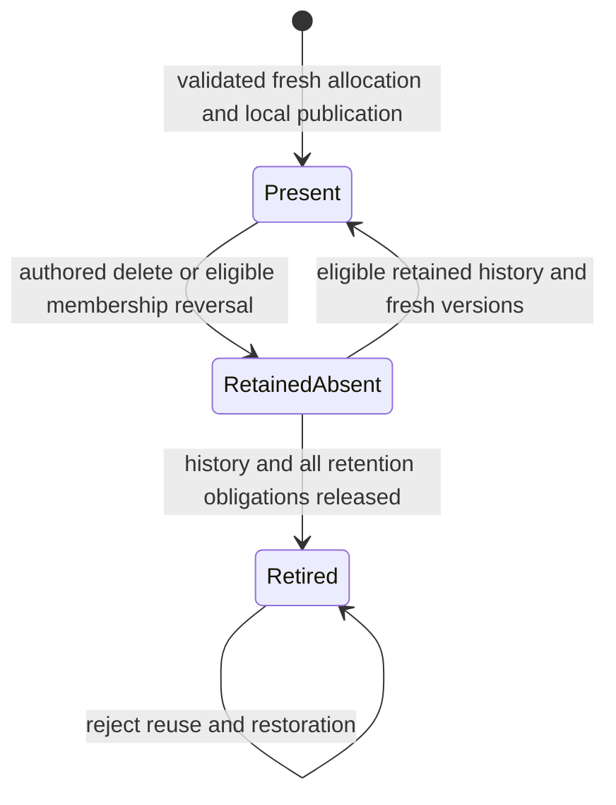

# Retained annotation membership and linked history

Specification §13.9.1 distinguishes live membership, retained absence and final
retirement. Actual compound publication and native F14 reverse create/delete
participants with fresh restored field versions, linked source/current-view
companions and shared invocation outcomes. This is a normalized lifecycle profile,
not an identity issuer, public create/delete gateway or general target-history proof.

## Precedent and derived identity rule

[VS Code's notebook model](https://raw.githubusercontent.com/microsoft/vscode/main/src/vs/workbench/contrib/notebook/common/model/notebookTextModel.ts)
allocates new cell handles for new cells, retains removed cell models in undo data
and reinserts retained models through its undo operations. This supports separating
fresh allocation from restoration of a retained entity. It does not establish Vellum
annotation authority, incarnation security, version floors or retention accounting.
The lifecycle rule here derives from Vellum's already adopted non-reuse, authored
history, current-authorization and bounded-retention requirements, not copied code.

Deleting a live annotation removes collection membership, not necessarily its
retained logical identity. Its owned history can restore that same non-retired
entity. Final retirement is different and irreversible within this incarnation.
Neither an ordinary create nor a restored record may reinterpret an old incarnation
as different content. Restoration rechecks current permissions and assigns fresh
live field versions; it restores neither old grants nor stale command eligibility.

These are record-lifetime states, not separate editing modes. Existing operation
admission/publication/control states still govern every transition. The three-state
vocabulary is not a bounded lattice or a categorical-completeness proof for an editor.

## Complete inventory and fresh allocation evidence

The private reference profile activates an explicit annotationLifecycle inventory
on every document in its supplied root. Each identity/incarnation has a present,
retained-absent or retired slot, body/target version floors and either a retained
record or null. Present rows must have exactly one matching present slot; absent/
retired slots cannot have a live matching row. A live local ID cannot denote two
incarnations simultaneously. Missing/duplicate/inconsistent inventory is not empty.

This is internal normalized state, not a new persisted annotation format or public
selector encoding. Existing roots lacking the profile are not silently bootstrapped.
Actual activation, object creation/disposal integration, complete identity inventory
and issuer/session continuity need their own refinement. The checker seeds an
explicit supplied inventory; seeding it is not evidence of real identity issuance.

Private create components extend the existing owned compound plan with an already
issued identity, literal body and before/candidate target. The trusted current
allocation facts must match the complete immutable plan and its complete ordered
create-identity list. Changing another source/annotation wish cannot redirect an
issued identity behind that preparation. Truth of issuer/current-allocation facts
remains supplied; equality of manifests does not mint authority. Public F13 create
still accepts no caller-chosen live ID. Its actual issuer/request adapter is open.

Ordinary create refuses any already tracked identical incarnation, including an
absent or retired one. Fresh incarnations cannot create a second live row with the
same local ID. A retained older incarnation cannot be restored over a newer live
one. Reclaiming a payload never makes its identity slot free. Slot count/root bounds
can refuse new work; namespace rotation and counter reset are not quota escape hatches.

## Compound membership and reversal

Create materializes the body, authored target/current placement, initial live field
versions and present slot in the actual candidate root. Delete checks current body
and target generations, removes the live row, retains its current payload and raises
floors to its actual current field versions. Each contributes the existing per-record
authored history scope, alongside all source/other annotation participants. Mixed
membership and field wishes for one incarnation refuse before staging; preparation
must normalize an unambiguous final intent rather than depend on array order.

Source mapping still affects currently live rows, not absent historical records.
Body/target-only work preserves independent membership metadata and must honor an
activated lifecycle profile's current root/record bounds. Source, fields, lifecycle,
history and all supported current views publish together through the existing engine
decision, or the original root remains unchanged. No file/save/clipboard effect occurs.

Undo/redo checks the actual complete linked frontiers, journals, current identity,
rights, versions, retention and companions. Removing a currently present participant
retains its current versions, including fresh versions produced by intervening work
that was subsequently undone. Reintroduction requires the exact retained entity and
authored values, then assigns bodyFloor+1 and targetFloor+1. Never reinstall historical
numeric versions or an obsolete whole row. Counter exhaustion refuses the entire
reversal. Old expected versions cannot become valid again after an absence/presence cycle.

Restored placement needs current validated source/target evidence. The reference
supports an unchanged relevant source revision, or its own validated linked source
inverse/forward journal plus supplied target-restoration eligibility. It verifies
resulting source and target bounds before stamping current placement context. It
does not infer identity from equal text after unrelated edits, map arbitrary retained
targets through unknown history, or adopt automatic detached restoration. Unavailable
proof refuses the whole group rather than reinterpreting coordinates. This retains
the existing conservative target-history boundary, not a complete restoration algorithm.

Actual native F14 and shared invocation tests exercise these participants with current
view mapping and spent replay eligibility. Unknown admitted history-participant kinds
are internal protocol faults: preserve the prior root, report Unknown/faulted and fence
the domain, not silently handle the kind as a target or report confirmed rejection.

## Retirement and resource obligations

Final retirement is an internal owner action, not another public cleanup verb. Require
retained absence, current authority/identity, authored persistence-or-discard disposition,
released history/retention/session references, drained delivery, version/resource and
bookkeeping readiness. Additionally inspect the actual current root: no retained group,
even invalidated, may still reference that record. A flag alone cannot erase a journal.
History closure/floor removal, external references and actual host discharge remain
separate obligations; the reference does not implement their complete planner.

Retirement drops the slot's retained payload, keeps identity/floors reserved and changes
its phase permanently. It does not change source, live annotation snapshot generation,
other records or authored frontiers. Its private root disposition advances once without
creating authored undo history. Old history/handles cannot reintroduce a retired entity.

Declare finite root/document/entry, retained payload, individual record and plan limits.
Check activated input and completed output roots, including ordinary field changes.
Admission pressure, failed inverse or counter exhaustion cannot discard unsaved bodies,
unresolved work or a required participant. All roots/staging/journal bytes are logical
serialized values; physical allocation/copy peaks, cross-owner charging and real host
retention are not established. Retired identity metadata remains bounded by admission;
the reference does not silently recycle slots to sustain unlimited creation.

## Conditional proof and executable evidence

Assume coherent owned roots, complete current host/issuer/retention facts and serialized
non-reentrant publication. Induct over the guarded transitions. Create introduces a
previously untracked incarnation. Remove preserves that identity and captures current
version floors. Restore uses the retained entity, cannot lower either floor and creates
strictly greater live field versions. Ordinary edits advance live versions and cannot
make them less than the stored floors. Retirement keeps the reserved identity with no
outgoing restoration transition. Actual whole-root validation and complete-frontier
reversal preserve membership consistency and linked atomicity; the shared ledger supplies
single eligible execution and root/outcome pairing. These are authored conditional
arguments, not proof-assistant refinement of arbitrary code or issuer/authentication truth.

The fixed participant sum and finite root/plan/record/slot traversals bound each operation.
Linked redo invalidation reuses the existing finite-set growth argument. There is no
extension callback, provider I/O or evaluator in publication. An unlimited sequence of
external undo/redo requests is not one non-halting command. Progress/fairness, whole-engine
categorical completeness and bounded-lattice closure remain separate claims.

The checker executes 4,096 publication, 8,192 reversal and 1,024 retirement gate cases,
six document/range/explicit-profile point forms, seventeen controls and fifteen semantic
mutants. An unmodified dynamically loaded composition must pass before mutants count;
load/ownership failures are not credited as semantic sensitivity. Depth-three exploration
visits 42 states/71 edges in the chosen finite action sample; it is not exhaustive closure.
Actual native F14/current-view/shared-ledger traces and a two-document source/create/delete
group test check fresh floors, later-work blocking and all-or-none reversal.

Six positive SMT conditions and two countermodel controls in baseline-contracts.smt2
support fresh exact-integer versions, stale-command refusal, exhaustion, floor monotonicity,
retired absorption and retirement obligations. They have satisfiable premises before
refuted negations. They abstract the actual guarded code and do not prove source mapping,
host facts, memory behavior or independent Cleanroom certification. The complete suite
contains 199 SMT conditions in thirteen manifests after this extension.

## Instrumentation and remaining integration

PATH-01/03/04/10/12, IF-01/03/08/12 and INS-01/02/03/06/07/08/12/13 distinguish fresh
preparation, present/absent/retired disposition, local root/outcome, retained history/body,
current release, restoration refusal and final discharge. MELT/RED/golden signals separate
useful publication/reversal from observation and retention age. USE tracks slots, payloads,
journals, staging and saturation. STRIDE covers stale-version ABA, false allocation,
retired resurrection, partial linked reversal and forged discharge; LINDDUN covers retained
deleted bodies, membership inference and historical linkage. Bodies, coordinates, IDs,
tokens and per-attempt identities are not metric labels; hidden tombstones are not current
annotation query rows or a source-reader disclosure entitlement.

Separate §13.6.2 native create/delete evidence is now in
[annotation-membership-editing.md](annotation-membership-editing.md); this older
compound checker's native-gateway scope flag remains false. Remaining: actual
identity issuance/reservation and decoded routing, legacy/annotation-snapshot activation/
new-object/disposal integration, full history-floor/retirement planning, general retained
target restoration, all query/event/collection products, actual host/concurrent/physical/
decoder/production and independent assurance. Point-profile persistence remains the separate
user-owned choice. No public operation family/variant, transport or deployment default is added.
