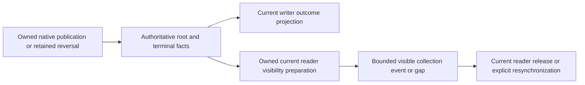

# Native annotation outcomes and recipient collection events

Specification §13.6.3 composes actual native F13 create/body/reattach/delete, shared
invocation outcomes and same-ledger native F14 undo/redo with the existing recipient
collection observer. Writer publication facts and independently authorized reader
events remain separate. This closes a selected native-event integration gap, not
the complete F13 record-result product or a production event dispatcher.

## Precedent and adopted boundary

[Neovim buffer update events](https://neovim.io/doc/user/api/#api-buffer-updates)
provide notifications associated with buffer change context; a caller can use that
context when submitting another request. That supports context-aware observation
separate from subsequent mutation. It does not establish Vellum's visibility,
retention or authorization rules, and no Neovim transport is adopted.

Vellum's adopted boundary is current recipient projection, not a broadcast of raw
operation records. Events carry the supported complete visible projection and
opaque observer-local generation relation. They are neither the native mutation
result nor an automatic query or write selector. A reader acquires an independent
current read context through §12.8.1 when needed; receipt of an event grants nothing.

These are existing pathways of one engine, not new execution modes. Observer work
occurs after publication and cannot undo a committed edit when delivery fails.

## Native edits retained reversal and reference lifetime

The actual annotation producer and shared ledger execute all four native variants.
Creation/reattachment retain document/range and explicit position/content point
profiles with both affinities. Body-only updates merge current placement, including
placement advanced by source mapping after preparation. Equal authored target data
does not hide an explicit detached-to-attached repair.

The independently scoped reader sees only its currently allowed collection and
body/target facets. Body changes hidden by its body ceiling do not create target-only
events; hidden target changes do not create body-only events. Completely hidden
annotations allocate no visible record reference or event/generation progress in
the selected equal-budget worlds. Source bytes and the authority publication
counter are not added to an annotation-only reader's projection.

Native undo/redo runs through the same invocation domain and existing retained
frontiers. Restoring the same non-retired logical annotation uses its existing
observer-scoped reference but fresh body/target versions. A removed reference
remains reserved while another annotation is created; it cannot silently change
meaning or be reconstructed from current row positions. Retained absent payload
does not enter a live collection projection. Complete retirement remains separate.

No-op/refusal and matching settled retries produce no authored collection change.
They do not turn a missing event into publication evidence. Conversely, a queued
event, missing event, reader revocation, binding pressure or queue gap cannot turn
an actual writer Applied fact into not-published. Writer outcome release can be
withheld while an independently authorized reader still receives an event; reader
revocation does not erase a valid writer fact. Old reader epochs cannot revive
the stopped stream.

Bounded queue/binding failure retains the committed root, gaps the observer and
does not install partial reference bindings. Resynchronization requires explicit
current visibility preparation and baseline authority. A failed resync does not
grant extra capacity or silently reopen the stream. Returned values are copies,
not mutable access to the authoritative root or future observer baseline.

## Conditional composition argument

Assume the existing trusted serialized owner boundary, authentic current writer
and reader host facts, valid visibility/order preparation, retention and finite
logical budgets. Native request/plan ownership, publication and same-ledger reversal
have the premises and guarantees in annotation-editing.md and
annotation-membership-editing.md. The observer has its independent current context,
facet ceilings, immutable visibility preparation and staged reference/frame commit
from collection-observation.md.

For each actual native transition, the authoritative root/fact protocol completes
before the reference obtains that root for observer projection. Projecting it can
either retain the previous equal visible baseline, stage one bounded visible
change, or report gap/unavailability. None of those observer branches writes the
authoritative root or the writer's terminal facts. Thus the existing publication
framing/single-execution argument composes with observer failure, rather than
assuming reliable notification to make the edit true.

Visibility filtering precedes reference allocation, and facet filtering precedes
visible comparison. In the selected paired worlds, hidden work therefore leaves
the observer's bindings, baseline and progression unchanged; later permitted work
has the same projection/reference allocation. Retained reference keys distinguish
logical incarnations and survive removal; membership restoration laws supply fresh
field versions. Current release and epoch checks remain necessary after queuing.

This is an authored conditional composition argument plus bounded executable
evidence, not automated refinement between languages or arbitrary-trace privacy.
Existing local version/release laws remain unchanged; no new SMT axioms are added.
Every reference call uses the existing finite native, history and observer loops;
it invokes no plugin/provider callback or user program. Actual physical/native
execution, scheduling and hostile-decoder halting remain separate obligations.

## Executable evidence

`annotation-observation-checks.mjs` connects the actual producer, editing adapter,
shared kernel, native F14 and collection observer. It checks:

- 112 native variant/facet/visibility cases: fourteen representative requests
  (body/delete, six creates and six reattachments), four facet ceilings, two
  visibility states;
- 224 actual same-ledger undo/redo observation stages;
- 1,792 current reader release combinations;
- eight paired hidden/visible histories under non-saturating explicit budgets;
- nine semantic controls and fourteen rejected observer/membership mutations.

Controls cover intervening creation during retained absence, current source mapping,
placement repair, copy isolation, writer/reader revocation separation, no-op/refusal/
retry, queue/binding pressure and explicit resync. The dynamically loaded unmodified
composition must pass before mutants count; load errors do not count as semantic
detection. Short mutation cases include every single missing release condition,
not only all-off/all-on gates. Membership mutations roll back restored body/target
versions and must be detected in the actual released event, not merely an isolated
membership helper.

The composition fixture has two fixed documents, one observed owner and no attached
views or external effects. Target representatives cover the six declared live forms,
not all byte strings; boundary conformance remains separate native-field evidence.
Native event/version/control cases are bounded selected traces, not exhaustive
reachability or an executed production observer scheduler.

## Instrumentation and remaining closure

PATH-01/03/04/12 and IF-01/03/08/12 retain native admission/publication, retained
reversal, current observation and release boundaries. INS-01/02 separate writer
admission/disposition and authoritative facts; INS-03 observes current reader
projection/release; INS-06 retained frontier/reference/restoration failures;
INS-07 held annotation obligations; INS-12 diagnostic loss; INS-13 useful completion
versus delivery/quiescence. MELT/RED/golden signals distinguish admitted/applied
work from visible events, gaps, current denial and resync latency. USE tracks
binding/queue/held-history pressure. STRIDE challenges replay, stale epochs,
reference reassignment and false nonpublication; LINDDUN challenges hidden activity,
body/target/linkage and global-counter disclosure. No raw annotation ID, hidden
row count, body, target, invocation or global publication counter becomes a label.

Section 13.6.4 separately checks normalized F13 identity/version receipts in
[annotation-results.md](annotation-results.md). This event checker's older false
result-product flag stays scoped to its own tests, not absence of that evidence.

Still open: public F13 wire/alias result-reference integration,
event-to-query selector integration, real issuer/visibility/order/retention truth,
other lifecycle/event/effect profiles, full invocation/effect replay and production
dispatch, general target restoration/full retirement planning, point storage,
actual concurrent/physical/timing/native/decoder/production and independent
refinement. Existing native/collection checker false flags retain their own narrower
scope. This batch closes no whole family, decision row or all-sections goal.
