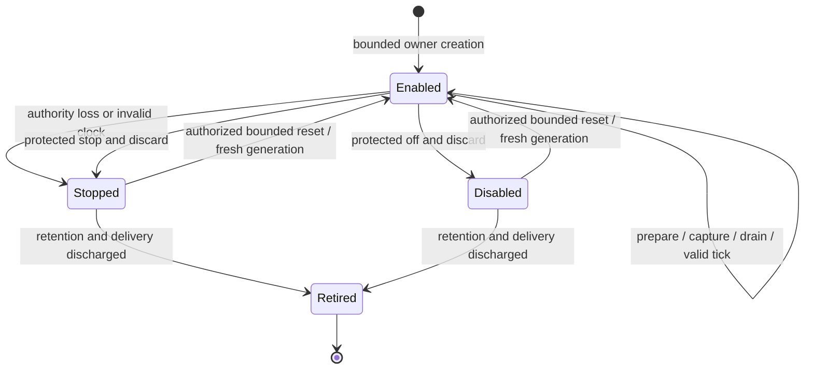

# Bounded optional diagnostic capture

Section 23.2.2 and [owned local drain](diagnostic-drain.md) separately bind F26
tasks/results to this queue. An optional actual consumer hold now prevents queue
retirement until that gateway and its known tasks discharge. The gateway charges
its binding and cannot reset its budget by rebinding. Ordinary queue behavior
without a bound gateway and the original 32 mutation controls remain unchanged.

Specification §23.2.1 refines the adopted optional capture/loss policy with a closed
content-free record, an owned queue, protected health and current authorized drain.
It leaves authoritative operation/effect evidence in its existing owners. This is
an executable sequential reference, not installed critical-path instrumentation,
a durable audit log or a production memory/lock-freedom guarantee.

## Record and ownership

The reference profile bounded-optional-capture/1 owns one queue per actual native
publication domain. Its captured scope fixes authority, engine, recipient, purpose,
destination, policy, continuity and profile. A spent-domain marker survives owner
retirement; replacing the owner cannot reset lifetime issuance. This selected
single-queue profile is not a global subscriber or a claim of complete multi-sink
instrumentation. Grant and host-truth obligations remain external.

The exact boundary-marker/1 product has only schema, site and milestone. Site is
one of the thirteen existing INS placements; milestone is offered, admitted,
completed, rejected, cancelled or discarded. All 78 combinations are permitted
descriptive markers, not a proof that the caller observed a real milestone at that
site. No source, annotation, path, host error, command argument, identity, timestamp,
trace baggage, correlation token or custom string is accepted. No additional
metadata field is permitted. Schema/version changes require explicit review.

This is a marker catalog, not the complete metric/outcome catalog. Rejected is not
automatically a service error; diagnostic-record counts are not application request
counts, useful throughput or fan-out counts. There are no invented latency units,
histogram buckets or numerical SLOs. Optional markers may inform events, logs or
traces and bounded aggregates; their absence is not evidence that no work occurred.

## Preparation and capture

Validate/copy/freeze the complete primitive record outside publication guards under
current collection permission. Reject unknown fields/codes and count invalid
diagnostic attempts without retaining their payloads or changing an operation.
Prepared tokens are opaque, owner-local, single-use and generation-bound. Bound
concurrent preparations and lifetime issuance independently.

Capture consumes only an owned token and bounded primitive scope/control facts.
It does not inspect/format/serialize the original record or call a subscriber,
exporter, sink, command, provider or clock. If either slot or byte capacity is full,
drop the new optional record; preserve existing FIFO contents. Account for offers,
successful capture and drop separately. No queue operation changes a native root
or invocation ledger. Inert typed inputs and host-established facts are premises;
this JavaScript reference is not a hostile-object decoder or allocator proof.

Independent finite limits cover slots, queue bytes, preparations, record/context/
reply sizes, preparation issuance, generations and retention steps. The local
reservation sums context, queue, prepared records and separate staging/health
replies using safe arithmetic. The profile must fit at least one largest allowed
record reply and a worst-case protected health reply. Physical object overhead,
global admission and actual bounded non-waiting critical-path mechanisms require
implementation evidence.

## Drain and protected health

Drain requires the exact issued generation, complete captured scope, current
release permission, retention, transfer/reply/resources and execution outside a
publication guard. Collection permission and release permission are independent.
Stage the whole bounded immutable FIFO prefix and reply before consuming records
or increasing drained counts. For an enabled owner whose authority remains
current, release/transfer/reply/size refusal preserves both. Observed authority
loss instead follows the explicit stop/discard rule below. Drained
means removal into the authorized local reply, not transport receipt, export,
durability, acknowledgment or an authoritative operation outcome.

Health has a separate protected reply reservation and current health permission.
It remains available when optional capacity is zero, collection/release is denied
or capture is disabled/stopped. Scope mismatch is unavailable. Its coverage is
explicitly optional-capture; occupancy uses record slots and canonical record JSON
bytes, not physical RSS. Its seven counters count offered, captured, drained, dropped,
invalid and discarded records/attempts plus preparationRefused for valid markers
refused by preparation-slot or lifetime-issuance pressure. Offered is the token
capture boundary, not preparation or every denied diagnostic API call.
Each value has an exact Boolean: reaching the finite maximum remains exact if the
actual count equals it; exceeding it saturates and marks inexact. Maximum zero
therefore distinguishes actual zero from an uncountable positive event. No wrap
or later zero-increment repairs lost exactness. Health does not instrument itself.

## Retention and generation transitions

Queued records have a positive finite logical retention budget. Valid positive
ticks decrement it or discard expired records. Invalid clock evidence stops and
discards rather than presenting unknown age as fresh. Ticks are service inputs,
not milliseconds or proof of an actual monotonic clock, suspend behavior or fair
service. Without service, no real-time expiry bound is claimed. Prepared tokens
are bounded staged metadata, not captured events with a fabricated observation age.

Stop clears queued/staged records, counts captured discards and never refunds
preparation issuance. Reset creates a fresh opaque observation generation and fresh
counters, not an exact cross-generation delta. Old generation tokens refuse; old
counts are not silently joined or retained as a lossless audit history. Generation
limits and spent issuance survive reset. Protected stop remains available after
content/ordinary-capacity loss; wrong scope cannot stop someone else's owner.
Observed matched-scope authority loss stops the old generation, so regrant alone
cannot revive it. Retirement requires explicit owner, retention and delivery facts;
no secure physical erasure or host quiescence is inferred.

## Precedent and proof boundaries

[OpenTelemetry error handling](https://opentelemetry.io/docs/specs/otel/error-handling/)
prioritizes isolating telemetry failures from application behavior and warns about
callbacks and implicit formatting. This supports the existing isolation direction,
not an SDK dependency or proof of this implementation.
[Its metrics model](https://opentelemetry.io/docs/specs/otel/metrics/data-model/#resets-and-gaps)
distinguishes stream resets, unknown starts and gaps; that subsection is marked
Development. Vellum uses an explicit local opaque generation, not OTLP timestamps
or a claim that two counter generations are comparable.

The reference checks 42 actual annotation/history stages, 512 preparation/4 capture/
64 drain/32 health gate vectors, 78 markers and all 1,555 action words through
length four (5,910 edges) against an independent integer/count/age oracle. Thirteen
controls and 32 semantic mutants have passing unmodified baselines. Import/runtime
errors do not count as kills. The action horizon is not exhaustive reachability
of every profile, and same-author oracle work is not independent Cleanroom review.

Ten added baseline solver conditions cover counter bounds/exactness including zero,
safe byte admission, drop-new framing, staged drain refusal, age rank and reset
distinction, plus wrap and stale-grant weakened-rule witnesses. All eight positive
laws have satisfiable premises and unsatisfiable negated conclusions. Integers and
abstract generation ordinals are logical abstractions, not exposed native epochs.
The age rank proves per-record progress under valid ticks; a closed vocabulary
alone does not prove fair service, whole-engine halting or categorical completeness.

MELT/golden/RED/USE reuse INS-12/13 local loss, occupancy, drain/refusal, clock and
retirement observations at CMP-16/17, IF-09, PATH-11/12 and DAT-10, with source
placements at the other INS sites. No arbitrary metadata,
raw owner/generation IDs or private epochs become metric labels. STRIDE/LINDDUN
cover scope spoofing, marker forgery, loss masking, private activity linkage,
cardinality floods and diagnostic authority confusion. STPA/FMEA, actual installed
placements, producer milestone truth, release/clock/retention policy, measured
costs/workloads, richer field schemas, complete measurement catalogs and
physical/concurrent/crash/independent refinement remain gates. No whole D36–D39,
F26, supported host matrix or all-sections goal closes.
