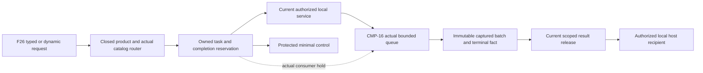

# Owned local diagnostic drain gateway

Specification §23.2.2 connects F26 authorized-diagnostic-drain requests to the
actual optional marker queue. It supplies bounded task ownership, shared typed/
dynamic routing, at-most-once local drain, retained terminal facts and separately
authorized result release. It stops before any exporter, transport or durable audit.

## Component and data boundary

The gateway is the selected local CMP-17 host bridge at IF-09/PATH-11, using the
existing CMP-16 queue. It is not a new engine execution mode, global subscriber,
native invocation job kind or arbitrary host callback. Domain-bound queue metadata
inspection and one opaque consumer binding are trusted internal ports, not public
F07 selectors or an implicit health grant. Queue and gateway scopes agree on
authority, engine, recipient, purpose, destination, policy and continuity, with
separately named capture/drain profiles. Caller-supplied labels cannot reclassify
another F26 facility as diagnostic drain.

Open only after actual owner/domain/scope inspection and compatible resource
reservation. The binding installs an actual queue-owned hold. Even true supplied
retention/delivery flags cannot retire that queue while the hold remains. Gateway
retirement releases it only after all known task/result consumers retire. The
gateway reserves its binding metadata; it does not silently increase the base
queue's declared payload budget. A spent binding marker prevents replacement
gateways from resetting task issuance. Direct queue operation without a gateway
retains its earlier contract.

No network hop or exporter is implied by the final edge. In the
[OpenTelemetry Logs SDK](https://opentelemetry.io/docs/specs/otel/logs/sdk/), processor,
exporter and flush operations have distinct completion semantics. This supports
explicit boundary naming; a Vellum local drain is not the SDK's export success.
No SDK, retry policy, callback API or numeric default is imported.
[OpenTelemetry error handling](https://opentelemetry.io/docs/specs/otel/error-handling/)
also motivates isolating diagnostic failure from application behavior; it does not
prove this reference or native crash/allocator safety.

## Exact request and replay

Issue a bounded opaque task and capture the actual queue generation. Issuance
reserves a slot and minimal completion/control/result storage but is not admission.
The argument product has exactly contract host-diagnostic-drain/1, task, generation
and a positive safe integer limit within the actual queue profile. Typed reference
envelopes use family/variant/version/arguments; dynamic envelopes use
name/variant/version/arguments. Both use the existing operation-catalog decoder
and hostRequest router for F26/authorized-diagnostic-drain. Their fixture strings
and family index do not assign production public IDs, Rust types or wire encoding.

Submission stores one immutable generation/limit intent in the actual issued task.
Matching repeated typed/dynamic submission observes the existing task; changed
intent, copied task/generation handles, unknown names/versions/fields, invalid limits
and other facilities refuse before drain. Retired handles never alias new tasks.
Slot reuse never refunds lifetime issuance.

## Service and retained facts

The task phases are issued, pending and terminal. Service requires actual pending
ownership, current authority/interpretation and reserved scheduler/resources. With
still-current ownership, missing readiness defers without touching the queue.
Observed matched-scope authority loss instead fences the gateway, settles pending
tasks as not performed and releases optional reply buffers; it does not mutate
authoritative source/invocation state or stop the independent capture queue.

An eligible turn rechecks actual queue mode/generation and current drain permission.
It performs the fixed queue operation at most once. Dispatch refusal or stale queue
settles notPerformed; an accepted empty batch is still performed with zero records.
The requested prefix is selected at service time, not leased at admission. Other
valid drains/capture may change it before service. The entire actual queue reply
bound plus the gateway envelope and protected control reply is reserved before
any drain, so ordinary result capacity is not discovered too late.

Store the actual immutable batch and historical remaining flag privately. Current
result reads return copied values without another drain and preserve the actual
opaque generation identity. A new queue generation makes an old pending drain
ineligible and purges an old terminal payload on authorized ordinary release, not
its performed fact. Capture stop alone does not erase an already drained task fact;
release still needs current scope, grant, retention and transfer. Ordinary release
does not require owner-control permission. Protected control does not require
ordinary result/data capacity and exposes no batch or queue contents.

The result states admission separately from phase and drain disposition.
notPerformed, performed and unknown are distinct; batch null means no retained
releasable payload, not proof that no drain occurred. Local drain is not transport
delivery, sink acknowledgment, export durability or audit completeness.

Pending-first task stop prevents drain. Service-first stop may release the optional
payload but cannot rewrite performed to notPerformed. Unexpected drain exceptions,
malformed private results or broken generation correlation settle unknown and
fence the optional gateway. Other pending tasks settle notPerformed. No raw error
text is retained/released and no automatic replay follows. The injected faults test
this controlled service boundary, not process death, allocator failure or native
preemption.

## Ownership and bounded progress

Finite limits bound live tasks, lifetime issuance, copied scopes/binding/intent,
retained batch, ordinary/protected replies and aggregate logical reservation.
Actual queue limits are inspected rather than supplied by a caller. Private
response validation checks both the actual queue bound and the reserved bound.
The gateway's releasedPayloads supervision count means released retained buffers,
not lost records or confirmed recipient delivery.

Task stop does not retire its slot or parent hold. Pending tasks cannot retire.
Issued/terminal retirement needs explicit owner, retention and delivery discharge;
gateway retirement additionally needs stopped state and no remaining tasks. Only
then can it release the actual queue binding. Supplied host facts cannot override
known consumers. Logical serialized charges do not establish physical allocation,
global memory accounting or concurrent/crash atomicity.

Every selected call has closed bounded input/work. The phase rank 2/1/0 for issued/
pending/terminal decreases on eligible progress/nonterminal stop, not on queries, replay or
missing readiness. Completion therefore still needs actual host service or stop;
closed vocabulary is not a proof that a stalled host or the entire engine halts.

## Evidence and instrumentation

The actual-module reference checks 42 native annotation/history stages and 84
typed/dynamic drains, 128 open/4,096 issuance/4,096 submission vectors, 64 readiness/
64 dispatch vectors, 512 result-release/96 protected-control cases, and all 1,555
action words through length four (5,910 edges) against a separate state/count oracle.
Sixteen controls include reset, cancellation races, actual holds and private faults
before/after drain or malformed/correlation-broken results. Forty semantic mutants
have passing baselines in coherent queue/gateway module graphs; import/runtime
runner errors do not count as kills. The earlier queue's 32 mutations remain.

Eight additional BASE-DRAIN solver conditions establish nonvacuous at-most-once,
terminal-knowledge preservation, current result/capacity, actual-hold exclusion,
lifetime issuance and retry-frame laws, with two weakened-rule witnesses. The
total is 252 conditions across fourteen manifests. Logical ordinals are not exposed
epochs. The bounded oracle horizon and conditional laws are not whole-profile
reachability, whole-engine categorical closure or independent Cleanroom review.

Reuse CMP-16/17, IF-01/08/09, DAT-10, PATH-11/12 and INS-01/03/04/12/13. MELT,
golden/RED/USE distinguish offered tasks, admissions, deferred readiness, actual
drain, terminal disposition, withheld/copied results, held slots/buffers, and binding
retirement. Do not infer application traffic, useful publication or export success
from these counts. Raw task/generation/owner identities, recipient contexts and
arbitrary strings are not ordinary labels. STRIDE/LINDDUN cover task spoofing,
replay, stale generation, result linkage, consumer-retirement bypass and diagnostic
authority confusion; STPA/FMEA remain separate analyses.

Actual host grants/clock/scheduling/retention/milestone truth, installed hooks,
complete F26 facilities and F06/event composition, production IDs/decoders/wire,
exporters/sinks, measured/physical/global/concurrent/crash and independent assurance
remain. No whole operation family, decision row or all-sections goal closes.
