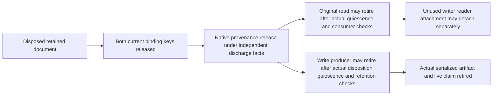

# Disposed annotation producer discharge

Specification §16.5.16 permits retirement of the original annotation read and a
qualified annotation-write producer after the actual native document has released
its provenance. Document disposal, key release, work quiescence, retained-consumer
discharge and attachment detach remain distinct. Authored state and archived
binding/baseline bytes remain unchanged throughout producer retirement.

## Precedent and lifecycle boundary

The direct executable precedents are native retained-disposal publication, the
existing superseding-checkpoint read discharge and the shared writer's independent
retirement/codec rules. The [Linux RCU overview](https://docs.kernel.org/RCU/whatisRCU.html#rcu-overview)
separates removal of references from later reclamation after readers finish. This
supports separating the lifetimes; it does not select RCU, grace-period timers or
CPU memory-ordering guarantees for this serialized reference.

A valid native released document has live=false, a closed provenance-released
lifecycle with positive generation and null retained binding, a null source
binding, an activated ordinary-binding inventory with positive generation and null
annotation binding, and a null current annotation baseline. Missing/unknown fields
or an old disposed-retained phase do not establish this condition. The actual
native lifecycle route creates the marker under the existing independent discharge
facts; the marker is not a cryptographic certificate or proof of real host truth.

Archived binding/baseline rows are not erased. They retain their historical bytes
and attribution, but an explicitly released document no longer uses them to pin
the original producer. Malformed retained inventories still refuse cleanup. A
current or retained reference in another known document is a separate consumer,
not implicitly released with the original owner.

## Original read retirement

The native read coordinator obtains its actual authority root; a supplied fake
root or extra flag cannot substitute for it. Its private original read task and
retained restoration must still exist. Require actual submitted-read quiescence
and all fourteen existing read-discharge facts exactly true, including independent
coverage, retention, delivery and history/snapshot/read/write/provider discharge.
EOF, cancellation, a host label or document disposal alone cannot override actual
work or named dependencies.

Scan the bounded current and retained baseline slots and every known attached
writer relation. Known live loaded-baseline captures, unresolved work, destination
quarantine and inconsistent relations block retirement. A settled writer capture
keeps its own immutable historical loaded bytes; after its launch dependency ends
it need not keep the original reader ledger alive as well. Unknown outside
consumers must still be excluded by actual host coverage and retention evidence.

Successful retirement removes the actual reader task, retained restoration and
adoption record. Preserve spent origins and the absorbing application-consumed
identity. Historical restoration inspection and late receipt intake become
unavailable after the authorized discharge, without recalling delivered copies.
No root, counter, authored record, history or peer writer/codec state changes.
This path needs no independent save checkpoint: an unadopted restoration can also
retire after actual document provenance release, without fabricating saved status.

## Write producer retirement

The existing writer still requires actual destination release, known application,
uncontested no-future-effect disposition, actual quiescence and strict independent
retirement/retention/delivery facts. A claimed native baseline promise must already
be discharged. Its archived baseline continues to pin the producer through disposal
and both key releases; only the valid provenance-released disposition makes those
original-document slots inert.

For ordinary native claimed work, check both the supplied root and the actual
native authority root. A caller cannot forge a released or empty supplied root to
evade the real retained baseline. Scan known peer current/retained annotation
baseline slots for the same producer origin/context; named references and explicit
unknown inventories refuse retirement. Cross-document negative fixtures challenge
the guard, not permission to attribute one document's write to another owner.

Only after the checks succeed does the actual codec retire the serialized artifact,
the claim record retire and the writer task disappear. Read state, native roots,
other tasks, origins and pool issuance remain unchanged. The existing bounded pool
may retain a cold issued claim handle while its liveProducerPins count drops;
producerPins is not a count of remaining live payloads or a physical-memory theorem.
No capacity or identity namespace is reset.

Read-first and write-first retirement are both valid when their independent
conditions hold. The existing checked attachment detach may run after read
retirement without discarding settled writer evidence. It removes only its two
relation charges. A known writer still working can block read retirement even
after the document's root pin has ended.

## Evidence and conditional arguments

disposed-annotation-producers-checks.mjs composes the actual native lifecycle,
reader, restoration, writer, baseline pool and codec. Across 42 annotation
capture/undo/redo stages it exercises 168 native scenarios: adopted loaded reads,
unadopted/unattached reads, and both read/write retirement orders after actual
acknowledged writes. It observes 168 read and 84 write retirements, all 16,384
read-discharge fact combinations, fourteen controls and sixteen semantic mutants
after a passing coherently rewired baseline.

Controls cover strict independent facts, staged disposal versus provenance release,
actual reader and writer quiescence, native-root substitution, closed released
shapes, known peer references/unknown histories, another known attached writer,
late read contradiction versus contested write evidence, disclosure revocation,
later native fault, counter exhaustion and foreign/cloned handles. These known
consumer checks do not prove all real consumers were declared. Runtime/import
failures are not accepted as semantic mutant detections.

Conditionally, the native marker and empty named-consumer set remove only a root
dependency; actual work and retention checks separately govern retirement. Each
successful transition removes exactly its owned task/artifact records while leaving
the native root and other owners unchanged. Spent-origin and consumed-application
state remains absorbing. The fixed known-consumer set admits a finite dependency
powerset; this is not whole-engine categorical completeness. Each request halts
after bounded scans, not after waiting for environmental discharge to occur.

These are authored preservation arguments and finite executable evidence, not
proof-assistant induction, hostile-decoder safety, physical reclamation,
concurrent/crash implementation refinement or independent Cleanroom certification.
The valid native initial profile, real retention/policy/coverage/provider facts and
all required host routes remain premises.

## Observation and remaining work

PATH-05/12 and INS-01/02/03/04/07/08/09/12/13 distinguish document-root pin release,
read retirement, write evidence/artifact retirement, attachment detach and retained
cold audit handles. MELT and RED/golden signals cover admission/refusal, useful
retirement, latency and errors; USE distinguishes work, artifact, relation, root,
promise and lifetime-issuance occupancy. STRIDE challenges forged released roots,
false coverage, stale identity, early refunds and origin reuse. LINDDUN covers
resource/owner/activity linkage, retained history and historical-result loss of
availability. Content, paths, identities, origins, tokens, handles and generations
are not ordinary metric labels. Installed signals and overhead remain unproved.

Native scratch/view/workspace and explicit-export destination routing, complete
unclaimed/legacy/rebind/history profiles, active-document contested recovery,
disposal promise transfer, public invocation/replay/events, actual host/package/
retention truth, global/physical costs, concurrent/crash refinement and independent
assurance remain open. No requirement, public verb, job kind, component, transport,
numeric default or solver condition changes; 234 conditions/fourteen manifests remain.
