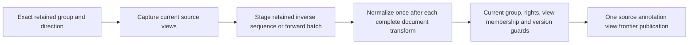

# Current view mapping through retained reversal

Specification §14.7 connects the actual F14 owned-admission path to the named
explicit-positional-selection/1 profile. Retained source transforms now map current
attached selections and their source contexts in the same private candidate as
source/annotation/frontier reversal. The earlier raw-helper counterexample remains
valid, but is no longer the native path for this profile.

Section 13.9.1 separately exercises this actual current-view/native F14 path with
retained create/delete compound history, including linked multi-document source
and annotation participants. See [annotation-membership.md](annotation-membership.md).
That evidence is scoped separately; it neither restores historical views nor proves
general target history, native issuance or a complete retirement planner.

Section 15.5 reuses the bounded participant constructor/completion machinery for
F11 forward search replacement, with a forward purpose rather than redo. The
forward wrapper can publish a validated equal-source view effect without a source
revision/history entry; native F14 still requires an applied retained reversal.
An explicitly empty forward edit set needs no source-view inventory, unlike a
nonempty transform with unknown membership. [The separate bridge checks](search-selection.md)
cover current annotations/views, original match extent and current query gates.
This reuse does not enlarge the original F14 evidence or prove all companions.

## Contract and precedent

Specification §14.2 already requires mapping live selections rather than restoring
old selections in other views. [CodeMirror state 6.5.2](https://raw.githubusercontent.com/codemirror/state/6.5.2/src/selection.ts)
provides selection-through-change precedent. Vellum keeps its selected positional
and affinity laws rather than copying the peer's endpoint association or historical
selection policy. No invoking-view restoration or new global UI default is selected.

No F14 caller fields or command variants are added. Native preparation internally
owns a bounded view part containing current source participants, exact retained
inverse/forward batches, current view signatures, candidate selections and logical
charges. Required signatures include view/document incarnations, source revision,
selection generation, profile, primary and selection values. Viewport fields are
not transformation inputs and are preserved from the current root. Private view
identities are not added to recipient reports or caller dependency requirements.

For a source group, missing view membership is unknown, not an empty set. An
explicit empty inventory is allowed; absent/incompatible source-view profiles,
duplicate identities, stale source contexts or exceeded bounds refuse. A group
with only authored body/target changes has no source transform and needs no source
view inventory/profile. Automatic source mapping grants no annotation/view
visibility or authorship; current rights/companion truth remain owner premises.

## Exact transformation and publication

Undo uses the actual inverseSequence in its stored sequential coordinates; it
does not sort that sequence into an original-coordinate batch. Redo uses the
actual simultaneous forward batch. Each view's current selections pass through
those exact transformations using the existing mapSelection helper. Normalize
once after the complete per-document transform so primary association is not
prematurely discarded between inverse steps. Source and selection domains remain
valid UTF-8 byte positions under the accepted profile.

Fresh preparation captures views present at reversal time, including views opened
after the original group. It does not recover saved historical cursors. A changed,
new or closed required view invalidates the prepared mapping; reprepare against
current state rather than retargeting old work. Unrelated-document selections and
late viewport changes are not restored or gratuitously made dependencies.

The actual native publishReversal path validates the owned part and invokes the
actual source/annotation evaluator. Both are pure reference helpers producing
private candidates; completeReversalViews verifies the resulting source bytes and
fresh revisions, then installs mapped selections/source contexts before returning
the complete root. No partial result, callback or additional publication is exposed.
Selection generation advances only when its selection/primary changes; source
context still advances when coordinates happen to stay equal. View-version
exhaustion refuses the whole source reversal. Frontier movement creates no new
ordinary authored group and no external effect replay.

The actual shared-root synchronization/ownership mechanism is still a refinement
gate: composing pure candidates is not a proof of concurrent atomic publication.
Likewise source-group correctness, current policy, issuer/retention integrity and
all non-selection companions remain premises, not conclusions of view mapping.

## Bounds and evidence

Finite accepted selection limits bound current/input views, source extent,
selections and serialized selection values. Separate native work limits bound
view batches, edit records, source/journal byte charges and the owned view-plan
serialization. Native maxPlanBytes includes the full part. Charges close over
their own decimal representation with at most 17 serialization steps. Current
tightened limits or changed accepted view limits cannot silently expand or
reinterpret a prepared invocation. These are logical UTF-8 JSON reference charges,
not a chosen wire/Rust layout or proof of physical memory, latency or reclamation.

The new suite checks 1,024 final gate combinations across undo/redo, 1,010 finite
point-oracle cases, 14 actual multi-edit inverse/forward traces, 42 controls and
eight mutants through redirected actual native-helper imports. The point oracle
uses separate sequential arithmetic, not mapSelection/mapAttachment. Controls
cover source/body compounds, later comment bodies, opposing affinities, current
selection changes, newly opened/closed views, range direction/primary merging,
missing inventory, copied ownership, budgets, fresh generations and whole-root
coherence. Existing F14 admission retains 512 gate cases/52 controls/six mutants.
Its journal-identity control now also isolates changed expected-byte metadata from
the new view part's independent expected-source guard. Mutants must load and fail
assertions; a masked or parser-failing mutation is not accepted evidence.

INS-01/06/02 separate capture, inverse/forward work, current view/member admission,
publication and frontier acceptance. INS-08 observes retained part lifetime and
batch/edit/view/byte pressure; INS-03 still controls visible outcome release.
MELT/golden/RED distinguish stale/refused/committed reversal work and latency; USE
tracks concrete staging/retention resources. STRIDE covers journal/plan substitution,
skipped peers and stale retargeting; LINDDUN covers hidden view existence, carets and
later annotations. No text, cursor/range streams or identity strings become metric
labels. Actual diagnostic installation, current field policy and overhead remain gates.

This is same-author finite reference evidence, not independent Cleanroom
certification, all-view-profile conformance or complete implementation refinement.
Other supported selection/native/provider companions, membership reversal,
general retained target restoration, equal-byte nonidentity
annotation classification, replay/outcome/event composition and physical/concurrent
refinement remain open. Point-annotation persistence is unchanged.
