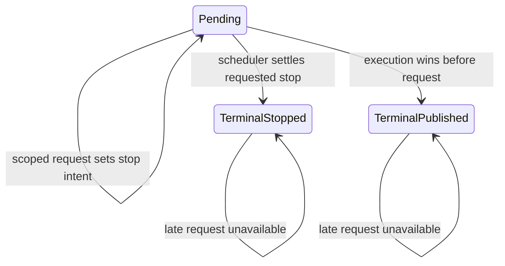

# Scoped native invocation cancellation

Section 6.5.2.3 adds replace-current/all canonical fixtures and separate retained
reply-frame obligations to actual F18/context/observer coverage: 38 forms/twelve
kinds, 608 gate/304 context cases, 76 races and 9,842 traces/27,588 edges. Original
ten controls/twelve mutations remain. Local cancellation does not retire borrowed
query results; canonical/result charges remain until protected invocation cleanup.
See replacement-gateway.md; preceding counts remain scoped to their own slices.

Section 6.5.2.2 adds four canonical selection/navigation fixtures through actual
F18 control and observer paths: 36 forms/twelve kinds, 576 gate/288 context cases,
72 races and 9,324 traces/26,136 edges. Original ten controls/twelve mutations
remain. No source-write grant is needed to cancel these view-only invocations;
protected authority, actual scope, pending eligibility and separate observer/
retirement lifetimes remain required. See selection-gateway.md; older counts
retain their own slice scope.

Section 22.3.1.11 adds a fresh-basis lifecycle form under the same settings kind:
32 forms/twelve kinds, 512 gate/256 context cases, 64 races and 8,288 traces/23,232
edges. Original ten controls/twelve mutants remain. Invocation cancellation and
retirement do not retire independent bases; faulted owners retain protected
individual discharge. See basis-lifecycle.md. Older counts retain scope.

Section 22.3.1.10 adds the explicitly requested created-layer result profile under
the existing settings kind: 31 forms/twelve kinds, 496 gate/248 context cases,
62 races and 8,029 traces/22,506 edges. Original ten controls/twelve mutants remain;
cancellation creates no references and protected result retirement releases only
its own charge. See settings-created-results.md. Older counts below retain scope.

Section 22.3.1.9 adds scoped serialization under the existing settings kind:
thirty forms/twelve kinds, 480 gate/240 context cases, sixty races and 7,770
traces/21,780 edges. Ten controls/twelve mutants remain. Cancellation or plan
retirement does not discharge the separately retained metadata basis; see
scoped-serialization.md. Earlier counts below retain their historical scopes.

Section 22.3.1.8 adds scoped layer lifecycle under the existing settings kind:
29 forms/twelve kinds, 464 gate/232 context cases, 58 races and 7,511 traces/
21,054 edges. Ten controls/twelve mutants remain. Cancellation or plan retirement
does not discharge its separately retained lifecycle basis. See scoped-lifecycle.md;
older counts below retain their historical scopes.

Section 22.3.1.7 adds scoped configuration definition under the existing settings
kind, retaining intrinsic serialization from §22.3.1.6. Current coverage is
28 forms/twelve kinds, 448 gate/224 context cases, 56 races and 7,252 traces/
20,328 edges. Ten controls/twelve mutants remain. Invocation cancellation or
plan retirement does not discharge separately retained declaration bases.
See scoped-definition.md; older counts below retain their historical scopes.

Section 22.3.1.5 adds scoped settings under the same settings kind: 26 forms/
twelve kinds, 416 gate/208 context cases, 52 races and 6,734 traces/18,876 edges.
Ten controls/twelve mutants remain. Invocation stop/retirement does not discharge
separately retained write bases; see scoped-settings.md. Older counts below retain
their historical slice scope.

Section 22.3.1.4 adds layer lifecycle under the existing settings kind:
25 forms/twelve kinds, 400 gate/200 context cases, 50 races and 6,475 traces/
18,150 edges. Ten controls/twelve assertion-killed mutants remain. Stop preserves
the root and pending preparation until protected retirement; see
engine-settings-layers.md. Older counts below retain their historical scope.

Section 26.1.2.1 adds configured-line preparation under the existing line kind:
24 forms/twelve kinds, 384 gate/192 context cases, 48 races and 6,216 traces/
17,424 edges. Ten controls/twelve assertion-killed mutants remain; see
configured-line.md. Stop/fault leaves interpretation held until protected
retirement, without refunding lifetime issuance. Older counts below are historical.

Section 22.3.1.3 adds a definition intent form under the existing settings kind:
23 forms/twelve kinds, 368 gate/184 context cases, 46 races and 5,957 traces/
16,698 edges. Ten controls/twelve assertion-killed mutants remain. See
engine-settings-definitions.md; no external effects or shutdown guarantees are added.

Current §22.3.1.2 settings integration extends the actual common ledger to
22 forms/twelve kinds: 352 gate/176 context cases, 44 races and 5,698 traces/
15,972 edges, with ten controls/twelve mutants after baseline. The settings job
uses the existing cancellation/outcome path; it does not own external provider
effects. Earlier counts below retain their slice scope. See engine-settings-state.md.

Current integration: §22.3.6 supplies the separate owned scoped native adapter,
current basis/scope/profile revalidation and stamp-free indexed receipt; see
[registration-scoped-invocations.md](registration-scoped-invocations.md). Shared
cancellation now covers 21 forms/eleven kinds, 336 gate/168 context cases, 42 races
and 5,439 traces/15,246 edges, preserving ten controls/twelve mutants. Earlier
counts/exclusions retain their slice scope. Wire/remote, full discovery/events,
host/measurement/physical/concurrent/crash and independent gates remain.

Current §22.3.4 integration adds the private resource-registration job alongside
owned source load, SaveAs, annotation restoration and separate baseline adoption:
twenty forms/eleven kinds, 320 gate/160 context cases, 40 races,
5,180 traces/14,520 edges, ten controls/twelve mutants with baseline.
Invocation stop leaves the earlier read/write evidence and producer obligations
unchanged; it does not issue, cancel or retire that earlier provider work. See
[load-invocations.md](load-invocations.md), [saveas-invocations.md](saveas-invocations.md)
and [annotation-load-invocations.md](annotation-load-invocations.md), plus
[registration-invocations.md](registration-invocations.md).
Earlier counts retain their scope.

Specification §17.1.1 connects F18 cancellation to the actual shared invocation
ledger. It checks the complete original context before requesting the existing
pending-job stop. Accepting that request does not run the job, settle its outcome,
release capacity, close an observer or establish external task quiescence.

## Precedent and scope

[Tokio's cancellation token](https://docs.rs/tokio-util/latest/tokio_util/sync/struct.CancellationToken.html)
signals cancellation requests to cooperating tasks. Rust's
[JoinHandle](https://doc.rust-lang.org/std/thread/struct.JoinHandle.html) separately
waits for thread termination; dropping it detaches rather than terminates the
thread. These support the existing distinction between intent, execution and
discharge. No Tokio dependency, thread runtime, token propagation hierarchy,
asynchronous service or native preemption is selected.

The trusted native composition is invocation-control.mjs, with fixed gates in
invocation-control.json. It accepts the existing actual domain/ticket, complete
seven-field invocation context and supplied current control facts. It adds no
owned context, callback, queue, quota ledger or new lifetime allocation. This is
not a public acquisition, encoding, command-name or result-schema selection.

## Admission and control boundary

Require exact-true owner control, current control context, valid control scope
and protected control readiness. These are host facts, not self-issued authority.
Use the existing metadata-only native lookup to validate the actual domain,
opaque ticket and complete original invocation context. A structural clone,
foreign ticket, unsubmitted/retired ticket, changed context field or extra field
cannot select the invocation. Checking the tuple does not prove live policy or
continuity; current control scope/context must be established independently.

Neither content disclosure nor source-write permission, ordinary observation
capacity, rich-result retention or capacity-administration permission is required
or granted by cancellation. The control path returns no root, rich outcome,
participant inventory or retained receipt. Actual protected ingress/service cost
and authentication remain host obligations; an ordinary refusal must not consume
an unlimited privileged lane or expose private cross-recipient status.

After validation call the actual stop helper. Its only successful transition is
Pending to Pending with stop intent set. Repeated pending requests are idempotent.
The existing scheduler later settles the original job once. If that stop wins
before execution, the checked local publisher preserves the root and records
notApplied/stopped. If publication wins first, late control is unavailable and
cannot rewrite applied/done. A running serialized native turn is not reentered or
preempted. No promise is made to interrupt noncooperative/native/provider work.

This diagram is the cancellation projection of the existing closed execution
machine, not the whole engine FSM. Issued/retired/foreign states refuse; faults
retain the existing Unknown/fenced interpretation rather than synthesizing a
stopped outcome. Request acceptance alone is not a terminal observation, worker
completion, result retirement or refund. Forgetting a result cannot reopen
execution or cancellation. Unrelated jobs remain eligible on the same root.

Observer close affects only observation; producer cancellation does not close
its observers. Pending minimal status remains pending after an accepted request
until actual settlement. An independently authorized observer may subsequently
receive the stopped outcome under its original/current disclosure ceiling.

For an acknowledged paste/cut continuation, scoped stop reaches the actual native
clipboard stage and prevents its local edit. It does not undo the already accepted
provider fact or export. The terminal local publication is notApplied/stopped while
the admitted provider effect remains confirmed. Task stop is a different control:
it can make local publication ineligible without setting the invocation stop bit.
Retain the invocation pin until real local settlement and drained ledger retirement;
retain the provider obligation until separately attested quiescence and safe task
retirement. Neither accepted stop nor local settlement manufactures quiescence.

## Conditional preservation and halting argument

Assume authentic current control facts, owned serialized native entries and the
existing reserved execution/outcome installation contract. There are four fixed
gate checks, one bounded metadata-only lookup over the existing fixed context and
one native stop step. No retry loop, new persistent state or recursive dispatch is
introduced. Each request returns in finite reference work; arbitrarily many caller
requests do not establish a global finite workload or latency bound.

For a refusal, no native stop is reached unless the complete context and all
current control premises hold. A valid terminal/running lookup reaches the native
phase guard and leaves the entry unchanged. A successful pending request changes
only the monotone stop bit. Therefore root identity, issuance/starts, replay intent,
result availability, retained charges and observer ownership are unchanged at this
boundary. Native execution consumes its once-only eligibility and installs the
original reserved terminal facts; no cancellation transition resets that eligibility.

Under actual scheduler service and no intervening engine fault, a requested pending
local job reaches its existing stopped settlement. The request itself proves
neither that service premise nor physical release. Existing execution/rank and
capacity conditions remain applicable within their original scopes; this adds no
new SMT claim or engine-wide lattice/categorical-completeness claim.

## Executed evidence

invocation-control-checks.mjs calls the actual native producers and stop helper.
Fifteen job forms cover create/body/reattach/delete, compound source edits,
native undo/redo, selection, line, Unicode-boundary and replacement commands,
acknowledged paste and cut, plus owned view-container and scratch creation. The exercised kind set is checked against the actual
ten-kind invocation admission catalog, not a second hand-maintained promise.
The suite includes 240 gate cases, 120 context cases and 30 before/after-publication
races. A depth-three exploration over cancel, run, replay, observer stop, forget
and retirement for each of the fifteen forms covers 3,885 traces/10,890 edges.
Seeded undo/redo starts remain separately counted from the invocation under test.
Ten controls
check ownership, strict grants, protected-path independence, no premature settlement/
refund/retirement, observer separation, unrelated jobs, fault knowledge, running-turn
nonpreemption, result eviction and clipboard task/provider-obligation separation.
Twelve assertion-killed mutations have a passing dynamically rewired baseline;
import or syntax failures do not count as detection. The native stage mutations
challenge lost stop propagation, fabricated provider quiescence and erased confirmed
effect facts. The Unicode command fixture requires the existing pinned ICU4J
reference dependency; test fixture values are not production profile defaults.

These are representative native design/reference observations across every current
admitted kind, not all payload/command variants or a proof of arbitrary host objects/
hostile wire decoders. All external-provider cancellation gateways, complete shutdown/disposal
products, public schemas, concurrent linearization, actual service/policy truth,
physical accounting, production refinement and independent assurance remain gates.
No whole F18, D-row or all-sections goal closes from this composition.

## Instrumentation and security

Reuse PATH-01/PATH-12, IF-01/IF-08 and INS-01/03/04/08/13. MELT/RED/golden signals
separate offered/accepted/refused control requests, useful stopped settlement,
request latency, accepted-to-terminal age, faults and censored/unresolved work.
USE observes protected service saturation and held obligations without treating
acceptance as resource discharge. Actual capture overhead and service must be
measured; no new public event schema or fabricated latency SLO is introduced.

STRIDE challenges forged owner control, wrong context, replay, false quiescence,
scope widening and control-plane denial of service. LINDDUN challenges existence
and activity inference through status, private attribution and stable labels.
Protected provenance remains access-controlled; do not put raw domain/ticket/
recipient/context identities in ordinary labels. Control evidence is not content
disclosure and a private stop bit is not an ordinary observable progress signal.
