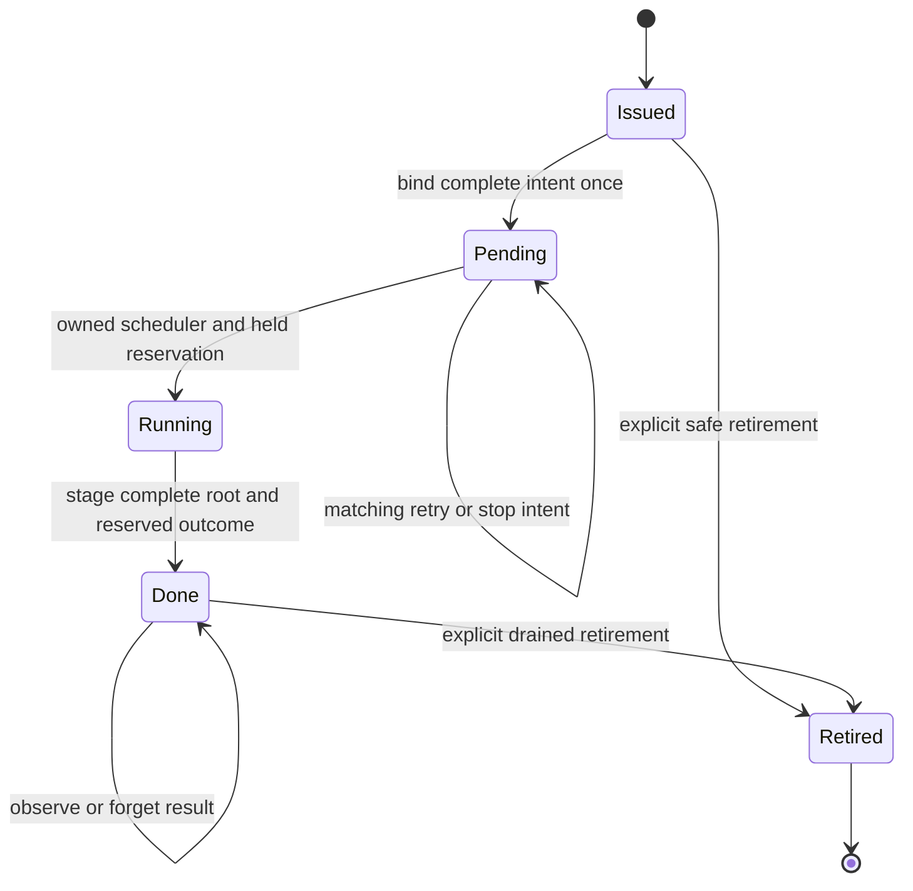

# Owned invocation replay and local publication

## Shared normalization before owned compound admission

Specification §4.2.2 supplies the connection between the existing normalization
law and this actual owner. A bounded internal normalizer accepts the existing
compound `/1`–`/5` products, preserves exact complete source edit records and
orders each source participant's edits before immutable intent capture/comparison.
It rejects malformed range ordering and unresolved overlap/insertion ambiguity.
Existing read-set/scope canonicalization remains separate. Repeated entries for
one exact document incarnation are grouped in first-occurrence order only when
their source/annotation-set expectations agree. All complete records are retained
before sorting; overlaps and insertion ambiguity still reject. Distinct source
participant order and authored annotation operations are not reordered. The private compound
evaluator keeps its ordered-input precondition; no public operation/profile,
normalization service or additional runtime component is introduced.

Each first occurrence copies its edit array into an independent grouped array.
Appending later records cannot extend any input array being traversed, including
when repeated native source records or their edit arrays alias. With n original
entries and m total records, grouping reads at most n headers and m records before
the existing bounded per-participant sort/scan. No recursion, source refresh,
permission acquisition or external work occurs. Conflicting expected headers have
no single starting context and refuse; equal headers contribute one complete
per-document edit set, one actual publication participant and one source history
change if its bytes change. This conditional frame/termination argument does not
prove hostile getter/proxy handling or physical allocation bounds.

The helper captures the supported finite product under the existing owner intent
byte ceiling. It neither reads current source to refresh a retry nor creates
another persistent result/handle. Final native validation still establishes exact
source/revision, expected bytes, current grants, declared read dependencies,
write scopes, mapping/history/view companions and resource eligibility. In
particular, an empty edit's expected-content condition is not discarded. F10
advice calls the same normalizer and preserves its original exact root/request/
context observation basis; malformed or ambiguous normalization gives no verdict.

For a finite unambiguous per-document set of complete records, unique starting
positions determine a unique increasing order, as established in
[batch-normalization.md](batch-normalization.md). Sorting is a permutation, so
expected conditions and individual mapping boundaries remain associated with
their records. Equal permutations thus yield equal stored semantic intent before
view preparation. Existing owned replay admits that intent at most once; later
normalization depends on the original product, not the changed live source. The
final exact-revision guard can still reject newly submitted stale work. These
conditional arguments assume finite inert normalized data, serialized ownership
and the existing trustworthy native context/capacity premises.

The existing invocation checker adds five controls. Sixty native cases exercise
all six permutations of three adjacent nonempty replacements across `/1`–`/5`
and typed/dynamic routes. Every case checks current F10 advice without root or
usage changes, then one actual two-document source/body/current-view/history
publication with the same candidate root as the canonical order. Controls also
check pending/terminal permutation retries, caller mutation isolation, eight
ambiguity/route refusals without consumed admission, preserved adjacent boundaries,
a non-elided invalid empty expected condition, and stale-source refusal after an
intervening owned publication.

Ten additional profile/route cases exercise repeated source entries through
F10 advice and actual two-document publication, with grouped/partitioned retries
sharing one retained intent. Three controls cover header conflicts, overlapping
duplicates, non-elided invalid empty conditions and shared record/array aliases.
Three added mutants omit grouping, omit header agreement or lose appended records.
The invocation check now has 27 controls and 37 semantic mutations. Its existing
512 admission, 256 publication, 128 release, 1,024 ceiling and 64 paired cases,
720 traces/4,320 edges remain. Three added mutants omit ordering, accept ambiguity
or elide empty records. Each loads successfully and must fail an assertion; tool,
construction and runtime failures do not count. No new proof program or solver
condition is added. This is reference-owner integration, not a hostile decoder,
complete public envelope, physical allocation or production/concurrency/crash proof.

IF-01/03, PATH-01 and INS-01/02 retain normalization/admission versus current
validation/publication; IF-02/PATH-02 and INS-03 retain advice/release; INS-06
retains actual history. MELT/golden/RED measure the distinct stage populations
and dispositions, USE retains bounded preparation/intent pressure, and STRIDE/
LINDDUN/hazard cases challenge erased preconditions, ordering substitution,
partial publication and replay retargeting. No source, identity or offset becomes
an ordinary telemetry label. Full frozen qualification and endpoint adoption are
still required. Older slice counts below retain their own scopes.

## Earlier invocation compositions

Section 6.5.2.3 reuses this owner for literal replacement, reserving actual returned
reply bytes separately from canonical arguments and native descriptor envelopes.
Both charges remain on retained faults and pending cancellation until protected
cleanup, without issuance refund or implied query retirement. Native source/
annotationSet/view dependencies are not refreshed on retry; see replacement-gateway.md.

Section 6.5.2.1 adds a separate measured canonical-argument charge for four
decoded ordinary-edit forms before native preparation. It uses actual owner
headroom, not implicit capacity in the ledger's existing four intent maxima;
native settings-pool reservation remains separate. Matching retries retain one
charge, refusals refund provisional capture and protected retirement discharges
it after native obligations without issuance refund. See ordinary-gateway.md.

Current integration: §5.2 adds explicitly scoped compound `/3`, retaining the
exact earlier profiles and shared read/advisory/publication rules. Scope is an
original-coordinate caller restriction, not a grant or another owner. See
[source-scopes.md](source-scopes.md); earlier counts/exclusions retain their own
slice scope. Current solver totals are 295 conditions/fourteen manifests.

Current integration: §5.1 adds selected native compound advisory validation
through shared pure candidate/view decisions without journal publication. See
[proposal-validation.md](proposal-validation.md); earlier exclusions retain their
own slice scope, not a claim that the new profile covers all F10/native jobs.

Current integration: §13.9.2 adds versioned native declared read dependencies
before candidate publication without adding authored history scopes. See
[read-dependencies.md](read-dependencies.md). Original slice counts and exclusions
retain their scope; host truth, public codecs, complete managed lifecycle/reversal
and independent refinement remain gates.

Current integration: §22.3.6 supplies the separate owned scoped native adapter,
current basis/scope/profile revalidation and stamp-free indexed receipt; see
[registration-scoped-invocations.md](registration-scoped-invocations.md). Shared
cancellation now covers 21 forms/eleven kinds, 336 gate/168 context cases, 42 races
and 5,439 traces/15,246 edges, preserving ten controls/twelve mutants. Earlier
counts/exclusions retain their slice scope. Wire/remote, full discovery/events,
host/measurement/physical/concurrent/crash and independent gates remain.

Earlier integration: §22.3.4 separately adds owned native resource registration
and current trusted-host result release, bringing the private dispatcher to eleven
kinds; see [registration-invocations.md](registration-invocations.md). Shared
cancellation covers twenty forms. Earlier counts/exclusions retain their slice scope.

Current document-lifecycle integration: §11.2.13 adds owned invocation for the
eight existing native scratch/relation/disposal/release products with live
restricted writer inspection and current result release; see
[lifecycle-invocations.md](lifecycle-invocations.md). Current shared cancellation
now covers ten native kinds/fifteen forms. Earlier counts/exclusions retain their
original slice scope; effect/activation/events/registry and host/physical/independent
gates remain.

Current invocation integration: §11.2.12 adds owned view/workspace lifecycle
invocation, current native staging, cancellation/replay and bounded current identity
result release; see [relation-invocations.md](relation-invocations.md). Remaining
F17, registry/event/remote products and host/physical/independent gates remain.
Earlier exclusions retain their slice scope.

Specification §6.5.1 connects bounded invocation eligibility to actual owned
source/body/target compound publication, current positional view companions,
prepared native undo/redo and recipient-safe terminal outcomes. Matching retries
cannot publish or reverse again. Result eviction changes availability, not
execution eligibility. The reference is local and serialized, not a crash-durable
ledger or a complete public dispatcher for every operation family.

Section 13.9.1 separately exercises actual retained create/delete compound history
and native F14 through this shared root/fact kernel. See
[annotation-membership.md](annotation-membership.md) for allocation-manifest binding,
fresh floors, current-view composition and fail/fence of unknown admitted history
kinds. Supplied allocation manifests are not an identity issuer, and normalized
compound entry is not a decoded native create/delete gateway. Section 13.6.2 now
adds owned normalized native create/delete on the same `annotation` producer kind;
[annotation-membership-editing.md](annotation-membership-editing.md) separately
checks original allocation/request/limits and actual same-ledger F14 round trips.
The existing field/compound checkers' scope flags remain confined to their tests.

## Precedent and boundary

[AWS idempotent API guidance](https://aws.amazon.com/builders-library/making-retries-safe-with-idempotent-APIs/)
distinguishes a request identifier from its parameters, rejects changed intent,
and explains why mutation and idempotency bookkeeping must agree. Vellum applies
that separation to its already adopted local replay contract. It does not adopt
AWS's retention periods, caller-token representation, service architecture or
durability guarantees. Existing annotation/history/view and outcome references
supply the actual closed publication paths rather than an opaque counter standing
in for an edit. No HTTP, network service, new public verb or plugin evaluator is added.

## Domain ownership and bounded admission

One trusted engine/root owner admits the reference domain under its actual
authority/admission incarnation. Each issued invocation separately binds its
recipient, purpose, destination, execution profile and continuity; different
recipients still share that one authoritative root. The supplied unique-domain
fact is a host premise: checking the flag does not prove global owner uniqueness
or authorization truth. Neither another document nor another recipient creates
an independent mutable engine root. Root copying preserves available committed
source-journal references through the existing bridge.

Private owned ticket objects bind finite entries. Their reference strings are
fixture encoding for the existing invocation identity, not a selected public token
syntax or bearer capability. Issue and bind may occur in one native ingress turn;
factoring the helpers does not require another network round trip. Copied tickets,
foreign domains, mismatched scope and unknown routes/kinds cannot select an entry.
The engine/domain identity is shared; the complete per-invocation scope is checked
again at submit, execution and observation. Context size is independently bounded.
Lifetime issuance is monotone and bounded even after retirement. Saturation refuses;
there is no automatic counter reset, old-token reuse or admission-domain rotation.

First submission binds the complete normalized prepared job by exact owned value
equality, not a hash or source-byte comparison. Source/annotation plans are copied
and frozen. Native reversal keeps its immutable owned preparation and an owned
comparison value; the native publisher still checks actual ownership/current
dependencies at execution. A frozen counterfeit value is not that authority.
Typed/dynamic route labels share one admission relation and are not part of intent.
Upstream canonicalization and additional families' semantic fields remain their
own obligations; equal final bytes do not establish equivalent complete requests.

Reserve root, bounded entries, intent copies and terminal result capacity before
accepting execution. Check all five supported terminal fact shapes and all 32
minimal-policy flag combinations against the result bound, including the common
unavailable product. That preflight does not depend on the eventual outcome.
The ledger charge reserves declared before/candidate root maxima and bounded
intent/reference/scope and policy/result/frame maxima. Participant view-work and optional
parser-journal reservations remain their own host budgets, not free work supplied
by a ticket. Logical declared charges and reservation truth are not physical-memory,
transient-copy-peak or complete cross-owner accounting evidence.

Section 13.6.4 now adds actual native F13 receipts at this same final boundary;
see [annotation-results.md](annotation-results.md). The declared per-slot result
reservation is five maxima rather than three, adding private receipt and native
release frame. Complete private receipt/frame fit is checked before annotation
admission; capture validates the actual decision/native versions after outer-root
checks. Final assignments pair root, coarse fact, receipt and done phase. Current
release uses original coarse publication/epoch plus explicit captured/current native
identity/version grants; absent detailed authority is denial, not a write grant.
Forget clears both results while keeping intent/execution spent. Trusted usage
adds receipt count/bytes, not public status fields or physical-reclamation evidence.

Section 14.6.1 uses that same operation-specific private receipt/frame pair for
native undo/redo, not two additional per-slot maxima. Annotation and reversal job
kinds are exclusive, and at most one native receipt is retained per invocation.
See [reversal-results.md](reversal-results.md): original decisions/targets are
historical, target disclosure meets captured/current scope, complete participant
movement is validated after outer-root resolution, and Unknown/cache loss never
implies nonpublication or fresh execution. The common five-maxima logical charge
is unchanged; actual physical/concurrent accounting remains a separate gate.

## Execution and coherent terminal bookkeeping

Section 17.1.1 adds the selected complete-context/current-control F18 route to
this actual stop helper; see [invocation-control.md](invocation-control.md). It
sets pending stop intent without starting/settling/refunding work, changing replay
eligibility or stopping observation. Its thirteen forms exercise every current
eight-kind admission branch, including acknowledged clipboard continuations;
provider facts/pins/quiescence remain separate. All payload/command variants,
external provider control, actual protected service and shutdown remain gates.

Section 23.1.4 separately observes actual admitted ledger phase/policy/retained facts
through a trusted metadata-only hook. It does not return roots or invoke run/stop/
retirement. Owned observation contexts/references and waits keep current disclosure,
protected phase-only capacity, clock/rank and discharge separate from producer state;
see [invocation-observation.md](invocation-observation.md). The original publication
checker's all-observation exclusion retains its narrower scope; global host truth,
all provider gateways and production refinement remain gates.

The running state precedes the one eligible execution. There is no transition back
to pending/issued for that ticket. Retiring an unsubmitted ticket spends it; pending
work cannot be retired or refunded as if it never ran. Stop intent must be settled
by the scheduler before terminal retirement; it does not erase bookkeeping.

The compound path prepares and rechecks actual current view companions for every
source participant, sums view work across documents, then calls the existing
source/annotation publisher and forward-view completers. Body/target changes and
linked history remain actual participants. Native reversal executes the originally
owned plan through actual F14, without refreshing its dependencies or target on a
retry. Candidate root pressure refuses the whole local candidate. The selected
source journal is retained through completed view roots and owned-root copying.

Construct the immutable root and reserved minimal outcome before the final trusted
local installation. Install root, terminal facts and done phase in the same
serialized decision, without arbitrary callbacks, telemetry, I/O or recipient
execution between them. Applied facts cannot exist without the installed root;
an installed root cannot lose its required terminal record through ordinary report
pressure. Validated Unchanged consumes eligibility and records a terminal fact
without source/history/publication bookkeeping. It is not reclassified after later
edits. Current denial at actual final validation yields known nonpublication, not
an implicit future retry with refreshed inputs.

An unexpected internal publisher/protocol fault leaves the prior installed root,
records conservative Unknown/faulted facts, and fences the domain against new
admission/execution. It does not fabricate confirmed rejection, restart the ticket,
erase prior Applied facts, or discharge other pending obligations. The deliberately
malformed private-job test is fault injection, not a hostile decoder proof or a
supported malformed northbound request. Recovery and production fault containment
remain separate gates.

## Outcome release and post publication observation

Retain actual facts with the captured minimal recipient ceiling. Current release
checks the complete domain scope, live/continuous grant, retention/transfer/resource
conditions, exact Boolean policy shape, policy epoch and recipient. Use actual
`releaseOutcome`; a broader current policy cannot widen the captured fields. Missing
or forgotten facts use the common unavailable outcome, never guessed NotApplied.
The reference's private admission/control labels are not adopted public error codes.

Result forgetting keeps the bound intent and spent eligibility. Explicit drained
retirement removes the entry but never reissues its owned token or resets lifetime
issuance. No unresolved worker/effect is modeled by the base compound/reversal jobs;
§6.5.3's clipboard continuation releases only its local pin on retirement, never
provider work/evidence or unknown local obligations. Pure local retirement is not
permission to discharge provider work.
Raw roots and usage inspection are trusted engine facets, not recipient APIs.

Recipient event projection runs after the authoritative root/fact decision through
the existing observer. Notification or transfer failure cannot roll back publication
or enable execution again. A selected real observer trace queues one visible event
and no duplicate event on retries. Full event ordering, execution waits, all outcome
profiles and complete gateway integration are not established by that trace.

## Conditional arguments and executable evidence

Assume truthful unique engine ownership, normalized finite owned values, actual
reservations and serialized non-reentrant trusted decisions. Initially a ticket
has zero starts. Only pending→running increments its start count; binding, execution,
forgetting and retirement provide no path back to pending. Retired owned objects
are never reissued. Induction over these guarded transitions gives at most one
start per ticket and total starts no greater than lifetime issuance. Exact immutable
intent comparison prevents mismatched retries from redirecting that start.

For a fixed finite profile, admission examines bounded owned values and a fixed
five-by-32 result table. The base compound/reversal paths use the existing finite
source/view/history traversals; §6.5.2 separately adds four closed owned editing
adapters and their bounds. No extension callback or expression evaluator is admitted. This is a
conditional per-run halting argument; pending work still needs actual scheduler
service. A finite vocabulary alone proves neither useful progress nor whole-engine
categorical or bounded-lattice closure.

Complete candidates and reserved fact shapes precede the final installation;
trusted bounded assignments then pair the root and terminal facts. Existing actual
publishers establish their scoped source/annotation/history/view frames, not a
caller-supplied terminal result. Current outcome projection preserves captured
ceilings and never rewrites those facts. These are authored conditional induction
and composition arguments, not proof-assistant refinement of arbitrary code.

The checker executes 512 admission, 256 actual publication and 128 release gate
combinations, 1,024 captured/current policy combinations, 64 selected hidden-world
pairs, and all 720 permutations/4,320 edges of six once-occurring actions: typed
submit, dynamic submit, run, stop, forget and retire. This is not exhaustive
unbounded-length execution exploration. Seventeen controls and 25 assertion-rejected
semantic mutants cover replay, intent ownership, old no-ops, multi-document/body/
view publication, native reversal, stale preparation, root/fact pairing, stop,
incarnations, bounds, current disclosure, journals and fail-stop behavior. The old
abstract replay exploration and SMT conditions remain separate, revalidated evidence.

The shared-root control admits three scoped recipients before execution. Compatible
cross-file changes preserve one another on the same current root; a competing stale
same-file plan refuses without undoing either earlier change. A recipient cannot
execute or observe another invocation by presenting only the shared domain context.
This checks local routing, not remote authentication, federation or a network protocol.

## Instrumentation and remaining gates

PATH-01/02 and IF-01/03/08/12 distinguish offered attempts, first bindings, duplicate
observations, actual execution, authoritative local disposition and current outcome
release. INS-01 counts admission/replay/saturation separately; INS-02 records actual
publication versus validated no-op or refusal; INS-03 records current release;
INS-06 records linked history; INS-13 tracks protected stop/retirement and held work.
MELT/RED/golden signals separate attempts, useful completion and observation latency;
USE tracks slots, retained intent/outcomes, root and staging reservations. STRIDE
covers forged scope/tickets, intent substitution, stale plans, partial installation
and fault masking. LINDDUN covers hidden mutation through status/IDs and unauthorized
retained-result linkage. No intent, private IDs, paths, content, tokens or per-attempt
metric labels are authorized by this reference.

Section 6.5.2 supplies scoped owned invoking-selection/line/Unicode/search preparation
integration; its evidence does not freeze the decoded-request replay gateway.
Section 6.5.3 separately supplies acknowledged clipboard local task/root/fact commit;
its complete request/dispatch replay, copy/provider and live execution/event gateways,
F13 membership and other operation/effect families still need integration.
Actual host policy/domain/reservation truth, production decoding/canonicalization,
fault/re-entry/concurrent installation, crash recovery, timing/resource privacy,
physical accounting, measured profiles and independent assurance remain gates.
Neither a whole D-row/family nor the all-sections goal closes. Requirements and the
approved §29.4.1 point representation are unchanged.
