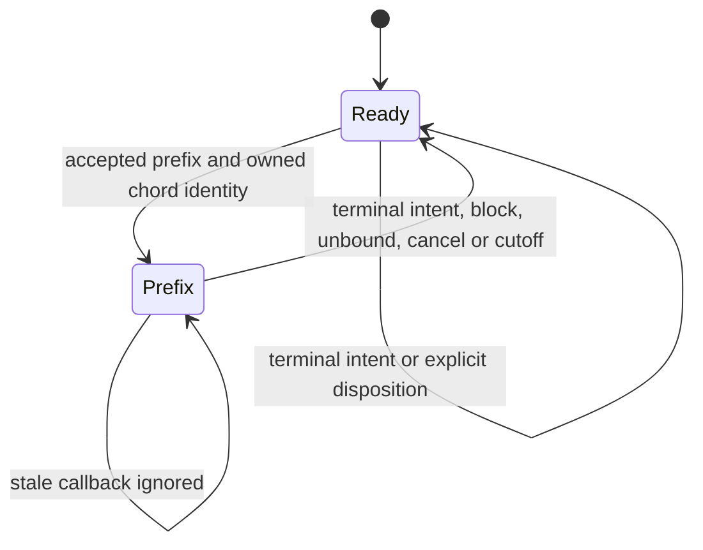

# Declarative keymaps and atomic input interpretation

## Ownership correction

Specification §1.1 assigns keymaps, chords and interaction modes to frontend
support, exercised by the ratatui reference example. They are not engine state
or engine semantic configuration. The bounded lookup/chord checks below remain
useful frontend evidence. The combined settings/keymap fixture described below
predates this correction; it does not establish a required joint engine/UI
publication. Its code is relocated to frontend-keymaps.mjs and
frontend-configuration-reference.mjs, exercised by ratatui-keymap-reference.mjs.
The engine reference projection excludes UI products; see engine-ui-boundary.md
for scoped checks and remaining native gates. No ratatui Rust implementation is claimed.

## Earlier combined reference scope

Specification §22.3.2 extends the existing F16 settings-keymap product with bounded
map changes and chord interpretation. Settings and maps publish together; pending
chords in affected contexts are cancelled without replaying consumed prefixes.
Lookup emits an ordinary command intent, not execution or authority.

## Precedent and selected semantics

The [Emacs keymap reference](https://raw.githubusercontent.com/emacs-mirror/emacs/master/doc/lispref/keymaps.texi)
distinguishes missing local bindings from bindings that stop lower lookup, and
describes prefix maps and applicable defaults. [Helix remapping](https://docs.helix-editor.com/remapping.html)
provides declarative nested keymap precedent. Vellum takes declarative structure
and explicit lookup dispositions, not Lisp evaluation, command strings, macros,
shell execution, raw key replay or recursive remapping.

keymap-products.json defines each map intent: exact scoped map reference, expected
generation, bounded binding changes and default changes. Binding changes name a
normalized key sequence and a bind/block/fallthrough action; removal has an absent
action. Defaults attach to an explicit prefix node and likewise support removal.
Bind names an admitted command reference, not a free-form executable string.
Native key encoding, full argument materialization and actual registry truth remain
integration gates. Known provider/derived evidence contracts are not input commands.

An absent entry permits normal default/lower lookup; it does not block. An explicit
fallthrough bypasses that map's applicable default. Block stops lower lookup.
Higher declared priority wins among compatible strata. Equal-priority conflicts,
including command-versus-prefix ambiguity, reject even if another priority could
mask them. A single map cannot attach a terminal action and children/defaults to
the same node. Map enumeration or input focus is not a priority tie-breaker.

After a prefix is consumed, lookup continues from that prefix node. Failure cannot
backtrack to execute a shorter lower binding or replay the prefix as text/commands.
An unmatched current event is explicitly unhandled; any adapter fallback needs
its own declared ordinary-input policy. It is not automatic reinsertion. Prefix
state captures the input context, generation, exact target and an owned chord
identity. Stale events cannot retarget or cancel a newer chord. Cutoff/cancel must
match that chord; an old timer cannot cancel a new prefix in the same view.

## State and progress

Each accepted prefix extends its finite sequence below the profile's maximum;
lookup scans finite maps/nodes/keys and emits at most one intent per event. This
is not global termination of an editor input stream: stale callbacks can be
ignored indefinitely and live cutoff needs an actual clock/service profile.
No timeout duration, physical key syntax, default key layout or modal scheme is
selected. IME-consumed/preedit input is not ordinary key replay; actual native
event filtering, composition and ordering remain host conformance obligations.

## Atomic activation and current ownership

The settings coordinator now stages keymaps through fixed pure helpers, not an
arbitrary publication callback. Capture required maps, registered command/schema
generation, finite profiles and affected input-context membership/target signatures.
Final admission rechecks those dependencies and current per-map write authority,
plus ordinary settings/retention/invocation guards. Changed input context or map
generation refuses the whole operation; a newer pending prefix alone does not
force stale preparation. Activation cancels the currently pending chord.

Publish changed maps, compiled tables, fresh input interpretation generations and
affected settings in one local publication. Keep old held settings/maps intact,
preserve authored content/history/effects and unrelated input contexts, and do not
advance source interpretation for a keymap-only change. Removing a nonexistent
binding can be complete identity, retaining the current pending chord without
needing unused new version/retention capacity. Rollback remains a fresh activation.
Removing commands/providers cannot erase already dispatched effect evidence.

## Executable evidence and limits

keymap-products.mjs supplies bounded trie compilation, explicit local/default/peer
lookup, chord steps and owned activation companions. keymap-activation.mjs composes
those helpers with the actual settings coordinator and existing command router.
The reference checks 341 key traces of at most four keys, 1,252 steps, 23 direct
controls and 15 settings/keymap activation controls. These cover all four lookup
dispositions, ambiguity, stale targets, consumed-prefix backtracking, late cutoffs,
one-publication composition, retained maps, current pending cancellation, stale
caller/current generations, current map rights and unrelated input preservation.

Eight in-memory mutants must load and then fail assertions: run a fallthrough
map's own default, let the first peer win, retarget stale input, let an old cutoff
cancel a new chord, preserve an old pending prefix on activation, ignore caller
map generation, reuse input generation and bind provider evidence as input.
Native composition mutations rewrite the actual coordinator's helper import to
the mutated module; they do not test an unconnected duplicate coordinator.

Profiles and registry/applicability/authority facts are normalized trusted inputs.
The reference uses opaque-string key/command/chord examples, not a selected native
encoding, default binding catalog or proven non-confusable issuer. Input-context/
chord identity issuance, physical allocation/retention/queue bounds, live timer/
scheduler behavior, platform key/IME handling, command-argument materialization,
full replay/result release and actual native ownership remain gates. F16 registry/
provider activation remains separately incomplete. No macro/runtime/plugin layer,
network fetch, solver theorem or independent Cleanroom certification is introduced.
Point representation follows approved §29.4.1; native persistence integration remains a separate gate.

## Instrumentation

INS-09 distinguishes map validation, peer/prefix conflict, owned staging and actual
settings/map activation. INS-11 observes content-safe prefix/terminal/stale/cutoff/
cancel classes, accepted target context and native adapter boundaries; INS-01/03
separate lookup intent from command admission/current release; INS-08 retained
interpretation and real hold discharge; INS-12 diagnostic loss. MELT/golden/RED
separate lookup, waiting prefix, activation and actual command completion. USE
applies to real tables, retained maps, pending contexts and queues. STRIDE/LINDDUN
challenge unregistered commands, stale targets, forged chord identities and raw
key-content capture. STPA/FMEA challenge replayed prefixes, ambiguous maps, stale
cutoff cancellation, half activation and lost old interpretation. No keystrokes,
sequences, targets or context identities become ordinary logs/metric labels.
