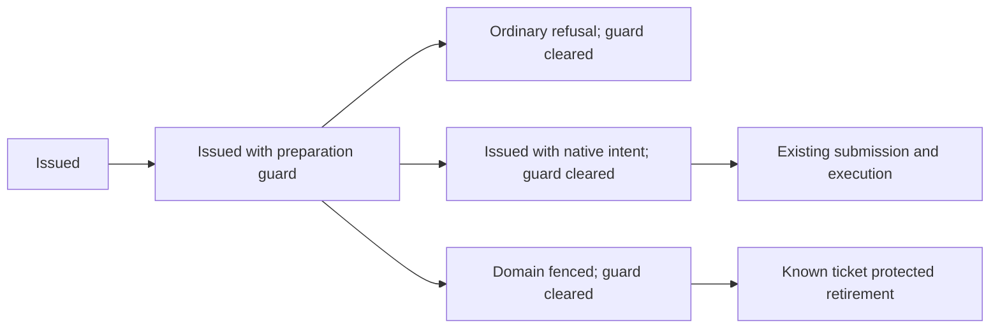

# Lifecycle envelope owner integration

Specification §11.2.13.7 now adds the actual-parent temporary reservation described
in [lifecycle workspace](lifecycle-workspace.md). It supersedes the temporary-parent
exclusion below for these five forms, not the physical or broader public gates.

The five selected F17 forms reuse the existing lifecycle owner, issued ticket,
preparation guard and intent. This adapter is not a new command, executor,
registry, transport or cleanup protocol. Ordinary captured request data is
separate from native profile, writer inspection and trusted host-control facts.

## Execution and failure

Capture uses the selected byte/node/depth profile intersected with the native
maximum intent size. Revalidate captured context, invocation value and existing
admission/staging gates before native preparation. The shared per-entry guard
excludes recursive/sibling preparation, submit and retire, and clears in finally.
Native profile and writer inspection checks still own authority and validity.

Preparation alone changes no authored root. Submit, run and result release retain
their existing contracts. Expected refusal preserves the root, eligibility and
native ledgers. Unexpected capture/native failure fences the existing domain
without pretending that an installed intent was rolled back. The caller already
owns its ticket; existing protected retirement can discharge its retained intent.
Cleanup never refunds lifetime issuance or reopens the faulted domain.

These are existing phase/guard combinations, not new public states:

Bounded ordinary capture plus finite wrapper branching gives conditional progress
when native control calls return. No arbitrary host/proxy/native-code halting or
preemption claim follows. The verifier injects returning/reentrant/throwing native
facts; they are not newly supported untrusted callback interfaces.

## Scoped evidence

Eight controls cover ten fresh typed/dynamic actual-owner compositions, 41 refusals,
fifteen reentry attempts and one host-control fault. Both routes prepare on a fresh
ticket, reuse the actual native intent and publish/observe through the actual owner.
Untrusted request accessors refuse without running. A verifier-only WeakMap value
in the native facts port distinguishes shallow native control from deep cloning;
it adds no public field or authority.

Eight targeted mutations challenge guard set/clear, fault fencing, outside-guard
admission, writer/facts preservation and native-plan delivery. Only assertion
detections count; construction/process failures do not. Separate fixed capture
and release faults execute ten cases each. A private boolean witness confirms
zero installed intents for early faults and ten actual installed intents for late
faults. All twenty keep the authored root unchanged, fence admission and discharge
the known ticket without issuance refund. Three false cleanup grants per case
refuse retirement; this does not validate arbitrary untyped host grants.

The selected source graph has 93 modules, including the argument adapter, and no
frontend imports; 76 engine and 11 presentation variants remain unchanged.

## Remaining gates

Local helper ceilings and unchanged native ledgers do not establish temporary
shared-parent reservation or physical/global peak bounds. Full F17 products,
discovery/events, substrate/host guarantees, installed measurements, actual Rust
integration and independent assurance remain open. Existing IF-01/03/04/07/08
and INS-01/02/03/04/07/08/09/12/13 distinguish capture/refusal/native handoff,
first fault, retained intent and ticket discharge. Raw requests, context and
invocation values are not ordinary labels. Full frozen qualification and endpoint
reconciliation are required before adoption.
