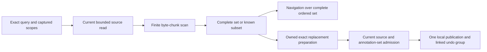

# Literal search and exact replacement composition

Section 6.5.2.3 separately joins existing replacement fields and the original
owned result to issued-ticket canonical preparation/replay. Private metadata
measures frozen native returned reply bytes for a separate retained-frame charge;
it does not grant query authority or establish issuer/lifetime truth. See
replacement-gateway.md. Earlier synchronous evaluator counts retain their scope.

Specification §15.4 selects F05 search/navigation and F11 replace-current/all
semantic products. The reference composes actual readRange, navigate and owned
annotation/source publication helpers, including actual retained inverse/forward
reversal. It is not a production search engine or native API codec.

## Precedent and product boundary

[CodeMirror's SearchCursor source](https://raw.githubusercontent.com/codemirror/search/main/src/cursor.ts)
provides bounded-range, chunk-iterator and explicit overlapping/nonoverlapping
cursor precedent. Its basicNormalize uses NFKD; that behavior is deliberately
excluded from Vellum's mandatory exact case-sensitive/no-normalization profile.
The selected matching and navigation rules are already required by requirements
§5.6 and specification §§15/28.17–18. No new regex, semantic rename, locale or
caseless capability is selected.

literal-search.json records logical field inventories, not wire encoding or Rust
types. The normalized request binds an opaque read context, exact document
incarnation/revision, literal query, profile, captured scopes and generation.
Navigation additionally has byte start, optional current-match index and explicit
wrap (the headless omitted-wrap default is normalized to false). Match identity
is the index within that owned request/result, never an index into newer results.
The read context binds recipient, purpose, destination and captured ceilings;
current release facts are supplied separately. An opaque selector is not a grant.

Overlap-only scope normalization follows the adopted selection baseline. Adjacent
captured selections remain separate, as do disjoint scopes. A caller wanting one
contiguous scope must capture that scope explicitly. Every match is wholly inside
one normalized scope; no hidden gap or independent selection becomes searchable
by concatenation. Source and query are canonical UTF-8, without newline folding.

## Owned data and execution

The evaluator scans each authorized scope through actual readRange, then accesses
owned chunks that may split UTF-8 scalars, CRLF or query bytes. Nonempty valid UTF-8
queries cannot begin at a continuation byte, and complete query encodings end at
source scalar boundaries. Exact byte comparison therefore retains original valid
byte ranges without normalization maps. A match advances by query byte length;
a mismatch advances by one byte. Both navigation directions use the same ordered
leftmost nonoverlapping set through the existing navigate helper.

Bounds cover root bytes, scope count, normalized input bytes, query bytes, byte
comparisons, retained matches, reply bytes and replacement/aggregate edit bytes.
Each comparison consumes one nonrenewable unit; each scan step advances. Scope
and chunk loops have finite bounded inputs. Insufficient comparison/match budget
returns a known subset with no exact total, even if that subset is empty. A result
that cannot fit the reply envelope is exhausted, not silently truncated. Navigation
over an incomplete set is unavailable. An exact match-count limit can still yield
complete coverage if the remainder contains no additional match.

These are logical finite bounds, not heap/time guarantees: readRange validates
the bounded source per scope, preparation copies captured values, and the actual
publication helper has its own bounded/retention premises. Pending scheduling,
actual cancellation, supersession delivery and lifetime reclamation remain executor
integration gates. The eager evaluator does not prove an asynchronous lifecycle.

Owned frozen result and preparation objects have private provenance. A copied or
modified public result is not replacement authority. Prepare binds the exact
query/profile/scopes/generation; publication rechecks them and current release.
Each match row also delivers a bounded cached owned occurrence reference under
§15.5; it is not a serialized token or arbitrary range authority. The replacement
preparer captures the current annotation set and current attached-view participants,
not annotations at search time. Current annotation changes require fresh replacement
preparation, not rerunning an unchanged source search. The shared forward view
helper maps source contexts/selections and publishes one complete candidate.
[Search/view bridge evidence](search-selection.md) records its separate checks and
equal-text view effects without source revision/history. These additions do not
close actual issuer/retention/policy, all companions or concurrency/physical gates.
Replace-current validates the selected owned occurrence. Replace-all requires a
complete set and builds all exact expected-byte edits once. Literal replacement
has no expansion; `$1` is ordinary text. Current all-match write eligibility is a
supplier predicate, not something inferred from search access or a caller label.

The actual compound coordinator validates source incarnation/revision and captured
annotation-set dependency, canonical nonoverlap, expected bytes, companions,
versions, history and admission. It either publishes all replacements and maps
current annotation placements in one group, or leaves the root unchanged. Authored
annotation bodies/targets are not source text or restored rows. Empty query and
fully identical replacements use D01 identity. Equal-byte edits with nonidentity
annotation effects are refused by this restricted compound reference: they are
not misclassified as unchanged, nor is general companion classification proved.

## Evidence and residuals

3,168 finite scalar-string-oracle comparisons vary ASCII, emoji, combining text,
precomposed text, BOM and line endings across four chunk sizes. The oracle builds
byte offsets independently from scalar strings. The slice checks 64 release
combinations and 64 actual-navigation compositions, plus 53 controls and seven
mutants that must load successfully and fail assertions. Controls include stale
query/profile/scope/generation, partial replacement, exact capacity, read-only
whole-plan refusal, current source/annotation dependencies, literal replacement,
one publication/group, actual undo/redo and range-annotation mapping/body framing.
Finite enumeration is not universal Unicode conformance or independent assurance.

INS-05 separates scan coverage, bounded work and stale/unavailable delivery;
INS-01/02/06 separate preparation, current admission, publication and reversal.
Record bounded status/count/budget classes at these interfaces, not raw query,
source, replacement, ranges or document IDs as metric labels. Counts themselves
require permitted release; diagnostic failure cannot grant or publish edits.
STRIDE covers stale/forged plans, resource exhaustion and write-eligibility bypass;
LINDDUN covers queries, histories, match counts and captured-scope linkage. USE/RED
and golden signals apply to queue/scan/publication resources and request outcomes,
not to sensitive lexical values. Actual telemetry installation remains a gate.

Context/identity issuance, current policy truth, hostile/native decoding, replay/
outcome/event composition, actual async ownership/accounting, optional caseless
profiles, complete state companions and production/native refinement remain open.
No annotation persistence policy, physical capacity, solver theorem or global
termination/categorical-completeness claim is selected by this slice.
