# Owned source load activation invocation

Current integration: §11.2.18 separately composes owned initial annotation
restoration and loaded-baseline adoption; see
[annotation-load-invocations.md](annotation-load-invocations.md). The existing
lifecycle job now includes both phases in shared cancellation. Earlier counts and
annotation exclusions below retain this source-load slice's scope.

Specification §11.2.17 connects the existing [native initial source activation](native-source-read.md)
to owned lifecycle invocation. It reuses the actual read producer, codec candidate,
registered identity resolution, paired writer, creation/join frames and result
release. The provider read has already completed. This does not issue another read,
reload an existing owner, or make external file state atomic with local activation.

## Read task codec and writer authority

The actual native read owner may borrow one frozen opaque activation handle for a
complete submitted read task and an actual paired writer inspection. Require strict
owner-control, preparation-reservation and resource-readiness facts and a healthy
native domain. The inspection supplies the actual writer/owner internally; it alone
cannot acquire read-producer authority and never grants read or write dispatch.

The handle binds actual read owner/registry/task/record/domain, writer/owner and a
live codec candidate witness. Recheck exact task-record identity, domain, submitted
phase, stop/conflict/codec-refusal fences, candidate/stream identity and complete
codec lifetime/context. The writer must name that read owner, share its authority
and respect an already-established native writer pairing. Repeated borrowing for
the same task/pair returns the same handle. Copies, peer task/owner/domain/pair and
incomplete candidates refuse. Witness and decoded-record helpers are private
first-party composition facets, not plugin APIs, supplied decoder callbacks or
northbound source disclosure.

No second source buffer is retained in the handle. Fixed preparation reads decoded
content from the actual live codec witness and invokes the existing private native
candidate rules against the actual current root. The native certificate captures
the actual read transcript/context/candidate and checks the exact birth/join frame.
An actual retained-lifecycle guard binds the actual paired writer and destination;
unknown or conflicting work still blocks activation. Current source-read resource
registration must equal the captured row. No optimistic path/format/identity-label
comparison substitutes for those existing native identity premises.

Actual read-task retirement revokes its handle in the same local retirement turn.
The handle therefore cannot retain an unaccounted task/codec record after that
retirement. Pending invocation subsequently refuses instead of resurrecting the
task. Existing created-owner provenance/consumer pins still govern whether native
retirement is permitted at all; invocation/result retirement does not retire the
read producer or establish quiescence. This is logical reference ownership, not a
physical allocator/GC or all-profile lifetime theorem.

## Current interpretation publication and results

The existing lifecycle job uses a separate private reference profile,
`native-source-load/1`, with the existing wrapper fields and an empty nested request.
These are reference labels, not assigned stable public command or wire IDs. The
separately supplied handle selects the task/candidate; the caller supplies neither
a replacement root/document, decoded bytes nor a creation/join override.

One immutable plan binds the actual invocation owner/domain/ticket/reference,
authority, request and exact lifecycle/membership/binding profile. At service,
recheck interpretation, profile and authority identity and resolve the current
owner using the existing native rules. A request validated before any owner existed
can join an owner that appeared before service, but only under the required current
owner-access facts. This preserves the meaning "activate this candidate under
current owner resolution"; it does not promise a new allocation or overwrite the
owner with the candidate's potentially different bytes.

Native `created` maps to root publication `applied`; `joined` and `already-activated`
map to `unchanged`. The receipt separately retains invocation, common status,
`source-load`, exact native activation disposition and native document identity.
Thus an unchanged root does not conceal the distinction between first joining and
repeating activation. The producer's original created/joined marker remains intact
on a validated repeat. The earlier read's evidence is not reissued or relabelled
by this local invocation.

Prepare the candidate, native producer certificate, paired-writer guard and bounded
receipt without publishing or marking the read task. The common owner checks its
root and actual baseline-promise floors, prepares the complete outcome, freezes the
candidate and carries the appropriate new-document source journal before commit.
Final stage matching binds plan/owner/domain/ticket/before-root/result/receipt and
revalidates authority/current facts, native transcript/frame and actual writer.
Native marker and return-value construction precede the first producer mutation.
Then commit read activation/pairing and install root, outcome, receipt and terminal
phase in the same synchronous trusted turn. No await, provider operation, host
callback or further explicit clone/construction intervenes between producer commit
and installation of the terminal tuple.

```mermaid
flowchart LR
  R[Completed native read and live codec candidate] --> A[Read task and paired writer authority]
  A --> I[Owned immutable lifecycle invocation]
  I --> N[Current native identity and birth or join frame]
  N --> C[Root and promise bounds plus outcome and receipt]
  C --> J[Freeze candidate and carry source journal]
  J --> V[Final native read and actual writer revalidation]
  V --> P[Commit producer marker pairing root outcome and receipt]
  P --> Q[Current scoped result release]
```

Queued invocation stop, actual read cancellation, late conflict, retirement, replaced
registration, incompatible profile, writer obligations and capacity/promise refusal
preserve the root against partial activation. Successful birth preserves raw BOM/
strict-UTF-8 content and the exact captured baseline; it initializes the existing
annotation/lifecycle inventories without inventing stored annotations. Joins preserve
the current owner's content, versions, history and savedness. Unrelated edits survive
and their actual source journals carry to a new birth. Neither case proves the
external file still has its captured content or upgrades captured-read coherence.

Result release meets the captured identifier ceiling, current invocation context,
available outcome summary and existing strict lifecycle-result/current-context/
historical-document grants. Results contain no source body, transcript, provider
probe or activation authority. Forget/replay/retirement never repeat the operation,
refund a producer or turn a receipt into permission to read its document.

## Conditional arguments and executable evidence

Under actual private factories/stores, immutable codec completion, sound current
host facts and serialized trusted publication, preparation only builds a candidate
and certificate. Native frames determine the root delta; the certificate and guard
bind the same actual producer and writer that final commit uses. Bounds, outcome,
receipt, journal and native marker/return construction precede mutation. Exact final
stage matching and native revalidation exclude substitution or partial commitment
on refusal. The remaining bounded assignments install the prepared tuple without
an observable intermediate state in this synchronous reference model.

Assume one engine-wide destination writer and truthful writer/registry coverage
under the chosen host profile. A successful local read/writer pairing proves
neither unique provisioning nor visibility of work in other registries. Those
global host/coverage obligations remain separate from this local composition.

The closed issued/pending/running/done vocabulary, at-most-one-start/replay fence
and bounded native primitive loops give conditional one-turn termination. These are
authored reduction/frame/termination arguments, not machine-checked whole-engine
induction, universal alias/provider truth, categorical completeness, physical
concurrency/crash atomicity or implementation refinement.

`load-invocation-checks.mjs` compares the owned path with the existing native factory
across 42 annotation capture/undo/redo stages and 252 typed/dynamic creation/join/
repeat publications. It covers 256 admission vectors, 153 strict service cases,
24 release masks, twenty-one controls and 30 targeted mutations in three exact
ten-case banks, each with a passing rewired baseline. The complete reference pass
and every bank are mandatory. Partitioning bounds verifier execution, not engine
service time, and removes no case. Controls use actual codec/read/native writer/export/registration
state, real retirement, unrelated source edits, root/result limits and an attached
baseline-promise floor, alongside isolated trusted stage/record fault injection.
Existing native read mutation names remain 36; marker and consumed-preparation
mutants are retargeted to the preconstructed commit representation, not removed.
The older twenty-mutant resource-read loader now resolves all local imports and
requires a passing unmutated rewired baseline; its cases and scope are unchanged.
Shared cancellation covers seventeen forms/ten native kinds, 4,403 traces/12,342
edges, retaining its ten controls/twelve mutants and protected stop semantics.

## Observation and remaining gates

Reuse IF-01/03/04/07/08/10 and INS-01/03/04/05/07/08/09/12/13. MELT/RED/USE/golden
signals distinguish candidate readiness, local activation, created/joined/repeated
dispositions, refusals, pending age, bounded occupancy, writer pressure, current
result release and safe retirement from the earlier provider read. STRIDE/LINDDUN
cover handle/plan/task substitution, stale context/registration, hidden retention,
false activation claims and identity/content leaks. Raw task/candidate handles,
document IDs, origins, paths, identity keys and resource versions must not become
metric labels or unauthorized log/trace fields. Installed signals, overhead and
physical charges remain separate gates.

This adds no operation-family variant, job kind, network route, provider or second
writer. Full command/provider registration and events/remote contracts, annotation
load invocation and nonempty replacement/reload/recovery profiles, actual host
identity/policy/coverage/retention/provider truth, installed measurements, global/
physical/concurrent/crash/native refinement and independent assurance remain open.
No whole F17, decision register or all-sections goal closes.
