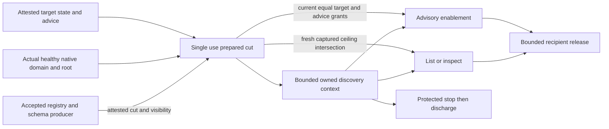

# Owned native contract discovery

Section 22.1.13 adds existing F02/F03 declarations through explicit profile /5
without changing /1–/4. Handler-bound input shapes and selected status vocabularies
are metadata, not native capability authentication or complete result codecs.
Origin, captured ceilings, current release, advice and protected lifetime remain
the existing owner's obligations; read-discovery.md records exact scoped evidence.

Section 22.1.8 adds explicit owned-contract-discovery/3 to the same bounded F01
owner. Its fourth fixed-source row describes four existing F11 ordinary-edit
forms; /1 and /2 remain unchanged. Exact known schema recognition does not grant
execution, authenticate nested handles or supply public codecs. See
ordinary-edit-discovery.md for selected current release, advice, origin and
protected lifetime evidence and remaining host/refinement gates.

Specification §22.1.5 supplies bounded F01 context ownership over an explicitly
attested accepted-catalog input port. It connects actual native domain ownership,
current root capture, opaque references and protected retirement to the existing
list, inspect and advisory-enablement products. It does not implement an accepted
command registry, schema generator, Rust handler registration or target evaluator.

Section 22.1.6 separately supplies a fixed internal declaration source for the
six existing annotation/history operations; see builtin-discovery.md. Its private
origin is preserved across cuts, contexts and current queries. Generic attested
cuts retain the premises below and cannot substitute for that source even when
their projected metadata is identical. This does not establish all-family
installed handlers, complete value schemas or actual current policy/advice truth.

## Producer boundary and precedent

The producer supplies a complete accepted catalog cut, descriptive schemas,
visibility and approved visible order. Each preparation requires their separate
exact-true attestations, current authority/interpretation and a healthy actual
native root. Copies belong to a single-use packet bound to that root and complete
authority/engine/recipient/purpose/destination/policy/continuity/profile scope.
The actual host must establish that these supplied facts describe the accepted
registry at this cut; supplying a Boolean is not proof of that correspondence.

[Neovim API metadata](https://neovim.io/doc/user/api/#api-metadata) is derived from
headers and exposes version and signature information. This supports structured
introspection and highlights metadata-to-handler correspondence as a real
implementation obligation. It supplies neither Vellum's disclosure policy nor a
proof of this module. No RPC transport or Neovim compatibility policy is imported.

Rows have a private command identity, contract/version/category, uniquely named
variants and optional permitted presentation fields. A variant's input contract
and variant must agree with its containing row. These are descriptive correlations,
not validation of actual input types or a new executable schema language. Metadata
is finite, dense, plain JSON with independent UTF-8 byte, depth, node, row, packet
and capture bounds. Functions, non-plain objects, sparse arrays, cycles, nonfinite
numbers and malformed Unicode refuse preparation. Literal descriptions are data:
they are not instructions, code, authority, implicit fetches or callback aliases.
This reference assumes inert supplied values, not hostile getters/proxies or a
production decoder/memory sandbox.

## Capture and current release

Acquisition projects the permitted catalog and variant order, copies facet
ceilings and optionally captures an observable attested target. It creates an
opaque context and, only when target evidence is established, a separate opaque
target selector. Unknown target evidence does not block metadata discovery or
grow into target authority after a later grant. Neither selector is an invocation
ticket, source-read grant or execution precondition.

List lazily issues opaque entries and exact-query continuations. Inspect lazily
issues variant references local to an entry and context. Repeated pages reuse
live references. Copied, cross-context and substituted references refuse. Raw
command identities, native publication epochs and private target bases are not
release-envelope fields. Explicitly permitted literal schemas may describe fields
with those names; checking envelope secrecy must not pretend to redact a schema.

Each query needs a fresh single-use attested cut at the actual current root,
current scope/authority, retained ownership and whole-reply transfer/resource
capacity. Current projection intersects captured entries, variants and schema/
presentation facets. Any change to the captured permitted metadata envelope
refuses the old envelope. New grants, entries and variants cannot expand it.
Hidden-only changes and unrelated native source activity need not invalidate
unchanged permitted metadata. Acquisition, projection and release stay outside
publication guards; no handler runs inside a native commit.

Inspect never embeds enablement. Advice separately checks the actual issued
target reference, captured/current target data equality, attested current advice
and captured/current advice permission. Established false is distinct from
unavailable. A target-state change can stale advice without staling unchanged
metadata. Positive advice grants no command authority; execution still uses the
existing router and current dependency/admission rules. Actual target projection
and evaluation truth remain producer obligations, not facts proved by equality.

## Bounds and retirement

Contexts, preparations, metadata, selectors, replies and lifetime issuance have
independent finite limits with a safe-integer aggregate reservation. Prepare the
whole bounded reply and selector-map updates before installing any of them;
failure installs no partial references or issuance. This is a sequential
reference transaction, not production concurrent or crash atomicity.

Actual matched-scope explicit false authority/interpretation/retention loss or
native owner fault stops the context. Changed captured permitted metadata or
narrowed metadata facets also close delivery permanently. Unknown/non-Boolean
facts and transient transfer/reply/resources refuse without proving context loss;
stale/foreign cuts and advisory-only refusal do not close metadata. Check the
outside-publication guard and recognized envelope before private invalidation,
then bind actual handle/scope. Regrant or equal metadata needs fresh acquisition.
See §12.8.3 and read-invalidation.md for thirteen loss cases, eight new mutants
and scoped limitations. Protected owner stop remains usable without content permission;
wrong-owner control cannot stop it. Stop clears captured payloads and selectors,
but spent issuance is not refunded. Explicit retention and delivery discharge
precedes context/registry retirement. A spent native-domain marker prevents a
replacement registry from resetting the lifetime budget. These reader operations
leave the native root and producer state unchanged.

## Evidence and instrumentation

The reference exercises 42 actual annotation/history native stages, 252 traversals,
504 inspections and 924 advice releases; 16,384 preparation vectors, 32 acquisition
vectors, 48 release vectors, 32 selected paired worlds and 23 controls. Thirty-two
named semantic mutations run in four fixed eight-case banks, each with a passing
unmodified baseline. Import, syntax and runtime errors do not count as kills.
The two existing native-family catalogs supply descriptive examples; synthetic
category cases validate four metadata categories, not four implemented handlers
or all 28 families. Selected paired worlds are not timing/resource/all-world
noninterference. The older §22.1.3 helper checks remain independently retained.

Instrument IF-01/03/07/08/10 and PATH-01/05/10/12 at preparation, acquisition,
release, refusal, pressure, stop and discharge. Reuse DAT-09 and INS-01/03/04/08/
09/12/13: bounded counts, latency, refusal class, occupancy, retained bytes,
issuance exhaustion and retirement lag. MELT, RED, USE and golden signals cover
these interfaces; STRIDE/LINDDUN cover scope spoofing, schema/alias confusion,
private target linkage and retention. Do not use raw command IDs, paths, target
bases, private epochs or arbitrary metadata as ordinary labels. STPA/FMEA and
independent assurance remain separate analyses. Installed telemetry, measured
overhead, host truth, physical/global accounting, wire/remote products and
concurrent/crash/implementation refinement remain open. No whole family, decision
row or all-sections goal closes.
