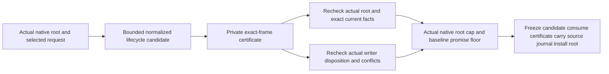

# Native retained lifecycle publication

Current document-lifecycle integration: §11.2.13 adds owned invocation for the
eight existing native scratch/relation/disposal/release products with live
restricted writer inspection and current result release; see
[lifecycle-invocations.md](lifecycle-invocations.md). Current shared cancellation
now covers ten native kinds/fifteen forms. Earlier counts/exclusions retain their
original slice scope; effect/activation/events/registry and host/physical/independent
gates remain.

Current logical container integration: §11.2.11 adds actual native view/workspace
birth and retirement, separately from document disposal and retained producer work;
see [relation-lifecycle.md](relation-lifecycle.md). Earlier registration exclusions
retain their slice scope; public products, complete consumer/host truth, recovery
and physical/concurrent/crash/independent assurance remain gates.

Current integration: §16.3.3 adds native source export admission, reservation release
and qualified SaveAs activation with private codec preparation, actual root/pair/
writer/promise checks and atomic serialized local publication; see
[native-source-destinations.md](native-source-destinations.md). Remaining persistence/
registration/history/recovery/public/host/physical/independent gates remain.
Earlier exclusions below retain their original slice scope.

Current integration: §11.2.8 connects the existing pure source-rebind product to
the actual native root with final pair/writer checks, exact retained binding/baseline
history, source journals and promise floors; see
[native-source-rebind.md](native-source-rebind.md). Native export/SaveAs admission,
registration/history release and host/physical/public/independent gates remain.
Earlier exclusions below retain their original slice scope.

Current integration: §11.2.7 additionally routes scratch creation and registered
view/workspace relations through the actual native owner, conditional explicit
profiles, private closed-delta certificates and existing floors; see
[native-live-lifecycle.md](native-live-lifecycle.md). Native registration, resource/
export/rebind/SaveAs and public products remain open. Earlier exclusions below
retain their original slice scope.

Current integration: §16.5.16 separately retires original annotation reads and
ordinary acknowledged-write producers after actual native provenance release,
under actual work/known-consumer/retention checks; see
[disposed-annotation-producers.md](disposed-annotation-producers.md). Remaining
all-profile lifecycle/export/rebind/history and contested-recovery gates persist.
Earlier exclusions below retain their original slice scope.

Specification §11.2.6 connects four existing retained-disposal substeps to the
actual invocation authority: dispose, release source binding, release annotation
binding and release document provenance. It preserves source journals and actual
baseline promises. It does not retire producers, make host coverage true or add
a public operation, native job kind or generic root-replacement interface.

## Ownership and execution

The direct executable precedents are the existing normalized lifecycle products,
private native annotation restoration/baseline certificates and the actual shared
writer's safe-disposition barrier. Their contracts remain the source of semantics;
this composition supplies the missing actual-root publication boundary.

The coordinator obtains the current root from the actual invocation domain. It
accepts an exact profile containing lifecycle, membership and ordinary-binding
limits, and only the four selected existing request products. The target must have
an activated ordinary-binding inventory; absent legacy inventory is not migrated.
It applies the existing bounded normalized transition, checks the activated pair
inventory and prepares a private writer guard and installation certificate.

No caller-supplied replacement root enters this coordinator. The certificate binds
the exact before-root object and native domain. An intervening unrelated publication
invalidates this short-lived preparation; the caller can prepare again against the
new root. This is a serialized reference rule, not a new persistent coarse editing
dependency, remote transaction or crash-durability protocol.

The normal coordinator does not return the certificate or guard. Both are discarded
on exit; successful native installation consumes the certificate before assigning
the root. Private factory seams remain trusted package boundaries, not an untrusted
in-process sandbox or cryptographic authority mechanism.

## Closed deltas and current facts

The twelve shared facts are authority, scope, continuity, not-stopped, resources,
companions, versions, reply, lifecycle permission, coverage, owner control and
preparation reservation. Each selected operation adds its own existing facts.
Every required fact is exactly true at preparation and rechecked at publication;
truthy values and stale preparations cannot stand in for current evidence.

The certificate independently reconstructs the allowed root delta. Disposal changes
only liveness/lifecycle, the identity tombstone and matching view/workspace relations.
Source-key release removes exactly the matching source owner/current binding while
retaining lifecycle provenance. Annotation-key release moves the exact old binding
and baseline into retained history, clears current annotation ownership/baseline
and advances its pair generation. Provenance release requires both current bindings
absent, changes only the retained lifecycle disposition and has its independent
history/snapshot/read/write/provider discharge facts. Publication and affected
generations advance once under the existing safe counter limits.

For key release, the guard retains the actual selected writer record, original
document and destination binding. Final validation rescans its actual bounded tasks
and destination quarantine. Queued work must be stopped; dispatched work needs
known application, uncontested evidence and no-future-effect disposition.
Quiescence alone is insufficient, and a late trusted conflict invalidates a
previously prepared guard. Real complete writer routing, policy and coverage are
still host premises; a same-authority empty registry cannot prove other writers
absent.

The native domain enforces its own root-size limit even when the supplied lifecycle
profile is larger. Its actual baseline pool also rechecks every outstanding promise.
The current promise profile requires its target live under its original annotation
binding: disposal refuses until the promise is validly discharged. It does not
silently cancel the promise, drop a hold or invent transfer to a disposed owner.
An unknown ordinary save still owns that promise after cancellation or quiescence;
actual known nonapplication and disposition/quiescence can use the existing checked
reservation-release path. More permissive promise-retention transfer is not proved.

## Source journals and retained peers

Lifecycle publication never changes source identity, bytes or revision. The trusted
metadata-only journal carry checks equal document inventories and each source tuple,
then reuses the actual owned committed transform references. It issues no new
source edit or fabricated receipt. Disposal does not make historical references
available to an unauthorized recipient; current live/identity/visibility checks at
analysis, geometry, read and publication boundaries still apply.

Native roots are frozen before installation. Source/settings, authored annotation
bodies/targets/placement/membership and history remain framed. Reader, writer,
codec, baseline and invocation ledgers are not refunded or reset by successful
lifecycle publication. A previously prepared native annotation edit cannot mutate
the disposed owner even with positive supplied gates. Historical restoration
inspection and late evidence remain separately controlled; original producing
reads still remain pinned until their own checked retirement is implemented.

The existing faulted-domain fence rejects new lifecycle root publication, including
a certificate prepared before the fault. Existing separate safe evidence/control
facets remain available under their own contracts; this does not add fault recovery.

## Evidence and proof limits

native-retained-lifecycle-checks.mjs covers 168 actual native transitions: four
substeps over 42 annotation capture/undo/redo stages. It checks 16,384 common-gate
combinations and 84 false/truthy/missing operation-specific fact cases, sixteen
controls and eleven semantic mutants after a passing coherently rewired baseline.
Controls include actual reservation floors, native size limits, both key roles,
source-journal carry, view/workspace generations, stale/foreign/cloned certificates,
exact delta frames, late conflicts, native faults, spent certificates, unbound
idempotence and actual disposed editing fences. Only semantic assertion failures
count as mutant detection; import/runtime errors do not.

Conditionally, the exact before-root check plus reconstructed delta makes publication
one allowed normalized transition or refusal. Rechecking the actual pool preserves
its existing future-publication promise invariant rather than weakening it. Exact
source tuples preserve each carried journal's source relation. Checked generations
and consumed certificate identity prevent replay of the prepared transition. Each
request terminates after bounded root/writer scans and one candidate; this is not a
liveness claim for environmental retention discharge or the whole editor.

The arguments are authored and finitely exercised, not proof-assistant induction,
whole-engine categorical closure, physical-allocation/concurrency/crash refinement,
hostile decoder safety or independent Cleanroom certification. Actual retention,
provider/policy/coverage truth, full required companion routing and installed
instrumentation remain evidence gates.

## Instrumentation and remaining work

PATH-05/12 and INS-01/02/03/04/07/08/12/13 distinguish candidate preparation,
root/guard invalidation, promise-floor refusal, native installation, retained
history/pins and eventual separate retirement. MELT and RED/golden signals cover
admission, useful publication, latency/errors and refusal reasons; USE covers root,
promise, history and retained-producer capacity. STRIDE challenges forged/stale
certificates, false coverage, ownership confusion, late conflict and quota theft.
LINDDUN covers resource/owner/activity linkage and retained history. No content,
path, identity, origin, token, handle or generation is an ordinary metric label.

Native scratch/view/workspace and explicit-export destination routing, complete
disposed read/write pin discharge,
promise transfer across disposal, live rebind/unbind/SaveAs and contested recovery,
public invocation/replay/events, actual host/package/retention truth, global and
physical costs, concurrent/crash implementation and independent assurance remain
open. No requirement, component, transport, numeric default or solver condition
changes; 234 conditions/fourteen manifests remain.
