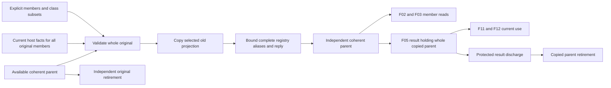

# Retained coherent version set evidence

The selected retained F02 profile copies an original available coherent parent in
the same actual owner, domain and pool. Its old owned projection is authoritative
for copied values; current roots, revision labels and independent member selectors
cannot replace it. This lowers existing §§12.8/12.10 semantics, extending
[native-version-set.md](native-version-set.md) without adding a public verb,
transport, filesystem mechanism or production numeric default.

## Scope and current authority

The request explicitly orders a nonempty participant vector. Every member has the
same document incarnation as an original member and a nonempty subset of its data
classes. Parent identity, exact request vocabulary, member domain and non-widening
classes are checked before accepted loss. Foreign/copied/wrong-kind references
and malformed requests cannot invalidate an unrelated original.

Validate the original whole context before admission, even for a subset. A known
loss in an excluded peer still invalidates that original; neither a smaller result
nor exhausted capacity hides the gap. Unknown facts and transient refusal withhold
without establishing loss. This depends on accepted current identity/policy and
dependency facts; retained labels and token possession do not supply them.

After a successful explicit copy, only its named members/classes are required by
its own current release. Remove excluded raw values, source-product revision/profile and
private annotation identities/facets. A narrowed copy cannot widen through a copy
chain or current-root fallback. Existing ordering and permitted annotation facets
stay unchanged, while all new context/member/record/cursor aliases are scoped to
the copy.

## Ownership and execution

The copy owns values and bounded registry/alias/reply stages independently. It
borrows neither the original's hold nor stop state. Its original may retire while
the new context remains readable. Publish the complete staged context or none.
Admission-capacity refusal preserves the live registry and spent issuance;
recognized bound loss still invalidates the original before capacity admission.

Groups, aliases, holds and spent issuance remain separate. New private registry
and alias frames are bounded at their actual representation size. The boundary
bank spends real nonrefunding hold identities until the next issuer ordinal grows
from one digit to two, then checks exact new registry/alias admission. No fixed
token-size assumption substitutes for the declared byte bounds. Existing complete
pool reservations remain logical envelopes, not physical/global accounting.

The same native member-query and synchronous search issuer paths enforce current
availability. A result retains the copied whole parent; its retained occurrence
and replacement consumers revalidate managed currentness before preparation and
publication. Disposal and owner fault fence delivery, including a search release
that observes loss first. Denied cleanup is not successful reclamation; authorized
once-only discharge does not refund spent identities or another owner's charge.

## Scoped evidence

| Area | Evidence |
| --- | --- |
| Owned retained projection | Twelve controls, 48 known-loss/capacity cases, sixteen unknown and three transient cases; old-cut values, explicit participant order, non-widening copy chains, fresh aliases, protected retirement and three search variants after original retirement. |
| Exact admission | Eighteen boundary cases over six dimensions: group/alias/issuance capacity, complete retained request, and private registry/alias growth after actual spent issuance. |
| Sensitivity | Nineteen assertion-killed mutations over coherent copied graphs, with construction failures excluded. |
| Actual lifecycle | Four retained-context disposal/fault cases and six retained-search cases, including search-first observation; 234 protected cleanup denials. |
| Dependent editing | Sixteen F11/F12 cases and seven mutations cover live use, stop/result retirement and query/peer loss before or after preparation. No independently leased prepared consumer is inferred. |
| Precommit faults | Three stage injections preserve the original root/registry and issuance, fence the owner and retain protected cleanup. |
| Selected substrate | 143 wrapped post-import filesystem/process callables, zero baseline calls and three detected staging injections with no partial registry/alias publication. |

These controls are finite reference evidence, not unbounded or categorical
completeness. The selected substrate probe does not establish import isolation,
all host APIs or all-route containment; stage faults do not prove post-publication
crash behavior.

## Instrumentation and remaining gates

IF-02/03/05 and PATH-02/07 reuse local engine ownership. INS-01/03/05/06/08/13
separate original validation, admission/copying, staged publication, content
handoff, dependent current use and protected discharge. Observe bounded refusal
classes, latency, pressure and actual live obligations without document names,
content, private IDs, hidden counts or a public failing-member index. A diagnostic
does not grant release or prove reclamation.

Arbitrary historical-root lookup, complete public arguments/results/events,
asynchronous lifetime, actual host/policy/notification truth, production packages,
physical/global accounting, measured SLOs, concurrent/crash refinement and
independent assurance remain explicit gates. Full frozen verification and exact
requirements/model/specification reconciliation are required before adoption.
