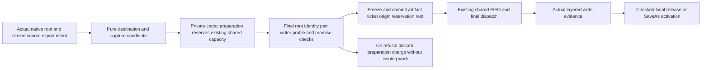

# Native source export and SaveAs publication

Current integration: §11.2.16 supplies owned SaveAs local activation through the
task-bound authority, current native candidate, atomic producer/root/outcome/receipt
and bounded current result release; see [saveas-invocations.md](saveas-invocations.md).
Final native activation now independently requires the exact current captured target
registration. A regression/control mutation checks refusal after replacement even
with retained identity-comparison facts and a private candidate framed onto the
new root. Historical release remains available under its existing contract. Load,
complete events/registry/remote and host/physical/concurrent/crash/independent gates
remain. Earlier exclusions retain their slice scope.

Current integration: §16.3.5 adds actual native explicit annotation-export
admission/release through the existing codec and destination owner; see
[native-annotation-export.md](native-annotation-export.md). Annotation disclosure
and source-write capabilities remain separate, and ordinary ownership/baseline/
binding intent is preserved. Earlier counts/exclusions retain their slice scope;
host, public, recovery, physical/concurrent/crash and independent gates remain.

Current integration: §16.3.4 adds actual native ordinary source admission and
acknowledged-baseline publication; see [native-source-save.md](native-source-save.md).
Its retained native anchors, final election/artifact/frame/floor checks and strict
execution facts do not close the remaining host, public, recovery, physical,
concurrent/crash or independent gates. Earlier exclusions retain their slice scope.

Current integration: §11.2.9 adds native source binding-history release and actual
native source peer/queued-consumer retirement fences without refunding producers
or changing current bindings/baselines; see
[native-source-history.md](native-source-history.md). All source-read cleanup and
remaining persistence/host/public/physical/independent gates remain. Earlier
exclusions below retain their original slice scope.

Specification §16.3.3 connects existing source-export/1 copy-export and SaveAs
intents, reservation release and acknowledged SaveAs activation to the actual
native root. It preserves §11.2.3 and source-export.md semantics, the existing
source codec, shared destination writer and private prepare/validate/commit pattern
already used for ordinary annotation admission. It adds no filesystem procedure,
public operation, callback executor or generic root-replacement interface.

## Local ownership and execution

The trusted coordinator obtains the actual native root and accepts exactly the
lifecycle, membership and bindings profiles. The source-save factory validates
the existing closed request, registered target identity, current binding/source/
serialization generations, create/overwrite authority and ownership/reservation
rules. It derives the existing capture and receipt products without issuing work.
The codec prepares exact immutable output under its shared artifact, lifetime-
issuance and held-byte limits. Preparation issues no artifact or writer ticket.
Only one source preparation occupies a codec; annotation preparation and capture
respect that reservation. Discard returns its charge without consuming issuance.

A private transition binds the actual writer/domain, exact before-root, prepared
source from that writer's codec, closed candidate frame and explicit profiles.
Native final installation rechecks exact current facts, structured ordinary-pair
evidence, actual writer capacity/origin/key state, root bounds and actual future-
baseline promise floors. It freezes the candidate and commits the source artifact,
writer task, fresh lifetime origin and destination reservation in one synchronous
reference path, with no callback, await or external I/O between validation and
installation. It consumes preparation and carries actual source journals. Failure
before commit leaves root, writer tickets, artifact/issuance counts and origins
unchanged; the coordinator discards the temporary source charge on every exit.

These are serialized local reference transitions, not atomic external write plus
local binding, machine-crash rollback, concurrent implementation proof or a
recoverable distributed transaction. Trusted private module factories remain
package boundaries; they are not an untrusted in-process security sandbox.

## Export and activation frames

Admission changes only publication and the target resource-owner reservation.
Copy-export never changes the current binding or baseline; an explicit authorized
copy may target the annotation resource without activating a colliding ordinary
pair. SaveAs admission checks the proposed source binding against the complete
current annotation binding and requires distinct resolved resources. Different
path strings do not prove distinction. Both share the actual existing FIFO;
neither bypasses unknown earlier effects or silently replaces another ticket.

Native source tickets bind to their actual domain. Dispatch refuses supplied or
stale roots and faulted domains. Existing application, synchronization, disposition,
quiescence and conflict handling remain separate. Local reservation release needs
a stopped queued task or known safe dispatched disposition; it does not refund
worker/codec retention or erase late write knowledge. Retirement still requires
quiescence, independent discharge facts and actual-root source-baseline/history
pins. Normalized release/activation helpers cannot mutate native ticket flags.

SaveAs activation requires the actual qualified write and safe disposition, a
current attested postwrite probe, unchanged original binding intent, both old/new
destination barriers and final pair evidence. A cancelled intent cannot activate,
even if its late write succeeds. It publishes the exact acknowledged capture as
source baseline, moves the resource-owner relation, archives the exact prior
binding/baseline when the context changes, and releases only its own reservation.
Same-context activation preserves binding identity/history. First scratch save
creates generation 1 without inventing old history. Later source/annotation edits,
serialization, document identity, views/workspaces and unrelated ledgers survive;
an old capture is not relabeled as the current source. Explicit null/malformed
history and bounded archive overflow refuse. Repeated completed control is an
unchanged local result, not another write or publication.

## Conditional arguments and evidence

Exact before-root identity and independently reconstructed closed deltas give the
serialized frame argument. The artifact-to-writer/plan check binds exact source,
serialization and output bytes to the prepared capture. Actual origin/capacity
revalidation prevents overcommit or replay after competing admission. Current
structured pair checks preserve distinct ordinary destinations at the publication
boundary. Rechecking actual task evidence and both destination barriers prevents
prepared activation from surviving late contradiction or cancellation. Single-use
preparation and actual promise floors preserve existing ownership and capacity.
Every scan uses bounded existing root/writer/codec inventories; the three closed
private transition kinds contain no retry loop or external computation. These are
conditional authored arguments, not a categorical completeness theorem.

native-source-destinations-checks.mjs checks 168 native transitions across 42
annotation/history stages, 131,072 admission and 32,768 control fact vectors,
63/117 strict-fact refusal cases, nineteen controls and twenty-one detected semantic
mutants with a passing rewired baseline. Controls cover exact frames, stale/foreign/
spent preparation, final pair/writer changes, shared FIFO/codec capacity, old capture
with later edits, scratch exclusive first-save, same-context activation, cancellation,
unknown/failed/conflicting evidence, safe disposition versus quiescence, actual
root pins, source/annotation alias policy and actual future-baseline floors.

## Instrumentation and remaining gates

PATH-01/05/10/12 and INS-01/02/03/04/07/08/12/13 distinguish preparation, refusal,
discard, actual admission/publication, queue/dispatch, layered evidence, reservation
release, activation and later retirement. MELT and RED measure transitions/errors/
latency, USE and golden signals cover queue/artifact/issuance/root/promise pressure.
STRIDE checks substitution, stale identity, replay and effect confusion; LINDDUN
checks correlation and disclosure. Ordinary metric labels exclude source content,
paths, document/resource identities, origins, handles, generations and coordinates.

Registration, remaining source/annotation admission and baseline/recovery profiles,
history-release integration, unclaimed/legacy/cross-context transfers and public
invocation/outcome/event products remain gates. Host identity/provider/policy/
coverage/retention truth, external atomicity/freshness/durability, physical/global/
concurrent/crash refinement, installed telemetry/measurement and independent
assurance are not established. No requirement, numeric default, public verb, native
job kind, component, transport or solver condition changes; 234 conditions across
fourteen manifests remain.
