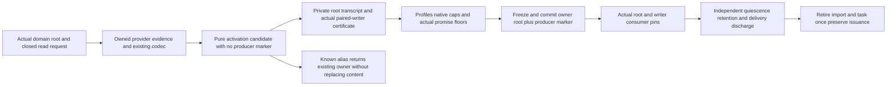

# Native source read activation and producer retirement

Current integration: §11.2.17 adds owned initial source-load activation with actual
read-task/live-codec/paired-writer authority, current native creation/join/repeat
frames and atomic producer/root/outcome/receipt settlement. See
[load-invocations.md](load-invocations.md). Native marker/return construction now
precedes producer mutation; all 36 native mutation names remain with marker and
consumption targets updated to that representation. The evidence below retains
its own scope. This does not prove file freshness, annotation-load invocation,
nonempty replacement/reload/recovery, full events/registration/remote encoding or
host/physical/concurrent/crash/independent truth.

Current registration integration: §22.3.3 adds atomic native resource metadata
activation and removal/reinstall generation fencing; see
[resource-registration.md](resource-registration.md). Current-row checks stale future
work without rewriting captured late evidence, bindings or producer obligations.
Public registration products, imported lifetimes and host/physical/independent gates
remain; earlier exclusions retain their original slice scope.

Current integration: §16.3.4 adds actual native ordinary source admission and
acknowledged-baseline publication; see [native-source-save.md](native-source-save.md).
Its retained native anchors, final election/artifact/frame/floor checks and strict
execution facts do not close the remaining host, public, recovery, physical,
concurrent/crash or independent gates. Earlier exclusions retain their slice scope.

Specification §11.2.10 connects the existing resource-read/1 work and normalized
activation semantics to the actual native owner. Direct semantic sources are
resource-read.mjs/resource-read.md, the existing source codec and ownership decision,
§11.2.7's fresh-owner/source-journal rules and native private certificate/parent-
floor patterns. This adds no provider, transport, parser, public verb or native job.

## Domain ownership and read execution

A private native read registry binds to one actual domain and a copied immutable
profile containing exactly lifecycle, membership and bindings limits. Existing
normalized registries remain historical references; they are not silently migrated.
Native admission/submission obtain the current healthy root, validate the existing
closed request/current read registration and require eleven exact-true launch facts.
A caller's replacement or stale root cannot redirect native read work. Registry-open,
ingress, control, candidate-release and retirement facts are strict as well.

The existing codec receives authenticated ordered start/chunk/end evidence under
bounded transcript/import limits. Exact accepted UTF-8, BOM serialization meaning,
empty content, mixed prose/code, Unicode and line endings remain unchanged. Provider
captured-read or atomic-resource-snapshot truth remains a supplied premise; requesting
the latter requires its actual declared capability. A version token alone does not
prove snapshot strength, freshness or isolation from external writers.

## Activation and current writer coordination

Preparation derives the existing normalized activation without changing the actual
task's activation marker. A private certificate binds its domain, exact before-root,
actual task/candidate, registration, context, ordered transcript and sole successful
end witness. A current actual writer guard is attached for the target identity key.
The writer must be paired with this source-read owner, and an established pairing
cannot silently change. The reader retains the actual writer owner reference as
well as the known writer record. This is a logical lifetime pin, not a measured
garbage-collector or physical-memory guarantee.

Final publication rechecks sixteen common exact-true facts and the existing creation
or owner-access fact, actual cancellation/contradiction/candidate continuity, current
read registration and actual writer effects. New queued or unresolved work and
destination conflicts invalidate prepared publication. These are checks of the
actual paired writer, not an assertion that host coverage is complete merely
because a flag says so. Complete external coordination remains a premise.

Creation independently reconstructs the permitted fresh document/owner/allocation
delta from actual decoded source and raw transcript. It sets native birth inventories
explicitly: source/settings/annotation-set/lifecycle generation 1, empty annotation
records/membership, ordinary-binding generation 1 with null annotation binding and
null annotation baseline. The loaded source binding/baseline retains its read
registration generation, origin, version, coherence and exact raw bytes. A read-only
resource needs no invented write registration or permission. Different read/write
registration generations are not coerced into one number.

Alias join instead returns the existing live owner under current access authority.
Its authored source, current binding/baseline, annotation inventory and root remain
unchanged even when the alias read contains different bytes. Repeated completed
activation is likewise a root no-op, not a reload. It does not infer missing native
inventories, attach/focus a view, join a workspace or discover a sidecar implicitly.

Both branch frames are rechecked at installation. The native boundary applies
post-enrichment document/activation/root limits and actual parent baseline-promise
floors before freezing and committing the producer marker/root. The existing
fresh-owner journal carry preserves all prior transforms without manufacturing an
edit receipt for initial content. Failed publication leaves the root, allocator,
producer marker and peer ledgers unchanged; existing read/codec charges remain
owned until their separate cleanup. No callback, suspension or provider I/O occurs
inside this serialized reference commit.

## Producer retention and late facts

Native retirement reads the actual domain root, never a supplied replacement.
Created-source read-origin and loaded-baseline references across live, retained-
disposed and historical/peer source positions retain the original producer. So do
known queued baseline consumers in the actual paired writer. Unknown source
consumer shapes are not evidence of absence. A separately provenance-released
owner with null active/retained bindings has discharged semantic pins under its
own lifecycle contract; cold retained data is not automatically a live consumer.

Quiescence, independent retirement/retention/delivery facts and all other known
consumers still govern task/import retirement. Key release alone does not release
retained read provenance. Cleanup releases charge once without recycling issuance.
An alias-joined read did not become the original source producer and may retire
after its own work/retention obligations. A stopped completed producer preserves
its historical capture while refusing another activation. A late contradiction
preserves the authored root but makes original provenance unusable and keeps the
created producer contested; recovery is not inferred from positive discharge flags.

A faulted native domain fences new admission, submission and activation, but still
accepts genuine late evidence and eligible non-producing cleanup. No failure is
rewritten as successful creation or ordinary rejection. Actor supervision and
recovery beyond the existing fault boundary remain separate contracts.

## Conditional arguments and executable evidence

Assuming truthful current authority, provider/identity/coverage and declared resource
facts, exact before-root identity and independently reconstructed creation/join
frames prevent stale overwrite, duplicate owners or alias-byte replacement. Actual
task/transcript/candidate and writer-guard revalidation prevent prepared work from
surviving cancellation, contradictory read evidence or intervening writer effects.
Marker/root installation and token consumption are one no-suspension reference
path; they are not production crash/concurrent atomicity. All scans use bounded
existing root, transcript, task and registry inventories and the closed create/join/
already-activated products, with no retry loop. These are conditional authored
arguments, not categorical completeness or an untrusted package sandbox. In
particular preparationReserved/resourcesReady and parent/global resource truth
remain premises; no physical heap or arbitrary-private-caller bound is established.

native-source-read-checks.mjs checks 42 prior annotation/history stages with actual
creation and alias join, plus 84 stage retirements through native retained disposal.
It exercises 8 registry-open, 2,048 admission, 2,048 submission, 65,536 activation
and 8 retirement fact vectors; 54 activation/access and 66 launch strict-value
refusals; twenty-seven controls and thirty-six detected semantic mutants with a
passing rewired baseline. Mutation detection counts assertion failures, not setup,
module-resolution or incidental runtime exceptions. Controls cover exact bytes,
alias frames, actual parent/post-enrichment caps, source journals, producer markers,
paired writer identity/lifetime, current effects, late conflict/fault handling,
actual-root/peer/queued pins, read-only registration generations and promise floors.

Queued-consumer and intervening-writer controls deliberately admit existing
normalized captures to the actual writer to challenge the native boundary. They
do not establish completed native ordinary-source admission or coordination with
every external writer. Peer-reference controls inject host metadata and do not
authorize cross-owner provenance adoption. Receipt/coverage truth, imported/legacy/
multi-registry transfer, provider replacement, reload and contested recovery are
not silently supplied by these negative controls.

## Instrumentation and remaining gates

PATH-01/05/10/12 and INS-01/02/03/04/07/08/12/13 distinguish read admission/launch,
decode/coherence, creation/alias/no-op/refusal, marker/root commit, late contradiction,
held codec/evidence, consumer-pinned cleanup and actual retirement. MELT and RED
observe transitions, failures and latency; USE and golden signals distinguish read
slots, transcript/import bytes, root/activation pressure, issuance and outstanding
promise floors. STRIDE covers forged evidence, stale state, owner substitution and
premature retirement; LINDDUN covers source/provenance correlation and disclosure.
Ordinary metric labels exclude content, paths, document/resource identities,
origins, handles, versions/generations and coordinates.

Remaining native ordinary source/baseline/annotation-export/registration/public
products, imported/legacy/multi-registry and contested recovery, actual provider/
identity/policy/coverage/retention/package truth, installed telemetry/measurement,
physical/global/concurrent/crash refinement and independent assurance remain gates.
Requirements and solver conditions are unchanged: 234 conditions across fourteen
manifests. No whole D20/F17/F20/F21 or broad specification goal closes from this slice.
