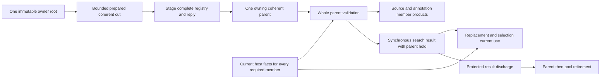

# Native current coherent version set evidence

The selected current-capture profile resolves every explicit document from one
actual immutable engine root. One bounded preparation becomes one owning parent
and its member aliases through an all-or-none synchronous handoff. Existing
§12.10 semantics and the precedents in [version-set-contexts.md](version-set-contexts.md)
govern the coherent set; this profile adds native reference composition, not a
database, transport or independently captured child-read protocol.

## Ownership and authority

Preparation reads the published root once. Each member retains only requested
source/annotation classes and permitted facets. Private annotation identity/facet
bindings remain available to the trusted owner, while recipient paging follows
attested root order, not logical annotation identity ordering. Those bindings and
opaque tokens are not grants. Actual identity/policy truth and complete change
notification remain host premises.

Installation stages candidate values, scope, private registry, parent/member
aliases and the complete reply before consuming the original prepared cut once.
A refusal preserves the cut and installed registry; successful transfer leaves
an independently charged installed copy. Preparation can then retire. Native
query aliases never expose private registry strings or acquire parent-control
meaning. Wrong-kind, foreign, copied and malformed selectors refuse before they
can poison an unrelated parent.

The F05 service uses a closed first-party issuer sum. A source-admitted member
provides a captured source cut; every retained result holds its whole coherent
parent. Stable recipient scope travels separately from the complete current-host
frame on the private accepted-facts port. Release and dependent preparation/run
revalidate current facts. Loss in a required peer fences delivery and use even
when the searched document is unchanged. Unknown facts or transient capacity
withhold without establishing loss. Later ordinary publication does not refresh
the retained cut.

## Resource and failure contracts

Preparation charges actual parent-root measurement workspace independently of a
smaller local refusal threshold. Installation reserves complete candidate,
registry, context, reply and selector staging envelopes. Groups, live aliases,
holds and nonrefunding issuance are separate bounds. A result hold prevents
parent retirement; discharge removes it once, and a pool refunds only its own
declared reservation. These bounds describe logical reference ownership, not
physical heap size, global admission or measured execution ceilings.

Precommit stage faults fence the actual owner without partial registry/alias
publication. Protected discharge remains possible. No post-consumption crash or
concurrent publication proof follows from synchronous assignments.

## Scoped evidence

| Area | Reference evidence |
| --- | --- |
| Preparation and current handoff | Eight capture controls, 45 boundary cases over fifteen dimensions, nine phase/thirty member strict denials; six handoff controls with sixteen loss, 32 unknown and three transient cases; 26 mutations. |
| Atomic installation | Five controls, 36 boundary cases over twelve dimensions, eighteen mutations and three precommit fault injections. |
| Member queries | Ten controls, 39 exact page/source boundary cases over thirteen dimensions, eighteen mutations and six source/annotation precommit fault injections; source range/line and three F03 products, native identity reuse, paging and context-control separation. Captured inner source-product and outer native reply budgets use their own complete representations. |
| Installed lifecycle | Four disposal/fault cases, 72 protected cleanup denials and nine mutations. |
| Search ownership | Ten controls including mixed-class authority and nine exact hold-selector/count/issuance boundary cases; three F05 variants, eighteen query denials and eight mutations. The lower discharge mutation has its own passing baseline with the redundant outer guard disabled. |
| Search lifecycle | Four actual disposal/fault cases and 108 protected cleanup denials; retained peer results fence and discharge without refunding spent identities or other owners. |
| Dependent consumers | Sixteen F11/F12 cases, including peer loss before/after preparation, with seven mutations. Prepared consumers remain dependent rather than receiving an independent ownership transfer. |
| Selected substrate | 143 wrapped post-import filesystem/process callables, zero calls in the selected baseline and three detected staging injections with no partial installation. Import/setup, other host APIs and all-route isolation are outside this probe. |

Mutation graphs load a coherent candidate before semantic assertions; construction
failures are not mutation kills. Finite controls and mutations do not establish
unbounded induction, categorical completeness or production refinement.

## Instrumentation and remaining obligations

IF-02/03/05 and PATH-02/07 stay within the local engine. INS-01/03/05/06/08/13
cover capture/admission, all-required validation, staging/publication, delivery,
dependent use and protected discharge. Observe refusal class, latency, pressure,
live obligations and once-only release at these boundaries. Keep document names,
content, annotation identities, private tokens and failing-member indices out of
metric labels and ordinary diagnostic products. This adds no network flow or
filesystem mechanism; host adapters and UI projection retain their own contracts.

All-profile source/lease envelope coverage, historical-cut acquisition,
complete public codecs/results/events and asynchronous lifetimes remain residuals.
Host identity/policy/notification truth, supported packages/platforms, physical and
global accounting, measured SLOs, concurrent/crash behavior and independent
assurance remain separate gates. Ten suite registrations validate the selected
counts, semantic controls and explicit evidence limits. Full frozen-input
verification and endpoint reconciliation are required before adopting this batch.
