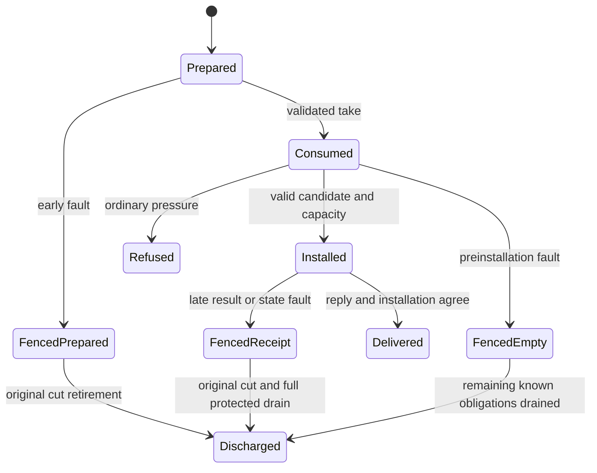

# Resource catalog acquisition results and cleanup

Existing native resource-catalog acquisition now validates its closed context or
unavailable reply against independently staged native ownership. It distinguishes
ordinary refusal, preinstallation fault and failure after context installation.
No public verb, transport, UI policy or numeric default is added. Actual-owner
decoded gateway accounting and complete discovery remain separate obligations.

## Result and installation binding

Context replies contain exactly status, the original newly minted context and
captured-permitted coverage. Unavailable contains only status. Check both exact
data fields and the independently expected original token; shape alone cannot
authenticate a caller-supplied alias. Reject non-string statuses without coercion.

Before installation, bind the private candidate's exact fields, captured scope,
projected rows, empty selector maps and initial live state to owned staging data.
At release, the reply disposition must agree with actual installation, and an
installed context must still match that staged meaning. A late unavailable reply
cannot silently hide an installed context. Valid reply pressure remains an
ordinary refusal: it consumes the current cut under existing rules, but spends
no context issuance and does not fault the registry.

## Registry fencing and original cut ownership

Unexpected acquisition failure fences this actual reader registry, not the
execution domain or provider work. New visibility preparation, acquisition and
delivery stop; known contexts and cuts, their reservations and spent issuance
remain retained. Query-result faults still have the narrower affected-context
scope from §22.2.2.3. No reset or same-domain issuer reopening is selected.

The cleanup pattern follows the existing [owned reservation admission](observation-admission.md)
and [protected native installation discharge](native-annotation-installation-fault-checks.mjs):
unknown setup does not invent absence, and failed delivery does not prove rollback.
An early unconsumed visibility cut remains explicitly disposable. A fault after
consumption but before installation creates no context. A late installed context
is invalidated and linked to a cleanup-only receipt under its original visibility
cut. That original cut was already owned before acquisition, so loss of the reply
does not make the installed context unreachable for protected cleanup.

These are explanatory protocol states, not new semantic verbs or a proof of global
categorical completeness. A receipt is never a renewed preparation: ordinary cut
consumption remains one-shot. Copies, foreign owners and repeated cleanup cannot
retire another record. Receipt cleanup requires literal-true owner control,
retention release and delivery drain; then it removes that inaccessible context
and receipt once. Direct context retirement cannot bypass the outstanding receipt
hold. Other known contexts and cuts still require their own protected discharge.
Neither cleanup path refunds lifetime issuance or reopens the issuer.

## Conditional accounting and instrumentation

Before installation, require the complete private cleanup frame to fit the existing
maxPacketBytes envelope. It replaces the consumed cut's slot after a late fault;
it is not a new context-independent queue or an extra uncharged reservation. Under
the existing serialized, callback-free native transition, consuming one cut lowers
occupancy by one and retaining its cleanup receipt restores at most that one slot.
The registry is then fenced against new admission. Context and issuance ceilings
were checked before installation and cleanup never subtracts spent issuance.
The fixed declared registry reservation remains held until the whole registry
retires. This is not a new shared-parent, allocator or physical-peak proof.

IF-01/02, PATH-02 and INS-01/03/05/07/08/09/12/13 distinguish acquisition frame/
candidate/release checks, ordinary refusal, first registry fence, context retention,
cleanup-only cuts and final discharge. MELT/golden/RED retain separate populations
and latency/error dispositions; USE covers declared occupancy and saturation.
Supervision exposes only content-safe fault and failed-acquisition counts, not
the inaccessible context identity. STRIDE/LINDDUN/privacy/hazard checks challenge
copied cleanup receipts, scope substitution, denial of drain, premature refund,
same-domain reopening and hidden identity linkage. Raw handles, scope/policy values,
registration metadata and malformed products are not ordinary labels or fault
payloads. No new signal threshold is selected.

## Scoped evidence and remaining gates

Five controls cover six native acquisition products, 24 malformed refusals and
three exact reply-capacity boundaries. Fifteen fixed fault stages exercise three
projection modes each: 45 faults, three retained early cuts, fifteen late installed
contexts and ninety protected-receipt refusal cases. The faults run with both
preparation slots occupied and check cleanup-frame bytes against the existing
envelope. They also verify sibling retention, unchanged authored/parent state,
absorbing registry fencing, original receipt ownership, once-only cleanup and
nonrefunding context/registry retirement.

Two mutation banks detect 24 changes against the complete acquisition/fault corpus.
Construction, syntax and process/tool failures do not count as semantic evidence.
Selected post-import probes wrap 143 filesystem/process callables; eight
preconstructed fixtures execute five controls with no observed baseline calls and
detect three fixed read/rename/process injections. General host/import isolation
is not established. The earlier native reader's forty mutations remain acceptance
obligations, and the query-result drain mutation retains its original scope after
the new receipt hold joins retirement's guard.

Full frozen qualification and endpoint reconciliation remain adoption gates.
Raw hostile ingress, actual-owner gateway integration, full discovery/all-family
products, physical/global accounting, operational measurements, crash recovery
and independent assurance remain separate obligations.
