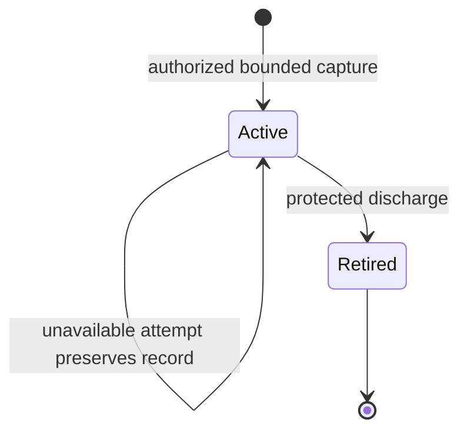

# Scoped conditional registration bases

Current integration: §22.3.6 supplies the separate owned scoped native adapter,
current basis/scope/profile revalidation and stamp-free indexed receipt; see
[registration-scoped-invocations.md](registration-scoped-invocations.md). Shared
cancellation now covers 21 forms/eleven kinds, 336 gate/168 context cases, 42 races
and 5,439 traces/15,246 edges, preserving ten controls/twelve mutants. Earlier
counts/exclusions retain their slice scope. Wire/remote, full discovery/events,
host/measurement/physical/concurrent/crash and independent gates remain.

Specification §22.3.5 supplies the native authority dependency for scoped F16
conditional registration. A basis identifies one captured read/write slot condition;
it is not a read selector, a possession-based grant or a mutation. The existing
native candidate and owned invocation remain the only registration publication
path. Their later scoped adapter must revalidate authority and the condition at
the serialized publication boundary; this slice does not implement that adapter.

## Precedent and adopted security constraints

[RFC 9110 §§13.1.1–13.1.2](https://www.rfc-editor.org/rfc/rfc9110.html#section-13.1.1)
separates matching an existing representation from requiring current nonexistence,
and evaluates the condition before a state-changing method. Only that conditional
update pattern informs this local design. No HTTP method, header, status, network
route or validator encoding is imported. The stronger native-generation comparison
and recipient scope follow Vellum's existing native registration and D09/D12
contracts, not a claim that HTTP proves Vellum's privacy or incarnation semantics.

An equality/staleness result can disclose a private change even without releasing
the changed fields. Accordingly, default-deny issuance and every current use require
independent exact-true permission for registration, the target slot, basis use,
presence observation and equality observation, together with ordinary current
authorization, scope, continuity, liveness, identity, complete registry coverage
and resource/retention/reply/preparation facts. Missing facts deny. Metadata visibility,
source/annotation data rights and trusted raw-result access do not imply these
permissions. Whether those host facts are truthful and appropriately granted is
an explicit policy premise, not an executable-reference theorem.

## Actual ownership and two condition meanings

One issuer belongs to one actual healthy native domain and its authority/engine.
It retains a copied, bounded native profile and limits. A current interpretation
fact plus exact retained-profile equality prevents silent reinterpretation.
The scope has exactly authority, engine, recipient, purpose, destination, policy,
continuity and the private native-registration-basis/1 profile. Each bounded slot
has a read/write table and complete provider/resource tuples. Object member order
does not change tuple identity. Actual catalog validation precedes interpreting
a missing slot as absence; a caller does not supply the root or an absence claim.

| Condition | Captured and checked meaning |
|---|---|
| Present | The actual complete native row, including its nonnegative generation, still matches. Generation zero is present, not an absence sentinel. Removal/reinstallation obtains a fresh generation under the existing nonreuse premise, so an old present basis cannot revive. |
| Absent | There is currently no row at that typed slot. This is a current predicate, not an absence epoch. Absent → present → absent may satisfy the same basis again; uninterrupted absence is neither required nor claimed. |

Neither condition compares a global publication, native floor, unrelated row or
source revision. Unrelated source/catalog activity therefore does not invalidate
the captured condition. Private changes to the target present row do invalidate
it, under the independently authorized equality-observation permission.

Opaque frozen object handles resolve only through their actual issuer's private
map, actual native domain and complete original scope. Copies, lookalikes, foreign
bases and actually issued F07 contexts/entry/cursor selectors cannot resolve.
Stable recapture of an equal active scope/slot/condition reuses the same handle
without spending issuance. A stale present basis remains charged until explicitly
retired; a new capture never silently upgrades that old basis.

## Public frames and private consumer boundary

Capture releases only status, opaque basis and present/absent classification.
Inspection releases only status, classification and current availability, or a
common unavailable result. Neither releases native generation, tuple, locator,
identity key/domain, root publication or owner-wide floor. A basis is not itself
permission to mutate, inspect metadata, read data or obtain a native receipt.

Private first-party resolution additionally requires an exact-true independent
registrationHostBasisAllowed grant. It returns a bounded immutable copied slot,
existing native expected-condition product and captured row, never a mutable root
or owner record. This is not an ordinary release surface or a public serialization.
Its return is a point-in-time native dependency, not an effect certificate: later
mutation preparation/service/final publication must apply their current authority,
native profile and existing atomic expected-condition checks. Possessing or
retaining this private return cannot bypass those checks.

The JavaScript reference assumes trusted inert bounded values and a private module
boundary; it is not a hostile-object decoder, in-process memory sandbox or proof
of confidentiality from a fully privileged host.

## Bounded lifetime and halting

Independent limits bound active bases, lifetime issuance, roots, retained native
profile, scopes, tags, slots, basis records, private-use payloads and replies. The
declared reservation is maxProfileBytes + maxBases × (2 × maxBasisBytes +
maxUseBytes + 2 × maxReplyBytes). Reject unsafe arithmetic or a reservation above
maxHeldBytes. Capture validates its retained record, private-use payload and whole
reply before publishing a map binding or spending issuance. The private-use
payload omits the retained scope; the public inspection frame is smaller than the
corresponding fitting capture frame. These are logical envelopes, not exact
allocator measurements or selected numeric product defaults.

Current/stale is an evaluated predicate, not a monotone retained lifecycle state.
In particular an absent basis can alternate between matching and not matching.
Protected retirement needs owner control, retention release and delivery drain,
not content/capacity grants or a healthy native owner. It removes resolution but
does not refund issuance or discharge any provider/task/root/baseline obligation.
Issuer retirement requires no bases and the same discharge facts. A spent-domain
marker prevents reopening that issuer to reset its lifetime budget.

All scans/copies range over validated finite structures; there is no callback,
provider I/O, recursive verb interpretation or unbounded retry loop. Under the
trusted inert-value and serialized execution premises, each call halts with a
complete bounded result or refusal. This is neither a whole-engine bounded-lattice
theorem nor categorical closure of all possible host transitions.

## Conditional arguments and executable evidence

Assume immutable serialized native roots, private registry maps, unique actual
domains, native nonreusing generation allocation, truthful current host policy/
coverage/identity/retention/resource facts and the supported native profile.

1. Domain, issuer, scope and opaque-object binding prevent copied/foreign/stale
   handles from selecting a different captured condition. Exact profile meaning
   and current gates are checked again for each capture/inspection/resolution.
2. Present-row equality plus the native nonreuse invariant excludes replacement
   resurrection. The absent branch checks only current nonexistence; it makes no
   history claim requiring nonexistent per-slot tombstones or a global counter.
3. Bounds and duplicate checks precede map/issuance publication. Retirement removes
   resolution without refunding lifetime issuance; the domain marker fences reset.
   Capture/use/retirement never mutate native roots, floors or producer ledgers.
4. Under equal scope, target condition and common fitting capacities, selected
   unrelated hidden row/source changes preserve the permitted public frames and
   stable local handle use. This does not establish timing/resource or all-world
   noninterference, nor hide an explicitly authorized target equality observation.

registration-basis-checks.mjs covers 42 capture/undo/redo stages and 252 captures
over source-read, annotation-read and writer rows in both condition modes;
131,072 authority vectors, 54 strict-fact cases, 48 selected paired worlds and
seventeen controls. Thirty-two semantic mutants run in four exact eight-case
banks, each requiring a passing rewired baseline. The named combined native
row/condition mutant removes redundant fences together; import/runtime failures
do not count as mutation kills. Existing direct/native-owned registration and
scoped-read suites remain mandatory with their original scopes.

The scoped mutation adapter, descriptor/payload products, public/Rust/wire/remote
encoding, complete discovery/events/other registries, actual host truths, installed
signals/measurement, packages/apps, physical/global/concurrent/crash refinement
and independent assurance remain gates. There is no new job kind, semantic family
or variant: 28 families/87 labels, eleven internal kinds and 234 SMT conditions/
fourteen manifests remain. No whole F16/D-row or all-sections goal closes.

## Instrumentation and threats

Reuse IF-01/03/04/07/08/10, DAT-09, PATH-01/05/10/12 and
INS-01/03/04/08/09/12/13. Distinguish capture, current inspection, private resolution,
stale/missing/refused conditions and protected retirement from native activation.
MELT/RED/golden signals observe those boundaries; USE observes basis, issuance,
scope, private-payload and reply pressure. Installed capture, overhead and service
objectives remain measurement gates.

STRIDE covers forged scopes, copied/foreign handles, stale target substitution,
issuer reset, unauthorized private resolution and resource exhaustion. LINDDUN
covers presence/equality inference, native-stamp linkage and private tuples in
diagnostics. Never use handles, scopes, native IDs/locators/stamps or policy epochs
as ordinary metric dimensions. Trusted usage counters are owner supervision, not
an ordinary recipient epoch or proof oracle.
