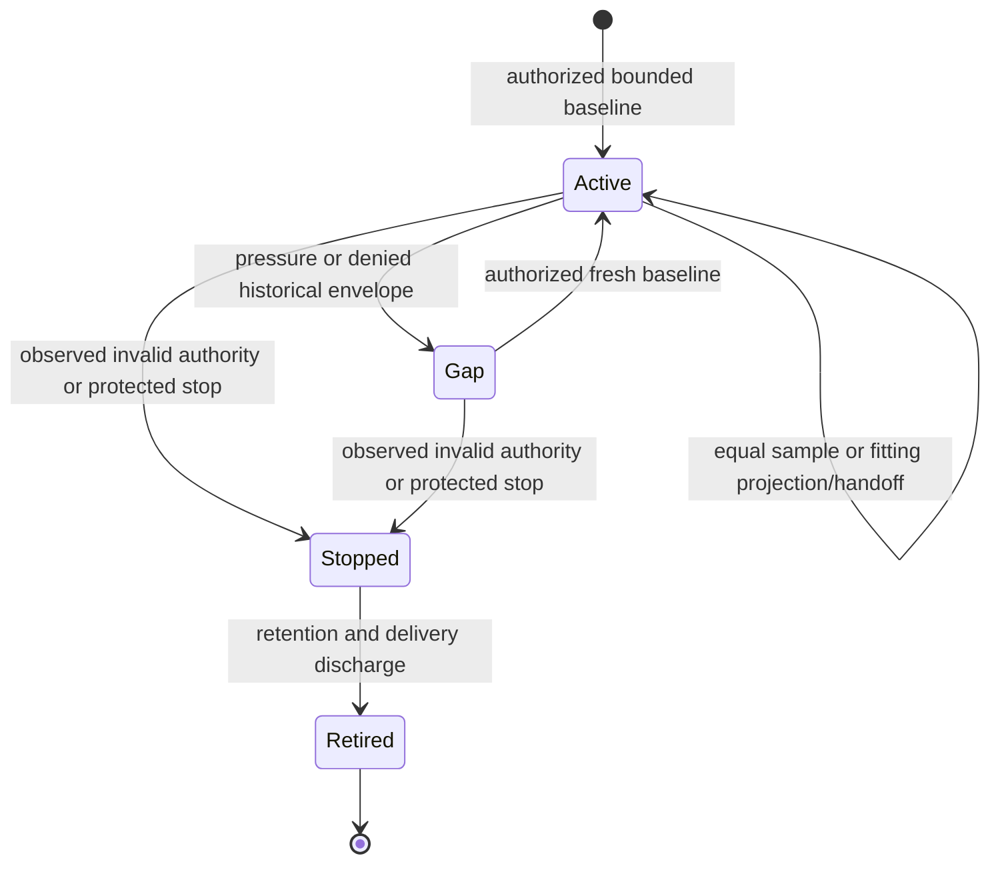

# Scoped native resource registry observation

Specification §12.3.3 applies the accepted §12.3.1–§12.3.2 full-projection observer
pattern to actual native resource catalogs. The profile scoped-resource-observation/1
refines F19 establishment, protected stop and authorized resynchronization for
resource metadata. It does not implement host grant-policy mutation, a lossless
activation audit, command-registry discovery or a public wire format.

## Committed state and captured policy

One bounded observer registry belongs to one actual healthy native publication
domain, authority and engine. It retains a copied supported native profile and
limits, without registration mutation or source/annotation data grants. Validate
the actual committed root and exact current profile meaning on use. All observation
preparation/projection/delivery happens outside publication guards; no subscriber,
provider, formatter or exporter runs inside native registration commit.

The exact scope fixes authority, engine, recipient, purpose, destination, captured
policy, continuity, profile and Boolean read/write descriptor ceilings. A complete
snapshot preparation covers both actual native tables exactly once. Each private
slot fact declares capture-policy membership, current membership, corresponding
descriptor permissions and approved visible order. Capture-policy membership for
a new slot means permission under the retained original policy, not membership in
the original snapshot. Its truth and retained meaning must be supplied by the host.

Intersect both membership decisions before ordering or allocating references.
Intersect the fixed class ceiling and both descriptor decisions before projecting
the existing §22.2.2 whitelisted fields. Visible order is contiguous over the
intersection, not an index into hidden rows. This is a live collection scope:
eligible new slots can appear under the captured policy. It does not reinterpret
F07's immutable captured-slot snapshots as live collections or infer that later
policy broadening expands an old grant.

Preparation requires strict authorization/scope/continuity/liveness/projection,
complete native coverage, permission to observe scoped logical-slot identity,
capture-policy availability/attestation, visibility/order attestation and bounded
outside-guard resources. Coverage equality checks the facts against actual tables;
it does not prove host policy truth or classify secret procedure labels. A missing,
malformed, foreign, stale, copied or spent preparation is not an empty catalog.

## Projection identities and sampled transitions

Filter hidden slots before allocating opaque observer-local references. Internal
keys use read/write table and complete provider/resource tuples, independent of
member insertion order. Results omit those tuples, native generation, locator,
identity key/domain, publication and owner-wide floor. Descriptor values remain
accepted declarations, not live provider/file probes or grants.

References identify visible logical metadata slots, not native registration epochs.
An unchanged slot keeps its reference. Removal retains its bounded private binding;
reinstallation of the same logical tuple can reuse it even with a new native stamp.
A new provider/resource incarnation gets a different reference. This preserves
§22.2.2's non-epoch meaning rather than leaking hidden native generation changes.
These references are neither F07 query selectors nor F16 mutation bases.

Every baseline/event says coverage captured-policy-current. Hidden-only catalog,
source or private-field differences do not advance a fitting permitted projection.
Changed permitted membership, order or metadata queues a complete projected state
with opaque observer-local before/after generations. Equal samples allocate no
new binding or generation. Their equality includes private logical-slot identity,
so two different visible slots with identical metadata do not collapse.

This observes committed states when serviced. It promises neither an event for
every activation nor audit history of intermediate states between samples. An
ABA between samples can leave the same permitted state. Full projected frames
are not silently presented as a lossless delta log or external-effect evidence.
Host sampling/service scheduling remains a separate obligation.

## Current release of queued historical frames

A queued frame can contain a slot no longer in the current catalog. Current
catalog visibility alone cannot authorize that old data. Delivery preparation
therefore covers the exact queued head's private slot set, with current visibility/
descriptor permission for the held historical values under an explicit host
historical-metadata release attestation. It binds actual registry, stream, complete
scope, current root and exact head object, and is single-use.

Current scope/profile/authority and whole-frame retention/release/transfer/reply
facts still apply at handoff. A wrong context refuses without stopping a different
valid stream. Missing/copy/stale certificates cannot fabricate empty delivery or
authorize another head, including after same-root resynchronization. A disappeared
slot may be released only with explicit current historical permission; disappearance
does not itself prove either permission or revocation.

If a valid head certificate denies any visible membership or a descriptor actually
present in the frame, discard the queue and require a baseline. Do not relabel a
rich queued frame as a narrower success under its old generation. A table-only
frame still requires membership disclosure permission but no absent descriptor
grant. The host must fence preparations/current facts when policy or continuity
changes independently of the native root. Root equality is not an authorization
freshness theorem; actual policy/attestation truth remains an explicit premise.

Observed authority/profile/continuity loss stops the old stream and clears its
delivery state. Later regrant cannot revive it; establishment needs a fresh
authorized context/baseline. Readiness stalls can withhold delivery; queue or
projection/binding/issuance pressure produces an explicit gap, not a silent suffix.
Authorized resynchronization uses fresh current snapshot preparation, clears the
old queue and publishes a new baseline/generation. It never substitutes historical
native state or grants mutation/retry eligibility.

## Bounds and lifetime ownership

Finite independent limits bound streams/preparations, actual rows, active retained
bindings, lifetime issuance, root/profile/scope/packet/projection/binding/reply
envelopes and queue length. The conservative reservation is maxProfileBytes +
maxPreparations × maxPacketBytes + maxStreams × (maxContextBytes +
2 × maxProjectionBytes + 2 × maxBindingBytes + (maxQueue + 2) × maxReplyBytes).
Reject unsafe total arithmetic or a reservation above maxHeldBytes. Fixture values
are not selected product defaults or physical allocator measurements.

Stage reference maps, issuance and whole reply before baseline/event/resync
installation. Failure must not spend partial bindings or exceed the lifetime
ceiling. Opening spends one stream handle, one generation and visible references;
changed events/resynchronization spend a new generation and any newly visible
bindings. Protected stop clears active projected data/binding tables but does not
refund lifetime issuance. Pending preparations retain their own bounded root/head
holds until explicit retirement; a zero active-binding gauge is not proof that
all physical references were reclaimed.

Stopped-stream retirement requires independent owner control, retention release
and delivery drain. Registry retirement requires no streams or preparations; a
fixed spent-domain marker prevents reopening/resetting its lifetime budget. None
of these transitions mutates native roots/floors, cancels providers, releases
producer holds or changes authoritative operation outcomes. Policy-grant revocation
itself remains with its existing authority owner, not an alias for stream stop.

Current F07 acquisition remains independent: use a fresh separately authorized
metadata-read context and visibility preparation. A current capture may be newer
than an event. Do not convert event generations/references into read selectors,
mutation bases or exact historical snapshots. No observer is required to read.

## Conditional arguments and scoped evidence

Assume private first-party modules, inert finite supported values, immutable
serialized native roots, stable captured-policy meaning, truthful current policy/
identity/order/coverage/retention/resource and outside-guard facts, and unique
native domain lifetimes.

1. **Coherence and non-expansion.** Exact native-table coverage/root/scope binding
   selects one committed state. Original/current policy intersections and fixed
   class ceilings constrain new members and facets before reference allocation.
2. **Historical release.** Exact head/root/scope binding and complete current
   historical-value facts authorize only the held frame. Narrowing creates a gap;
   observed scope invalidity stops delivery and prevents old-queue resurrection.
3. **Identity, bounds and frame.** Actual opaque handles and staged private maps
   prevent copied/foreign bindings, partial allocation and issuance reset. Logical
   slot identity is not a native epoch. All observer operations frame native
   root/floor and producer ownership; failure cannot reject an applied mutation.
4. **Privacy and halting.** Under equal permitted slots/order/facets and common
   fitting capacity/service conditions, selected hidden differences preserve
   permitted frames, reference use and stream advancement. Calls scan/copy finite
   bounded structures and return a complete frame, refusal, gap or terminal owner
   transition. This is not timing/resource/all-world noninterference, scheduler
   fairness, lossless audit, whole-engine lattice closure or categorical completeness.

registration-event-checks.mjs covers 42 capture/undo/redo stages, 84 full/table-only
streams, 65,536 preparation vectors, 32 acquisition/32 delivery vectors, 96 selected
paired worlds, sixteen facet cases and twenty-five controls. Forty semantic mutants
are required in five exact eight-case banks, each with a passing rewired baseline.
Mutation-target validity precedes the kill loop; import/runtime failures do not
count as kills. Existing native registration/read/basis/invocation, collection
observation and cancellation suites remain unchanged and mandatory.

Public Rust/wire/remote encoding, actual subscription scheduling/host policy and
historical classification, complete command/schema discovery and other registries,
installed instrumentation/measurement, packages/apps, global/physical/concurrent/
crash refinement and independent assurance remain gates. Requirements, 28 families/
87 labels, eleven internal job kinds and 234 SMT conditions/fourteen manifests
remain unchanged. No whole F19/F07/D-row or all-sections goal closes.

## Instrumentation and threats

Reuse IF-01/03/07/08/10, DAT-09, PATH-01/05/10/12 and
INS-01/03/04/08/09/12/13. Observe postpublication snapshot preparation, policy
intersection, baseline/changed/unchanged sample, queued historical authorization,
handoff refusal, gap/resynchronization and protected lifetime discharge separately
from mutation and provider outcomes. MELT/RED/golden signals cover those seams;
USE covers packet/stream/binding/issuance/queue/reply pressure. Service objectives,
capture installation and measured overhead remain measurement obligations.

STRIDE covers incomplete/forged policy facts, stale packets/head substitution,
cross-scope handles, false continuous suffixes, replay and quota reset. LINDDUN
covers hidden-row/native-stamp linkage, stale rich-frame delivery and private
identity/procedure labels in diagnostics. Do not use raw scope/slot identities,
handles, procedure/locator values, policy epochs or native stamps as ordinary metric
dimensions. Trusted usage counts are supervision, not a recipient clock or proof
oracle. No network path, callback bus, exporter or workflow service is introduced.
