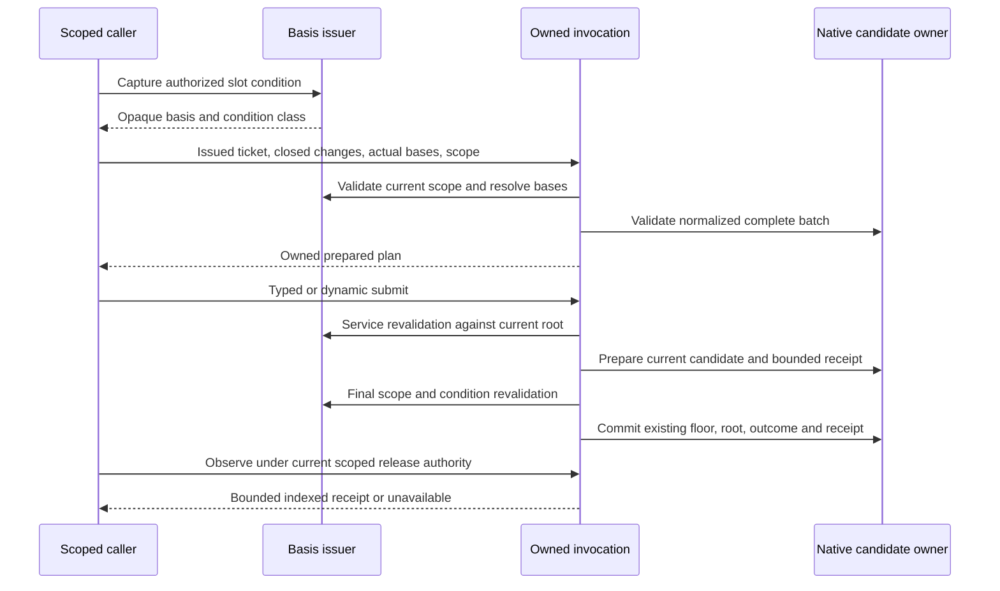

# Owned scoped registration mutation

Current integration: §12.3.3 separately supplies actual native resource-catalog
full-state observation, original/current policy intersections, opaque logical-slot
references and exact historical-head release with gap/resynchronization/protected
lifetimes; see [registration-events.md](registration-events.md). It does not supply
a lossless activation audit, command/schema discovery or policy-grant mutation.
Earlier counts/exclusions retain their slice scope; wire/remote, host/measurement,
physical/concurrent/crash and independent gates remain.

Specification §22.3.6 connects §22.3.5's actual scoped bases to the existing native
resource-registration candidate and owned F16 invocation. It supplies a first-party
semantic adapter and a scoped receipt, not a network route, callback runtime or
Rust/wire encoding. The existing registration job, finite invocation phases,
native batch semantics and serialized publication owner remain unchanged.

## Inputs and identity boundaries

The exact private wrapper is scoped-registration-invocation/1 with operation
activate-context, profile scoped-resource-registration/1, the issued invocation
reference and request {changes}. A change has action install/remove and a basis
index; install additionally supplies the complete existing native configuration
product. There is no patch language, executable callback, default generation or
implicit replacement of missing fields. Native validation still rejects unknown
products, malformed configuration, unsupported profiles and duplicate typed slots.

Actual opaque bases travel in a separate copied array, not through structured
cloning or JSON serialization. Its length equals the change count; indexes form
a complete nonrepeating permutation. This prevents unused retained bindings and
keeps correlation local to the submitted request. Each issued basis supplies the
read/write table, provider/resource tuples and explicit native expected condition.
The scoped change cannot substitute native identities or a generation. Supplied
configuration still includes the existing host declaration fields, including
identity/locator declarations where that native product requires them. The current
host must authorize and validate those declarations; they are not self-certifying,
and the receipt never echoes them.

The basis scope must match the invocation's authority, engine, recipient, purpose,
destination and continuity. Its own profile remains native-registration-basis/1,
not the execution profile. Its policy is separately bound by an exact current
host scope attestation. All original current basis permissions and native mutation
facts remain required, including independent presence/equality observation and
private first-party resolution permission. Neither an ordinary F07 read selector
nor a captured raw-host receipt can substitute for that authority.

An empty batch still needs an actual healthy basis issuer, supported retained
native profile, complete scope, exact current host attestation and actual before
root. It cannot bypass authority because there are no per-change resolutions.
The native helper validates the scope against the actual domain/root and retained
profile without claiming that any particular row condition remains current.

## Owned preparation and execution

Preparation resolves each basis under current authority, lowers the closed input
to the existing native request and validates that complete batch. It retains an
immutable original scoped request/scope/profile and normalized native request,
plus actual issuer and copied opaque-reference bindings. Both the incoming
envelope and the complete retained value/reference envelope must fit the native
maxIntentBytes. Copying the array preserves opaque identity without retaining a
caller-mutable array. Repeated preparation returns the same plan only for the same
actual bindings and equal immutable inputs after fresh current validation.

Native and scoped plans exclude each other on the same issued invocation slot,
as do existing lifecycle/relation preparations. They cannot silently reinterpret
one another. Typed and dynamic admission use the same registration job and owned
plan; normalized intent contains no arbitrary callback or alternate execution path.

At service, resolve the bases again against the actual current root and require
the normalized request to equal the captured native request. Recheck both native
interpretation and complete current scope/profile meaning. Present bases retain
their native generation/nonreuse semantics; absent bases remain current-absence
predicates and may again match after an absent/present/absent round trip. Unrelated
source or catalog changes can survive fresh native candidate preparation without
invalidating the target or binding it to a global floor.

Final commit repeats scope, issuer, native profile and every basis-condition
check, then uses the existing native certificate/floor reconstruction and common
root/outcome/receipt boundary. Relevant source journals and current baseline
promises remain in that common path. There is no await, provider I/O, native floor
allocation or root publication between scoped preparation and native validation.
The common native commit still performs the floor allocation with atomic local
root/outcome/receipt installation in the synchronous reference model.

Missing/stale/retired authority or changed conditions before service produce
ordinary not-published/notApplied disposition without native publication. A
contradiction in supposedly stable trusted facts between stage and final commit
is a protocol fault, not a successful stale mutation; selected controls check no
floor/root publication. Queued stop remains the existing stopped disposition.
Postpublication withholding or eviction cannot turn an applied edit into rejection.

## Scoped receipt and retained evidence

The scoped receipt contains only the already-issued invocation reference,
applied/unchanged status, and one {basis: request-local index, state: present/absent}
per submitted change in change order. It does not contain native identities,
registration generations, global publication/floor, configuration or new basis
handles. The invocation reference is the existing admitted correlation, not a new
registration epoch or a claim of all-world identifier noninterference.

The scoped result allowance is captured at admission and cannot grow later.
Every release also needs the common current context/outcome-policy gates, all
current scoped result grants, original scope/profile meaning and actual basis
issuer/root validation. The native raw-host receipt endpoint refuses scoped plans;
the scoped endpoint refuses native raw plans. A later host-result grant cannot
substitute for a missing captured scoped allowance.

Receipt release does not require the original row condition to keep matching:
the successful mutation itself may invalidate it. Later target changes do not
rewrite historical results. Current authority or issuer retirement can withhold
the receipt while the authoritative outcome remains intact. A fresh basis for a
subsequent mutation is a separately authorized bounded capture; the receipt does
not promise free quota or automatically create new authority.

Forgetting the result clears delivery evidence, not eligibility for replay or
native publication. Invocation retirement drops its private plan/reference holds
without retiring shared bases, refunding issuer lifetime issuance or discharging
provider work. Conversely, explicit basis retirement fences queued/final mutation
use but does not cancel native effects, erase outcomes or assume provider quiescence.

## Conditional arguments and executable evidence

Assume private first-party module boundaries, inert finite supported inputs,
immutable serialized native roots, unique domains, truthful current scope/policy/
identity/coverage/retention/resource facts and the existing native nonreuse and
publication premises. The reference is not a hostile-object decoder, physical
allocator, memory sandbox, concurrent installation or crash-durability proof.

1. **Reduction.** Complete ordinal coverage and actual scoped resolution lower
   each change to exactly one captured typed slot/condition and supplied native
   configuration. Whole-batch native validation preserves duplicate-slot, schema,
   generation and all-or-nothing rules. No new activation semantics are introduced.
2. **Current authority.** Scope/native profile equality and actual opaque bindings
   are retained, then independently revalidated at service and final commit.
   Retirement or changed target conditions cannot authorize the prepared native
   request. Equal unrelated activity need not invalidate it.
3. **Publication and frame.** The existing native candidate/certificate/floor and
   common journal/baseline/root/outcome/receipt boundary govern installation. The
   adapter does not mutate authored data, bindings, histories, producer ledgers or
   basis issuance. Selected actual native executions match direct native batches.
4. **Disclosure and retention.** Scoped receipts project only submitted ordinals
   and result presence, within captured/current release authority. They do not
   echo native stamps/identities or upgrade a basis into a grant. Historical outcome
   and provider/issuer lifetimes remain separate. This is not timing/resource or
   all-world noninterference.
5. **Bounded halting.** Change/reference counts are finite and bounded by existing
   native maxRelations, and all retained intent/result envelopes fit their owners'
   limits. Each fixed first-party call performs finite validation and returns
   preparation, disposition, bounded receipt or refusal. There is no interpreter,
   provider loop or retry language. This does not prove whole-engine lattice or
   categorical closure, host scheduler fairness or external termination.

registration-scoped-checks.mjs checks 42 capture/undo/redo stages and 1,428
typed/dynamic publications over seventeen forms: mixed/empty and source-read,
annotation-read and writer replace/remove/install/same/absent-remove cases.
There are 256 common admission vectors, 207 strict service cases, 136 release
vectors and twenty-one controls, including ordinal permutation, empty authority,
profile/root/domain substitution, retirement between stage and commit, aliasing,
result eviction, current historical release and caller/native route separation.

Thirty-two semantic mutants run in four exact eight-case banks with a passing
rewired baseline in each. Every case loads one coherent kernel/basis/producer
module graph, preserving real singleton ownership across the new import cycle;
the checks include actual execution and targeted private-stage boundary controls.
Mutation targets are checked before the kill loop. Import/runtime failures do not
count as semantic kills. The older native invocation preparation remains first in
source order so its existing exact-target mutation retains its intended meaning;
no old mutation name, assertion or case is removed. Existing direct native,
native-owned invocation, scoped-basis, scoped-read and cancellation suites remain.

Shared cancellation includes the scoped body: 21 forms/eleven internal kinds,
336 gate/168 context cases, 42 races and 5,439 traces/15,246 edges, with ten controls
and the existing twelve mutants plus a passing baseline.

Requirements, 28 families/87 semantic labels, eleven internal job kinds and
234 SMT conditions/fourteen manifests remain unchanged. Public Rust/wire/remote
encoding, full discovery/event products and other registry classes, imported/
legacy/recovery, actual host policy/identity/retention truth, installed measurement,
packages/apps, physical/global/concurrent/crash refinement and independent
assurance remain gates. No whole F16/D-row or all-sections goal closes.

## Instrumentation and threats

Reuse IF-01/03/04/07/08/10, DAT-09, PATH-01/05/10/12 and
INS-01/02/03/04/08/09/12/13. Distinguish capture, owned preparation/admission,
service re-resolution, final publication, stale/retired refusal, protocol fault,
scoped receipt handoff and protected retirement. MELT/RED/golden signals follow
these boundaries; USE observes native/basis/intent/result pressure separately.
Capture installation, overhead, service objectives and actual resource costs
remain measurement obligations, not properties inferred from reference counters.

STRIDE covers basis substitution, cross-scope reuse, declaration spoofing, stale
publication, raw/scoped route confusion, altered receipts and exhaustion. LINDDUN
covers native-stamp linkage, locator/configuration leakage and unauthorized
presence/equality observations. Do not log raw requests, configuration, opaque
handles, native identities, locators, policy epochs or stamps as ordinary metric
dimensions. Native trusted usage is supervision, not a recipient clock or proof
oracle. No network transport or exporter is selected by this adapter.
