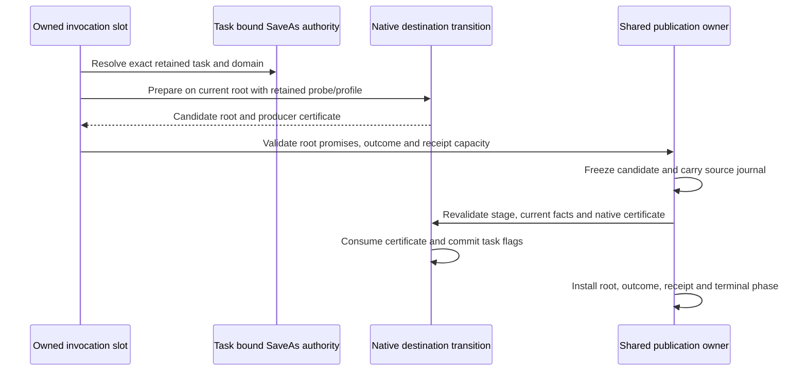

# Owned SaveAs activation invocation

Specification §11.2.16 composes the existing native SaveAs local activation with
owned lifecycle invocation. It reuses [task-bound authority](source-saveas-authority.md),
[native destination transitions](native-source-destinations.md) and the existing
invocation outcome/result contract. The external write has already happened; this
slice does not make that write atomic with local activation or issue another effect.

Section 11.2.17 separately supplies [owned initial source-load activation](load-invocations.md)
with its own read-task/codec/paired-writer authority. Earlier load exclusions below
retain this SaveAs-only slice's scope; other load/recovery and full event/registry/
remote/host/global/physical/independent gates remain.

## Interpretation and authority

The existing lifecycle job accepts a separately selected private reference product,
`native-source-saveas/1`. Its wrapper keeps the existing contract, operation,
invocation, profile and request fields; the nested request contains exactly a probe.
These are scoped reference labels, not assigned stable Rust or remote command IDs.
The task-bound authority is supplied separately, never serialized into request data.
The task itself determines the document, destination, captured revision and write
origin. No replacement-root, arbitrary task, provider callback or source bytes enter
this request.

One immutable plan binds the actual invocation owner/domain/ticket/reference,
authority, request and lifecycle/membership/binding profiles. The existing issued
slot owns one lifecycle preparation or one relation preparation, not both. Typed
and dynamic submission share the same normalized interpretation, context checks,
outcome reservation, result ceiling and replay fence. Inspection of the writer alone
cannot prepare this product.

At service the fixed handler rechecks exact retained profile/authority identity and
current interpretation. It derives a new candidate from the actual current root.
The source-save helper resolves only the captured task-bound authority, invokes the
existing private SaveAs candidate rules and seals the existing native transition.
It reuses the actual native writer/artifact baseline computation also used by the
destination validator; no caller-supplied baseline or duplicated activation policy
is accepted. Task/effect/ordinary-pair checks and exact native frames still govern
the result. A replacement destination registration cannot inherit a captured task's
generation, configuration or authority, even when its identity labels still match.
Historical release remains separate and does not require restoring an old registry.

## Publication and outcome boundary

Native `activated` becomes common `applied`; validated repeat activation stays
`unchanged`. The receipt records invocation, common status, `source-save-as` and the
actual native task's document. It is an identity/result product, not source content,
provider write evidence, or authority to mutate the returned document.

Before producer commit, reserve/check the candidate root, actual attached baseline
promises, complete outcome and receipt bounds. Freeze the candidate and preserve
existing source journals before final commit. The stage must still match the exact
plan, owner, domain, ticket, before-root, result object and receipt. Recheck current
interpretation/profile/authority and the actual native certificate. Only then consume
the native transition and update its actual task's `bindingApplied` and
`reservationReleased` flags. The same synchronous trusted publication turn installs
the root, outcome, receipt and terminal phase. No host callback, await or provider
procedure occurs between that commit and the bounded terminal assignments.

Queued invocation stop publishes no activation and leaves the written producer and
held reservation unchanged. Producer stop is a separate control: it can block
activation without cancelling the invocation or erasing late write evidence. New
conflicting native export reservations, stale registrations, revoked/current facts,
incompatible profiles and root/promise/result capacity pressure refuse publication
without a partial producer commit. Unrelated source edits survive; the acknowledged
baseline continues to name the captured revision. The local outcome's effect field
does not reissue or relabel the earlier write's separate evidence.

Current result release requires the captured identity ceiling, current invocation
context, visible outcome summary and strict lifecycle result/current-context/
historical-document grants. Forgetting results and retiring the invocation do not
retire or refund the write task. Replay never executes activation again; a new
invocation can validate an already-activated task as unchanged.

## Conditional proofs and reference evidence

Under actual private owner/task/certificate stores, sound current host facts and
serialized trusted installation, let state be `(root, writer, terminal record)`.
Preparation only constructs a candidate/certificate. Every refusal before native
commit therefore preserves the original root and writer. The private native frame
defines the accepted root delta and captures the same writer/task used for final
producer commit. Exact stage matching and final certificate validation prevent
substituting another root, task or invocation. Bounds, outcome preparation, receipt
construction and journal work precede commit; the remaining trusted assignments
install the prepared tuple without an observable intermediate state in this
synchronous reference model. This proves conditional reduction and frame
preservation, not physical concurrency, crash atomicity or implementation refinement.

The existing closed issued/pending/running/done vocabulary and at-most-one-start
fence apply. The handler contains no retry, recursion, callback or external I/O;
native work is bounded by declared root/task/codec/profile limits. Thus one service
turn terminates under those existing bounded-primitive premises. No new global
lattice, arbitrary program executor or categorical-completeness theorem is asserted.

`saveas-invocation-checks.mjs` compares the owned result with the existing native
factory across 42 annotation capture/undo/redo stages and 84 typed/dynamic
publications. It covers 256 admission vectors, 63 strict service cases, eight result
release masks, eighteen controls and 24 targeted mutants with a passing rewired
baseline. Controls include real native export/registration changes, source edits,
actual root/result limits and an attached baseline-promise floor, plus isolated
trusted stage substitutions. All native state remains separate from test-issued
protocol faults; these tests do not establish host premise truth.

Shared cancellation now covers sixteen forms/ten native job kinds, 4,144 traces
and 11,616 edges, retaining twelve mutants and the stop/observer/retirement split.
The native destination suite adds the current-registration regression and a
corresponding mutant: nineteen controls/21 mutants with baseline, with its original
168 transitions and gate-vector counts unchanged. The nine-product pure/retained
lifecycle suite retains its own counts and scope.

## Observation and remaining gates

Reuse IF-01/03/04/07/08/10 and INS-01/03/04/07/08/09/12/13. Observe admission,
service/refusal, native activation, outcome and current result release separately
from the earlier write. MELT/RED/USE/golden signals cover pathway latency/errors,
pending age, bounded occupancy and writer pressure. STRIDE/LINDDUN cover task/plan
substitution, stale context/registration, partial-commit claims and identity leaks.
Do not use raw documents, origins, paths, task handles or identity keys as metric
labels or unauthorized log/trace fields. Actual telemetry and overhead remain gates.

This adds no operation-family variant, job kind, provider, network route, second
writer or public token format. Load activation/read-task/paired-writer composition,
complete F17 events and command/provider registration, remote encoding, actual host
policy/identity/coverage/retention truth, recovery, global/physical accounting,
concurrent/crash/native refinement and independent assurance remain open. No whole
F17, decision register or all-sections goal closes.
