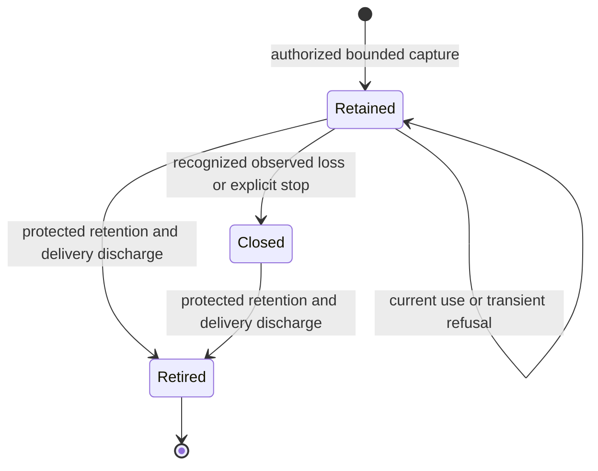

# Scoped semantic settings writes

Specification §22.3.1.5 separates ordinary configuration inspection from conditional
mutation. A retained write basis captures an exact current layer and its semantic
dependencies without releasing native generations or the whole configuration.
The scoped request lowers through the existing settings job and atomic root/outcome
boundary. It is not a new settings engine, grant store, transport or execution mode.

## Basis authority and retention

Capture binds the actual owner/domain and complete seven-field execution context,
the current settings profile and an explicitly selected accepted layer. The owner
may serve several separately authorized recipients; a basis cannot cross recipient,
purpose, destination, profile or continuity contexts. Current host facts must name
that same context. Native layer selection is a trusted host port; this does not
select a public wire locator, expose F07's private origins or infer a layer from focus.

Current exact-true settingsBasisAllowed, settingsWritable and ordinary authority/
health/readiness facts plus per-layer write permission govern capture/use. Only a
fixed first-party adapter with settingsHostBasisAllowed may resolve the private
layer/generation condition. Recipient inspection returns current availability or
unavailable, never the condition. F07 read selectors and interpretation leases are
not mutation bases; neither their inspection nor their release API accepts a basis.
These host facts are policy premises, not a memory sandbox or cryptographic proof.

The captured footprint includes schema/restriction/association interpretation and
the selected layer with all contributors to its affected target resolutions.
Current actual dependencies fence own-layer and contributing-layer changes and
ABA. Disjoint layer/target progress can remain valid. Recognized explicit authority,
scope, continuity, liveness, interpretation or write-grant loss and actual footprint
loss are absorbing when the basis observer processes them. Foreign contexts,
foreign profiles and malformed/unknown grant packets do not establish that loss;
transient readiness/caller-stop refusal alone does not close a basis.

The diagram describes private retention state, not three exhaustive authority or
execution outcomes. Actual current predicates remain separate. Closed bases retain
their charged slots; stopping a basis is not retirement or cancellation of a producer.
Retirement works after owner fault with independent protected discharge. Shared
interpretation/basis capacity and lifetime issuance use the existing charged pool;
release never refunds issuance and a closed pool cannot reopen.

## Scoped invocation product

The private normalized scoped-semantic-settings/1 product uses F16 semantic-settings
through typed/dynamic envelopes. Exact fields are contract, operation, invocation,
profile, changes, dependencies. Each change has exact basis, key, operation, value:
basis is a natural index into a separately supplied vector of real issued handles.
All handles must be unique and used; multiple distinct-key changes may share an
index. Copied, foreign, missing, unused or out-of-range references refuse.
Set/remove/reset retain the existing type/scope/composition and null-value rules.
Callers cannot supply a native layer or expectedGeneration through this product.

Bind every handle and validate the complete normalized proposal before invoking
any stateful loss observer. A malformed later reference, duplicate key or invalid
value therefore cannot close an earlier valid basis. The same raw normalizer and
pure native decision validate actual key/type/scope and complete resolution; no
arbitrary callbacks, coercion or alternate mutation implementation is introduced.

Preparation captures the original scoped intent, exact handle vector and derived
native conditions. An equivalent replacement handle cannot refresh a retry; raw
and scoped preparations cannot reinterpret one slot. Bound both captured intent
and complete normalized settings-job wrapper before preparation ownership is
registered. Existing request/value/node/depth, plan and parent limits apply.

At service, revalidate the original bases, context, profile, current rights and
mandatory/additional predicates, then use the existing settings publisher. Failed,
stale, stopped or retired conditions publish nothing. Successful multi-layer work
has one local root/outcome publication; disjoint changes are merged rather than
restored from an old root. A valid empty request needs no basis or unused version,
but still needs its authorized first-party gateway and current ordinary guards.
Capture owns caller data and the handle vector. Cancellation or invocation
retirement does not discharge separately retained bases. Replay reports the retained
historical outcome without applying again or refreshing a now-stale condition.

## Precedent and evidence

[VS Code's configuration provider](https://github.com/microsoft/vscode/blob/main/src/vs/workbench/api/common/extHostConfiguration.ts)
separates inspect from update/remove and clones inspection values. That supports
keeping observation distinct from mutation, not Vellum's authorization model.
[CodeMirror's immutable state and configuration transactions](https://github.com/codemirror/state/blob/main/src/state.ts)
support coherent state replacement, not Vellum's retained conditional authority.
The opaque-basis pattern reuses the already adopted
[scoped registration basis](registration-bases.md), without importing its resource
tables or creating a network protocol.

Run settings-write-basis-checks.mjs and scoped-settings-checks.mjs with Node.
The basis checker has 22 controls, fifty gate/seven context/seven malformed cases
and eleven assertion-killed mutations. The invocation checker has 21 controls,
nineteen malformed/six tuple cases and seven assertion-killed mutations. Both retain
24 legacy activation controls and use coherent unchanged graph baselines. A private
read-only verification export measures captured intent sizes for exact budget
boundary cases; no such export is installed in the actual engine or recipient API.
Shared cancellation now covers 29 forms/twelve kinds, 464 gate/232 context cases,
58 races and 7,511 traces/21,054 edges, ten controls/twelve mutations, including
intrinsic serialization, scoped definition and lifecycle under the same settings job.

Existing current-gate, scope/ceiling, retained-setting, no-op and parent-budget
solver conditions keep their original conditional scope: 295 across fourteen
manifests, 81 baseline. These new source-composition checks do not turn them into
source-extracted or Rust refinement proofs. Full frozen verification is required.
Full F16 declaration/lifecycle scoped products, handler-bound multi-contract schema
discovery, complete public codecs/events, real policy/applicability, physical/
concurrent/crash behavior and independent assurance remain separate gates.

## Interfaces and instrumentation

IF-01 carries normalized invocation, IF-07 owns interpretation/basis retention and
IF-03 owns PATH-01 publication. No new component or job kind is needed. INS-01/09
distinguish malformed admission, current context and dependency refusal; INS-02/03
distinguish atomic publication and retained outcome; INS-08/12/13 distinguish
interpretation versus basis occupancy, stopped-but-held slots, spent issuance,
wrapper/plan byte pressure and protected discharge. Keep preparation/service/control
and observation latency populations separate under MELT/golden/RED/USE.
STRIDE covers substitution, stale authority and exhaustion; LINDDUN covers cross-
recipient configuration linkage and condition disclosure. Ordinary labels use
bounded reason/profile/kind codes, not layer IDs, keys, values, native generations,
basis tokens or raw paths. Installed hooks and measured ceilings remain separate.
