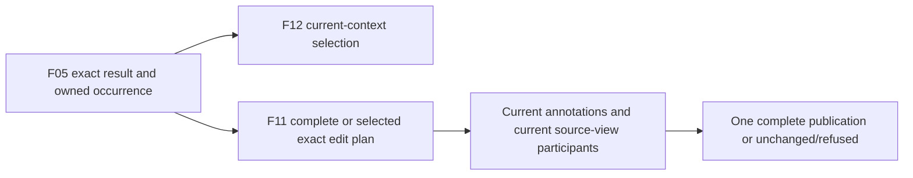

# Owned search selection and view coherent replacement

Specification §15.5 connects F05 match results to F12 select-search-match and
routes F11 search replacement through the shared source-view participant helper.
An occurrence remains tied to one exact source/query/profile/scope/generation;
view selection and source replacement have separate effects and current gates.

## Semantic products and precedent

[CodeMirror state 6.5.2](https://raw.githubusercontent.com/codemirror/state/6.5.2/src/selection.ts)
provides single, main-range replacement and added-range selection construction
precedent. Vellum keeps the adopted explicit anchor/head/affinity/primary profile,
not the peer's merge direction, association or serialization defaults. Exact search
semantics remain requirements §5.6 and §§15/28.17–18; no regex, implicit folding,
query unquoting or semantic rename capability is added.

Each F05 match row now delivers lo/hi and a scoped owned occurrence reference.
The internal constructor caches one reference per retained match, so repeated
lookup does not issue unbounded distinct tokens. Lookup and resolution recheck
current query-context grant, scope, continuity, capacity, retention and stop facts.
The reference binds the captured query/profile/scopes/generation and exact source
incarnation/revision, not arbitrary caller ranges. Copied results/references cannot
reconstruct local provenance. A known exact occurrence in a partial result may be
selected; it conveys neither a complete set, exact total nor next/wrap guarantee.
An empty query has no occurrence to select. The constructor/lookup is an internal
facet of existing result delivery, not a new public operation family or verb.

F12 selection-edit/1 adds select-search-match with match, direction, affinity and
selectionMode. Direction is forward/backward, affinity before/after, and mode is
explicitly replace-all, replace-primary or add-primary. There is no implicit focus
or binding/UI default. Current view/source/selection context and current search
context must both validate at preparation and publication. The occurrence's exact
document incarnation/revision must match the explicit target; stale source is
not automatically mapped or rebased. Current read permission does not grant source
write permission; selecting in readable read-only source is valid.

The declared selection normalizer still governs merges and primary ownership.
Replacing/adding a primary range can merge with an overlapping existing range.
That view result never redefines the captured search scopes or the original
occurrence's byte range. F11 replace-current consumes the original result occurrence,
not the painted or normalized view range. A later view selection requires its
fresh selection generation but need not rerun an unchanged source query.

## Shared source and view publication

Search replacement preparation now takes the current owner root. It preserves
the query's exact source dependency while capturing the current annotation-set
and current view membership/source/selection dependencies needed for mapping.
Later comment changes do not require a search rerun if source is unchanged;
they require current replacement preparation. Changes after preparation invalidate
that prepared mapping. Newly attached, closed or changed views cannot be skipped.

F11 replacement uses the same bounded participant constructor/completion machinery
as the native F14 bridge, with a forward-edit purpose rather than a history
reversal. The actual source/annotation coordinator and current positional maps
form one private candidate before return. All attached view source contexts update,
even if their coordinates do not move. Current viewport values are preserved.
No automatic next-match search, cursor restoration or additional authored group is
implied. Replace-all still requires a complete set and one transaction/group or none.

Equal bytes do not erase a mapped view effect. If the restricted source/annotation
coordinator validates unchanged source but a current selection moves, one local
view publication advances its selection generation without a source revision or
source undo entry. Complete source/view identity preserves the current root after
validation. Equal-byte nonidentity annotation effects remain an explicit coordinator
refinement gate; no view helper relabels their refusal as successful identity.
An empty edit set declares no source transform and needs no view-map inventory;
this does not interpret unknown membership as empty for a nonempty transform.

## Bounds security and evidence

Matched-reference count is bounded by retained match count and the existing reply
envelope. Current selected profiles bound view/selection/root input and output;
the shared participant helper also checks batch/edit/byte/plan limits and version
capacity. Reference byte charges use UTF-8 JSON, not a chosen wire/Rust format.
The JavaScript occurrence objects are opaque local reference fixtures, not usable
serialized token values. Internal module exports are trusted composition helpers,
not plugin ABI or public issuer operations. Arbitrary in-process code is outside
the memory-isolation claim; actual issuer, authenticated context lookup, retention
ownership, native decoding and concurrent release remain gates.

The new suite checks 36 direction/affinity/mode selections, 32,768 final view/query
gate combinations, six replacement forms, 42 controls and eight load-success,
assertion-failing mutants through redirected actual modules. It covers copied/raw
references, bounded repeated lookup, current query/profile/scope/generation, document
incarnation, selection staleness, partial/empty results, source-only query scope,
read-only behavior, all-view publication, current annotations, equal-text view
effects, exact replacement despite selection merging and resource refusal.
Existing search/selection/history suites retain their recorded scopes; moved
generation guards are mutated in their actual shared module, not inert source text.
This is same-author finite evidence, not independent Cleanroom certification.

INS-05 observes result coverage/current occurrence acceptance, INS-01/11 selection
preparation and handoff, INS-02/07 source/annotation/view publication, and INS-08
retained reference/participant pressure. MELT/golden/RED separate request, preparation,
stale/refused/unchanged/applied and release latency; USE tracks concrete retained
results, selectors and staging. STRIDE covers forged occurrences, stale retargeting
and skipped views; LINDDUN covers query/source/scopes, cursor streams and hidden
annotation/view existence. Do not log full captures/plans or use text, coordinates,
references or identities as metric labels. Actual diagnostics/policy/overhead are gates.

Full grapheme/word/page/visual commands, Unicode/geometry/native conformance,
membership/general target-history restoration, equal-byte annotation/nontext
identity, replay/outcome/event composition, all state companions and physical/
concurrent implementation refinement remain open. Point storage is unchanged.
