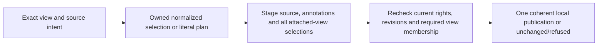

# Selection and literal editing products

Specification §26.1.1 selects F12 set-selection, a line/document endpoint subset
of logical-movement, and F11 literal ordinary-edit fields. The reference composes
actual positional mapping, canonical byte edits and source/annotation publication
with every attached view's selection state. It does not close all F12 movement,
native input, source-history view reversal or general companion refinement.

## Precedent and explicit profile

[Simple line products](line-edits.md) in §26.1.2 reuse the ordinary-edit core
through a trusted derived-batch helper. They retain exact canonical conflicts,
current annotation/all-view dependencies and publication guards rather than
introducing another mutation path. Their line/newline/settings checks are
separate from the original set/endpoint/literal counts below.

Section 26.1.3's [Unicode products](unicode-commands.md) also reuse the actual
set-selection and trusted derived-edit core for grapheme/prose-word movement and
deletion. Pinned reference Unicode conformance and command checks do not prove
page/visual motion, production/incremental/native providers or all companions.

Section 19.4's [geometry products](geometry-products.md) now compose owned current
F09 source targets with the actual set-selection coordinator for declared visual/
page semantics. Synthetic provider relations do not establish native shaping or
font/bidi/cell-width truth. Richer visual-caret identity beyond source/affinity is
explicitly unsupported by this consumer, not silently classified as unchanged.

[CodeMirror state 6.5.2 selection source](https://raw.githubusercontent.com/codemirror/state/6.5.2/src/selection.ts)
distinguishes anchor/head, cursor association and a main selection, and permits
adjacent nonempty ranges. Vellum keeps its own §28.45 primary/direction rule, not
the peer's merge-owner or serialization policy. No upstream implementation or
JavaScript selection representation is imported as a Rust/API/JSON standard.

selection-edit/1 binds invocation, exact view/document incarnations, source revision,
expected selection generation and an accepted profile. Set-selection adds explicit
anchor/head/affinity records and primary index. Logical movement adds a named
endpoint and explicit extension Boolean. Ordinary-edit adds literal text and
selectionAfter: mapped or carets-after. No implicit focus, default affinity,
normalization of source, capture expansion or executable command text is accepted.

Section 15.5 also supplies select-search-match with an owned occurrence, explicit
direction, affinity and replace-all/replace-primary/add-primary mode. Both current
query context and exact target view/source/selection context revalidate; copied or
raw ranges do not substitute for occurrences. [The bridge evidence](search-selection.md)
also maps current views in replacement; it does not complete other motion products.

The named explicit-positional-selection/1 profile follows the adopted nonempty
merge law: order by source position, merge overlaps, retain adjacent ranges, and
take direction/affinity from the primary contributor or earliest explicitly listed
contributor. Exact same-position/same-affinity caret duplicates collapse; opposing
affinities and carets inside/on range boundaries remain explicit. Report order
is not insertion ordering. Such a selection set can be meaningful for views while
its ordinary source plan is ambiguous: coincident/touching insertions or insertion
inside replacement must pass §4's canonical batch rules or refuse as a whole.
Explicit agent batches never pass through this human-selection normalizer.

| Choice | Benefit | Cost and disposition |
|---|---|---|
| Named explicit positional profile | Retains affinity intent and reuses the existing positional map; ambiguous text plans fail before mutation | Can retain more caret distinctions than an interactive UI wants; selected only when named |
| Peer-style UI coalescing | Simpler interactive selection presentation | May discard opposing-affinity intent; not silently made the engine/global UI default |
| Refuse mixed carets/ranges at selection-setting time | Small state domain | Rejects meaningful explicit view intent before a conflicting source action exists; not required by this profile |

This selects a usable explicit engine profile, not every UI interaction default.
For mapping, nonempty positional ranges use the existing outward boundary law;
collapsed points use their explicit before/after affinity. These are positions,
not content-sensitive comment identity. Source replacement can enclose newly
inserted content without claiming the original selected content survived.

## Owned preparation and atomic effects

Preparation resolves only the explicit target and captures required selection/
source dependencies. Ordinary edits capture all attached view identities, selection
generations and mapping profiles; another view appearing, disappearing or changing
selection invalidates that prepared mapping. Current authority, read-only coverage,
stop, capacity and compatibility revalidate at publication. Pure selection can
operate on a readable read-only document without source write authority.

The reference computes literal replacement edits against one source revision,
stages actual mapAttachment positional results, and composes actual
publishAnnotationPlan source/annotation/history results into one private candidate.
Only the complete candidate is returned. Unrelated current documents/views and
current viewport fields are preserved, not restored from a preparation snapshot.
An ordinary source change has one publication and one linked source group, with
coherent source contexts in all attached selections. Other view/native companions
remain explicit refinement obligations, not implied by these selection participants.

Line-start/end and document-start/end target exact §29.2 source structure.
Extension retains the anchor and moves the head; non-extension collapses to the
named endpoint. A CRLF-interior byte has no line-body coordinate and is refused,
not rounded. EOF is a valid caret. Character, word, page, visual and search-result
commands are not silently approximated by these endpoint commands.

D01 compares source and selection effects separately. A changed selection advances
its generation and one local publication, not a source revision or source undo
entry. Equal replacement bytes with a changed selection are applied view effects,
not unchanged success or a fabricated text history group. Complete identity still
validates and preserves all current generations. Section 6.4.1 now composes actual
equal-byte annotation placement changes through this coordinator; see
equal-byte-companions.md. Other profiles and complete companion classification
remain refinement obligations, not an unsupported v1 capability waived by tests.

## Evidence and remaining bridges

The reference compares 1,536 selection/primary cases with an independent overlap-
component graph oracle, including idempotence, and checks 1,024 admission gate
combinations and 48 endpoint movements. Forty-nine controls/eight load-success,
assertion-failing mutants cover primary/direction/affinity, canonical ambiguity,
multiple adjacent replacements, read-only/stop rechecks, version/resource pressure,
peer membership/dependencies, annotation composition, equal-text view changes,
and a real intervening edit in another document. This is same-author finite
reference evidence, not independent assurance or implementation refinement.

One control is deliberately a bridge counterexample: raw reverseAnnotationGroup
restores source but leaves the new view source contexts stale. It is **not** a
view-aware F14 implementation. Specification §14.7 and [history-views.md](history-views.md)
now compose retained inverse/forward transforms with current view mapping, membership
and final guards in the actual native path for the named positional profile. The
standalone primitive counterexample remains a guard against bypassing that bridge.
Other profiles/native companions and implementation refinement are not discharged
by the existing source-only proof or a passing aggregate suite.

Finite profiles bound source bytes, input/affected views, input/output selections,
selection serialization and literal/edit bytes. Selection byte accounting uses
UTF-8 JSON of the reference value, not a chosen transport. Existing bounded-state/
participant/retention premises cover the compound helper; flat-root copying is
not an indexed-storage or physical accounting proof. All loops have finite
admitted inputs, but no open-workload scheduler or global termination theorem follows.

INS-01/02/11 separate interpretation/preparation, current acceptance, publication
and selection handoff; INS-06 covers the retained-reversal bridge. Observe bounded
counts, refusal/identity/disposition classes, queue/service/acceptance latency and
mapping/view pressure under MELT, golden signals, USE and RED. STRIDE includes
stale retargeting, unauthorized view/source changes and skipped peers; LINDDUN
includes selections, carets, view presence and input patterns. Do not use text,
coordinates, affinity-event streams or identities as metric labels. Actual current
reply projection, installed signals and overhead remain gates.

Remaining work includes other view/F14 profiles, equal-byte annotation/nontext
identity, grapheme/word/page/visual products, indentation/tab and
generated-newline profiles, actual Unicode/native/geometry conformance, full replay/
outcome/event composition, physical ownership and complete state companions. The
official [Unicode 18 grapheme test data](https://www.unicode.org/Public/18.0.0/ucd/auxiliary/GraphemeBreakTest.txt)
exists, but is not bundled or executed here; scalar validation is not that
conformance. Point representation follows approved §29.4.1; native persistence integration remains a separate gate.
