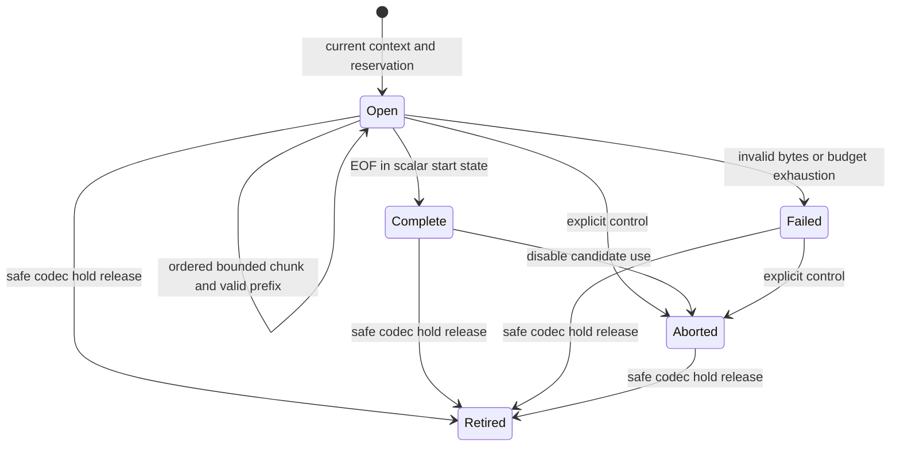

# Streaming source fidelity and immutable serialization

The source-only evidence below retains its original scope and counts. The later
actual shared-owner annotation composition is documented in §16.2.2 and
[annotation-retention.md](annotation-retention.md); it does not promote this
source-only check to complete annotation persistence. Section 16.5.2 separately
checks exact retained annotation output comparison; see annotation-comparison.md.

Specification §16.1.1 refines the adopted strict-UTF-8/one-signature domain in
§§16.1/28.21. The reference validates actual streamed octets, stages an owned
source candidate, maps file/document coordinates explicitly and captures immutable
serialized output from actual engine source/settings. This closes a codec and
capture subproduct gap, not complete F20/F21 resource admission, atomic load,
filesystem writing or successful persistence.

## Closed control and byte domain

source-codec.json defines nine UTF-8 control states, including absorbing failure,
with disjoint byte intervals and explicit end-of-input acceptance. The table
accepts scalar UTF-8 only: no overlong forms, surrogate encodings, out-of-range
code points or incomplete final scalar. NUL, valid noncharacters and a literal
U+FFFD are content, not decoding failures. There is no replacement decoding,
newline/Unicode normalization, trimming or automatic final newline.

BOM recognition is separate from scalar validation. Retain at most the initial
three undecided octets, possibly across chunks. An exact first EF BB BF becomes
BOM metadata once; every subsequent byte, including another U+FEFF, belongs to
source. A nonmatching prefix is fed to scalar validation without reordering or
dropping bytes. EOF flushes any undecided prefix as text and refuses an incomplete
scalar. A BOM-only file therefore has empty source with BOM metadata; an empty
file has empty source without it.

The owner binds a stream to captured origin, provider/resource identity, binding
generation, opaque resource-version epoch/token and profile. Tokens are equality
evidence, not ordered counters or non-ABA proofs. Host-supplied coherentInput and
current authorized scope are premises: the codec cannot prove an actual resource
read was atomic or that a token still describes external bytes. Each append
requires exact next sequence/file offset and a dense ordinary octet array; no
Uint8Array coercion of negative, fractional, missing or oversized values occurs.
Unknown contexts, gaps, duplicate chunks and extra fields refuse without advancing
the stream. This is not the complete effect replay/deduplication contract.

Failure is sticky for processing. Complete finish is idempotent and returns the
same opaque candidate; it cannot accept further bytes. A candidate is inaccessible
before successful EOF and cannot be copied into ownership. Inspection and mapping
require current recipient gates and the exact captured context. Abort disables
future candidate use without refunding retention. Retirement invalidates the ref,
drops retained body/context and releases only codec bookkeeping. Neither abort
nor retirement attests external read quiescence, cancels provider work, publishes
source or discharges a persistence obligation.

## Serialization and coordinates

capture-source is the serialization-input subproduct of F21. It names exact
document incarnation/source and serialization generation. Actual engine document
source and serialization fields supply the capture; caller bytes cannot replace
them. The private normalized serialization record has generation, profile and BOM
choice. Its generation is independent of source revision. The reference does not
implement its settings activation, resource binding or a whole save request.

Validate the source, prepend exactly one signature when BOM metadata is present,
then retain immutable document/revision/settings/source/output. The tuple with
BOM absent and a literal leading U+FEFF is unrepresentable in this selected inverse
domain and refuses before any write. It remains valid authored source: refusal
cannot remove the character, set BOM metadata or publish an edit. A separately
authorized supported conversion would need its own contract.

File-to-document positions exclude a consumed signature. Its first three raw
octets have no source-text position; file position 3 maps to document position 0.
Other mappings are exact scalar boundaries translated by the captured 0/3-byte
prefix, including EOF. Do not round interior scalar/BOM bytes or reuse this map
with another profile/version. Serialized output streaming intentionally accepts
raw octet subranges, which may split a BOM/scalar; those are write payload chunks,
not edit coordinates. All reads remain current-gated and bounded.

Exact artifact comparison checks retained encoded bytes, not length, source
revision, settings generation or a digest. Actual source publication and undo
show that equal output can have different source revisions; BOM-only settings
changes can yield different output at the same source revision. Comparisons name
both captured versions, never relabel either as latest, externally fresh, saved,
acknowledged or durable. This helper is not a saved-baseline election or a source/
annotation combined-save outcome. Source serialization does not clear comments.

## Conditional laws and bounds

At this fixed profile, D returns only source bytes and BOM choice; E encodes that
tuple. Resource/source/settings identities are not reconstructed from file bytes.
For every successfully admitted supported valid raw byte string b, these functions
satisfy E(D(b)) = b: the decoder removes either no bytes or exactly that first
signature, stores the choice, and otherwise copies every validated octet in order.
For an encodable source/metadata tuple t, D(E(t)) = t. Excluding absent-BOM tuples
whose source starts with U+FEFF removes the only signature/text collision in this
profile. A present signature plus literal leading U+FEFF remains reversible.

The table's accepting prefix invariant is the standard scalar UTF-8 byte grammar;
the continuation states encode exactly the remaining count and first-tail bounds.
Disjoint intervals give one successor or failure for every byte; only scalar-start
accepts EOF. Induction on input length yields validation and chunk-invariance;
the bounded initial probe composes with that invariant without treating metadata
as source. The source candidate/capture private maps preserve ownership; failed,
aborted or retired processing cannot issue a usable new candidate. Current capture
reads actual expected source/settings; later authoring cannot mutate owned bytes.
These are authored construction arguments, not proof-assistant-checked induction.

Finite profiles bound active imports/artifacts, total issued selectors, aggregate
logical held bytes, contexts, input/source/output/chunk bytes, chunks, candidate/
artifact/reply size, comparison work and coordinates. Empty chunks consume a work
slot. Admission reserves context size plus maximum input and candidate bytes for
each import; completed candidates share its retained body. Output admission reserves
room for a full artifact, then charges its actual normalized JSON size. Abort does
not refund; retirement does not recycle issuance. These logical charges are not
allocator/RSS, physical decoder or arbitrary malicious-object/Proxy bounds.
Each call has finite table/array work and refuses under its limits; unlimited new
call arrivals and the external read/write executor are not a termination theorem.

## Executable evidence

source-codec-checks.mjs checks all 2,304 control-state/byte transitions using native
fatal-decoder completion languages, nine EOF states and 65,810 raw cases (all one-
and two-byte inputs plus selected three/four-byte boundaries). It exercises 9,195
chunk splits and 9,195 coordinate positions over generated prose/Unicode/newline/
BOM inputs, 512 import/128 capture/128 release gate masks, 43 named controls and
twenty load-success/assertion-failing mutants. The separate native TextDecoder
uses fatal mode and explicit literal-BOM handling; it is an independent algorithm
oracle, not an independent reviewer or universal implementation certificate.

Controls include exact context/sequence/offset, no protected byte traversal before
gates, malformed octets, sticky failure, opaque ownership, BOM ambiguity, literal
U+FFFD/NUL/noncharacters, actual source publication/undo, immutable output despite
caller mutation, independent serialization/source versions, equal-length unequal
bytes, aggregate/issuance limits and bounded comparison/replies. Finite cases are
not full-engine reachable-state exploration. formal/results.json with matching
live/frozen hashes governs whether the current complete suite passed.

Actual resource snapshot/token truth, host binding/identity, complete F20/F21/F27
admission and replay/events, atomic initial-load/replacement publication, all
companions, production streaming/backend refinement, optional codecs, physical
retention/accounting, filesystem attributes/conflict/synchronization/durability
and independent Cleanroom assurance remain explicit gates.

## Instrumentation and standards

INS-04/07 observe import start/chunk/EOF/refusal, serialization capture and output
preflight; INS-08 candidate/artifact/byte/issuance saturation and retained age;
INS-03 current inspection/range/mapping/comparison release; INS-01/02/06 later
admission/publication/history; INS-13 protected diagnostic drain. Distinguish bytes
received, valid source bytes, metadata prefix, encoded bytes and useful completed
captures; partial processing is not successful load/save. RED covers attempts,
refusals and stage duration; USE covers streams/slots/held logical charges; golden
signals cover useful candidate/output latency and saturation. Use local monotonic
stage clocks and approved bounded codes. STRIDE covers malformed encodings, stale
context/offset, substitution, BOM ambiguity and exhaustion. LINDDUN covers source/
resource linkage, error offsets and retained candidates. No content/path/token/
resource/document/origin identifier is a metric label; no raw decoder error is an
automatic diagnostic payload. These are probe obligations, not installed telemetry.

[RFC 3629](https://www.rfc-editor.org/rfc/rfc3629.html) gives the scalar octet grammar
and signature distinction. The [Encoding Standard](https://encoding.spec.whatwg.org/#utf-8-decoder)
separates BOM recognition from the decoder and provides a fatal no-BOM decoding
hook; replacement decoding is not adopted. The one-signature inverse domain is
Vellum's already accepted §28.21 policy, not an inferred universal editor default.
