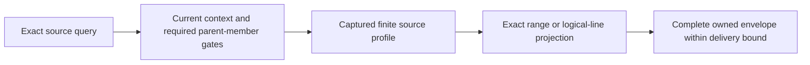

# Source range and logical line read products

Specification §22.1.4 completes the selected semantic field products for F02's
bounded-range and line variants. Snapshot handoff remains §§12.8–12.10. Actual
single-document and all-required version-set queries call the same source helper;
there is no line-specific permission bypass or implicit current-source lookup.

## Precedent and selected semantics

[Ropey 1.6.1](https://docs.rs/ropey/1.6.1/ropey/struct.Rope.html#method.get_line)
provides zero-indexed line queries, a non-panicking get_line alternative and
[line-to-byte conversion](https://docs.rs/ropey/1.6.1/ropey/struct.Rope.html#method.line_to_byte).
Vellum retains its already adopted §29.2 LF/CRLF/CR profile and byte coordinates,
not Ropey's backend, complete line domain, sentinel indices or performance bounds.
This reference is a bounded full-source scan, not an incremental rope/index.

source-products.json defines source-query/1's normalized common fields: contract,
operation, snapshot, document and profile. Bounded-range adds lo/hi; line adds a
zero-based line index. The document is the exact authority/document/incarnation;
the opaque snapshot resolves the captured source revision and retained profile.
Missing/extra fields, unknown versions/variants, invalid boundaries or unavailable
selectors refuse without clamping, fallback or an implicit file load. This tags
the earlier private untagged bounded-range fixture; it is not migration of an
already released wire API. Wire/Rust encoding and hostile decoding remain gates.

Range content returns exact owned UTF-8 bytes, requested range, source reference,
unit and context. Line content returns exact body and delimiter byte spans and
owned bytes separately, with source reference, unit, context and requested index.
No total line count, document length, annotation body/count or unrestricted root
handle is incidental metadata. The spans themselves are authorized source metadata.
Both variants either deliver their complete requested unit or return the common
recipient-safe unavailable product. Public masking does not waive separate bounded
internal cause instrumentation; this reference does not install those diagnostics.

CRLF is one delimiter, lone CR/LF delimit independently, and U+2028 remains content.
Empty source has one empty line; a trailing delimiter has a final empty line.
No BOM, whitespace, case or newline transformation follows from a read. A literal
U+FEFF already in source remains source content, separate from file-signature
metadata. A canonical range can include a CRLF-interior byte even though §29.2
does not give that point a line-body-column representation.

## Current release and bounded ownership

Source acquisition captures an owned finite source product profile alongside the
root. It bounds retained root bytes, per-query input extent, delivered content bytes
and serialized reply bytes. Unknown/nonfinite/incomplete profiles reject. Root/input
extent must fit at capture. Current capacity can still refuse delivery; mutating
registry defaults cannot reinterpret a held context's captured limits. Annotation-only
contexts do not require a source-query profile and cannot acquire source authority
by requesting line metadata. Source queries do not allocate annotation selectors,
publish source or create history.

The actual registry checks recipient, purpose, destination, accepted policy,
continuity, interpretation, lifecycle and handoff capacity before source projection.
Version-set member queries additionally require every named member's current
permissions, stamps and retained state through the actual parent helper. A direct
single-context call cannot bypass that parent. Stop invalidates selectors even if
an internal hold keeps the root charged; regrant does not revive the old selector.
Already disclosed owned bytes are not recalled.

Canonical source validation and existing logicalLines/readRange perform a fixed
number of finite full-root passes. maxInputBytes bounds the traversed input extent,
not an exact summed instruction/fuel charge. maxReplyBytes counts UTF-8 JSON of the
reference value, not a selected transport/Rust encoding. Row storage is bounded by root bytes
plus one, and reply/content checks bound the delivered values. These are logical
reference bounds: copies, serialization, allocation overhead, reclamation and
actual latency require physical accounting/measurement. No constant-time,
incremental-index or service-fairness claim follows from these functions.

The line-partition argument remains formal/reference-profile.md: valid UTF-8
cannot embed CR/LF inside a multibyte scalar; consume each delimiter and append
the final row. Ordered body/delimiter spans reconstruct source exactly. The product
selects one such row and reads its exact source extent through readRange. Current
release and provenance are separate premises, not consequences of that text law.

## Evidence and residuals

The reference compares 1,869 line replies and 10,819 scalar-boundary range replies
with a separate string-delimiter/scalar oracle. Inputs include all length-zero-to-
four strings over ASCII, é, CR, LF and U+2028, plus emoji/BOM/combining text. It
checks 32 direct release combinations, 64 actual registry release combinations,
128 required-parent combinations, 48 paired hidden-annotation comparisons,
45 controls and seven mutants. Mutants must load successfully and fail assertions;
their actual registry and parent imports are redirected to the altered helper.
The existing read-context and version-set suites still exercise acquisition,
retirement, holds and source/edit composition. This is same-author finite evidence,
not independent certification or complete concurrency/refinement proof.

INS-03 separates acquisition, retention, query service and accepted byte/envelope
handoff. Observe current gate/capacity/refusal classes, latency, request/error rate
and source/selector/hold saturation without source, ranges, line indices or identity
strings as metric labels. STRIDE covers stale/aliased selectors, profile substitution,
metadata release before permission and all-required-parent bypass. LINDDUN covers
line/length/existence linkage and hidden annotation metadata. MELT, golden signals,
USE and RED reuse the existing read/resource/interface plans; installed telemetry,
privacy overhead and numeric objectives remain gates.

Actual issuer/root/history/policy truth, native decoders/adapters, complete source
projection profiles, raw trusted handoff, incremental indexing, concurrent ownership,
physical accounting and implementation refinement remain open. This slice neither
changes point-target persistence nor claims whole-system categorical completeness.
