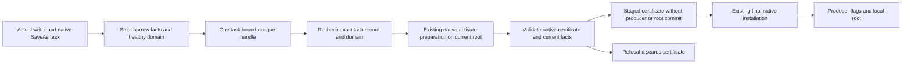

# Task bound SaveAs activation authority

Specification §11.2.15 narrows the existing native SaveAs activation authority to
one actual writer task and its native publication domain. It is a prerequisite
for owned activation invocation, not that invocation or a new public operation.
Section 11.2.16 separately supplies [owned SaveAs invocation](saveas-invocations.md);
the authority-only evidence below retains its own scope.
The governing transition remains [native-source-destinations.md](native-source-destinations.md)
and the actual source-save, source-destination-state and invocation-publication
modules. No read-only lifecycle inspection becomes an effect capability.

## Authority and execution boundary

The actual source-save owner can borrow one frozen opaque handle for a native
non-annotation SaveAs task. Borrowing requires strict current owner-control,
preparation-reservation and resource-readiness facts and a healthy native domain.
Private maps retain the actual owner, writer, task, exact task record and domain.
Repeated borrowing returns the same handle, rather than allocating an unbounded
series of handles for one task. Their number is bounded by actual task issuance,
not by a new independent quota or an accounting refund.

A copy, caller-made object, unrelated writer/domain, copy-export task or read-only
inspection cannot acquire this authority. Trusted reads recheck exact task-record
identity, native domain and SaveAs/non-annotation classification. Task removal or
replacement invalidates the handle. Fault-injection tests for record replacement
and kind/domain corruption exercise that fence; they do not authorize production
mutation of private fields or task resurrection.

The fixed consumer calls the existing native factory only with kind `activate`
and that exact task. The caller supplies the existing lifecycle/membership/binding
profiles, probe and current facts. The factory derives a candidate from the actual
current native root, not a root captured when the handle was borrowed. The consumer
validates the resulting native transition and discards it on refusal. It performs
no task issuance, dispatch, provider I/O, baseline publication, reservation release
or activation itself. It cannot select an arbitrary root, task or transition kind.

Native installation still owns final current root/frame/profile, ordinary-pair
distinction, authority/effect and baseline-promise checks. Only that existing
installation consumes the certificate and commits writer flags plus the local root.
Intervening cancellation invalidates a prepared transition without discarding late
written evidence. Unrelated source edits survive activation; the acknowledged
baseline still describes the captured revision, not the newer source. Validated
repeat activation remains unchanged. This adds no stronger provider-probe freshness
guarantee than the owning native contract and its declared current facts.

## Conditional arguments and executable evidence

Let a valid handle resolve to `(owner, writer, task, domain, record)`. The resolver
requires `writer.tasks[task] = record`, `record.nativeSourceDomain = domain`,
non-annotation classification and SaveAs purpose. A successful resolution therefore
cannot substitute a peer task or replacement record under the private-map and
actual-factory premises. The consumer has one fixed native call:
`(owner, domain, profile, activate, {task, probe}, facts)`. Certificate acceptance
refines existing native activation; it does not define alternative activation rules.
Preparation/validation/discard do not change writer task fields or publish a root.

Borrow, resolve and prepare contain no retry loop, recursion, callback, await or
provider operation. Work is the existing bounded native preparation plus finite
handle checks. These are conditional reduction/preservation and termination
arguments, not a new machine-checked whole-engine induction, host-truth guarantee,
concurrent/crash proof or categorical-completeness claim.

`source-saveas-authority-checks.mjs` uses the actual native writer, codec, loaded
fixture, source-edit publication, native preparation and final installer. It covers
eleven controls, nine strict borrow fact cases and sixty-three strict activation
fact cases. Twelve targeted mutations are killed after a passing rewired baseline.
They challenge task identity/domain/kind, stable handle reuse, current validation,
inspection escalation, strict facts, fixed transition routing, probe forwarding and
initial native certificate validation. Broad native SaveAs and owned lifecycle
suites remain separate evidence with their existing scopes.

## Interfaces instrumentation and remaining gates

This remains within existing lifecycle/execution/persistence boundaries. It adds no
network path, identity authority, public encoding, operation-family label or second
writer. Reuse IF-01/03/07/08/10 and INS-01/03/04/07/08/09/12/13 for borrow/refusal,
preparation latency/errors, pending work, bounded occupancy, native activation and
safe discharge. MELT/RED/USE/golden signals distinguish preparation, activation and
observed writes. STRIDE/LINDDUN cover spoofing, substitution, stale authority and
metadata disclosure. Raw handles, origins, paths, documents and identity keys must
not become metric labels or unauthorized log/trace fields. Installed telemetry and
overhead remain separate gates.

The separate §11.2.16 owned invocation binds this authority to its exact owner/domain/ticket,
retain immutable interpretation and result ceilings, reprepare at current service,
and validate/reserve root, producer commit, terminal outcome and receipt before the
final bounded installation. Its composition and cancellation/replay/result
release tests remain separate evidence, not established by this authority-only suite.
Load activation needs its own actual read-task
and paired-writer authority; the SaveAs handle cannot substitute for it. Complete
F17 events/registry/remote products, host policy/identity/coverage truth, recovery,
physical accounting and independent assurance remain open. No whole F17 or goal closes.
