# Vellum system model

Native resource instrumentation now separates pre-dispatch queue time from the
wait for first accepted attributed result intake. The original task's opt-in
inline timestamp observes nonempty read payloads or terminal claims and meaningful
save application/synchronization result claims, not Start/progress/no-future/
quiescence. Duplicate/late delivery cannot renew the first clock; an observed
result with unknown duration stays distinct from no result. Four fixed aggregate
families retain pending/unknown and retired-without-result populations after task
retirement, independently of optional diagnostic loss. The privileged timing
query adds no recipient grant, payload label, worker, deadline or execution state.
No physical completion or successful-result truth is inferred from these clocks.

Current native delivery boundary: all seven delivery gates are closed under the
approved binding-only F16 and typed-native/adapter-owned lookup baseline. F16
catalog correspondence is an inert immutable native dependency capture, not
analysis/provider activation or execution. C4 uses the four existing publication
families' original establish/resync commands, independently disclosed historical
receipts, typed event products and protected stop/revocation owners. The adapter
may map external IDs to these handles; native original-role/current authority and
retirement checks remain authoritative. Settings/catalog snapshots do not acquire
event streams. C7's full debug/release, strict lint, formatting, documentation,
pinned reference-provider and runnable-handoff checks pass. These qualify the
implemented provisional native baseline, not a UI, universal performance SLO,
physical persistence or production provider choice. Existing formal proof
provenance is unchanged; no renewed independent certification is claimed.

C5 native implementation: the original admission fence now owns one bounded,
separately disclosed historical attempt report. Identical retry returns that
report's status without recapture or new funding. `UnresolvedRetained` preserves
actual producers, payloads and protected late-evidence/cleanup paths; report
retirement releases only report metadata. Final control retirement requires a
fresh complete native census, actual document reclamation, discharged dependencies
and prior wait/disposition/report retirement. It releases the fence reservation
and installs an absorbing closed-engine tombstone. Inert provider/encoder/catalog
declarations are configuration, not worker leases; prepared payloads and export
reservations still block release. Five optional fixed service boundaries cover
return, disclosure, report retirement, release checking and control retirement.
The host still owns scheduling and process exit; no crash-persistence, forced
worker termination or new frozen-proof qualification is implied. F18's installed
`shutdown-disposition/1` continuation now reaches that original accepted plan
through a private-origin discovery source and closed typed/dynamic 2/4/4-field
input. The only opaque arguments are the original fence and document; current
disposition/coverage facts stay separate. Copied metadata cannot execute, missing
accepted consent refuses, and repeated disposition cannot renew the original
lifecycle expectation. Direct protected progress is independent of discovery
retirement. Optional normalization/dispatch timers expose the actual path without
content labels. Complete C1/C4 and final whole-engine qualification stay separate.

F05 native implementation: host-established logical-source correspondence now
issues a bounded borrowed capture over the original source/combined/version-set
issuer machinery, not a name resolver or new payload owner. The original managed
search owner still funds evaluation, results and holds. Closed typed/dynamic
headers and an explicit private-origin discovery source reach literal matches
and next/previous navigation; released products retain logical reference,
literal-exact/1 profile and request generation. Current read/result authority is
separate; observed correspondence loss absorbs only after original-role checks.
Protected retirement releases the actual result hold even after loss. Native
public/source-owner tests and focused linting qualify this implemented path,
not a JSON identity codec, reference /4 installation or fresh formal proof run.

Adopted delivery boundary update: apply the user-approved
[F05/F16/C4/C5 clarifications](specification.md#adopted-v1-delivery-clarifications)
to earlier diagrams/lookup/completion descriptions. The host establishes logical
source correspondence and the engine issues bounded native-owner bindings;
catalog binding does not activate analysis or execute a provider; generic-ID
lookup is adapter-owned over typed engine observation handles; and shutdown
report return is distinct from actual obligation discharge/final root release.
Retained unresolved owners keep the admission fence and protected evidence/cleanup
paths. No new executor, UI, substrate resolver or global observation registry is
introduced. Existing formal results retain their recorded scope/input provenance;
this decision reconciliation is not a new proof run or native gate closure.

F07 implementation boundary: a native recipient settings reader now composes the
bounded privileged projection builder with a separately parent-funded owner.
Host-attested complete visibility cuts bind the actual settings root and target;
each cut is one-use. Acquisition captures the eight-field disclosure scope,
permission ceiling and context-local opaque target/origin references. Queries
require fresh current cuts and independently current host authorization. Observed
loss, narrowing or changed captured payload invalidates permanently; transient
refusal and foreign requests do not. Equality is bounded and nonrecursive,
independent of native graph indices and map enumeration. Unrelated changes do
not invalidate unchanged captured content. Values/types remain owned flat graphs.
Protected stop/discharge and pool retirement preserve lifetime issuance and a
closed-pool tombstone, including after faults or admission fencing. The separate
owner participates in native root/reclamation classification and the 40-role
shutdown funding census; it holds settings data, not document payload pins.
Fixed optional service observations and privileged occupancy counts instrument
actual reader paths. Host authorization truth remains an embedding premise.
The privileged projection helper and `settings_read` still expose internal data;
they are not recipient endpoints. F07 configuration-query/1 now has closed
typed/dynamic envelope ingress, owned bounded normalization and installed sealed
discovery/dispatch for all three operations. Result frames preserve original
context/target/key with owned filtered payloads. Decoding reserves classification
and seven request frames from the actual parent, refunds every exit, and fences
unexpected pre-dispatch faults on the reader pool without faulting execution.
Busy decoder ownership prevents recursive entry or retirement; protected cleanup
survives a decoder fault. Input capture uses native logical units, not JSON byte
or physical-memory claims. Release workload qualification and whole C1 closure
remain open; frozen proofs are not requalified. The catalog profile's
implementation is described below.

The distinct F07 resource-catalog profile now has a native recipient reader over
the actual validated catalog owner. Complete host visibility covers exact logical
slots and contiguous approved visible order. One-use preparation binds both the
catalog root and actual engine semantic-root identity; stale cuts never refresh.
Contexts retain only captured permitted metadata and private tuple bindings.
List/inspect use context-local entry/continuation references, stable page retries,
captured ordering and descriptor ceilings. Reply/selector bounds fit before any
alias publication; late faults retain spent issuance while invalidating only the
affected context. Current loss/narrowing/changed permitted metadata is absorbing;
private changes and unobserved equal-metadata reinstallations are not native
epoch promises. Writer descriptors include the permitted identity-known Boolean,
never identity keys/domains, locators, registration stamps or provider authority.
The separately funded owner has protected stop/discharge and a closed-pool
tombstone, with the 40-role shutdown census verifying actual occupancy/funding.
Fixed service/invalidation observations remain bounded and label-free. This
distinct catalog profile now has closed typed/dynamic list/inspect envelopes,
owned bounded ordinary-data capture and sealed installed discovery dispatch.
Original context/entry/continuation roles remain separate from inert captures.
The actual parent intent ceiling intersects requested native capture bytes;
classification plus seven request frames are separately leased and refunded.
Busy state fences recursive ordinary entry and retirement. Decoder faults fence
only this pool, including after native alias installation; spent issuance and
unconsumed preparations are not rolled back. A final result guard checks actual
installed selector maps, captured tables/descriptors and original reply roles.
Protected stop/discharge survives decoder faults. Functional integration of the
two accepted F07 configuration/catalog profiles is complete; release performance
qualification and whole C1 completion remain open. No wire codec is implied.

F02's installed discovery adapter now dispatches bounded-range/line reads and
current/retained single/coherent acquisition through the existing funded facades.
The sealed source binds original entry/variant selectors; copied descriptions
cannot install it. Discovery release is separate from current content authority.
Original document/snapshot/preparation roles, native result guards and protected
cleanup remain with their existing owners. Fixed label-free dispatch timing joins
native service timing; no new snapshot store, task, wire codec or authority is
introduced. A public consumer preserves captured bytes across an actual edit and
discharges both readers and discovery. Whole C1 and release qualification remain.

F03/F04 now also have sealed installed discovery bindings over their existing
funded decoded facades: annotation enumeration/inspection/location for single and
coherent snapshots, and history frontier/availability/permitted detail. A fixed
header classifier precedes exact installed selector and metadata release checks;
native argument capture, result guards and current content authorization remain
mandatory. Neither copied descriptions nor metadata access supplies native read
or reversal authority. Separate fixed-tag optional dispatch timings preserve
capture-off/on/saturated behavior. Their synchronous preparation frames fit the
existing prepaid read-declaration workspace; no owner or result store is added.
Public consumers exercise withheld annotation facets, context-bound results and
independent protected cleanup. Whole C1 and release qualification remain open.

F12 trusted-native discovery now dispatches the existing normalized set-selection,
logical endpoint movement, search-match selection and boundary-backed Unicode
movement forms to the original invocation runner. Declarations come from the
owning normalizer. Private origin and exact contract/operation selectors prevent
copied metadata or cross-form dispatch; replay preserves the original invocation,
view and match/boundary evidence. Synchronous declaration frames share the prepaid
builtin maximum; fixed optional dispatch timing has no payload labels. A trusted
embedding still independently authorizes mutation. This is not a recipient grant
or completion of F06 result/observation assembly. No key map, visual motion,
search-name resolver or second selection publisher is introduced.

F05's logical request guard remains separate from working native search. Its
authority/document/incarnation names have no selected native identity mapping;
its profile/generation meaning cannot be silently dropped into the older native
request. The complete logical search facade remains uninstalled pending the
explicit host-established binding versus integration-edge naming decision.

F10 native compound advice now has a working current-checks path. A borrowed
original-request basis binds the actual native root, annotation/history census
and complete context/policy; separately authenticated host facts must permit both
proposal reading and observing every predicate influence. Classification and eight
native request frames lease actual parent headroom under the intent ceiling.
Publication and advice share source/read/scope/annotation/view predicates.
Advice uses borrow-only private candidates with virtual annotation slots and an
unreserved history decision; these cannot be converted into a publishable
transaction or returned as identities. Candidate-root projection includes those
private slots. The reply is only fixed-profile Boolean advice or unavailable;
memory refusal, unsupported/unreadable work and unexpected private failures are
not negative verdicts. Private failure fences the owner without reclassifying
invocations. Fixed optional service/phase observations contain no proposal data.
Closed borrowed typed/dynamic headers now preserve the original plan/proposal
pairing and enter the same native producer through sealed installed discovery.
Malformed/foreign roles refuse before native work; metadata and native predicate
observability remain independently current. Header/decoded/installed service
observations add no payload labels. Their fixed declaration frame fits the
existing prepaid read-source maximum; no owner, mapping registry, scheduler or
result store is added. Functional native-profile integration is complete; no
nested logical-plan JSON/wire codec, renewed frozen proof or future publication
authority is inferred.

F06's borrowed native receipt ingress now validates typed/dynamic tuples, exact
original invocation/context/profile and the closed facet/index before delegating
to the existing V10 release owner. Current receipt/native authority remains
independent. It allocates no result, decoder store or identity mapping and cannot
replay execution. Fixed-tag optional ingress timing joins existing native release
timing without exposing labels or handles. Status, ordinary retained outcome,
protected minimal control and bounded wait admission now have matching borrowed
typed/dynamic ingress. Wait continuation/discharge remain native, not a polling
loop or producer executor. Sealed installed F06 sources now describe and dispatch
all four forms and the separate receipt contract, with current discovery release
and native authority independently required. Copied metadata cannot install a
handler. Direct protected reads do not depend on fresh discovery readiness.

Named-facet stream establishment/resynchronization now has an owner-local native
command ledger using the shared issued/executing/settled/faulted lifecycle. Exact
root/scope/generation checks precede native service; replay returns identity only.
Actual baseline/error retention contributes to document pins and shutdown funding,
with separate command/table retirement. Unknown interrupted effects remain held.
Separately funded receipts bind the original command/allocation and complete
historical mixed projection to independently current release authority. Stop does
not retire its command claim. Direct and sealed installed typed/dynamic routes now
join establishment/resync, identity-only retry and receipt delivery. Optional
fixed-tag timings cover those interfaces; source/facet/collection discovery staging
shares one owner-exclusive prepaid frame. Collection commands additionally bind
the original visibility-preparation identity: validate without consumption, consume
once through the kernel, retain the baseline/error, then identity-only replay.
Historical receipts retain the original collection references and require separate
current authority. Their real funding and document pins survive stop until cleanup.
Source/named-facet/collection/registry publication admission is shutdown-fenced,
including new command/receipt owners and unexecuted establishment. Fresh unbound
collection-visibility capture is fenced; original packets, existing authorized
receipts, settled replay and protected cleanup retain their separate lifetimes.
Protected stop V4 and exact-context revocation V2 now compose those three
publication receipt families with the existing control owners. Each receipt
target binds its original command and context; current native control and separate
revocation authority remain mandatory. Direct and sealed installed typed/dynamic
routes close only the selected context, preserving sibling receipts, retained
command claims and funding. Earlier exhaustive profiles are unchanged. Complete
untyped attachment lookup remains separate work, not a new global identity store.

Scoped F18 cancellation now joins typed/dynamic passive input to the actual native
pending-job owner, directly or through sealed installed discovery. Current owner/
context/scope/readiness remain independent authority checks. Accepted requests set
intent only; native scheduler settlement remains separate. Fixed-tag optional
normalization/dispatch timing carries no tickets or context labels. Whole F18
shutdown completion and engine-wide qualification remain open.

Native disposition acceptance now binds one original inspection, decision product
and save-allocation set. Missing/stopped/conflicting saves return `NeedsSave` before
fencing. Success funds and retains immutable metadata once; changed retries or
alternate consent cannot replace it. Accepted document progress survives loss of
the host's original handles and still rechecks current disposal rights and actual
installed save baselines. This starts controlled progress, not whole-owner drain.
Accepted controls now expose a resumable, fixed-size cancellation cursor over
the original fenced invocation/save tables. Each step visits at most its declared
slot budget, stops actual pending local invocations and unneeded queued saves,
and preserves required source/comment save allocations and dispatched effects.
Terminal/unsubmitted tickets and retired slots are skipped. Finished scan is not
shutdown completion; errors preserve partial counts in an absorbing blocked scan.
The scan neither publishes, disposes, refunds retention nor renews waiting.
After all accepted documents leave the live state, current authorized cleanup can
release the plan's exact metadata reservation. An absorbing retired marker prevents
reacceptance or raw-path consent reuse; the fence, effects and wait remain independent.

Each installed shutdown fence now owns at most one cooperative wait, progressing
from unstarted to waiting/cutoff to retired. It uses declared host monotonic ticks,
not polling frequency or an engine timer. Retries cannot renew its budget; invalid
clocks end waiting with unknown remaining time. A funded, immutable cutoff report
is separately reauthorized; failed capture remains explicit rather than becoming
an empty report. Protected retirement releases only wait/report funding and never
reopens admission or cancels/settles producers. This is not full shutdown acceptance.

Native shutdown reporting reads source contexts,
annotation/coherent preparations and contexts, managed search, settings retention,
serialization bases and operation observers. Reports distinguish actual unconfigured,
active and closed states, retained entries, primary/observer-child reservations and
document/issuer dependencies without acquiring payload pins. A closed native-field
census now requires exactly one row for each of the 38 roles and classifies parent
funding independently of local credit/root payload bytes. Represented parent
reservations, including decoder and external-context children, must balance the
actual ledger before a cut reports complete native-owner coverage. Unrepresented
credit remains explicit and prevents that claim; over-attribution refuses as a
fault. Coverage is as-of metadata, not controller acceptance or whole-engine drain.
It additionally inventories source/facet/collection publication streams, source
command/receipt storage, registry observation, registration bases, discovery and
decoder storage, history inspections (including hidden captured participants),
publication/release/invocation measurements and the original fence/wait owner.
Original child reservations remain distinct from primary envelopes; empty/stopped
stores do not become closed owners. A complete inventory can still contain
unknown writes, active owners, lost-handle debt and undrained effects.
Core invocation, history-journal/pin, search-session/result and annotation/snapshot
stores are now represented too. Individual invocation metadata preserves original
identity, phase, intent binding and outcome availability across stop/forget/retire;
new state invalidates projection currentness without rewriting historical reports.
Each invocation also reports its retained native holder count and validated
shared-parent reservation total. The closed slot census covers nine command
capture families plus compound results, created-layer results and observation
policy. Original ticket/capture funding is checked even with no live documents;
forgetting results does not imply releasing the remaining capture reservation.
Search-result context lineage additionally validates the original issuer and
coherent parent, and refuses duplicate claims on one native hold across source,
combined and coherent contexts. Issuer slot spaces stay distinct; standalone
holds remain legitimate retained obligations. Query-local reconciliation uses
linear workspace bounded by the existing work and capture-byte limits.
Protected shutdown stop calls the actual local invocation owner under the original
fence and current control, preserving terminal outcomes and external effects.
Unknown aggregate funding remains unavailable, not a fabricated zero reservation.
Native inventory additionally distinguishes logical views, workspace containers
and their document edges, retained boundary source/evidence copies and open settings
preparations. Boundary bytes are retained-copy bytes, not current semantic text or
parent credit. Settings preparation lifetime references are counted independently
of retained-settings pool rows; dropping the final plan changes currentness without
an authored publication. Empty configured stores are not inferred closed.
Host-owned invocation observation contexts now have an engine registry funded by
their declared hold envelope. Shutdown reports original context/ticket identity,
retained charge and native host-object retention, not grant/delivery/quiescence.
Closing or dropping a context cannot refund its reservation; dropped-handle debt
remains visible even after its original invocation/policy retires. Only protected
context retirement removes its registered claim. Reused private slots cannot
rebind an old context; fresh admission is fenced while existing control survives.
Resource reporting now includes provider/codec/restorer/catalog declarations,
retained source preparations/export reservations, owned save/read registries,
own-write continuity credit and the measured current semantic root. Parent
reservations, local accounting credit and logical payload size are distinct
coordinates. Source-read registry retirement validates its exact funded envelope;
unrelated ledger credit cannot close the store or refund another obligation.

The native shutdown cut now includes source/annotation reads, reader-owner state,
restoration provenance and the reader/writer attachment. Local byte ceilings are
not reported as parent reservations; empty child tables do not imply retired
owners. Fresh reader/operation-registry acquisition is fenced while original
delivery and safe cleanup remain available. The annotation reader now has absorbing
whole-owner retirement after explicit admission stop, actual child/pin/provenance
discharge, operation-store retirement and attachment detachment. Its closed state
is root-stamped; historical counters are unavailable, not fabricated zeroes. It
drops native tombstones/restorer registrations without closing semantic editing or
the shared writer. Its protected control remains usable under an editing fault or
exhausted publication counter, without healing either. Owned-read stores validate
their exact parent charge, not unrelated ledger credit.
After validated provenance release and actual producer retirement, outstanding-
binding reports omit those released descriptors instead of looking up dead
producers. Historical reports stay unchanged; actual remaining tasks/reads are
still inventoried independently.
The shared pending-write/artifact owner now has protected retirement under its
original funded shutdown fence and current domain control. Actual tasks, artifacts,
preparations, reservations, binding/provenance claims and dependent reader/observer
owners must discharge first; empty active pools do not count as closed. Retirement
drops spent producer/origin storage, root-stamps an absorbing closed state and
preserves fence/unrelated credits, fault status and authored publication counters.
Provider/encoder/catalog metadata remains engine-owned, not discharged by this
producer-store transition. Fresh native-operation observation pools/contexts now
respect the fence while existing queries and protected stop remain available.
Fresh source/combined/coherent contexts,
their preparations, installations, retained copies and internal holds, annotation
snapshots, managed search, settings profiles/interpretations/bases/mutation plans
and serialization bases/plans are also fenced. Retained service and exact invocation
replay remain available. Refusing initial settings installation or an unchanged
settings plan does not latch an integrity fault. Whole shutdown acceptance/drain is
still unimplemented; this projection cannot report completion.
New catalog setup/plans, registration-basis issuers/records and discovery owners/
contexts now respect the fence. Matching original registration bases remain service,
without renewing retired records. Fresh discovery visibility evaluation remains
available for retained queries but cannot authorize a new context.
Fresh provider/annotation-codec registration, artifact capture/materialization,
annotation export and restoration (including empty hydration) are fenced. Existing
ports still settle admitted writes. Qualified baseline adoption from an already-
restored read uses protected bookkeeping, preserving other saves' reserved counters.

Shutdown inspection now follows current/disposed/archived binding records to
their original native baseline producers, without copying baseline contents or
requiring historical owners to be currently editable. Contested baseline evidence
remains an obligation. New reader/writer attachment acquisition respects the fence;
its prepaid writer endpoint is included in artifact-ledger validation. This extends
the partial cut, not whole-owner shutdown or control-retirement coverage.

Native pre-acceptance shutdown inspection now captures document expectations and
actual writer/artifact dependency edges without retaining content or effect leases.
Nonpublication write/delivery progress invalidates currentness but leaves the
historical cut immutable. Source/comment choices bind exact acknowledged records;
missing choices return NeedsDecision without fencing or implicit save/discard.
Other owner families remain explicitly outside this cut's coverage. Captured
choices are not save readiness, destructive authority or accepted shutdown.

Native document disposition now connects those exact choices to retained lifecycle
publication under their original installed fence. It checks current disposal
coverage and acknowledged document/policy/binding expectations. The discard-only
route rejects save choices; the save route requires each chosen component's
original admitted producer, qualified acknowledgment and matching installed ordinary
baseline. This includes already-activated Save As and explicitly adopted annotation
exports; acknowledgment of an unadopted export remains insufficient.
It does not serialize/recompare content or substitute a clean flag for evidence.
Sequential disposal preserves history, resource owners and fence funding.
Bounded as-of post-fence reports expose actual represented document/write/read/
binding/owner obligations without new producer pins. Unknown application,
no-future-effects and quiescence remain independent; empty represented tables do
not establish full owner coverage. Report release is separately reauthorized and
does not refresh historical state. Optional bounded timing/outcome diagnostics
cover save readiness, disposition and report capture/release, including interrupted
publication. These are native progress, not whole-engine acceptance/drain,
erasure, external freshness or stronger persistence guarantees.

The engine now owns a prepaid exact-root ordinary-admission fence, independent of
integrity faults. It blocks selected native ordinary ingress/final publication
while preserving original replay, admitted save settlement and protected cleanup.
Its opaque original basis and once-only parent charge survive source progress and
faulted replay. It is not accepted shutdown or full owner-acquisition coverage;
complete owner inventory, controller acceptance/drain/cutoff reporting and control
retirement remain open.

Native ordinary source saves now reserve future baseline storage/root-slot demand
and a publication generation before issuance, alongside annotation promises.
An absorbing source save/export admission fence leaves existing settlement and
protected cleanup usable. Unknown effects retain claims; actual terminal evidence
or a validated newer installed baseline permits discharge. This implements the
source-save prerequisite for C5, not the full shutdown controller or a new frozen
reference proof.

2026-11-06 selected architecture: publication stream establishment/resync commands
and original retained results are owner-local, with shared engine lifecycle
conventions and separate current receipt authorization. There is still one engine,
not a separate engine per owner/document. V1 revocation is independently authorized
withdrawal of one exact original context, implemented through its absorbing native
closure; it does not withdraw an issuer-wide grant, close siblings, prevent fresh
authorized admission, erase authoritative evidence or discharge producer holds.
U06's scope and publication-command ownership are no longer human decisions.
The direct bound SDK revocation edge now has closed typed/dynamic native envelope
normalization followed by the same independently authorized exact-context native
transition. Stop remains a separate closed operation. Normalization refusal
cannot close a context or emit a fabricated native execution duration. Installed
discovery now publishes the first-party closed input schema and dispatches only
through its private native origin, current discovery release and separate native
authority. Metadata staging is charged to the existing discovery parent; direct
protected control remains independent of ordinary discovery headroom. Complete
attachment resolution and original publication commands/results remain separate
missing composition; this is not whole-F19 or formal-proof closure.
Historical open-scope statements below describe earlier checkpoints; full native
command/result/ingress composition and revocation conformance remain unproved.

The source publisher now implements owner-local original establish/resync commands
with prepaid bounded storage, full original scope/native-root/generation binding,
once-only native execution and protected identity-only replay. It uses a small
shared finite lifecycle, not another execution engine. Original results remain
separate from current stream state; interrupted acknowledgment retains uncertainty
and fences ordinary source-publisher service without disabling protected control
or healing/faulting unrelated authored state. Actual document-pin accounting and
parent retirement include this table. Privileged inspection is not F06 release;
native source receipts now add separately authorized complete-original-result
delivery and real command claims. Their weak correlation basis binds the original
allocation/current root and receipt role without keeping payload alive. Current
policy truth remains an independent host premise, not an implication of root
equality. Stale classification cannot apply loss; confirmed current loss closes
only the original receipt. Receipt claims survive stop until actual retirement,
participate in document pins and prevent premature command/parent discharge.
Closed typed/dynamic source command and receipt ingress now connect to installed
discovery through its private native source. Metadata is descriptive only; original
opaque roles, current discovery release and independent native authority are all
required. Receipt outputs are checked against the original allocation/error before
delivery. Heterogeneous receipt controls and facet/collection reuse remain work.
C5 inventory must include these actual command
and receipt obligations. Native timing/closure events are content-free and optional;
no unmeasured command/receipt latency or formal-proof completion is claimed.

Implementation projection: [Rust engine acceptance plan](docs/engine-test-plan.md).
Owned source/annotation load operation configuration, admission, matching recovery,
admission fencing and protected operation retirement now populate optional native
synchronous service timing at their actual owners. Source labeled admission uses
the same timing contract without adopting owned work. Child retirement reports
its existing operation-discharge and native-control observations from one measured
episode; these overlapping observations are not additive latency samples. Timing
excludes external substrate execution, pending age and worker quiescence. Capture
disabled, zero-capacity and saturated paths preserve task identity, original retry,
generation and actual credit discharge. No new labels, transport, clock domain,
exporter or latency target are introduced; broader C6 coverage remains open.

Current native lifecycle integration (implementation projection, not a new frozen
proof): the installed discovery source binds the existing five native request
forms to four F17 variants. Its additive `/4` inventory preserves `/1`–`/3`
and uses the same bounded owner, issuance and retained contexts. Descriptions
come from the actual argument declarations and identify native roles; they are
not JSON codecs, executable schemas or grants. The source marker is private.
Opaque entry/variant recognition checks the original context, installed origin
and selected operation before any observed-loss effect. A fresh scope/root-bound
discovery cut then revalidates current release; ordinary native admission, intent
funding, replay and fresh publication checks remain independent. Generic metadata,
even identical bytes, cannot select these executable handlers. The scratch path
is exercised through the existing separately authorized F06 V6 retained result;
neither discovery nor repeated result queries allocate a second document.
Actual discovery and native admission/service/release observations are reused;
there is no executor, transport, UI, clipboard or new persistence mechanism.
All five selected lifecycle forms are now exercised from installed discovery
through publication, permission-filtered F06 delivery and native hold retirement.
Disposal also checks actual view/workspace detachment. Pending delivery withholds;
retired delivery reports the existing outcome-unavailable state. Repeated native
retirement refuses without a second refund; it is not newly made idempotent.

F17 container discovery now binds view/workspace create and retire (four native
forms, two semantic variants) to their actual normalized relation declarations,
original one-shot owner and F06 relation result. This is a separate fixed source
using the existing scoped `/1` owner and a private producer marker, not an
extension of the `/1`–`/4` built-in inventories or a new registry/profile. Generic
byte-identical descriptions and cross-variant selectors cannot execute it. Native
host execution authority remains a premise; result-admission grants only capture
and later disclosure, not mutation permission for untrusted callers. Current F06
release, immutable replay, observation/policy drain and final invocation retirement
remain independently enforced. Logical container operations allocate no UI window
or substrate resource. Complete C1/C2/F17 coverage remains open.

The three native retained-disposal substeps (source-binding, annotation-binding
and provenance release) now have their own fixed installed discovery source on
the same scoped `/1` owner. It describes the existing typed request and admission
roles, not a new input grammar or lifecycle verb. Private original-source/selector
recognition precedes fresh discovery release; the unchanged native invocation
captures intent and independently requires fresh release-service facts. Generic
service cannot run these commands. Applied/unchanged results use the existing F06
V3 facet with separate current release; observer, original result capture and
policy must discharge before invocation retirement. No callback, filesystem
operation, payload erasure or changed `/1`–`/4` built-in inventory is introduced.
Loaded-candidate activation and the other C1/C2 obligations remain open;
retained release alone does not establish C3 final storage reclamation. The
separate trusted retained-owner removal publisher is described below.

The installed ordinary-edit route now binds `/3` or `/4` original selectors to
the four existing literal, explicit-line, boundary and configured-line native
argument products and their original admission functions. Generic metadata is
not an installed handler, and a foreign entry/variant pair cannot select one.
Fresh discovery release precedes native admission; the native view/source,
boundary-evidence and settings-interpretation owners remain authoritative. This
is a **trusted-native embedding path**, not a new recipient security boundary:
logical contexts and discovery facts do not authenticate or authorize arbitrary
scripts. Recipient policy integration and authorized ordinary result projection
remain unfinished. No new discovery inventory, executor or publication path is
introduced. Existing bounded discovery/native diagnostics are exercised with
capture off/on/saturated; dispatch overhead is not yet operationally qualified.
All-family facade/result integration and whole-engine performance qualification
remain open under C1/C2/C6; this projection is not independent proof certification.

Installed F13 dispatch now connects all four annotation mutations to the existing
scoped annotation owner and its independently authorized F06 result. Original
opaque entry/variant and private builtin origin are recognized before loss can
affect a capture; a fresh discovery cut precedes the owner's actual annotation
rights, execution context, funding and original-intent checks. Source read-only
does not stand in for annotation write permission. Result admission is explicit:
omitting it cannot be upgraded by replay; create-result authority still binds to
the original invocation's allocation. The original F06 captured/current/native
grant intersection remains the result boundary. All four mutations are exercised
with capture disabled, enabled and saturated; no issuer, publication path,
executor, network or UI mechanism is added. Host authentication/policy truth
remains a trusted premise, not a claim that descriptor metadata grants authority.

Installed F14 undo/redo dispatch now carries original native invocation, group or
frontier target, direction, declared reads and result admission into the existing
history owner. Private installed selector recognition and fresh discovery release
precede admission; replay does not resolve a new frontier or reverse twice.
Cross-document history publication remains atomic, and a declared dependency
changing after admission prevents publication. F06 releases the actual historical
decision under original/current target-disclosure intersection, not reconstructed
current history. This is trusted-native embedding, like the underlying reversal
API: discovery and result grants do not authorize mutation for arbitrary scripts.
No history machine, scheduler, wire codec, profile or publisher is added.

Installed F16 context dispatch now uses a closed V1 sum of ten existing normalized
forms: native/scoped values, settings-layer lifecycle, source serialization,
settings definition and resource registration. Original private-source entry/
variant recognition and fresh discovery release precede each existing guarded
admission. Typed basis roles and independent context/profile/current rights stay
with those owners, as do funding, publication, service and retained outcomes.
No new evaluator, registry inventory, worker, filesystem operation or UI behavior
is introduced. All ten execution arms have consumer scenarios. Values and layer/
definition changes publish through their existing owners; serialization changes
metadata without changing source bytes; registration remains logical metadata,
not provider execution. An explicit discovered native-lifecycle result opt-in
uses the same normalized guards and original created-layer result owner. It
must be supplied before admission; ordinary matching replay preserves the
original capture, and cannot add a previously unrequested result. F06 delivery
still requires captured observation policy and independent current release.
Protected result cleanup remains once-only; C2's other assembly stays open.

Replay follows each owner's existing contract. In particular, scoped resource
registration resubmission is current scoped service and can refuse once its
original absent-slot basis is stale after installation. Its historical result
remains independently readable; refusal does not undo or deny past publication.
Native/scoped context dispatch does not manufacture uniform replay success.
All five currently installed command families now have dispatch joins, not a
complete all-family or recipient-authorized engine facade. C1–C7 remain open.

The user selected native logical-root accounting. The engine now computes an
explicit current semantic-root projection: documents/format/policy, annotations,
history/frontiers, logical views/workspaces, persistence bindings/baselines and
current compiled settings. Owned payload lengths and native record units use
checked arithmetic; pending work, held captures and basis pools stay separately
bounded. The trusted-owner gauge allocates no intermediate root and emits only
optional bounded content-free completion/refusal diagnostics. This is build-local
logical accounting, not JSON equivalence or a physical heap bound. No numeric
ceiling is inferred by measurement. An explicit immutable embedding-selected
ceiling is now required by shared settings preparation. Compiler-derived candidate
settings bytes replace the current settings contribution in the actual whole-root
measure before plan retention. Value, additional-read, declaration and authored-
layer paths share this check. Final service recomputes its candidate and remeasures
current unrelated semantic state; capacity refusal installs no prefix. Scoped
value/declaration preflight runs it before absorbing basis-loss observation.
Initial trusted installation checks a preinstalled ceiling, or may bootstrap before
ceiling configuration measures the current root and existing obligations. The
current native route coverage and remaining scope are described below.
Compound publication now overlays actual source/annotation values, mapped views,
journals and frontier replacements into one measured candidate before installing
any participant. It remeasures unrelated current state and permits reclaimed
selection storage to fund source growth. Undo/redo and branching account actual
retained values and links. Annotation preparation checks actual spent-slot growth
before issuance; later refusal does not refund admitted identities. Content-free
optional admission signals cannot affect either decision. The compound check is
one part of capacity integration, not closure of the global invariant or full
engine goal.
Source birth now admits its decoded payload and spent slot before issuance. Initial
resource loading checks its full source/binding/baseline/validator candidate before
either is installed; known aliases remain unchanged. View/workspace birth rechecks
actual slot headroom through retained service and installation. Membership and the
common selection publisher check actual old/proposed payloads before assignments;
release reclaims payload but never spent issuer slots. Provider/encoder/restorer
registration admits actual registry-handle/body growth before issuance. Optional
bounded admission diagnostics grant no authority and are not publication evidence.
Source/written/loaded baseline replacement, annotation binding and initial sealed
restoration now check their complete candidates before installation. Ordinary
annotation save admission also reserves future logical root-slot demand: maximum
of current slot and held bounds per document, additive across documents, with each
hold's retention/counter demand separate. Competing guards, settings preflight and
late ceiling configuration preserve that floor. Installation substitutes its
actual slot and consumes only its own credit. Unknown dispatched effects retain
headroom until protected actual discharge. Corrupt private promises fault mutable
admission without issuing, while protected cleanup remains available.
Trusted-owner capacity gauges distinguish current bytes, pending growth and total
demand; content-free optional diagnostics are not authority or publication proof.
The current native mutation-route audit is recorded in the accounting profile.
Full facade/engine completion, universal refinement, physical/crash guarantees and
independent Cleanroom assurance remain unclaimed.
See [native semantic-root profile](docs/native-root-accounting.md).
Intrinsic document output intent now lives in the owned document root, with its
own positive-safe generation and exhaustive strict-UTF-8/one-BOM profile. It is
not a configuration-registry key, parser dependency or substrate mechanism.
Trusted preparation captures exact target/context/profile and canonical additional
and mandatory v3 reads; service rechecks fresh host premises against the current
root. Real metadata changes advance only format and owner publication generations.
Identity needs no unused counter. Source revisions, bytes, journals, annotations,
views and bindings remain unchanged, including across source undo. A standalone
`Utf8Source` retains its original decode hint; document save capture explicitly
uses owned output intent rather than that hint. Intent need not yet be encodable:
an absent signature with a literal leading U+FEFF refuses before save issuance.
Each immutable save artifact/task records its original format state. Dispatch and
baseline publication validate their agreement, not equality with later document
metadata. Late acknowledgment remains historical; current saved-state comparison
uses current exact encoded bytes. Writer ownership/quiescence stays independent.
Direct and retained format mutation share the existing publisher/one-shot ledger,
full native logical descriptor/plan/parent bounds and Running/Unknown fault fence.
Changed mandatory-read counts refuse before fresh descriptor copying; serialization
replay rejects changed caller-read counts before interpreting the new descriptors.
Equal-count input still receives full canonical/version validation.
Managed byte edges now record optional bounded SourceDecode/SourceEncode outcomes
without payload, identities, byte offsets, host messages or clock callbacks.
Document creation/new resource loading observes actual strict decoding; save
capture and current saved-state comparison observe actual encoding under owned
format intent. Existing-binding reuse and pinned dispatch perform no conversion.
Metadata-only publication performs no codec work. Earlier admission/policy limits
do not fabricate conversion attempts, and successful decoding is not evidence of
later document publication or saving. Standalone immutable value codecs keep their
pure recorder-free API. Physical I/O remains a separate substrate responsibility.
Bounded optional content-free configuration/query/preparation/validation/publication
signals observe those actual paths. Recipient-bound metadata-only format bases
now have a separate finite pool funded against the actual shared owner retention
budget, including native profile/frame, context capacity and lifetime tombstones.
Each opaque basis retains only seven-field context, document incarnation and
format generation, not source, an old root, registry, baseline or save capture.
Current exact target/profile facts bind before recognized loss can close it;
unknown grants, foreign contexts and transient readiness cannot poison it.
Source progress commutes; format changes/disposal invalidate the condition.
Scoped direct/retained commands derive document/generation privately from the
original basis. Complete native semantics, reads and wrapper bounds precede
stateful observation. Fresh first-party basis permission and native mutation
authority remain separate, and the raw runner/commit cannot bypass scoped checks.
Raw/scoped requests share one exclusive slot, publisher and Unknown fence.
Stop, forgetting or invocation retirement never release the independent basis;
protected drain-based discharge works after faults. Pool closure refunds once
and cannot reopen or refill lifetime issuance. Bounded lifecycle/scoped signals
and usage distinguish retained contexts, issued contexts and reserved bytes.
This is trusted native behavior; public codecs, actual policy authentication and
physical crash/refinement guarantees remain open.
Declaration-role conditional bases now share the existing settings retention pool,
its context ceiling, prepaid profile/slots and nonrefilling lifetime issuance.
The record retains context/profile and the exact schema/restriction/association
triple, not a layer/source snapshot or authority grant. Ordinary layer/read handles
have distinct types and pool-row kinds; their permissions do not substitute for
declaration-basis permission. Full context/profile binding precedes recognized
absorbing loss. Ordinary layer/source progress preserves this condition, while
actual interpretation-facet progress invalidates it.
Scoped declaration requests contain no native expected tuple. First-party lowering
derives it privately, retains original basis identity plus flat declaration/read
intent and uses the unchanged native definition plan. Current changed-facet grants,
full native declaration/layer/association dependencies and mandatory/additional
reads remain independent. Complete request/plan/parent logical bounds and semantic
preflight precede loss observation. Changed mandatory/read counts refuse before
copying changed requirements. Direct/retained scoped publication shares the existing
ledger/publisher/fault fence; generic service cannot reuse old permission facts.
Success releases changed/unchanged only; Debug output redacts native conditions.
Stop/replay/forget do not rearm work or retire the independent basis. Protected
drain-based release and final funded-pool retirement work after faults. Bounded
declaration-basis and scoped phase signals contain no identities, epochs or values.
Full public recipient codecs remain open.
The independent conditional lifecycle-basis controls are now native. Their typed
handle and pool-row role bind exact context/profile plus configuration generation
and layer-incarnation high-water, without retaining a settings/source snapshot.
They share the existing funded context capacity and nonrefilling issuer with
interpretations, ordinary and declaration bases. Observation is not registry-write,
per-layer or association authority. Source-only progress preserves the pair;
actual configuration progress invalidates it. Bound recognized loss is absorbing,
while unknown/transient/foreign facts cannot poison another condition. Capture
also supports zero/exhausted high-water when no allocation is requested. Stop
retains its charge; protected drain-based retirement works after fault. Optional
bounded capture/inspection/stop/retirement signals expose no pair or identities.
Private scoped lifecycle lowering/service is now native. Caller create labels,
scopes and values cannot supply authority or incarnation; the engine derives those
from the held configuration/issuer condition. Exact existing identities and local
create-index references lower into complete target associations. Fresh registry,
association and full-identity layer grants apply only to actual changed facets.
Captured mandatory/caller reads, raw reference forms, basis identity and context
remain fixed through replay. Native candidate, semantic and whole-wrapper checks
precede stateful basis-loss observation. Direct and retained execution share the
existing native layer publisher, one-shot ledger and fault/Unknown fence; generic
service cannot bypass fresh facts. No-op needs no unused grants or counters.
Source/history progress is preserved subject to declared reads. Optional bounded
lowering/preparation/validation/publication signals contain no authored payload,
identity or epoch. Protected basis retirement remains available after faults.
The §22.3.1.11 selector consumer is native as well: removals and association members
may select a bounded, entirely used vector of ordinary write bases. Distinct
handles selecting the same actual layer are rejected. Pure current-footprint
checks bind every original selector before any permission-loss observer runs;
complete native/root/wrapper preflight still precedes stateful use. Fresh selected-
basis facts are independent of lifecycle, registry and association authority.
The original handles, private identities, removal indices and reference forms
remain charged and sealed across replay, including after source-only progress.
Stopped/retired bases fence pending work, while invocation cancellation/retirement
does not discharge independent bases. Both host-native and basis-selected forms
share one admission implementation, plan, runner, outcome and publisher. An empty
selector vector needs no unused basis facts. This implements selector consumption,
not by itself §22.3.1.10's optional historical creation-reference producer/result release.
That producer/release is now a separate opt-in native prepared-plan port. It
reserves complete private capture plus worst qualified reply and the native
settings max-state staging allowance against actual parent retention before
queue admission. Capture and reply have independent explicit native result-byte
ceilings; no JSON-byte, allocator or physical-peak equivalence is claimed. Native
and scoped/basis-selected preparations use their existing invocation/publisher.
The result hold contains complete original context, ordered full native identities
and a non-owning weak plan-identity witness, not a source/settings root snapshot.
After ordinary fresh native/root/promise validation, private reference staging
checks the actual created identities/count against the current before/candidate.
Only the common successful terminal publication makes the ordered opaque
references available. Current full-envelope release facts and the admission
ceiling remain independent of source/value disclosure. Pending, refused, stopped,
forgotten and faulted work yields none. Early private-reference faults preserve
the prior root; actual post-install interruption remains Unknown, not rollback.
References are historical metadata, not layer existence or write authority. Fresh
write-basis capture uses current exact identities and the ordinary funded pool;
same-label recreation cannot retarget them. Protected drain-based forget releases
the hold once and invalidates references, not independently acquired bases.
Generic outcome forget/retirement cannot bypass this protected discharge. Stop
does not refund the result hold; replay cannot reopen one after forget. Optional
bounded admission/staging/publication/release/basis/forget signals carry no
identities, native stamps, values, resource names or lexical payloads.
Its §22.3.1.8 aggregate owner-root prerequisite is implemented for the current trusted native
owner through explicit `configure_semantic_root_budget`, candidate checks and held
baseline slot floors, rather than relabeling `CoordinatorLimits` or configuration
state/plan/parent bounds. The native profile and route audit above retain their
scope. Public codecs and actual recipient policy integration remain open.
The private first-party result flags are host-policy premises, not authentication
or entitlement proof. No complete public lifecycle-family or physical-memory
closure is claimed.
Native semantic configuration now compiles inert initial schemas, restrictions,
layers and explicit logical target associations under finite structural/byte/work
bounds. Six closed types, fixed scope precedence, replacement/declared-field map
composition, library reset, precise origins and masked equal-rank conflict checks
match the adopted baseline. Value/schema processing uses iterative traversal and
flat owned arenas, not recursive engine copying or an executable schema language.
Initial installation consumes the compiled state once through the ordinary
publication floor; actual owner-bound target handles expose trusted borrowed reads.
Native target handles now use checked, non-reused registration identities rather
than target-vector positions. Current value-activation rebuilds preserve both
registrations and their allocator. Trusted queries, domain read predicates and
configured-line consumers resolve the identity against the specific current or
retained root in use; the two roots need not share physical ordering. Minting and
lookup reject duplicate/corrupt bindings instead of choosing an arbitrary row.
Identity lookup retains no configuration snapshot or interpretation allowance.
Native fixture tests exercise storage permutation, removal/registration renewal,
allocator exhaustion and old snapshots. The live declaration/association producer
and authored-layer lifecycle are now separately implemented and tested.
It neither picks application keys/defaults nor proves actual workspace/document
association or changes an existing edit command's explicit settings.
Bounded direct set/remove/reset activation now retains the actual immutable basis,
written layers and every contributor of affected targets. Service revalidates that
footprint and rebuilds from the current root, preserving disjoint publications.
Actual metadata changes advance layer/configuration generations; only changed
effective values advance each target's source/serialization/analysis epochs.
Identity requires no unused counter. Flat compact rebuilds discard superseded and
derived values; preparation and final validation/publication emit only bounded
content-free dispositions. Plans have individual logical byte/work bounds, not
shared parent funding or physical peak-memory guarantees. Native settings jobs
now share the one-shot ledger and direct staging path. Independent flat intent
captures preserve change order, unordered map meaning and exact numeric bits.
Matching pending/terminal retries never prepare again; typed outcomes are historical
facts, and forgetting them cannot reopen execution. The owner fault fence spans
settings-root and terminal-outcome installation. Interrupted publication retains
Running/Unknown without a fabricated known rejection.
Settings changes with additional reads now have a separate opaque v2 preparation
and one-shot job profile. The captured v3 conjunction supports source, annotation,
workspace and configuration dependencies while mandatory settings contributors
remain independently checked. The serialized staging boundary validates both
against the same actual starting owner state before no-op classification or
installation. Disjoint changes merge from current settings; a valid read set cannot
replace required contributor checks. Complete wrapper/read/core logical bytes and
the independent settings/read work bounds apply. Early envelope checks precede
read copying, and loss of the retained read count/profile faults rather than
silently weakening the command. Independent original captures protect replay and
typed retained outcomes; interrupted installation remains Unknown. Read-only
objects gain no writes/history scope. This is trusted native composition, not
recipient observation authority or a new cross-substrate transaction.
Live declaration/association replacement now owns a bounded flat declaration
capture and binds the complete original settings root, expected interpretation,
fixed profile and additional v3 reads. The current root must still match at service;
unrelated source progress is allowed unless explicitly read. Every authored layer,
including unused layers, retains identity, generation and contributions. The
candidate validates new declarations and resolves all targets before publication.
Configuration and changed-facet epochs advance only for real changes; existing
target/domain counters compare effective key/value maps, including key/domain
addition and removal. Metadata-only changes preserve those counters. New targets
receive fresh registrations and contextual counters at one; restoration never
revives removed handles. True identity needs no unused counter. Retained jobs use
independent original declaration/read meaning, historical typed outcomes and the
existing Running/Unknown fence. Old interpretation leases remain frozen; counted
preparations block premature pool retirement. Optional bounded definition
configuration/preparation/validation/publication signals contain no content.
This privileged native route is not recipient registry-role authorization or
physical crash durability.
Native authored-layer lifecycle now binds configuration generation and the actual
owner-local incarnation high-water. Initial compilation takes the maximum accepted
layer incarnation, or zero; creation order must issue exactly the next contiguous
incarnations. Only successful publication advances that high-water; removal never
refunds it. Surviving authored layers keep their complete identity, generation and
values; the flat candidate copies only live values and re-resolves the complete
proposed associations through shared definition-resolution/counter rules. Unattached
layer changes preserve unaffected target/domain counters and association epochs.
Ordinary value plans re-resolve captured layer identities at service, so unrelated
layer removal cannot silently retarget index-based writes or spuriously stale them.
Whole-set lifecycle proposals capture current settings and additional reads; they
do not refresh after configuration progress. Existing interpretation leases retain
removed data. Direct and retained paths use the same preparation lifetime holds,
bounded content-free layer boundaries and fault-fenced atomic root/outcome path.
Native request/created-value byte caps count logical Rust storage; serialized
envelope byte limits, recipient registry-role grants, cross-process identity
restoration, other consumers and full F07/F16 products remain open.
Native conditional layer bases now retain the actual selected/contributing layers
and schema/restriction/association interpretation in the funded settings pool.
The complete authority/engine/recipient/purpose/destination/profile/continuity
context is copied under bounds and bound to the actual owner and registered engine
label. Context labels are equality subjects, not a new transport or network route.
Explicit trusted current facts and a well-formed complete layer-grant packet remain
policy premises; request data cannot supply authenticated truth. Inspection returns
only current/unavailable, never epochs, native layer conditions or configuration.
Foreign contexts/profiles and malformed grant packets bind no loss observation.
Recognized explicit authority/write loss, missing known grants or actual footprint
loss closes a basis irreversibly; transient readiness, unknown facts and bounded
work refusal alone do not. Disjoint settings/source progress may survive. Handles
retain no snapshot outside the funded pool. Interpretations and bases share live
capacity, lifetime issuance and tombstone funding, with distinct types/row kinds.
Stopped/closed bases remain charged until independently authorized retention and
delivery discharge; protected retirement is allowed after fault without healing it.
Bounded basis configuration/capture/inspection/stop/retirement signals and Debug
forms contain no context labels or configuration payloads.
Native scoped mutation now binds a unique fully used original basis vector and
indexed set/remove/reset changes, with no requester-selected layer/version fields.
Borrowed lowering inputs share the existing raw normalizer, flat intent copier,
resolution kernel and publisher; they introduce no alternate settings semantics.
Current ordinary authorization/readiness and layer grants gate semantic/read queries
before they can expose a data-dependent refusal.
The complete proposal, read conjunction and full normalized job wrapper are checked
before any stateful basis-loss observer. Plan and actual parent descriptor limits
apply to both direct and retained routes. Original immutable captures and an
independent pointer seal prevent reference refresh or valid-plan substitution.
Caller and trusted mandatory v3 reads conjoin canonically; current required sets
must match the original mandatory meaning, even when caller reads overlap them.
Service requires fresh complete host facts, context/profile and first-party gateway
permission, then revalidates every original basis and required/additional predicate
under the same publication fence. The generic runner refuses pending scoped jobs
without those facts; the specialized service port still uses the same owner,
ledger, publisher and outcome boundary, not a new execution mode. Disjoint settings
progress is merged; source/annotation/view/history/effect frames remain current.
Stop/forget/retirement cannot rearm execution or implicitly discharge bases.
Retained outcomes are historical; scoped success carries only changed/unchanged,
not native epochs. Private capture drift or interrupted installation remains
Running/Unknown. Observed integrity faults during admission also latch the owner,
without binding a job or retaining a failed preparation; ordinary refusals do not.
Scoped preparation/validation/publication signals contain no
payloads. Recipient interpretation/result projections, public codecs, registry-
scoped declaration/lifecycle products and authenticated host policy remain open.
Native declared configuration reads now use a separate exhaustive v3 profile,
leaving v1/v2 executable vocabularies intact. Configuration-domain binds an actual
owner-local target, one source/serialization/analysis generation and all three
interpretation epochs. Configuration-state uses a distinct actual registry handle,
whole configuration generation and those epochs. Handles are data, not observation
grants. Positive safe versions, canonical subjects, complete conjunctive bounds and
current actual root conditions validate in advice, compound/scoped preparation,
shared publication and replay. Domain reads survive unrelated domain/target and
equal-value origin changes; whole-state reads intentionally invalidate more broadly.
Configuration ABA never restores old epochs. Empty conjunctions need no unused
settings/workspace service; read-only participants gain no mutations/history scopes.
Original captures, work profile and vocabulary remain replay intent, not refreshed
current assumptions. Existing bounded read preparation/advice/validation signals
observe the real pathway without keys, values, identities or epochs as labels.
Recipient observation policy, dynamic codecs, semantic discovery and complete F10/
F11 qualification remain open; static epoch mismatch checks do not establish native
mutable-definition/association producer correctness.
Native immutable settings interpretations now live in a bounded owner-local pool,
not in arbitrary public snapshot Arcs. Opaque IDs bind the actual owner and a
non-reused slot; copying an ID creates no storage or quota. Historical borrowed
reads resolve against the captured root, not the current configuration. Explicit
limits prepay lifetime slot headers and worst-case retained snapshot bytes against
the actual owner's configured logical retention headroom. Reservations are private,
owner-bound and once-releasable. Other existing source/history/effect budgets have
not been migrated into that account; this is not a whole-engine physical budget.
All actual settings preparations carry a lifetime hold, including pre-pool and
invocation-held preparations. Pool retirement requires no interpretations or plans,
refunds its original reservation and leaves a closed marker that cannot reopen.
Protected discharge works after faults without restoring execution health. Optional
content-free configuration/acquisition/query/release/retirement capture and trusted
capacity gauges expose the real pathway; they grant neither recipient access nor
current command-consumer validity.
Native configured line jobs now name an owner-bound target and exact role keys,
resolve only accepted source-domain values, and lower to the existing explicit
indent/outdent/newline participant. Request/inner-intent bounds precede acquisition
of an invocation-owned prepaid interpretation. The source plan captures the actual
lease, schema/restriction/association epochs, target source generation and profiles;
an independent retained intent prevents substitution by another valid line plan.
The common source publisher rechecks the live lease, original and current values,
epochs/source generation and ordinary source/view/annotation/history guards before
any installation. Unrelated target/domain changes and equal-value origin changes
may proceed; target source-domain ABA and changed selections refuse. Stop/forget
retain interpretations; protected terminal/uncertain release or invocation
retirement discharges the actual lease without refunding lifetime issuance or
healing a fault. This is trusted native consumption, not recipient read/use policy,
dynamic codecs or complete consumer qualification. No UI/focus/keymap rule enters
the engine. Existing line and configured preparation/validation/retention signals
observe real execution without settings/source payloads in diagnostic labels.
Native view/workspace create/retire commands now share the bounded one-shot ledger
and actual direct-control staging. Admission captures command/profile or an original
known refusal, never a replacement root or preallocated container identity. Service
stages from current state, checks exact profile/retirement expectations and current
publication floors/capacity, and prepares typed historical identity receipts before
installation. Root, terminal outcome and receipt have no intervening callback/I/O.
Capture contradiction or interrupted publication fences Unknown, never fabricated
nonpublication. Stop/forget/retirement share existing ledger rules. This is trusted-
owner execution, not recipient identity release, dynamic adapters or full F17.
Native optional workspaces now own bounded logical membership edges, not document
payloads, source authority, paths, focus or settings associations. A document may
belong to several workspaces while keeping one source/annotation owner. New
containers have generation 1 and no members; actual add/remove advances generation,
idempotence preserves it and retirement never recycles identity or disposes members.
Both document disposal paths stage every actual membership removal and generation
advance with source liveness/view detachments before one publication. An exhausted
last peer or staging budget refuses the whole operation.
`ReadDependencyV2` adds exact live workspace membership-generation predicates to
the unchanged four-kind v1 vocabulary through a versioned profile. Advice,
compound/scoped preparation, replay and final publication share current-root
validation. Membership ABA/disposal/retirement invalidate old reads; disjoint
containers and unrelated source publication do not. Complete lifecycle recipient/
event facets, imported/durable workspace identity, settings associations and actual host
membership/policy truth remain outside this native projection.
Native compound read footprints now retain a closed source/set/body/authored-target
conjunction under explicit count/work bounds. Duplicate subjects reject, order
canonicalizes and final validation reads the actual starting root before changes
or no-op classification. Same-object reads precede their authored mutations;
read-only subjects acquire neither mutation authority nor history links. Authored
target predicates do not silently assert mapped placement. Read-only advice shares
the current predicate checks, without reservation or status accounting changes.
Read-enabled source/annotation compounds, including bounded source scopes, share
the invocation ledger and publisher. The new profile owns one canonical read set,
including legacy source-read inputs, without altering older routes. Retries do not
reacquire current facts; capture loss/substitution fences Unknown. Configuration read predicates,
automatic dependency discovery and recipient observation
grants remain outside this native implementation projection.
Native bounded source scopes now constrain exact original-snapshot replacement
cells and insertion gaps independently. Canonicalization orders records without
merging or widening. Scoped source and compound preparations retain restrictions;
the common publication path rechecks exact participants, revisions, scalar-safe
extents, limits and coverage before no-op classification or root assignment.
Scoped source and compound invocations bind the original restriction/work profile in the shared
ledger. Replay never reacquires source; capture drift fences Unknown. Restrictions
do not grant source/annotation rights, create another owner or follow undo/redo.
Recipient-authorized scopes, mapped scopes and complete discovery/result assembly
remain outside this native projection.
Canonical source access now includes bounded range/line products and explicit
byte ↔ scalar/UTF-16/logical-line conversion under an exact live document revision.
LF/CRLF/CR spans partition unchanged canonical bytes, including trailing empty
lines; CRLF-interior coordinates remain valid byte-edit positions but refuse
body-column projection. One-BOM file metadata is outside these text coordinates.
The exhaustive v1 conversion request/result vocabulary is a trusted-owner read
interface, not the complete recipient/discovery facade. Replies own only requested
content and context; optional observations contain no payload or coordinates.
An optional headless logical-view registry now owns bounded selection sets under
the explicit positional profile, preserving primary, direction and affinity.
Detached birth, exact attach/detach/retirement and independent lifecycle fences do
not create a UI, choose focus or dispose a document. Line/document endpoint commands
are implemented; grapheme/word segmentation, parser/display conversion, keymaps
and layout are not. The separate pinned Unicode 18 reference adapter now passes
finite conformance and native integration; production/incremental segmentation
provider selection remains open.
The Rust implementation covers source candidates, trusted-owner coordination,
bounded invocation replay/retained facts, linked source history and pinned source
saves with destination/evidence/baseline retention. Exact literal search now binds
bounded session/result origins, supports explicit navigation and routes current/all
replacement through invocation replay and the existing atomic source/history path.
Query supersession is rechecked at publication. A known occurrence from an
exhausted result may be explicitly selected or replaced; navigation and
replace-all require completeness. Search-match selection uses exact owned result
identity and explicit mode/direction/affinity through the common selection ledger.
Preparation and publication resolve the original occurrence, never rerun a query
or accept caller ranges. Normalized view ranges do not alter replacement extents.
Source preparation captures the complete affected logical-view inventory and final
publication revalidates its source/epoch/value signatures. Source, annotation,
history and mapped current view states stage together; undo/redo never restores a
historical peer cursor. Equal-byte selection effects publish without a fabricated
source revision or undo group. Disposal detaches affected views atomically, and
attachment ABA cannot revive old contexts. Recipient release and full catalog/
discovery integration remain outside this implemented projection.
Literal selection edits now freeze exact view/source intent and derive original-
snapshot replacements under ordinary source limits. Explicit mapped/carets-after
selection policy stages in that same source/annotation/view/history publication;
all peer views retain ordinary current-position mapping. Literal text is not
decoded or normalized. Equal-byte caret effects need no source revision/history,
and stale context, ambiguous edits or counter exhaustion publish no prefix.
Literal editing now also admits its exact context/text/policy through the shared
invocation ledger. Matching retries never reacquire current selections, including
terminal no-ops and forgotten outcomes; the original preparation or refusal runs
once. Execution checks the ledger's literal intent against the retained capture,
then performs ordinary current-dependency validation. Missing/altered capture is
Unknown/faulted, not known nonpublication. Outcomes remain the existing trusted-
owner retained facet, not recipient projections or a retained selection-result
product. Selection-only set/endpoint commands now also use the common one-shot
ledger with typed retained selection updates/refusals. Preparation freezes raw
request, exact view/source context, original normalized selections and candidate.
Execution compares original ledger intent, validates current target identity and
epochs, and checks candidate derivation against the same captured source version
before the shared selection publisher. This integrity check cannot choose a newer
source/caret. Read-only source is permitted; compatible later comments and history
are preserved. No-op, stop, result forgetting and retirement follow shared ledger
rules. Full selection-result snapshots, recipient
release, complete operation facets and remaining ordinary-edit forms stay open.
Explicit simple line editing now implements selected-line indent/outdent and
generated LF/CRLF/CR under a one-time finite native work profile. Units/tab widths
and newline prefix policy are explicit request values, not live configuration
lookups or default style choices. Logical endpoints reject CRLF interiors; shared
line targets deduplicate and nonempty upper line starts are excluded. Outdent
preserves common leading bytes and native history retains the real inverse.
Newlines copy only prior prefix bytes and place origin carets after each actual
insertion, including different per-selection payload lengths. Frozen line context,
request and work profile are revalidated against original candidate derivation
in the existing all-companion publication path. Explicit line requests now also
use the shared invocation runner and original retained outcomes. Replay compares
original context and all request settings before any current-state acquisition;
execution independently checks the frozen work profile and preparation identity.
Typed `LineRejected` preserves original preparation refusals and later coordinator
refusals, while faulted/wrong-kind owned preparation remains Unknown. Stops,
terminal no-ops, forgotten outcomes and later profile activation never re-enable
execution. A separate native configured-line profile now consumes charged settings
interpretations as described above; neither interface's trusted retained facts
are scoped recipient release.
A runtime boundary registry now captures exact canonical source under finite live/
lifetime/source/vector/word/byte bounds, exposes a trusted-host provider input, and
retains an immutable native copy of an accepted table. Capture and ready-evidence
handles are distinct, non-reused and scoped to the source owner. Full-extent grids
must be ordered and scalar-safe; significant words must be exact adjacent default-
word segments. Grapheme compatibility is checked for the requested word-start or
word-end vector, not imposed as a global table invariant. Raw word boundaries need
not be a grapheme subset. The closed Unicode 18/UAX #29 revision 49 profile is a host
attestation, not algorithm verification or a qualified production provider. No
segmentation, subprocess or I/O runs in publication. Source revision changes,
including undo restoring equal bytes, invalidate eligibility. Protected retirement
frees optional derived data after disposal or fault without claiming cancellation,
quiescence, erasure or refunded lifetime IDs. Production provider selection and
recipient release remain open.
Native movement/deletion consumers now traverse grapheme or significant-word
start/end targets strictly by direction, with BOF/EOF saturation, positive total
step bounds and bounded derived native data. Nonextending selection collapse
consumes a count; extension preserves anchor/primary/affinity. Implicit deletion
requires grapheme endpoints, while explicit selected scalar extents stay exact.
Movement freezes before/after values and uses the shared selection publisher;
deletion uses ordinary source/annotation/all-view/history publication and the
shared carets-after mapping. Retired/stale evidence refuses at final validation.
Literal, line and Unicode source intents now occupy one private typed 0/1 capture
slot with an independent declared-kind seal and exhaustive publication dispatch;
lost, mismatched or malformed multiple captures fault instead of becoming raw edits.
No segmentation provider, keymap, geometry or UI convention is inferred from these
command consumers, and no Unicode conformance claim follows from host-attested tables.
Unicode movement/deletion now also use the shared one-shot invocation ledger.
Original operation, context, evidence ID, request and work profile are retained;
matching retry precedes all current-state lookup. Equal replacement tables cannot
substitute another evidence ID. Pending retirement refuses at execution, whereas
terminal replay stays observational after undo, source/evidence changes or outcome
forgetting. Motion retains a typed view update, deletion ordinary commit facts,
and both retain typed Unicode refusals. Motion uses the same native publisher under
the runner's fault sentinel; root and terminal facts precede diagnostic capture.
Explicit legal kind/phase/preparation-error pairings replace a permissive source-
runner fallback. Detected private binding drift remains Running/Unknown and fences
the owner without publishing or fabricating known rejection. Full result snapshots,
recipient release and production-provider qualification remain open.
The separate Rust reference adapter snapshots and SHA-256-checks the pinned ICU4J
jar and embedded reference tool, stages private temporary copies, and runs Java
with bounded Base64 input/output, direct-worker deadline/reaping and strict version/
protocol checks. It executes outside editing and is not an engine dependency or
process sandbox. Trusted executable/OS behavior and cleanup/physical limits remain
explicit premises. Qualification/input/execution/decode have content-free actual
monotonic service-duration observations; source/paths/stderr/tables are not logged.

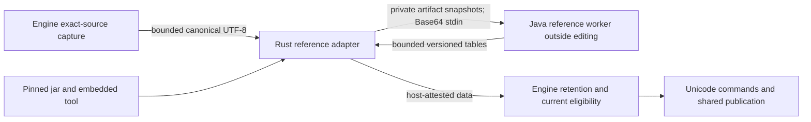

The explicit reference gate checks all 853 grapheme/1,944 word corpus cases and
eight supplementary sources through real native input captures. All 2,805 tables
remain usable for grapheme motion/deletion/replay/undo. Eight word-start and five
word-end vectors correctly refuse as incompatible with graphemes; the corpus
exposed and corrected an earlier overly broad whole-table refusal. No boundaries
are intersected, normalized or replaced with dictionary output. This is finite
reference conformance/integration, not universal/independent proof or selection of
Java/ICU as the production or incremental provider.
Shared pure attachment candidate preparation now supplies
explicit point profiles, content-origin survival and persistent affected/detached
evidence under bounded mapping. The owner now also implements authored comment
records, independent versions/policy, atomic source/annotation companions and
linked field/membership history through retained compound invocations. General
historical target mapping refuses when evidence is missing; recipient release,
generalized annotation reload and remaining logical
command products remain open.
Coherent complete annotation snapshots and a separate strict v1 reference-JSON
codec are now executable: explicit host identity/source aliases, both point
profiles, immutable artifacts and bounded duplicate-detecting parsing. Decoding
does not activate identities, publish a baseline or attest provider writes.
Explicit annotation export now routes retained original bytes/context through the
same destination FIFO, provider dispatch and independent receipt ledger as source
saves. Both artifact kinds share bounded live/lifetime/held-byte accounting;
delivery stop is separate from admitted effects and task/nonce retention. Export
cannot activate ordinary bindings, supersede a source baseline producer or publish
a source baseline. The real codec-to-macOS path is tested, including diagnostic
off/on/full equivalence. Encoder/provider ports remain trusted host attestations,
not scoped recipient grants. Initial ordinary annotation association now uses an
exact-basis plan and complete engine-owned role inventory. Known distinction is
required against a present source binding, checked again on source admission,
dispatch and baseline publication. Annotation ownership blocks source lookup and
document disposal; pending effects and actual delivery leases block activation.
Unrelated authored edits survive metadata publication. The first provider-issued
comparison profile supports one exact registration; the macOS adapter compares
reopened anchored entries' device/inode identities, detects introduced hardlinks
and does not refresh pinned save conditions. This is a best-effort current host
observation, not an atomic or lasting alias guarantee. Cross-provider comparison,
annotation rebind/unbind, generalized annotation-save obligations, load/restoration and
before-codec funded capture remain open.
Associated explicit exports now retain their original ordinary binding separately
from export metadata. Explicit baseline adoption selects the newest eligible actual
dispatch serial, preserves source baselines/authored state and pins the real
producer/artifact. Optional token enrichment is a separate publication; contradictory
evidence fences adoption/comparison without reverting authored state. Exact current
output comparison checks the actual current source/set and original encoder context,
with a combined byte budget and no persistent artifact issuance. Native codec →
filesystem → receipts → explicit baseline → comparison is tested off/on/full.
Ordinary native annotation save now atomically admits a current transient codec
result, retained artifact, shared-writer task and capacity claim. The fixed native
baseline slot is preallocated; the claim reserves worst-case descriptor/key/token
bytes plus bookkeeping and one publication-counter unit per save. All current Rust
root-publication routes preserve that floor; installation consumes its own credit.
Queued cancellation and safe nonapplication, terminal acknowledgment failure or
actual supersession can release capacity without deleting write/receipt evidence.
Writer delivery leases still independently prevent task retirement; later conflict
does not resurrect a released promise. Admission stop preserves existing holds and
protected cleanup works after native fault. New native codec/filesystem acceptance
exercises admission → dispatch → independent receipts → prepaid baseline off/on/full.
This does not implement reference wire/root-envelope reservations, before-codec
funding, recipient authorization, generalized loading or external freshness. Required
acknowledgment follows the captured request, not provider capability.
Owned annotation reads now capture exact source/set, ordinary pair and independent
read registration in a bounded actual task. Provider-attributed start/chunk/end/
failure receipts form an ordered transcript; short chunks are not EOF. Exact
duplicates are idempotent, contradictions retain two witnesses and fence candidate
release. Quiescence, stop, complete input and actual delivery drain are independent.
Reads and writes share launch headroom, while unknown write disposition remains
separate from quiescence. The macOS adapter emits captured-read receipts and the
strict external codec can retain original bytes plus read-only decoded data.
Valid JSON and invalid raw UTF-8 are exercised off/on/full without native annotation
or baseline mutation. No atomic-resource snapshot is advertised.
Initial native restoration now checks independently approved identity/source/history
associations, lifetime-empty ownership and the original owned read. A separate
privileged restorer stages typed values; neither an encoder nor a file alias grants
that authority. Lifetime ownership survives unused/retained slots. Complete rows
install atomically with positive floors, unchanged source and no authored creation
group. Current/historical selectors use actual managed snapshots, never serialized
counters cast into edit versions; unavailable witnesses refuse intact. Each read
pre-reserves its native provenance companion. Consumed provenance survives stop,
quiescence, native fault and late contradiction pending explicit future discharge.
Restoration and loaded-baseline adoption now share private read-only preparation
and fenced commit paths with their native public operations. Restoration prepays
the document-handle vector as well as records/results; commit performs no new
cloning or allocation. Exact root, current read/writer evidence and root/promise
funding are rechecked before publication. One fence covers all records/set/root/
consumption installation, or baseline/provenance-marker/root installation. An
unexpected interruption remains faulted/Unknown, not rollback or known refusal.
Both whole-service boundaries have optional bounded content-free timing. These
are native stages for future owned invocation composition, not annotation-load
admission/replay/F06/discovery completion or new frozen formal refinement.
The annotation reader now lends stable opaque task/capture authority under strict
owner-control/preparation/resource facts. It binds the actual registration, record
nonce and original complete capture with weak markers; it copies no source or
decoded rows and adds no consumer pin. Currentness checks complete transcript/
capture coherence and preserves the actual consumed-read association. Stop before
consumption revokes access; stop after consumption preserves provenance, while
late contradiction or actual retirement invalidates it. This is producer
provenance only: approved sealed restoration data, operation permissions and the
actual adoption writer guard remain separate. No issuer registry or read dispatch
is added; the owned binding below joins terminal/result ownership.
Owned native annotation loading now composes both restore and adopt-baseline on
the existing invocation ledger. Immutable intent binds the original weak read
authority, sealed artifact identity or read/bound pair, native profile, context
and result ceilings. The charged pending proof is held only until terminal
publication; weak original roles and a fixed identity/disposition receipt remain,
so results do not retain decoded bodies or source snapshots. Service uses the
same native preparations and current phase-specific host/native guards. It
preconstructs the receipt/outcome and keeps terminal installation inside the
native publication fence. Empty restoration still consumes the read despite an
unchanged root; adoption after edits preserves historical evidence and authored
state. Stop/forget/invocation retirement never retire or refund the producer.
Borrowed authority alone remains non-pinning; caller-held sealed artifacts and
actual producer provenance retain their own consumer obligations. Original replay,
independent current result release and bounded optional actual-path observations
reuse existing control/retention/measurement owners. F06 V9 now releases the
original annotation-load identity/status under independent common/native current
checks and complete reply bounds. Its Existing prefix delegates actual V8
delivery; earlier exhaustive enums and observer profiles remain unchanged. One
fixed source on the existing discovery /1 owner advertises restore/adopt-baseline
as distinct native forms, and strict private-origin/phase matching precedes current
discovery release and native admission. Identical generic metadata cannot grant
that origin. These declarations describe native roles, not a wire grammar, decoder,
new registry, producer or execution mode. Other C1/C2 routes and frozen formal
refinement remain separate.
Real filesystem read → strict association → fresh-owner hydration → re-export →
ordinary save runs off/on/full for document/range/both point profiles. Imported
incarnations cannot change on re-export, and a contested old read does not revert
authorship or invalidate a later independent write baseline. Explicit loaded-baseline
adoption now attaches the actual same-owner read registry, preserves original
encoding/restoration/reader/binding provenance and publishes a typed loaded fact,
never a fabricated write acknowledgment. Ordinary admission and dispatch validate
the captured loaded producer, even after the current slot becomes a written
baseline. Raw noncanonical JSON may compare modified after semantic hydration.
Checkpointed read discharge now checks the actual current written checkpoint,
binding/source/set, destination safety, loaded-slot/queued dependencies and actual
capture/receipt drain. It atomically retires the original task and provenance,
without publication or writer-evidence changes, including after native fault.
The same-owner attachment owns reader/writer endpoints with separate charges and
a shared private incarnation; detach preserves unconsumed reads and reattachment
cannot revive old handles. Generalized historical-source import remains open.
Retained native disposal now changes only lifecycle/publication state under an
exact-root preparation and final baseline-promise checks. Central live-owner
validation fences current content/mutation/capture/launch paths; historical
receipts, outcomes, immutable copies and protected history retirement survive.
Source and annotation key release work in either order, require actual known
uncontested disposition (not quiescence alone), and archive their complete original
bindings/baselines in fixed lifetime-document slots. Archived baselines continue
to pin source/annotation producers and original reads. Keys can then acquire a
fresh non-confusable owner, never revive the disposed incarnation. Explicit native
provenance release now requires both keys absent, actual history discharge and
known noncontested writer disposition. It ends only that disposed root's producer
pins; independently owned immutable copies, archive bytes and authored records
remain. Disposed consumed reads retire under actual provenance/binding/drain checks
and peer-reference scans, including when no checkpoint or attachment ever existed.
Claimed ordinary writer retirement verifies actual artifact/source/set/context
and removes task, claim and artifact together after independent disposition,
quiescence, delivery drain and shared-artifact checks. Either retirement order
works; pure cleanup survives native fault/counter exhaustion without publication.
Root release, read retirement, write retirement and detach are separately observed
off/on/full. Final storage reclamation and contested recovery remain open.
Existing native document birth/immediate disposal, retained-disposal preparation
and commit, lifecycle metadata query, source/annotation binding release and
provenance release now time their actual synchronous service endpoints using
the bounded opt-in recorder. Default-off, disabled and already-full capture do
not read the service clock. Existing boundary identities and return/state
semantics are preserved; repeated cleanup remains a no-op, not a new publication.
Nested resource-integrity faults are classified unknown rather than ordinary
refusal by the shared coordinator observer. Mutating lifecycle paths retain their
existing fence; immutable preparation does not acquire mutation authority.
Spans exclude host waiting/provider completion, may nest and must not be summed as
an additive end-to-end duration. These diagnostic attempts are not an installed
complete lifecycle rate/population, queue/saturation gauge, physical-resource
measurement or latency/overhead qualification. No identity/content labels, new
runtime/provider, reclamation plan or frozen formal claim is added.
Retained disposal and disposed source/annotation binding transfer/provenance
publication now also fence installation against unexpected unwinding. Normal
pre-install refusal preserves roots without poisoning the owner; full success
clears the installation fence. An interrupted service leaves the owner faulted,
emits at most its bounded Unknown attempt when capture is available, and propagates
the original panic without logging its payload. Document/view/workspace or
binding/lifecycle/publication roots may be partially installed; even an interruption
after the final write is not a returned success or permission to replay.
Task inventories and parent holds remain owned, and existing protected cleanup
controls are independent. No rollback, erasure, effect cancellation, quiescence,
receipt issuance or native lifecycle invocation producer is inferred. Fault-cut
tests exercise the actual native installation boundaries under capture off,
available, timed and full; process abort/kill and physical/durable recovery remain
separate qualifications.
The native disposal invocation now has an explicit original-ticket producer over
the existing exact-root preparation. Its immutable complete context, plan and
publication/result ceilings are backed by one shared reservation. Fresh service
facts precede publication; matching replay never executes. The actual publisher
stages a private lifecycle candidate before installing roots, and only the
matching committed terminal outcome enables the specific historical disposal
result. Current release checks do not reconstruct facts from later roots.
Protected capture retirement preserves Running/Unknown and unrelated ownership.
Admission/service/release/retirement have optional bounded native timing. This is
not the broader reconstructed lifecycle envelope, the other lifecycle producers,
an event stream or a new frozen proof. Its historical result now also composes
through the explicitly admitted native F06 V2 receipt profile. V1's six-family
enum remains closed; V2 wraps those products and adds retained disposal only.
The observer retains its chosen profile and capability ceiling, checks complete
wrapper/original-payload bounds and reuses common current observation checks plus
the native disposal context/epoch/release gates. A receipt-only integrity fault
does not become a publisher fault or discard protected control/ownership. Other
lifecycle and atomic-annotation receipt families remain incomplete.
Native original-ticket producers now additionally cover disposed source-binding,
annotation-binding and provenance release. Each immutable funded capture binds
its exact request/context and separate disclosure ceilings; fresh service calls
the existing writer/lifecycle guards. The actual publisher captures applied or
unchanged status before installation/no-op return, and the getter requires its
matching terminal outcome rather than newer resource rows. Unknown interruption
stays fenced/Running; protected capture discharge does not settle it or retire
provider tasks. Late evidence cannot refresh a spent refused invocation. Optional
bounded admission/service/result/retirement timing describes these engine paths,
not provider truth or physical-memory/performance qualification. The explicit F06
V3 profile now composes all three products, wrapping existing V1/V2 products without
changing those exhaustive enums. A shared common lifecycle-release guard checks
current observation ownership and publication/context/epoch/result bounds before
the original native getter checks its captured rights and actual historical
candidate/outcome correspondence. Version and family support are fixed at admission;
no context upgrades through query or fallback. Receipt-only faults preserve protected
control and independent holds. Other lifecycle producers and complete public
facade/discovery remain open; native atomic results separately compose through V4.
Native view attachment/detachment and workspace membership now fence their own
row/counter/publication installation as well. Normal refusal/no-op leaves the owner
healthy, while unexpected unwind anywhere in service preserves its original panic,
fences the owner and emits at most the bounded Unknown attempt when capture is
available. Final-write/before-acknowledgment interruption is not returned success
or retry permission. Existing source/history, peer relations and parent holds
remain owned. Actual optional service timing reuses the existing view-lifecycle
and workspace-membership boundaries without labels or payload. This is neither
crash recovery. The native owned live-relation producer now binds all three
operations to original context/request/target generations and actual shared funding
before copy/preparation. Fresh service reuses those publishers and applicable
rights; private staging binds the historical changed fact to the actual ticket
before installation. Typed retained release is separate from execution and does
not reread a newer relation. Protected stop/refund preserves spent/Unknown work
and unrelated holds. No view snapshots or replacement roots are retained, and
service does not repeat attach normalization. Explicit native F06 V5 now composes
these results under original observer ownership, a captured lifecycle ceiling,
complete wrapper funding and common/native disclosure checks. Older contexts do
not upgrade; historical delivery does not query current relations. Receipt-only
faults preserve protected status and cleanup. Other lifecycle products and complete
public decoder/discovery remain separate obligations.
Source
file output now refuses the ambiguous absent-BOM/literal-leading-U+FEFF case;
the native logical scratch constructor now preserves such authored content at
birth instead of passing it through file-signature decoding. Explicit output BOM
and generated-newline intent do not normalize source. Scratch starts its source/
annotation/lifecycle/pair/serialization generations at one; legacy privileged
import keeps its existing zero baseline and one-signature decoding. Both use one
actual bounded owner allocator/root publisher, fenced against interrupted row/
generation installation. No view, workspace, binding/baseline, history edit or I/O
is created. Bounded optional logical-validation/scratch/publication observations
carry no content or identity. Owned scratch now reserves parent capture before
copying immutable intent and independent result ceilings; admission creates no
document. Fresh native service stages its original ticket's exact generation-one
allocation in that shared publisher before installation. Retry cannot allocate
again. Separately authorized historical identity delivery does not consult later
rows or assert liveness; protected once-only hold retirement cannot erase Unknown,
rearm issuance or release peers. Four bounded optional timed boundaries distinguish
admission, service, disclosure and retirement. Explicit native F06 V6 composes the
scratch identity result under original observer ownership, captured lifecycle
capability, full parent-funded wrapper and common/native release checks. Older
profiles do not upgrade; grantless legacy forms stay unavailable. Receipt faults
are absorbing only for receipts, not protected status or independent cleanup.
Private V5 delegation preserves prior result checks with one outer receipt timing
record. Complete public ingress/discovery, load activation, wire counter mapping and physical/concurrent/crash qualification
remain separate obligations. A valid logical birth can still require refusal at
the later byte edge; no automatic BOM repair is allowed.

The trusted-native lifecycle behavior facade is a finite dispatch over scratch,
live attach/detach/membership and already prepared disposal. It borrows native
requests and operation-specific premises, then delegates directly to those existing
owners. There is no additional ticket, root, executor, UI or substrate path.
Separate facade admission/service observations are inclusive, not additive latency
components; native result disclosure and protected cleanup retain their own paths.
Unexpected service interruption propagates its original panic and Unknown; the
facade cannot settle or refund it. This is not reference F17 data decoding:
string-ticket resolution and wire version/disposition mapping are not silently
replaced with opaque roles or inferred decisions.
The separate explicit native disposal profile now binds all original source/
annotation/lifecycle/serialization/binding expectations and retain/discard choices
to an exact native preparation, original ticket and actual parent hold. Binding
presence is explicit: legacy bound-at-zero is not unbound. Admission and fresh
service require all common and selected coverage/disposition premises; old service
cannot bypass them. An independent private expectation witness and the actual
pre-install publisher guard prevent substituted metadata from becoming success.
Both dispositions preserve `disposed-retained` evidence rather than claiming
physical erasure. Existing historical results and protected stop/discharge stay
independent; timing is optional and content-free. Wire identity/counter mapping,
complete reference-envelope decoding and accepted F17 discovery remain open.

The native facade's closed V2 sum now exposes explicit prepared disposal and an
`Existing` inclusion of unchanged V1 requests/admission/service. The original
native owner still captures and executes once; outer/inner family mismatch or lost
applicable coverage cannot mutate or spend the pending invocation. V1 forwards
through the same single facade observation/fault boundary, while V2 dispatches
privately to the original native handlers rather than calling public V1 again.
Both versions preserve independent historical result rights, stop, forgetting and
exact protected cleanup. No new job, authority, counter projection, UI, substrate
or decoder/discovery route is implied.

The data-first native entry now accepts semantic requests for the same five
operations, so an SDK/automation caller need not preserve an opaque disposal plan
to retry. A first disposal request is authorized and parent-funded before actual
metadata validation/preparation; only then is the original immutable intent
installed. Expected first-preparation failure releases only provisional capacity
and leaves the ticket issued. Matching replay returns its original phase without
metadata lookup or a new preparation, including after disposal/forgetting; changed
intent cannot refresh the original root guard. Unexpected preparation products
fence Faulted instead of becoming fabricated ordinary refusals. The prepared and
data routes share the same original native owner, actual publisher, independent
historical results and protected cleanup. There is no additional execution mode,
identity codec, UI or substrate path.

The in-process lifecycle argument boundary now guards one exact native wrapper
and the five supported request forms using handler-owned declarations. It copies
source/selection data under explicit logical output bounds, preserves native
identity/version/lifecycle/workspace/view and optional binding roles, and rejects
unknown fields, private variants, coercion and contradictory redundant roles.
The caller owns/funds normalization output; admission still establishes actual
parent funding, authority, replay/currentness and semantic validity. Separate
optional normalization timing contains no request labels/content. No raw source
content is interpreted as code and no opaque role is reconstructed from a string.
Actual accepted-registry installation and full in-process dynamic dispatch remain
open. Requirements §17.4 excludes remote invocation from v1; wire projections are
reference/compatibility notes, not a reason to add a transport to this engine.

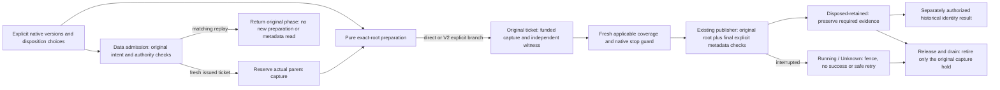

Preparation, admission, service and result/discharge have their own optional
content-free native boundaries; the release/drain edge does not claim quiescence,
physical erasure or resolution of Unknown. Failed fresh coverage returns without
execution; a matching retry cannot replace the captured preparation or choices.
canonical annotation source text never re-enters the file decoder.
A separate macOS local-filesystem
module implements the user-selected staged replacement with explicit safety
refusals, best-effort checks and native phase instrumentation. Its flows/limits are
mapped in the acceptance plan; it does not imply atomic conditional writes,
universal metadata support, crash durability or other-platform qualification.
The engine does not yet
cover the complete authorized command/release facade, annotation persistence or
logical-view companions.
Executable status is recorded separately from the historical qualification below.
This implementation projection changes the model file;
the earlier frozen model hash does not qualify these working-tree bytes.

Canonical design twin · revision 0.288 · 2026-11-02

Working native implementation update · 2026-11-06: the Rust registry receipt
owner now uses the existing funded registry packet pool, not a new global store.
Its context retains the actual original command until protected retirement,
including after stop; live streams, commands and receipt contexts have separate
lifetimes. Complete original historical rows require separately current release
authority; a denied row withholds the entire result rather than filtering it.
The privileged authorization input includes an opaque context/command/result and
whole-engine-root correlation basis. Preparation refuses stale or foreign bases
before applying supplied loss facts. Root equality does not attest external policy
truth. Native host basis/result copies are not recipient grants or managed holds.
Delivery certificates are one-use and root-bound; current authority invalidation
cannot be undone by regranting the same certificate. Observed receipt-grant loss
closes only that context. Protected cleanup remains possible under ordinary
admission failure, but cannot discard outstanding certificates or command claims.
Optional static actual-path observations cover admission, host-basis inspection,
preparation, release, reply correlation, closure/invalidation, stop and retirement.
This implements the native owner in the reference composition described below;
the installed F06 binding below does not adopt the reference whole F19 dispatcher,
qualify physical memory bounds or update frozen proofs.
The native typed/dynamic receipt decoder now lowers the exact fixed six-field
F06 request to actual release and original-result validation, matching the trusted
native port's opaque command/context before authority facts are evaluated.
It uses bounded fixed-shape traversal with no input-frame allocation, supplier,
new state owner or grant. Actual normalization/facade boundaries are instrumented.
The existing scoped /1 discovery owner now installs a privately attributed receipt
source only against the matching actual native registry parent. Its opaque
selectors/current discovery release lead to this same decoder and actual receipt
owner; a generic copy of the metadata cannot adopt that source identity. The
metadata includes a closed six-field JSON Schema 2020-12 outer shape; identity and
current historical authority remain independent runtime checks. Request roles are
checked before discovery loss, and discovery denial cannot stop a native receipt
context or consume its certificate. Complete dispatch service/disposition and
nested owning phases are instrumented with static labels. This installs the F06
receipt path, not the reference whole attached-owner/F19/lifetime composition.
Registry-specific F19 original commands now also have an installed source on this
same discovery owner and exact typed/dynamic request lowering. The command,
operation, stream and preparation roles must match the original native port before
current discovery/native authority is evaluated. Its fixed grammar allocates no
input frame and executes no supplier. Private installed origin prevents generic
metadata from adopting the route. One existing native request yields local
settlement or protected identity-only replay, never baseline payload. A caller can
use that protected decoded edge without fresh discovery after ordinary admission
fails. Actual normalization, facade and installed dispatch timings/dispositions
are optional and label-free, including Unknown on native protocol unwind. Other
required observer owners, heterogeneous attachments/events and U06 remain open;
no frozen proof, arbitrary callback/FFI or whole C4 qualification is inferred.

Draft 0.224 §12.3.6 specifies the pending registry-baseline retained-outcome
composition. The existing registry command owns the original result and funded
historical entry-to-slot association; a separately admitted observation context
owns its captured disclosure ceiling and revocation state. Current historical-slot
authorization gates release of that original result. The command, live stream and
receipt context have independent lifetimes. Receipt queries cannot execute,
resynchronize, refresh the baseline, consume stream events or infer historical
authority from current catalog membership. This is a staged reference binding,
not an extension of either accepted receipt profile or production implementation.
The native reference now checks original historical association retention, actual
receipt-context command claims, complete slot authorization and reentry/funding
guards within the existing prepaid registry slots. Eight native control groups
and ten targeted unsafe variants pass. Public F06 binding now covers both native
forms on both routes, with original result/opaque-role validation and quarantine.
Two handler-owned accepted-registry descriptions cover three variants without
widening builtin profiles; twenty-five standard schema cases and actual authorized
discovery pass. F19 bound/local stop routing now includes twelve native classes,
including receipt contexts, without producer cancellation or command-claim release.
An internal funded authorization-basis seam supplies original historical slots to
the trusted authorizer; it is neither recipient output nor a grant. Full frozen
qualification/adoption, complete F19 revocation and whole shutdown remain open.
No physical or policy-truth claim follows from these conditional reference results.

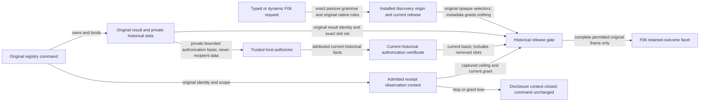

Draft 0.223 §12.3.4 composes the eleven existing native observation stop classes
through a closed dispatcher and local opaque-reference lookup. Lookup makes one
finite pass over prepaid actual attachments using pure issuer-owned membership,
retaining at most one candidate before one native stop. No caller-supplied owner,
mutable trial dispatch, persistent registry or wire identity scheme is introduced.
Actual domain/attached-owner identity,
native context membership, original scope and strict current control facts remain
separate checks. Ordinary values are captured before current-fact suppliers;
opaque roles are not traversed. The pure attachment membership seam allocates no
inventory and issues no authority. History closes one context; coherent members
close their parent; publication claim binding precedes trusted stop. Existing
native lifetime holds remain owned. No global context registry, remote lookup,
producer cancellation, policy service, UI or substrate mechanism is added.
Existing IF-01/03/07/08/10, PATH-01/05/10/12 and INS-03/08/12/13 observe binding
refusal, control denial, stop and retained obligations without raw identity labels.
Hostile-wire encoding, historical command-result release/discovery, explicit revocation, complete F19/F18 and
operational/independent gates remain; focused reference evidence is not adoption.

Draft 0.223 §12.3.5 gives the existing registry independent original command
records for establishment/resynchronization. Commands share prepaid packet slots
and lifetime issuance with that actual owner, while snapshot preparations keep
their separate one-use role. Original root/scope and resync stream/generation do
not refresh on retry. One native result is retained as-observed; control responses
contain only the original command reference. Historical payload release/discovery
remain separate, not inferred from protected control or this trusted fact seam.

```mermaid
stateDiagram-v2
    [*] --> Issued: bounded original reference
    Issued --> Issued: refused pre-admission
    Issued --> Executing: original basis and current admission
    Executing --> Issued: refused before native execution
    Executing --> Settled: native call returned; result retained
    Executing --> Faulted: closed protocol fault; holds retained
    Settled --> Settled: matching authorized lookup; no execution
    Issued --> [*]: protected abandonment
    Settled --> [*]: protected result retirement
    Faulted --> [*]: pre-native fault only; protected retirement
```

Executing refuses reentry/retirement. A fault before native execution does not
invent unknown effects; a fault after native execution began retains an absorbing
registry fence in the existing funded command slot. Protected stream discharge
does not erase the unknown record or prove faulted-owner reclamation. No automatic
restart, global issuer, new owner, network or substrate path is introduced.
The original command and its technical preparation are distinct identity flows.
IF-01/03/07/08/10 and PATH-01/05/10/12 retain their boundaries; INS-03/08/12/13
classify admission, native result, retained lookup, protocol fault, pressure and
retirement without raw identities under MELT/RED/USE/golden and STRIDE/LINDDUN.
Normal typed/dynamic binding and focused fault evidence do not close public
historical receipt release, discovery, explicit revocation, shutdown or assurance.

The Rust native registry now implements this original-command relation in
`resource/catalog/observation/commands.rs`. Its distinct opaque command reference
occupies the existing registry packet owner and lifetime budget. Command issue
captures the complete scope and actual engine `NativeRootIdentity`, plus the exact
stream/generation for resync. A technical command snapshot additionally binds that
engine basis; the narrower catalog stamp alone cannot reinterpret an old command
after unrelated source publication. Issue is not native admission. A complete
worst-phase command/control/result/historical-binding envelope and at least two
possible command/preparation slots are required before identity allocation.

The native FSM above now executes over the actual metadata observer owner.
Pre-admission refusal preserves issued intent. Busy execution performs one shared
native establishment kernel or existing resync call and retains the exact returned
result, including unavailable. Settlement verifies actual stream/generation,
projection identity and exact historical native-slot association. Matching settled
lookup uses original scope/operation and protected control only: no root refresh,
new ordinary admission, preparation consumption, resampling or queue reset. It
returns identity only. The retained baseline and private historical slot mapping
stay behind a privileged first-party seam; ordinary receipt disclosure is a
separate still-unbound relation, not a control permission or replay response.

Native fact inputs are immutable and safe Rust holds the exclusive owner borrow;
mutable supplier reentry is therefore excluded here. The explicit busy/started
state still guards lifecycle and fault handling, but arbitrary FFI/reentrant
supplier adapters are not qualified by these native tests. A closed protocol
fault marker retains faulted ownership without putting private exception causes in
ordinary results/diagnostics. A started-but-faulted record itself is the bounded
registry ordinary-admission/delivery fence. Source editing remains separate;
protected stream retirement cannot erase the unknown command. Command abandonment
is supported only when no started uncertainty is being discarded. The record and
separately held preparations must retire independently before parent refund.
Fixed-label optional timings distinguish admission/native service from identity-
only lookup and retained responsibility. Ten native command scenarios and 80
affected owner regressions pass; this is not whole-family/frozen/independent or
performance qualification, nor implementation of the public receipt/facade paths.

Draft 0.222 §23.1.12 connects the four native operation kinds to the existing
observation-admission pool through explicit native-operation-observation/1 opt-in.
Existing pools and publication receipt contracts are not silently widened.
The original actual domain funds the native child ceiling and eight-frame decoder
workspace; both capacity scopes account their demand, while native profile/kind
bookkeeping is prepaid. Native reservation retirement dispatches to the actual
native observer/waiter lifetime before workspace release. Captured ordinary data
never traverses task/context/progress roles: canonical and handoff size checks use
null shadows while retaining actual reference identity. A reproduced unknown-
progress accessor traversal is repaired in this successor, not the frozen 0.221.
Two accepted-registry records describe the closed contracts' inputs/results and
private wait continuations under existing metadata bounds; no schema is an
evaluator or authority. Current recipient/epoch/scope/native disclosure and
protected control remain separate from decoder/profile/advice. IF-01/02/04/08/10,
PATH-02/11/12 and INS-01/03/04/08/09/12/13 keep argument/release/evidence/fault/
retention populations distinct without new telemetry labels. Full qualification,
complete F19/F18 and operational/independent gates remain; no new UI, substrate,
network, issuer or host-registry-placement choice is introduced.
Eleven controls/twelve coherent three-module mutations, 24 route deliveries,
45 standard-schema cases, the exact registered validator, adjacent pool/decoder/
receipt references and static/cold boundaries pass. Bounded read-only challenge
found no concrete defect at this scope and did not execute tests or qualification.

Working Rust projection: `builtin/native_operation.rs` now joins sealed discovery
to the existing funded read/save observer decoder for all four native parent
kinds. Its two metadata entries consume declarations checked by the owning
normalizer. Installed-source identity and current metadata release precede native
dispatch; neither grants task, receipt, control or wait authority. Separate
prepaid synchronous builder frames and a fixed optional dispatch span reuse the
existing owners; no task store, network path or producer action is added. Current
native class-specific release and protected retirement remain authoritative.
This implementation binding does not recertify frozen reference artifacts.

Draft 0.221 §23.1.11 adds the native-operation observation profile inside the
existing actual-domain observation responsibility, not another producer or
global invocation issuer. A fixed four-kind branch binds the actual F20/F21
native issuer, owned parent, original scope and original task. Its separately
versioned status/wait/minimal-control and retained-outcome products do not change
execution-receipt/1's eight local publication receipt kinds. Native read/write
knowledge never becomes an authored publication outcome. Read chunk/conflict
payloads, annotations and export/baseline workflow state do not cross this edge.
Current recipient/epoch/scope and disclosure intersect a privately captured
ceiling; ordinary evidence denial and receipt-local faults preserve protected
control. The actual parent reserves the whole observation ceiling before exposure
and current-fact reentry, with independent context/input, signature/reply,
ordinary/protected progress and waiter envelopes. An observer does not pin a
producer or execute/stop it. Forgetting the producer absorbs observation; stopped
waiters retain funding until protected retirement. Fixed branch predicates,
monotone stop/quiescence pairs, bounded issuance and decreasing wait rank supply
the conditional closure argument; trusted-port return, actual clock/policy,
physical/concurrent/crash and independent-assurance premises remain explicit.
Seventeen controls/fifteen targeted facade mutations, 24 typed/dynamic deliveries,
the exact registered predicate, adjacent observation/save references and static/
cold boundary checks pass. A separate bounded read-only challenge found no
concrete defect in this relation; it did not execute tests or qualification.
IF-01/02/04/08/10 and INS-01/03/04/08/09/12/13 carry query/evidence/release/fault/
retention distinctions. No new network, substrate, identity service, UI or
measurement schema is installed. Qualification, discovery/decoder integration,
F19 event/context and F18 shutdown assembly remain open.

Draft 0.221 §16.1.5 now binds both ordinary-save commands to owned parent records
in their actual shared writer. The original domain/context, immutable request and
actual task are retained; annotation intent additionally retains its validated
artifact context and complete identity/source-association binding. One native
attempt per parent is explicit. Raw bypass, attempt relabeling and retroactive
adoption of raw work refuse. Source preparation/final commit and the annotation
codec/baseline-claim section install their co-owned roles without authored-root
publication or provider dispatch. Matching observation cannot recapture content,
migrate a pool, re-encode with another technical profile or attest storage.
Guarded child retirement spends the parent; real annotation claims must discharge
separately. The sponsor funds an independent bounded lifetime parent store once
for the shared writer, not per attachment edge. Bounded semantic input and
execution scope are privately captured before current-fact reads; caller changes
cannot alter the child/parent meaning. Eleven controls/fifteen coherent-graph
mutations and bounded read-only review pass; existing native source/annotation
and writer regressions pass. Full qualification/adoption and downstream
discovery/receipt/event/control assembly remain. IF-01/02/04/08 and
INS-01/03/04/07/13 retain their existing roles; no UI/substrate module, network
hop, owner type or measurement schema is introduced.

Draft 0.221 §16.1.3 binds F20 source-load native-attempt recovery to its actual native
reader and complete original domain context. Matching requests recover the exact
retained task without recapture, submission or publication; changed intent and
retired origins refuse. Existing bounded issuance, ordinary admission fence,
current release and native producer/control/evidence lifetimes remain separate.
The parent additionally reserves 2 × maxIssued × maxCaptureBytes for independent
spent-origin and owned-parent stores that outlive task payload retirement; this repairs a reproduced logical funding
gap without changing issuance limits, identity or introducing physical claims.
No common issuer, dispatcher or execution machine is required. IF-01/02/04/08,
PATH-12 and INS-01/03/04/13 retain admission/retry/release/attempt/retention roles;
no component, network flow, owner type or measurement schema is added. Focused
checks and read-only challenge pass; this changed candidate is not qualified by
either the adopted 0.219 report or the separate 0.220 qualification.

The same candidate's §16.1.4 binds annotation-load requests through their native
owner and confined raw ledger. Pure request validation and original-task lookup
do not refresh the current source/set/pair/binding basis: an edited source can
invalidate candidate applicability without losing the retained task's identity.
The annotation parent's lifetime-origin reservation follows the same conditional
resource accounting law. Current annotation release, native fresh admission,
restoration/baseline adoption, evidence and retirement remain distinct. Both routes
and the real source-change case pass selected checks and bounded review; complete
discovery/effect/event/receipt assembly and full qualification remain. Existing
interfaces and INS-01/03/04/07/13 carry these distinctions; no component, network
hop, identity service, public raw ledger or telemetry schema is introduced.

The updated load adapters now atomically admit owned parent-operation records
with the actual child task. Identity is qualified by native issuer incarnation
and complete original context. Immutable request comparison keys the parent by
operation independently of effect/attempt; neither relabeling nor raw admission
can create another child under it. Prior raw attempts cannot become parent
admissions retroactively. The native owner is the sole retry owner; this selected
load-command profile has one attempt and no automatic provider retry. New logical
reads require new operation identity and current authorization. Guarded child
retirement drops the co-owned parent payload into a spent tombstone. Independent
bounded origin and parent stores require maxHeldBytes plus
2 × maxIssued × maxCaptureBytes in the actual parent. Both load paths bound and
privately capture the complete request/context before current-fact reads; catalog
routing reads no permission supplier and grants no authority. Supplier mutation
of caller inputs cannot retarget matching lookup or parent/child admission.
Source thirteen controls/sixteen mutations and annotation twelve/sixteen pass coherent baselines;
earlier bounded read-only review found no concrete defect in the preceding parent
relation; it does not cover the later input-capture ordering repair.
Cross-issuer identity, automatic retry/reconciliation, downstream result/event/
discovery and full qualification remain. The earlier F21 attempt-only prototype
was removed; §16.1.5 now supplies its owned-parent replacement, not that old
prototype's weaker relation.

Draft 0.220 reconciles the existing diagnostic gateway with the actual-domain
ordinary-admission fence. Task issuance and first submission serialize with fence
installation; matching retained retries and previously admitted service/control/
discharge remain separate. CMP-17, IF-01/08/09, PATH-11/12 and INS-01/03/04/12/13
retain their roles. Observe fenced admission as refusal, not cancellation,
nonperformance or useful completion. No owner type, network path, executor or
measurement schema is added. The staged fix awaits full frozen qualification.

The same staged batch composes the fourteen existing F17 forms with actual-domain
recipient observation and the retained operation-receipt facet. Command publication,
receipt disclosure and selected projection changes remain separate; observer loss
cannot undo the committed root, and permitted annotation events do not require
command-receipt disclosure. Existing IF-01/02/03/08/10 and INS-01/02/03/08/12/13
carry those distinctions. No event framework or complete F19 dispatch is inferred.

Draft 0.219 §23.1.10 composes typed retained-outcome receipt observation inside
the existing facade and observation owner. Original domain/ticket/context and
native receipt roles remain distinct from current release. Explicit per-facet
admission ceilings and native command disclosure ceilings bound current grants;
generic details or metadata is not receipt authority. Decoder and complete reply
frames are prepaid. Receipt-local faults retain command state and leave summary/
protected control independent; no execution, event or receipt-reference issuer is
added. IF-01/02/08/10, PATH-02/11 and INS-01/03/08/09/12/13 cover the same semantic
interfaces and pathways. UI/substrate mechanisms and node ownership are unchanged.
Section 25 records the approved exhaustive, versioned executable-enum policy;
finite vocabulary checking is not production Rust compilation or whole-engine
categorical completeness. This draft awaits frozen qualification.

Draft 0.218 §18.8.4 binds the two existing F08 query forms to their actual
analysis owner. Original domain context and snapshot identity remain separate
from current permission, source/provider/analysis applicability and view attachment.
The facade prepays classification and seven declared decoder frames; the native
query independently funds its two construction frames while decoder funding stays
held. Capture, private serialized query handoff and cleanup share busy ownership;
unexpected faults fence analysis, preserving protected evidence and discharge.
Immediate query values add neither provider work nor command receipts/events.

Handler-owned metadata uses the existing accepted-registry discovery route,
without widening builtin profiles or adding a schema interpreter. Discovery
selectors/advice cannot replace native snapshots or grants. IF-01/02/05/07,
PATH-07/08 and INS-01/02/03/05/08/12/13 cover decoding, current release, declared
pressure/refund, fault and retained duties. No network, substrate or UI mechanism
is added; post-import selected-call probes are not host isolation. F16 activation,
F24/F28 invocation/evidence/event assembly, installed host/provider truth,
physical refinement and independent assurance remain separate gates. This is
composition inside existing components, not a new execution mode or graph node.

Draft 0.217 §17.4.2 binds the selected native owners to actual domain attachment
edges. Acquisition reserves child funding and metadata before exposure; existing
parent-funded pools retain their native charge. The shared writer keeps one
immutable sponsor and separate peer edges. New obligations remain distinct from
retained service, qualified baseline/release bookkeeping and late evidence.
Original section/lease/hold identities survive through commit and discharge;
historical source roots use an identity witness, not copied state. Search cleanup
rechecks the original dependency after fact capture. Native publication observers
derive roots and terminal local outcomes from their actual domain/ticket.

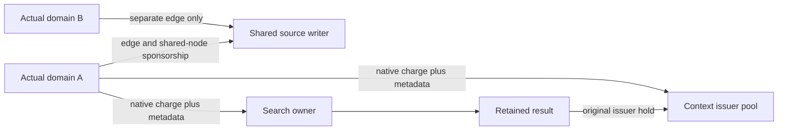

These are internal ownership/retention relations, not new components, public
verbs, transports or UI responsibilities. IF-01/02/03/04/05 and
INS-01/02/03/04/05/08/12/13 retain their instrumentation boundaries: distinguish
native charge, additional child funding, metadata, acquisition refusal and
protected cleanup without private IDs as metric labels. Closed owner roles and
selected discharge cases do not prove complete factory/dependency closure,
shutdown consent/drain/controller composition, all F18/F19 products, physical
allocation or independent assurance. Owners lacking whole-owner retirement remain
explicitly retained. The [scoped owner contract](formal/owner-attachments.md)
records the reference boundary; model and requirement gates remain intact.

Draft 0.216 §17.4.1 puts the selected absorbing ordinary-admission fence in the
actual invocation-domain owner. IF-01 admission and native source/annotation writer
admission/commit share that state; pending authored publication cannot cross it.
An exact original-root retry retains one parent-funded root frame and the same
fence. Native admission sections and running publication exclude installation;
matching invocation observation, protected stop/retirement and pre-admitted save
evidence/baseline bookkeeping remain distinct. This is not fault containment or
shutdown acceptance. IF-01/03/04, PATH-12 and INS-01/02/03/04/08/12/13 keep their existing
boundaries and attribution; no network, UI responsibility, clipboard owner, public
verb or numeric limit is added. Complete owner inventory, eligible-dispatch and
all-native-path composition, actual service/clock/physical truth and independent
assurance remain open; the primitive cannot assert whole F18/L09 closure.

Draft 0.215 §18.8.3 binds the selected analysis owner to the actual healthy engine
domain and current authoritative root. Missing/invalid optional inventory refuses;
an explicit empty inventory grants no analysis. Strict ordinary facts, original
opaque ownership and a nonrenewing per-domain registry preserve current source/
context checks without a second writer. Late producer evidence and protected
cleanup remain separate after a domain fault. IF-01/02/05/07, PATH-07/08 and
INS-01/02/03/05/08/12/13 keep existing ownership and attribution; no component,
network edge, public verb, parser execution mode or numerical limit is added.
The legacy unbound normalized reference remains; full audience/context/retry/
activation/event assembly, parent/global/physical funding and production/host/
independent assurance are not proved by this binding.

Draft 0.214 §§1.1/22.1.27 retain the separate headless clipboard integration facade
and reconcile discovery with that partition. All 43 fixed /13 metadata variants
belong to the 71-variant engine projection, not the five integration workflows.
The metadata/ownership crosscheck covers thirteen profiles and 303 profile/variant
occurrences, with six oracle sensitivity controls; it proves no handler execution.
The 87 editor variants partition into 71 engine, five integration and eleven
presentation variants, without renumbering families or removing transfer behavior.
F22/F23 workflows and the two clipboard F11 aliases belong to integration, not
the semantic kernel or UI. CMP-10 hosts that integration and provider edge;
CMP-01/03/08/09 retain behavior, publication, authorization and generic effects.
IF-01/02/03/04 and PATH-06 preserve original capture/task/evidence, current exact
edits and truthful external/local dispositions. INS-01/02/03/04/06/12/13 keep
their owning-stage attribution; no new component, transport or authority is added.
The combined clipboard references remain scoped composition evidence, not a
clipboard-free core import graph or production package proof. Actual integration
issuer/task/retry assembly and package conformance remain explicit obligations.
Earlier 76/11 ownership counts describe preceding reference batches and are
superseded by this partition. Their combined clipboard job/task machinery is
integration composition evidence, not a requirement for core clipboard state.

Draft 0.212 §12.3.1.1 places original native claim binding before IF-02/08
publication event/minimal-outcome release. The fixed ports resolve the actual
opaque observer and retained scope/epoch before independently attributed trusted
current context/facts reach the existing absorbing-loss path. Refusal preserves
queue, issuance and producer state; caller flags do not replace current policy.
The first-party lowering is not a public payload exposing private identities.
INS-03/08/12/13 distinguish binding refusal, attributed loss, pressure and retained
responsibility without sensitive labels. Five controls/eight semantic mutants
and bounded review pass; full frozen qualification/adoption remain pending.
No component, public verb, network/substrate edge or new owner is added. Actual
root/domain binding, heterogeneous F19/context/control products, U01, host truth,
hostile ingress and physical/concurrent/independent refinement remain separate.
See formal/observer-binding.md.

Draft 0.211 §11.2.13.7 funds the fourteen existing F17 envelope forms from actual
parent headroom before IF-01 capture. Four bounded serialized capture/reconstruction
frames remain charged through native preparation and refund under the existing
slot guard; native retained plans and spent issuance remain separate. IF-03/08
publication/receipt meaning is unchanged. INS-01/03/08/09/12/13 distinguish ordinary
capacity refusal, temporary workspace, retained intent and protected cleanup without
private identity labels. Three controls, 28 route cases, 42 capacity boundaries,
four semantic mutants and bounded read-only review pass; full qualification/adoption
remain pending. No component, verb, job kind, network/substrate effect or UI policy
is added. Physical/hostile-input/host truth, public event/result assembly and F18
shutdown fencing remain separate. See formal/lifecycle-workspace.md.

Draft 0.210 §14.6.2 binds standalone F13/F14 requests at IF-01 to original owned
native capsules. IF-03 rechecks role-specific authority, allocation, dependencies,
limits and original participants before publication; IF-08 releases retained
historical receipts under captured ceilings and current grants. Complete finite
native profiles and actual parent capacity fund preparation, including larger
native ceilings without rejecting small valid intents solely for that difference.
INS-01/02/03/06/07/09/13 distinguish capture, validation, publication, outcome release,
history and protected hold discharge. Twelve controls, fourteen coherent semantic
mutants, ten adjacent regression suites and bounded review pass focused checks;
full frozen qualification/adoption remain pending. No component, operation family,
network/substrate path or UI policy is added. U01 and cross-family event/result
assembly remain separate; supplied host truth, physical/concurrent/crash and
independent-assurance gates remain. See formal/native-local-command-binding.md.

Draft 0.209 §6.5.2.5 binds explicit mixed source/annotation proposals at IF-01 to
one original invocation. Each F13 component retains its native owner/currentness,
independent versions and original create allocation; F11 source rights cannot
authorize annotation authoring. IF-03 derives the same-proposal source candidate,
rechecks all participants and final component limits, then installs one root/
history/coarse-fact/receipt-vector decision. IF-08 releases historical component
facts under their original ceilings and current grants. Actual parent reservations
fund bounded public/native metadata, staging and §13.9.6 receipts. INS-01/02/03/06/
07/09/13 distinguish offer/capture, current validation, whole publication, release,
history and protected responsibility, not one success per component. Sixteen
controls/thirteen semantic mutants, twelve adjacent regressions and bounded review
pass; full frozen qualification/adoption remain pending. This adds no component,
job kind, network/substrate effect, UI policy or public operation family. Current
discovery/enablement, cross-family event/result assembly and U01 remain separate,
as do issuer/policy/physical/concurrent/crash and independent-assurance gates.
See formal/atomic-authoring.md.

Rust mixed-authoring projection: `atomic-source-annotation/1` owns bounded ordered
native component data over canonical source/read/scope input. Current component
bindings and annotation-write premises enter separately from requester data and
are rechecked at dedicated service; generic invocation run cannot perform the
mixed command without that validation. Native allocation and annotation staging
remain in the existing compound owner. Candidate targets without a source write
lower once to their original captured source context; body-only work keeps its
independent version eligibility after compatible automatic mapping. Current views
are derived at service and all source/annotation/history/receipt effects share
the existing atomic publisher. Parent funding prepays native logical 3C+2M+2R and
the existing receipt frame, retained together under the original result holder.
Inventory/document-pin accounting follows that holder through stop/forget and
protected exactly-once retirement. Original component receipts reach the existing
typed F06 facet under separate current common/native release rights. Optional
payload-free input/admission/service/installed timing adds no transport, UI,
exporter, new pool or annotation issuer. This is a native Rust projection, not a
wire identity codec or physical/concurrent/independent certification claim.

Draft 0.208 §13.9.6 binds internal component receipts to the original normalized
compound, actual invocation parent/domain/ticket and captured disclosure ceilings.
IF-03 stages the entire historical vector with the final root and coarse terminal
facts; IF-08 release checks the original component and current grant without
reading a newer row. INS-01/02/03/06/13 distinguish preparation, one publication,
historical release, retention/drain eviction and protected once-only hold refund.
The actual parent funds checked logical metadata/result frames; this creates no
new pool, component, job kind, substrate effect, UI policy or public verb. Eleven
native controls/nine coherent-graph mutants and seven adjacent regression suites
pass focused checks; full qualification/adoption remain pending. Public mixed
ingress, per-participant authoring authority and U01 remain separate, as do actual
issuer/host/physical/concurrent/crash and independent-assurance gates. See
formal/atomic-annotation-results.md.

The adopted compound create-result grant is now original-component-scoped:
`(owner/domain, invocation, immutable plan, original annotation ordinal)` binds
to exactly one native allocation. The ordinal is only a locator. Existing-record
grants stay exact; no sibling authority or additional allocator handshake is
introduced. The native Rust producer in
`coordinator/invocation/compound_results.rs` funds `2B + 3nM` against the existing
parent before normalization/copy, seals original native plans, and stages the
entire receipt vector inside the existing compound publisher before installation.
Native retained release intersects captured/current rights and never rereads a
newer row. Strict retention/drain forgetting and separately owner-controlled,
once-only hold retirement preserve spent issuance, unrelated holds and Unknown.
The standalone result profile and exhaustive F06 V1–V3 products are unchanged.
Explicitly admitted native F06 V4 now composes atomic receipts with original
observer ownership, an independent atomic family ceiling, complete wrapper
funding and common/native release checks. V4 delegates prior products through
their native guards; no context upgrades by fallback. Receipt-only integrity
faults preserve protected control, producer health and holds. Public mixed ingress
and complete accepted decoder/discovery assembly remain separate obligations. Native
tests and the conditional argument below are not frozen-model recertification,
crash atomicity, independent assurance or whole-engine completion.

Draft 0.207 §6.5.2.4 binds source-only F11 exact-batch at IF-01. Explicit caller
intent normalizes/captures once; private source/annotation-set dependencies stay
inside the original coordinator. IF-03 derives bounded companions from the current
service root and publishes one source/history/mapping decision; original public
intent and retained private evidence govern retries. INS-01/02/03/06/07/09/13 retain
their existing placements. No UI state, provider effect, component or network path
is added. Atomic authored F11/F13 composition remains separate required work;
full qualification and implementation/host/physical assurance remain gates.

Rust source-only projection: the seven-field `exact-source-batch/1` native
normalizer accepts original typed source writes, the existing V3 read conjunction
and exact native scopes, never a caller-supplied private compound plan or annotation
stamp. Shared grouping/order normalization retains canonical public intent under
the original invocation; a separate private candidate captures annotation-set and
source/policy dependencies once. No view selection is captured at admission for
this profile. Actual service derives current attached-view companions, checks their
complete native envelope, then uses the existing atomic publisher. Ordinary
view-bound preparation remains unchanged. Sealed installed typed/dynamic dispatch,
protected stop, ordinary retained outcomes and optional payload-free timing reuse
the existing owners. Host current authorization remains an independent premise;
this is not a logical-ID wire codec, arbitrary automation grant, authored mixed
batch facade, complete F11/C2 closure or release latency qualification.

Draft 0.206 §4.2.2 closes repeated-source grouping at existing IF-01 admission
and F10 advice. Consistent same-incarnation headers form one first-ordered
participant before shared edit ordering/capture; inconsistent contexts or edit
ambiguity refuse. Independent grouped arrays prevent input-alias self-extension.
IF-03, parser/view/annotation companions and history still see one actual source
participant. INS-01/02/06 retain normalization, refusal and local history meaning;
no component/authority/network path is added. This is not a complete F11 public
envelope or physical/concurrent implementation proof.

Draft 0.206 §20.1.1 binds the existing F11 accepted-composition-commit variant to
one explicit primary replacement. Original document/view/source/selection context,
exact expected bytes and literal text enter IF-01; the existing coordinator stages
one source edit, annotation/history and mapped secondary/peer selections at IF-03.
The original primary caret is reconstructed before normalization can change its
index. Retained full intent and existing outcome/control/discharge paths apply.
INS-01/02/03/06/07/09/13 keep their existing placements. UI preedit/focus/native
ordering remains outside the engine; no component, provider or network path is
added. Focused controls/mutations are not full qualification or native IME proof.

Rust implementation projection: `prepare_composition_replacement_v1` now retains
one exact UTF-8 replacement and initiating view context in the existing private
derived-edit slot. The shared publisher maps all original endpoints, overrides
only the initiating original primary, then normalizes once; annotation, history,
view and source installation remain one existing atomic path. Native admission,
closed typed/dynamic normalization and sealed installed discovery use the original
invocation ledger. Full execution context and all three capture limits remain
original intent; capture/native-envelope refusal leaves the ticket issued/unbound.
Existing protected stop, terminal outcome and retirement paths are reused, not a
new result store or IME session. Optional payload-free normalization, preparation,
admission and installed-dispatch timing use the existing bounded recorder. This
implements the native composition profile, not a wire identity codec, arbitrary
script authorization, complete F11/C2 closure or release latency acceptance.

Draft 0.205 §23.3.1 refines the existing observation intent with the closed
engine-measurement/1 descriptor/value profile. INS-01–09/12–13 keep their existing
interface/path placements; UI INS-10/11 remain separate. Typed populations,
phase endpoints, tagged resource units, continuity/freshness/loss and restricted
correlation do not create another authority or network pathway. No installed
probe, exporter or wider boundary-marker/1 payload is inferred. Clock/provenance
truth, funded runtime capture, physical costs and workload thresholds remain gates.

Native measurement refinement: Rust now supplies all 32 descriptor literals and
finite dimension dictionaries, checked against the adopted catalog. Typed values
separate counters/gauges/durations and observed zero from off/unavailable/unknown.
Reusable occupancy/commitment coordinates cannot masquerade as consumed work.
Private immutable points bind one descriptor/dimension tuple and an allocation-
identity generation; bounded ordinals never wrap or reset. Counters saturate with
sticky inexactness. Delta needs increasing order, exact complete current endpoints,
one generation/series and separately established whole-interval continuity. Pure
host-tick conversion requires matching monotonic domain/epoch, validity, order,
scale and duration ceiling; no native clock is sampled. Pending/censored/completed
duration endpoints and first-authentic-result classification retain their distinct
meanings. The helper does not track actual effect attempts or prove clock truth.

`Recorder::try_with_diagnostic_measurements` separately enables four actual INS-12
series, with no change to boundary-marker/1 payloads or authoritative operations:

| Actual queue transition | Measurement increment |
|---|---|
| Every `record` offer, including disabled/full queue | offered |
| Successful bounded enqueue | captured |
| Drop-newest on full queue | dropped |
| Successful owned `pop_front`; not empty drain | drained |

Default/disabled recorders allocate no measurement state. Explicit activation
bounds the fixed four series/generations, native state plus four-point snapshot
workspace, integer values and observation ordinals. Record-time updates allocate
nothing, invoke no callbacks and read no clocks. Snapshot preflights all four
points before consuming ordinals; exhaustion refuses without resetting counters.
Counter saturation is inexact rather than lost-zero visibility. Metrics can remain
enabled while event capture is disabled; offered is then not captured or dropped.
These are diagnostic-stage populations, not requests, invocations, useful editing
throughput, persistence or physical memory. Snapshots are privileged local values,
not recipient-authorized telemetry. Full provenance/collection/release permission,
general series activation/retention, the other installed probe populations, actual
clock/physical/workload truth, adapters/exporters and independent refinement remain
open. There is no new interface, network route, UI responsibility or numeric default.

Actual native transaction-publication measurement: an optional singleton pool on
the actual coordinator binds `publication.dispositions` to entry/exit of the shared
source/annotation final-candidate kernel. One compound operation counts once, not
once per participant, source/body change or diagnostic event. The same boundary
serves linked reversal and derived line/Unicode/source edits. Applied publication,
no-op, ordinary refusal and invariant fault remain distinct. Replay, preparation
refusal, pending cancellation and calls rejected before kernel entry are outside
this population. Other publishers (including lifecycle/settings) still need their
own placements; these counts are not a whole-engine denominator.

Private fixed counters use native atomic storage and a nonescaping Arc-backed
unwind guard under the existing exclusive mutation authority. The guard completes
once on return or records one fault on unwind, with no allocation, callback, clock,
mutex or retry loop inside the publication probe. This is not concurrent authored
mutation or a second writer. A fault count does not establish nonpublication or
rollback: fault injection explicitly preserves the actual engine fence even when
one source assignment occurred before the surprise. Counter snapshots remain
available to the privileged native owner under that fence.

Configuration validates immutable explicit limits and reserves actual parent bytes
for six series/counters plus a complete six-point reply. Ordinary measurement
refusal/exhaustion does not reject or heal edits. Saturation is sticky inexactness;
snapshots preflight every ordinal. Collection stop is absorbing and returns off
rather than fresh zeros, without stopping editing. Protected retirement requires
owner control, delivery drain, retention release, stopped collection and no actual
probe hold; it releases the original reservation once and leaves a nonrearming
closed tombstone. No root/journal payload is retained or charged as a semantic
root. Snapshot copies remain caller-owned. General measurement provenance/current
recipient release, actual durations/other populations, physical/overhead/workload
and independent assurance remain open; no UI, transport or exporter is added.

Actual native read-release measurement now binds `release.dispositions` at the
outer shared read executor for nine native/decoded source, annotation, history,
acquisition and search paths. Each request is one handoff attempt, including
pre-admission refusal and a call rejected by an existing fault fence. Compatibility
wrappers and internal native producers do not count twice; rows, hidden peers and
occurrences are not independent attempts. Default-off collection allocates nothing
at execution; explicit activation starts a prospective cohort, not historical totals.

The counter update follows protected refund and final healthy-owner delivery
classification. This native profile exposes success, refusal or fault; unavailable
authority/currentness/stop premises remain a single refusal, not an inferred stopped,
unknown or provider-quiescent result. The other closed disposition dimensions are
zero only for this advertised cohort. A fault count does not prove noninstallation,
rollback or absence of outstanding native obligations. No source, handles, paths,
request IDs or recipient labels enter metric dimensions. Actual return values remain
the execution authority; counters never authorize, settle or retry a request.

A fixed parent-funded pool owns six series/counters and one whole snapshot frame;
it is not semantic-root payload. Synchronous exclusive ownership needs no outstanding
probe lease, atomic update loop, mutex, allocation, clock or provider callback at
record time. Counter saturation is sticky inexactness, and all six snapshot ordinals
preflight before any advance. Snapshot exhaustion does not block reads. Snapshots
are privileged native cuts, available under the owner fault fence, not recipient-
authorized exports. Absorbing collection stop preserves funding and yields off where
ordinals remain; owner/drain/retention-authorized retirement releases the original
reservation once and leaves a closed nonrearming state. Existing caller-owned points
retain only their generation references, not the pool or engine read authority.
Unowned read workspace debt and native installed contexts remain separate.

Coverage is this cohort, not trusted direct-owner reads, other engine release
families, global useful throughput or `release.duration`. Enabling collection needs
its own actual parent headroom; it is not cost-free instrumentation. Physical/RSS,
measured overhead, general provenance/recipient release and actual clock/span
integration remain open. No catalog verb, network route, UI or exporter is added.

Native source-destination codec preparation now binds exact document revision and
intrinsic serialization to immutable encoded bytes without artifact/task issuance.
One pending source preparation occupies a fixed native owner slot and reserves
shared live-artifact/lifetime-artifact credit plus actual payload bytes. Every
existing artifact admission respects that credit, byte charge and spare vector
slot. Retention rechecks the original opaque preparation and current source/format,
then transfers charge to one retained source artifact without encoding again.
Stale/disposed/foreign/spent requests refuse without consuming the preparation.
Protected discard is available under faults and checks actual aggregate charge;
it never erases unrelated debt, heals a fence or refunds lifetime issuance.
Artifact delivery/retirement remain separate. `prepared_sources` and overlapping
`prepared_source_bytes` gauges expose this obligation even before issuance; future
shutdown inventory must not infer no codec work from retained-artifact count alone.
This codec operation alone is not destination permission, writer admission or
Save As activation. The native composition below supplies admission/activation;
public command assembly and host/global/physical/concurrent guarantees remain open.

Native source export now composes preparation, destination and current host facts
with the one existing writer. Explicit present/absent conditions never invent a
validator. Exclusive create, atomic conditional existing writes and synchronization
are independently advertised host capabilities and checked with the applicable
create/overwrite grants. Old provider registration advertises no new capability.
Native facts are trusted current inputs, not document-carried or self-issued rights.

Admission preflights all root/counter/writer space before committing one artifact,
one task and one root destination reservation without an intervening callback/I/O.
Reservations are bounded by lifetime task issuance and participate in native root
accounting. Foreign ownership and competing reservation roles cannot be treated
as known absence; load/annotation binding and producer/provenance retirement honor
them. Copy export cannot bind or publish an ordinary baseline. Save As admission
requires actual structured source/annotation distinction, not key inequality.

Dispatch uses the shared identity-domain/key FIFO, current registration/grants,
original source-binding intent, exact target condition and immutable source capture.
Later source edits do not recapture it; legacy dispatch cannot omit current export
facts. Known application plus no-future-effect disposition permits per-origin
reservation release, not quiescence, acknowledgment success or binding activation.
Release changes semantic ownership and requires a healthy root; private codec
discard remains separately protected under faults. Idempotent release does not
publish again. Contradictions retain destination faults and attributable evidence,
even after local reservation release. Unexpected reservation-role drift fences
before launch/retirement rather than manufacturing nonapplication.

Native Save As local activation now rechecks the exact original binding intent,
qualified acknowledgment, noncancelled safe disposition, current complete target
registration and attested present postwrite version (including explicit unavailable
version). Both old/new destination effect domains must be resolved; an old distinct
destination's pending export reservations and same-document pending annotation
baseline promises cannot be silently transferred. Final structured pair evidence
is checked independently of admission. No provider I/O occurs in publication.

A changed context moves the exact prior binding/baseline into an explicit native
source-binding history vector, counted with its actual rows/key/baseline payloads
in the owning document's root census. An explicit host archive-row envelope and
actual root/promise floors apply before installation. Same-context activation
preserves binding generation/history; first scratch binding creates generation 1
with no fabricated history. The acknowledged immutable capture becomes the baseline,
not a relabeling of later source/serialization edits. Baseline publication/election
and producer retirement now recognize activated Save As producers, including late
version refinement. Current/archived baseline anchors retain their actual producer.
Only the activating origin's reservation is removed; producer quiescence/drain and
retirement remain separate. A checked atomic local installation advances publication
once; repeated completed activation is unchanged while the same binding is current.
The retained outcome separately reports activation and reservation-release facts.
Optional bounded `SourceSaveAsActivation` capture contains no identity/content labels.
The native path now shares a read-only candidate preparation and fenced commit.
Commit matches the exact semantic root and original task record, then repeats
the native current-fact, acknowledgment, registration, old/new writer and promise
checks before any mutation. Binding/history, reservation removal, producer flags
and publication generation stay under one fence. Unexpected interruption remains
faulted/Unknown, not rollback or a claim that the external write did not happen.
The whole-service boundary now has optional bounded timing. A separate opaque
SaveAs authority factory/currentness check requires strict owner-control,
preparation and resource facts, binding weak original registration/record markers.
It adds no producer/payload pin, read-only-inspection promotion or issuer registry;
actual reservation/quiescence/anchor obligations still govern retirement. Ordinary
save and copy-export tasks cannot supply this authority. Native repeats retain
their existing no-reprobe/unchanged semantics.

Owned SaveAs activation now captures the original opaque task authority, probe,
pair evidence, history bound and independent result ceilings in the invocation
ledger. Service prepares against current state and installs the historical
document/changed result inside the same native activation fence. It never
dispatches a second write or marks intervening edits as saved. Matching replay
does not reactivate; current result disclosure is separately authorized. Protected
stop, result forgetting and capsule retirement do not cancel, refund or retire
the actual write producer. Interruption fences the owner and withholds the staged
result while preserving the acknowledged write evidence. Optional bounded timing
covers admission, service, result release and retirement without private labels.
The installed source on the existing scoped discovery /1 owner now routes the
original native SaveAs authority/request to that admission. Metadata does not
grant execution or replace producer authority. F06 V10 releases the original
historical result under the copied lifecycle capability, complete bounded reply
envelope, current common release and independent native result checks. Its
Existing prefix delegates actual V9 delivery; published V1–V9 enums and profile
guards remain unchanged. No new frozen formal refinement or whole-family
qualification is claimed.

The retained-lifecycle native cleanup path now has an actual final publisher:
`reclaim_disposed_document_v1` requires exact provenance-released lifecycle,
current trusted-host cleanup/disposition premises, healthy root/frontier state
and a freshly recomputed zero across resource, read/history and context/invocation
owners. Copied counts and external flags cannot bypass native retained work.
Publication drops source and authored annotation payload under one fault fence,
preserving spent lifetime slots and annotation last facts/version floors and
restoration identities. A whole-document tombstone is not an authored delete;
existing root accounting checks its document slot is absent, without adding a
separate editing-path census. Fault interruption is Unknown and fences normal
mutation. Optional bounded timing covers the actual synchronous publisher, not
external quiescence or physical erasure. The constrained legacy direct-dispose
contract remains distinct; no unmanaged-copy reclamation or frozen formal
refinement is claimed by this new trusted-owner path.

C4 now has a concrete source-only native sampled-stream owner in
`coordinator/publication_stream.rs`, under the existing `SourceCoordinator`.
It owns an exact copied `SourceReadScopeV1`, actual parent funding, a bounded
full-source replacement queue, retained baseline and opaque stream-local
generations. Explicit post-publication sampling reads the actual canonical source;
it is not a callback inside editing or a lossless activation audit. Equal native
source versions do not copy payload or spend generations for hidden companion
publications. Pressure creates a gap, not a false continuous suffix; resync
requires current baseline authority and clears every old frame. Release checks
original binding, current policy/liveness/readiness, complete native frame bounds,
document/generation-chain and baseline identity before returning the exact head.
Wrong caller claims do not apply loss; attributed loss and native disposal close
the old stream absorbingly. Protected stop and separate retirement preserve
producer state and spent issuance, including under an editing fault. Stream
rows remain in the C3 census until actual retirement, and pool retirement refunds
its actual reservation once without reopening the spent issuer.

The native `facet_publication` owner now extends sampled full projections to an
explicit combination of source, exact named annotation membership/body/target
facets and attached logical selections within one document. It has its own actual
parent reservation and closed spent state under the same coordinator, not another
editing engine. Source-only V1 remains unchanged. Its copied bounded scope keeps
the original recipient/policy/context and host-established named references;
current exact grant coverage is checked before each handoff. Missing coverage is
unknown, not manufactured withdrawal. Unselected source/revision and global
annotation/publication generations never enter its projection. Immutable native
source/content versions compare equality without copying/scanning payloads before
queue/issuance pressure or replacement construction. Existing view integrity
checks still use bounded normalization workspace; allocation-free view polling
and whole-engine overhead qualification are not claimed. A semantic view carries its
fixed positional profile, selections and selection generation, not presentation
state or an incidental source revision.

Actual view attachment is checked even at queued release: detachment, retirement
or rebinding to another document absorbingly fences the old observer despite a
positive supplied liveness flag. Named deletion projects absence without exposing
collection membership or conflating it with visibility withdrawal. Gaps, exact
historical heads, independently authorized resync, lifetime issuance, protected
stop and separate retirement follow the bounded source-owner pattern. Retained
rows join the existing C3 publication-context incidence, including stopped rows;
real disposal/removal tests demonstrate the resulting native reclamation fence.
Optional fixed-label service timings, untimed gap transitions and trusted pressure
gauges instrument these actual paths without content/identity telemetry. Delivered
copies are not recallable. These raw native ports do not yet complete collection/
multi-document observation, registry streams, original command/replay/result/
correlation or generic F19 attached-owner dispatch. Existing exhaustive facade
profiles are not widened merely because a new technical owner exists.

Collection visibility now has a native exact-root preparation prerequisite in
`annotation/projection/collection.rs`. Its separately typed single-use packets
reuse the actual annotation preparation pool and its parent funding/C3 incidence;
they cannot enter ordinary installed annotation readers. Complete present-record
coverage, original scope and facet ceilings are checked before copying. Hidden
rows are filtered first; approved visible order follows attested facts rather than
native slot order. Each retained packet binds the actual native publication and
scope, so later roots require fresh preparation. An independent current whole-
projection attestation remains necessary even at the same root. Attributed loss
invalidates irreversibly; wrong original claims do not, and temporary handoff
pressure does not consume the packet. Stale/invalidated packets still retain
their native obligation until separately authorized cleanup.

Native staging consumption moves captured rows exactly once. Raw native IDs in
that technical artifact remain host/engine inputs, not recipient references or
selectors; the collection observer must separately fund and atomically
install its observer-local binding ledger and full frame, now implemented below.
This prerequisite alone does not implement original commands. Existing pool gauges and
optional fixed-label actual-path timings cover native preparation, validation,
consumption/retirement and untimed invalidation without exposing root ticks or
content. Delivered copies are not recallable or managed read contexts. No new
public F19 capability, frozen formal qualification or goal closure follows.

`collection_publication` now owns the native single-document collection stream:
an actual independent parent reservation pays for the copied original scope/facet
ceiling, spent slots, two binding workspaces, full projection and queued replies.
It consumes exact-root preparations and assigns opaque observer-local references
only to visible native identities. Removed visible membership retains its native
binding; a returning incarnation keeps its reference, and a new allocation obtains
a different one. Source/global annotation/publication counters and hidden row
offsets never enter these projections. Raw visibility-capture IDs cannot be used
as recipient references or read selectors.

Frame/reference/lifetime issuance is staged together and installed only when all
bounds fit. Hidden-only changes do not spend observer progress. Pressure gaps
clear queued data without installing partial bindings; authorized resync needs a
fresh preparation and atomically installs the fitting ledger/frame/new generation.
Current authority and original scope govern every exact-head handoff, including
independent permission for the historical payload rather than current membership
alone. Attributed loss/disposal stops the old observer; protected stop is separate
from retirement and producer discharge. Retained stopped rows join C3's native
publication-context incidence until actual retirement. Fixed-label optional timing,
untimed gap markers and trusted pressure gauges instrument these actual paths.
Host policy/historical-release truth, runtime scheduling, external copies and
whole-engine performance remain explicit premises/qualification work.

Native source/facet/collection stream handle equality uses actual allocation
identity plus private slot; derived equality of `Arc<()>` is not issuer identity.
The source/facet regression could alias a foreign same-numbered slot at passive
stop binding and is now corrected and tested. Existing exhaustive control profiles
are not widened. Collection/source/view composition across documents, registry
streams, original command/replay/result/correlation and U06 remain open.

The actual resource catalog now has a native `resource/catalog/observation` owner
for scoped registry observations. One bounded retained domain copies its native
profile and original authority/engine configuration and funds stream contexts,
preparations, exact historical certificates, binding workspaces and queued full
projections. Both actual catalogs must be covered once. Captured-policy/current
membership and descriptor facts are intersected before projection/reference
installation, with fixed per-class descriptor ceilings. Outputs contain only local
references, read/write classification and allowed typed capability declarations;
native tuples, private configuration, locator/key/stamp/global-floor data stay
outside recipient projections. Logical-slot references survive same-tuple
reinstallation, but new provider/resource incarnations do not alias them.

Preparation, sampling and delivery run outside publication guards without provider
calls/subscribers. A queue or binding/issuance failure cannot reject a committed
catalog change. Equal permitted samples advance no observer generation, binding or
queue. A current snapshot cannot authorize old queued data: a separate single-use
historical certificate binds actual current root, complete original scope and
exact head identity. An independent historical membership/descriptor attestation
may authorize a slot no longer in the catalog; denied frame membership/descriptor
creates a gap rather than silently changing a generation. Readiness withholds the
exact head. Fresh authorized resync installs frame, bindings and generation together.

Host classification has an explicit privileged edge: head inspection supplies the
exact pending whitelist frame and opaque head, and a borrowed historical-address
resolver supplies that head's native ledger slot to the trusted classifier. These
are host-only metadata products, not ordinary recipient disclosure/grants or
control-authorized inventory release. Their root-bound head token cannot be reused
after catalog change; certificate issuance and delivery each recheck current scope
and root/head ownership. The engine does not prove host policy/historical truth.
Only certificate-checked delivery crosses the ordinary recipient edge. No generic
facade currently advertises the privileged products or these raw technical helpers.

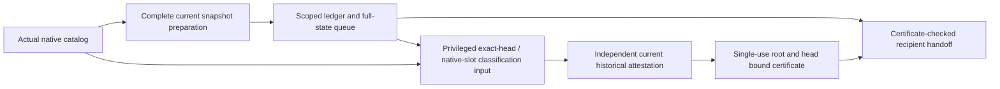

Foreign/wrong-role/spent/head-mismatched packets refuse before applying supplied
loss; stale certificates are not empty-delivery credentials. Certificate-free
empty/gap polling releases no frame. Accepted loss stops the old observer, while
protected stop is separate from retained packet/stream retirement and producer
discharge. The pool refunds only after all streams/preparations retire and keeps
a spent-domain marker. Metadata-only storage has no native document target or
payload hold and is excluded from C3's document incidence, not from shutdown's
future owned-work inventory. Fixed-tag optional actual-path service timings and
untimed gap markers plus trusted pressure gauges instrument each edge without
raw identities/content. Public command/replay/F06 binding, combined observers,
heterogeneous dispatch, U06 and whole-engine performance/qualification remain open.

Its fixed-tag optional service timing and untimed gap-transition marker carry no
identity/content labels; trusted native queue/gap/stopped/issuance/charge gauges
are not scoped recipient cursors. Host sampling scheduling and authority truth,
unmanaged delivered copies, runtime/performance thresholds and complete C6
populations remain distinct. The raw technical open/resync helpers are not F19
matching-command lookup and are not advertised as such. Broader annotation/view/
registry streams, original command/result/event assembly, heterogeneous F19
dispatch and explicit revocation remain open. U06's revocation target choice is
not inferred from stream stop or an unrelated compound-create approval.

C3 native lifecycle/retained-target qualification is now closed against the
fixed acceptance ledger in `docs/engine-test-plan.md`: 89 selected units and
265 affected-owner integrations pass, including actual read/context and stopped
owned-save discharge through this publisher. Ledger capture/funding orphan drift
refuses even after a result is forgotten. Complete public/result/event/shutdown
assembly and the final workspace qualification remain their separate gates;
this does not add another public cleanup verb or alter the original goal.

The existing context contribution now includes `retained_invocations`: closed
intent, phase and terminal-outcome traversal counts each ledger slot once for an
original captured/prepared/allocated native document reference. Original view
source survives view reattachment; original inputs survive outcome forgetting;
terminal creation identity can survive independent family-hold retirement.
Unknown/running phases and actual retained-slot gauge drift refuse rather than
fabricate an empty inventory. Native settings/registry identities and opaque
group handles are not interpreted as arbitrary document counterparts.

Native context mapping contributes `DocumentContextPinsV1` through the trusted
`document_context_pins_v1` diagnostic: attached views, actual workspace
membership, pending/accepted boundary evidence, live issued annotation snapshot
allocations and retained serialization bases. Detached/empty containers are not
document pins. Stale/closed records and snapshot clones retain their incidence
until actual retirement/final drop. Workspace gauge/duplicate-target drift is an
error, not an empty census. The allocation-free scan is off the editing path,
changes no root/hold/funding and carries bounded optional label-free timing.
Settings/catalog bases without a native document identity are not inferred to
pin documents; native dependent captures must be counted at their actual owning
invocations. Authored annotation payload/tombstones require document cleanup,
not an external-holder release. This is not an authoritative reclamation guard;
the actual removal publisher recomputes the complete contributions rather than
trusting this copied diagnostic.

Read/search/history target mapping now contributes `DocumentReadPinsV1` through
the trusted `document_read_pins_v1` query. It counts source contexts/holds,
annotation preparations/contexts/holds, coherent preparations/parents/holds,
managed search rows, legacy sessions/known live issued result holders, linked
history groups/pins and inspection bases against original document incarnations.
Stopped/invalidated/superseded retained products remain visible to the census;
retiring an installed context does not discard a distinct prepared cut or search
holder. A selected-member search holds the entire coherent parent. History
groups and pins remain indivisible across source/annotation participants, including
private basis participants omitted from an ordinary permitted projection.
Original owner helpers validate hold correspondence, orphan targets, search
gauges and pin-to-group existence before reporting counts. Fault/drift is not an
empty inventory. State variants are closed native cases, not trial issuer calls.
No allocation, payload disclosure, hold/alias mutation, publication or refund is
introduced by this diagnostic; optional bounded service timing carries no private
labels. Per-document counts are incidences, not unique allocations or RSS.
This is another C3/C5 owner contribution, not the whole-engine reclamation guard:
the separate final publisher now composes resource, context and invocation/result
owners with this contribution before removal.

Resource-owned document pin mapping now exposes actual retained row incidences
through the trusted `document_resource_pins_v1` diagnostic. It includes current
source/annotation bindings, write tasks and owned parents, artifacts, private
source preparation, export reservations, annotation reads and owned parents, and
activated source reads. The closed top-level resource census classifies every
field; catalog/provider/domain metadata has no direct document incarnation edge.
Observation and continuity metadata refer through their actual producer rather
than inventing another document pin after permitted producer retirement. Artifact
charges and owned parent/child correspondence are checked; fault/invalid/drift is
not zero. Counts are incidences, not unique allocations or RSS. Bounded optional
timing records no content, path, key, token or identity label.

Stop/quiescence does not remove an extant row. SaveAs reservation release does
not retire its producer/artifact; an annotation artifact can outlive its write
task/parent, and an activated source read remains after document provenance
release until actual read retirement. Healthy unrelated documents remain
independent. This is the resource owner's contribution to C3/C5, not a general
reclamation witness: retained document metadata, history/views/snapshots/searches/
invocations and other owners still require their own exact mapping and final
fenced owner removal. A zero resource total neither frees an owner nor proves
physical reclamation, erasure or disclosure authority.

Native explicit source binding-history release now refines §11.2.9. Twenty-four
exact current control/coverage/discharge facts and actual live ownership, expected
binding generation, current complete registration/pair and bounded typed archive
rows precede removal. Native expected binding is `Option<u64>`: `None` means
unbound, not loaded binding generation zero. A historical producer reference must
resolve to the actual matching source task/capture; detected row/role drift fences
instead of being treated as empty history. The supported native archive is always
a known typed vector; imported nullable/unknown inventories are not accepted by
this profile. Historical registration context is retained, not rebound to a new
current provider.

The closed synchronous release changes only that source archive and publication
once. Empty archives are unchanged without spending a counter; stale expectations
still refuse. Actual root and outstanding baseline-promise floors are checked even
for shrinking/unchanged archives. Current source/baseline, annotation/edit history,
views/workspaces, writer reservations, producer task facts and artifact/worker
charges survive. Later producer retirement still needs actual other consumers,
quiescence and delivery drain; a trusted discharge flag cannot erase a known
producer obligation. Content disclosure and external create/overwrite/launch
authority are neither implied nor required. Optional bounded content-free
`SourceBindingHistoryRelease` capture covers actual control outcomes.

Native pure source rebinding now refines §11.2.8 through one exclusive coordinator
transition. Its opaque target names only a complete registered provider/identity
context; it contains no source payload, write condition, existence assertion or
permission grant. Current expected binding (explicit unbound versus generation),
all twenty exact control/coverage facts, target registration, structured proposed
ordinary pair, current owner inventory, both destination effect domains and the
actual bounded source archive are rechecked in the same synchronous reference
path. Every same-document export reservation blocks rebinding until separately
released. A changed association cannot transfer a pending annotation baseline
promise into a different source context. No callback, provider I/O, await or public
root-replacement certificate is exposed between checks and installation.

The direct Rust publisher now uses one private native preparer/commit certificate,
as required before the owned §11.2.14 binding. Preparation is semantically
read-only (it may reserve existing vector capacity), seals the exact owner/root
and fixed decision, and retains only original opaque roles/options. Commit
requires fresh authority, the same root, and fresh actual writer/reservation/
baseline-promise checks: ordinary queued writes are not necessarily semantic-root
changes. All expected refusal and allocation precede a fenced ownership-move
installation. An unexpected unwind leaves the owner faulted/Unknown, preserving
the archived provenance when installed; it is not rollback or known refusal.
Optional `SourceRebindPreparation` and `SourceRebindCommit` observations separate
those stages from the existing whole-service `SourceRebindPublication` episode.
The durations overlap and must not be summed. No private identity/content labels
are recorded. This is a Rust implementation step, not owned invocation, F06 result
or installed-discovery completion. The native owned binding below reuses it;
F06 V7 and the installed rebind source now complete that selected native assembly;
the other C1/C2 obligations remain open.

Initial source-load activation has a native owned invocation over the task-bound
authority prerequisite. A privileged factory requires exact owner-control,
preparation and resource-readiness facts, then binds the actual submitted task,
registration, record nonce and live codec witness within the coordinator's one
read/writer ownership domain. The opaque non-cloneable handle contains weak
markers, no copied source and no strong producer/task/codec-payload pin. Repeated
valid borrowing has the same identity; stop, conflict, witness replacement and
actual task retirement invalidate old authority. Existing producer retirement
conditions are not waived or strengthened by the handle. Currentness checks do
not activate, disclose content or grant document creation/owner access.
The existing native activation path now shares the same complete transcript/BOM/
decoded-candidate validation and private materialization installer with raw loads.
Birth, binding, original marker and return are prepared before mutation; current
root/task/marker, destination barriers and funding are rechecked before one fenced
installation. Joins preserve the existing owner; repeats preserve the first marker.
Whole-service activation/direct-load timing covers unexpected interruption as
Unknown. Impossible private candidate/transcript drift faults
the owner before publication, while a merely replaced witness withholds the old
handle. The existing invocation ledger captures weak authority, exact context,
native profile and result ceilings under bounded shared retention. Service resolves
the current owner, independently checks creation or owner access and the actual
paired writer, and joins preconstructed result/outcome/terminal installation to
the native fence. Historical results retain identity and the exact original native
disposition; producer retirement does not turn replay into a new activation.
Protected stop/forget/invocation cleanup never retire or refund the producer.
Admission/service/result/retirement have optional bounded content-free timing and
reuse the shared admission/disposition measurements. F06 V8 now releases the
original source-load identity/disposition under independent common/native checks
and a complete bounded reply envelope; its Existing prefix delegates actual V7
delivery without widening earlier exhaustive profiles. A fixed installed source
on the existing discovery /1 owner binds original selectors to native admission;
generic identical metadata cannot grant its private origin. No new registry,
producer or discovery execution mode is introduced. Direct native already-activated
responses remain distinct from original-invocation results. Annotation activation,
other family assembly and full C1/C2 remain separate; no new frozen formal
refinement is claimed.

Native owned rebind now uses the existing invocation ledger, not another engine
or writer. It captures the original document, registered target, exact ordinary-
pair evidence/options, complete context and result ceilings under explicit shared
funding. Caller input changes and matching replay cannot replace this intent.
Fresh service requires the original context and independent current native rebind
facts, constructs the native preparation against current state, and stages only a
fixed applied/unchanged candidate matched to the complete original native roles.
Only matching terminal commit enables its historical document/status result;
source/annotation edits outside the binding preconditions survive. Known native
refusal is terminal and cannot revive when a writer later drains. Generic service
cannot bypass fresh facts, while protected stop remains distinct from completion.
Unexpected installation unwind retains faulted/Running with no releasable staged
result. Authorized capture retirement refunds that hold once without converting
Unknown execution to known nonpublication or clearing the owner fence. Preparation,
commit, invocation service, result release and retirement emit bounded optional
content-free timing. This is the trusted-native owner surface, not arbitrary-
recipient authorization, effect truth or independent formal certification.

Installed rebind discovery now uses a fixed native source on the existing scoped
`/1` owner, with an original private producer marker and exact opaque selectors.
It derives native roles from `SourceRebindRequestV1`'s declaration, validates a
fresh discovery cut, and delegates to the existing owned admission/service/result
path. Earlier built-in inventories and discovery profiles remain unchanged.
Historical delivery uses the explicit F06 V7 `SourceRebind` facet, preserving
V1–V6 exhaustive vocabularies and delegating the V6 prefix without reexecution.
Original policy/capability and full reply-envelope ceilings, current common/native
release rights, exact result family and original invocation remain conjunctive.
Generic lookalike metadata cannot select a handler; a wrong family produces no
placeholder, and an old-profile observer cannot be upgraded by a new selector.
Observer, capture, policy and invocation retirement still discharge their own
holds. This closes the selected native rebind route, not all C1/C2, event or
performance obligations; loaded-candidate activation remains the F17 route gap.

Same-context rebinding preserves identity/baseline/history and spends no publication
unit, including at counter exhaustion. Otherwise binding and publication advance,
the exact old binding/optional baseline moves into history, and the new current
baseline is explicitly absent. Scratch first-binding uses generation 1 without an
invented archive. Native `Binding.baseline` is now an Option: absence is neither an
empty file nor an unavailable-version baseline. The compatibility saved-state
comparison and ordinary pinned-save admission return `ResourceError::MissingEvidence`
for a bound owner with no baseline; they cannot manufacture equality or refresh a
condition from a later read. Explicit same-context Save As may install a qualified
capture later without another archive row. Baseline publication, retention,
disposed provenance and root accounting honor this explicit absence.

Rebinding preserves authored source/serialization, annotations, edit journals,
logical views/workspaces and producer ledgers. Binding cycles spend fresh checked
generations, so an old expected association cannot revive. Archive/root/promise
preflight and vector reservations precede the closed install; root faults and
counter/capacity exhaustion refuse without a partial association. Optional bounded
content-free `SourceRebindPublication` observations describe control-call completion
(including unchanged), not an actual-publication count series. Full public
invocation/replay/recipient composition remains separate work.

Native source-writer retirement now checks actual nonstopped queued condition
consumers before removing a task/artifact. An exact captured baseline origin pins
its producer. For the same destination identity, a queued older/equal anchor also
pins later known written records, even if a newer current baseline has replaced
the original root consumer. Captured loaded/explicit conditions have no own-write
anchor (serial zero); this is not an invented provider version or causal epoch.
A strictly newer queued anchor does not pin older written records. Actual anchor
tasks, original document/binding/whole registration, source artifact bytes and
issued nonzero launch serials are checked; unexpected drift fences without deleting
evidence. Existing task/codec bounds fund retention and backpressure; no duplicate
pin registry, root payload, worker or physical-memory guarantee is introduced.

Stopping a queued consumer removes only its queue obligation. Producer safe
disposition, uncontested evidence, root/history consumers, quiescence, delivery
drain and nonrecycled issuance still govern retirement. The bounded optional
`SaveProducerRetirement` diagnostic boundary records actual source retirement
completion/refusal without identity/content labels or invented timing. It is not
effect evidence. Full public persistence composition remains separate work; legacy
opaque provider validators are not parsed into epochs or promoted to non-reuse
guarantees.

Native causal source-evidence foundation now refines the receipt/version portion
of §16.5.1. `ProviderCausalCapabilitiesV1` declares causal receipts and token
non-reuse independently of each other, synchronization and conditional writes;
all old provider factories default both claims off. Explicit ResourceVersionV1
epoch/token fields are separately nonempty/bounded under max_validator_bytes.
Only trusted first-party factories mint typed read/result/causal-edge observations
for the original registered issuer and dispatch capability. These are host truth
assertions, not proofs of non-reuse, external isolation or actual write causality.

Read/load/capture, pinned conditions, result facts, historical baselines, Save As
postwrite probes, archives, queued-origin checks and actual root accounting preserve
the epoch independently of the token. A repeated token in another epoch conflicts;
an unavailable version stays unavailable rather than inheriting the causal edge's
after version. Versioned dispatch view v2 preserves opaque versus typed versions
and presence. The legacy v1 view is now fallible and refuses a typed causal
condition; its compatibility validator getter does not return a stripped token.
No missing epoch can silently downgrade original typed source-result ingress.

Protected actual-task intake reconciles a separately attested actual before/after
edge with the original pinned full condition and result version. Result, edge,
safe disposition and quiescence remain independent in every receipt order. Typed
result/edge contradictions share one fixed two-fact witness cap; accepted result
metadata uses the existing fixed-role witness slots. An exhaustive fixed-size
trial merge preserves accepted facts if conflict storage is full. Contradictions
fault the whole destination, prevent acknowledgment eligibility/safe retirement
and do not disappear on stop or later compatible evidence. Equal accepted/conflict
facts remain duplicates. The legacy opaque result merger retains its existing
bounded profile. This is explicitly bounded evidence, not arbitrary union closure.

Present source causal facts and explicitly selected typed absent-create after-results
are supported; annotation write admissions refuse typed destination versions rather
than dropping epochs. Full public profiles remain open. An epoch-changing or same-token edge may be recorded as a factual
observation without authorizing advancement. Source Save As requires the actual
result's full epoch/token in a current postwrite probe, not its original epoch.
Optional bounded CausalSaveEvidence and SaveEvidence boundaries classify actual
edge/result intake without private fields or invented timing; intake remains
protected after authored permission loss or an editing fault.

Native own-chain source launch now refines §16.5.1 through the existing ordinary
source admission and shared writer, not another worker or persistence procedure.
One-time explicit SourceContinuityLimitsV1 setup supplies maximum edge count,
native derivation bytes, one expanded receipt-metadata projection and aggregate
retained continuity credits. No deployment default is inferred. The projection
counts native fixed-width capture/dispatch headers, resource key and version/edge
incidences plus the widest valid causal-fact fields. It is not JSON/wire size,
physical allocation, source-payload funding or a global memory proof. Initial
minimum credits precede artifact/task issuance; final expansion is preflighted
against per-product and shared credits before issuing the actual launch serial.
Accepted tasks retain their credit through stop; only actual safe/quiescent/drained
retirement discharges it. Counter/debt drift cannot manufacture a refund.

An own-chain ticket freezes the exact typed original condition and verified root
anchor serial (zero for a loaded capture). A metadata-only first pass walks bounded
actual same-destination dispatched records in checked serial order. Safely resolved
nonapplication is skipped. Every written step requires known application/no-future
disposition, an uncontested source record, exact document/binding/complete provider
registration, independently declared causal/non-reuse capabilities, exact-true
current progression permission, matching actual launched before/result after
versions and an accepted causal edge. Epoch changes, equal-token writes, observed
multi-edge token cycles, missing edges, foreign contexts and final-probe mismatch
refuse. A zero-edge identity proof makes no progression claim. The legacy launch
path cannot bypass own-chain role validation. No destination probe refresh or retry
is performed.

Only after preflight does a bounded second pass materialize immutable ordered
origin/serial/before/after receipt values. Original source/serialization/condition
and the derived launched condition remain separate. Causal ingress now validates
against that actual launched condition; a later source edit cannot recapture the
accepted output. Receipts are borrowed through the existing provider dispatch
lease, not an untracked raw-Arc exporter. Original artifact/source tuples, current
binding/pair and source permissions still pass the shared writer's checks.

Typed current root anchors also retain the required later write prefix: an
unpublished newer acknowledgment cannot erase earlier records before another
own-chain admission. A published newer eligible root anchor can discharge older
records once other queue/root/drain guards permit. Same-context copy exports keep
the actual nonzero source binding generation for causal context matching, without
becoming ordinary baseline producers or activating bindings. Static bounded
SourceContinuityConfiguration/Admission/Derivation, SaveDispatch and actual
retained-credit gauges distinguish setup, accepted work, launch/refusal and later
retirement, with no private labels or invented clocks. Public wire-envelope,
invocation/replay/recipient composition and actual
host non-reuse/causality/physical guarantees remain separate gates.

Absent-create result typing is a separately captured native profile, not a before
condition or an inferred provider default. SourceExportOptionsV2 selects Opaque or
EpochToken; v1 absence stays Opaque. Present destinations must retain their original
schema. Typed-after creation independently requires causal-receipt and exclusive-
create capabilities plus existing current grants. The original condition remains
Absent, with no before epoch/token; legacy condition v1 refuses typed-after tasks.
Typed result-only evidence can supply the actual after epoch/token, refine an
unavailable result version and, after qualified Save As activation, establish the
next verified own-chain anchor. Copy never binds. Any observed concrete before/after
edge contradicts the pinned absence and consumes the existing fixed witness store;
it never manufactures a creation edge or erases accepted write facts. Existing
SourceExportAdmission/SaveEvidence/CausalSaveEvidence boundaries cover the actual
transitions. This native schema is not a public wire profile or physical create
mechanism; the filesystem adapter still refuses absent-create procedures.

Native ordinary source save admission now also has a writer-owned operation
parent (§16.1.5), not a second invocation executor or persistence worker. The
owner namespace qualifies the supplied operation label; effect/attempt remain
immutable child intent. Source revision, expected format/binding generations,
complete target identity/registration, requirements, pinned/own-chain policy and
all seven native execution-context components are bounded and privately captured.
Matching lookup compares the operation independently of effect/attempt, rechecks
twelve strict current disclosure/write/disposition/retention/reply premises and
returns only the original actual task. It neither recaptures after edits nor
requires fresh-admission/pair/preparation facts. Changed intent, context, foreign
owner or retired operation refuses. Current grants remain trusted host assertions,
not authenticated by copied context strings or task identity.

First admission independently checks the twenty native ordinary-save premises,
actual source/format/binding/registration/pair and shared codec/writer limits.
All fallible copies/capacity checks precede child creation. Parent assignment and
child linkage finish synchronously without callbacks, suspension, external I/O or
authored-root publication. The Rust owner now constructs the complete parent
before native child issuance and validates its exact task/capture correspondence.
Artifact installation/charge, task/linkage, optional continuity credit and parent
installation share one fault fence. Interruption leaves the owner fenced and
installed obligations intact, never a successful admission or rollback claim;
it does not fabricate no-future/quiescence or discharge an annotation promise.
Raw tasks cannot be adopted retroactively. Successful
actual child retirement simultaneously removes the parent payload, retaining the
spent operation identity. Stop, worker quiescence, recovery and caller-supplied
retention facts cannot waive existing producer/baseline/history/effect/drain guards.
Parent/child linkage or reservation drift faults rather than erasing obligations.

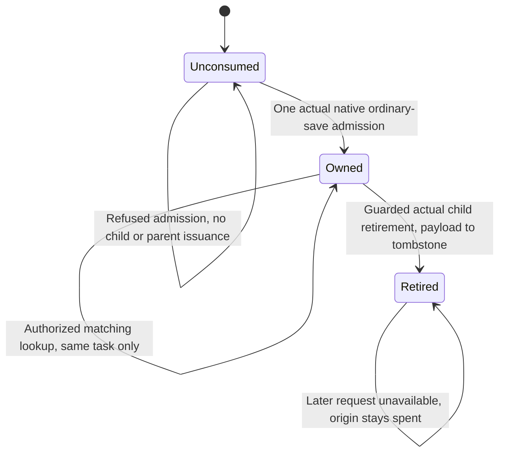

One-time SaveOperationLimitsV1 bounds lifetime rows, individual labels, full native
parent/tombstone capture and admission reply. A checked maxIssued × maxCaptureBytes
plus fixed store header is reserved independently of existing task/codec/condition
payload bounds; row headers must fit before preallocating the inventory. Native
logical projections are not wire bytes, total physical memory, allocation success
or durable/crash/concurrent truth. The fixed optional profile header is in root
accounting; private parent rows and spent origins remain writer metadata. Actual
issued/owned/retired/reserved-store gauges and optional bounded SaveOperation
configuration/admission/recovery/retirement markers carry no private labels or
invented timing. Actual source/annotation child admission and original parent
admission/recovery now have optional process-monotonic whole-service timing,
including Unknown on unexpected interruption. These synchronous durations do not
measure provider I/O, queue age or scheduler waiting. Capture off/on/saturated
does not change execution, funding, recovery or retirement. The annotation
extension below shares this same component/store.
Typed/dynamic public codecs, full invocation/observer/event assembly and permission-
filtered terminal receipts remain separate gates. Frozen formal evidence/hashes
are unchanged.

The Rust installed ordinary-save source now declares both F21 variants as effect
requests on the existing scoped discovery /1 owner. Private installed origin,
exact entry/variant/family/kind and current discovery release precede dispatch
to the original shared-writer parent. Source and annotation native permissions,
immutable intent, optional catalog binding and actual codec/claim guards remain
independent. No second parent, invocation executor, task store, registry, parser
or effect dispatch is introduced. Matching recovery after edits or catalog
withdrawal returns the same original task without recapture; changed attempt or
family refuses. Existing native-operation observation supplies independently
authorized status/retained evidence and protected control, not an invented
authored-publication result. Capture disabled/zero/saturated/available does not
alter these semantics. Complete F19/event and other C1/C2 assembly remain open.

Native ordinary annotation save parents now extend that same closed role space
with original annotation-set, encoding-context identity, complete annotation/source
association and original pinned destination bytes/version. Source and annotation
operation labels cannot collide to create two children; both use the same lifetime
parent cap and existing writer/codec/FIFO. No new executor, observation issuer,
baseline pool or persistence mode is added. Source absence is explicit None, not
a fabricated source binding; a scratch document can save its separately bound
annotations while its source remains unbound.

First annotation admission privately captures bounded native intent/context before
the actual existing artifact/task/baseline-claim admission. Twenty-nine strict host
premises cover ordinary annotation launch, complete disclosure, aliases/source
evidence, context attestation, native pair/identity/ownership and claim preparation/
historical-artifact/overwrite permissions. The actual engine independently checks
snapshot/root/source/set, encoder/context, full source/annotation association,
provider, pair, source-independent annotation write policy and all codec/claim/root
floors. Standard JSON validity and external alias/policy truth remain trusted
producer/host premises, not proved by arbitrary issuer fixtures.

Matching annotation lookup needs twelve strict current metadata-release facts,
including annotation-readable but no source-read grant. It compares the complete
original native request and execution context without inspecting replacement
encoded candidates, technical profiles, current edited content or admission-fence
state. Changed encoding/association/condition/set/scope refuses. Pinned absence is
not an ordinary annotation destination; typed causal versions and annotation
own-chain refuse rather than silently changing the selected schema/policy.

The prepaid inline parent header funds the closed source/annotation role maximum;
annotation tails additionally charge the before bytes/version and both association
key incidences, even when underlying Arc payloads are shared. These are conservative
native logical projections, not wire/allocator/RSS measurements. Actual child
retirement still requires independent effect disposition, worker/receipt drain,
baseline-claim and consumer discharge. Parent tombstoning never releases a pending
claim or hides an unknown write. Existing separately retained annotation artifacts
require their own eligible cleanup after child retirement. Role/context/condition
drift faults without erasing those obligations. The existing bounded SaveOperation
markers and issued/owned/retired/reserved-store gauges instrument these actual
paths without private content/identity fields or invented time. Full public typed/
dynamic invocations, observation/events and retained terminal receipts remain gates.

The Rust first-party protected stop composition now uses a closed
`ObservationStopPortV1` sum over existing native owners. Its Read branch preserves
the source/annotation/coherent/history stop ports; the other branches target an
original invocation observer, native-operation observer or discovery context.
Exactly one native call validates the original owner/context/scope and current
protected control. There is no trial-call issuer lookup, new attachment inventory,
registry, allocation, payload release, producer stop or implicit retirement.
Observer debt and producer obligations survive. Existing editing faults are not
healed, and native owner-local faults are not promoted merely by dispatch.
Unexpected unwind remains Unknown with an engine fence. The actual interface
emits bounded label-free outcome/optional synchronous service timing, not worker
wait duration or external effect evidence. This is the implemented first-party
subset, not full F19 opaque resolution, grant revocation, resynchronization or new
settings/catalog/registration owners. The additive `ObservationStopPortV2`
retains the exhaustive V1 sum and adds the actual native source-publication
stream owner. Its passive typed/dynamic stop envelope retains the existing
`read-context/1` logical contract; V2 versions the Rust shell, not a transport.
Fixed 2/4/3-field normalization and exact opaque target-role matching precede
native current-control evaluation. Invocation contexts expose a separately typed
identity backed by their existing unique marker, not a progress/control reference
or a new registry. Native ownership validation remains mandatory even when the
envelope and lowering agree. No trial stop calls or fallback issuer search occur.
Unknown fields/verbs/roles refuse without invoking native control. Label-free
normalization and dispatch observations have optional actual-path service timing;
pre-dispatch refusal has no fabricated native service duration. Explicit grant
revocation (including U06) and full F19 command/replay/correlation integration remain
open. The additive Rust V3 sum now also reaches actual named-facet, collection,
registry-stream and registry-receipt protected controls; earlier sums stay closed.
The same fixed typed/dynamic grammar and exact native-role check precede one owner
call, with no new registry, lookup by trial, grant, ordinary admission or implicit
discharge. Actual returned dispositions/optional service timing are instrumented.
Stopped streams/context rows and registry command claims remain owned until their
separate native retirements. This completes current native stop wiring, not missing
observer owners, opaque attachment resolution, installed heterogeneous ingress or
grant revocation.

The implemented bound event-delivery edge now dispatches source, named-facet,
collection and registry streams through one closed native port/result sum. Original
target/port identities must match before any owner release; native scope, current
authority and historical-head certificate guards remain independently authoritative.
One returning native release preserves its exact issuer-scoped before/after chain,
projection, Empty or Gap, without a global sequence, callback or new command.
The common reply's additional header must fit the actual owning reply ceiling
before any queue/certificate consumption. Caller limits cannot enlarge that funded
ceiling. Existing raw release APIs use the same kernel with zero extra header.
Actual interface disposition/service-time capture is bounded, optional and static;
underlying owner transitions remain separately instrumented. No new state/retention
owner is introduced, and no wire/opaque-attachment resolution is inferred.

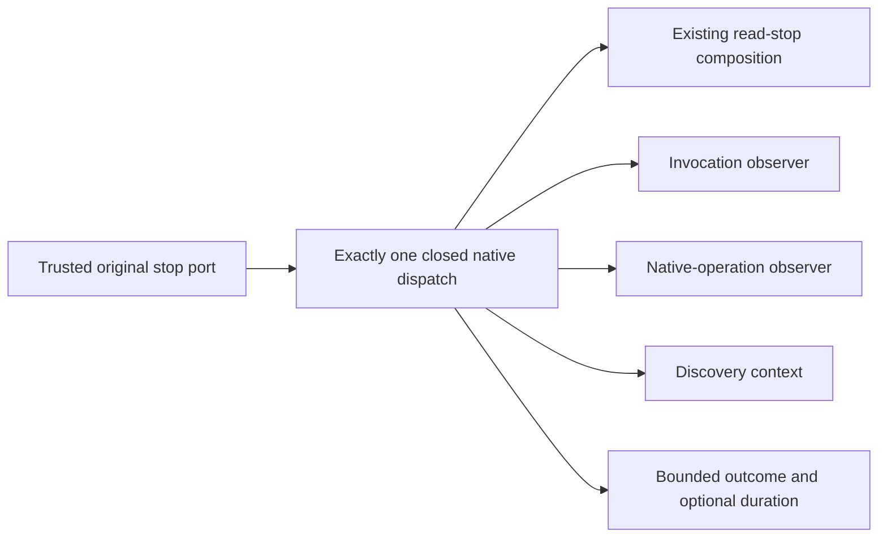

Native save observation now implements the source-save/annotation-save portion of
§23.1.11 over the actual shared writer-owned parents. A raw/export task, foreign
owner or mismatched original execution context cannot attach. No publication
invocation or execution-receipt selector is borrowed. The actual original task,
parent context and producer incarnation remain the target after edits. Returned
facts exclude source/annotation bodies, aliases, bindings, artifact/workflow state
and baseline adoption. Opaque native result tokens remain opaque; typed versions
retain their actual after epoch/token. Portable version/default acknowledgment
mapping is not qualified by this native projection: it reports the actual native
task's captured synchronization requirement and satisfies it only from retained
uncontested write knowledge, without strengthening provider guarantees.

Admission captures bounded original scope, projection policy and explicit limits;
publication must be false and recipient must match. Source and annotation evidence
disclosure are separate. Current policy intersects the ceiling at every query;
temporary ordinary capacity/receipt denial withholds data, while explicit original-
scope authorization/scope/continuity/liveness/retention loss closes observation
absorbingly. A grant cannot revive that context. Producer retirement invalidates
later queries, but observers add no producer pin and never restore execution.

Status and retained-outcome share an ordinary projection signature and progress
identity. Switching between them does not itself issue progress. Late application,
synchronization/version/conflict/disposition knowledge can change the permitted
ordinary signature. Minimal control uses a separate signature over stop/quiet bits,
at most four protected progress issuances and independently funded reply space.
Zero ordinary issuance, denied effect disclosure or a locally quarantined receipt
facility cannot reveal rich evidence through that protected path. Terminal means
stopped or producer-quiescent, not successful persistence or obligation discharge.
The no-future-effect attestation remains independent of known application.

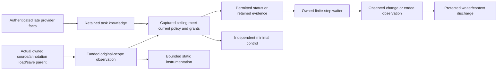

Each native waiter needs an owned ordinary progress reference, available prepaid
slot, positive finite budget and valid host-attested clock evidence. Poll compares
actual permitted state and proves no time progress. A strictly advancing tick in
the captured clock epoch consumes one remaining step; this is not elapsed wall
time, suspend behavior or a native timer guarantee. Invalid/regressing/foreign-
epoch clock evidence ends that wait. Stop/explicit expiry ends observation only.
Ended records occupy their slots until protected retirement; reused slots mint
new identities, never renew old handles. Busy ownership excludes recursive service
and retirement. Unwinding result-path panics/validation faults clear busy and quarantine the
context's receipt facility without faulting/stopping its producer; ordinary control
projection and protected minimal control remain independent.

The shared retention parent funds the fixed lifetime context inventory and each
whole child ceiling before exposure. Native logical demand follows
5R + 2C + 3X + (W+1)B + (I+4)N with checked arithmetic and actual minimum native
record/frame sizes. Context/policy strings, both ordinary/protected signatures,
save versions/read terminal evidence, references and wait slots remain bounded. Stop, issuance
exhaustion and scope loss refund nothing. Wait/context/pool retirement separately
requires actual emptiness and strict owner-control/retention/drain facts; pool
retirement is absorbing and context issuance never recycles. These private pools
are outside authored-root accounting and independently charged to the shared
retention budget, not a physical/RSS/wire-byte or concurrent/crash proof.

Actual pool/context issuance, live/fault/busy state, ordinary/protected references,
waiting/ended slots and declared-versus-reserved demand have trusted-owner gauges.
Bounded NativeOperationObservation configuration/admission/query/snapshot/result-
validation/wait/close/retirement markers contain no raw scope, handle, version or
body labels and invent no service time. Public typed/dynamic
F06 normalization/accepted-registry descriptions, generic publication receipt
facets, full event/shutdown and host/physical/concurrent qualification remain open.
Frozen formal artifacts/hashes are unchanged; this is native implementation evidence.

Installed Rust read admission/recovery now declares both F20 variants on the
existing scoped discovery /1 owner as EffectRequest operations. Exact private
installed origin, entry/variant/family/kind and current discovery release precede
the original source/annotation reader's native guards. The closed SDK request sum
preserves the distinct original native parent/child products and catalog capture
inside each original target. No shared replacement task, read buffer, parser,
executor, invocation issuer or activation path is added. Matching recovery after
edits or catalog withdrawal returns the same child without another read; changed
attempt and spent identities refuse. Existing native-operation observation
independently releases actual terminal evidence under current authority. EOF and
quiescence never imply source activation or annotation restoration; observer
retirement discharges only its own funding. The source/annotation × raw/catalog
× zero/one/available capture path preserves those semantics and private-label-free
diagnostics. Full F19/event and remaining C1/C2 qualification remain separate.

Native annotation-load operation parents now bind actual reader tasks to immutable
origin/context, source/set, annotation/source writer associations and a separately
registered reader. Matching authorized recovery is metadata-only and spends no
new issuance; changed intent refuses. Raw tasks cannot be adopted. Guarded ordinary,
superseded and disposed read retirement tombstone the co-owned parent only after
their actual capture/provenance/quiescence duties discharge. The origin stays spent.
A shared-retention reservation funds bounded lifetime inventory and native read
ceiling before exposure; admission fencing alone refunds nothing and suppresses
no late producer evidence. Final protected sponsorship retirement requires all
actual reads and held bytes drained and irreversibly closes that namespace.
Static optional markers and trusted-owner gauges carry no private labels. This
implements annotation-load admission/recovery; the shared observation lifecycle
also admits these actual owned readers. Its closed native receipt sum separates
save knowledge from annotation-load phase/control/conflict/refusal/counts and at
most two original end/failure witnesses. Only terminal metadata is projected:
chunk-conflict bodies, restoration and baseline results never enter receipts.
Original coherence and opaque versions remain lossless; portable mapping remains
unqualified. Read/annotation disclosure replaces, rather than borrows, save
disposition/source disclosure. Shared bounds include fixed read receipt overhead
and two validator envelopes. Context-local receipt fault quarantine preserves
minimal control and the producer. This annotation branch does not substitute for
source-load observation, public portable codecs or complete F06/F17 assembly.
Frozen formal artifacts and hashes are unchanged.

The native source reader now has its own ready/submitted task lifecycle, not an
annotation-reader alias. SourceReaderLimitsV1 bounds live/lifetime slots, total
input, chunks and held/store bytes; shared retention funds the complete pending
ceiling and lifetime inventory before exposure. Original-provider dispatch and
nonce authenticate intake independently of later permission/root faults. Source
and annotation inventories stay separate; all read/write workers share the
existing maxOutstanding ceiling and aggregate outstanding gauge.

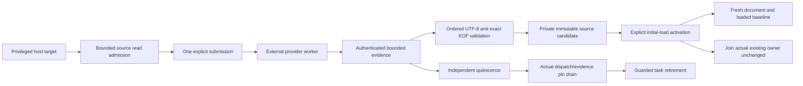

Typed epoch/token versions are never inferred from opaque tokens. Split signatures
and scalars, original line breaks and prose/code bytes remain lossless. Invalid
UTF-8 prefixes or incomplete EOF refuse without publication. End/candidate success
is not activation or quiescence. Initial activation composes existing load_resource
ownership/baseline rules; an existing dirty owner is joined, not replaced. Stored
activation remembers the actual writer association, which may differ from the
reader registration. Re-observation revalidates that association. Stop, evidence,
retirement and global sponsorship retirement have separate guards; stopped or
retired live work does not recycle lifetime slots or refund the pool ceiling.
Optional bounded SourceRead markers and owner gauges carry no private labels.
Atomic-resource-snapshot remains explicitly unsupported, never downgraded.
Source-load owned-parent retry and observation now compose this actual reader.
The issuer privately binds the complete native request and seven-field original
scope before one atomic parent/child installation. Matching release is metadata
recovery, not submission, candidate decoding, activation or result replay. Four
fresh launch facts do not replace the ten strict current release facts. Recovery
can survive an admission fence/root fault without resetting work. Labeled raw
origin history refuses adoption; unlabeled native tasks are never retrospectively
attached. Parent/child consistency and bounded origin/capsule projections are
checked before fresh issuance or retirement. Actual task retirement atomically
spends its parent, preserving the source origin independently of payload debt.
Its separately funded lifetime registry uses two maxCaptureBytes envelopes per
source lifetime slot plus native headers. Neither child retirement nor zero held
work returns that sponsorship. Only protected actual global drain closes it,
before the underlying reader sponsorship can retire.

The observation target/receipt sum now covers all four actual native kinds.
Source-load receipts expose only original safe end/failure metadata, counts and
native phase/control/refusal/conflict facts—no candidate, activation or baseline
results and no chunk witnesses. Opaque versions remain opaque; typed versions
preserve epoch and token. A source reply envelope funds two complete typed end
witnesses (four validator fields), unlike the two-field save/annotation branch.
Original scope, policy ceilings, current source read/disclosure grants, protected
minimal control, signature progress, finite-step waits and actual discharge all
use the same kernel. Observers acquire no producer pin; local malformed-result
or unwind faults quarantine only receipt delivery. Source-load recipient/portable
F20/F17/F06 schemas, default acknowledgment/opaque-version mapping, filesystem
worker integration, replacement/reload and complete event/shutdown remain open.
Frozen formal artifacts/hashes are unchanged; no new formal refinement is claimed.

Native dependency-aware history reversal now retains an original group or expected
source/annotation frontier, direction and canonical V3 read conjunction in the
existing invocation ledger. Only first admission resolves a frontier, requiring
the expected group; retries compare original target kind and complete read meaning
without refreshing it. The service guard requires a reversal plan with the same
group/direction and exact declared reads, preventing reclassification as an
ordinary edit. Existing final read/history validation precedes atomic linked
source/annotation publication. Stop and retained outcomes use the existing ledger;
diagnostics reuse bounded admission/replay, read preparation/validation, history
preparation, execution and publication boundaries. No callbacks, I/O, new writer,
recipient authority, wire contract or accepted-registry row is introduced. Native
tests establish these bounded owner-API behaviors, not full F14 refinement or
formal proof; frozen formal artifacts/hashes are unchanged.

Native F06 input binding now has explicit context-owned decoder activation.
Typed family index 5 and dynamic inspect-execution select the same existing
version-one status, minimal-control-status, retained-outcome and bounded-wait
forms. The native envelope separates ordinary inert data from borrowed original
task/context/progress roles. Canonical shadows replace those roles with null;
no handle is traversed, serialized or promoted into authority. Complete request,
actor and canonical products have independent byte/node/depth admission. Before
native release, exact original context, task kind, profile and receipt facet must
match. A wrongly targeted loss packet cannot close the original observer.

Explicit decoder enablement funds eight maximum input frames plus native state/
attachment bookkeeping once in actual shared retention. The existing observation
pool retains its native context/admission ownership; no query creates another
context, workspace or consumed admission step. Current policy/facts are privately
bounded before fixed native dispatch. Native u64 policy epochs retain all bits
through a fixed-width internal measurement shadow, not a public wire epoch codec.
Decoder busy ownership and an internal native handoff exclude recursive service
and context retirement. Expected input/permission refusal does not quarantine;
unexpected decoder faults quarantine only decoding, preserving native protected
control and producer responsibility. Native receipt-path faults remain receipt-
local instead. Fault/stop/scope loss refunds nothing. Actual native waiter drain
and protected context retirement discharge decoder and native reservations.
Static argument-normalization/decoder configuration/query markers and trusted-owner
workspace gauges include no private data. All four kinds/four forms/both routes
execute through this native gateway; no provider dispatch or publication is added.
This is not complete accepted-registry metadata/standard schemas, portable result
projection, the normalized admission-pool refinement, hostile/wire ingress or
F19/F18 composition. Frozen formal artifacts/hashes remain unchanged.

The native resource owner now also owns an optional declarative read/write catalog,
separate from its existing immutable provider/encoder/restorer ports. Its closed
typed products preserve provider/resource identities, locator versus identity key,
explicit Boolean declarations, the two selected read profiles and complete writer
capabilities. It does not infer actual provider truth or invoke a procedure name.
Known initial rows seed one owner-wide floor. Install/remove batches bind explicit
expectations; changed installs share floor + 1, removal cannot lower it, and zero
remains a valid present stamp. An owned non-cloneable certificate binds complete
request/profile, original owner/root/floor and predicted candidate/result. Fresh
strict facts, exact root identity and full reconstruction precede one synchronous
root/floor/publication transition; no callback, I/O or binding activation intervenes.
Unchanged success keeps the exact catalog root and clock. Current root accounting
includes catalog headers/rows/payload; root identity includes its original marker,
profile and floor, including nonpublication bootstrap. Per-attempt native staging
bounds are not a global caller-owned plan budget. Optional bounded configuration/
preparation/validation/publication/query diagnostics and local timing observe these
actual paths without identity-valued labels. Native tests frame source/history and
existing producer work. Owned native registration jobs now retain complete ordered
request/context/profile and the original invocation identity in the same ledger.
First admission validates and discards its prediction; service re-prepares against
current metadata, preserving unrelated edits and selecting the then-current shared
stamp. Same-slot stale expectations become retained rejection; replay never refreshes
the bound request or executes again. The native primitive now stages an infallible
publication product, letting catalog root/floor and the sealed terminal outcome
install under one exclusive local guard. An unexpected unwind returns Faulted and
preserves Running/unknown, including after publication; it is not crash atomicity
or a rollback/retry promise. Protected stop binds original owner/context/ticket and
needs no continuing registration rights. Typed retained-result delivery checks its
immutable original capture/value seal, captured result ceiling, fresh full context/
permissions and independent native byte bounds. Native owner-wide stamps remain
trusted-host-only, not recipient-safe public identifiers. Real once-only admission/
terminal counters and optional bounded service/result timing cover the path.
Native conditional registration bases now bind the same coordinator, complete
eight-field recipient/policy scope, exact native profile and typed slot. Present
bases retain the full row (including generation zero); replacements/ABA stale them.
Absence is a current predicate, so absent → present → absent may become current
again. Unrelated valid edits do not stale a basis. Every current capture/inspection/
resolution rechecks separate basis/presence/equality/slot grants, profile meaning,
actual catalog validity and root bounds. Ordinary replies disclose no native fields;
the explicitly host-only resolver returns bounded copies under an additional grant,
not a commit certificate. Active equal recapture reuses its opaque handle. The
separately sponsored finite pool bounds active and lifetime issuance; protected
retirement works without content rights or healthy domain, does not refund issuance,
and permanently closes the issuer after discharge. Basis lifecycle changes frame
authored root identity, revisions and provider work. Optional content-free timed
capture/inspection/host-resolution/retirement boundaries observe the actual path.
The native typed scoped adapter now retains the original issuer marker, complete
basis scope, original opaque-reference array and exact index permutation in the
existing registration capture. Its original actions/configurations share the
immutable normalized request rather than forming a second contradictory copy.
Repeated scoped preparation rechecks current native/basis facts before comparing
original meaning; it cannot refresh references or normalize away a changed mapping.
Service re-resolves the full rows/conditions before preparing and again after
native staging, with no callback or I/O before the common guarded publication.
Even an empty batch needs the actual current issuer/root/profile. Protected stop
requires original context/scope identity but not continuing edit/basis rights.
Scoped retained results verify original capture/value seal and current issuer/
scope/permissions, not the historical row predicates. They contain only issued
invocation correlation, applied/unchanged and submitted index/present-or-absent
pairs in change order. Native result and scoped result/service routes refuse the
other plan flavor. Forget/retire does not retire shared bases or refund issuance.
Actual optional timed preparation/validation/result observations and once-only
invocation cohorts cover this adapter, including disabled/saturated capture.
The passive native scoped envelope now validates exact outer constants/fields and
an original borrowed invocation role, then copies inert request data with explicit
byte/node/depth bounds. Its closed change/configuration schema preserves strict-
UTF8 line endings, annotation profiles and every explicit writer Boolean. It rejects
extra/duplicate/null shadows, unknown profiles/actions and unsafe/coercing basis
numbers; ordered basis indices remain a complete permutation. Schema preflight and
joint inert/typed envelope bounds precede typed output allocation. Normalization
retains no copied authority, context, policy or native row identity. Actual native
basis references are supplied separately at submission; fresh common admission
checks still govern issuer/scope/profile/conditions and immutable invocation intent.
Optional content-free timed normalization/decoded-admission observations distinguish
parser refusal from real job admission. Captured output and workspace costs are
native logical envelopes, not wire bytes, allocator/RSS or global sponsorship.
The native registration envelope now has passive Rust normalization alongside the
scoped envelope: exact native constants and original borrowed invocation role,
complete ordered table/provider/resource/expectation/configuration changes, exact
safe natural identity/stamp fields, explicit absent versus present-zero, duplicate
slot and wrong-table rejection. It shares the existing closed configuration parser;
all Boolean/profile/line-break meanings survive unchanged. Bounded inert capture
and joint inert/typed logical preflight precede typed output allocation. Normalized
data grants no authority or actual-root promise; decoded admission checks the
native profile and delegates to the original typed job/currentness/replay guards.
Optional bounded normalization/decoded-admission observations support native timing.
This is already-decoded host data, not an opaque-role wire codec or /2 enablement.
Native/scoped serialization also have passive Rust value adapters. Exact outer
schemas keep original invocation/document/dependency roles separate from inert
data; the scoped basis remains separately supplied. Closed format/Boolean and safe
positive generation validation precede typed output allocation. Joint inert/typed
workspace bounds exclude borrowed referent storage explicitly. Decoded admission
rechecks native/execution profiles and delegates to the existing job and authority
guards, including scoped basis currentness and original-intent replay. Optional
bounded normalization/admission timing records no content or opaque identities.
Scoped ordinary settings now has its six-field passive Rust adapter, preserving
original invocation/dependency roles and separately supplied basis handles. Exact
indexed set/remove/reset schemas, null-only non-set values and duplicate key/index
guards precede iterative typed value conversion. Joint inert/output/conversion
workspace bounds are distinct from native set-value node/depth and retained-plan
limits. Decoded submission checks captured native/execution profiles, then delegates
all basis validation, loss ordering, current rights, service and replay to the
existing conditional job. Optional bounded timed observations cover the actual
normalization/admission path. No UI, provider resolution or wire authority is added.
Scoped layer lifecycle now has the passive eight-field Rust adapter. Original
invocation/dependency roles stay borrowed and the lifecycle basis remains separately
supplied. Exact creation/contribution, removal-identity and target-reference schemas
are validated before typed allocation, including safe indices, duplicate full
members and shadow rejection. Equal creation labels remain legal distinct proposed
incarnations. The same iterative inert-value converter and joint logical workspace
rules apply; native candidate/value/root/plan bounds remain existing handler checks.
Decoded admission checks both native profiles and execution profile before the
original conditional job. Actual service grants, source framing and once-only
allocation/replay remain unchanged. Timed optional observations contain no values
or identities; this is not wire role decoding or discovery /2 enablement.
Scoped definition activation now has its passive six-field Rust adapter, including
the closed Boolean/integer/text/enum/list/map type forms and complete schema,
restriction and target-association proposal. Iterative type/value conversion has
independent inert and joint output/workspace bounds; original invocation/dependency
roles remain borrowed and the definition basis stays separate. Decoded admission
checks activation/definition/execution profiles before the original conditional job.
Native schema compatibility, authored-value preservation, candidate/root/plan bounds,
loss ordering and current changed-facet grants remain native compiler/job checks.
Optional content-free timed diagnostics cover refusal, admission and replay without
becoming effect evidence. This adds no schema VM, provider resolution or wire role
codec. Existing privileged native settings ports are not promoted to recipient-safe
facades merely by attaching inert envelope descriptions.
Native ordinary settings now has a context-bearing Rust path behind its passive
six-field envelope. It uses the existing configured settings-context vocabulary,
ordinary current host facts and complete native layer-write grants, without issuing
or requiring a conditional layer basis. The same ledger retains owner/context,
immutable native request, caller/required/combined reads and original preparation
identity; current required sets, rights and actual settings dependencies are checked
again before the existing root/outcome publisher. Generic service cannot bypass
fresh facts, and legacy/scoped/native intents cannot reinterpret a ticket.
Protected context control can request stop without edit rights; actual service
settles it separately. A weak preparation-identity seal retains no old settings
root after settlement. Broken provenance/aliasing stays Running/unknown under the
owner fault fence, including interruption after installation. Native parent and
plan limits cover the complete capture/preparation wrapper. Optional bounded
normalization/admission/validation/publication and common execution observations
contain no caller context, keys or values. Legacy trusted-owner ports remain
privileged; no new operation family, provider effect, UI or execution runtime is added.
Native definition activation now reuses the same sealed native carrier with a
closed definition participant branch, not a parallel cancellation/dependency
implementation. Its seven-field envelope carries explicit positive-safe schema/
restriction/association epochs and uses the same iterative declaration codec as
the scoped definition path. Captured native request/preparation variants are
boxed with complete enum/payload accounting; enum headers are preflighted before
native payload capture. Current context/profile and changed-facet grants are
checked at admission/service. Required reads, original preparation identity,
protected stop, unknown fencing and the existing root/outcome publisher remain
shared; value/definition/raw/scoped tickets cannot be reinterpreted. Weak identity
retains no old settings snapshot after settlement. Optional bounded timed native
definition normalization/decoded admission adds no raw epochs, identities or values
to diagnostics. This is native engine behavior, not a new job family, schema VM,
provider effect, recipient outcome-disclosure promise or discovery /2 enablement.
All ten specified F16 inner argument declarations now drive their actual decoder
header guards (exact fields, contract and operation). Their shared field guard
preflights cardinality and performs only fixed-declaration bounded scans without
allocation. Normalized products expose those same static descriptions, and each
owning type supplies a private declaration constant for later registry assembly.
The original native-settings description name remains a compatibility alias.
Nested native validation, original borrowed invocation/document/dependency roles,
separate conditional bases and current execution authority remain separate.
The native context descriptor capture now derives the two fixed F16 variants'
ten disjoint outer-schema branches from those declarations, including registration
profile constants and the positive-safe serialization epoch representation.
It supplies input/outcomes/requirements/limits/cancellation as bounded inert data,
with explicit outer-only and non-authority qualifications. Fixed local workspace
feeds the existing budgeted capture; no caller registry, evaluator, external callback,
reference loading or coordinator state access is introduced. Optional
ContextDeclarationCapture observations time the actual source/copy success or
refusal without metadata labels. These descriptive schemas do not validate
native opaque handles or nested values. Full result products, later registry
profiles and all-family integration remain separate. The preceding broader batch
does not qualify these later edits.
Discovery ingestion now recognizes input descriptions from the already bounded
five-facet capture, before installing a retained row. The legacy /1 shape is
unchanged. A private finite /2 grammar recognizes exact outer schema branches,
required/property equality, disjoint contract constants and the closed field/type
vocabulary, without recursion, allocation, schema execution, refs or loading.
It is selected only by explicit /2 scope; /1 interpretation is unchanged.
DiscoverySchemaRecognition times only that actual
bounded recognition step (not ingestion wait or capture); diagnostics never
select acceptance. The existing owner now supports both /1 and /2 with one
authority/engine, parent reservation, packet/context/selector capacities and
monotonic lifetime issuance. It stores no selected profile mode: full profile
belongs to each cut/context/query. Idempotent configuration from either supported
profile cannot reset ownership, funding or issuance. The /1 source is still
exactly F13/F14; /2's fixed source adds the existing F16 descriptor. Private
BuiltinV1/BuiltinV2 origin must match its captured profile and current cut before
loss effects, consumption or release. Generic metadata retains its external
truth premise and cannot impersonate either built-in origin.

The /2 source privately hands borrowed fixed descriptors directly into existing
bounded capture, avoiding an intermediate allocated schema tree. Complete nested
legacy/context staging is conservatively prepaid, with the existing logical/
physical-accounting distinction. Visibility, current authority, target/advice,
capture/current intersection, original selectors, root freshness and protected
retirement remain independent shared guards. Source preparation/inspection and
finite recognition retain optional bounded content-free timing; no transport,
effect dispatch, authored generation, UI preference or general schema evaluator
is introduced. Later source profiles, complete nested/result codecs and physical/
performance qualification are not implied by this selected integration.

For /3 ordinary-edit discovery, actual envelope correspondence precedes metadata
advertisement. The first native passive adapter now owns the selection-edit/1
ordinary-edit declaration used by its ten-field header guard, with the fixed
explicit-positional-selection/1 profile and mapped/carets-after vocabulary. The
invocation/view/document roles are borrowed opaque native values. The complete
original LogicalViewContext is a separate native binding argument; header roles,
source revision and expected selection must match it, never a fresh view lookup.
This does not assign a public identity encoding or invent missing view stamps.
Safe-natural numeric fields include zero and refuse unsafe/nonintegral numbers;
wider trusted-native counters keep their separate existing entry point.

The accepted data is flat/scalar. Text and complete normalized-header byte bounds
are checked before a single literal copy; no schema/inert tree is materialized.
Borrowed role referents, caller ingress, allocator/stack/RSS and later native job/
source preparation remain separately accounted. Malformed nested values are
rejected without walking them. Redacted Debug and content-free optional actual
normalization/decoded-admission timing preserve the existing capture-off/full
behavior. The adapter delegates to the original literal job: no new invocation
kind, phase, preparation, authority path, companion publisher, history model, UI
gesture or external effect. Replay keeps original intent; stale contexts and
changed write policy cannot be repaired by normalization. Empty literal deletion,
mixed prose/code/newlines, equal-byte mapped identity and caret-only publication
retain their existing semantics. Other envelopes and the complete /3 source are
separate obligations; /3 is not enabled by this adapter alone.

The second /3 native envelope now implements line-edit/1 ordinary-edit with its
own decoder-owned ten-field declaration and explicit-prefix-line-edit/1 profile.
It reuses the original view/invocation/document binding guard; the native role
value type is shared by alias without extending its closed variants. Exact
two-field settings accept only indent-lines/outdent-lines with a nonempty ASCII
space unit or one tab and positive safe native-sized tabWidth, or insert-newline
with explicit LF/CRLF/CR and none/copy-prefix. Nested or unknown settings refuse,
never invoking a provider, grammar, platform default, UI gesture or callback.

Explicit argument unit/owned-header bounds precede the bounded unit scan/copy.
Prefix normalization copies one unit, while newline normalization needs no unit
allocation; no schema tree is built. Native line work limits/current permissions
remain authoritative at original preparation/publication, not inferred from
normalization. Decoded admission uses the existing retained line job, exact intent
replay and complete source/view/history publisher. Optional LineArgumentNormalization
and LineDecodedAdmission timing observes actual success/refusal and respects
off/full capture. Shared literal binding behavior remains unchanged. This closes
two of four /3 envelopes; configured-line, boundary and complete /3 discovery are
still required at that checkpoint. Physical/latency qualification and result
disclosure stay separate.

The third /3 envelope now implements configured-line-edit/1 ordinary-edit with
the fixed configured-prefix-line/1 profile and its actual ten-field declaration.
A separate closed native value enum carries a typed configuration object: a real
borrowed SettingsTargetId and inert key-role data. This is not an ordinary target
label/JSON identity resolver. A fixed private ten-field projection reuses the
same original view-role/header guard; configuration itself is validated by its
own owning decoder, not inferred from placeholder/common header data.

Configuration keys have exactly unit/tabWidth or delimiter/autoIndent according
to the closed action, with two nonempty key names. Explicit per-key and combined
owned-byte bounds are checked before copying either. The normalized request
clones only the namespace/slot target token and owns the two names: no compiled
settings read, schema lookup, provider call, interpretation issuance or retained
settings root. Stack projection/caller/allocator/RSS and subsequent native
preparation/lease charges remain separate from logical normalized storage.
Representational success does not establish target ownership, source-domain key
availability/types, current footprint or authority. The original configured job
still resolves and retains its actual interpretation, checks service currentness,
publishes complete companions/history and releases through protected retirement.
Optional ConfiguredLineArgumentNormalization/ConfiguredLineDecodedAdmission
service records are content-free and cannot select outcomes under saturation.
At that checkpoint this closed 3/4 /3 envelopes; source/grammar integration was
still separate.

The fourth /3 envelope now implements boundary-command/1 ordinary-edit under
unicode-logical-edit/1. Its own thirteen-field declaration drives the actual
decoder; the separate exhaustive value enum carries a real borrowed
BoundaryEvidenceId. A fixed stack projection reuses original view/source/
invocation binding, with no table lookup, copy, segmentation or provider call.
Only grapheme/word-start/word-end, forward/backward, positive safe native-sized
count and the literal Boolean false for extend are accepted. F12 movement and
visual/page/UI units are not advertised by this ordinary-deletion adapter.

The normalized record is fixed-size borrowed roles plus the native command;
its explicit owned-header bound excludes referents, ingress, stack/RSS and later
native preparation. Representation does not establish evidence ownership,
liveness, freshness, semantic segmentation truth, native work capacity or write
authority. Decoded admission invokes the existing Unicode deletion job, retaining
the original evidence/intent for replay and current publication validation.
Retired evidence cannot be reacquired on matching terminal replay; foreign/
retired evidence, native count excess and service write-policy loss still refuse.
Actual BoundaryEditArgumentNormalization/BoundaryEditDecodedAdmission timing is
optional and content-free; off/full capture cannot select results. The existing
shared native admission/terminal measurement hooks remain in the original job.
All four /3 envelope paths now supply the exact source described below. Those
adapters alone establish no provider-conformance or whole-engine proof.

The explicit owned-contract-discovery/3 source now appends one F11 ordinary-edit
row after the identical F13/F14/F16 prefix, using the same owner, parent funding,
contexts/selectors and nonrefunding lifetime issuance as /1 and /2. Each full
scope and private BuiltinV3 origin must match before release or loss effects;
generic lookalikes cannot replace it. Default /1 and each earlier source retain
their original rows and strict interpretation. No new command, execution mode,
source generation, effect, UI binding or executable handler registration follows.

The four ordinary outer-schema branches derive contract/operation/fields/profile
from the actual normalized types' declarations and constants. The other four
facets retain qualified local terminal forms, runtime/current predicates and
non-establishment limits, owning resource profiles and prepublication stopping
semantics. These are inert outer descriptions, not nested/Rust identity codecs,
authority, native work availability, segmentation truth or result-disclosure grants.

For the /3 ordinary metadata product, exact finite recognition precedes generic
schema fallback. A structurally valid F16 schema cannot substitute for it. A
fixed 32-pair frontier compares the already bounded native capture against the
known declaration without recursion, heap staging, callbacks, references or
loading; object member order is irrelevant, required/branch arrays remain exact.
The source and simultaneous expected-schema/matcher workspace are conservatively
included in the shared declared logical charge. An old 256-KiB private test
fixture no longer funded that charge and now declares 512 KiB; production has
no new default and still refuses insufficient funding. This is not physical
stack/RSS accounting. Existing actual source-preparation and finite-recognition
timing observes success/refusal with off/saturated behavior unchanged. Capture/
current schema ceilings, current authority, target/advice, root freshness and
protected cleanup remain independent. Later profiles, full facade/result/event
assembly and physical/latency/overhead qualification remain required.

The passive Rust literal-search argument boundary preserves the accepted nine
fields for literal-matches, next-match and previous-match. One shared declaration
drives each actual header guard; nested reference/scope/navigation field sets
also drive their exact guards. It retains the original opaque read-context and
actor by borrow, separately from the caller's logical reference. The reference
cannot mint native document identity or authenticate correspondence. Unsupported
nonempty matching profiles, caller generation, UTF-8 query bytes, empty scopes,
scope order and navigation survive normalization without lookup or evaluation.
Explicit logical header/string/range budgets and checked arithmetic precede
owned copying; optional actual service timing records only boundary/disposition.
There is no conversion that discards these fields to fit the older native search
request. Native binding, exact requested reply products and the /4 discovery
source remain open; this boundary does not enable /4 or claim physical performance,
full search-contract refinement or a new frozen formal proof.

The existing native retained-search owner separately measures configuration,
evaluation, release, occurrence resolution, navigation and both result/pool
retirement bodies with optional local process-monotonic service spans. Wrappers
delegate to the same measured owner; nested validation/hold markers do not receive
invented durations. Complete/partial/refused/unknown classification, original
scope/authority checks, protected discharge, holds and nonrefunding issuance stay
unchanged under off/available/saturated capture. Spans may overlap enclosing
facade durations; they are not exclusive CPU time, queue waits, recipient delivery,
independent population coverage, a numeric performance SLO or `/4` enablement.

Managed-search result pressure is now an exact private live/stopped-row gauge,
updated at the three closed row transitions: installation, first absorbing query
loss and protected removal. Hot capacity admission and usage projection no longer
scan lifetime tombstones; issuance stays nonrefunding and identities are not reused.
Checked arithmetic/bounds fault conservatively before releasing an unaccounted
hold. Protected pool retirement still reconciles the actual row inventory before
removing its reservation. The larger native pool header remains prepaid. These
representation invariants add neither authority nor a telemetry recipient grant;
other inventories may still scan and no new physical/latency/formal proof follows.

The passive native F13 authoring guard now consumes the actual mutation owner's
four field/operation declarations, rather than maintaining a second schema. It
retains original opaque invocation/document/dependency roles, validates annotation
and target owner-document agreement, copies bounded scalar body/profile text and
preserves full-width typed native versions and complete native targets (including
both point profiles and original source/basis). Inert numbers/decimal strings do
not become live version roles. It performs no registry/source/profile/dependency
lookup, fresh annotation allocation, preparation, execution or receipt release.
Requested profile and dependency identity are not silently discarded to fit a
legacy mutation call. The passive guard itself supplies neither execution nor
recipient authority, wire codecs or discovery enablement. The separate scoped
native handoff described below now owns context/profile/limit capture and original
allocation. The optional `AnnotationAuthoringArgumentNormalization` service
span is distinct from the existing annotation-query guard and carries no values.

The scoped F13 native invocation path retains one original prepared annotation
under the original ticket, with an exact shared-ledger reservation and private
owner/plan/read seal. Admission requires configured annotation/history/root bounds,
explicit execution limits and strict host-attested context/permission/currentness
facts. It reserves native logical units before preparation: `3C + 2M + 2R +
2*max(0,N-M)`, where C is capture capacity, M parent intent capacity, R root ceiling
and N construction capacity. This is not a JSON-byte, RSS or physical peak proof.
Profile labels select host-attested meaning; they do not authenticate an issuer.
No source-write grant, new storage owner, callback, grammar or UI is introduced.

Equivalent admission retries reuse allocation/plan/hold. Service rechecks actual
funding, original native configuration, exact preparation seal, current read
conjunction and fresh strict host facts before the common publisher. Known
refusals are retained once; protocol faults fence the owner and remain unknown.
Protected stop intent is not settlement, forget is not discharge, and raw ticket
retirement cannot bypass the hold. Protected retirement requires original context
and explicit control/release/drain facts, releases only its own reservation once,
and retains a lifetime tombstone. Faulted pending payload discharge preserves
`AnnotationFaulted` uncertainty rather than inventing execution or a clean result.
The pending-age population conservatively leaves that phase unclassified; the
unknown census includes it without claiming physical execution.

Optional bounded content-free admission/service/retirement timing uses actual
endpoints and existing invocation outcome cohorts. A completed service attempt
may contain a rejection, no-op or stop; it is not a publication-success metric.
Atomic annotation receipts and actual F06 observation assembly remain open;
the coarse native outcome getter is privileged, not recipient-authorized delivery.
This implements native scoped execution, not the whole §14.6.2 facade contract,
all-family discovery, physical-performance qualification or a new formal proof.

The native invocation ledger now additionally owns an optional original policy
capture on the issued ticket, before producer admission. A trusted host supplies
complete context and the original finite policy/epoch; the metadata-only profile
rejects unsupported detail disclosure rather than downgrading it. The shared
retention ledger funds its bounded native headers/copied labels before copying.
Repeated identical binding reuses capture/funding, while late binding, changed
meaning and post-discharge rebinding refuse. Ordinary producer execution remains
separate and does not derive mutation authority from this observation policy.
Forget does not release it, raw ticket retirement cannot bypass it, and private
capture users prevent protected release. Discharge can release the policy after
actual producer interruption without making that producer terminal or replayable.
No second public reference issuer, new operation family, callback or worker is
introduced. Optional actual bind/usage/retirement timing has no context labels.
That original-policy role alone is not an observation context or a validated
outcome/wait/facet profile.
Its declared result ceiling is metadata, not funding of arbitrary retained coarse
payloads. Original/current scope/policy validation and complete reply/reference/
wait funding still precede any future observer exposure. Host authentication and
grant truth, full populations, operational/physical qualification and independent
or frozen formal refinement are not claimed by these Rust tests.

The native F06 path now also owns an explicitly retained host observation context
over the actual original capture and independently bound invocation. Its complete
declared local envelope is reserved before copying; actual scoped-producer context
is checked where present. Protected status reads only admitted pending/terminal
phase and policy metadata, never the retained outcome payload. Two preallocated
control identities are independent of ordinary issuance: unchanged phase and
forgetting outcome data do not issue a new one. Original/captured/current control
permission and current exact facts gate release. Unknown/mismatched inputs refuse
without invalidating a real context; explicit authority loss closes it absorbingly.
Foreign owners cannot poison it. Private ticket/funding substitution faults without
disclosure/refund. Publication interruption remains Unknown after cleanup.

Protected close affects only this observer; protected retirement frees only its
actual hold and drops the original-policy attachment. The producer is never run,
stopped, forgotten, settled or retired by these transitions. Actual admission,
control read, close and retirement emit optional bounded content-free timing.
That protected facet alone does not supply ordinary outcomes, receipt facets,
references/waits, decoding/discovery or public acquisition. Native
host retention/registry/drain remains a premise;
dropping an unretired handle does not refund its parent reservation. Complete
registry/shutdown reconciliation and physical/performance qualification remain.

The same native context now supports ordinary status/retained-outcome through a
fixed-size local-command projection. Admission validates complete native result,
reply and reference bounds. All publication/control/effect/recovery fields meet
original, captured and current rights; native public causes remain absent and
details are withheld. Raw private errors, participants and correlation never enter
this projection. One pure exhaustive terminal classifier supplies semantic facts
to both projection and measurement; projection reads no diagnostic state. Known
local effects remain distinct from external provider acknowledgments.

Ordinary progress uses one context origin plus a bounded monotone lifetime index,
with no per-query heap allocation or lifetime-tombstone scan. Its signature is the
permitted phase/outcome only: identical status/outcome projections reuse reference,
unrelated publication does not advance it, and forgotten facts are not invented
nonpublication. Ordinary refusal/exhaustion does not consume protected references.
Explicit authority loss remains absorbing; unknown facts and transient readiness
loss do not poison a context. Actual ordinary query timing adds no content/context
labels. Remaining receipt families, codecs/discovery and complete registry/
shutdown recovery remain open; static work bounds are not measured latency proof.

Native F06 contexts now own prepaid wait rows with independently validated native
record/reply bounds. Admission uses only issued ordinary references from the same
context and original/captured/current control permission, with exact capacity,
clock and retention facts. A wait identity binds context origin, bounded slot and
fresh row marker. Reuse cannot revive an old handle. Normal poll/tick service has
constant row lookup; admission, closure and inventory scan only configured capacity.

The closed service vocabulary is poll, tick, expire and stop. Poll samples actual
permitted status without executing work or spending rank. A same-epoch strictly
newer valid logical tick decreases remaining positive rank by one, ending at zero;
invalid clock service ends unavailable. Termination is conditional on valid tick
service or another end event, not guaranteed by an unbounded poll-only sequence.
No elapsed-time, fairness, timer or native-clock truth follows from this rank.

Observed change/terminal delivery, ordinary refusal/exhaustion or protected stop/
expiry ends one wait. Explicit authority loss or observer closure ends all waits.
Foreign context/identity cannot consume eligibility. Ended rows remain retained
until separate protected delivery/retention discharge; parent context retirement
cannot bypass them. No event runs, stops, settles, forgets or retires the producer.
Optional actual wait endpoint timing and trusted retained/waiting gauges expose
no context, references or content. Global registry/drain ownership, operation
receipt families, codecs/discovery and operational/physical qualification remain open.

The native F06 context now also captures immutable receipt-family ceilings and an
independent absorbing receipt-fault state under the existing funded context frame.
Its typed retained-outcome facet dispatches only to six existing native getters:
annotation, reversal, relation, host registration, scoped registration and created
settings. Separate current receipt permission, the publication-rights meet and
exact context/epoch precede native grant/provenance/currentness/lifetime checks.
Coarse details permission cannot install or widen a receipt ceiling.

Admission validates complete wrapper/payload bounds, applicable original native
registration maxima and created-reference frame size before exposing the context.
Native copy/allocation ceilings are clipped, never widened. Created settings keep
their existing borrowed result and opaque references; borrowing does not waive
frame funding or create write authority. Returned tickets must match the actual
observer invocation. Host registration remains a trusted-host metadata role,
whereas scoped registration retains current issuer/scope and opaque basis meaning.

No receipt query executes/replays work or issues an ordinary reference. Native
receipt integrity failure disables only that receipt facility, preserving producer
facts, holds and protected status; common context faults still close the observer.
Atomic-annotation/document-lifecycle facets remain unsupported at admission, with
no placeholder outputs or cross-family fallback. Extending the exhaustive native
output vocabulary needs an explicit API/version decision. Inclusive optional
admission/release timing contains no content/context labels. Full public codecs,
discovery, remaining producers, registry/shutdown and physical qualification remain.

Native scoped execution now also stages its private original decision receipt
inside the actual common publisher, after fallible root/history validation and
before root installation (including the no-op exit). Applied receipts bind the
original invocation as publication anchor; unchanged receipts have no publication
anchor. Both retain only operation, opaque annotation identity, historical
membership and resulting content/target versions. Independent field changes
merged since preparation are reflected in the staged result; later rows are never
queried to reconstruct an old result. Body, target, placement, source snapshots and
authority-wide counters are absent. The existing capture ceiling now includes the
hold/inline receipt header; no new funding pool or implicit capacity is added.
The serialized terminal boundary retains this receipt alongside the coarse result.
Known refusal/stop retains only not-published; pending/faulted work has no decision.
Forgetting clears both products, while protected retirement releases their hold.
Original-ticket/seal mismatch refuses receipt staging before any root install.
The optional `AnnotationDecisionStaging` span covers this actual private path;
diagnostic saturation changes neither receipt nor publication. This is producer
implementation evidence, not by itself recipient delivery. The separate native
filtered facet below now adds copied ceilings/current release and a fixed native
frame; F06 ownership and public wire/alias assembly remain required. Existing
frozen formal claims/hashes are not upgraded by these Rust tests.

The user-selected invocation-scoped create-result authority is now implemented in
the native F13 owner. Before preparation/admission, the trusted host binds its grant
to the original invocation, document, full context and result-field ceiling. The
engine's retained original allocation instantiates that scope; it cannot authorize
an existing record or another invocation. Existing operations still require their
exact annotation identity. Current create release may use that invocation scope
or the exact resulting identity, always checked against the same original plan.
This adds no public caller plan/allocation field, host callback, second handshake,
identity-reservation/prepared-admission lifecycle or alternate execution path.

Result opt-in reserves the complete fixed native frame within original C/M funding
before the builder runs. Original epoch/publication/field ceilings are immutable;
replay cannot retrofit a legacy result or widen them. A closed five-variant type
represents the admissible identity/content/target capability sets; current release
uses their meet. Missing details cannot become identity rights. Known stop/refusal
has no record fields; unavailable/forgotten/faulted pending is never nonpublication.
Release checks original owner/ticket/plan, exact funding and original coarse facts,
not newer rows. Valid historical receipts survive a later domain fault subject to
current grants; observer-side integrity failure cannot roll back the producer.
Forget clears both products, protected retirement releases only their own hold,
and earlier delivered opaque identities/versions are historical facts, not rights.
Optional content-free result admission/release timings cover actual endpoints.
Rust tests exhaust the five-capability algebra and all 25 actual release pairs,
plus binding/refusal/replay/cleanup/interruption cases. These are scoped native
implementation checks, not real host/issuer truth, a full F06 observer, wire
encoding, physical/tail/overhead qualification or new frozen formal proofs.

The native F12 adapter now guards the four existing selection/navigation envelopes
from their exact declarations: raw selection set, logical line/document endpoint,
owned search occurrence selection and retained Unicode-boundary movement. Original
invocation/view/document context is borrowed; opaque match/evidence roles cannot
be replaced by inert coordinates or labels. Raw order/primary, direction, affinity,
selection mode and extension remain intact. Safe native numeric conversion, fixed
header/nested field closure and explicit participant/owned-byte bounds precede
fallible selection copying or occurrence retention. Endpoint scan budget becomes
the existing native endpoint intent. The adapter resolves no source/name/query,
issues no identity and performs no segmentation or visual/UI movement.

Handoff uses the existing one-shot selection/Unicode movement handlers, retaining
their original preparation, replay/currentness/stop behavior and trusted retained
outcomes. It never changes the Unicode operation to deletion or requires source
write permission for view-only work. Optional content-free normalization/admission
service spans overlap enclosed native work; they are not queue/population/tail
qualification. Full scoped recipient admission, complete canonical-capture/limit
funding, typed/dynamic outer registration, filtered result/event codecs and later
F12 discovery remain open. This is native adapter coverage, not closure of the
entire §6.5.2.2 facade, F06 observation owner or 71-variant inventory.

The native relation invocation adapter accepts only the existing view-container/
workspace-container create/retire products under native-relation-lifecycle/1.
Handler-owned declarations drive exact five-field creation/seven-field retirement
guards. Original invocation and target roles are opaque; native view stamps and
workspace contexts retain their complete original values rather than deriving
generations from a lookup. Workspace target/expected identity must agree. Fixed
normalized storage is bounded before cloning only Arc-backed identity handles;
the adapter traverses no nested payload, resolves no label and issues no identity.
Admission delegates to the existing native job, preserving its original preparation,
service-time currentness, replay, stop and retention. Optional payload-free service
spans cover normalization and decoded admission, not queue waits or full execution.
This trusted-owner boundary is neither recipient authorization nor a safe-number/
wire selector codec, filtered historical receipt facet or full F17 facade. Those
remain separate contracts; no new native command, UI policy or substrate is added.

Native relation receipt disclosure now has a separate admission-time opt-in over
that trusted-owner job. Before return, the admission stores the complete bounded
seven-field host-attested context, original opaque ticket, fixed result bound and
immutable identifier ceiling with the original relation interpretation. Legacy
jobs cannot acquire it later. This does not authorize execution for a recipient.
Service checks complete owned-capture/result bounds and command/receipt correlation
before native commit, prepares the private receipt seal before publication and
installs it with the normal terminal result in the same exclusive synchronous
turn. A post-root interruption remains unknown and exposes no new success receipt.

The retained facet checks the original owner/ticket, captured ceiling, complete
current context, six independent exact-true release conditions, actual applied
terminal outcome, private receipt correlation and current result bounds. Status,
kind and historical target use the existing closed native receipt enum. Delivery
performs no target lookup, invocation execution, reference issuance, new lease or
wire encoding. Later container retirement does not erase historical identity;
later grants cannot widen admission. Forget drops outcome and seal but preserves
immutable interpretation for replay. Receipt validation failure withholds that
receipt without rolling back or faulting the producer. Optional actual admission/
release service observations carry no context/target values. Complete F06 receipt
context/facet assembly, recipient execution authority, other receipt families and
physical/overhead/independent qualification remain open; frozen proofs are unchanged.

Ordinary native annotation publication now rechecks private-plan identity against
the actual owner and issued slot/document ledger, including live-record identity
coherence. Its closed authoring vocabulary excludes reversal-only restore wishes;
same-record components may contain one body and one target edit, in either order,
but never a repeated field or create/delete combination. Contradictions fence
Unknown before annotation staging or any source/annotation/history installation;
normal current version/policy/permission checks remain with existing staging.
The guard uses bounded scalar headers (no body/target copy or lifetime-row walk),
with no allocation for a single component, and optional content-free service
timing. This is private invariant checking, not safe-caller forgery exposure,
an exact original-intent seal, receipt ownership/funding, a new authority grant
or performance qualification. Those remaining receipt obligations stay open.

Native reversal publication now has two explicit checked boundaries. First, the
original retained group must match the complete source candidate/journal and scope
stamp sets and exact annotation inverse meaning (including source/linked roles).
Annotation membership/body/target inverse kinds form a closed set; duplicates,
missing or substituted meaning refuse as protocol faults. Current versions,
permissions and policy still pass the existing source/annotation/history staging
checks without refreshing the original request or changing known stale refusals.
Second, the history decision must contain only that original group's expected
state transition and exactly one update per original source/annotation scope.
Each update removes that group's top from the original direction, appends it once
to the opposite direction, preserves both prefixes/loss flags, and increments the
frontier version exactly once. New groups, unrelated invalidations, wrong outcome
identity or missing/duplicate scopes fail before source/annotation/history/root
installation. Existing outer-root/resource validation and atomic installation
still follow. The guards borrow bounded native data, copy no source/body trees,
invoke no provider/extension and emit only static optional phase/service records.

A real failing Rust regression showed an internally incomplete linked reversal
could previously publish. The new guards close that native invariant gap; they
are not a claim that safe callers could forge the opaque preparation. Adversarial
stage tests exercise actual publisher wiring, while normal permutation, Unicode,
annotation and stale behavior remain governed by existing contracts. F14's causal
receipt anchor, captured/current target-disclosure lattice and F06 publication
ceiling/epoch composition were open at that guard checkpoint. The native receipt
port below now supplies construction and host-attested release; actual F06 owner/
policy/opaque-context assembly, complete performance and formal refinement remain
open. The guard alone does not grant receipt availability or create a public mode.

The native F14 result opt-in stores one immutable original ticket/target/direction,
complete host-attested context/publication epoch, publication ceiling, optional
target Boolean ceiling and explicit bounds with the original reversal intent.
Direct group and existing read-conjunction/frontier variants retain the same native
service and currentness semantics; no new lookup or interpretation repairs replay.
The full private receipt/header and maximum target-bearing projection are bounded
before admission even when the target ceiling is false. Reversal and annotation
command kinds cannot attach two operation receipts to the same native intent.

After complete plan/frontier and outer-root/resource validation, the publisher
prepares a fixed private applied receipt before the first root installation. Its
publication anchor is the executing opaque invocation, never the authored group
or root counter. Normal service installs that receipt with the terminal outcome;
confirmed prepublication refusal retains only invocation/undo-or-redo/not-published.
Stopped, pending, forgotten, retired and unknown work cannot become that refusal.
Post-installation panic or protocol fault leaves no success receipt. Query performs
no execution, result minting, target re-resolution, root/history reconstruction or
new history pin. A later history retirement cannot rewrite the original decision.

Release checks original/current publication ceilings and epoch, the entire original
context, independent current gates, original slot/capture/decision correlation and
current bounds. Applied target disclosure is captured-target-ceiling ∧ exact current
grant; absent means false and a substituted supplied grant withholds applied data.
The minimal not-published form never consults an unused target grant and contains
no target/publication/participant/version/existence fields. Producer fault withholds
delivery rather than rewriting stored history. Forget clears receipt/outcome without
resetting intent or lifetime issuance. Actual optional admission/staging/release
observations remain static and payload-free; staging completion is not publication.
This trusted native port is not an F06 opaque context/policy authority, public wire
codec or proof of host epoch/grant truth; those remain explicit integration gates.

The trusted source owner's preparation, synchronous commit service and query
boundaries now use the existing optional native monotonic timer, including known
refusals. Default-off/full-queue suppression and publication semantics are
unchanged; the Admission marker's duration is commit service, not queue waiting.
The separate release responsiveness harness samples every edit/commit/query
episode even when diagnostic capture saturates. `docs/performance.md` defines
workloads, endpoints, explicit caller-budget enforcement and the retained smoke
capture. This is not UI/I/O timing, an adopted SLO, or complete runtime pending-age/
overload instrumentation. No new engine scheduler or formal refinement is implied.

The existing invocation cohort now additionally supports an explicit V2 native
process-monotonic timing profile, with one prepaid bounded timing entry per possible
lifetime ticket. Original admission/terminal hooks update it independently of
Recorder capture. Safe owner snapshots distinguish pending ages and missing clock
samples, known local terminal durations, interrupted execution and incomplete
membership; replay never restarts an age. Legacy/Off profiles remain separate.
Protected observer retirement refunds the full hold without altering original
jobs or repairing an unknown execution. No source, identity or raw stamp is in
the aggregate. This is a privileged native observation, not a generic series,
recipient grant, deadline, queue-only wait measurement or formal proof. The actual
paths and the five applicable testing perspectives are documented in
`docs/performance.md`; whole-engine and observer-overhead qualification remain open.

A separate native invocation performance experiment now exercises actual
admission/service/result/observer queries across counter/timing and diagnostic
capture profiles. Total includes an observer snapshot on every operation; phases,
cohort denominators, logical holds and protected cleanup are checked separately.
This supplies the executable observer-overhead path and a retained warm smoke,
not an adopted SLO, controlled overhead proof or whole-engine qualification.

Native layer lifecycle is now the third closed native participant in that same
carrier. Its nine-field envelope retains explicit configuration-generation/
incarnation-high-water conditions, native creation/removal identities and complete
target associations. Shared contribution/identity/target codecs preserve values
without admitting scoped reference shadows. Current registry, full affected-identity
and changed-association grants remain independent; preparation allocates no live
incarnation. Original required reads, plan identity, stop, unknown fencing and
source framing remain common. The optional existing created-reference profile
reserves its own result hold before admission and stages/publishes with the same
root/outcome boundary; failure exposes no references, and protected discharge remains
available after owner fault. No new result schema or provider/runtime is introduced.
Native lifecycle normalization/decoded-admission observations are optional, bounded
and timed without raw identities or values. All ten specified F16 envelope paths
now exist; accepted-schema/discovery assembly and other engine closure gates remain.
Catalog correspondence is now adopted as host-established and engine-issued.
The host/substrate owns locator resolution and actual native identity evidence;
the engine binds an already-issued source-read target to the complete original
strict-UTF8 read row under explicit current correspondence and permission facts.
Opaque native keys/domains are not derived from catalog labels or locators.
Admission, dispatch and activation require that full row to remain current;
unrelated publications do not invalidate it. Activation additionally requires
known identity. Metadata cannot upgrade the native read guarantee. Withdrawal
does not erase late original transcripts, refund issuance or release live dispatch
handles. Owned-operation recovery retains the original binding without relaunch.
The reader task and owned operation envelope charge the full logical capture;
host-held target copies are separately bounded per binding, not globally sponsored.
Optional bounded binding/currentness observations have content-free fields and
opt-in native timing. Existing native-only targets remain a privileged separate
profile. Annotation reads share the immutable capture with a closed kind tag,
independent annotation permission and annotation-profile validation. Admission,
dispatch, new capture and restoration check currentness; restoration also requires
known identity. Static task/intent integrity and exact logical task charges do not
depend on current catalog rows. Original late transcripts, previously returned
captures, successful restoration outcomes and owned recovery remain attributable
after withdrawal. Protected retirement still requires real native/capture pin drain.
Optional bounded annotation binding/currentness observations have opt-in timing.
Catalog-backed ordinary source/annotation writes now accept an immutable opaque
writer binding established by the trusted host and issued by the engine. It binds
the exact native writer/identity and full original write row/profile, not the
document association or an inferred locator. Known identity and original-row
currentness gate admission, dispatch and new baseline installation. Synchronized
acknowledgment requires both the catalog declaration and actual native support;
other advertised bits do not create native capabilities. The writer task and its
artifact share one capture, charged once in the existing artifact hold. Static
integrity checks do not consult the current catalog, so original receipts and
historical baseline queries survive withdrawal. Mismatched/foreign bindings are
expected refusals; a catalog-bound artifact cannot be reused through a native-only
annotation export to discard its dependency. Native-only paths remain separate.
Optional bounded writer binding/currentness observations support native timing.
Owned catalog source/annotation jobs now capture the same complete binding in the
existing parent ledger, with full logical capture bytes inside its finite intent
ceiling. Native task/artifact/parent correlation remains static and independent of
currentness. Matching recovery retains original scope/permissions/intent and does
not relaunch, recapture a candidate, re-reserve a baseline or require the old row
to remain current. Bound/unbound or changed full bindings cannot reinterpret an
origin; a separately issued semantically identical full binding may recover it.
Catalog own-chain source saves additionally require explicit logical continuity,
causal receipts and token nonreuse, plus the existing actual native capabilities,
causal edge/probe/permission checks and bounded credit. Conditional-write and sync
declarations remain independent; no stronger isolation is inferred. Optional
existing admission/recovery and catalog-currentness observations follow this path.
Source copy and Save As now carry the full original catalog binding through source
preparation transfer, task/artifact and final binding activation. The additional
catalog hold is checked before issuance; expected refusal discards only the owned
source preparation. Exclusive create, atomic conditional write and typed causal
after-results require their independent declarations plus native support. Save As
rechecks currentness before activation, while retained activation/outcome and
installed historical baselines remain readable after withdrawal. Protected export
reservation release and retirement do not require a current catalog row.
Annotation exports, including captured ordinary-association exports, now own a
separately bounded artifact envelope sharing immutable payload/snapshot/provenance.
The reusable caller artifact is unchanged, so independent destinations cannot
retarget each other's captured catalog dependency. A previously catalog-bound
input requires the same full binding; a native-only export cannot strip it.
Full payload/condition/catalog bytes are charged before task or artifact issuance;
task retirement releases only its export-owned envelope. Optional existing export/
artifact/control observations and timed catalog checks observe these actual paths.
Documents now retain a closed LF/CRLF/CR generated-newline birth default in their
fixed native header. Compatibility creation/load explicitly use LF; host-aware
birth/load accept another policy, and catalog source activation consumes its full
captured strict-UTF8 row's policy before birth. Joining an existing owner ignores
the incoming default and preserves that owner's source/default/history. No policy
is inferred from mixed file endings. A current exact-version query is allocation-
free; the default-newline facade resolves this immutable default and lowers to the
existing explicit line derivation/publication/history path. Literal input and
explicit/configured delimiters are unchanged. Undo/redo and Save As do not mutate
the birth default. No policy setter/generation or new command/wire variant is
introduced. Fixed-header root accounting includes the field. Optional bounded
policy-read/default-newline observations support native timing and capture-off/
saturation equivalence. Public events, recipient-safe wire products and later discovery profiles remain open; no opaque-role
wire codec is selected. Read/write registration lifetimes remain independent.
No complete §22.3.3–§22.3.6 or new formal refinement is claimed.

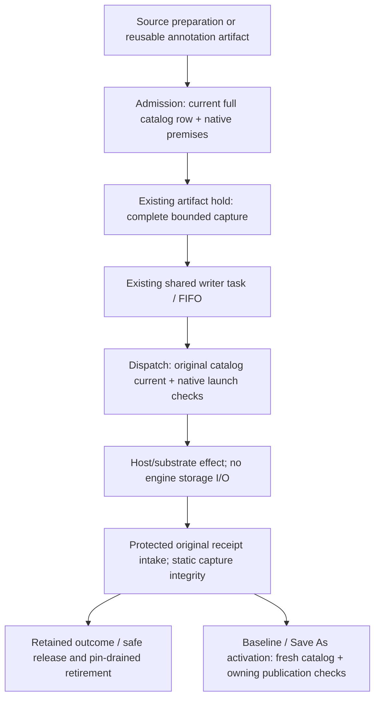

```mermaid
sequenceDiagram
  participant H as Trusted host
  participant L as Existing invocation ledger
  participant C as Catalog state in the same coordinator
  participant B as Conditional basis authority in the same coordinator
  opt Scoped native profile
    H->>B: Capture exact present/absent basis under current observation grants
    B-->>H: Opaque original handle and condition only
  end
  H->>L: Submit original request, context and profile
  opt Scoped native profile
    L->>B: Bind original issuer, scope, references and index mapping
  end
  L->>C: Validate first admission; discard prediction
  H->>L: Service with fresh facts
  opt Scoped native profile
    L->>B: Re-resolve original full row predicates
  end
  L->>C: Reconstruct and validate current root, floor and result
  C-->>L: Prepared publication and result
  opt Scoped native profile
    L->>B: Final exact scope, issuer and condition revalidation
  end
  Note over L,C: Exclusive guarded publication plus sealed terminal; interruption is unknown
  L->>C: Install root and floor
  L->>L: Install sealed retained outcome
  H->>L: Query typed result with fresh release facts
  opt Scoped historical receipt
    L->>B: Reauthorize current issuer/scope, not historical row conditions
  end
  L-->>H: Bounded copy under captured/current intersection
```

F01 now has a native optional base-profile /1 discovery-reader owner within the same engine,
not another authoritative command registry or runtime service.
Unknown/later discovery profiles are rejected rather than implicitly widened. Shared retention
prepays finite packet/context inventories, context/capture/reply ceilings and
selector staging/reply envelopes under checked native declarations. Producer-supplied
accepted-registry/schema/visibility/order truth remains an explicit premise for
the generic producer. The fixed builtin /1 source now derives the six F13/F14
logical declarations from their native handler modules. It discharges only source/
declaration origin, not authority, live enablement, visibility/order, resources or
advice. A private source discriminator is carried through bounded packets and
contexts; current cuts of another origin refuse before consumption or observed-loss
effects. Owner inspection returns bounded independent identities plus immutable
declarations, not invocation capabilities. Native command spelling is owner-local,
not a wire identity. Shared funding prepays fixed six-variant staging; optional
process-monotonic timing covers actual builtin inspection/preparation attempts.
No executable schema, general handler registration or later discovery profile is
introduced; schema/value/recipient/full-facade correspondence remains open.
Native request-role recognition now precedes loss/stop effects and cut consumption:
positive safe page shape, original entry/variant/cursor/target roles, entry/variant
correlation and original cursor-limit binding are checked without allocation or
new issuance. Foreign/mismatched requests cannot invalidate a healthy original;
recognized corrupt indexes fault the discovery domain and preserve uncertain
obligations, rather than being cleared as ordinary loss. Valid recognized loss
still absorbs before current page-capacity and transient delivery refusals. The
actual recognition boundary has finite disposition capture; opt-in native timing
covers synchronous query attempts, not queue/transport latency. Generic and builtin
contexts share this guard through direct and typed/dynamic calls. The older frozen
reference's evaluation order has not been reconciled or claimed refined by this
native fix; formal artifacts/hashes remain unchanged.
Metadata is inert and callback-free; a descriptor or displayed alias is not a
registered executable route, UI keymap, provider procedure or authority grant.

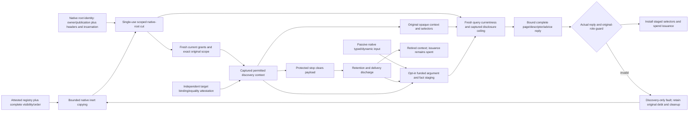

The native scope copies authority/engine/recipient/purpose/destination/profile/
continuity plus the explicit policy epoch. Current authority/interpretation and
independent preparation/acquisition gates must be strictly true. Wrong scope or
foreign handles cannot consume another cut. A valid matching cut is consumed
even if later capture/reply/context capacity refuses, with no installed context
or issuance on that refusal. Approved dense visible order excludes hidden rows
and variants; schema facets and target capture do not infer broader grants or
advice truth. Private metadata projection is sized before materialization.
No authored-root publication, handler registration or provider I/O is added.

Native stop clears payloads; actual protected retirement clears slots without
refunding lifetime issuance. Fresh opaque markers prevent stale handle aliasing
when bounded live slots are reused. Global parent credit returns only after
admission stop and actual packet/context drain; the closed owner stays spent.
Detected integrity faults fence only discovery, preserving original protected
handles and uncertain funding, not setting the editing-domain fault flag.
Static preparation/acquisition/query/control/retirement markers and owner-only gauges
exclude raw scope, descriptor, command and target labels.
The actual pre-install result guard has a separate content-free validation marker;
guard failure is unknown producer integrity, not a known caller refusal.

Native list/inspect/advice retains original context/entry/variant/target roles.
Selectors are scoped to the original context marker and minted lazily; cursors
also bind the exact page limit and position. Repeats reuse selectors. A fresh cut
is consumed before later query refusal, but staged selectors/issuance are installed
only after a complete native bounded reply exists. Pages cover captured-permitted
rows, not raw registry slots; descriptors expose only captured schema/presentation,
with all five schema facets grouped in one immutable inert object. Advice requires
original target and variant ownership, independently attested current equality and
Boolean advice; positive advice grants no rights and launches nothing.
Unknown authority/retention facts withhold without stop; explicit loss, editing-root
fault or changed/narrowed permitted descriptor values clears the original context
payload and selectors, without refunding issuance or parent sponsorship. Scope-
foreign callers cannot apply that loss. New visibility/variants/facets cannot widen
an old capture; hidden-only changes are not descriptor staleness. Inert equality
uses bounded iterative value comparison, not Debug, serialization or callbacks.
Stopping new context admission permits fresh cuts and queries for existing contexts.

The native result guard validates the actual whole page/descriptor/advice against
the original request, retained context and tentative selector map before any
installation. It checks original role correlation, dense captured page positions,
cursor limit/position, positive safe versions, captured kind/variant counts, all-
or-none schema facets, approved immutable payload identity and native metadata
ceilings, and rejects unused/duplicate tentative selectors. It allocates no new
metadata workspace or callbacks. A malformed producer result fences discovery;
the consumed cut stays consumed, tentative selectors/issuance remain unpublished,
prior issuance and original protected cleanup/debt stay intact. This validates
native shape/origin and approved payload release, not policy/schema truth, a wire
representation, exact JSON bytes, or an all-root/crash/physical refinement.

Native cuts now additionally bind the current `native-semantic-root/1` identity,
not merely publication generation or a size gauge. The composite contains original
owner/publication/fault state, exact mutable view/workspace profiles, immutable
append-only provider/encoder/restorer prefix positions, exact persistence
configuration/fence/dispatch headers and the loaded-baseline attachment lifecycle
generation/original incarnation. Existing source/policy/format/lifecycle, annotation/history, settings,
view/workspace row and binding/baseline/export transitions use the checked owner
publication generation. No global counter or authored revision is introduced.
One private attachment lifecycle generation also stamps absence: attach reserves
two steps before installing credit, uses one, and leaves detach its exclusive
remaining step. Protected detach needs no global publication unit or allocation.
No-op calls preserve identity. Present/absent attachment cycles cannot reproduce
the old root, even with identical sizes/profiles. Counter exhaustion refuses new
attach before credit; impossible active exhaustion faults without fake cleanup.
A stale cut remains unconsumed and
does not stop its context or spend issuance; a fresh matching cut can continue the
old captured disclosure frontier. A separate content-free root-currentness marker
records the actual comparison. Stored identity is fixed packet metadata, not a
retained historical root, executable role or portable hash/identity encoding.

F01 now has a context-owned optional native decoder. Shared exhaustive operation
declarations supply actual family/name/version/contract, required fields and opaque
role names to the decoder; this is not a second accepted registry or a self-discovery
schema profile. Typed family 0 and dynamic discover-contracts version 1 normalize
to the same original context/list/inspect/advice meaning. All required fields are
explicit, including nullable continuation. Opaque roles stay outside metadata
traversal with null shadows; ordinary whole-envelope, full native scope and canonical
meaning get independent bounded copies. Scope policy epoch remains u64; two-u32
measurement shadows do not select a public wire representation.

Decoder enablement reserves a separate actual parent charge once, with eight native
input/fact/owned/template frames plus fixed state. Queries borrow it, copy only the
fifteen current query facts and pass through existing native authority, original
scope/profile/role, fresh-cut, captured disclosure and actual result guards. Shape
never authenticates selectors or enables unsupported profiles. Wrong scope/profile/
context cannot apply loss elsewhere; unknown facts withhold while known loss stops
the original context. Busy ownership/private handoff ends before return. Stop and
failure keep workspace credit until actual protected context retirement; malformed
arguments spend no cut, while later native refusal retains native consumption rules.
Post-native faults preserve already installed selectors/issuance, not fake rollback.
Original protected cleanup remains possible after a decoder fault; uncertainty never
refunds credit. Static normalization/configuration/query markers exclude raw input,
scope, metadata and roles. No provider callback, transport, UI or new verb is added.

This implements native base-profile queries/current-root guarding and decoded
query handoff, not schemas/external accepted-registry truth or full public facade assembly.
Identity covers the current native payload projection and audited mutation routes,
not excluded admission/retention/diagnostic state or arbitrary future mutators.
Future registry replacement/removal cannot reuse the current append-only-position
argument without a new generation/incarnation rule. Accepted-registry currentness,
normalized JSON/native-byte correspondence, host/physical and crash refinement
remain separate gates; no filesystem probe or policy truth is inferred.
Frozen formal artifacts/hashes remain unchanged; no new formal proof is claimed.

The macOS present/best-effort path now has real scratch-copy and Save As staged-
replacement tests, retaining byte fidelity and permissions; copy remains unbound,
and Save As requires a fresh native postwrite probe and actual receipts. Its current
adapter explicitly refuses absent/atomic-conditional procedures and typed causal
conditions. A real native refusal test demonstrates no staging/replacement and
preserves non-write/disposition/quiescence facts even when a fixture host advertises
unsupported causal capabilities. Scripted provider tests do not prove physical
exclusive-create/conditional-write/causal/non-reuse truth. Complete invocation/
replay/recipient assembly, broader host procedures and independent/concurrent/crash/global assurance
remain open.

Native final annotation retirement now refines §13.9.1 at the trusted local owner.
Ten exact-true current host gates are necessary, not sufficient: the engine also
checks the original record/floors, retained absence, every actual retained journal
(including invalidated groups), live registered captures containing that record,
released frontiers and safe publication-counter headroom. Refusal preserves all
payloads and companions; inventory/frontier drift faults rather than inventing
release. Successful cleanup moves identity/floors/restoration key to a slot funded
at original issuance/restoration and releases body/target payloads. It advances
only the publication counter, not source or live annotation-set versions or peer
frontiers. The absorbing tombstone retains lifetime issuance and cannot be restored
or overwritten by an old authoring plan. No background eviction, public verb,
provider effect, telemetry identity label or erasure of external copies is added.
Whole-document final reclamation and general history-floor planning remain open.

Native source saved-state comparison now preflights intrinsic encoded length plus
baseline length with checked arithmetic before making its temporary codec copy.
`SourceComparisonBudgetV1` independently bounds output and combined comparison;
the compatibility query derives limits from the existing resource blob ceiling
(output cap, twice-cap combined bound clamped to native size). A caller can request
a larger explicit bounded inspection without authorizing a save. Unbound state
needs no serialization; equal-length output is still compared exactly, and a fresh
revision may equal the baseline. Ambiguous output refuses without normalization.
The temporary vector is dropped after comparison; no artifact, task, root, held
reservation or issuance is installed. Existing Query/SourceEncode dispositions
distinguish preflight refusal from encoding and completion without content labels.
This is a trusted-owner per-call logical bound, not shared-parent/global temporary
funding, physical peak proof, scoped recipient projection, baseline-lineage product
assembly or external freshness. Those contracts remain separate.

Optional native service timing now uses a declared `ProcessMonotonicV1` profile on
the caller-owned recorder. It is off by default and leaves existing queued records
and host-supplied times unchanged. One private non-cloneable process-local episode
captures `std::time::Instant` at entry and checks the elapsed interval at exit.
There are no public/persisted stamps, cross-clock subtraction, supplied clock
callbacks, scheduler, timer facility, timeout policy, series registry or new pool.
Start/end clock panics are isolated from authoritative engine fault handling;
missing or reversed clocks produce absent time, not zero. A genuinely measured
zero remains distinguishable. Abort/OOM/crash and physical clock truth are not proved.

All nine native/decoded read adapter paths time the actual synchronous attempt
through native work, protected refund and final health gating; early fault/busy/debt
refusals terminate at the admission marker. Protected native stop separately times
its native control episode, and passive stop normalization has its own phase timer.
An envelope refused before native handoff has no native-control time; normalization
time is not relabeled as a whole command. Intermediate markers remain untimed unless
their own producer supplies a measurement. Elapsed service includes local preemption,
not outer host/lock queues, external effects, producer quiescence or CPU consumption.

The same profile now times all seven native invocation service entry points: generic
run, scoped settings mutation/definition/lifecycle, ordinary/scoped serialization
and managed search consumer. The source-search compatibility method delegates once.
Each returned attempt emits its existing execution or terminal-replay marker with
elapsed time; no duplicate timer is installed on internal family dispatch. Replays
do not execute again or enter a new admission/disposition cohort. A completed
service call can settle a rejected/stopped job; retained outcomes and transition
counters, not service markers, establish the job disposition. Fault returns retain
Unknown and unwinding has no measured endpoint. Timing does not catch engine
publication panics, clear their fence or retry work to manufacture a duration.

Timing starts only for explicit opt-in and available event capacity at entry. It
does not sample this clock for disabled/already-full capture. If subsequent markers
fill the queue, endpoint loss follows existing drop-newest accounting; timing loss
must not be treated as zero latency or an unbiased sample. Record/drain still invoke
no clock or subscriber. Timing and dispositions never control permission, mutation,
settlement, cleanup or control availability. Values can reveal activity patterns and
remain privileged operational metadata, not permission to export telemetry. Raw
markers are not authenticated clock provenance. Structured duration-series/current
recipient delivery, correlated spans, other execution pathways, measured overhead
and supported-platform/suspend/workload qualification remain open.

Native invocation measurement now binds `invocation.admissions` and
`invocation.dispositions` to actual ledger transitions. All 24 current production
first-binding sites and sixteen known terminal-install sites share two internal
installers. Those installers validate actual owned first-bind/terminal state,
preserve original intent and phase, and update optional fixed counters without
allocation, clocks or callbacks. A ticket is issued before it is admitted; matching
pending/terminal replay does not admit again. An ingress mismatch/refusal is not a
new original-invocation terminal disposition. Preparation refusal, no-op and accepted
pending stop retain their separate eventual local terminal meanings.

An optional parent-funded singleton collector captures a first-admission cohort.
Activation does not retroactively count old admitted jobs; an older issued but
unbound ticket can enter the new cohort on its actual first bind. One private bool
per native slot preserves that membership through replay/forget; the pool reserves
the full declared lifetime slot capacity for this metadata plus seven series/counters
and a whole snapshot frame. Scope is this native ledger/cohort, not all engine
requests or a denominator for another producer's population. No identity/context
becomes a metric dimension. Old counters do not reset on result eviction or ticket
retirement. Stop yields off, blocks new cohort capture, retains funding and cannot
rearm; protected stopped-pool retirement releases its own reservation exactly once
and clears its private cohort marks, without canceling pending jobs or pretending
their obligations are discharged.

Consumed faulted executions remain retained in `Running` outside native service.
Exclusive borrowing prevents a snapshot during live service; current public
forget/retire/replay cannot remove/reexecute these faulted slots. A bounded cohort
census therefore supplies their once-only cumulative fault contribution, separately
from known terminal faults. This invariant must be preserved or transferred before
future uncertain-job reclamation. A nonconsuming control/service failure that leaves
an original candidate pending is not an extra terminal job outcome. Fault observation
never fabricates nonpublication, a receipt, rollback or quiescence; tests include an
actual partial assignment and preserved engine fence. Native owner snapshots work
under that fence, while ordinary metric exhaustion cannot reject or heal work.
Full provenance/current-recipient release, ingress-offer classification, durations,
other producer populations, physical/overhead/workload and independent gates remain
open. Existing marker events, executable verbs and engine/UI/substrate boundaries
are unchanged.

Draft 0.205 §1.2 records modular resource substrates behind engine-owned ports,
with local filesystem as the first target module. CMP-10's resource-module
refinement implements IF-04/10/13 without importing filesystem/SDK/credential
types into the engine. A future S3 module is not a v1 implementation or active
network path. Each module retains its own identity/capability/guarantee profile;
ordinary best-effort saves and actual effect/discharge evidence remain unchanged.
Module implementation, platform conformance and package builds remain gates.
This is separate from CMP-04's in-memory source representation.

Draft 0.204 §18.8.2 connects the existing F08 value checker to actual analysis
query release. The analysis owner borrows two declared construction frames from actual
remaining headroom, blocks owner mutation/retirement during its finite call and
refunds only those frames at completion. Valid replies also retain original
packet context/parse-state/coverage. Produced-result or unexpected query faults
fence this owner without changing source, editing-domain state or provider facts;
late evidence and protected discharge remain available after the borrow ends.
No new module/component/verb/profile is introduced. IF-02 and INS-03/05/08/13
retain release, local invariant fault, query pressure and actual discharge, without
content/tag/identity metric labels. Five controls, ten fault cases, seven reentry
cases, three capacity boundaries, four tiny-delivery assembly probes and eight mutations are focused evidence, not
full frozen qualification or physical/global/hostile-runtime assurance.

Draft 0.203 §22.1.24 connects the existing F01 result validator before native
selector/issuance publication. Native and decoded routes share this guard and
the existing bounded reply/selector staging. Invalid produced results or validator
exceptions fence only the discovery owner, retain the consumed cut and original
maps/issuance, and preserve protected cleanup. Later faults do not undo an earlier
successful publication. No module/component/verb/profile is added. IF-01/02,
PATH-02 and INS-01/03/05/08/12/13 retain result-validation, local fault, retained
history and discharge distinctions without raw identities/content in labels.
Twenty-seven guard cases and three semantic mutations are scoped evidence;
full frozen qualification, other products and operational gates remain.

Draft 0.202 §22.2.2.5 connects the existing resource-catalog registry and decoded
query workspace to the actual invocation parent's budget. A private single-domain
lease funds retained registry state; classification/workspace borrowing refunds
only temporary units, and protected final retirement refunds the registry once
without reopening its namespace. Native context/selector/current-root authority
and late-fault retention remain unchanged. Shared declarations are accessed lazily
to avoid an import cycle. No new module/component/operation/profile is introduced;
the selected graph/entrypoint census remains 118 and ownership stays 76/11.
See formal/registration-reads.md for 28 reader controls, 49 semantic mutations,
four decoder fault stages and the separately guard-blocked issuer-reset control.
The invocation checker retains 24 controls/34 mutations. IF-01/02, PATH-02 and
INS-01/03/08/09/12/13 retain capture, current release, pressure, fault and discharge
without content-derived labels. Full frozen adoption, profile discovery and
broader implementation/host/measurement/independent gates remain.

Draft 0.202 §15.4.4 also makes the existing synchronous F05 cancellation quantum
explicit: current checks before one finite non-reentrant call, protected control
at the next owner boundary, and original-context/current-stop validation before
later release or F11/F12 use. Chunking is not a preemption promise; accepted stop
cannot reclaim retained holds or recall disclosed bytes. IF-01/02/05, PATH-02/07
and INS-01/03/05/06/08/13 distinguish offered stop, accepted stop, useful evaluation,
later refusal and actual discharge. See formal/search-gateway.md for the existing
control/finite-work argument. No component, operation, async mode or solver law
is added. Actual protected-control service and measured responsiveness remain gates.

Draft 0.202 §22.2.3 defines required trusted host command bindings above the
coordinator: immutable descriptor/handler incarnations, exact activation expectations,
explicit executor/affinity and serialized base calls, captured owned arguments,
ordinary facade admission and retained code/assets until actual discharge.
Withdrawal/replacement cannot reinterpret old calls or erase admitted effects.
This is neither frontend keymaps nor the existing resource registry, new executable
engine semantics, a plugin loader or a native implementation claim. IF-01/03/07,
PATH-01/05/12 and INS-01/02/03/08/09/13 retain activation/invocation/publication/
withdrawal/discharge distinctions without identity-valued labels. The reviewed
composition argument and concrete binding acceptance obligations are in
formal/context-handoff.md. Existing PS-CH evidence remains scoped; PH-09 and actual
facade/discovery/host/Rust binding are not relabeled proved.

Draft 0.201 §4.2.2 binds existing per-document complete-record normalization to
the common owner before immutable compound intent/retry comparison and current
view preparation. F10 uses the same normalization without publication. Native
ordered evaluators, current authority/dependencies and linked publication remain
unchanged; this adds no module, component, profile or public verb. See
formal/invocation-publication.md for 60 permutation/profile/route cases, 22 controls
and 28 mutations, with existing gate/trace populations retained. IF-01/03 and
PATH-01 retain admission/preparation/publication; IF-02/PATH-02 retain advice.
INS-01/02/03/06 distinguish normalization/replay, final publication, release and
actual history. Source identities/offsets are not telemetry labels. The graph
remains 118 and engine/presentation ownership stays 76/11. Full frozen adoption,
public facade completion and implementation/operational/independent gates remain.

Draft 0.200 §18.8.2 describes the existing F08 captures, analysis-summary and
unavailable values without introducing a release, codec or discovery profile.
See formal/analysis-query-values.md for 2,019 native replies, bounded malformed
and mutation evidence, and the distinction between shape and original authority.
The checker remains separate from native owner release/fault integration.
IF-02 and INS-03/05/08 retain current release, empty success, unavailable, mismatch
and resource distinctions without content-derived labels or a new pathway.
The selected engine dependency graph remains 118; this detached checker does not
add a runtime component or change the 76/11 engine/presentation partition. Full
frozen adoption and broader product/implementation/operational gates remain.

Draft 0.199 §18.8.1 corrects the existing F08 half-open query intersection:
authorized current [a,a) returns no captures, not a synthetic zero-width fragment.
Current snapshot/view/authority, scalar-boundary and capacity validation still
precede release. See formal/analysis-work.md and formal/analysis-range-laws.smt2
for native fixture regression coverage and the conditional integer argument.
INS-05/03 separate successful empty delivery from unavailable; INS-08 retains
work/retention boundaries without payload-derived labels. The graph stays 118,
ownership 76/11 and all component/interface/pathway counts remain unchanged.
Full frozen adoption and complete public-product/implementation/host/measurement/
independent gates remain open.

Draft 0.198 §22.1.27 adds descriptive metadata for the three existing F01 queries
through explicit discovery /13 while preserving /1–/12 and the default profile.
See formal/discovery-self-descriptor.md. Lazy declaration access retains cold
initialization; finite inert schemas do not issue capabilities, execute metadata
or authorize handlers. Native current release, disclosure and protected cleanup
remain authoritative. The selected graph/cold-entry census is 118, ownership is
76/11 and 43 engine variants have fixed metadata, not complete product/event
coverage. IF-01/02, PATH-02 and INS-01/03/08/09/12/13 remain the relevant boundaries;
no component, interface or instrumentation pathway is added. Full frozen adoption
and broader implementation/host/measurement/independent gates remain open.

Working Rust projection: `discovery/ownership/builtin/discovery_query.rs` provides
an explicit native self-description source and sealed installed dispatch for all
three queries. It consumes the normalizer's input declarations and the native
reply guard's closed result-form/schema-facet declarations. Current route release
and target-query release remain separate; decoding requires its original funded
context. Descriptions do not acquire contexts, register executable metadata or
recursively expand schemas. Preparation uses the existing prepaid synchronous
builtin frame; selectors, reply bounds and retirement stay at the existing owner.
Fixed optional dispatch timing has no identity/content labels. This is an actual
Rust binding, not installation of the reference /13 catalog, a new component or
renewed certification of frozen formal artifacts.

Draft 0.197 §22.1.26 describes the existing F10 compound-plan advisory query
through explicit discovery /12, preserving /1–/11 and the native current
root/request/context observation basis. F01 enablement and F10 validation advice
remain distinct and neither authorizes execution or reserves capacity. See
formal/advisory-descriptor.md and formal/advisory-discovery.md. The graph and
clean-entry census are 117, with one descriptive helper inside existing discovery
ownership, not a new component or runtime service. The 76/11 ownership partition
is unchanged and presentation geometry stays outside the symbolic engine graph.
IF-01/02, PATH-02 and INS-01/03/08/09/12/13 retain bounded disclosure/refusal/fault/
cleanup evidence without a new instrumentation path. Forty engine variants have
fixed metadata, not complete product/event coverage. Full frozen adoption and
broader implementation/host/measurement/independent gates remain.

Draft 0.196 §19.4.1 moves the presentation-owned F09 source-reply capacity check before new
target installation. Withheld hit/navigation replies no longer consume an
undisclosed persistent cache slot. Previously delivered references retain their
identity and current authority/quota/retirement checks. See
formal/geometry-reply-admission.md. IF-06, PATH-09 and
INS-03/10/11/12/13 retain separate preinstallation refusal and installed-lifetime
outcomes. This frontend/reference helper stays outside the symbolic engine facade
and its selected static dependency graph. No component/interface, telemetry path or public gateway is added;
the graph remains 116 and the 76/11 partition is unchanged. Full frozen adoption,
public integration and physical/operational/independent gates remain.

Draft 0.195 §23.1.9 closes the structural description of three existing F16
released products without selecting their public retrieval route. Trusted-host
stamps, scoped basis decisions and original opaque created-settings references
retain distinct release authority and lifetimes. The checker never traverses
created references and is separate from native construction/observer admission.
See formal/registration-result-values.md. IF-01/02, PATH-02 and
INS-01/03/08/09/12/13 retain stage-bounded observations; no new runtime component,
telemetry path, result profile or graph edge is introduced. The selected graph
remains 116 and the 76/11 partition is unchanged. Combined-reply integration,
public mapping, full frozen adoption and operational/independent gates remain.

Draft 0.194 §23.1.8 closes the value description of existing released F13/F14
projections, not their public retrieval route. Partial annotation-version and
target-hidden reversal forms stay distinct from full private receipts; private
reversal authority is not exported. See formal/projected-edit-results.md for
actual native frames, strict data/enum checks, mutation and validation-only
substrate evidence. Native authority/disclosure/retention remain separate; the
checker is not integrated into producer or observer installation. IF-01/02,
PATH-02 and INS-01/03/08/12/13 retain existing evidence boundaries without a new
runtime component, telemetry path or result profile. The selected graph remains
116 and the 76/11 partition is unchanged. Public mapping, integration, other
families, full frozen adoption and operational/independent gates remain open.

Draft 0.193 §22.1.25 exposes the existing four F12 argument forms/three semantic
verbs through explicit discovery /11, preserving all ten older profiles. It adds
no C4 component or UI policy. Native view-only publication and original match/
boundary authority remain unchanged; source-write permission is not required.
See formal/selection-descriptor.md and formal/selection-discovery.md. Original
capture/current disclosure, fixed/generic origins and existing protected cleanup
remain distinct edges. Capacity refusal does not grow budgets or disable /10.
The selected graph and clean-initialization census are 116; components/interfaces
and the 76/11 ownership partition remain unchanged. IF-01/02, PATH-02 and
INS-01/03/05/08/12/13 retain content-safe stage evidence without a new telemetry
path. Full frozen adoption, complete products/events and implementation/host/
measurement/independent gates remain open.

Draft 0.192 §22.1.24 connects bounded F01 arguments to the existing native owner
and original cut/reference ports. Local classification/seven-frame reservation,
fifteen named current-fact reads, borrow exclusion and exact temporary refund
preserve separate capture/query/retained-selector edges. Unexpected faults fence
the discovery owner without setting the editing-domain fault flag; late selector
installation/issuance remains accounted for and original cleanup survives.
See formal/discovery-gateway.md. IF-01/02, PATH-02 and
INS-01/03/05/08/12/13 retain bounded stage evidence without private labels.
The graph is 115; components/interfaces and 76/11 partition remain. No new public
verb or mode is added. Reply-sized result validation, precommit integration,
restart, global/physical/operational/independent and full frozen adoption gates
remain open.

Draft 0.191 §22.1.23 closes the structural description of existing F01
page/descriptor/advice/unavailable values, preserving original request-role
correlation, permitted disclosure and inert metadata. The checker is separate
from native selector installation and future facade fault mapping; a late refusal
does not undo native issuance. See formal/discovery-results.md for actual-native,
fuel/cost, mutation and selected substrate evidence. IF-01/02, PATH-02 and
INS-01/03/05/08/12/13 keep publication/validation/delivery distinct without private
labels. The selected static engine/reference graph is 114; components/interfaces
and the 76/11 partition remain unchanged. Smaller verifier banks preserve all
mutants/oracles and the 60-second timeout; earlier timeout evidence stays failed.
Fresh full frozen adoption, integration, other products/events and operational/
independent gates remain open.

Draft 0.190 §22.1.22 captures the three existing F01 query arguments through
typed/dynamic routes, retaining original context/entry/cursor/variant/target
objects outside canonical data. Native ownership/currentness/profile/advice and
loss/stop checks remain separate. See formal/discovery-arguments.md for 61 native
results, exact boundaries and 28 targeted mutations. IF-01/02, PATH-02 and
INS-01/03/05/08/12/13 distinguish capture from native admission/release without
private labels. The selected graph is 113 including the normalizer; components,
interfaces and 76/11 partition remain. No new public verb, acquisition, result,
self-discovery profile or transport is selected. Full frozen adoption, actual-
parent gateway, public products and operational/independent gates remain open.

Draft 0.189 §22.1.21 describes the fourteen native F17 forms/eight variants under
explicit discovery /10 while preserving /1–/9. The four receipt structures remain
native facets, not new public queries or event streams. Exact metadata recognition,
current disclosure, original capabilities and publication remain separate edges.
See formal/lifecycle-discovery.md for schema/native/ownership/boundary/mutation
and selected substrate obligations. IF-01/02/03/08/10, PATH-02 and
INS-01/02/03/05/08/12/13 retain distinct evidence without private labels. The
selected static graph includes discovery/descriptors and reaches 112 modules;
components/interfaces and the 76/11 partition are unchanged. Full frozen adoption,
public result access/complete events, host/physical/measurements and independent
assurance remain open.

Draft 0.188 §11.2.13.6 shares four existing native receipt shapes between
construction and current release. Shape is not authority or whole-operation
feasibility. Malformed construction discards native preparation before the
existing invocation fault fence; original-ticket retirement remains available.
Forty-eight native results, 24 mutants and 28 fixed malformed-construction cases
include native discard, zero targeted producer commit calls and unchanged-root
witnesses. See formal/lifecycle-results.md. The selected graph reaches 96 modules
without frontend imports; components/interfaces and the 76/11 partition remain.
IF-01/03/08/10 and INS-01/02/03/08/12/13 distinguish preparation/publication/
release/fault/discharge without private receipt labels. No new public query,
wire profile or command is selected. Complete public products, parent/physical,
host/measurement/independent and full frozen adoption gates remain open.

Draft 0.187 §11.2.13.5 connects nine activation/rebind/container forms to their
existing native owner preparation ports and lifecycle/relation jobs. Original
opaque authority and inspection remain outside captured data. Shared slot
preparation exclusion, fault fencing and original-ticket retirement preserve
separate preparation/publication and provider-completion semantics. Eighteen
fresh native publications, twelve mutants and 36 early/late fault cases include
boolean-only installation/discharge witnesses. See
formal/lifecycle-activation-envelope.md. The selected graph is 95 modules without
frontend imports; architectural components/interfaces and the 76/11 partition
are unchanged. IF-01/03/04/05/07/08 and INS-01/02/03/04/05/07/08/09/12/13 retain
capture/authority/publication/fault/discharge distinctions without private labels.
Shared-parent/physical, complete products, host, measurement, independent and
full frozen adoption gates remain open.

Draft 0.186 §11.2.13.4 defers native lifecycle declaration reads until
normalization, after module evaluation. Clean-process checks exercise each of
94 selected static modules plus forward/reverse graph imports; a copied-graph
negative fixture reproduces the eager-read initialization failure. This adds no
public operation, component, interface or runtime observation boundary and does
not count construction failure as behavioral mutation detection. Existing native
publication/fault obligations remain; arbitrary dynamic and production initialization
are not proved. See formal/lifecycle-entrypoints.md. Full frozen qualification
and current endpoint reconciliation remain adoption gates.

Draft 0.185 §11.2.13.3 binds nine additional existing F17 ordinary argument
forms to native load/SaveAs field/profile declarations and rebind/container
catalogs. Completed-provider authority and writer handles remain native ports,
not captured data. All 36 discriminator pairs are disjoint; named native witnesses
do not prove whole-engine completeness. See formal/lifecycle-activation-arguments.md.
IF-01/03/04/05/07/08 and INS-01/02/03/04/05/07/08/09/12/13 retain provider/capture/
binding/publication/release distinctions without private values as labels. The
source graph is 94 modules without frontend imports; model components/interfaces
and 76/11 engine/presentation variants are unchanged. Full products, accounting,
host/measurement/independent and frozen adoption gates remain open.

Draft 0.184 §11.2.13.2 connects selected F17 envelopes to the existing native
owner and shared preparation guard. Trusted native control ports remain distinct
from captured request data. Unexpected faults fence the domain; original tickets
retain installed-intent cleanup without rollback or a new receipt. IF-01/03/04/
07/08 and INS-01/02/03/04/07/08/09/12/13 retain capture/admission/publication/
release and fault/discharge distinctions. See formal/lifecycle-envelope.md.
The selected source graph has 93 modules without frontend imports; architectural
components/interfaces and the 76/11 engine/presentation variants are unchanged.
Temporary-parent/physical accounting and full frozen adoption gates remain open.

Draft 0.183 §11.2.13.1 binds selected F17 typed/dynamic argument capture to
existing native wrapper/lower/context declarations. Five forms use four existing
variants and preserve the issued string value, not an opaque token. Immutable
bounded capture is distinct from native validity/authority and actual-parent
gateway accounting. IF-01/03/04/07/08 and INS-01/02/03/04/07/08/09/12/13 retain
capture/refusal/admission/publication/release distinctions without raw identity
or content labels. See formal/lifecycle-arguments.md. No component, interface,
transport, cleanup verb or numeric default is added; full qualification and
endpoint reconciliation remain adoption gates.

The [single user release gates](v1-release-gates.md) distinguish local release
acceptance from conditional capability obligations and additional assurance depth.
One human may run concurrent agents; local ownership, atomic publication, current
authority, lossless preservation and protected cleanup remain required. This
classification adds no component, interface, transport, state or numeric default.
Existing model and scoped-reference obligations remain open where not discharged.

Draft 0.181 §22.2.2.4 validates resource-catalog acquisition frames and actual
installation meaning, keeping ordinary refusal separate from an absorbing reader-
registry fault. Late installed but undelivered contexts retain spent issuance and
an original-cut cleanup receipt within the precharged packet envelope; protected
retention/delivery discharge removes that receipt/context once. Domain/provider
work remains independent and no issuer reset is introduced. IF-01/02, PATH-02 and
INS-01/03/05/07/08/09/12/13 retain frame/candidate/release, first fence, retained
context/receipt occupancy and protected discharge distinctions. No component,
interface, operation, transport, UI policy, threshold or numeric default is added.
See formal/registration-acquisition.md for FSM/accounting and scoped evidence.
Full frozen qualification and endpoint reconciliation remain required; actual-
owner gateway, complete discovery and operational/independent gates remain open.

Draft 0.180 §22.2.2.3 closes selected F07 resource-catalog query frames and
binds inspection/page meaning to retained rows and original staged/installed
selectors. Unexpected bound faults invalidate only the affected context while
retaining slots, reservations, spent issuance and early cuts. Late installed
issuance is not rolled back; valid reply pressure stays transient. IF-01/02,
PATH-02 and INS-01/03/05/07/08/09/12/13 retain validation/install/release, refusal,
first invalidation and protected discharge distinctions. No component, interface,
operation, transport, UI policy, signal or numeric default is added. See
formal/registration-query-results.md. Full frozen qualification and endpoint
reconciliation remain required; acquisition, gateway accounting, complete products
and operational/independent gates remain open.

Draft 0.179 §22.2.2.2 captures existing F07 resource-catalog capabilities
arguments using shared native outer/nested declarations. Original context, entry
and continuation identities remain separate from bounded immutable ordinary data.
Native visibility/current release, page limits, absorbing invalidation and
protected cut/context/registry discharge remain authoritative. IF-01/02, PATH-02
and INS-01/03/05/08/09/12/13 retain capture/refusal, native release, invalidation
and cleanup distinctions. No component, interface, operation, transport, UI policy,
signal or numeric default is added. See formal/registration-query-arguments.md.
Full frozen qualification and endpoint reconciliation remain required; actual-owner
gateway charging, complete results/discovery and operational/independent gates
remain open.

Draft 0.178 §22.1.20 appends fixed existing F07 descriptors under explicit /9
while preserving /1–/8. Shared native type declarations support closed recursive
syntax with fixed local schema references, not an engine evaluator or remote
loader. Current key/value meaning, integer-bound order, declaration uniqueness,
original roles, permitted projections and budgets remain native obligations.
IF-01/02, PATH-02 and INS-01/03/05/07/08/12/13 retain descriptor/capture/release,
refusal/withdrawal, ownership/capacity and protected discharge distinctions. No
component, interface, operation, transport, UI policy, signal or numeric default
is added. See formal/settings-discovery.md for schema/native/compatibility/
resource/mutation and selected substrate evidence. Full frozen qualification and
endpoint reconciliation remain required; other products and operational/
independent gates remain open.

Draft 0.177 §22.2.1.4 binds existing F07 decoding to the actual invocation
owner's temporary classification/seven-frame lease and fixed native reader.
Original roles and captured scope/facts remain authoritative. An unexpected
pre-dispatch decoder fault fences its pool, not the execution domain; contexts,
cuts, issuance and retained charge survive until protected discharge. IF-01/02,
PATH-02 and INS-01/03/05/07/08/12/13 retain admission/capture/release/refusal,
first-fault, busy/held capacity and cleanup distinctions. No component, interface,
operation, transport, UI policy, signal or numeric default is added. See
formal/settings-query-gateway.md for scoped accounting/native/fault/reentry/
mutation and selected substrate evidence. Full frozen qualification and endpoint
reconciliation remain required; complete public/discovery and operational/
independent gates remain open.

Draft 0.176 §22.2.1.3 closes selected F07 result frames and binds values,
ordered declarations and original origin references to retained permitted data.
Unexpected bound native-release faults invalidate only the affected reader while
retaining contexts, charges, spent issuance and possibly unconsumed cuts; valid
reply pressure is transient. IF-01/02, PATH-02 and INS-01/03/05/07/08/12/13 retain
validation/release/refusal, first invalidation and protected discharge distinctions.
No component, interface, operation, transport, UI policy, signal or numeric default
is added. See formal/settings-query-results.md for product/fault/discharge/mutation
and selected substrate evidence. Full frozen qualification and endpoint
reconciliation remain required; decoded dispatch, complete public/discovery and
operational/independent gates remain open.

Draft 0.175 §22.2.1.2 captures exact existing F07 arguments from declarations
consumed by the native reader. Original context/target roles remain separate from
immutable canonical shadows. Native current scope, projection, release, observed
loss and protected cut disposal remain authoritative. IF-01/02, PATH-02 and
INS-01/03/05/08/12/13 retain capture/refusal, disclosure/invalidation and cleanup
distinctions. No component, interface, operation, transport, UI policy, signal or
numeric default is added. See formal/settings-query-arguments.md for native,
malformed, boundary and mutation evidence. Actual-parent decoded dispatch,
complete result/discovery products and operational/independent gates remain; full
frozen verification and endpoint reconciliation remain required before adoption.

Draft 0.174 §22.1.19 adds explicit discovery /8 for four existing F06 operations,
preserving /1–/7. Guard-derived schemas distinguish operation replies from private
wait continuations; metadata does not select public events, clock truth, decoder
support or producer control. Actual owner identity/current release and prepaid
admission remain authoritative. IF-01/02, PATH-02 and INS-01/03/05/08/12/13 retain
descriptor admission/release, disclosure ceilings, withdrawal, envelope refusal,
native validation and protected discharge. No component, interface, operation,
transport, signal or numeric default is added. See formal/observation-discovery.md
for scoped schema/native/projector/compatibility/boundary/mutation and selected
substrate evidence. Full frozen qualification and endpoint reconciliation remain
required; complete public/operational/independent gates remain open.

Draft 0.173 §23.1.7 binds existing F06 typed/dynamic decoding to the actual shared
reservation. Explicit bootstrap support precharges metadata; context admission
pays native charge plus eight logical request frames in both envelopes. Protected
control needs no additional ordinary headroom, including after stopped/faulted new
admission. Native-only bootstrap retains its earlier profile. IF-01/02, PATH-02 and
INS-01/03/04/07/08/12/13 distinguish admission, prepaid versus in-use capacity,
native release, faults and protected drain/discharge. No component, interface,
operation, transport, signal or numeric default is added. See
formal/observation-decoder.md for conditional/native/boundary/fault/reentry/
mutation and selected substrate evidence. Full frozen qualification and endpoint
reconciliation remain required; complete public/operational/independent gates remain.

Draft 0.172 §23.1.6 checks closed selected native F06 results and independently
staged token/wait binding. Unexpected native-path failure fences the observer and
ends wait eligibility without refunding issuance, dropping ended waiters or
stopping the producer. Shared reservation release still follows actual native
retirement and protected drain. IF-01/02, PATH-02 and INS-01/03/04/07/08/12/13 retain
ordinary/protected release, invariant fault, held capacity and discharge
distinctions. No interface, operation, transport, signal or numeric default is
added. Decoder integration must preserve independently reserved minimal control,
not consume opportunistic ordinary headroom. See
formal/invocation-observation-results.md for product/fault/mutation and selected
substrate evidence. Full frozen qualification and endpoint reconciliation remain
required; complete public and operational/independent gates remain open.

Draft 0.171 §23.1.5 captures exact existing F06 typed/dynamic argument meaning,
preserving original observation context and ordinary after-reference identity.
The native owner retains authority, policy ceilings, result retention, wait
eligibility and independent budget/capacity checks. IF-01/02, PATH-02 and
INS-01/03/04/07/08/12/13 retain capture/refusal/native-release and ordinary/protected/
producer-lifetime distinctions. No component, interface, operation, transport,
signal or numeric default is added. See formal/invocation-observation-arguments.md
for sixteen native compositions, 122 refusals, 96 exact boundaries and 21
mutations. Actual-parent decoder charging, complete public products and
operational/independent gates remain; full frozen qualification is required.

Draft 0.170 §22.1.18 adds explicit discovery /7 for the existing three F04 queries,
preserving /1–/6. Fixed guard-derived input/result schemas describe structure;
actual-owner context, currentness, projection, release and reversal authority stay
at runtime. IF-01/02, PATH-02 and INS-01/03/05/08/12/13 retain descriptor admission,
disclosure, withdrawal, envelope refusal and native validation distinctions. No
component, interface, operation, transport or signal is added. Metadata depth 22
does not raise product defaults or prove global/physical bounds. See
formal/history-discovery.md for schema/native/runtime-counterexample, compatibility,
boundary, mutation and selected substrate evidence. Complete products and
operational/independent gates remain; frozen verification and endpoint
reconciliation are required before adoption.

Draft 0.169 §14.5.4 connects exact F04 typed/dynamic arguments to the actual
history owner. That owner reserves decoding classification plus seven bounded
logical request frames and protects their exact refund; the invocation domain's
history-root role does not establish invocation-domain/global reservation truth. Original
context/authority meaning, copied current facts and native currentness/release
remain separate. Decoder/native faults retain base/context/issuance obligations.
IF-01/02, PATH-02 and INS-01/03/06/07/08/12/13 keep admission/capture/release,
fault and discharge distinctions, with no new interface, operation or runtime
signal. See formal/history-query-gateway.md for conditional/native/boundary/fault/
reentry/mutation and selected substrate evidence. Complete public and host/global/
physical/concurrent/crash/measured/independent gates remain. Full frozen
verification and endpoint reconciliation remain required before adoption.

Draft 0.168 §14.5.3 checks closed existing F04 result structure, original context,
captured aliases, pre-copy reply admission and copied-value integrity. An internal
construction/copy fault fences the history inspection owner without deleting its
contexts, refunding issuance or discharging retained obligations. Owner fault/stop
and entry liveness are separate; a live flag alone is not delivery authority.
Protected closing/retirement remains available. IF-01/02, PATH-02 and
INS-01/03/06/07/08/12/13 retain validation/rebinding/reply, ordinary refusal,
owner-fault and discharge distinctions, with no new component, interface, operation
or signal. See formal/history-query-results.md for conditional structural,
native/fault/mutation and selected substrate evidence. Actual-parent argument
dispatch, complete public products and operational/independent gates remain.
Full frozen verification and endpoint reconciliation remain required before adoption.

Draft 0.167 §14.5.2 specifies exact F04 typed/dynamic argument capture from actual
guard declarations, preserving original opaque history identity, null-group meaning
and copied eight-field authority/limit semantics. IF-01/02 and PATH-02 keep the
existing query/native boundary; this does not install a parent-owned dispatcher,
acquire history or authorize reversal. INS-01/03/06/07/08/12/13 retain argument
refusal, advice/currentness, saturation and discharge distinctions, not new signals
or proof of runtime observation. See formal/history-query-arguments.md for native,
boundary, mutation and conditional structural evidence. Actual-parent dispatch,
complete public products and operational/independent gates remain. Full frozen
verification and endpoint reconciliation remain required before adoption.

Draft 0.166 §22.1.17 adds result metadata to existing F02/F03 descriptors in
explicit discovery /6, preserving exact /1–/5 products. Six inline schemas expose
native value structure, not token codecs, authority or request-dependent equality.
Actual owner/request/source/placement/alias/lifetime checks remain on IF-01/02
and PATH-02. Distinct native aliases may have identical JSON shadows. Existing
metadata envelopes refuse insufficient capacity; depth-32 fixtures do not raise
product defaults. INS-01/03/05/08/12/13 distinguish metadata disclosure/refusal
from actual-owner validation and faults, with no new signal, component, verb or
interface. See formal/read-result-discovery.md for validator/native, disclosure,
boundary, mutation and selected substrate evidence. Full frozen verification and
endpoint reconciliation remain required; complete public/other-family and
operational/independent gates remain open.

Draft 0.165 §24.4.1 separates retained full verification snapshots from
verifier-owned disposable checker scopes. Parent result validation controls
release, including expected failing descendants; unexpected failures and rejected
output retain their scopes. Original ownership and directory identity constrain
cleanup, whose failure demotes a candidate pass as a tool failure. Full snapshots
remain explicitly retained. This is assurance infrastructure, not a new engine
component, interface, verb, runtime signal or physical/global resource contract.
Historical retention, quotas, other scratch files and abrupt termination remain
outside these controls. See formal/capture-retention.md for seventeen controls,
nine mutants and ten actual registered read-result regressions. Full frozen
verification and endpoint reconciliation remain required.

Draft 0.164 §22.1.16 checks existing F02 acquisition result shapes, requested
classes and retained-parent separation. Native single owners bind the actual
staged context; coherent owners also bind staged member aliases and actual
candidate roster/documents/classes before cut consumption or installation. The
facade checks returned value/request meaning, not fresh-token authenticity.
Preinstallation faults preserve native/prepared frames; late facade faults retain
actual installed contexts, spent issuance and consumed cuts while fencing admission
and refunding only temporary decoding workspace. Authored roots remain unchanged;
no rollback or general crash recovery follows. IF-01/02, PATH-02 and
INS-01/03/05/08/12/13 distinguish candidate validation, cut consumption, installation,
release and the two fault frames. See formal/read-acquisition-results.md for 31
mutants and scoped evidence. Discovery /1–/5 is unchanged. Complete products and
operational/independent gates remain; full frozen verification and endpoint
reconciliation are required.

Draft 0.163 §22.1.15 checks existing native F03 page/record/location/unavailable
products and staged record/continuation bindings before selector publication.
The facade checks returned value shape and original request identity; it does not
infer native registration from token fields. Withheld content/location remains
absent and detached placement remains explicit. Native prepublication faults
install no selectors; a postpublication facade fault retains actual complete
native selector/issuance obligations, fences admission and releases unavailable.
Authored roots and protected temporary workspace frames remain unchanged/refunded;
no rollback or general crash-recovery claim follows. IF-01/02, PATH-02 and
INS-01/03/05/08/12/13 distinguish both fault frames and retained resource pressure.
See formal/annotation-query-results.md for 27 mutants and scoped evidence.
Discovery /1–/5 is unchanged; complete products and operational/independent gates
remain. Full frozen verification and endpoint reconciliation are required.

Draft 0.162 §22.1.14 enforces existing F02 content/line/unavailable shapes at
construction and northbound release. Coherent source replies bind the final native
member alias and retained member-root revision before publication. The facade
checks shape/request identity, not independent captured-revision truth; fixed
native authority remains separate. Unexpected result/refusal payloads fence owner
admission, with protected decoding refund and selected unchanged native/root
frames. IF-01/02, PATH-02 and INS-01/03/05/08/12/13 distinguish construction,
alias binding, release/refusal and faults without new UI, storage or network
mechanisms. See formal/source-read-results.md for 27 new mutants and exact scope.
Discovery /1–/5 is unchanged. Other result products, complete codecs and
operational/independent gates remain; full frozen verification is required.

Draft 0.161 §22.1.13 adds existing F02/F03 guard-bound declarations to explicit
F01 discovery /5, preserving /1–/4. Original capability roles and runtime semantic
checks remain distinct from metadata shapes and selected status vocabularies.
Fixed origin, captured ceilings, current release and bounded protected lifetime
remain the discovery owner's responsibilities; advice does not become native read
authority. IF-01/02/07, PATH-02 and INS-01/03/05/08/09/12/13 distinguish metadata
capture/release, advice and refusal/loss without new UI, network or filesystem
mechanisms. Verifier faults stay in assurance reports, not engine outcomes or
observed runtime health. Selected schema verification uses byte-counted input
and exact boolean replies; tool/protocol failures cannot count as semantic mutation
counterexamples. See formal/read-discovery.md for 32 mutants and exact scope.
Complete public products and operational/independent gates remain; full frozen
verification and endpoint reconciliation are required.

Draft 0.160 §22.1.12 connects F03 enumeration, inspection and target location
through original annotation/combined and coherent-member native owners, including
retained copies. Snapshot and secondary selector roles remain original opaque
identities; native kind/context/member/page-size validation precedes current loss.
Independent current scope/facts preserve whole-parent authority and unknown/loss
meaning. Actual-parent seven-frame workspace refunds separately from native page
and selector reservations. Fresh complete pages feed later facade queries; refusal
publishes no partial selectors. IF-01/02/07, PATH-02 and INS-01/03/06/08/13 observe
decode, admission/refund, selector use, release and loss without UI, network or
filesystem mechanisms. See formal/annotation-query-gateway.md for 37 mutations and
exact evidence, including 24 actual decoded handoff-to-query chains, 72 products
and twelve source-only annotation-promotion refusals. Complete public and
operational/independent gates remain; full
frozen verification and endpoint reconciliation are required.

Draft 0.159 §22.1.11 connects current and retained F02 snapshot-handoff routes
to original native source, annotation/combined and coherent-set owners. Exact
canonical arguments preserve original opaque retained references separately.
Current annotation/set requests must match the original private prepared cut
before native current validation; mismatch cannot poison or consume another cut.
Native authority, known-loss ordering and once-only transfer remain authoritative.
Actual-parent eight-frame temporary workspace and busy fencing have protected
refund independent of native retention and issuance. IF-01/02, PATH-02 and
INS-01/03/06/08/13 distinguish decoding, cut matching, handoff, ownership, loss and
faults without UI, network or filesystem mechanisms. See
formal/read-acquisition-gateway.md for 43 mutants and exact scoped evidence.
Complete public products and host/physical/global/concurrent/crash/measured/
independent gates remain; full frozen verification is required.

Draft 0.158 §22.1.10 connects both existing F02 range/line routes to the original
source, combined or coherent-set native owner, including retained copies. Shared
handler fields bind canonical arguments while original opaque snapshot identity
stays separate. The actual pool selects a fixed read port; independently captured
current scope/host facts retain their native meanings and known loss precedes
transient resource refusal. Actual-parent temporary logical workspace is held
through evaluation and refunded independently of native owner reservations.
IF-01/02, PATH-02 and INS-01/03/08/13 distinguish decoding, admission/refund,
read release, loss and faults without UI, network or filesystem mechanisms.
See formal/source-read-gateway.md for 31 mutants and exact scoped evidence.
Acquisition, full public products and host/physical/global/concurrent/crash/measured/
independent gates remain; full frozen verification is required.

Draft 0.157 §22.1.9 adds the existing F05 synchronous search declaration to explicit
F01 discovery profile /4, preserving /1–/3 rows and order. Handler-bound request/nested-field declarations
and closed refusal/data/navigation shapes describe actual products without
granting execution or defining structural selector authority. Partial totals remain
unknown and incomplete navigation unavailable. Existing source-origin/current-cut/
metadata-ceiling and protected lifetime rules apply within unchanged finite
discovery envelopes. IF-01/02/05/07 and INS-01/03/05/09/12/13 distinguish metadata
release, advice, search evaluation and native retained use; there is no new UI,
network or substrate mechanism. See formal/search-discovery.md for exact scoped
evidence. Nested codecs, asynchronous lifetimes and host/physical/global/concurrent/
crash/measured/independent gates remain; full frozen verification is required.

Draft 0.156 §15.4.4 connects both existing F05 engine routes to one synchronous
native search owner. Exact bounded canonical data is separate from original opaque
identity and independently captured current-query/source/host facts. Authority/
engine domain binding does not replace the source recipient scope. Reserve and
refund temporary logical workspace separately from native retained-result holds;
known loss precedes native capacity refusal and fixed pre-query surprises fence
the owner. Existing original/retained source, combined and coherent-set consumers
keep their current-use dependencies. IF-01/02/05, PATH-02/07 and
INS-01/03/05/06/08/13 observe decode, admission/refund, evaluation, retention and
dependent use without adding a component, network path, UI policy or substrate
mechanism. See formal/search-gateway.md for exact scoped evidence. Full public
products, asynchronous lifetimes and host/physical/global/concurrent/crash/measured/
independent gates remain; full frozen verification is required.

Draft 0.155 §12.8.10 connects existing retained F02 selection to an original
available coherent parent in the same actual owner/domain/pool. Whole-original
current authority precedes narrowing/admission; a new context independently owns
only the requested old members/classes and fresh aliases. Original stop/retirement
cannot erase the copy, and narrowing never restores missing data. Existing
F02/F03/F05 and F11/F12 current-use paths and whole-parent search holds apply.
IF-02/03/05 and PATH-02/07 add no network, filesystem or UI mechanism.
Native coherent-parent stop now separates its metadata authority check from
protected discharge: each ordered original member scope and exact-true owner
control remain required, but delivery-drained and retention-released facts are
irrelevant to stopping. Parent or member stop invalidates that parent only, without
allocating, advancing publication, refunding issuance, releasing holds or erasing
already delivered bytes. It remains available with exhausted ordinary headroom and
under the editing fault fence without healing that fence. Retirement and search-hold
release still require complete original discharge controls; parent retirement also
requires zero actual holds. Independent retained copies keep their own stop/lifetime
state. This repairs native implementation conformance to the existing stop contract;
it adds no command, authority role, generic F19 facade or new formal assumption.

Native F19 stop composition now has one closed `ReadObservationStopPortV1` facade
over existing source, annotation, coherent-parent/member and history controls.
Original typed opaque references and original immutable control scopes are passed
to exactly one first-party native stop method, without selector probing, structural
identity reconstruction, current-content grants, issuer registry or fallback.
Ordinary Rust references cannot execute getters or mutate during the exclusive
owner call; this is not hostile-object/wire decoding. Control cost remains bounded
by existing captured owner metadata/roster profiles. No copying, temporary read
lease, pool, retained result or new root charge is introduced.

This is a protected control role over the same engine, not another editing mode.
It does not enter ordinary read admission or the read-release counter population,
require ordinary read headroom, clear unrelated workspace debt, suppress valid
control under an existing editing fault, or heal that fault. Native result paths
preserve actual refusal/fault classification instead of guessing from the global
health flag. Stop returns only unit success or a closed native error; it does not
retire contexts, refund issuance, cancel producers or establish delivery drain,
quiescence, rollback or erasure of previously delivered bytes.

Rust unwind containment fences the owner and reports fault without undoing an
already performed stop. Abort/OOM/crash containment is not established. One optional
content-free `ReadObservationStopFacade` marker classifies actual control success,
refusal or unknown fault with time absent. Existing native stop observations remain
distinct lower boundaries. Broader wire decoding, general attachment resolution,
unsupported settings/discovery/stream families, grant revocation, protected ingress
hosting and whole F19 qualification remain open; no network, UI or substrate role
is added.

Passive native F19 stop envelopes now accept exactly `route/request`, the original
typed family index 18 or dynamic `control-observation`, variant `stop-observation`,
version 1 and `read-context/1` arguments containing only contract/operation/context.
The context is an original typed source/annotation/coherent-parent/member/history
reference, not a serialized ID. Extra owner/scope/authority fields, duplicate or
missing keys, wrong primitive types, unsupported tuples and nested data in place
of a capability refuse before native control. Field order and typed/dynamic spelling
canonicalize to the same original target; target role and parent/member identity do
not. The actual first-party native port must match that target without alias repair.

Every accepted ordinary field is a closed constant. A shallow fixed-width 2/4/3
record validation therefore replaces general copying: no allocation, caller string
retention, arbitrary-data walk, extra pool, ordinary read reservation or invented
packet quota is needed for this native profile. Oversized record widths refuse
before iteration; scalar comparisons are against fixed literal spellings. Borrowed
Rust values cannot execute getters or mutate during the exclusive call. The result
can outlive ordinary packet strings but not its original capability. This is an
intrinsically bounded native grammar, not a budget/proof for caller-owned input,
wire parsing, hostile objects, external protected ingress or physical memory.

`ReadObservationStopArgumentNormalization` classifies shape acceptance/refusal,
never a control grant. Malformed input and target mismatch emit a refused facade
disposition; valid input delegates once to the existing protected native stop port.
Scope/control facts remain trusted first-party lowering, absent from caller fields.
Existing editing faults, ordinary pressure and unrelated workspace debt remain
separate from protected control. Generic attachment resolution, the remaining F19
families, wire selectors and hosted ingress/resource qualification remain open.

INS-01/03/05/06/08/13 distinguish original validation, copying, staged installation,
handoff, dependent use and discharge; issued-width growth stays inside explicit
registry/alias bounds. See formal/native-retained-version-set.md for scoped
evidence. Arbitrary historical roots/async/full public products and host/physical/
global/concurrent/crash/measured/independent gates remain. Full frozen verification
is required.

Draft 0.154 §12.8.9 connects current coherent version-set preparation,
all-or-none native installation, opaque member queries and synchronous F05 child
ownership to the actual engine owner. One immutable root supplies all requested
participants; class/facet retention stays separate from delivery authority.
Recipient scope remains stable while current per-member host facts are revalidated
at release and F11/F12 use. Any required bound loss fences the whole parent;
search results retain it until protected discharge. Record/cursor aliases cannot
control a parent. IF-02/03/05 and PATH-02/07 add no network or substrate edge.
INS-01/03/05/06/08/13 distinguish capture, all-required validation, staging,
delivery, dependent use and charge release without document/content/identity labels.
See formal/native-version-set.md for pathways and finite evidence. Historical/
async/complete public products and host/physical/global/concurrent/crash/measured/
independent gates remain; full frozen verification is required.

Draft 0.153 §12.8.8 corrects abstract single-document and version-set projection
retention: annotation-only candidates/installed members retain neither source
bytes/revision nor a source profile. Declared reference units count admitted
classes only. IF-02/03/PATH-02 and INS-01/03/08 distinguish admission, release and
retention; denial at release is not permission to retain unrequested data.
Three class cases, a mixed-class set and three mutations check this correction;
native coherent-root capture, physical/global accounting and broader assurance
remain separate gates. See formal/read-contexts.md. Full frozen verification is
required.

Draft 0.152 §12.8.7 adds exact retained annotation/combined projection copies and
non-widening class subsets. Original whole-projection authority precedes admission;
new copies retain only their selected classes/facets and independently require
current release. Source-only copies remove raw/private annotations and reject F03
before out-of-class loss; annotation-only copies remove source. Staged complete
registries, fresh selectors and protected issuer-specific search holds stay under
the actual engine owner. IF-02/03/05 and PATH-02/07 add no network or substrate
mechanism. INS-01/03/05/06/08/13 observe acquisition, release, evaluation, current
use and discharge without sensitive labels. See formal/native-retained-annotation.md
for scoped evidence. Historical publication lookup/version-set/async/public and
host/measurement/physical/global/concurrent/crash/independent gates remain; full
frozen verification is required.

Draft 0.151 §12.8.6 adds native retained-source acquisition from an original
available context in the same actual owner/domain/pool. The stored source cut,
not the current root or a caller revision label, supplies the new bounded copy.
Current authority is revalidated before admission; observed loss cannot hide
behind exhausted capacity. The new context owns its copy and spent issuance,
independently of the original's later stop/retirement, but still needs current
release and actual liveness. IF-02/05 and PATH-02/07 remain local engine paths;
INS-01/03/05/06/08/13 separate capture, release, search/current use and protected
discharge without content or identity metric labels. See
formal/native-retained-source.md for scoped evidence. Broader historical/
annotation/combined/version-set/public and host/measurement/physical/global/
concurrent/crash/independent gates remain; full frozen verification is required.

Draft 0.150 §15.4.3 connects both current native F02 issuers to one synchronous
IF-05 service. Original context identity selects a closed first-party issuer case;
each result retains that issuer and its actual hold. Opening-pool identity is not
later authority or a separate service mode. Combined search retains both class
grants, bounds holds/metadata and shares spent issuance with context/selectors.
IF-02/05 and PATH-02/07 remain local engine ownership, not filesystem/network
mechanisms. INS-01/03/05/06/08/13 separate admission, evaluation, release, F11/F12
current use and protected discharge; no sensitive metric labels are added.
See formal/native-combined-search.md for scoped lifecycle, boundary and mutation
evidence. Historical/version-set/async/public and host/measurement/physical/global/
concurrent/crash/independent gates remain; full frozen verification is required.

Draft 0.149 §12.8.5 binds native annotation/combined current capture, staged
one-time installation and opaque F03 selectors to the actual engine owner.
IF-02/03/PATH-02 separate private preparation, installed retention and current
content handoff. Combined source and annotations share one cut but retain separate
class authority. Registry candidate staging prevents partial private-context
installation; precommit faults fence the owner while preserving the cut for
protected discharge. INS-01/03/08/13 retain admission/release/loss/retention/control
placements without authored publication, network I/O, UI policy or sensitive
metric labels. See formal/native-annotation-contexts.md for bounded evidence and
remaining historical/version-set/public/host/physical/concurrent/crash/
independent gates. Full frozen verification is required.

Draft 0.148 §15.4.2 connects IF-02 native source ownership to IF-05 retained
search results and dependent F11/F12 consumers. The actual source hold and
parent-charged result pool remain engine responsibilities. Current native owner/
query validation precedes first preparation and actual publication; a prepared
intent is not an independent read lease. Loss settles notApplied without authored
publication, cancellation or charge refund. Protected result retirement removes
capture/occurrence/footprint lookup paths while preserving prepared invocation
obligations. INS-01/03/05/06/08/13 observe these distinct boundaries; no content or
identity labels, network path, UI policy or new public verb is added.
See formal/native-source-search.md for exact profiles, bounded evidence and remaining
async/public/host/physical/concurrent/crash/independent gates. The selected finite
oracle covers seven actions, 2,801 traces/10,738 edges through horizon four, not
unbounded completeness. Full frozen verification is required.

Draft 0.147 §12.8.4 binds selected current-source F02 issuance and range/line
delivery to the actual invocation owner. IF-02/PATH-02 keep opaque native identity,
captured scope/source, actual parent reservation, absorbing bound loss and separate
held-root discharge. Actual disposal fences delivery and new holds even under stale
positive grant facts. Caller claims cannot substitute for accepted host policy/
profile/continuity evidence or poison foreign contexts. See
formal/native-source-contexts.md for thirteen controls, 33 exact boundaries,
28 semantic mutants, native disposal/two mutants and three hidden-I/O cases.
The separate lifecycle oracle checks 4,681 traces/18,056 edges through horizon
four with three mutations, not unbounded or concurrent completeness.
INS-01/03/08/13 retain admission/release/loss/retention/protected-control placements;
no source publication, network, job, UI mode, wire encoding, numeric default or
solver condition is added. The observed graph reaches 79 reference modules with
the unchanged 76/11 engine/UI partition and no frontend imports. Native F05 child
lifetime, other required F02 products, actual host/policy/physical/global/
concurrent/crash/public/independent gates remain. Full frozen verification is required.

Draft 0.146 §15.4.1 composes IF-02 retained F02 source capture with IF-05 native
F05 evaluation under existing DAT-07/DF-04 scope and current-release boundaries.
The selected functional registry supplies the only source snapshot. Separate
exact-true source/query facts, original current-query comparison, captured ceiling
intersection and numeric scope normalization precede evaluation. Observer state
and registry state are preserved; parent version-set validation remains upstream.
See formal/read-search-composition.md for twelve native cases across direct and
observer paths, 54 denials, nine packet boundaries and eleven mutation controls.
Native issuer/root binding, absorbing bound loss and asynchronous result-child
lifetime remain open; prior result identity/size is not later-use authority.
INS-05/01/02/06 retain capture/admission/evaluation/release/use placements, not
installed clock/measurement truth. No topology, UI policy, external effect,
network, job, default or solver law changes. The expanded static reference
traversal reaches 78 modules without frontend helpers; the 76/11 engine/UI
partition is unchanged. Full frozen verification and actual
host/policy/physical/global/concurrent/crash/public/independent gates remain.

Draft 0.145 §6.5.2.3 joins two existing F11 replacement forms and original native
IF-05 result evidence to IF-01/02 canonical admission and IF-03 common publication.
Actual returned reply bytes have a separate owner-headroom charge alongside the
canonical capture; size/origin metadata is not query authority or a lifetime lease.
Existing slots/busy/candidate ownership and protected nonrefunding cleanup are
reused. Source-write/all-match and current query grants are exact; UI focus or an
origin-view write grant is not introduced. Source/annotationSet/view dependencies
remain pinned: later same-document comment changes cause refusal, not refreshed
merging, while current comment authorship survives mapped source publication.
See formal/replacement-gateway.md for 25 controls, 108 permission cases, 24 capture
boundaries, twelve argument/three footprint/twelve gateway mutations, six faults
and six hidden-I/O cases. F18/context/observer coverage has 38 forms/twelve kinds
and 9,842 traces/27,588 edges, retaining prior controls. INS-01/02/05/06/07/10/13
retain admission/publication/evidence/history/mapping/view/discharge placements;
no new external effect, UI policy, component, job, network, profile, default or
solver condition is added. The observed semantic-root graph reaches 74 modules
without frontend helpers. Full frozen verification and all public/native/F05
issuer/lifetime/host/physical/global/concurrent/crash/independent gates remain.

Draft 0.144 §6.5.2.2 connects four existing forms of three F12 engine variants
through original invocation slots and common publication. IF-01/02 retain bounded
catalog/current-context normalization; IF-03 uses one original native candidate and
current-root view-only decision. Source read and view write remain necessary;
source-write authority is not required and authored documents/history are preserved.
Opaque occurrence/boundary evidence, complete canonical charges, busy-ticket fencing
and protected nonrefunding cleanup reuse §6.5.2.1. See formal/selection-gateway.md
for 32 controls, 156 permission cases, 48 boundaries, eleven argument/ten gateway
mutants, eight faults and twelve selected hidden-I/O cases. F18/context/observer
coverage now has 36 forms/twelve kinds and 9,324 traces/26,136 edges, retaining its
twelve mutation controls. INS-01/02/03/05/10/13 retain admission/publication/release,
evidence/view/discharge placements; INS-11 remains a frontend input boundary.
The observed semantic-root graph reaches 73 modules without frontend helpers;
supported visual movement remains UI-owned. No component, job, network, storage
mechanism, numeric default or solver condition is added. Current full frozen
verification and all public/native/host/physical/independent gates remain required.

Draft 0.143 §6.5.2.1 connects four existing F11 ordinary-edit decoded forms to
original issued tickets through the existing facade and common publication owner.
IF-01/02 normalize complete bounded arguments/context/limits; IF-03 keeps one
original native candidate and common root/outcome decision. Boundary evidence stays
opaque; retries cannot resample state, borrow a foreign plan or refund issuance.
Same-ticket preparation excludes nested retirement. A separate measured canonical
capture charge uses the actual owner ceiling before producer work; native settings
pool and protected late-fault discharge remain independent obligations. See
formal/ordinary-gateway.md for 35 controls, 162 permission cases, 48 boundaries,
thirteen argument/eleven gateway mutations, two late faults and three hidden-I/O
variants. INS-01/02/03/09/11/13 retain their placements. The observed semantic-root
graph now reaches 72 modules without frontend imports. No component, job, network,
storage mechanism or solver condition is added. Public/wire/native, actual host,
physical/concurrent/crash and independent gates remain; full frozen verification
is required.

Draft 0.142 §22.1.8 adds an explicit /3 first-party discovery profile describing
four existing F11 ordinary-edit forms. IF-01/02/07 and CMP-01 retain bounded
metadata/source-origin/current-release contracts; IF-03 publication and the default
/1 and prior /2 meanings are unchanged. Catalog-owned frozen fields bind actual
guards; schemas describe outer structure, not boundary-handle authenticity,
enablement or invocation authority. See formal/ordinary-edit-discovery.md for sixty
validator cases, fourteen controls, seventeen mutations and three hidden-I/O
variants after preconstructed fixtures. Unknown/false/positive advice, observed
loss versus unknown authority and protected nonrefunding lifetimes remain distinct.
INS-01/03/09/12/13 retain discovery/advice/capture/cleanup observations. No edit
verb, job, UI policy, network or storage mechanism is added. The semantic-root
graph remains 71 modules; package isolation, full public products, actual host/
policy, physical/concurrent/crash and independent gates remain. Full frozen
verification is required; existing 295 SMT conditions retain scope.

Draft 0.141 §13.9.5 strengthens the existing IF-01 advice and IF-03 publication
composition across source/annotation, configuration and workspace read footprints.
CMP-03 checks complete current conjunctive reads; read-only participants gain no
authored history scope. For nine fixed instances, formal/mixed-reads.md checks
262,144 mismatch/selection pairs, forty native cases, 28 actual interleavings,
96 advisory observations and thirteen targeted mutations. This finite powerset
guard is not categorical closure of the engine or automatic dependency discovery.
No runtime predicate, component, job, network or storage mechanism is added.
INS-01/02/03/08/09/12/13 retain current-validation and accounting boundaries.
The scoped-lifecycle mutation region now ends before the new selector normalizer,
preserving its eleven original semantic mutations under strict unique targeting.
The stopped 0.140 run did not verify that batch; a fresh full frozen pass must
verify both batches. Host/policy, public products, physical/concurrent/crash and
independent gates remain; the existing 295 SMT conditions retain scope.

Draft 0.140 §22.3.1.11 connects created-layer references through fresh ordinary
write bases to native lifecycle removal/reassociation. CMP-01/03/04 and IF-01/03/07
reuse the existing settings participant; no component, job kind, network, storage
or UI mechanism is added. Separate lifecycle and selected-layer conditions remain
bound to actual owner/profile/context and original handles. Registry/association
rights remain independent; complete preflight precedes stateful loss observation.
See formal/basis-lifecycle.md for seventeen controls, six boundaries, twelve
mutants and six selected hidden-I/O cases. Discovery has eleven forms/105 validator
instances; cancellation has 32 forms/twelve kinds. INS-01/02/03/08/09/12/13 retain
separate historical reference, fresh condition, invocation and cleanup lifetimes.
The reference semantic import graph remains 71 modules. Full frozen verification
is required; public wire/complete consumers, host/policy truth, physical/concurrent/
crash and independent gates remain. No solver law or closure claim is added.

Draft 0.139 §22.3.1.10 adds an explicitly prepared native created-layer result
profile within CMP-03's existing settings publication. IF-01/03/07 retain request,
root/outcome/reference commit, historical result release and fresh write-basis
capture. An opaque result reference is neither a native epoch nor write authority;
current per-layer rights, full incarnation and shared basis capacity still govern
later mutation. Private result/staging reservations charge the actual parent;
protected forget/retire invalidates references and refunds only that hold once.
See formal/settings-created-results.md for 21 controls, six boundaries, thirteen
mutants/two late fault points and both-route substrate execution/six hidden-I/O
cases. Cancellation covers 31 forms/twelve kinds. The runtime reference import
graph has 71 modules without frontend helper imports; this is not production
package isolation. INS-01/02/03/08/09/12/13 separate result and basis lifetimes.
No component, network path, job kind, filesystem procedure or solver law is added.
Public wire/result/event/discovery completeness, actual policy/host, physical/
concurrent/crash and independent gates remain. Full frozen verification is required.

The Rust created-layer result owner now times actual result admission on its
prepared-layer, scoped-lifecycle and native-lifecycle attachment routes, private
staging, result publication, filtered release, protected forget and fresh basis
capture. All use the existing six CreatedResults boundary identities; optional
timing does not add references, reservations or execution authority. Unrequested
result staging starts no timer and emits no result marker. Default-off, disabled
and already-full capture retain their clock-suppression policy. Interrupted staging
or publication has no fabricated completion span; subsequent faulted release is
unknown and protected cleanup remains independently measurable. Existing result
identity, copied authority ceilings, exact funding and once-only discharge are
unchanged. These spans may nest with producer/settings/basis spans and are not
additive pipeline latency or an installed complete rate/wait/saturation population.
Rust scenarios cover all admission routes and diagnostic modes, preserved opaque
reference identity, refusal, interruption and cleanup. This is actual-path
instrumentation, not F06 integration, annotation create-grant selection, measured
tail/overhead/physical qualification or a new frozen formal proof.

Draft 0.138 §24.1 strengthens verification evidence, not engine behavior or runtime
topology. Sixty-three existing mutation harnesses construct/import candidates before
catching semantic assertion failures. Stale annotation-baseline, lifecycle-slot and reversal-forget
targets are repaired under their original mutation identities; production predicates
are unchanged. See formal/mutation-harness.md for eight control-flow fixtures,
four selected lexical controls, three target checks and preserved cleanup. Actual
mutant execution and a fresh full frozen pass are required. Lexical checks do not
prove arbitrary JavaScript control flow, all mutation cardinalities, independent
assurance or whole-engine completeness. The existing 295 solver conditions/fourteen
manifests and all runtime components/interfaces/instrumentation retain their scopes.

Draft 0.137 §22.3.1.9 adds a metadata-only serialization condition and private
scoped lowering into CMP-03/04's existing settings participant. IF-01/03/07/13
retain request, atomic root/outcome, current disclosure and persistence roles;
CMP-10 still implements codecs and external I/O. Conditions retain only execution
context, document incarnation and metadata generation, never source or an old
root. No configuration registry or source-read grant is required. Current target
write grants, native dependencies and complete per-invocation context remain.
Eighteen basis/six reservation controls, sixteen scoped controls, nine budget
boundaries, actual disposal and native old/new-save composition are recorded in
formal/scoped-serialization.md, with nine basis/publication and three budget
assertion-killed mutants. Ten outer forms/94 validator cases and thirty
cancellation forms/twelve kinds preserve prior controls. INS-01/02/03/07/09/12/13
separate basis and invocation lifetimes from actual persistence evidence. No
component, job, UI policy, storage procedure or solver law is added. Public codecs,
full family/consumer coverage, actual policy/host truth, production packaging,
physical/concurrent/crash and independent gates remain; full frozen verification
is required for this batch.

Draft 0.136 §22.3.1.8 adds a distinct lifecycle condition and private lowering into
CMP-02/03's existing layer allocator/settings publisher. IF-01/03/07 retain
request, atomic root/outcome and current release. Creation materializes native
authority/incarnations privately; existing host proposal identities and bounded
creation indices are not a selected public identity/result encoding. Conditional
basis permission does not grant allocation, per-layer writes or reassociation.
Forty-two basis cases/thirteen mutants and 26 invocation controls/eleven mutants
cover selected binding, source/journal, grant, counter, replay and protected cleanup
behavior; see formal/scoped-lifecycle.md. Three wrapper/three root boundaries
preflight known settings candidates against actual parent capacity without charging
unrelated source to configuration maxStateBytes. Reference construction precedes
retention checking; physical peak allocation/cost remains unproved. Nine outer
forms/85 validator cases and 29 cancellation forms/twelve kinds retain prior
controls. INS-01/02/03/08/09/12/13 separate conditional observation, authorization,
private materialization, publication and held discharge. No component, job kind,
network or filesystem/frontend procedure is added. Public/scoped created-reference
results, full codecs/events/remaining profiles and actual policy/host/physical/
production/concurrent/crash/independent gates remain. The 295 conditions/fourteen
manifests retain their scope; full frozen verification is required for this batch.

Draft 0.135 §22.3.1.7 adds scoped configuration declaration bases/lowering using
the existing CMP-02 settings pool and CMP-03 coordinator. Conditional observation
is separately authorized; ordinary layer bases and read/discovery handles do not
grant registry mutation. IF-01/03/07 retain request, atomic root/outcome and current
release; no component, job kind, network or UI/filesystem policy is added.
Thirty-five basis cases, 22 controls, three wrapper boundaries and fifteen
assertion-killed mutants cover selected owner/context/profile, grant/dependency,
source-journal, no-op/counter, budget and protected fault/cancellation behavior;
see formal/scoped-definition.md. Eight outer forms/74 validator instances and
28 cancellation forms/twelve kinds retain prior controls. INS-01/02/03/08/09/12/13
distinguish conditional availability, write enablement, preparation, publication
and retained discharge. The selected substrate check additionally exercises both
metadata routes and six injected hidden-I/O cases through coherent baselines,
common fault fencing and protected cleanup. Static production separation, scoped
lifecycle, full public codecs/events, actual host/policy, physical/concurrent/crash
and independent gates remain. Existing 295 conditions/fourteen manifests retain
their scopes; full frozen verification is required for this batch.

Draft 0.134 §22.3.1.6 adds intrinsic document serialization metadata through
existing F16 semantic-settings and the common settings job. CMP-01/03/04 and
IF-01/03/07/13 retain document intent, guarded atomic publication and immutable
capture; CMP-10 retains codecs and I/O. No component, network edge, job or UI
policy is added. This document state is distinct from CMP-02 configuration defaults.
Selected evidence in formal/source-serialization.md covers target/context binding,
generation/dependency refusal, source/journal framing, finite budgets/counters,
old/new save captures and faulted admission fencing. INS-01/02/03/07/09/12/13
separate metadata application from output capture, write acknowledgment and
quiescence along PATH-01/05. Discovery adds its seventh outer form (65 validator
instances); cancellation covers 27 forms/twelve kinds. Existing 295 solver
conditions/fourteen manifests retain their scopes. Scoped format write bases,
public codecs/events, actual policy/host, physical/concurrent/crash and independent
refinement remain gates. Full frozen verification is required for this batch.

Entry points: [context/deployment](#2-c4-system-context),
[components/dependencies](#4-components-ownership-and-dependencies),
[interfaces](#5-interfaces-and-contract-boundaries),
[identities](#6-identity-authority-and-version-model),
[trust/network/data flows](#7-trust-boundaries-network-paths-and-data-assets),
[pathways](#8-execution-pathways), [formal obligations](#9-abstract-state-invariants-and-assumptions),
[STRIDE](#10-stride-model), [instrumentation](#11-instrumentation-model-what-where-and-why),
[verification](#12-assurance-and-verification-plan),
[open decisions](#13-open-decisions-and-model-completion-work).

## 1. Authority, scope and notation

Draft 0.133 §17.2.4 closes a selected preparation accounting gap: CMP-02/03 check
the complete normalized parent intent before retaining a new plan or configured
interpretation lease. Native/scoped registration, relation/document lifecycle,
Save As, completed source/annotation loads and configured lines use their existing
jobs through IF-01/03 and PATH-01. No component, transport, provider effect or UI
dependency is added. Payload, retained-reference and complete-wrapper bounds stay
independent; the reference JSON-byte unit is not physical memory or public wire.
See formal/preparation-envelopes.md for 48 boundary cases, 32 preparation/32 pending
retries, sixteen refusal recoveries, four successful lease cases and eight source
mutation kills with a coherent baseline. INS-01/02/09/12/13 retain safe refusal,
held-work and publication attribution. Existing 295 conditions/fourteen manifests
retain their scope. Full frozen verification is required; full products/accounting,
actual host/policy/physical/concurrent/crash and independent gates remain open.

Draft 0.132 §22.1.7 adds explicit owned-contract-discovery/2 outer schemas for six
actual F16 settings/registration request forms across two existing variants.
CMP-02 derives inert declarations from handler guards; IF-01/07 and PATH-02 retain
the existing owner/cut/current-release boundary. The /1 source remains unchanged;
both profiles share capacities and nonrefunding issuance. F16 coverage is partial,
not an invented third variant or installed all-family dispatcher. Bounded schema
recognition performs no provider I/O or general validation. See
formal/schema-discovery.md: eleven controls, 54 standard-validator instances and
seven assertion-killed mutations. INS-01/03/08/09/12/13 retain safe refusal,
metadata-release and retention attribution. Existing 295 conditions/fourteen
manifests retain their scope. Full frozen verification is required; complete nested/
result/event/public codecs, scoped definition/lifecycle interfaces, actual policy/
host and physical/concurrent/crash/independent refinement remain open.

Draft 0.131 §22.3.1.5 adds retained conditional bases and scoped ordinary settings
mutation without broadening recipient inspection. CMP-02 captures actual layer/
interpretation footprints and complete per-recipient contexts; CMP-03 revalidates
the original basis vector and current rights through the existing settings job.
IF-01/03/07 and PATH-01 retain their roles. One owner serves separately authorized
recipients; copied/foreign handles, malformed later input, native precondition
substitution and retries cannot redirect the prepared intent. Bases share charged
context capacity and spent issuance but cannot pass through interpretation read/
release APIs. Stop retains the hold; only protected discharge retires it.
See formal/scoped-settings.md: 22 basis controls/eleven mutants and 21 invocation
controls/seven mutants. Complete-parent-wrapper budgets now apply before settings
preparation registration. Cancellation covers 26 forms/twelve kinds. INS-01/02/03/
08/09/12/13 retain safe admission/publication/retention observations. Existing
295 conditions/fourteen manifests remain scoped; no new global closure theorem.
Full frozen verification is required. Full scoped declaration/lifecycle products,
handler-bound multi-contract discovery, public codecs/events, actual policy and
Rust/physical/concurrent/crash/independent refinement remain gates.

Draft 0.130 §22.3.1.4 adds bounded layer lifecycle through the existing F16
settings owner/job. CMP-02 captures the complete layer/association proposal and
issuer high-water; CMP-03 validates current grants/dependencies and publishes one
coherent root/outcome. Created incarnations exceed the live lineage's high-water;
removal cannot refund it or rewrite retained interpretations. Only changed
association/effective-domain counters advance. IF-01/03/07 and PATH-01 remain;
no component, callback, UI state, storage mechanism or job kind is added.
See formal/engine-settings-layers.md: 22 controls/seven mutations, retaining
24 activation/27 definition controls. Cancellation covers 25 forms/twelve kinds.
Eight conditional BASE-LAYER cases bring totals to 295/fourteen manifests,
81 baseline. INS-01/02/03/08/09/12/13 retain identity exhaustion, admission,
publication and held-interpretation coverage. Full frozen verification is required;
complete consumers/registry/results/events, real applicability/policy, public
codecs/Rust and physical/concurrent/crash/independent gates remain.

Draft 0.129 §26.1.2.1 connects F11 line edits to actual owned semantic settings.
CMP-02 captures explicit target/key bindings and a charged interpretation lease;
CMP-03 revalidates current authority, schema/restriction/association and selected
source-domain generations before the existing source/annotation/view publication.
IF-01/03/07 and PATH-01 remain unchanged; no callback, component, job kind or
network edge is added. Disjoint progress is preserved; ABA, substituted plans and
truthy grants refuse. Protected retirement discharges the lease without refunding
lifetime issuance. See formal/configured-line.md: 28 controls/eleven mutations,
with sixteen legacy editing controls. Cancellation covers 24 forms/twelve kinds.
INS-01/02/03/08/09/12/13 retain interpretation, publication and held-work coverage.
Existing 287 conditions/fourteen manifests retain their scope. Full frozen
verification is required; complete consumers/applicability/policy, public codecs,
Rust/physical/concurrent/crash and independent refinement remain gates.

Draft 0.128 §22.3.1.3 adds private F16 definition/restriction/association activation
through the existing settings job and owner. CMP-02 prepares declarations and
CMP-03 publishes the coherent root/outcome; IF-01/03/07 and PATH-01 retain their
existing roles. Authored layers and old leases survive; changed-facet authority,
complete interpretation/layer dependencies and fresh epochs fence stale work.
PATH-02's native F07 reader absorbs observed actual target withdrawal even when
no visibility packet can exist, without poisoning foreign/transient requests or
other targets. See formal/engine-settings-definitions.md: 27 controls, 480 native
resolution cases and five semantic mutation kills, retaining prior activation/
reader evidence. Nine conditional BASE-DEF laws bring totals to 287 conditions/
fourteen manifests, 73 baseline. Cancellation covers 23 forms/twelve kinds. No
component, network hop or job kind is added. INS-01/02/03/08/09/12/13 retain
preparation/publication/reader-loss/retention attribution. Full frozen verification
is required; actual applicability/policy/consumers, layer lifecycle, complete
registry/discovery/events, public codecs and physical/concurrent/crash/independent
refinement remain gates.

Draft 0.127 §1.2 separates engine contracts from substrate mechanisms. CMP-03/09
retain local publication, captured effect coordination and evidence validation;
CMP-10 executes resource resolution and platform procedures through IF-04/10/13.
Codec mechanisms may live at the edge without weakening fidelity requirements.
The existing graph adds no component, network hop or public operation. Selected
post-import execution runs 59 controls plus source-read activation/save-evidence
handling without intercepted filesystem/process calls. Six interception controls
and three dispatch mutants challenge that observation; see
formal/engine-substrate-boundary.md. This is not static host-free packaging,
all-path isolation or host truth. INS-04/07/08 separate engine preparation,
provider procedures and receipt observation. Concrete host/package conformance,
physical/concurrent/crash and independent gates remain. Solver totals remain
278 conditions/fourteen manifests, 64 baseline; full frozen verification is required.

Draft 0.126 §13.9.4 adds actual-owner workspace membership read predicates to
compound publication and advisory validation. Native add/remove/disposal generation
changes and container retirement fence stale reads; disjoint workspace progress
preserves the selected predicate. Workspace identity and generation grant no read
or write authority and do not imply member source stability or discovery coverage.
Private `/5` preserves `/1`–`/4` and composes configuration/source reads without
creating history participants. Fifteen controls/nine predicate mutation kills and
four BASE-WSREAD conditions accompany existing IF-03 and PATH-01/04 ownership.
See formal/workspace-reads.md for evidence and limitations. Solver totals become
278 conditions/fourteen manifests, 64 baseline. INS-01/02/03/08/09/12/13 distinguish
admission, permission/staleness, replay and held work without workspace identities,
membership counts or versions as ordinary labels. Full frozen verification is
required; complete footprints/consumers, host policy/membership, wire/Rust and
physical/concurrent/crash/independent refinement remain gates.

Draft 0.125 §12.8.3 extends actual owned invalidation to discovery, history and
invocation observation. Bound explicit losses close delivery; unknown/transient
facts and foreign/malformed requests do not establish that loss. Invocation closure
ends every owned waiter and clears delivery references without changing the actual
producer/outcome. Strict readiness/control/discharge and independent legacy release
vectors accompany 29 new mutation kills. See formal/read-invalidation.md for exact
profile roles, executable counts and still-open readers. PATH-02 and existing
IF-01/02/12, INS-03/08/09/12/13 retain ownership; no new component, interface,
network path, execution mode or public verb is introduced. Existing 274 solver
conditions/fourteen manifests remain abstract conditional laws. Full frozen-input
verification is required; host event/policy truth, remaining owner integration,
global/physical/concurrent/crash and independent gates remain.

Draft 0.124 §13.9.3 adds native configuration read predicates to compound
publication and advisory validation. Per-target semantic-domain and optional
whole-configuration counters come from the actual coherent starting owner root,
with separate interpretation generations and exact predicate observation grants.
Origin-only/disjoint changes preserve unaffected semantic predicates; restored
values do not restore old generations. IF-03 and PATH-01 retain candidate and
publication ownership; no new interface, job, network edge or filesystem/UI
responsibility is introduced. INS-01/02/03/08/09/12/13 observe safe admission,
stale/denied validation, publication, replay and retained work without target,
setting, value or version labels. See formal/configuration-reads.md for ten
controls, five mutation kills and remaining consumer/owner/host refinements.
Solver totals remain 274/fourteen manifests; targeted checks do not substitute
for full frozen verification or close the remaining v1 scope.

Draft 0.123 §22.2.2.1 extends absorbing observed invalidation to the actual
resource-metadata F07 reader. Private context closure drops delivery selectors
without authoring native state, refunding issuance or discharging retained slots.
Regrant/native metadata ABA requires a new frontier; transient/unknown facts and
foreign requests do not establish a bound loss. Five gap/four transient/ten
unknown-fact cases, eight controls and eight assertion-killed mutants accompany
the unchanged legacy 21 controls/forty mutation cases. Release vectors now use
independent issued contexts. See formal/read-invalidation.md for scoped audit
coverage and unclosed pure-helper/owner/event obligations. CMP-08, PATH-02 and
IF-01/02 retain their roles; no interface, network, job kind or UI/filesystem
ownership is added. INS-03/08/09/12/13 observe safe lifecycle/occupancy counts
without raw identifiers, handles, stamps or metadata labels. Existing conditional
laws remain 274 conditions/fourteen manifests, 60 baseline. Real policy/retention,
global accounting, remaining native owner integration, wire/Rust, physical/
concurrent/crash and independent gates remain; no whole reader-family closure.

Draft 0.122 §22.2.1.1 adds the native F07 read projection over actual engine
settings: values, context-local permitted origins and accepted setting declarations.
Private owner-bound cuts, captured ceilings, current scope/projection checks and
parent-charged contexts remain in existing CMP-02/03/08 and PATH-08 boundaries;
no interface/network/job kind or UI state is added. Real host disclosure-policy
facts remain premises. Bound observed authority/continuity/retention gaps and
observed projection invalidation are absorbing; regrant or value restoration
requires fresh acquisition. Transient resource/query refusal is not an authority
gap, and malformed foreign requests cannot invalidate another context. Charged
invalidated holds remain until retention/delivery discharge. Five gap and five
transient cases exercise that distinction alongside actual visible value ABA.
Six products, fifteen gate/eight scope cases, twelve budget
cases, twenty-two controls and twenty-two assertion-killed mutations with a coherent
baseline are in formal/engine-settings-reads.md. The static import graph has 67
modules. Four REL-SETTING conditions add absorbing-invalidation/unobserved-frame
laws and two weakened-rule witnesses: 274 conditions/fourteen manifests, 60
baseline. These remain abstract step laws, not implementation refinement.
INS-01/03/08/09/12/13 observe safe read and
retention stages; MELT/golden/RED/USE/STRIDE/LINDDUN exclude raw configuration,
keys, selectors and origin identities from labels. Mutable definitions/policy/
associations, actual consumers/membership, complete F07/F02/F19/events, public
codecs/Rust, host/physical/concurrent/crash and independent gates remain.

Draft 0.121 §22.3.1.2 adds native engine semantic-settings state and layer
activation under CMP-02/CMP-03, with accepted initial schemas/restrictions/target
associations. PATH-08 uses the existing common coordinator; settings is the twelfth
closed native job kind, not a new engine, mode, interface or network pathway.
Actual owner/ticket preparations capture affected contributing dependencies;
private immutable context leases occupy a parent-charged logical pool. Metadata
versions and effective source/serialization/analysis versions remain distinct.
Source/history/views and nonempty source journals survive unrelated activation.
Evidence and limitations are in formal/engine-settings-state.md: two routes, six
types, 42 malformed declarations, eleven budget/four hold cases, 24 controls and
seventeen assertion-killed mutants with baseline. Eight conditional BASE-SETTING
conditions bring the baseline to 60 and total to 270 across fourteen manifests.
The static engine import graph covers 66 modules without frontend helpers.
INS-01/02/03/08/09/12/13 observe preparation, current validation, publication and
retention using bounded content-safe MELT/golden/RED/USE observations; STRIDE and
LINDDUN cover cross-owner/stale authority, exhaustion and context/origin linkage.
Raw values, setting keys and context/origin identities are not metric labels.
Mutable definition/policy/association activation, actual consumers/membership,
recipient F07 values/origins/events, Rust/wire, host/physical/concurrent/crash and
independent gates remain. Internal snapshots do not confer disclosure rights.

Draft 0.120 §22.1.6 adds a fixed internal F13/F14 descriptor source using private
declarations consumed by the actual reference handlers. CMP-02 owns that accepted
engine interpretation; CMP-15 still owns bindings/input policy. Actual native
authority/engine bind internal identities. Private source origin survives prepared
cuts, retained contexts and current release, refusing generic lookalikes in either
direction. Evidence: six handler products, 49 missing-field refusals, eight facets,
thirteen controls and nine assertion-killed mutants after a coherent baseline.
See formal/builtin-discovery.md. No component/interface/job/network path or solver
condition is added. INS-01/03/08/09/12/13 retain admission/release, interpretation,
bounds, disclosure and lifecycle attribution; raw metadata is not a metric label.
All-family value/handler correspondence, mutable registry activation, current
policy/advice truth, wire/Rust, physical/concurrent/crash and independent gates remain.

The engine/UI boundary also governs command metadata, configuration activation
and accessibility. Default-binding suggestions are frontend profile data, not
engine registry state or admission prerequisites. CMP-02 resolves engine-owned
semantic settings; CMP-15 independently activates input/presentation preferences
and composes native accessibility focus/geometry with engine semantic reads and
actions. UI conflicts cannot block headless semantic requests. This clarifies
existing ownership without adding components, jobs, flows or joint publication.

Draft 0.119 §22.3.1.1 adds bounded engine-only F16 semantic-settings arguments.
Typed/dynamic tuples share exact fields, authority-scoped layer identities,
positive expected versions, ordered set/remove/reset intents and extra reads.
Iterative owned copying rejects UI fields, cycles, malformed data and conflicting
identities under explicit finite profiles. Focused evidence: 24 products, ten
byte/node/depth oracle cases, 46 controls, a 10,000-level value and eleven
assertion-killed mutations after an unchanged baseline. The engine static graph
now covers 65 modules without frontend helper imports. See formal/semantic-settings.md.
Normalization is not registered-key/type/authority truth, owned preparation or
publication. No preferences store, component, native job, network path or solver
condition is added. INS-01/09 distinguish decode/resolve/admit/activate; INS-02
remains actual publication. Actual producers/state/retention, native integration,
physical/concurrent/crash and independent refinement remain open.

Draft 0.118 §1.1 and requirements §§3.1/3.3 clarify engine versus frontend
ownership. Keymaps, chords, modes, focus and presentation are frontend state,
not accepted engine configuration. Useful bounded input reference work belongs
to frontend support exercised by the ratatui example. CMP-02 stages engine
semantic configuration; CMP-15 owns input interpretation and may share optional
UI helpers. The combined fixture is relocated to frontend reference modules;
F16 now names semantic-settings, not keymaps. The engine reference projection
classifies all 87 labels as 76 engine/eleven presentation variants. Focused
evidence covers 44,544 routing cases, 121 UI/native-domain frames, thirteen
controls and four assertion-killed mutations after an unchanged graph baseline.
The declared static graph excludes frontend imports. Actual all-native gateway
and settings-argument/activation refinement remain open. See
formal/engine-ui-boundary.md; no Rust example implementation is claimed.

Draft 0.117 §5.2 adds explicit native compound `/3` source scopes, preserving
exact `/1` and `/2`. Original-revision replacement cells and pure-insertion gaps
have independent constraints; holes, missing scopes, stale bases and out-of-scope
no-op records refuse before authored candidate changes. Scope is not a grant,
new owner, shifted document or external-save restriction. Shared native command/
F10 decisions retain separate read/policy/annotation/view/history obligations.
Focused evidence: 2,560 command/query cases, 1,056 publications, 42 managed query
states/84 queries, fourteen controls and sixteen assertion-killed mutations with
a coherent graph baseline. Ten BASE-SCOPE conditions add eight nonvacuous laws/
two weakened-rule witnesses: 52 baseline conditions, 262 across fourteen manifests.
See [source-scopes.md](formal/source-scopes.md). Full frozen verification is required.
Other dependency domains, mapped scopes, actual policy/visibility, public codecs,
physical/global/concurrent/crash and independent refinement remain gates. No whole
family, decision row or all-sections goal closes.

The existing edit/query interfaces carry scope data to the same coordinator.
No component, identity service, network path or executor is added. INS-01/02/03
observe normalized constraints, final coverage/publication and advice release;
MELT/RED/USE/golden and STRIDE/LINDDUN distinguish refusal/pressure/fault without
raw scope positions or object/policy labels. A fixed-snapshot permission powerset
is bounded; capacity-limited encodings and changing revision universes are not an
automatic engine-wide categorical closure.

Draft 0.116 §5.1 adds the selected native compound F10 advisory-validation
profile through the actual typed/dynamic catalog router and local owner. Shared
pure source/annotation/view decisions issue no invocation, install no current root
or result and prepare/commit/carry no source journal. Exact current host facts bind
proposal readability and whole-predicate observability to request, root and caller
context. Advice is neither later authority nor a reservation; unavailable/faulted
evaluation gives no Boolean verdict. Focused evidence covers 2,048 query-gate/128
routing cases, 42 native states/84 queries, twelve controls and thirteen mutations
after a coherent graph baseline, including journal spies and actual body/target/
create/delete comparison. See [proposal-validation.md](formal/proposal-validation.md).
Existing 252 solver conditions/fourteen manifests remain unchanged; no new SMT
condition or whole F10/D-row/goal closure is claimed. Other native validation
profiles, provider evidence, full companions, host visibility truth, wire products,
physical/concurrent/crash and independent refinement remain gates. Full frozen
verification is required for this batch.

Existing query admission/read-release paths carry the proposal, exact host basis
and copied advice. Pure decisions retain only bounded temporary derived state;
publication alone owns committed journal/root installation. No new component,
identity provider, transport or network path is added. INS-01/03 observe query work
and release; INS-02 must distinguish candidate checks from real commit counts.
MELT, RED/USE, golden, STRIDE and LINDDUN retain privacy-safe bounded labels.

Draft 0.115 §13.9.2 adds versioned native compound declared read dependencies.
Four closed source/set/body/authored-target predicates validate the actual starting
root under complete current permission/context facts before candidate changes or
no-op classification. Read-only objects stay outside authored history. `/1` remains
exact; only the read conjunction is canonicalized, not authored edit records.
Focused evidence: eight predicate/eight permission cases, 24 permutations, fourteen
controls and twelve assertion-killed mutations after a coherent module-graph
baseline. See [read-dependencies.md](formal/read-dependencies.md). Existing 252 solver
conditions/fourteen manifests are unchanged; no new SMT condition is claimed.
Standalone F10, other dependency domains, complete managed lifecycle/reversal, host
truth, public codecs, physical/concurrent/crash and independent refinement remain
gates. Full frozen verification is required; no whole family, D-row or goal closes.

Existing preparation/publication interfaces and pathways carry this product; no
owner, transport or service is added. Existing MELT, RED/USE, golden, STRIDE and
LINDDUN coverage applies to stale-assumption refusal, bounded validation work and
private dependency/context linkage without raw identifiers or predicate values.

Draft 0.114 §23.2.2 connects F26 authorized-diagnostic-drain to the actual owned
optional queue through the existing typed/dynamic catalog router. Bounded task
issuance/admission, one local service attempt, retained terminal facts and current
copied result/protected control release remain separate. An actual parent hold
blocks queue retirement until known task/result consumers discharge; stop, payload
release and true supplied discharge flags cannot bypass it. Cancellation is not
retroactive; malformed or exceptional private drain results remain unknown and
fence the optional bridge rather than inventing nonperformance or retrying.
Evidence covers 42 native frames/84 typed-dynamic drains, 128 open/4,096 issue/
4,096 submit vectors, 64 readiness/64 dispatch/512 result/96 control cases, 1,555
action words/5,910 edges through horizon four, sixteen controls and forty mutants
with coherent module-graph baselines. Eight added baseline solver conditions give
six nonvacuous laws/two weakened-rule witnesses, for 252 conditions/fourteen
manifests total. The original queue's 32 mutations remain. Requirements, 28 families/
87 labels, eleven native kinds and shared cancellation are unchanged. This is
local drain, not export/transport/durability/audit success. Actual host grants/
clock/scheduling/retention/milestones, installed hooks, complete F26/F06/events/wire,
measurement/physical/global/concurrent/crash and independent gates remain.
See formal/diagnostic-drain.md; no whole family, decision row or goal closes.

Draft 0.113 §23.2.1 adds an owned optional diagnostic marker/capture/loss profile.
Preparation bounds/copies approved primitive markers outside critical sections;
single-use capture preserves FIFO on drop-new, while separately authorized drain
stages a whole reply and protected health survives zero optional capacity. Saturating
counters preserve exact/inexact meaning, logical retention discards on expiry or
invalid clock, and fresh reset generations cannot refund lifetime issuance.
Evidence covers 42 native state frames, 512 preparation/4 capture/64 drain/32 health
vectors, 78 markers, 1,555 action words through length four/5,910 edges, thirteen
controls and 32 semantic mutants with baseline. Ten added baseline solver conditions
bring the total to 244 across fourteen manifests: eight nonvacuous laws and two
weakened-rule witnesses. These are optional diagnostic records, not authoritative
outcomes, application traffic or proof of caller milestone truth. Requirements,
28 families/87 labels, eleven kinds and shared cancellation are unchanged. Actual
installed instrumentation, clocks/host grants, complete measurement schemas,
measured overhead, global/physical/concurrent/crash and independent gates remain.
See formal/diagnostic-capture.md; no whole D36–D39/F26 or goal closes.

Draft 0.112 §22.1.5 adds bounded owned F01 discovery contexts over an explicitly
attested accepted-catalog producer port. Actual native domain/root ownership,
captured/current metadata ceilings, opaque entry/variant/cursor/target references,
current target-bound advisory release and protected nonrefunding retirement are
checked without registering handlers or creating an authoritative command store.
Evidence covers 42 native stages, 252 traversals, 504 inspections, 924 advice
releases, 16,384 preparation/32 acquisition/48 release vectors, 32 selected paired
worlds, 23 controls and 32 semantic mutants in four exact eight-case banks with
passing baselines. Accepted-registry/schema/handler truth and actual target
projection/evaluation remain explicit producer obligations, not consequences of
attestation flags. The older normalized F01 checks remain. Requirements, 28 families/
87 labels, eleven internal kinds, shared cancellation and 234 SMT conditions/fourteen
manifests are unchanged. Wire/remote, all-family types/handlers, host truth,
measurement/packages/apps/physical/global/concurrent/crash/independent gates remain.
See formal/native-discovery.md; no whole family, decision row or goal closes.

Draft 0.111 §12.3.3 adds actual native resource-catalog full-state observation,
following the accepted collection observer pattern outside publication guards.
Captured-policy/current membership and descriptor intersections precede opaque
slot-reference allocation; native stamps/identities remain private. Queued historical
frames need exact current root/head/scope authorization even after slot removal.
Narrowing/pressure creates an explicit gap; authorized baseline recovery and protected
stop/retirement preserve spent issuance and producer ownership. Evidence covers
42 stages/84 streams, 65,536 preparation vectors, 32 acquisition/32 delivery vectors,
96 selected paired worlds, sixteen facet cases, twenty-five controls and forty
mutants in five exact eight-case banks with passing baselines. This is sampled
permitted state, not a lossless activation audit or host grant-policy mutation.
Requirements, 28 families/87 labels, eleven internal kinds, shared cancellation and
234 SMT conditions/fourteen manifests remain unchanged. Wire/remote, complete
command/schema discovery/other registries, actual host policy/historical release/
scheduling, measurement/packages/apps/physical/global/concurrent/crash/independent
gates remain. See formal/registration-events.md; no whole F19/D-row or goal closes.

Draft 0.110 §22.3.6 connects actual scoped registration bases to the existing
owned F16/native batch path. Closed indexed changes, copied opaque bindings and
current scope/profile/condition checks govern preparation, service and final commit.
Scoped indexed receipts omit native identities/stamps and use captured/current
release grants without requiring original row freshness after publication. Evidence
covers 42 stages/1,428 typed-dynamic publications, 256 admission/207 strict service/
136 release cases, twenty-one controls and 32 mutants in four exact eight-case banks
with coherent module-graph baselines. Existing native mutation targets are preserved.
Shared cancellation now covers 21 forms/eleven kinds, 336 gate/168 context cases,
42 races and 5,439 traces/15,246 edges; ten controls/twelve mutants remain.
Requirements, 28 families/87 labels and 234 SMT conditions/fourteen manifests are
unchanged. Public wire/remote, full discovery/events/other registries, imported/
recovery and host/measurement/packages/apps/physical/global/concurrent/crash/
independent gates remain. See formal/registration-scoped-invocations.md; no whole
F16/D-row or all-sections goal closes.

Draft 0.109 §22.3.5 supplies scoped conditional registration basis authority,
separate from F07 read selectors and the later F16 mutation adapter. Actual native
domain/profile/scope ownership and independent current slot/presence/equality
permissions govern opaque bases. Present requires the same native row/generation;
absent is current nonexistence, not an absence epoch. No public native stamp,
global-clock invalidation or mutation right is introduced. Evidence covers
42 stages/252 captures, 131,072 authority vectors, 54 strict-fact cases, 48 selected
paired worlds, seventeen controls and 32 mutants in four exact eight-case banks
with passing baselines. Protected discharge preserves lifetime issuance and fences
issuer reset; native roots/floors/producer ledgers remain framed. Requirements,
28 families/87 labels, eleven internal kinds and 234 SMT conditions/fourteen
manifests remain unchanged. Scoped mutation composition/payloads, wire/remote,
discovery/events/other registries and host/measurement/packages/apps/physical/
global/concurrent/crash/independent gates remain. See formal/registration-bases.md;
no whole F16/D-row or goal closes.

Draft 0.108 §22.2.2 adds owned scoped F07 resource metadata inspection over actual
native catalogs, using complete current-root visibility, captured permitted slot/
facet ceilings, opaque context-local selectors and staged bounded pages. It omits
native identities/locators/stamps and ignores hidden-only changes while current
narrowing still refuses rich envelopes. Captured slot selectors are not native
epoch, freshness or mutation preconditions. Evidence covers 42 stages, 378
traversals/2,268 inspections, 2,048 preparation/512 acquisition/1,024 release vectors,
96 selected hidden-world pairs, twenty-one controls and forty mutants in five exact
eight-case banks with baselines. Native roots/floors/producer ledgers remain framed;
protected stop/retirement preserve spent issuance and prevent issuer reset.
Pinned parser checks add a distinct private-tree assertion before edits, retaining
all thirteen mutations and later preservation checks; native crash freedom is not proved.
Requirements, 28 families/87 labels, eleven internal job kinds and 234 SMT conditions/
fourteen manifests remain unchanged. Wire/remote/mutation-precondition encoding,
complete discovery/events/other registries and host/measurement/packages/apps/
physical/global/concurrent/crash/independent gates remain. See
formal/registration-reads.md; no whole F07/F16/D-row or goal closes.

Draft 0.107 §22.3.4 composes existing native resource-registration batches with
owned F16 invocation and current trusted-host result release. The same native
candidate/floor reconstruction governs atomic local floor/root/outcome/receipt;
stale same-slot intents refuse while unrelated source/catalog changes survive.
Raw owner-wide stamps remain restricted native host results, not public or
unprivileged encodings. Evidence covers 42 stages/1,176 typed-dynamic publications,
256 admission/135 service/112 release cases, twenty-one controls and 32 mutants in
four exact eight-case banks with baselines. Two named combined mutants remove
redundant owned/native identity fences together. Shared cancellation covers twenty
forms/eleven internal kinds, 5,180 traces/14,520 edges. Requirements, 28 families/
87 labels and 234 SMT conditions/fourteen manifests remain unchanged; one private
registration job kind is added. Public scoped encoding/discovery/events, other
registry classes, imported/legacy/recovery and host/measurement/packages/frontends/
physical/global/concurrent/crash/independent gates remain. See
formal/registration-invocations.md; no whole F16/D20/D33/D35 or goal closes.

Draft 0.106 §11.2.18 composes owned initial annotation restoration and separate
loaded-baseline adoption with actual task-bound read authority and existing native
candidate rules. Completed restoration preserves provenance after cancellation;
conflict/retirement still fence authority. Actual shared-writer inspection grants
no effect authority. Producer/root/outcome/phase receipt commit in one synchronous
reference turn. Evidence covers 42 stages/252 typed-dynamic publications, 256
admission/150 strict service/24 release cases, twenty controls and 32 mutants in
four exact eight-case banks with baselines. Shared cancellation covers nineteen
forms/ten kinds, 4,921 traces/13,794 edges. Requirements, family/job labels and
234 SMT conditions/fourteen manifests remain unchanged. Nonempty replacement/
reload/merge, missing-history/contested recovery, all binding/history/legacy/host
profiles, complete events/registration/remote products and host/measurement/
physical/global/concurrent/crash/independent gates remain. See
formal/annotation-load-invocations.md; no whole F17/D20/D33/D35 or goal closes.

Draft 0.105 §11.2.17 composes owned initial source-load activation with the actual
read task, live codec candidate and paired writer. Current native creation/join/
repeat frames govern atomic local read-marker/pairing/root/outcome/receipt; native
disposition remains explicit even when the document root is unchanged. Evidence
covers 42 stages/252 typed-dynamic publications, 256 admission/153 strict service/
24 release cases, twenty-one controls and 30 mutants in three exact ten-case banks with baselines. Actual read
retirement revokes its authority; native commit preconstructs marker/return values.
The 36 native read mutation names remain with retargeted marker/consumption checks.
Shared cancellation covers seventeen forms/ten kinds, 4,403 traces/12,342 edges.
Requirements, family/job labels and 234 SMT conditions/fourteen manifests remain
unchanged. Annotation-load invocation, nonempty replacement/reload/recovery,
complete events/registration/remote products and host/measurement/physical/global/
concurrent/crash/independent gates remain. See formal/load-invocations.md;
no whole F17/D20/D33/D35 or all-sections goal closes.

Draft 0.104 §11.2.16 composes task-bound native SaveAs activation with owned
lifecycle invocation, current-root native validation and atomic local producer/root/
outcome/receipt settlement. Evidence covers 42 stages/84 typed-dynamic publications,
256 admission/63 strict service/eight release cases, eighteen controls/24 mutants
with baseline. Current target registration is independently rechecked; the native
destination suite now has nineteen controls/21 mutants. Shared cancellation covers
sixteen forms/ten kinds, 4,144 traces/11,616 edges. No external write is issued or
made atomic with local activation. Requirements, family/job labels and 234 SMT
conditions/fourteen manifests are unchanged. Load activation/paired authority,
complete events/registry/remote products, actual host/measurement and physical/
global/concurrent/crash/independent gates remain. See formal/saveas-invocations.md;
no whole F17/D20/D33/D35 or all-sections goal closes.

Draft 0.103 §11.2.15 adds task-bound native SaveAs activation authority and checked
current-root preparation without producer/root commit: eleven controls, 9 strict
borrow/63 activation cases and twelve mutants with baseline. Owned activation/outcome
composition and load authority remain open; no whole F17 or goal closes. See
formal/source-saveas-authority.md. Requirements, existing family/job labels and
host/physical/concurrent/crash/independent gates remain unchanged.

[specification.md](specification.md) draft 0.108 traverses every top-level v1 area:
local publication, identity/release, annotations/history/search, persistence,
execution/resources, optional language regions, layout/native input/accessibility,
clipboard, configuration, protected observations, assurance and compatibility.
It derives contracts at existing interfaces/pathways without adding services or
runtime dependencies. [The coverage register](specification-coverage.md) tracks
the completion gate; full source-unit coverage does not close every normative clause.
[The decision register](specification-decisions.md) separates policy choices,
technical specification and evidence gates. Specification §27 records the accepted
nine-item bounded editor-precedent baseline, consolidating requirements §19 at
existing components/interfaces. [Its proof ledger](formal/editor-precedents.md)
links [general abstract proof arguments](formal/precedent-proofs.md) for all nine
adoptions, supported by 29 additional SMT conditions (19 local laws/10 controls).
Authored finite-list/trace inductions are not proof-assistant-checked inductions;
concrete implementations and unspecified-profile gates remain open alongside
existing scoped model support. Specification §27.3 records the precise boundary.
[The assumption audit](formal/assumption-audit.md) assigns 18 selected premises
to existing owners and records 11 open theorem handoffs. A checked registry links
all 29 local precedent conditions and reports the registry-to-command context
handoff as concretely unbound. Twenty-five controls check structural sensitivity,
not premise truth or composition correctness. No new runtime element is added.
[PS-CH](formal/context-handoff.md) adds 25 bounded reference cases across context
activation, captured command meaning and final publication, plus diagnostics
off/full/fault and post-commit failure. It reuses actual finite splice/map/inverse
operators, not full temporal-module refinement. PH-09 stays open for concrete
schemas, compatibility validation, representation and implementation correspondence.
[The evidence harness](formal/evidence-harness.md) now captures verification bytes
before local proof-module imports, executes in that copied tree and checks live
inventory/hash equality before accepting current evidence. Forty-two controls
cover freshness and output/status acceptance. This is verification infrastructure,
not a new engine service, atomic filesystem capture or toolchain sandbox.
[Canonical byte-edit oracles](formal/text-oracles.md) add three algorithmically
different constructions, 59,058 finite evaluations and selected domain/mutation
controls. They strengthen PA-01/PA-02 reference evidence, not actual storage
refinement, independent certification or unresolved coordinate/profile policy.
No new component, network path, identity issuer, provider guarantee or whole-system
assurance claim is added. Existing publication, release, mapping/history, activation
and save-evidence instrumentation placements apply (§27.2). D01 now adopts
validated unchanged success under specification §6.4; equal bytes alone do not
establish identity. The BOM/literal-leading-U+FEFF ambiguity explicitly limits
any unconditional two-sided metadata/text round-trip claim; §28.21 now selects the
restricted one-signature base domain, with production codec refinement still open;
specification §16.1.1 adds scoped streaming/reference codec evidence.

Draft 0.102 §11.2.14 adds the existing pure source-rebind product to owned lifecycle
invocation. The same native rebind preparer/frame and live old/new destination writer
guards govern local association changes; the restricted inspection can prepare
candidates/guards but still cannot issue effects or commit SaveAs producer state.
Current service preserves unrelated authored edits, refuses replacement registrations
and pending export reservations, archives the exact old binding/baseline and never
infers savedness. Native rebound maps to applied; validated identical association
stays unchanged. Existing context/result ceilings, atomic outcome/receipt, cancellation,
replay and slot ownership remain. Evidence now covers nine native products across
42 stages/756 publications, 256 admission/477 strict service/72 release cases,
twenty-two controls and 28 mutants in two exact fourteen-case banks with baselines.
The native rebind suite remains unchanged. Requirements, 28 families/87 labels,
ten native job kinds, shared cancellation and 234 SMT conditions/fourteen manifests
are unchanged. SaveAs/load activation/producer commits, complete F17 events/registry/
remote products, actual host/compiler/identity/policy/coverage/retention truth,
installed signals, packaging/frontends and physical/global/concurrent/crash/
independent assurance remain gates. No whole F17/D20/D33/D35 or goal closes.
Earlier exclusions retain their slice scope; see formal/lifecycle-rebind-invocations.md.

Draft 0.101 §11.2.13 connects eight native scratch/attachment/membership/retained-
disposal products to owned invocation, cancellation, current-root service and
applied/unchanged outcomes with current identity-result release. A stable restricted
writer inspection references actual task/fault records but cannot issue writes;
existing native preparation/frame/guard logic is shared, not duplicated. Actual
new write promises and late conflicting writer evidence still block unsafe disposal
or key release. Immutable owner/domain/ticket-bound interpretation, exact current
profile/writer identity, native caps/promises and final stage/certificate/guard
revalidation govern atomic root/outcome/receipt publication. Evidence covers
42 stages/672 typed/dynamic publications, 256 admission cases, 414 strict service
refusals, 64 release masks, fifteen controls and 26 mutants in two exact thirteen-case
banks with baselines. Shared cancellation covers fifteen forms/ten native kinds,
3,885 traces/10,890 edges. The 28-family/87-label catalog, requirements and existing
234 SMT conditions/fourteen manifests remain unchanged. Rebind/SaveAs/load activation
invocation/results, complete F17 events, command/provider registration/descriptor
binding, opaque remote references, actual host/compiler/policy/coverage/retention
truth, owner retirement/recovery, installed signals, packaging/frontends and physical/
concurrent/crash/independent assurance remain gates. No whole F17/D20/D33/D35 or
all-sections goal closes. Earlier exclusions retain their historical scope; see
formal/lifecycle-invocations.md.

Draft 0.100 §11.2.12 connects native view/workspace creation and retirement to
owned invocation admission, cancellation, current-root service, terminal outcome
and current-policy identity-result release. One immutable preparation binds the
actual owner/domain/ticket; unrelated source publications survive because service
builds a current candidate rather than installing a captured root. Exact retained
profile compatibility, native caps/current baseline promises and final stage facts
govern root/outcome/receipt commit. Captured result ceilings cannot widen; historical
identity is not a capability or permission to expose allocation order remotely.
Evidence covers 42 stages/336 typed/dynamic publications, 256 admission cases,
174 strict service refusals, 32 release masks, fifteen controls and 23 mutants with
baseline. Shared cancellation now exercises nine native job kinds/fourteen forms,
3,626 traces/10,164 edges; F17's two existing container subproducts bring the family
catalog to 87 variants/44,544 routing contexts without changing 28 families/four
categories. Remaining F17 invocation/results/events, command/provider registration,
complete descriptor-to-handler/discovery binding and remote encodings, host/compiler/
policy/retention truth, installed measurement, packaging/frontends and physical/
concurrent/crash/independent assurance remain gates. Requirements and existing
234 SMT conditions/fourteen manifests are unchanged. No whole F17/D33/D35 or goal
closes. D28's unrelated geometry gate is restored rather than accumulating lifecycle
registration exclusions; earlier evidence retains its slice scope. See
formal/relation-invocations.md.

Draft 0.99 §11.2.11 supplies actual native logical view/workspace creation and
retirement. The existing bounded identity allocator creates detached/empty containers
without reuse; exact retirement expectations remove only the selected relation row,
not documents, bindings, history or producer obligations. Owned before-root
certificates, exact candidate/reply frames, strict current facts, actual native caps
and current baseline promises govern synchronous publication. Existing native
attachment/membership accept births, while old selection/membership mutations refuse
after retirement. Evidence covers 42 stages/252 publications, 49,152 fact vectors,
162 strict refusals, thirteen controls and twenty semantic mutants with baseline and
conditional arguments. Public lifecycle/discovery/invocation/event products,
command/provider callback registration, imported/legacy/contested recovery, complete
consumer/host/retention truth, installed measurement, physical/global/concurrent/
crash refinement and independent assurance remain gates. No requirement, public
verb, native job, component, network path, numeric default or solver condition
changes; 234 conditions/fourteen manifests remain. No whole D20/D28/D33/F17 or
all-sections goal closes. Earlier exclusions retain their slice scope; see
formal/relation-lifecycle.md.

[The clause audit](specification-audit.md) maps all 1,115 source units in
requirements §§1–19, including scope/context/table scaffolding. Full-census mode
requires every numbered section with exactly one row per unit; eight controls
exercise stale/missing/duplicate source and reference failures. This establishes
inventory integrity, not semantic adequacy, atomic-clause proof or independent
review. The pass carries omitted agreed constraints into the draft without
selecting public schemas, host mechanisms, numeric profiles or dependencies.
[The selected publication ledger](formal/publication-clauses.md) decomposes all
ten requirements §5.3 bullets into 41 review clauses with exact source fragments,
contract owners, scoped case/property references, conformance scenarios and risks.
Sixteen controls validate partition/reference integrity, not semantic indivisibility
or proof closure. IF-03 / INS-02 and the existing publication/release/effect
observation profiles remain authoritative; no runtime element or placement is added.
[Resource-profile validity](formal/resource-profiles.md) refines specification
§17.2.1's unit/domain, occupancy-versus-consumption and inherited-charge contracts.
Six conditional local laws and four fault controls add symbolic accounting and
fixed-coordinate product-lattice support, not physical allocation, quota defaults,
clock/service guarantees, scheduler refinement or whole-editor lattice closure.
[PS-NO](formal/noop-publication.md) gives the adopted D01 path 43 bounded
configurations and eight local SMT conditions, including actual finite edit/map
operators, validation before identity, meaningful equal-text companions/effect
intent and unrelated/diagnostic/cancellation races. Concrete per-operation
identity predicates, schemas, mappings, grouping and concrete D03 status retention remain
open; policy adoption is not implementation or whole-contract proof closure.
[D02 normalization](formal/batch-normalization.md) accepts unambiguous unsorted
input once in the shared admission path and preserves complete records and edit
boundaries, rejecting unresolved ties. Two reference constructors compare 8,008
finite permutations; seven local SMT conditions support order/frame and a
same-bytes/different-mapping counterexample. No production algorithm, metadata
schema, mapping default or complete coordinator refinement is selected.
[D03 replay](formal/replay-reference.md) adopts bounded incarnation-scoped
deduplication, immutable intent and explicit retirement, separating eligibility,
retained status and outstanding obligations. One finite reference explores 48,664
states / 2,092,552 transitions; nine local SMT conditions support scoped guards
and controls. No actual identity encoding, retention budget, clock, crash-durable
receipt or exactly-once external-effect guarantee is selected. Admission stays at
IF-01/03 and INS-01/02; current status release stays at IF-02 / INS-03.
[D04 mapping](formal/mapping-profiles.md) adopts purpose-specific closed profiles,
boundary-exclusive nonempty content ranges, single-affinity collapsed points and
separate location/applicability/detachment. Complete original-target removal
preserves authored bodies; mapped proposals retain exact preconditions. Finite
checks cover 2,338 batches / 18,056 point / 88,504 target cases and 15 controls;
nine local SMT conditions provide scoped support, not actual schemas, point/
replacement/history/geometry, D45 interaction or coordinator refinement.
[D05 outcomes](formal/outcome-projection.md) adopts layered authoritative facts
and current recipient-safe explanations for the whole report. A finite reference
checks 9,216 protected-world comparisons, 3,456 reason-order and 3,456 release
cases with 19 controls; nine local SMT conditions support conditional projection,
release/frame and recovery-basis laws. Concrete codes/products/precedence/fields,
policy/provider/retention and complete implementation remain open. Existing
IF-01/03 / INS-01/02 retain authoritative decisions; IF-02/08 / INS-03 retain
current release and INS-04/12 retain effect/diagnostic distinctions.
[D06 capacity](formal/capacity-admission.md) adopts complete finite profiles,
fail-fast new atomic admission with existing bounded queues preserved, soft
targets that cannot grant hard capacity and rejection of incompatible proposed
capacity activation. The declared-charge reference covers 6,561 profiles,
157,464 admissions, 118,098 activations and 59,049 optional plans with 18 controls;
ten local SMT conditions support conditional partition/frame/activation laws.
Actual schemas, physical accounting, measured defaults, clocks, service and
fairness remain unproved. Existing admission/resource interfaces carry these
obligations; this introduces no new runtime component or transport.
[D07/D08 lifecycle](formal/identity-residency.md) adopts separate incarnation,
binding and continuity evidence, explicit disposal and retained authored state/
obligations. Scoped checks cover 96 evidence decisions, 1,920 serialized registry
scenarios and 1,088 finite lifecycle states with 14 controls; seven local SMT
conditions support guard/frame laws. Certified-key truth, obligation completeness,
safe retention ownership, discharge witnesses and actual host/implementation
refinement remain gates. IF-10/PATH-10 and INS-08 retain lifecycle observations;
INS-04/05/13 retain effect, worker and shutdown responsibilities.
[D09–D12/D42 release](formal/scoped-release.md) adopts scoped non-grant selectors,
current bounded checks without a lease, serialized owned-value handoff and
whole-envelope projection under a trusted embedding host. The private fixture
checks 34 field masks, 2,312 hidden-world comparisons, 19,652 handoff cases,
1,156 frames and 28 stream states/168 transitions with 18 controls. Nine local
SMT conditions support conditional gates/meet/count/continuity laws; actual
policy/visibility truth, handle/queue ownership, historical lookup and full
release-surface refinement remain gates. IF-02/08/09 and INS-03/12 retain release
and diagnostic boundaries, not a new transport, identity service or sandbox.
[The remaining baseline pass](formal/baseline-contracts.md) completes D13–D48
(D42 already in §12.6), with adopted clauses in specification §28 and a complete
[48-decision contract/evidence/gate ledger](formal/baseline-decisions.json).
Fifteen private mechanism families have 5,861 cases and 18 controls; 16 local SMT
conditions add 12 positive laws/four controls; §13.9.1 adds six positive membership
laws/two controls (24 baseline conditions total). Eleven ledger sensitivity controls
check exact inventory/reference integrity, not semantic closure. Actual operation/
configuration/annotation-format profiles, pinned assets/Unicode, both frontend/
native integrations, measured resource/service/reliability and operational security
processes remain required gates. No unsupported requirement is counted as delivered.
All evidence remains scoped; this is baseline traversal completion, not complete
v1 specification, implementation refinement or categorical completeness.
[D33's semantic catalog](formal/operation-catalog.md) now has 28 design families
with 87 variant labels: 10 query, nine local-command, seven effect-request and two
observation families. Specification §22.1.1 adopts one engine-owned typed catalog
and shared typed/dynamic normalization, distinct historical-evidence/current-derived
gates and advisory discovery. All 12 §3.3 facade bullets have selected inventory
links; 44,544 private routing cases/28 controls and ten local SMT conditions add
scoped support, not full operation coverage, public identifiers/argument schemas,
actual Rust adapters, effect execution or owner/retention refinement. IF-01/03/04/
05/13 and current-release boundaries retain their responsibilities; no new service
or asynchronous editing mode is introduced.
Specification §22.1.2 and [source/edit contracts](formal/source-edit-contracts.md)
now bind F02 exact snapshot reads to F11's final exact-batch validation. The private
reference checks 512 reads, 64 source-only decisions and 29 controls with actual
UTF-8 bytes. Current release and final mutation authority remain separate; a
snapshot selector is no grant/lease. Companion suppliers, public schemas, line/
ordinary-command variants, actual retention/decoding and concurrency refinement
remain open. Existing IF-01/02/03/08 and INS-01/02/03/06 own these boundaries.
The decision register captures all adopted baseline contracts and their remaining
concrete profile/evidence gates. D47–D48 retain real maintenance/reporting and governance
profiles as open work. Protected functional-output privacy and storage identity/retention
limits are explicit. The baseline traversal/source census are complete; concrete
operation/profile choices, process commitments and general refinement remain open.

The edit contract separates semantic request/state domains,
simultaneous replacement, final validation, atomic publication/outcomes and
conformance/observation obligations from Rust/storage representation. D01's
validated unchanged-success, D02 shared ordering normalization and D03 bounded
replay/retirement, D04 purpose-specific mapping, D05 layered outcome projection and
D06 finite-profile admission/capacity activation, D07/D08 identity/residency and
D09–D12/D42 scoped current release are
adopted; concrete identity/canonicalizer refinement, caller-resolved tie encoding,
admission/retention implementation, mapping profiles and concrete
result/resource profiles remain explicit decisions. Concrete identity/continuity,
retention/disposal and field/token profiles remain open; current bounded handoff
is adopted without leases, while actual transfer/ownership mechanics remain gates.
Existing proofs are partial
evidence, not a refinement proof of the whole draft or an implementation-ready API.

Fresh separate-agent review of revision 0.41 found no in-scope safety/progress
counterexample and two minor evidence issues, now addressed: static algebra
enumeration is no longer mislabeled as a transition horizon, and privacy witnesses
use immutable delivery-time facts rather than later core state. Four regression
paths plus endpoint witnesses and two metadata sensitivity controls cover these
fixes. This records artifact review, not independent certification or approval
of unreviewed refinements; see formal/completion-audit.md.

Complementary contract extension (§11.5) adds imported reservation accounting,
paired diagnostic privacy and a conditional finite-backlog progress model,
with selected claim/argument/evidence links. These extend, not replace, existing
checks. Formal scope and final current-input validation are recorded in
formal/review-lenses.md and formal/completion-audit.md; no implementation or
independent review of the new extensions is implied.

Complementary review direction (§11.4 / requirements §12.5.3) includes USE,
RED, outcome SLIs/SLOs, LINDDUN, targeted interaction/failure analysis, structured
assurance, conservation and useful-work/progress. These reuse existing contracts
and observation placements; adoption alone is not completed per-element analysis
or runtime instrumentation evidence. Scoped formal extensions follow in §11.5.
The earlier separate review below did not review these subsequent additions.

Pre-specification assurance/observation pass: formal/baseline-0.38.json preserves
the prior passing-run manifest. A user-authorized separate agent challenged the
architecture/assumptions and all 89 observation plans; findings and resolutions
are recorded in formal/completion-audit.md. This is a second-agent review of the
same artifacts, not independent human/oracle/source-isolated assurance. Current
MELT/golden intent now covers all nine active execution/identity/connection/flow/
asset/interface/contract families through existing instrumentation points (§11.3).
No new runtime component, transport, measurement schema or numeric SLO is selected.
Event delivery after resync now rechecks both current read grant and retention;
the two bypass controls test that boundary without claiming broader subscriptions.

This is the canonical, reviewable architecture model for Vellum. It describes
intended contracts, ownership, interactions and assurance obligations derived
from [requirements.md](requirements.md), not delivered software or a live replica.
There is currently no editor implementation. Selected abstract contracts have
executable formal models and bounded validation evidence in [formal/](formal/README.md).
Creating this document does not establish whole-system correctness, completeness,
certification, full Cleanroom conformance or source-isolated reimplementation.

Requirements govern product intent and scope. This model owns the architectural
catalogs and composed views of that intent. If they disagree, record and resolve
the discrepancy; do not silently choose whichever document was edited last.

V1-only scope: deferred automation, federation, remote transport and durable
orchestration designs have been removed. Sections 1.1–1.2 remain the scope gate;
numbered requirement boundary stubs preserve links, not future requirements.
Retired catalog slots are not reused. The new PS-EC slice checks the recently
adopted editor contracts within the explicitly bounded profile in formal/slices.md;
SMT conditions add arbitrary-integer boundary/frame laws, not storage performance
or concrete implementation proofs.

Residual-proof extension (PS-DR and symbolic conditions in formal/slices.md):
arbitrary-length array laws now cover pointwise inverse content, source frames,
two-edit composition and two-chunk reads. RFC 3629 conditions cover all Unicode
scalar values and valid one-to-four-byte tuples, not grapheme/UI behavior. PS-DR
checks exact shared-cell accounting and capacity admission, cancellation versus
worker release, reclamation safety and source/context/current-grant acceptance
through IF-02/IF-03/IF-05. Analysis providers do not acquire source ownership.
INS-01/02/03/05 and SCN-01/04/06/09 retain lifetime, stale-result, pressure and
disclosure conformance obligations. These are new scoped proofs, not assumed
inheritance from earlier slices. Concrete schemas, data structures/allocator,
segmentation/platform and provider correctness remain missing inputs; no backend,
Unicode tailoring, grammar or new product scope is selected to close those gaps.

Additional editor ideas adopted (requirements §§3.2, 3.4.2, 5.1, 19.1/19.9):
operation scopes explicitly separate permitted source-write ranges from authorized
read context, retain original identity/coordinates and reject whole publication
on stale/ambiguous/exceeded boundaries. Scope is neither ownership nor authority;
mapping cannot silently widen it. Typed internal authoritative components declare
versions/dependencies/lifecycles and stage/publish through the existing coordinator;
derived caches normally remain separate. Storage requires indexed bounded source/
line access, batches, immutable snapshots and real retention/reclamation accounting.
Public visual-lens/module-registration APIs remain unselected; persistent UTF-8
rope leads the storage candidates, with piece tree retained for measured comparison.
IF-01/IF-03 enforce scopes through existing admission/publication; IF-02 retains
read-release checks. INS-01/INS-02 observe bounded rejection dispositions, INS-03
governs disclosures, and SCN-01/SCN-04/SCN-06 require scope-boundary, stale/mapped
scope, denied context and resource/conformance fixtures. No new catalog component,
runtime, formal model or proof is introduced by these design contracts.

Editor-engine adoption (requirements §§3.3, 3.4.2, 3.8, 5.1, 5.3, 6.2, 19.9):
the six strongest directions are normative within the existing engine;
transactions, explicit target sets and mapped attachments are the priority combination.
IF-01/IF-03 carry explicit revision-bound targets; IF-12 and annotation ownership
retain distinct history/attachment semantics; IF-02/IF-08 retain authorized
snapshot handoff and bounded subscription recovery; IF-05 retains optional
mixed-language interpretation under one source owner. Namespaces are not grants,
and anchor movement is not semantic identity proof. Participating authoritative
state has typed version/dependency contracts and one publication boundary, without
arbitrary publication callbacks. Public scoped lenses and extensible state-module
registration remain candidates, not newly selected APIs or runtimes;
rope versus piece tree remains an evaluation choice. Existing pathway, threat,
instrumentation and conformance obligations apply; no new component or network
path is introduced. This documentation follow-up postdates the revision 0.32
full formal report; unchanged abstract models do not prove these mechanisms.

Current review checkpoint (requirements §§7.6, 19.7–19.8): all residuals have an
architectural direction, explicit evidence gate or deferred boundary. The
chronological follow-ups below retain decision provenance, not current proof
coverage. R-03's named policy choices and R-12's fault-scope direction are agreed;
concrete schemas, numeric profiles, provider conformance and general/independent
assurance remain open. No implementation or new semantic proof follows.

Cohesive strengthening reuses the existing catalogs: IF-01/IF-03 share validated
change semantics and bounded authorized command metadata; IF-02/IF-08 provide
snapshot-specific handoff/projections; IF-05 retains dependency-directed optional
analysis; IF-04 retains distinct effect evidence. History/attachment mapping uses
the same source-change semantics without assuming total/invertible mappings.
Minimal causal-context projections preserve attempt, dependency, authority,
budget and profile lineage through these interfaces; correlation grants no access.
PATH-01/07 retain prepare/validate/publish separation, PATH-05 exact save evidence,
PATH-12 bounded lifecycle and scoped fault isolation. No new component, graph
database, network pathway, actor-per-file or mandatory transport is introduced.
Instrument accepted/rejected context, snapshot availability, invalidation scope/
fallback, cost/queue pressure and fault escalation at the existing INS-01–INS-05/
INS-12–INS-13 boundaries, with bounded authorized fields, not content dumps or
high-cardinality metric labels. SCN-01–SCN-09 need actual profile-based conformance;
the existing formal slices do not establish these new concrete behaviors.

Residual-review agreement (R-01; requirements §17.14): public operation/result
contracts are defined before and independently of internal storage representation.
The vocabulary remains small, closed and versioned, with explicit target context,
coordinate conversions, anchor dispositions, outcome guarantees and fidelity
profiles. Existing canonical UTF-8 document-byte coordinates and linked-frontier
history remain the baseline; precise schemas/algorithms and concrete refinement
are still pending. No rope, piece table or extension language is selected.
Coordinate/anchor follow-up (requirements §17.3) retains typed, context-bound
conversions, exact-revision admission and optional bounded mapping followed by
revalidation. Declared attachment profiles distinguish insertion affinity,
annotation detachment and proposal targets; collapse does not prove target
survival, nor may undo overwrite later explicit reattachment. Concrete mapping
schemas, coordinator/native refinement and additional replacement/history/geometry
profiles remain open under adopted D04 (specification §4.3.1). Approved point
meanings and the explicit §29.4.1 storage representation are not pending choices;
D45 caret/selection defaults are separate.
Outcome/orchestration follow-up (requirements §4.4) separates typed admission,
local publication, effect evidence, execution control and caller observation,
with constrained combinations and immutable as-observed reports. Serialized
local publication does not select mutexes; external waits stay outside its
critical section. Logical reservations may outlive a wait. Saga compensation,
where explicitly supported, is a new validated action, not atomic rollback;
durable recovery remains deferred. Concrete schemas/refinement remain pending.
Git follow-up (requirements §5.3.1): evaluate optional Git-backed agent candidate
staging/checkpoints and validated single-root conditional promotion. Git is not
mandatory storage, a worktree is not a security sandbox/edit mutex, and reference
publication is not atomic checkout or a joint editor-state/reference commit.
Authoritative unsaved state, dependency/authority validation, publication
generations, cost evaluation and the concrete promotion bridge remain explicit
obligations. Candidate branches do not select user-facing history branching.
Mixed-region clarification (requirements §6.2): one authoritative object owner
regardless of natural language or embedded grammar. Region-service constraints
describe interpretation and write sets, not ownership partitions. Tangling/export
or semantic links create no implicit authority transfer; mutations of another
object require explicit participant/effect and owner/authority validation.
Symbolic-kernel agreement (requirements §3.4.1): presentation-independent typed
objects/relationships, scoped queries and validated transformations form the
logical runtime content twin, distinct from this architecture twin. Existing
owners and mutation/release gates remain authoritative; text is authoritative
for v1 documents and semantic graphs are contextual derived evidence. Provider
I/O/serialization and UI geometry/input/rendering mechanisms sit at adapters;
kernel contracts retain fidelity, logical coordinates, authority, history,
atomicity, evidence and bounded work. Future structured-authoritative profiles
are not introduced into v1. Kernel refinement and edge conformance are separate
obligations; this direction creates no new component IDs or verified algorithm.
Formal results apply only to their exact input hashes and declared model scopes.
Post-reconciliation snapshot agreement (requirements §3.4.2): exclusive mutation
authority with shared immutable identified observations, separate object/storage/
access lifetimes, coherent multi-object reads and bounded actual retention.
Structural sharing is allowed; concrete storage/reclamation/accounting and
admission policy remain unselected. The recorded full validation predates this
agreement and does not verify these subsequent document changes.
R-03 save-policy agreement (requirements §5.10): single-flight per resolved
destination, bounded FIFO of exact admitted captures, explicit capacity/expiry
outcomes and no implicit coalescing. Independent destinations/editing progress
separately. User review selects the direction; existing alternative-policy checks
do not establish numeric budgets, deadlines, service or provider guarantees.
CQRS follow-up (requirements §3.4.1): IF-01/IF-03 commands share one mutation
authority; IF-02/IF-08 queries/projections and IF-05 contextual derived read models
do not mutate authored state. IF-04 effect evidence retains its distinct validated
ingestion obligations. No separate store/service, event sourcing or universal
eventual consistency is required; CQRS itself does not establish DEC-11 scheduling.
Layout follow-up (§8.1): DEC-08 is agreed by user review, with a shared optional
adapter-facing interaction contract and provider-owned geometry per view/context.
One v1 engine hosts one authority managing many objects/workspaces; no per-file
engine, dedicated thread, global singleton or rendering backend is selected.
Concrete platform capabilities/mappings/conformance remain open; approval is not
verification. The recorded full formal report predates these follow-up edits.
R-04 identity direction (§3.7): host-scoped equivalence, continuity and evidence
validity/uncertainty are explicit; normal saves require the captured binding's
continuity rather than silent name-following. Retargeting is explicit. Declared
provider-controlled replacement may preserve logical identity; physical IDs/path
normalization alone do not establish universal alias coverage or write safety.
Concrete provider contracts and conformance remain unverified.
R-04 filesystem reset (§5.9): editor-like best-effort external-change detection,
detected-conflict rejection, retained unsaved content and structured agent outcomes
are the baseline. Universal atomic conditional write is not mandatory; stronger
profiles are optional advertised capabilities, not inferred from local single-flight
or external protocol examples. File watching/automatic merging remain deferred.
Provider conformance and exact platform guarantees remain open; full tool results
predate this follow-up.
Acknowledgment and precedent follow-up (§§5.9, 13.3, 19.6): ordinary provider
write/sync completion, synchronization by default where supported, exact receipt
strength and partial write/sync-failure evidence are agreed direction, not a crash
durability proof. Prefer mature mechanisms; departures need explicit agent/user
benefit, costs, failure behavior and evidence. Documentation comparison finds
precedent for the kernel's basic mechanisms, not equivalence or measured runtime
performance. Consecutive queued-save external-baseline progression remains an
explicit R-01/R-04/R-07 contract/refinement gap, not an invented auto-refresh rule.
Provisional queued-save direction (§5.10): retain original captures/evidence and
record any allowed expected-baseline progression through attributable same-binding
preceding writes, with current conflict checks and pinned caller conditions intact.
Unknown/contradictory effects cannot authorize progression; write and sync grades
remain distinct. This working direction does not complete the public schema or
multi-save provider refinement, and is not covered by prior full tool results.
Observation-led tuning (§12.5.1) is agreed: existing INS pathways expose bounded,
authorized pressure/progress/failure and policy-context evidence for measured
profile changes. Safety invariants are not tunables, existing obligations survive
configuration changes, and automatic adaptation is not implicitly authorized.
No numeric default or scheduler approval follows; prior full results predate this
documentation change and instrumentation/conformance/overhead remain unverified.
R-05 resource-envelope direction (§7.5) is agreed: soft optional-work degradation,
hard admission limits for promised atomic work and consistent retention floors;
existing live snapshots/history/effect obligations survive pressure/cancellation.
Observed workloads guide numeric tuning (§12.5.1). Concrete eviction algorithms, protected
capacity amounts/fair shares (DEC-11), numeric quotas and concrete accounting
remain open; previous full results do not verify this documentation change.
Pressure-policy follow-up (§7.5) agrees obligation-aware shedding of stale derived
work, optional diagnostics/presentation/analysis and eligible cache/history, with
explicit admission rejection/deferral when work cannot fit. Target actual resource
pressure; no partial atomic work, false completeness, lost authored state or
refund of live obligations. Concrete algorithms and numeric profiles remain open.
Scheduling follow-up (§7.5): DEC-11 direction is agreed by user review. Bounded
protected completion/control capacity and cost-aware scoped sharing preserve
admitted obligations and eligible progress under explicit host service/bounded
processing assumptions. No origin-based privilege/quota multiplication or unsafe
borrowing; no algorithm, numeric shares or preemption guarantee selected. Prior
full results predate this agreement and do not prove concrete fairness.
Resource-accounting follow-up (§7.5): independent memory/processing/concurrency/
fan-out/time ceilings with scoped aggregate attribution are agreed. Scheduling
cost is separate from resource ceilings; conservative estimates/bounded staged
acquisition preserve admission safety. Shared storage/child work cannot evade
accounting or multiply quota. Exact algorithms/numeric profiles and host/native
visibility remain open, not a process-wide RSS guarantee. Full results predate
this follow-up and concrete accounting/refinement remains unverified.
Revalidation can check the reconciled graph and unchanged abstract protocols;
it cannot establish semantic discovery/refinement or adapter implementation
merely because these design contracts are now included in the hashed inputs.

### 1.1 Modeling technique

Use C4 context, deployment/container and component views for static boundaries;
sequence diagrams for important dynamic interactions; typed catalogs for
interfaces, identities and data; and explicit invariants, STRIDE and observation
maps for assurance. C4 alone does not describe authorization or protocol safety.

Vellum is a library, not a separately deployed C4 container. Its components live
inside a host application container/process. Crates, threads, queues and C4
containers are not interchangeable. No code-level C4 diagram is warranted yet.

Catalogs and pathway descriptions below are canonical manually authored model
data. Mermaid diagrams are selected views of them, not independent specifications
or currently generated artifacts. Rendering is optional; the source remains
readable as text. [relations.json](formal/relations.json) owns the manually reviewed
typed interface/dependency overlay; [architecture.ttl](formal/architecture.ttl)
is its generated RDF projection together with these catalogs. SHACL checks the
declared graph boundary; TLA+ models selected execution and evidence contracts.
Neither diagrams nor graph conformance prove behavioral correctness.
[Slice contracts](formal/slices.md), [obligation links](formal/obligations.json)
and the [case manifest](formal/slices.mjs) add scoped proof coverage. The graph
distinguishes partial invariant coverage from whole-invariant verification.

### 1.2 Status and identifiers

| Marker | Meaning |
|---|---|
| A | Agreed architectural direction, awaiting concrete specification/evidence |
| A-opt | Agreed optional capability; no dependency when disabled |
| P | Proposed direction, not approved by creating this model |
| D | Out of v1 scope; no deferred feature design retained |
| TBD | Deliberately unresolved detail; not a working implementation default |

Every modeled item has an immutable identifier within its catalog. Retire IDs
rather than reuse them for different meanings. IDs are traceability labels, not
runtime handles or capabilities. References to requirement sections identify
source intent; individual formal requirements now have REQ-FM labels in §14.5;
stable individual IDs for the remaining requirements are future specification work.

| Prefix | Catalog |
|---|---|
| ACT | Actors and external systems |
| CMP | Logical components, not a chosen crate layout |
| IF | Interfaces/contracts |
| DAT / ID | Data assets / identity and version dimensions |
| TB / NET / DF | Trust boundaries / network paths / data flows |
| PATH / INS | Execution pathways / instrumentation points |
| INV / LIVE / ASM | Safety invariants / progress obligations / assumptions |
| THR / SCN / DEC | Threats / verification scenarios / decisions |

### 1.3 Current decision baseline

| ID | Direction | Status | Requirements |
|---|---|---|---|
| DEC-01 | One local authority may manage multiple workspaces; atomic local multi-document publication | A | §§1.2, 3.4, 5.3 |
| DEC-02 | Document-first identity, versioned resource bindings and independent view lifetime | A | §3.7 |
| DEC-03 | First-class document/point/range annotations, plain-text comments, separate host persistence | A | §3.8 |
| DEC-04 | Frontier-only local undo/redo with atomic links; selective reversal deferred | A | §5.8 |
| DEC-05 | Strict UTF-8 baseline, reversible BOM metadata, preserved content/endings and distinct saved-state dimensions | A | §5.9 |
| DEC-06 | Typed scoped configuration with staged coherent activation | A | §11.2 |
| DEC-07 | Bounded optional language service and independently mapped embedded regions | A-opt | §§6.1–6.2 |
| DEC-08 | Shared adapter-facing layout policy with geometry-provider ownership and explicit logical/visual navigation | A | §8.1 |
| DEC-09 | Current-policy bounded release gates and recipient-scoped metadata projections | A | §§15.5–15.6 |
| DEC-10 | Callback-free diagnostic capture, host drain, collection-time allowlists and separate release grants | A | §§12.7–12.8 |
| DEC-11 | Class-aware admission, protected completion/control capacity and bounded cost-aware fair sharing | A | §7.5 |

DEC-08 and DEC-11 were agreed in subsequent user residual review; concrete layout
conformance, scheduling/resource profiles and fairness evidence remain unverified.
No particular geometry or fairness algorithm is selected by those directions.

## 2. C4 system context

### 2.1 Actors and external systems

| ID | Entity | Role and boundary | Status |
|---|---|---|---|
| ACT-01 | Human author | Native input, commands, accessible reads/actions | A |
| ACT-02 | Host application | Embeds library; owns event loop, executor, grants, resource services and lifecycle | A |
| ACT-03 | Agent/automation caller | Submits explicit proposals through host API; no built-in model execution implied | A |
| ACT-04 | OS/frontend services | File resources, clipboard, input method, accessibility, terminal/window/font backend | A |
| ACT-05 | Annotation persistence provider | Host-chosen storage for annotation snapshots; no mandated sidecar/database | A |
| ACT-06 | Diagnostic consumer | Host-authorized local sink/bridge; optional external destination | A-opt |

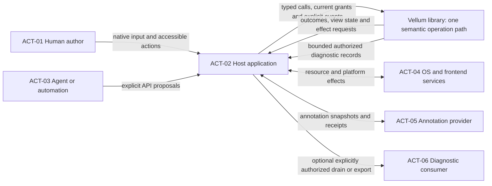

This is the v1 context. It has no listener, remote client, identity server,
telemetry collector or durable workflow service as a required participant.

### 2.2 Scope exclusions

No deferred deployment landscape is retained. The v1 context above is the active
scope; excluded capabilities have no modeled actor, journal or transport pathway.

## 3. C4 deployment/container view

Two thin reference applications demonstrate alternative host containers: one
graphical `iced` application and one `ratatui` terminal application. Embeddings may
use either, both or a headless host; neither adapter owns the application's loop.

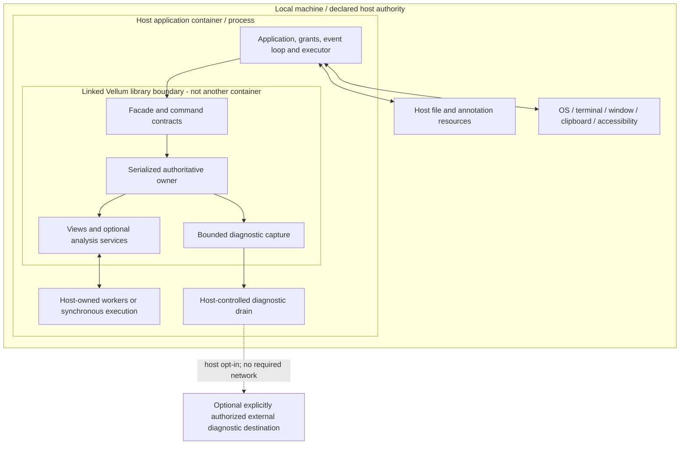

- One mutable owner per document incarnation; one coordinator serializes local
  validation/publication for its managed state. Independent authorities need not
  share a lock, process or global revision order.
- Workers own mutable parser/working state; accepted immutable results are shared.
  Thread-per-document, task pool, runtime and exact crate layout are TBD.
- A synchronous test host is supported. This does not reduce concurrent behavior
  to one sequential schedule in the assurance model.
- Process memory contains sensitive source/history/annotations. Trusted host,
  native grammar/scanner and provider code are in the trusted computing boundary;
  a library API is not a sandbox against them.
- Filesystem durability, OS crash dumps, remote mounts, clipboard relays and
  font/native-service behavior are host/platform assumptions, not implicit guarantees.

## 4. Components, ownership and dependencies

### 4.1 Component catalog

| ID | Component | Responsibility / owned state | Status |
|---|---|---|---|
| CMP-01 | Facade and command resolution | Typed/dynamic invocation; explicit targets; validation and structured outcomes | A |
| CMP-02 | Registry/configuration preparation | Engine command schemas, selected builtin handler declaration source, semantic setting resolution and staged coherent interpretation; no keymap/chord ownership | A |
| CMP-03 | Workspaces coordinator | Sole managed mutation/publication authority; consistent coordinator generations | A |
| CMP-04 | Document primitives | Authoritative source roots/revisions, immutable snapshot/edit/mapping mechanics under owner | A |
| CMP-05 | Annotation state | Authored bodies/versions and attachment evidence; distinct from transient decorations | A |
| CMP-06 | History | Scoped frontiers, linked groups, inverse data and retention eligibility | A |
| CMP-07 | Binding/lifecycle registry | Document/resource identity, binding generations, membership, disposal obligations and baselines | A |
| CMP-08 | Access and projection gate | Accepted local grants/policy state; bounded read/release and metadata projections | A |
| CMP-09 | Effect/outcome controller | Typed requests, attempts, cancellation intent, evidence, applicability and supervision-facing status | A |
| CMP-10 | Host execution/service ports | Executor/timers, modular resource substrates (local filesystem first), headless clipboard workflow integration, clipboard/annotation services and worker lifecycle integration; concrete OS/SDK/credential types and clipboard-specific workflow state stay outside the semantic engine | A |
| CMP-11 | Structural and language analysis | Optional grammar parsers, schema validators and supplied domain analysis for prose/code; versioned contexts and bounded embedded regions; no source ownership or required core indexer | A-opt |
| CMP-12 | Literal search | Snapshot/profile/scope-based matching and complete validated replacement plans | A |
| CMP-13 | Shared view semantics | Explicit logical selection/mapping contracts; optional adapter-facing viewport/decorations/geometry integration, not mandatory kernel presentation state | A |
| CMP-14 | Geometry providers | Coherent shape/bidi/wrap/hit-test output under shared adapter-facing policy | A: DEC-08 |
| CMP-15 | Frontend adapters | `iced` / `ratatui` keymaps/chords/modes, focus/gestures/preedit, presentation and native capability reporting; optional shared UI helpers | A |
| CMP-16 | Instrumentation capture | Safe bounded records/accounting; no subscriber/formatter callback inside publication | A |
| CMP-17 | Host diagnostic bridge | Authorized drain, format, optional SDK/sink integration and bounded shutdown | A-opt |

CMP-04 through CMP-09 name logical responsibilities, not independently mutable
copies or independent commit owners. CMP-03 publishes their relevant authoritative
changes coherently. View/selection state is distinct from source-text revision;
its mutations also follow the validated semantic path, not worker writes.

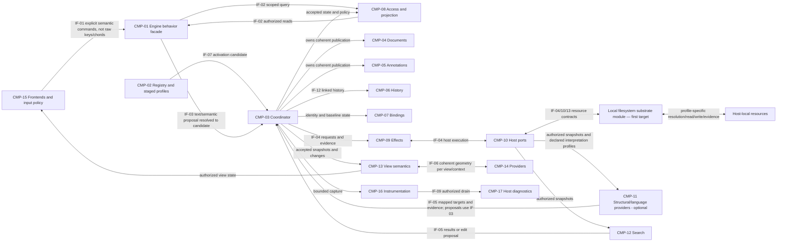

Arrows show selected runtime interactions, not crate import dependencies. The
local-filesystem node refines CMP-10's resource-module role; it is the first
implementation target, not an implemented provider or a new semantic authority.
No future S3 module/network instance is asserted by this graph. The
gate consults accepted owner/policy state; it is not an external policy callback
invoked during publication. Read/query/release interfaces below refine this view.
Only selected capture arrows are drawn; all source placements are cataloged by
INS IDs rather than repeated edges from every component.

### 4.2 Allowed dependency direction

| Consumer | Allowed dependency | Prohibited coupling |
|---|---|---|
| Document primitives | Framework-neutral text/identity/coordinate/change contracts | UI, filesystem, parser, executor, SDK or networking dependency |
| Coordinator/history/annotations/bindings | Primitives, typed policy/profile/effect contracts | UI dispatch or arbitrary host I/O/callback during publication |
| Facade/registry | Semantic operation contracts and coordinator interfaces | Separate mutation implementation per invocation surface |
| Structural/language/search providers | Authorized immutable source and typed target/context/evidence contracts | Core dependency on parser/schema runtimes, mutable owner access or parser-node identity as permanent target |
| Shared views | Accepted source/annotation projections, mappings and provider contract | Native event-loop ownership or private annotation data bypass |
| Geometry providers/adapters | Neutral layout/input contracts and their optional native backend | Core types importing framework-specific glyph/event/runtime objects |
| Host services | Typed effect/completion and lifecycle ports | Completion handlers writing owner state directly |
| Resource substrate modules | Engine-owned resource/effect/identity contracts; local filesystem is the first target | Engine dependency on filesystem/SDK/credential types; universal filesystem emulation or cross-module atomic persistence |
| Diagnostic bridge | Owned allowed records and release/health contracts | Exporter/subscriber dependencies required by text primitives or publication |

Dependency versions, features, source provenance and native asset compatibility
must be recorded before implementation selection. Optional grammar/schema/analysis/geometry/SDK
packages must not force their runtime dependencies into the minimal headless core.

### 4.3 Symbolic kernel, authority and edge mapping

Requirements §§3.4.1 and 5.2.1 clarify existing responsibilities, not a new graph
database or competing owner. V1 document state remains text-authoritative.

| State/role | Existing owners or gates | Constraint |
|---|---|---|
| Authored source and annotations | CMP-03 owns publication of CMP-04/CMP-05; CMP-06 retains eligible history | Source and authored annotation fields are not disposable semantic cache; explicit targets differ from automatically mapped evidence |
| Derived structure/symbols/validation/discovery | CMP-11 or host capability via CMP-10; IF-05 validates context | Provider provenance, exact source/region maps, grammar/schema/dialect versions, source/scope/configuration generations and coverage claims required; no independent mutation authority or universal stable symbol ID |
| Consumer projection | CMP-08 via IF-02/IF-08; CMP-13 supplies logical view state | Agent/tool queries and UI views are authorized projections, not parallel editable sources; hidden edges/counts/tokens cannot bypass release rules |
| File/provider edge | CMP-10 through IF-04/IF-10/IF-13 | Encoding and I/O mechanisms implement kernel fidelity/identity/evidence contracts; single-root Git publication does not atomically check out paths |
| UI edge | CMP-13 logical selections, CMP-14 optional geometry, CMP-15 input/presentation | Frontend input/preedit and layout/rendering translate semantic requests; logical selections and frontend preedit have separate owners and neither implies authored document history |

The runtime content twin is source-contextual data, unlike this design twin's
architecture catalogs. Physical graph storage, cross-domain ontology, inference,
workspace indexing, transport and structured-authoritative profiles are not
selected. Built-in semantic discovery remains outside approved v1 scope; supplied
plans/evidence use the same facade, validation and projection boundaries.

Prose, code and mixed documents share the authoritative source/change contracts;
they need not share one structural ontology. CMP-11 names optional provider
responsibilities, not a new mandatory runtime. Prefer established applicable
grammars/schemas under named versions/dialects/extensions; syntax, schema validity
and domain meaning remain distinct claims. A structural operation is a first-class
request through IF-01/IF-03 where supported, not a provider mutation bypass or a
promotion of deferred v1 features. Its required evidence determines availability.
Providers may be in-process or host-supplied; separation does not mandate IPC.
Optional schema validation here concerns document content; validating operation
envelopes and core typed contracts remains mandatory at admission.

The pathway is authorized snapshot acquisition through IF-02, bounded provider
interpretation/validation, context/evidence acceptance through IF-05, then a
versioned change proposal through IF-01/IF-03. Candidate conformance evidence is
prepared outside publication and checked against its declared dependencies at
the final boundary; no arbitrary parser/validator callback runs inside that
boundary. Missing/stale/ambiguous/partial evidence refuses the claimed structural
operation rather than silently weakening it. Handled provider failure leaves
ordinary source editing available; lossless preservation does not depend on a
successful parse. Lines, tokens and syntax nodes are contextual projections, not
owners, mutation authorities or mandatory graph-maintenance steps on every edit.
Actual provider failure containment/availability still requires implementation
evidence; an in-process native fault is not made safe by this logical boundary.

Specification §26.3 now separates target resolution, exact change planning and
source/candidate validation claims. Syntax, schema conformance and binding/
discovery are not interchangeable levels of authority. Required claims bind
their scope/query, exact target/candidate and captured interpretation context;
broader partial analysis does not preclude a complete narrower claim. Accepted
evidence still passes final current dependency/authority/publication checks.
formal/structural-targets.md records 1,024 private claim cases, three literal
prose/code/fence source fixtures and 26 controls. Provider truth, map/target/candidate
schemas, real conformance and companion/adapter refinement remain gates; no new
mandatory v1 operation or interpretation runtime is added.

Specification §26.4 now distinguishes exact source/candidate subjects, named
assertions/definitions/options, validation verdicts and contextual coverage.
Matching complete positive and definitive negative facts yield contested evidence,
not an arrival-order winner. Issuer-policy/definition-closure changes invalidate
captured applicability or need explicit reconciliation; recipient revocation does
not rewrite retained facts. Required assertions still come from accepted intent.
formal/validation-reports.md records 64 private report cases, 260 permutation/
duplicate cases and 24 controls. These are normalized trusted fixtures, not public
decoding, actual schemas, provider truth, candidate binding or retention refinement.

Specification §§26.5–26.6 further bind preparation to an engine-owned immutable
candidate, retained descriptor/required claims and non-aliasing scoped selector.
Candidate meaning cannot change through caller buffers or catalog rediscovery.
Required report intake authenticates/matches the relevant key before affecting
that candidate; equivalent duplicates are idempotent, reused identity with a
different payload blocks the affected gate, and lost retention cannot leave old
positive evidence established. Definitions use a bounded authorized preloaded
import closure, not implicit URI fetching. Ordinary exact edits without these
claims remain independent. IF-01/03/05/07 retain their roles; no new service or
arbitrary callback inside publication is introduced. formal/preparation-boundary.md
records 256 admission cases/30 controls and 1,536 closure cases/six controls, not
public codecs, actual authentication/physical retention or validator truth.

Specification §13.5 makes comment content/version and authored target/generation
separate fields. Updates validate the relevant version and preserve current other
fields; deletion validates both. Mapping evidence is not an authored body or target
update. formal/annotation-records.md records 48 private frame cases/18 controls;
full annotation history, mapping, optional metadata, persistence association and
recipient projection remain gates. These boundaries refine existing data and
interfaces, not object ownership across mixed-language sections.

Specification §29 now adopts a v1 reference profile: closed typed execution and
authorized discovery, lossless LF/CRLF/CR logical lines with zero-based byte
columns, Unicode 18.0.0/UAX 29 revision 49 default extended grapheme/word rules,
invocation groups with explicit bounded typing opt-in, versioned reference-host
JSON annotations, bundled pinned reference assets, typed settings, minimal bounded
capture and separate minimal core/providers/adapters with both iced/ratatui apps.
Identifier commands and visual layout remain distinct profiles; no mandatory
parser, JSON-LD, exporter, RPC or storage runtime enters the core. JSON location/
binding is host-supplied, not inferred from a filename. Existing IF-01/02/03/05/07/
09 retain their boundaries. Profile/default changes are material interpretation
changes; unsupported capability is explicit, not silent downgrade. Actual Unicode/
decoder/native conformance, concrete catalogs/assets and numeric measurement remain
gates. formal/reference-profile.md records the new finite reference scope.

Specification §29.4.1 fixes the reference annotation snapshot's exact JSON shape
and decimal-string integers. Authored historical target and current attached/
affected/detached placement are separate; stored identity/source claims are not
live grants or registry truth. Decode and immutable staging occur outside final
publication. A file load must revalidate the captured annotation-set dependency
before changing live records; capture alone does not prevent a concurrent overwrite.
Actual coordinator/history/identity validation remains necessary. No file is a history archive or source of executable
instructions. Both authored and located points require the explicit position/content
profile; affinity alone is insufficient. Decode/stage preserve each field without
defaulting or migration. formal/annotation-snapshot.md records 828 accepted values/
23 target shapes, 256 staging decisions, four mapping witnesses, 75 controls/five
mutants with baseline and 28 pinned structural/metaschema cases. IF-13 / INS-07
retain semantic-integrity/refusal signals without raw source/point identity labels.
These are design-reference/schema checks, not production decoder certification,
host identity, physical persistence or full publication refinement.

Specification §§13.6–13.7 fix F13's four native annotation request/result products
and the persisted-data activation boundary. Live document/record/source references
and required version fields are not casts of stored identities or decimal strings.
Mandatory engine dependencies cannot be stripped by request metadata. Fresh create
identity is engine-issued and bound to owned preparation. The annotation snapshot
generation tracks record projection changes without making every field edit depend
on an old full-set snapshot. Loaded data needs a complete current activation plan,
not implicit deletion/merge/reidentification. No new family, variant, network path,
callback or core store is added. formal/annotation-operations.md records 1,024
first-admission gate cases/86 controls, not actual load planning, all target branches,
full history/companions, registry truth, replay or Rust/wire implementation proof.

Specification §13.8 fixes F03's three native query products over one retained
coherent authorized annotation context. Enumeration derives ordered pages and
opaque continuation from the visible domain, not filtered global offsets. Record
and target-location queries share that same captured body/version/placement
context. Relevant policy/continuity change invalidates continuation; each bounded
owned handoff still checks current rights and availability. Withheld target data
is not detachment, unavailable retention is not empty content, and historical
location is not relabeled current. This uses existing read/release interfaces and
INS-03, not a new transport, global store or subscription mode.
formal/annotation-queries.md records 96 release cases, 512 paired comparisons,
18 traversals and 51 controls. Host projection truth, actual read-context/cursor
issuance and retention, native transfer and all target products remain gates.

Specification §§12.8–12.9 refine existing F02 `snapshot-handoff` and F19
`stop-observation`. F02's design label is now `read-document`: explicit mediated
source, annotation-only and combined contexts share a coherent captured root,
while source content access still requires its own grant. No family/variant or
execution category is added. Current capture and exact retained lookup are distinct
selection products; missing history never becomes latest. A scoped registry issues
context/record/continuation selectors within complete reply capacity, and retires
all dependent selectors on close/invalidation. Actual internal holds retain their
charges until discharged; selector invalidation is not physical reclamation.

```mermaid
stateDiagram-v2
  [*] --> Prepared: reserve and capture coherent projection
  Prepared --> Active: current validation and owned selector handoff
  Prepared --> Retired: refuse or stop; discharge actual preparation holds
  Active --> Active: bounded current query; immutable captured root
  Active --> Invalidated: owner close or relevant invalidation or eviction
  Invalidated --> Retired: final required internal hold discharges
  Retired --> [*]
```

New authorization allocates a different context, not an edge back to Active for
an invalidated identity. The base context is bounded/evictable, with no read lease,
minimum availability or mandatory clock TTL. Owner stop remains protected after
content revocation and under full ordinary read capacity. Raw snapshot disclosure
retains its separate trusted contract. This operates at existing read/observation
owners and INS-03/08/01/13/12, not a new service or core storage subsystem.
formal/read-contexts.md records 128 acquisition cases, 64 paired cases and 630
action edges over 222 states, 57 controls and eight rejected in-memory mutants.
Host roots/policy/history, actual selectors/native handoff, allocation charges and
complete adapters remain integration gates, not established by this reference.

Specification §12.10 selects coherent multi-document `read-version-set/1` at
F02's existing handoff. One explicit all-required participant vector under one
authority resolves from one published cut, not a join of independently current
reads. Parent/member installation and the permitted envelope are all-or-none.
Per-document source/annotation scopes remain independent; revisions need not
equal one another or the common publication generation. Named-set consistency is
not complete semantic discovery or cross-authority consistency.

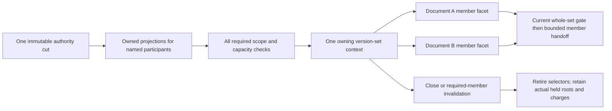

Every member query rechecks the parent and all required members. A member cannot
bypass this through the lower-level read path or independently close itself.
Explicit parent/member stop closes the owning set; losing a required member
invalidates further set delivery, not a silent subset. Reauthorization/subset
recovery creates a new context. Internal holds can retain individual member roots
and bounded parent metadata after selectors retire. The same engine owns this
registry overlay; no extra store, execution mode, transport or lease is introduced.
INS-03/08/01/13/12 observe acquisition, all-required validation, release and actual
hold discharge separately. formal/version-set-contexts.md records 256 admission
cases, 32 cut/order cases, nine scope combinations, eight paired cases, two edit
compositions and 270 edges/116 states, 59 controls/nine rejected mutants. Real
atomic root/host policy/history truth, native ownership/encoding and physical
resource/refinement evidence remain gates.

Specification §§13.9/14.4 add owned source/annotation field composition and linked
field-journal reversal at the existing coordinator. Before-source targets and
descriptor-bound candidate targets have separate validation bases; no guessed
future source token is accepted. Private annotation-set dependencies cover required
mapping without granting body visibility. Body and explicit target changes share
one record's authored history scope; automatic mapping is not authored history.
Source undo transforms current placements with retained actual inverse steps and
does not reinstall old annotation rows. Equal content after later work is not
frontier eligibility. New work retires complete dependent redo continuations.

formal/annotation-compounds.md records 128 gate cases, eight target cases with
undo/redo, two field-order cases, 29 controls and eight rejected mutants. It is a
body/target/source subset; separate §13.9.1 membership evidence is in PATH-04 and
formal/annotation-membership.md. Actual issuer/reservation and decoded gateway,
full mapping-history evidence and native/resource/replay refinement remain open.
The point-representation decision is resolved in §29.4.1: authored and located
points require explicit position/content profiles, independently of affinity.
The approved decode/stage path and subsequent native capture preserve both;
missing profiles reject without default or implicit migration. This does not
promote the earlier field-journal evidence to native restoration, complete
annotation persistence or all-sections closure.

Specification §14.5 refines existing F04 with scoped frontier, availability and
permitted blocking-detail products. Actual linked frontiers determine captured
eligibility, not the recipient-visible graph. History context issuance remains a
gate; a source/annotation snapshot is not silently a history context. INS-06/03/08
separate capture, current release and retained pressure from INS-02 reversal
publication. formal/history-queries.md records 192 release cases, 24 paired cases,
49 controls and five rejected mutants composed with the normalized compound
registry. Context/coverage/policy truth, complete reversal eligibility and native/
physical refinement remain open. No runtime component or operation is added.

Specification §14.6 selects F14's undo/redo request and owned admission products.
Exact group or expected scope-frontier intent freezes before queueing; private
required participant/source/annotation-set dependencies cannot be narrowed by a
caller or retargeted at publication. Existing owners retain preparation, history,
authorization, publication and result-release responsibilities; no new service or
execution mode is introduced. formal/history-reversal.md composes actual normalized
dependency union/reversal across 512 gate cases, 52 controls and six mutants. Real
invocation/terminal receipt truth, full replay/reply composition, membership and
general target restoration, physical accounting and native refinement remain open.

Specification §22.1.3 refines F01's list/inspect/advisory-enablement products.
Scoped coherent registry metadata and visible-domain continuation remain separate
from exact target-bound advice and actual invocation. Named schema descriptions
bind the registered contract/variant; presentation aliases cannot register handlers.
formal/contract-discovery.md composes selected native catalogs and actual routing
with 192 release cases, 216 paired comparisons, 18 traversals, 57 controls and six
mutants. Existing registry/release owners and INS-01/03/09/08/12 retain responsibility;
no network fetch, new execution mode or component is introduced. Actual registration/
schema truth, all-family handlers, actual registry integration, codecs and physical/
concurrent refinement remain open. Section 22.1.5 separately supplies actual native
context/selector ownership over an attested catalog port, not registry/handler truth.
Section 22.1.6 adds the selected built-in declaration source; its field/origin
correspondence does not establish all-family installed handlers or current policy.
The approved §29.4.1 point representation is unchanged;
native restoration and persistence integration remain separate gates.

Specification §23.1.2 refines F06's status, retained outcome, bounded wait and reserved
minimal control products, using existing F19 owner stop. Exact invocation/generation
and captured/current release scope fence observation independently of execution.
Closed waiters cannot revive; observation loss neither restarts work nor discharges
producer obligations. formal/execution-observation.md composes actual replay and
outcome projection: 192 release/64 projection cases, four wait actions, 2,801 traces/
6,136 observation edges, 56 controls and six mutants. Existing owners and
INS-01/03/04/08/13/12 retain responsibility; no runtime/transport is added. Real
registry/fact/policy truth, clock/scheduler progress, physical ownership and full
invocation/provider/native refinement remain gates; poll self-loops prove no time
progress. Point representation follows §29.4.1; native persistence integration,
not a position/content policy choice, remains open.

Specification §§22.2.1/22.3.1 refine F07 inspection and the settings portion of F16.
Typed scope resolution, explicit caller generations/dependencies and owned plans
preserve mandatory context and current per-layer authority. Activation publishes
affected profiles into current state without rolling back unrelated settings or
authored/effect state; held old interpretations remain intact. Source/view/analysis/
host semantic domains advance only for actual effective changes. Permitted origin
references are projected, never raw private workspace identities or absence proofs.
The earlier combined frontend fixture in formal/configuration-products.md composes
baseline replacement/dependency helpers:
128 activation gates, 18 resolution/order cases, 192 query gates, 24 paired cases,
63 controls/eight mutants. Existing owners and INS-01/03/09/08/12 retain responsibility.
Engine semantic keys/defaults, registry/provider activation, applicability/policy truth,
native/replay and physical refinement remain gates; native point persistence
integration remains open under the approved §29.4.1 representation.

Specification §22.3.2 assigns bounded map/default intents and chord interpretation
to frontend support, not F16 engine settings. Bind/block/fallthrough/removal and peer/prefix
conflicts are explicit. Lookup emits ordinary command intent with its exact target;
stale events and old cutoff identities cannot retarget or cancel a newer chord.
The earlier combined frontend fixture installs maps, cancels affected prefixes
and preserves unrelated contexts in one normalized publication. This is not a
joint engine/UI guarantee. INS-09/11/01/03/08/12 retain their layer-specific responsibilities; no runtime mode
or input execution authority is added. formal/keymap-products.md records 341 traces/
1,252 steps, 23 core/15 activation controls and eight actual-helper mutants. Physical
keys, default bindings, native IME/clock/identity/accounting, argument/replay/refinement
and registry/provider activation remain gates. Point representation is approved
in §29.4.1; native persistence/restoration remains a separate evidence gate.

## 5. Interfaces and contract boundaries

These are semantic interfaces, not Rust signatures, wire schemas or binary ABIs.
For every interface: define input bounds, lifetime/ownership, current authority,
failure/unknown behavior and observation at specification time.

| ID | Producer → consumer | Contract / freshness / failure | Instrumentation |
|---|---|---|---|
| IF-01 | Host/agent/frontend → facade | Versioned registered command/query and authorized bounded metadata; explicit object/context/target sets independent of focus and bounded discovery scope when applicable; admission, rejection, pending and outcome distinct; no required graph query language | INS-01 |
| IF-02 | Access gate → recipient/worker | Bounded authorized projection/snapshot with source context and publication handoff; explicit single or all-required multi-document cut, parent validation for every member release; current release and retention apply; unavailable context explicit; raw snapshot release is disclosure; semantic edges/counts/tokens gated; named/filtered results do not claim global completeness | INS-03 |
| IF-03 | Prepared candidate → coordinator | Shared source-change semantics for all write participants, mappings/history and invalidation; source-write scope distinct from read/discovery dependencies, expected contents, capabilities and resources; stale/ambiguous/exceeded scope rejects whole publication; typed state participation, no arbitrary callbacks; atomic publication or unchanged rejection | INS-02 |
| IF-04 | Effect controller ↔ host service | Typed operation/effect/attempt, captured destination/binding, guarantee and immutable payload; receipt validation, unknown outcomes and retry ownership | INS-04 |
| IF-05 | Structural/schema/language/search provider or host evidence → result gate | Source incarnations/versions, exact region maps, grammar/schema/dialect/profile/query/discovery scope and provider generations/provenance; syntax/schema/meaning claims distinct; complete-within-declared-scope versus partial/unsupported/unknown; accept, supersede, reject or unavailable; no direct mutation or completeness inferred from a token | INS-05 |
| IF-06 | View service ↔ geometry provider | Coherent per-view layout/context, caret/affinity, projection and valid hit targets; unsupported/partial geometry explicit; concrete profile conformance pending | INS-10 |
| IF-07 | Registry/staging → owner | Coherent compatible profile, expected activation generation, affected dependencies; atomic activation or retained prior profile/degradation | INS-09 |
| IF-08 | Event/health source → recipient | Authorized source-context events/status and subscription validity; bounded release checks; explicit gaps/invalidation and authorized snapshot resynchronization, no private sequence leakage | INS-03, INS-12 |
| IF-09 | Capture → host diagnostic bridge | Schema-allowed owned records; bounded non-waiting capture, separate authorized drain, safe formatting and explicit loss | INS-12 |
| IF-10 | Host resolver ↔ binding registry | Host-scoped identity/equivalence/freshness and authorized destination; duplicate/alias/rebind conflict without overwriting unsaved state | INS-08 |
| IF-11 | Native input/accessibility ↔ adapter | Keys versus committed text/preedit; focus/view incarnation and coordinate profile; disclosure-limited surrounding text and current actions | INS-11 |
| IF-12 | Explicit history scope → history/owner | Complete linked participants and frontiers, retained inverse data/current rights; atomic reversal or blocked/unavailable, no hidden cascade | INS-06 |
| IF-13 | Source/annotation snapshot ↔ persistence preparation | Exact serialized profile and baseline/binding evidence, preflight encoding, per-artifact outcome and acknowledgment strength | INS-07, INS-04 |

One implementation may realize several interfaces in one call; IDs do not imply
network hops or separate threads. IF-02/IF-08 release gates use locally accepted
policy or an explicit externally supplied validity contract, never hidden I/O in
IF-03. Trusted code holding unrestricted memory lies outside mediated-read control.

## 6. Identity, authority and version model

### 6.1 Identity catalog

| ID | Dimension | Meaning and prohibited inference |
|---|---|---|
| ID-01 | Initiating access context/principal | Host-established local subject/grant; caller author labels or trace IDs are not authentication |
| ID-02 | Client/device and executor | Distinct submitting and performing roles; executor credentials do not prove human authorship; remote device authentication is D |
| ID-03 | Resource authority | Owns admission/commit policy; physical/network proximity does not grant authority |
| ID-04 | Workspace membership | Logical grouping across code/notes/domains, neither tenant nor transaction/permission boundary by itself |
| ID-05 | Document identity and incarnation | Logical editing entity plus non-confusable live lifetime; path/content equality does not identify it |
| ID-06 | Resource key/locator/binding generation | Host-declared equivalence/lifetime, routing name and current relationship; aliases and rebind require validation |
| ID-07 | Text revision/coordinator generation | Text version per incarnation versus coherent local publication; not global clocks or public cross-scope activity counters |
| ID-08 | Annotation identity/content version/attachment generation | Authored content versus mapped target evidence; present/retained-absent/retired lifecycle distinguishes reversible membership removal from absorbing retirement. Restoration preserves logical identity, advances both retained version floors and rechecks current rights; never restores grants or permits incarnation reuse |
| ID-09 | View/input/layout context | Independent selections, composition, dimensions and geometry generation; focus changes cannot retarget late work |
| ID-10 | Configuration/policy/analysis generations | Accepted schema/profile, current grants, grammar/query/region context; not one interchangeable counter |
| ID-11 | Operation and linked history group | Logical request versus reversal grouping; undo/redo gets a fresh operation linked to retained history |
| ID-12 | Effect and attempt | External/computational request and execution attempt; timeout/cancel is not outcome evidence |
| ID-13 | Recipient/projection scope and token | Permitted view/disclosure purpose/destination; scoped tokens cannot reveal hidden sequence or confer access |
| ID-14 | Diagnostic correlation | Bounded audience-scoped attribution only; never a capability or unbounded metric label |

### 6.2 Authority/data relationship

For §22.1.8, the fixed IF-01 declaration source supplies frozen guard-owned fields
under an explicit discovery profile. IF-02 metadata release retains source origin,
captured/current schema ceilings and opaque context-local selectors. A structurally
valid request, positive target-bound advice or discovery reference is not IF-03
mutation authority. Current source/selection/handle/configuration and companion
checks remain at the actual preparation/publication paths. Unknown authority and
established loss retain separate lifecycle effects; protected cleanup does not
refund issuance. This adds no external provider or UI execution path.

For §13.9.5, IF-01 advice and IF-03 publication evaluate the same conjunction
against the actual CMP-03 owner root and complete invocation context. Source,
annotation, configuration and workspace identities retain separate version
domains; one current condition cannot stand in for another. Read-only participants
remain outside authored history. Advice leaves root/accounting unchanged, and
later native progress requires current revalidation. Fixed finite predicate-set
lattice evidence does not establish complete semantic footprint discovery.

For §22.3.1.11, IF-01 supplies a lifecycle basis and ordered ordinary write bases
to CMP-02 preparation. Complete bounded selector/native validation and all layer
footprints precede stateful permission-loss observation. IF-03 revalidates the
original handles, current actual incarnations, registry/association rights and
mandatory/declared dependencies through the existing CMP-03 settings participant.
Historical creation references, fresh layer conditions, lifecycle conditions and
invocation tickets have separate lifetimes; no reference implies authority.
Source-only progress and its transform journal remain framed. Faulted owners deny
ordinary use but retain protected individual discharge through CMP-04. No I/O,
presentation dependency or network path is added.

ID-10's selected configuration conditions have distinct footprints. Declaration
bases capture the native schema/restriction/association triple; lifecycle bases
capture configuration generation plus nonrefunding incarnation high-water.
Both are private first-party conditions, not IF-02 read tokens, ordinary layer
write bases or mutation grants. Their opaque references retain complete owner/
domain/context/profile binding in CMP-02's shared bounded pool. Conditional
availability is separately authorized from changed-facet/per-identity mutation.

For §22.3.1.10, IF-01's explicitly requested result preparation reserves private
result/frame/configuration staging costs in the actual parent. CMP-03 commits
opaque creation references with the common root/outcome; IF-07 release intersects
captured and current policy. A later first-party IF-01 write-basis acquisition
checks the original full incarnation and actual current grants/dependencies again.
Historical result availability does not imply layer existence or write authority.
Reference forget, fresh-basis retirement and invocation issuance are distinct.
No source/file conversion or external service is needed for these transitions.

For §22.3.1.9, IF-01 → CMP-03 preparation → IF-03 publication privately derives
document/generation conditions from the original metadata-only basis. Capture,
use and current target grants bind all execution-context fields; the owner binds
authority/engine rather than requiring every recipient to be the opening recipient.
The dedicated finite pool charges the actual parent without requiring configuration
state or retaining source. Ordinary source progress commutes unless an explicit
dependency says otherwise; disposal or changed metadata invalidates the condition.
IF-13 persistence captures retain their own original settings and acknowledgments.
Basis stop/release, invocation stop/retirement and external quiescence are distinct.

For §22.3.1.8, IF-01 → CMP-02 preparation → IF-03 publication privately materializes
new authority/incarnations and resolves bounded creation indices. Existing host
proposal identities do not settle public created-reference/result encoding.
Native current dependency/grant and root-capacity checks remain at publication;
source-only progress can commute while actual configuration progress stales the
lifecycle condition. No provider I/O, network or presentation step is introduced.
INS-09 attributes permitted conditional capture/use/loss, private preparation,
changed/no-op activation and retained logical occupancy; INS-12 governs diagnostic
capture of those signals and INS-13 protected discharge. No raw allocator epochs,
handles or hidden configuration details belong in ordinary labels. Reference
root/configuration/intent byte limits do not prove physical accounting or host truth.

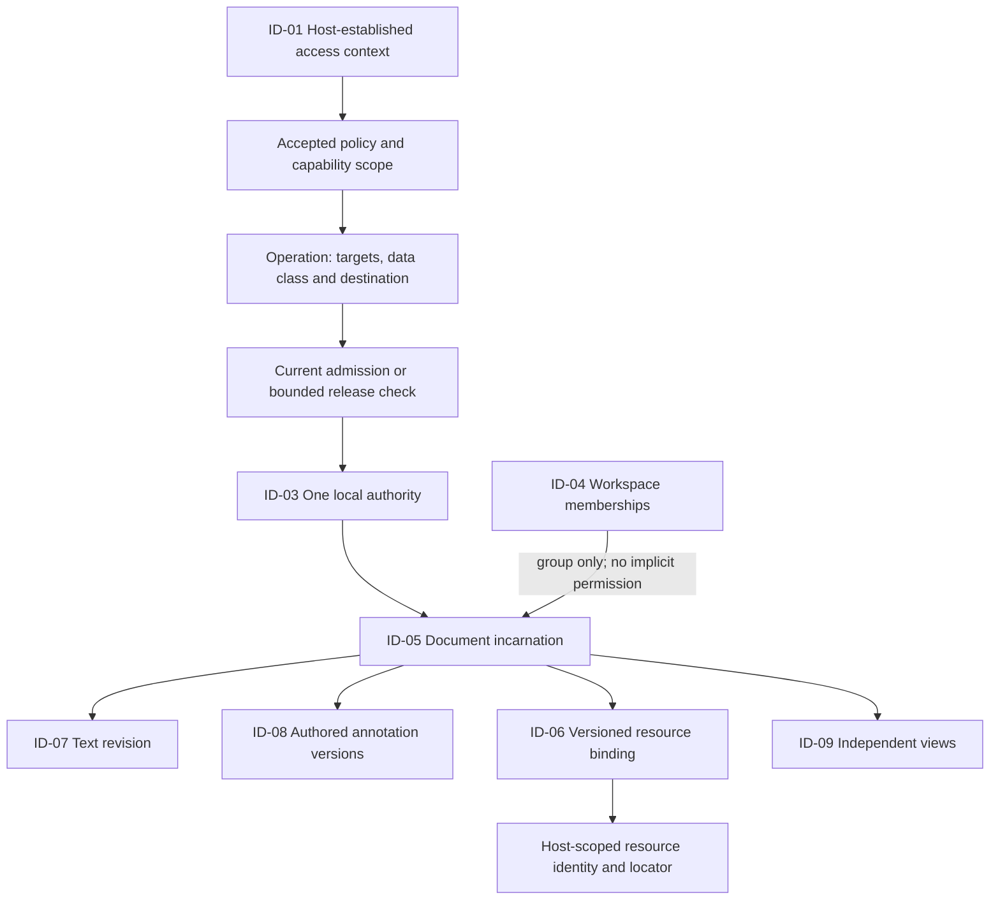

Capability checks apply separately to source/history/annotation reads, mutation,
disclosure/export and effect execution according to the supported host profile.
Policy changes affect future mediated releases/actions; they cannot recall bytes
or effects already delivered. A signed/authentic document or comment is still data,
not an instruction grant. Activation as agent instructions is a separate D contract.

## 7. Trust boundaries, network paths and data assets

### 7.1 Trust boundaries

| ID | Boundary | Required controls / limits |
|---|---|---|
| TB-01 | Input/API data → semantic admission | Bound/validate schema, target, access context, current capabilities and profile; pasted text is not command replay |
| TB-02 | Authority → recipient/worker projection | Current bounded disclosure checks, source/annotation/history separation, safe scoped metadata; raw snapshot is explicit disclosure |
| TB-03 | Prepared/derived/host result → owner | Incarnation/generation/attempt/dependency checks; accepted evidence versus applicable result; no direct worker writes |
| TB-04 | Library ↔ host resource/OS service | Explicit effect identity, destination, guarantees, authorization, ordering, loss/unknown and cleanup responsibility |
| TB-05 | Data/assets/config → native/provider execution | Grammar/scanner/font/provider loading is trusted code/resource preparation, not document-controlled downloads or a sandbox |
| TB-06 | Diagnostic capture → consumer/sink | Collection allowlists, bounded execution, authorized scoped drain, safe rendering, destination and retention policy |
| TB-07 | Process/lifetime → retained memory or disposal | Retention obligations, revoked new access, invalid handles, outstanding effects; no promise of secure erasure or process-fault containment |

TB-01/TB-02/TB-03 are semantic enforcement boundaries inside a trusted process,
not memory-protection barriers. External attacker-controlled text remains untrusted
even after it is stored in an otherwise trusted host's file or annotation store.

### 7.2 Network/connection inventory

| ID | Path | v1/future status and contract |
|---|---|---|
| NET-01 | Host ↔ linked library | A: in-process Rust calls/events; no socket, listener, port or network auth required |
| NET-02 | Host ↔ files/annotation/OS services | A: local reference services; host may substitute remote storage or clipboard relay only with explicit disclosure/guarantee profile. Transport and credentials are host-owned |
| NET-03 | Host diagnostic bridge ↔ external sink | A-opt host integration, off unless configured; endpoint/recipient, confidentiality/integrity, authentication, retention and retry bounds must be specified before enabling. No core exporter |

No path may become authorized merely because it is on the same machine/network.
Record concrete endpoints, credentials' ownership, connection establishment,
timeouts, termination and offline behavior before an optional network deployment;
do not put actual credentials or private deployment addresses in the twin.

### 7.3 Data asset inventory

| ID | Asset / owner | Sensitivity, retention and release |
|---|---|---|
| DAT-01 | Authoritative source / CMP-03, CMP-04 | Sensitive logical UTF-8 text; preserve until authorized lifecycle disposition; source reads and external writes separately authorized |
| DAT-02 | Immutable snapshots/candidates / owner and trusted workers | May retain old secrets; bounded snapshot/staging budgets; raw delivery is disclosure, not revocable memory |
| DAT-03 | Authored annotations/attachments / CMP-05 | Bodies, identity, provenance, targets and quoted context may be private; separate versions/persistence and recipient projections; persisted authored/located points retain explicit position/content profiles without defaulting; file claims do not prove mapping continuity |
| DAT-04 | History/frontiers/inverse data / CMP-06 | Deleted source/comment content and links may be sensitive; bounded consistent floors; history-read rights not implied by current source access |
| DAT-05 | Bindings/baselines/serialization metadata / CMP-07 | Paths/resource identity, content snapshots, BOM/settings and external tokens; do not log locators or treat baseline equality as external freshness; native annotation artifacts retain complete live fields with explicit host/source aliases and immutable captured bases, not restoration/write authority |
| DAT-06 | Logical selections/mapping / CMP-13; frontend preedit/screen context / CMP-15 | Distinct owners: logical ranges participate in validated semantic mapping; temporary preedit/focus/input state remains frontend-local, not source undo/save/parse content; surrounding-text release bounded |
| DAT-07 | Derived parse/search/layout and supplied semantic evidence / CMP-10–CMP-14 | Can reproduce sensitive source or hidden relationships; source/scope/provider-context-bound caches with explicit coverage, bounded demand and access scope; derived evidence is not authority; §6.5.2.3 retains original native reply frames under a separate logical charge; size/origin metadata is not query authority or lifetime |
| DAT-08 | Effects/receipts/operation outcomes / CMP-09 and host | General payloads may contain full content; native F13 receipts retain only original invocation/operation, native identity, historical membership and authored versions, never a root/body/target snapshot. Native result disclosure meets copied admission ceiling and current bound grant; eviction does not restore execution. F14 receipts retain only original decision/direction/target references under scoped grants; F06 observation contexts retain bounded copied metadata/projected signatures and owned reference/wait records, not separate historical roots; their parent authority handle keeps ancestor ownership/charges live until discharged. Wait termination does not discharge producer/provider ownership. Shared observation admission retains bounded reservation/context bindings, reusable charges and consumed quotas; observer stop is not shared discharge. Scoped clipboard cancellation preserves the accepted provider fact and separate local pin/provider obligation; local stop never implies provider quiescence. Owned F17 SaveAs receipts retain only invocation/status/operation/document under the lifecycle ceiling and current release; the private task-bound producer authority is not serialized or granted by that receipt. Owned initial-load F17 receipts additionally retain the exact created/joined/already-activated disposition; private read-task/codec/paired-writer authority is not serialized. Actual read retirement revokes that authority rather than retaining retired task records through its handle. Other late/unknown evidence retains its own bounded obligations |
| DAT-09 | Profiles/grants/registry / CMP-02, CMP-08 | Configuration may contain private values and code-loading authority; no implicit activation from source content; versioned accepted state |
| DAT-10 | Diagnostic records/counters / CMP-16, CMP-17 | Allowed operational fields only by default; metadata still sensitive; bounded capture/retention, safe scoped release and no raw objects |

All retention is bounded by a declared policy; concrete durations/counts/bytes are
TBD. Eviction may discard eligible cache/history according to its contract, not
silently discard unsaved authored source/comments or authoritative effect evidence.
Copies already disclosed, OS/native dumps and host backups are outside an editor-only
erasure guarantee. Native/library code and test fixtures also require provenance.

### 7.4 Data-flow catalog

| ID | Source → destination | Data / transformation | Boundaries / interfaces |
|---|---|---|---|
| DF-01 | Human/native services → frontend-local interpretation → engine behavior facade | Keys/preedit/native coordinates stay frontend-local; only resolved semantic requests and separately authorized source queries cross IF-01; no raw-key Unicode reconstruction or implicit focus retargeting | TB-01; IF-11, IF-01 |
| DF-02 | Agent/host → facade → preparation | Declared edits, object-read/discovery-scope dependencies and expected contents → bounded versioned candidate; provenance/coverage not assumed from graph edges or clean Git merge; no built-in semantic completeness oracle | TB-01, TB-03; IF-01, IF-03 |
| DF-03 | Owner/access gate → worker or caller | DAT-01/DAT-03/DAT-04 → authorized snapshot/projection; retention is not grant renewal | TB-02; IF-02 |
| DF-04 | Worker/host evidence → owner/result gate → authorized consumers | DAT-07 source/scope/provider-context-bound output → accept/reject/supersede or concrete edit proposal through normal validation; subsequent agent/UI release passes IF-02; selected F11 replacement retains original native result identity and separate capture/reply charges, without re-search or grant renewal | TB-02, TB-03; IF-05, IF-03, IF-02 |
| DF-05 | Owner → host → source resource → receipt controller | Captured source/profile/binding/baseline → encoded bytes → explicit outcome/acknowledgment; no joint multi-file durability implied | TB-04; IF-13, IF-04 |
| DF-06 | Owner → annotation provider → receipt controller | Captured annotation bodies/attachment/source-version evidence → host serialization → separate persistence outcome | TB-02, TB-04; IF-13, IF-04 |
| DF-07 | Owner/event/health state → recipient | Current projection → bounded query/subscription release; filter metadata/cursors/conflicts, not only bodies | TB-02; IF-02, IF-08 |
| DF-08 | Component milestone → capture → host bridge → sink | Classified primitive record → bounded queue/accounting → current authorized projection → sink-safe rendering/export | TB-06; IF-09 |
| DF-09 | Host/config input → staging → accepted profile/provider | Validated settings/assets/grants → coherent activation, separate from external preparation and old work context | TB-01, TB-05, TB-03; IF-07 |
| DF-10 | Authorized source/annotations/preedit → view/provider → native interface | Logical content → mapped geometry/decorations → paint, pointer/IME/accessibility; source remains unchanged | TB-02, TB-05; IF-06, IF-11 |
| DF-11 | Clipboard ↔ host ↔ owner | Exact permitted payload → staged cut/paste validation; export and deletion are separate effects/transitions | TB-01, TB-02, TB-04; IF-04, IF-03 |

## 8. Execution pathways

Each pathway lists ordering and important branches, not final event enums. Work
may be prepared concurrently; authoritative transitions serialize locally. Every
path is subject to current grants, declared resource bounds and structured outcomes.

### PATH-01: input/API proposal to atomic local edit

1. IF-11 translates native input, or IF-01 accepts a host/agent request; resolve
   interactive focus into explicit target incarnation/context.
2. Resolve registered schema/profile and accepted access scope; reject malformed,
   unsupported, denied or unadmittable requests without required content effects.
3. Read authorized identified snapshots; prepare complete change sets, participant
   list, mappings, inverse/history metadata and non-text dependency evidence.
   For supplied semantic plans, retain object-read and discovery-scope context
   and the provider's limited coverage claim; graph traversal creates no authority.
4. Stage all candidate state and necessary required-effect capacity. No arbitrary
   host I/O, code loading or subscriber callback runs in final publication.
5. CMP-03 revalidates text/non-text dependencies, current authority/read-only rules,
   incarnations, expected contents and capacities. Reject stale/conflicting work
   without publishing any participant.
6. Publish one coherent generation with fresh changed-text revisions, annotation
   attachment state and linked history. Capture only bounded safe milestone data.
7. Return authoritative outcome; expose committed snapshots/events through gates;
   dispatch declared effects through the host. Later effect failure cannot uncommit.

Workspace read predicates (§13.9.4) use actual current membership generations in
this owner decision. They are a declared read footprint, not a second workspace
owner, file-tree snapshot or implicit source dependency. Cross-workspace membership
does not duplicate documents, and read-only workspaces never become history writers.
Currentness and exact whole-predicate observation permission are independent checks.

```mermaid
sequenceDiagram
  participant Caller as Host or frontend
  participant API as CMP-01 Facade
  participant Prep as Candidate preparation
  participant Owner as CMP-03 Owner
  participant Host as CMP-10 Host ports
  Caller->>API: IF-01 explicit target, context and command
  API->>Prep: Accepted schema and authorized snapshots
  Note over Prep: Normalize unambiguous record order once; preserve boundaries and metadata
  Prep->>Owner: IF-03 complete candidate and dependencies
  alt Invalid or stale at final validation
    Owner-->>Caller: Rejected/conflict, no partial mutation
  else Valid bounded semantic identity without effect intent
    Note over Owner: Final checks still apply; preserve current edit state and bookkeeping
    Owner-->>Caller: Validated unchanged success; bounded status is separate
  else Valid within bounds with meaningful local change
    Note over Owner: Bounded serialized validation and atomic publication
    Owner-->>Caller: Applied outcome and new generation
    opt Declared host effect
      Owner->>Host: IF-04 declared effect request
      Host-->>Owner: Typed completion, possibly late or unknown
      Note over Owner: Reconcile evidence and applicability separately
    end
  end
```

Source: §§3.4, 4.4, 5.1–5.3. Observations: INS-01, INS-02, INS-04.

Specification §6.4.1 closes the normalized equal-byte annotation-mapping refusal
through existing compound/ordinary/search/clipboard paths. Classify semantic
projections before bookkeeping. Automatic placement/view-only changes preserve
source revision and authored history, advancing only changed annotation/selection
generations and one publication. Actual authored body/target/text participants keep
their scopes. Current private annotation/all-view dependencies and safe required
counters still gate publication. Equal byte values do not restore content identity.

```mermaid
flowchart LR
  E[Validated exact source transforms] --> C[Compare staged semantic projections]
  C --> I[Complete identity preserves root]
  C --> M[Automatic placement and current view changes]
  M --> P[One publication with separate generations]
  C --> A[Actual authored body target or text changes]
  A --> H[Journal only actual authored participants]
  H --> P
  P --> R[Current recipient outcome and event projection]
```

An applied mapping candidate cannot be discarded because source/view values compare
equal. Derived mapping alone neither creates nor invalidates authored undo/redo.
Native F14 reverses actual participants, preserving current conservative placement
rather than reattaching from equal text. Unchanged source/revision mints no parser
transform; annotation/view consumers retain their own context dependencies.

The 8,060 single/paired-edit survival-oracle cases, 256 gate decisions, thirteen
controls/eleven mutants and arguments are scoped evidence in
formal/equal-byte-companions.md. Paired source/version/history/view frames do not
prove complete outcome/status/event/cache/timing noninterference: internal Applied/
Unchanged, raw publication and annotation counters can differ across hidden worlds
and need protected projection. All other profiles, general target restoration,
full invocation/replay/events, native/concurrent/physical/production and independent
assurance remain gates. Earlier equal-byte refusal wording is superseded for this
normalized subset; universal proof flags remain false. INS-01/02/06/03 separate
classification/publication/history/private release; INS-05/10/13 derived contexts
and capacity. MELT/RED/USE/golden signals track those phases; STRIDE addresses false
identity, stale dependencies and overflow; LINDDUN hidden activity through outcomes/
tokens/timing. No raw private target/body/identity/global count metric labels or new
component, transport, parser runtime or undo policy is introduced.

Owned invocation/publication composition (§6.5.1) connects the existing engine root
to one bounded replay ledger shared by typed/dynamic routes, documents and recipients,
not an engine per file or per recipient. Each issued invocation separately binds
and rechecks its recipient/purpose/destination/profile/continuity.
Owned issued identities bind complete immutable prepared intent; no cache miss,
result eviction, retirement or changed source can make an old identity execute again.
Stage actual compound source/annotation/current-view/history or originally owned
native F14 reversal; preserve committed parser journals. Install root plus reserved
terminal facts together before optional observer delivery. Faults fence the domain
with Unknown rather than fabricated nonpublication or automatic restart.

```mermaid
flowchart LR
  T[Typed route] --> A[One owned bounded invocation admission]
  D[Dynamic route] --> A
  A -->|first binding only| P[Actual current compound or owned native reversal]
  A -->|matching retry| O[Existing pending or retained facts]
  P --> C[One root and terminal-fact installation]
  C --> O
  O --> R[Current recipient and capture-ceiling release]
  C --> E[Post-publication observer outside critical path]
```

Conditional induction, 512 admission/256 publication/128 release/1,024 policy/
64 paired cases, 720 permutations/4,320 edges, seventeen controls/25 mutants are in
formal/invocation-publication.md. Supplied unique-domain/policy/reservation truth,
all operation/effect/wait/event gateways, actual concurrent/physical/crash/native/
timing/resource/hostile-decoder and independent refinement remain gates. INS-01/02/
03/06/13 separate first admission/retries, authoritative disposition, current release,
linked history and protected control/retention. MELT/RED/USE/golden signals keep
logical operations distinct from attempts; STRIDE covers ticket/intent/partial-root
faults and LINDDUN hidden status/retained linkage. No new model node/interface,
transport, identity service or public family is introduced.

Owned editing invocation adapters (§6.5.2) retain the original selection/literal,
line, Unicode logical or literal-replacement preparation and bounded private semantic
snapshot. Equal-looking proxy handles do not prove identity or complete intent.
Recheck the original owned data, then actual current source/view/query/settings/
evidence eligibility; do not reprepare old work or invoke search/native tools inside
publication. View-only commands preserve independent source/comment/history rights.
Actual producer candidates join the same shared engine root/fact decision.

```mermaid
flowchart LR
  P[Existing owned producer preparation] --> B[Bound identity and complete private descriptor]
  B --> I[Shared invocation entry and one eligible run]
  I --> V[Original producer validates current dependencies]
  V --> C[Actual candidate and reserved root/fact installation]
  I --> F[Unexpected private meaning drift fences domain]
  C --> R[Existing current outcome release]
```

The 1,024 admission/512 publication/512 release cases, 2,880 traces/17,280 edges,
sixteen controls/fifteen mutants and conditional arguments are in
formal/editing-invocations.md. Acknowledged clipboard local task/root/fact commit
is separately composed in §6.5.3; other families and decoded-request gateways,
host truth/retention, all selection profiles, native/
concurrent/physical/timing/resource/decoder and independent refinement remain gates.
INS-01/02/03/05/06/09/11/13 distinguish bounded capture/replay, actual disposition,
current release, evidence/history, interpretation and protected control. MELT/RED/
USE/golden signals keep phases/counts separate; STRIDE covers lookalikes, context
drift and quota bypass, LINDDUN private descriptors/linkage. No new catalog node,
public family, identity service, callback registration or transport is introduced.

Acknowledged cut/paste continuations (§6.5.3) keep the original task, invocation,
bounded semantic capture and accepted receipt in one single-ticket-owned capsule.
They stage actual current ordinary publication without marking the task successful.
The outer engine root/outcome checks precede task commit and trusted root/fact/done
installation. Local refusal spends eligibility but does not erase accepted external
evidence; unexpected fault preserves Unknown and fences the domain. No-op remains
Unchanged. Capsule pins, bounded stages, provider work and origin issuance have
separate lifetimes; ledger retirement cannot discharge provider work or uncertainty.

```mermaid
flowchart LR
  E[Accepted original clipboard receipt] --> P[Owned pinned local continuation]
  P --> S[Actual current edit staged without task success]
  S --> V[Outer root bound and reserved outcome validated]
  V --> C[Trusted task disposition and root fact done installation]
  V --> N[Known local refusal retains external evidence]
  C --> R[Current scoped outcome release]
  E --> Q[Independent quiescence and retention drain]
  C --> L[Late contradiction retained without source rollback]
```

formal/clipboard-invocations.md supplies conditional arguments, 512 admission/1,024
publication/256 release cases, 1,440 traces/8,640 edges and sixteen controls/eighteen
mutants. PATH-01/06, DF-11, IF-01/03/04/08 and INS-01/02/03/04/06/11/13 distinguish
provider acknowledgment, local staging/installation, current release, late evidence
and pins/stages/work. MELT/RED/golden signals separate local and provider completion;
USE tracks held stages/pins; STRIDE covers partial task/root/fact publication and
claim substitution, LINDDUN retained descriptor/linkage. No private labels are added.
Full decoded admission/dispatch replay, copy/provider gateways, live execution/event
aggregation, native acknowledgment/retention truth, actual concurrent/crash/physical/
decoder/production and independent refinement remain gates. This changes existing
owner composition, not the component/interface/network catalog or point-storage choice.

### PATH-02: read, history inspection and subscription release

Rust annotation/combined preparation (§12.8.5, preparation only): the actual owner
has an immutable independently parent-funded preparation pool with native cut
tombstones, retained facet envelopes and request/copy/scope workspace even at zero
prepared capacity. Complete bounded native host rows must match every actual
present annotation exactly once; rows select visibility/body/target facets, never
content. Hidden rows leave no retained row identity/body/location, and visible
rows retain only admitted fields. Annotation-only cuts have no source value,
revision capture or source-product profile; an authorized target facet may still
contain its own permitted placement revision. Combined cuts copy source and
annotations from that same actual root with an explicit immutable source profile.
No raw trusted AnnotationSnapshot is reused to widen the projection.

Preparation validates whole-root, scope, request, row, capture, selector and
combined-source envelopes before issuing a private cut. Subsequent publication
does not refresh its values. Fresh nonconsuming handoff validation binds the
actual original cut and full scope, then independently requires whole-facet/source
authority and actual live document. Recognized loss (including stopped annotation
observation), disposal or owner fault invalidates cut aliases despite ordinary
pressure; unknown/transient facts do not establish loss. Out-of-class source
permission does not affect annotation-only cuts. Protected discard removes a cut
without refunding its pool or spent issuance; empty-pool retirement refunds once,
preserves issuance and cannot reopen. Cleanup does not heal a fault. INS-01/03/08
distinguishes configuration, preparation, handoff validation/loss and discharge
through bounded optional content-free records, not authored publication or real
timing. Installed ownership, combined F02 source queries and combined F05 search
are described below; arbitrary historical lookup/full public products remain open.
No UI, transport, filesystem or provider callback is added.

Rust installed annotation/combined ownership (§12.8.5, partial): a distinct
immutable pool reserves context/issuance slots, retained projection/scope and
independent request/copy/reply workspace against actual remaining parent headroom.
It bootstraps the actual preparation domain, then owns its domain/values without
depending on the preparation pool's subsequent lifetime. Complete original cut,
scope and input-envelope checks precede current whole-projection validation;
known loss still invalidates a cut when installed occupancy/issuance is full.
Context/capture/row/reply limits and registry invariants precede consumption.
The complete acquisition token/class result is staged before the nonallocating
cut-to-context ownership move. Ordinary refusal consumes nothing. A precommit trap
or owned registry drift fences the engine, leaves the cut intact and installs no
partial context. Preparation and installed funding/issuance discharge independently.

Combined F02 range/line reads use the original retained source/version and shared
native source materialization. Complete original identity/scope, request and scalar/
line shape precede accepted loss. Both admitted classes, actual live document and
current whole-facet authority remain required; source-profile and installed request/
reply ceilings intersect. Validation scans use the admitted source bound; separate
delivery scan/reply refusal cannot conceal loss. Annotation-only contexts contain
no source/profile and reject source requests before out-of-class loss. Publications
never refresh a context. Stop fences aliases; protected row retirement requires
stop/discharge and refunds no issuance/fixed funding. Empty installed-pool retirement
refunds once without reopening. Returned copies are not recalled. INS-01/03/08/13
distinguishes configuration, installation, source release, invalidation and protected
cleanup through bounded optional content-free signals, not authored publication or
invented timing. F03 selector/page and F05 combined-result ownership are implemented
below; retained/version-set/public products and
independent refinement remain open. Component/interface/network boundaries do not
change, and there is no new scheduler, UI or substrate effect.

Rust F03 current-context reader (§12.8.5): enumeration, inspection and target-location
queries resolve only original installed context/record/continuation identities.
Complete scope and typed request, selector kind/context and continuation limit/
position checks precede accepted loss; malformed or cross-context requests do not
poison another snapshot. Every valid release uses the existing whole-projection
current/liveness/fault checks, including source permission for combined contexts.
The original facet projection alone supplies content/version/location; no newer
root lookup fills omissions or refreshes captured values.

The installed native profile now explicitly funds selector descriptors and bounded
page staging before configuration succeeds. Contexts, F03 selectors and F05 holds
share spent issuance; live-selector occupancy includes context selectors but not
independently capped live holds. Complete per-row and
reply bounds, selector/lifetime headroom, candidate descriptors and all owned reply
values precede registration. Equivalent record and cursor requests reuse their live
identities, including at exhausted issuance when no new selector is needed. A later
oversized row or allocation/refusal registers no successful prefix. A precommit trap
or malformed owned position/capacity fences without partial registration or a fake
successful page. Positive bounded page limits produce strictly increasing returned
cursor positions until the finite visible projection ends; retries do not consume
cursors. Empty projections return a complete empty page without issuing records.
Stop fences all aliases, and protected context retirement removes every dependent
selector lookup while retaining spent context/selector counts and fixed funding.
Already disclosed values are not recalled. INS-01/03/08/13 distinguishes query
release, one selector-batch registration, loss and protected cleanup through optional
bounded content-free records, not authored publication or fabricated timing. This
closes native current annotation/combined F03 semantics, not other issuer profiles,
public codecs/discovery, host policy truth or independent/universal refinement.

Rust managed source/combined/version-set literal-match ownership (§§15.4.2–15.4.3/12.8.9, partial F05): an
immutable shared pool bootstraps the actual source or installed combined domain and separately
reserves native result/tombstone and independent request/capture/reply workspace
from the actual parent. Original handle, complete scope, original request and
scalar-range shape precede accepted loss; source facts and query facts have
independent absorbing-loss sets. Unknown facts and temporary pressure do not
establish loss. Known source loss precedes result occupancy/issuance refusal.
Evaluation holds the original context, uses the existing literal kernel and never
refreshes its source revision. Result identity alone cannot release matches or
become a legacy trusted SearchResult. Fresh release validates source eligibility
and the original actual hold. Query loss fences only its result. Protected result
retirement discharges that hold once; empty child-pool retirement refunds only its
own reservation and cannot reopen issuance. The pool owns its funded domain labels
and spent issuance gauge; retiring the bootstrap source pool cannot invalidate
unrelated combined results. A closed first-party issuer/facts sum selects existing
source-only, combined or version-set-member ownership, not caller-supplied providers. Each result holds
its original owner's actual ledger entry. Combined live holds are independently
capped and share nonrefilling issuance with installed contexts and F03 selectors;
their lifetime slots are funded/preallocated before installed configuration succeeds.
Whole-projection current rights for both source and annotations remain required at
release, navigation, occurrence resolution and F11/F12 preparation/service. An
annotation-only request or wrongly attributed issuer packet refuses before loss.
Held stopped contexts cannot retire. Protected result retirement discharges only
its original hold once, including after global fault, without a new content grant.
INS-01/03/05/06/08 distinguish configuration, evaluation/partial work, release,
invalidation and protected retirement through bounded optional content-free
records. No callbacks, invented clocks, network, filesystem, UI or observer
authority enter this path. Native next/previous navigation now uses that same
managed owner and fresh release checks, sharing the trusted ordering/wrap kernel.
Original scalar start, current occurrence/result binding and complete native
request limits precede accepted loss; incomplete results and reply-capacity refusal
cannot hide recognized loss. Only complete results navigate. A valid empty reply
is distinct from unavailable, and wrap is explicit on each finite operation.
Occurrence identity contains no raw search capture or independent source lease;
retirement and identical peer results cannot rebind it. Navigation creates no hold,
issuance, publication or source-history entry. Complete native reply limits intersect
both actual profiles, and INS-03/05/08 adds optional redacted navigation outcomes.
Managed F11/F12 consumers now bind the original result, whole source scope, query
and closed replacement/selection command in the existing invocation ledger. Source
and query facts remain independent of freshly attributed mutation authorization
for that exact command; intrinsic write, revision, view and companion checks still
belong to the existing native publishers. Capture fixes generated source ranges
or the original native selection request once. Managed literal occurrence lookup
can issue a checked prefix occurrence from partial results, without pretending it
is exact navigation or granting replace-all over incomplete work. The immutable
search profile explicitly bounds total replacement payload.

One closed fact-bearing pending phase carries these existing F11/F12 operations;
it is not another engine, scheduler, semantic command family or public lease.
Generic execution refuses it unless settling previously accepted protected stop.
Matching retry observes the original intent without preparation, acquisition or
publication. Actual service revalidates the original managed owner and separately
accepted mutation facts. Loss/retirement settles a known not-applied outcome,
without refreshing the request, cancelling work or refunding either issuer.
Prepared values do not keep an independently usable read lease: protected result
retirement removes original eligibility even while invocation intent remains.
Scoped protected stop remains monotone intent until actual service settles it.
Private candidate/identity drift and interruption during real source installation
remain faulted/Unknown, not fabricated not-applied, retry or rollback. Native
capture/request/replacement limits and optional content-free preparation,
validation/admission/publication signals apply; no UI, substrate, network or clock
edge is added. Retained version-set acquisition is described below; public
codecs/discovery and independent refinement remain open. This is a Rust
implementation projection, not a new frozen formal proof claim.

Rust retained annotation/combined acquisition (§12.8.7): the installed owner can
copy an original available context's exact permitted cut as source-only,
annotation-only or combined. An explicit admitted-class tag distinguishes an
empty annotation projection from source-only data. Shape, scope, original opaque
identity, subset selection and complete request bounds precede observing loss.
The original whole projection must pass fresh current/liveness/fault gates before
new capacity/issuance or an independent exact-true preparation gate is considered.
No newer-root content, broader facet authority or provider lookup fills omissions.

Narrowed owned values, scope and acquisition reply finish before one nonallocating
context installation. Native logical units count only admitted source/annotation
payload; existing installed funding covers copy/reply staging. Private class or
staging drift faults without a partial registry. Copies spend ordinary context/
selector/shared issuance, add no hold to the original and have independent stop
state and fresh F03 selectors. Original retirement cannot erase a copy. Class
isolation gates release and further narrowing; excluded-class facts cannot poison
or widen a projection. Shared F05/navigation/F11/F12 use the owned old source cut,
but ordinary source/view revision checks still refuse stale mutation. Optional
INS-01/03/05/06/08/13 retained-capture signals are bounded/content-free, not authored
publication, clocks or authority. Coherent version-set/arbitrary-history/public
products and independent/universal refinement remain open; frozen reference proof
claims are unchanged.

Rust coherent version-set preparation (§§12.8.9/12.10, partial): an independent
retained-work pool stages ordered explicit unique document members from one
serialized published root. The shared private projection builder supplies actual
permitted source/annotation classes and facets; it does not acquire public child
contexts or join independently captured snapshots. Shared authority/engine,
recipient, destination/purpose and interpretation are checked, with per-member
policy/continuity domains preserved. Source-only members retain no annotation
inventory, annotation-only members no source revision/profile. Internal common-cut
provenance is not disclosed as a global generation. New publication never refreshes
the owned values.

Configuration requires the actual immutable semantic-root ceiling and reserves
measurement workspace against it independently of a smaller local input refusal
threshold. Complete request/aggregate scope/member/row/capture/selector and shared
nonrefilling preparation bounds precede registration. All private member staging
finishes before one nonallocating cut registration; failure exposes/spends no
prefix. A staging surprise fences without a partial cut. The exhaustive semantic-
root inventory classifies this separately funded pool as retained work, not current
authored root storage.

Handoff facts bind the exact original prepared ID and ordered captured scopes.
All required members are checked in the same decision: later relevant loss cannot
be hidden by earlier unknown/resource pressure. Relevant false authority, scope,
continuity, lifecycle, whole-projection currency, retained availability or admitted-
class loss fences the complete cut. Class-excluded facts do not. Actual owner fault
also fences handoff. Protected discard needs the complete original control frame;
it retains spent issuance/fixed funding. Empty pool retirement refunds once without
reopening or healing faults. Optional INS-01/03/08/13 distinguishes configuration,
preparation, validation/invalidation and discharge with bounded content-free records,
not authored publication, I/O or invented timing. Parent/member installation is
described below, including all five member-query forms and whole-parent F05
holds/consumers and retained set copying. Complete public products
remain unimplemented integration work; frozen formal claims and
independent/universal refinement status do not change.

Rust coherent installed ownership (§§12.8.9/12.10, partial): a separate parent-funded
pool owns complete sets and ordered opaque member aliases, with explicit live
context/member/selector, shared nonrefilling issuance, aggregate value/scope/row,
request/reply/selector and fixed funding bounds. Original ID/scopes/request shape
precede whole-preparation current validation; new occupancy or reply refusal cannot
hide recognized peer loss. The native reply and complete private alias batch finish
before nonallocating transfer of the original cut exactly once. Staging or owned-
capacity surprises fault without consuming the cut or publishing a partial registry.
Aliases retain exact parent/index meaning and cannot become standalone read contexts.
No global ordinal, annotation identity or hidden peer roster is disclosed.

The shared all-required-member gate checks installed scope, original parent/facts
binding, current rights/dependencies/continuity and actual liveness/fault. Newer
publication leaves captured values untouched. Preparation-pool retirement cannot
erase installed ownership or its independent funding. A protected stop by parent
or member closes the whole set. Complete original protected control facts govern
stop/retirement; neither needs new content grants, allocates aliases or refunds
spent issuance. Retirement removes every dependent member lookup, not a peer set;
empty-pool retirement refunds only its own reservation once without reopening.
INS-01/03/08/13 adds bounded optional content-free configuration, installation,
validation/invalidation and protected discharge signals, not authored publication
or timing truth. This is native owning-parent/member lifetime semantics, not member
full public
products or independent/universal refinement. No UI/substrate/network path is added.

Rust coherent member source reads (partial F02, §§12.8.9/12.10): original opaque
member and complete original parent/facts scopes are resolved before any disclosure.
Only source-admitted members enter the source path. Canonical range/line shape uses
the existing source-context resolver and finite original-source bound, not a newer
root or tighter delivery scan allowance. Wrong parent/member, out-of-class and
malformed packets cannot poison an owning set. Each valid handoff runs the actual
all-required-member gate again; relevant peer loss, actual peer disposal or owner
fault fences the parent, even if the requested member itself is unchanged.

The inner captured source request/product and outer complete parent/member query/
reply envelopes have independent native bounds. Installed facts use their actual
context selector representation, not an assumed prepared-selector width. Accepted
loss precedes delivery scan/reply refusal. Canonical UTF-8 ranges and original
logical line bodies/delimiters are copied through existing source reply constructors.
These owned disclosures add no hold/selector/issuance, publication or root history;
later stop cannot recall delivered bytes. Optional INS-01/03/08/13 source-handoff
signals are bounded/content-free and carry no peer index or invented timing. Source
range/line, F03 member delivery and whole-parent F05 holds/consumers are native;
complete public products remain open; retained-set acquisition is described below. Frozen
formal evidence and independent/universal-refinement limits are unchanged.

Rust coherent F03 member reads (§§12.8.9/12.10): enumeration, inspection and
target-location use a shared pure paging/facet kernel with the existing installed
annotation reader. Each owner still performs its own authority, native frame and
atomic registry publication checks. Version-set record/cursor types are distinct
from standalone annotation selectors and parent/member control selectors. Their
private keys bind the exact member alias; cursors also bind page limit/position.
Complete parent/scope/class/query/selector shape preflight precedes accepted loss;
fresh all-peer eligibility precedes reply/row/new-selector pressure and disclosure.
Values come only from the original permitted facet projection, never a newer root.

Installed funding now explicitly covers lifetime query-descriptor slots and bounded
whole-page descriptor staging. Contexts, member aliases and F03 descriptors share
nonrefilling issuance/live-selector ceilings. Complete row/reply frames, pending
keys and owned reply values fit before one nonallocating descriptor registration.
A later oversized row/refusal or precommit/capacity surprise registers no prefix;
private position/kind/domain surprises fault rather than retarget. Equivalent
descriptors are reused even at full issuance when no new ID is needed. Positive
bounded pages advance finite original row positions; empty pages need no ID.
Parent retirement removes associated query lookups with member aliases, while
preserving spent issuance and already delivered values. Registry validation rejects
dangling or out-of-class descriptors. Optional INS-01/03/08/13 query/registration
signals are bounded/content-free, not authored publication, authority or clocks.
All five member-query forms and whole-parent F05 holds/consumers are now native;
full public products remain open; retained-set copies are described below. Frozen formal proof
claims and independent/universal-refinement limits do not change.

Rust coherent F05 ownership/current use (§12.8.9): the existing closed first-party
search issuer sum now includes an original version-set member plus its actual
owning parent. Only source-admitted members supply matcher input. Stable selected
scope/member/parent attribution is separate from the complete fresh per-peer host
frame; full attribution and complete inner/outer request bounds precede observing
loss. One existing matcher/navigation/occurrence path evaluates the old cut.
Each result owns an actual whole-parent hold from a preallocated, separately capped
ledger. Holds share nonrefilling issuance with contexts/member/query selectors but
not live-selector occupancy. Held parents cannot retire, even after stop/fault.
Search bootstrap can use the installed set domain without keeping source/preparation
pools alive. Peer/query loss cannot discharge another result or issuer's hold.

F11/F12 still use the existing invocation ledger and source/selection publishers.
Preparation and actual service revalidate the original result and every required
peer; mutation authority stays independent. Captured peer scopes retain immutable
attribution only, not another source lease, and are charged by the complete native
capture envelope. Malformed/wrong-parent packets cannot consume pending intent;
protected result/parent retirement makes dependent work known not-applied rather
than renewing its lease. Ordinary native revision/view/companion guards remain.

Published-result retirement uses a closed issuer-specific protected control sum:
source/combined single controls cannot discharge a set result, which requires its
complete ordered original parent control frame. Actual hold/member/parent/count
bindings are checked before exactly-once release; spent issuance/fixed funding is
not refunded. Local unpublished-hold cleanup has only the private staging capability.
Private ledger drift faults without releasing unknown obligations. Protected cleanup
survives read loss, disposal and owner fault without healing the fault. Existing
INS-01/03/05/06/08/13 boundaries and usage gauges observe this with bounded content-
free records, not authored publication, sensitive peer labels or invented timing.
Retained set copying is described below. Full public products, host truth and
independent/universal refinement remain open; frozen formal proof artifacts are unchanged.

Rust retained coherent projections (§12.8.10): only an original owning parent can
select the old cut in the same actual installed pool. Explicit ordered unique
participants must name original incarnations/scopes and nonempty class subsets;
unknown members, scope rebinding, duplicates and widening refuse before observing
loss. Whole-original current authority/liveness/dependency/retention validation
precedes new capacity/preparation refusal, including for omitted peers/classes.
Unknown/transient facts do not establish loss. No newer root or provider lookup
repairs missing historical values.

Shared projection narrowing copies only admitted source/profile/rows/facets and
preserves private common-cut provenance. Scope/value copies, complete fresh alias/
reply staging and current admission finish before one nonallocating publication
into the retained-reader registry, not the authored root. Current installation and
retained copying use the same admission/staging kernel and shape invariants. New
aliases/record/cursor lookups cannot cross originals, and copy chains cannot restore
removed data. Fresh contexts spend their own shared issuance, inherit no hold or
stop state and remain available after original retirement. Subsequent releases
gate only their explicit new members/classes. Actual fault/disposal still fences
delivery; old reads never grant stale writes. Existing F02/F03/F05 and F11/F12 paths
apply unchanged. INS-01/03/05/06/08/13 retained-capture signals stay bounded/content-
free with no sensitive labels, authored publication, I/O or invented timing. Full
public products, arbitrary historical lookup, host truth and independent/universal
refinement remain open; frozen formal proof artifacts are unchanged.

Rust source producer-result contracts (native portion of §22.1.14): source-only,
combined and coherent-member range/line handoffs use one shared pre-release guard.
Expected snapshot/member identity, actual captured source reference and original
resolved range/line geometry are independent of the constructed reply. Guard final
alias binding, result kind, source stamp, endpoints/index/span, payload lengths,
adjoining line spans and the closed empty/LF/CR/CRLF delimiter vocabulary. Native
Rust types supply closed variants, byte vectors and nonnegative integral domains;
this does not implement JSON safe-number shadows, hostile-object decoding or a
public selector codec. No newer root, payload copy or retained context is acquired
by validation. Actual byte/line correctness remains with existing constructors and
the independent source oracle; same-length altered payload is not a shape proof.

Malformed construction returns only unavailable and latches owner fault plus the
bounded trusted-owner NATIVE_SOURCE_RESULT_INVARIANT cause. Future data admission
stays fenced, but protected cleanup remains available without healing the fault.
The cause is owner-health metadata, not an authored root field, publication, grant
or telemetry-derived health. Existing registry/issuance/funding/root frames remain
unchanged on selected pre-release faults. Optional INS-01/03/08/13 validation records
distinguish accepted products from invariant faults without payload/identity labels
or invented clocks. Capture loss cannot suppress the authoritative fault. Native
decoded facade/late-fault frames, metadata/
discovery, full public products and independent/universal refinement remain open;
frozen formal proof claims are unchanged.

Native F03 producer-result guards (§22.1.15) now run before selector commit in
both installed annotation/combined and coherent-member owners. A borrowed common
validator checks final context/member identity, closed result kind, exact requested
record slot, actual staged/existing selector binding, page cardinality/fullness,
continuation mapping and unique record aliases. Optional body/location facets must
match the retained row's presence; body version/length and exact native location
metadata are checked without copying payload. Same-length body correctness remains
the constructor/oracle obligation, not a new byte oracle. Validation uses constant
auxiliary state and bounded quadratic duplicate checks within existing limits.
Prepublication faults latch owner health and NATIVE_ANNOTATION_RESULT_INVARIANT,
return only unavailable and install no selector prefix or issuance. The shared
first-cause slot remains sticky; protected cleanup neither heals nor requires
telemetry. Optional bounded AnnotationReadResultValidation records distinguish
completion/invariant fault without body/location/handle labels or invented time.
This does not implement hostile decoded-object guards, public codecs or the late
facade fault frame; those cannot promise rollback of already installed selectors.

Native read acquisition guards (producer portion of §22.1.16) now cover current
and retained source-only IDs, annotation/combined acquisitions and coherent sets.
Single owners bind final identity to the actual next pool slot/namespace before
installation; annotation classes must match captured/requested meaning and the
copied retained candidate. Coherent owners compare final parent/member identities,
ordered documents/classes and unique member aliases against actual prepared/copied
candidates and staged alias bindings. Retained handoffs additionally preserve the
requested roster/classes and require a distinct original parent. Parent/member
role separation remains native type separation, not numeric slot inequality.
Checks occur before cut consumption, registry installation or issuance. Malformed
construction returns only unavailable, preserves existing native/prepared state,
and latches the same fixed first-cause owner-health slot with
NATIVE_READ_ACQUISITION_RESULT_INVARIANT. Protected stop/discard/retirement stay
available and do not heal the owner. Validation copies no source/body or retained
identity set; duplicate checks use constant auxiliary state within existing limits.
ReadAcquisitionResultValidation records are optional, bounded and content/identity-
free, with no invented clocks or authority from capture. Native source acquisition
still returns its existing opaque ID/Option, not a new status/data wire wrapper.
Decoded facade products, late-fault/refund frames, discovery and complete public
codecs remain open; a late facade failure cannot undo installed native obligations.

Native northbound capture prerequisite: `capture::InertCaptureV1` copies only an
already-decoded closed Rust plain-data sum (null, boolean, finite number, UTF-8
text, array, object). Opaque capabilities are deliberately not variants. Iterative
DFS builds one immutable flat node arena with ordinary child indices, preserving
array/object order, exact UTF-8 and signed zero. Duplicate object fields, actual
ancestor cycles and nonfinite numbers refuse without returning a partial capture;
shared acyclic values are copied independently, not interned as identities.
Independent caller-selected byte/node/depth ceilings apply before owned copying
and edge reservation. Root depth is one. Byte units are native output headers,
edges and payload plus live traversal workspace, not JSON bytes or physical heap.
Output cleanup is flat rather than recursively dropping nested native values.

With N admitted nodes, at most N entries and N container exits occur; ancestry and
duplicate-field scans remain bounded by admitted finite data. This is a local
algorithm argument, not imported frozen-model refinement or a latency/global/RSS
guarantee. Optional InertDataCapture observations report only completion/refusal
without data labels or invented time. Debug output is redacted. This pure utility
has no coordinator/retention owner and grants no authority. The native adapter below
composes selected parent reservation, capture, native handoff and late-result
guarding; complete route/field/public-value normalization still belongs to the
decoded facade. Hostile raw
ingress, descriptor enumeration, wire/token formats and UI remain outside it.

Native source-read facade adapter (§22.1.10/14 composition prerequisite):
`query_source_facade_v1` selects exactly one first-party source-only, installed
annotation/combined or coherent-member port from the original typed opaque handle.
The existing native issuer/facts sums are reused; search configuration is not
required and no callback/fallback/provider selects a different owner. Capture actor
labels independently from recipient scope, bind only authority/engine to the actual
chosen pool and infer no grant from label equality. Copy ordinary scope and all
current peer facts under independent native byte/node/depth ceilings, preserving
unknown versus false; opaque identities stay outside the inert graph. The actual
producer retains original-scope/whole-parent current authority, absorbing loss,
lifetime and captured-source checks.

Reserve a three-usize classification frame, then seven M-sized logical frames
against the actual coordinator retention parent, where M is the lesser of caller
native capture bytes and invocation max-intent bytes. Fixed-field/peer-frame
preflight precedes allocation; the scope template drops before facts staging to
keep at most seven live frames. Native retained pools and result construction keep
their existing reservations. A linear private guard keeps busy through native
validation and refunds only its temporary reservations on ordinary or unwind exits.
Final release is decided after cleanup: a cleanup invariant cannot leak an otherwise
valid reply. Unexplained outstanding workspace is fenced, not erased; failed
discharge preserves remaining debt rather than claiming zero. Unwind handling
assumes Rust unwinding, not panic-abort/crash recovery or host panic-hook containment.
Protected native cleanup remains separate.

Final native shape/request/identity checks add no source copy or lease. Malformed
rebound products latch NATIVE_SOURCE_FACADE_RESULT_INVARIANT without overwriting an
earlier native cause. Internal/unwind/finalization faults fence the owner and return
only unavailable, preserving existing contexts and spent issuance. Optional bounded
admission/capture/handoff/validation/refund/final-release records carry no content,
identity or handle labels or invented clock. Trusted usage exposes busy/logical
outstanding workspace, never read authority. Final release observations follow
refund, not premature lower-result acceptance. This native typed adapter is not
the complete decoded facade: public document/profile projection, exact typed/dynamic
envelope normalization, JSON-safe result shadows, hostile ingress, discovery and
public token/codecs remain open. No UI/network/filesystem operation is added;
frozen proof claims and native-versus-JSON byte distinctions remain unchanged.

Native annotation facade adapter (§22.1.12/15 composition prerequisite):
`query_annotation_facade_v1` routes enumerate/inspect/target-location through a
closed single-context or coherent-member native port. It shares the source adapter's
owner busy fence, actual parent classification/seven-frame reservation, bounded
scope/facts copying and protected finalizer. `read_facade_usage` exposes that shared
trusted-owner state; the older source-specific spelling reports the same state.
No additional execution mode, context pool or source grant is introduced.
Annotation-only contexts and retained coherent members work without source-readable
facts; complete original peer attribution and class-required current facts remain
native-owner obligations. Source-only projection promotion refuses without lending
loss to a different supported operation. Original typed record/continuation roles
remain outside inert copying, and fresh handles support subsequent native facade
paging, inspection and location. Page retries reuse existing native selectors.

Independent facade checks bind final result kind/context/requested record, preserve
optional facets, reject duplicate page aliases and enforce cardinality/fullness
and canonical native location shapes without authenticating new aliases or copying
bodies. Validity does not establish current grants, alias registration or exact
captured facets; the native owner supplies those checks before complete selector
publication. NATIVE_ANNOTATION_FACADE_RESULT_INVARIANT latches a malformed final
shape without overwriting a prior native cause. Late facade/finalizer faults retain
already installed selectors and monotonic issuance, fence release and refund only
temporary charges. Protected native retirement remains separate. Distinct bounded
AnnotationFacade admission/capture/handoff/validation/refund/release events avoid
conflating source and annotation populations, without content/identity labels or
invented clocks. Full decoded envelopes, public profiles/document projections,
JSON-safe shadows, selectors/events/codecs, host/panic-abort/crash/global/physical
and independent refinement remain open; frozen formal claims are unchanged.

Selected successful-native/late-facade trace (ordinary refusal and prepublication
native faults can return before the registry step):

```mermaid
sequenceDiagram
    participant C as Native caller
    participant F as Read facade and shared busy fence
    participant P as Coordinator retention parent
    participant N as Native F03 owner
    participant A as Native selector registry
    C->>F: Original typed handles, arguments, current facts
    F->>P: Reserve classification and seven bounded frames
    F->>N: Copied scope/facts, original query identities
    N->>A: Install complete selector set if needed; spend issuance
    N-->>F: Owned result and native aliases
    F->>F: Validate final result; latch invariant faults
    F->>P: Protected refund of temporary reservations only
    F->>F: Check final owner health after cleanup
    alt Valid result and healthy owner
        F-->>C: Release native result
    else Late invariant failure
        F-->>C: Unavailable; admission remains fenced
        Note over A: Native selectors and issuance are not rolled back
    end
```

Native read acquisition facade adapter (§22.1.11/16 composition prerequisite):
`acquire_read_facade_v1` has six closed native ports: current/retained source,
annotation/combined and coherent set. Source ports cannot carry superfluous private
preparation; retained ports carry original native identities, not reconstructed
references. The shared read guard selects eight M-sized frames (queries retain
seven), where M is still min(caller native capture bytes, invocation intent bytes).
Ordinary requested scopes/classes and separately supplied source/prepared/installed
facts share the bounded flat copier. Typed class enums normalize membership without
reordering participants; duplicate documents and empty rosters refuse. No source,
annotation body, additional lease or retained validation-identity set is copied by
the adapter itself; native producers retain their existing payload funding.

Current annotation/coherent requests first use read-only private boolean seams to
match exact full scope, classes and ordered roster against the actual held cut.
Mismatch is an ordinary refusal before current native validation can accept loss,
invalidate or consume that cut. The seams return neither projections nor authority;
native validation still owns actual scope/dependency/grant checks and once-only
transfer. The preparation-selected root is preserved rather than recaptured from
a later publication. Retained copies use the whole original current-facts frame
even for a requested subset, preserving independent ownership and absorbing loss.

Final native reply checks preserve requested classes/roster, typed parent/member
roles, distinct member aliases and retained-parent separation. Fresh registration
is still native authority, not inferred from shape. A source-only success keeps its
existing opaque ID representation, not an invented status/data wire product.
NATIVE_ACQUISITION_FACADE_RESULT_INVARIANT identifies representable malformed final
products without overwriting native preinstallation causes. Pre-handoff faults
install nothing; post-install/cleanup faults retain actual installed contexts,
issuance and consumed cuts, fence release and refund only temporary frames.
Undisclosed installed acquisitions remain native obligations: complete owner
shutdown/undelivered-result recovery is still a separate gate, not an automatic
rollback or newly selected cleanup verb. Acquisition-specific bounded admission,
binding/capture/handoff/validation/refund/release events avoid payload/identity
labels and invented clocks. Exact decoded profiles/document projections, JSON-safe
shadows/codecs, raw ingress, physical/global/crash and independent refinement remain
open. No new execution mode, transport, UI or filesystem mechanism is introduced.

Native history basis prerequisite (§14.5.1): an opaque caller-owned metadata basis
binds the actual coordinator namespace, selected group identities/validity and full
actual source/annotation participant union. It captures metadata presence, both
ordered frontier stacks and lost-floor flags for requested and actual participant
scopes. Set-like order is normalized; no publication counter, journal payload or
inverse pin is captured. Within declared global metadata bounds, unrelated work
preserves equality while hidden linked-participant changes do not. Missing groups
compare stale; corrupt duplicate actual identities fence the owner. Optional bounded
capture/validation observations contain no identity or content labels.

This is a trusted-owner endpoint comparison, not a recipient context, permission
oracle or unobserved-ABA detector. Equal metadata after undo/redo may compare current;
an owned context must latch observed invalidation and independently enforce
current grants, aliases, retention, continuity and delivery. Reversal still needs
fresh command checks. Native logical header/union/stack charges are caller-owned,
not JSON bytes, physical allocation or retained-context pool funding. The separate
native owner below now supplies retained projection/lifecycle behavior; complete
decoded/public composition and refinement of frozen formal evidence remain open.

Native history inspection owner (§14.5.1/14.5.3): one optional coordinator-owned
pool binds exact eight-field recipient/purpose/destination/profile/policy/continuity
scope. Configuration/capture copy ordinary labels fallibly; actual namespace and
monotone slot identities issue opaque handles. Equality checks namespace allocation
identity, never `Arc<()>` value equality. Projection targets and aliases are unique;
selected actual groups must exist. Complete actual source/annotation participants
remain private even when only one scope is projected. The captured basis includes
both stacks; the owned entry permanently latches observed basis loss, declared
global metadata pressure or explicit grant/retention/liveness/continuity/history
loss. Unknown facts or temporary transfer/reply pressure withhold without revival
or closure. Unknown aliases, wrong scope and foreign handles refuse before applying
query-induced loss. Unrelated work within captured bounds preserves advice.

```mermaid
stateDiagram-v2
    [*] --> Live: funded acquisition / issue fresh identity
    Live --> Live: current basis and release gates / bounded advice
    Live --> Live: unknown or temporary refusal / no data
    Live --> Invalidated: observed bound loss, mismatch, metadata pressure or stop
    Live --> Retired: owner control + delivery drain + retention discharge
    Invalidated --> Retired: owner control + delivery drain + retention discharge
    Retired --> [*]: tombstone keeps spent issuance
```

Frontier, availability and permitted-blocking-detail have separate exhaustive
native products. Only complete retained empty metadata with no lost floor establishes
empty; missing/withheld/invalid group or evidence does not. All actual participants
determine blocked state; details contain only captured scope/group aliases, bounded
as a whole and sorted by reference UTF-16 label order. Empty detail is not proof of
no blockers. Trusted current host facts establish policy/coverage/evidence premises,
not requester labels or captured equality. Private current alias bridges supply
existing F14 group/scope bindings but no write authority or frontier reservation.
Closing/retiring inspection cannot cancel an independently prepared reversal.

Each successful native result passes an independent retained operation/context/
alias/count/order/byte guard before release. This is binding/shape validation, not
a second frontier/evidence oracle. A malformed product records sticky trusted-owner
NATIVE_HISTORY_RESULT_INVARIANT and fences the shared native coordinator, preserving
authored roots, retained entries, live flags, reservations and issuance. A live flag
under a faulted/stopped owner is not deliverability. Protected stop and separately
drained/discharged retirement remain available. Owner stop is absorbing; pool
retirement requires stopped owner and no remaining entries, discharges its actual
parent reservation and preserves issuance in a closed tombstone. No reconstruction
or in-place pool reconfiguration revives the owner.

The parent ledger reserves native pool/row/scope units, `(maxContexts + 1)` capture
and basis ceilings, and two reply ceilings with checked arithmetic. Invalidated
entries consume context capacity until retirement; lifetime issuance never refunds.
No source/body/journal payload or inverse pin is retained. Native methods have
closed operation branches and finite scans/sorts bounded by the captured profile
and configured actual metadata; no callback, clock, I/O or arbitrary evaluator runs
inside them. This is executable native evidence plus a conditional finite-loop
argument, not machine-checked unbounded refinement or categorical completeness.

Optional bounded configuration/acquisition/validation/invalidation/query/result-
validation/alias-resolution/stop/retirement/pool-discharge observations separate
advice, refusal, fault, ownership and saturation populations. Trusted gauges expose
contexts/live/issuance/reservation/stopped/closed, not recipient metadata. No raw
handle, identity, alias, history payload or invented service time enters events.
Native decoded F04 argument dispatch is refined below; public discovery/control/identity codecs, hostile ingress,
physical/global/crash/concurrent and independent assurance remain open. Native
scope bindings and trusted host facts are not externally authenticated identity.

Native history facade composition (§14.5.4 prerequisite): `query_history_facade_v1`
has only the three existing exhaustive native query variants. It shares the read
gateway's busy fence and linear parent reservations with source/annotation/read
acquisition, but keeps separate history admission/capture/handoff/result/refund/
release observations. History admission checks its actual owner is operational and
not stopped; it bounds classification plus seven caller-request-byte frames by
`maxHeldBytes - baseCharge` as well as actual parent ledger headroom. It does not
substitute settings intent bytes or history capture bytes for the request ceiling.
Neither logical envelope establishes physical allocation or hostile-ingress safety.

```mermaid
flowchart LR
    H[Trusted host: original handle, ordinary query, exact actor, current facts]
    G[Shared read guard: busy fence, classification, seven-frame admission]
    C[Independent bounded scope, query and fact captures]
    N[Native history owner: actual basis, grants, projected advice]
    V[Original-operation and retained-alias result validation]
    F[Protected temporary refund and final health check]
    R[Owned reply or unavailable]
    H --> G --> C --> N --> V --> F --> R
```

The eight-field actor and requested scope are copied independently and match the
actual configured owner. Current-fact scope and twelve optional facts are captured
independently under byte/node/depth bounds. None remains unknown, not false or true.
Copied query meaning equals the original; original opaque handles never enter the
inert graph. Foreign actor/fact scope and unknown aliases cannot lend bound loss to
a valid context. Native current checks and absorbing loss remain authoritative;
the facade cannot widen projections, grant writes, pin inverses or reserve reversal.
The final product is checked against the original operation/handle and actual
retained projection, not against its own echoed aliases. Malformed facade products
set NATIVE_HISTORY_FACADE_RESULT_INVARIANT without replacing an earlier native cause.

One protected finalizer holds busy through result validation, refunds only owned
temporary reservations, checks cleanup health before releasing data and never
erases unexplained workspace debt. Unwind faults fence the shared native owner;
late faults preserve entries, issuance, base reservation and already-observed
invalidation, not rollback. Protected history retirement still works. Panics are
handled only under Rust unwinding, not abort/crash containment or host panic-hook
control. No callback, transport, filesystem or UI interpretation enters this path.
The passive native decoded envelope below now composes with this fixed adapter.
JSON-safe result shadows, public acquisition/control/identity/discovery codecs and
independent refinement of the frozen reference gateway remain separate.

Native managed-search product guards (§15.4/§15.4.4 prerequisite): the existing
source/combined/coherent-member service now validates candidate range extents,
UTF-8 boundaries, order/nonoverlap, canonical scope containment, native match/reply
caps, empty-query shape and checkable exhaustion contradictions before installing
the retained result. Validation scans only bounded existing ranges/scopes with
constant auxiliary state: no second evaluator, result-sized copy or source scan.
It deliberately does not prove literal byte equality, omitted-match completeness
or the evaluator's comparison count; those remain matcher/refinement obligations.

Release products must equal the actual original retained result identity, version,
status and ordered ranges. Occurrence products must retain the requested original
result/index. Navigation products must retain the original result/version, selected
native occurrence/range and expected wrapped/empty meaning from the single native
navigation decision. No second navigation is executed. Existing current permission,
whole-parent facts, stop, original issuer/hold and completeness checks still precede
release. Ordinary unavailable/incomplete/empty outcomes are not integrity faults.

Malformed internal products are withheld and use the shared sticky first-cause
`NATIVE_SEARCH_RESULT_INVARIANT` fence. A failed candidate discharges only its
unpublished original hold, preserving spent issuance and installing no result.
Late product faults retain the already-published result and its hold until protected
retirement; they are not rollback or automatic discharge. Optional bounded product-
validation observations record finite dispositions without content, coordinates,
identities or invented elapsed time. Root accounting continues to exclude bounded
owner-health metadata and test-only faults; no new retained pool/frame is added.
This closes a native product-guard prerequisite, not the F05 facade, typed/dynamic
search arguments, wire codecs, independent matching proof or physical assurance.

Native fixed search adapter (§15.4.4 native-lifetime composition): evaluation,
retained release, occurrence and navigation wrap the four existing native methods
under one shared read busy fence. These native ports are not four new catalog verbs
or completion of the three decoded F05 forms. SearchRequest/SourceSearchFacts remain
their existing native types; serialized profiles/ref/generation/argument/discovery
codecs and full public F05 assembly are still separate.

`try_search_facade_v1` returns the existing closed `SourceReadContextErrorV1`
alongside native products. Private result-returning native paths preserve actual
invalid-input, limit and allocation failures rather than guessing from owner health
after losing the error. All authority/currentness/stop premises remain the single
`Unavailable` class; faulted owners, invariant failures and unwind/cleanup failures
return `Faulted`. The original optional-result API forwards to this path and discards
only the error classification. Neither API retries execution, grants authority or
asserts rollback on late failure. Faulted admission emits content-free `Unknown`,
while ordinary busy refusal emits `Refused`; unmeasured time remains absent.

The same native error-delivery rule now covers source, annotation, history and
acquisition, including their four passive-decoded paths. All nine read adapter paths
use one private first-party executor for admission fencing, unwind containment,
protected cleanup and final healthy-owner delivery. It cannot be supplied through
the public API as a caller/provider callback. Existing source/annotation products
and acquisitions retain their original native error until delivery; the history
producer's declared semantic `Unavailable` remains unavailable, not an inferred
failure reason. Compatibility optional-result methods discard only classification.
No new pool, frame allowance, authority premise, command, codec or lifetime is added.

Actor labels are independently captured and authority/engine must match both actual
search and issuer domains; labels grant no source/query permission. Original source,
combined/member context, result and current occurrence handles stay opaque and are
not traversed or reconstructed. A retained result must bind the original issuer,
complete scope and query both before native current-loss observation and at final
release. Command query and current-query request/flags are independently bounded and
copied; neither repairs the other, and unknown stays unknown. Document versus empty
captured scope and original range order remain distinct native meanings.

Copied complete peer facts are restored under the selected coherent-member scope,
including a member that is not the first participant. Source/query loss remains
absorbing before native query capacity refusal; malformed/foreign frames cannot
lend loss to another context. One private closed first-party dispatch selects the
existing native operation; no caller/provider callback, requery, new lease or hidden
refresh enters release/occurrence/navigation. A fixed binding captures the guarded
native outcome's original evaluation identity or navigation decision, so adapter
validation preserves exact delivery without another matcher/navigation pass or
result-sized copy. Native invariant causes remain first; adapter-only corruption
uses `NATIVE_SEARCH_FACADE_RESULT_INVARIANT`.

Actual classification/eight-frame parent admission precedes copying with effective
bytes min(caller, settings-parent ceiling), independent node/depth bounds and explicit
native template/owned-copy ceilings. Temporary validation shadows drop before facts
staging. Result/hold storage remains funded by existing native pools. The same guard
holds exclusion through native handoff, validates the original-request product,
refunds only temporary reservations and checks owner health after cleanup. Rust
unwind handling does not cover abort/OOM/crash/panic-hook containment. Late failure
retains installed results/holds/issuance; protected original control is independent
of delivery. Test-only privileged lookup validates cleanup of an undelivered result;
it is not public recovery/discovery. Optional observations contain only finite
boundaries/dispositions, no content, IDs, coordinates or clock sample. No UI,
substrate, transport, new retained pool or independent assurance is added.

Native source argument binding (§22.1.10/§22.1.11): typed family index 1 and dynamic
`read-document`, version 1, select only `bounded-range` and `line`, with exact native
outer/header/argument fields and `source-query/1` operation/variant agreement.
Native snapshot nodes retain the original source, combined or coherent-member role;
native document nodes retain the original document identity. Only null placeholders
enter inert shadows. This is deliberately a native capability binding, not an
implementation of the reference model's serialized document authority/id/incarnation
record. A separate identity codec and its conformance remain open; native binding
must not be reported as complete wire/reference-decoder equivalence.

Envelope, seven-field actor and canonical record are independently byte/node/depth
bounded; fixed templates and owned normalized output have explicit native bounds.
Normalized ordinary data outlive input strings/packet; actual capabilities stay
borrowed. Route spelling disappears from semantic equality, not context role,
document, actor, profile, query or limits. Pure normalization grants nothing.
Actual document/profile scope checks precede current-loss observation. The actor
remains separately attributed rather than replacing the read scope or granting
source access. All coherent peer facts still pass through the shared fixed port.

One actual source read guard funds classification plus seven effective-byte frames,
where the effective ceiling is the lesser of caller and existing settings-parent
limits. Validation shadows are explicitly dropped before facts/native staging to
accommodate the normalized frame without increasing that reservation. Existing
current authorization, retained context, full parent facts, original-request result
guards and protected final-health/refund checks remain controlling. Optional bounded
normalization observations have no payload, identity, alias or clock sample.
Late faults are not rollback. No new UI, substrate, network or wire responsibility
enters the engine; frozen formal evidence is unchanged.

Native annotation argument binding (§22.1.10/§22.1.12): typed family index 2 and
dynamic `read-annotations`, version 1, select exactly enumerate, inspect and
target-location under `annotation-query/1`. Native single/coherent-member snapshot,
document, record and continuation nodes preserve original typed capabilities;
record versus continuation and single versus coherent selector classes cannot be
substituted. Null continuation is distinct from an actual continuation. Pure
normalization does not authenticate a selector or grant a disclosed facet.

Exact outer/header/argument fields, contract/variant/operation agreement, nonempty
seven-field actor/profile and positive safe-integer page limits are checked without
coercion. The envelope, actor and canonical shadow are independently bounded, as
are fixed templates and owned normalized output. Ordinary actor/profile/limits
outlive the caller packet; snapshot/document/selector references remain borrowed.
Typed/dynamic spelling disappears from normalized equality, not native role,
identity or query meaning. Native document binding is not the reference model's
serialized authority/id/incarnation codec; that codec/refinement remains open.

Actual scope document/profile checks precede current-loss observations. Native
selector lookup, context binding, complete required peer facts, current annotation
permissions and original-request result guards remain controlling. A separately
attributed actor is not a read scope or grant. Lowering clones only original opaque
identity wrappers into the existing closed native query enums; no reconstruction
from strings, row numbers or aliases occurs, and no new verb is introduced.

One shared annotation read guard funds classification plus seven effective-byte
frames, using min(caller bytes, existing settings-parent ceiling). Temporary
normalization shadows drop on return and native validation shadows now discharge
before facts/query staging. Normalized output and bounded fixed native lowering
therefore fit the existing envelope without another pool/admission. Optional bounded
normalization observations contain no identities, content, selectors or clock
sample. Known loss stays absorbing; unknown facts merely withhold. Late faults
preserve already-published selectors and nonrefunding issuance; protected retirement
still works under the owner fence. No wire/parser, UI, substrate, physical/crash,
concurrency or independent assurance claim is added; frozen formal evidence is
unchanged.

Native acquisition argument binding (§22.1.11): typed family 1/dynamic
`read-document`, version 1, select only snapshot-handoff. Exact native outer/header,
single `read-context/1` or coherent `read-version-set/1` and current/retained selection
fields are checked. Single documents and retained source/annotation/set references
remain original opaque capabilities. Ordered participant rows have typed document
and closed Source/Annotations/Combined classes; empty/duplicate documents refuse.
Native enum/row types deliberately replace wire class arrays/identity triples here;
wire syntax validation and full reference-decoder refinement remain open.

Envelope, actor and canonical shadows have independent byte/node/depth ceilings;
fixed/dynamic templates and owned normalized actor/profile/participant rows are
bounded too. Packet/ordinary-string lifetimes are independent of original borrowed
document/reference lifetimes. Route spelling disappears from equality, not selection,
ordered documents/classes, profile, actor or limits. Normalization grants nothing.
The normalized target/classes/profile/reference must match the separately supplied
fixed native port before current loss is observed or a prepared cut can be consumed.
Original prepared-binding checks, complete host/peer facts, once-only transfers,
retained independent ownership and original-request result guards still control.

One existing acquisition guard reserves classification plus eight effective-byte
frames against the actual parent, using min(caller, settings-parent ceiling).
Normalization temporaries drop on return; the validated actor shadow now discharges
before native facts staging, keeping normalized output within that same reservation.
No nested admission, new pool, capture/preparation verb, UI or substrate behavior is
introduced. Optional bounded normalization observations carry no payload/identity or
clock sample. Late faults retain native context installs, consumed preparations and
nonrefunding issuance; no rollback/crash claim is made. Frozen formal evidence is
unchanged; physical/global/concurrent/independent gates remain separate.

Native decoded history arguments (§14.5.2/14.5.4): passive Rust object/data/original-
context nodes represent the adopted `route`/`request` envelope, not a new transport.
Typed family index 3 and dynamic `inspect-history`, version 1, select the same three
closed F04 variants. Exact header/argument fields, `history-query/1`, operation/
variant agreement, closed undo/redo and nonempty scope/profile/group meanings are
checked without coercion, alias repair or family renumbering. Frontier has no group
field; availability/detail retain explicit null versus group reference. Duplicate,
missing, extra, malformed and unsupported tuples refuse ordinarily.

The original typed opaque context never enters inert copying or token serialization;
only null enters its ordinary shadow. Envelope-data and handle lifetimes are
independent: canonical ordinary query/actor/limit values are owned and outlive the
original packet, while the actual context reference remains borrowed and identical.
Typed/dynamic route spelling and set-like field order disappear from normalized
meaning; original context, exact eight-field actor, ordinary arguments and captured
ceilings do not. Foreign actual handles and well-formed unsupported profiles survive
pure normalization. Native profile/owner binding refuses unsupported meaning before
observing accepted loss, preventing malformed requests from poisoning valid contexts.

Whole-envelope shadow, actor and canonical record each have independent native
byte/node/depth bounds, plus a tighter caller-byte ceiling and bounded owned output.
Three-field limit classification and seven caller-byte frames use the existing
actual owner/parent admission before ordinary copying. Fixed templates and temporary
normalization shadows are discharged before shared native query copies coexist;
the retained normalized output stays within one frame. There is one busy fence and
one protected finalizer, not nested admission or another mode/pool. Independently
copied current facts, actual current basis/projection and final result guards remain
controlling. Optional bounded argument-normalization observations carry no payload,
handle, alias or invented time. Late faults preserve retained obligations and native
loss, not rollback. Rust unwind assumptions remain unchanged.

This closes selected passive-native decoded argument/dispatch behavior, not JSON
parsing/encoding, arbitrary JavaScript objects/getters/proxies/reflection or raw
hostile ingress. UTF-8 Rust strings cannot represent invalid UTF-8/lone surrogate
inputs; their ingress refusal remains the external parser/adapter obligation. No
public acquisition/control syntax, wire handle codec, result shadow/discovery codec,
UI, filesystem, network, physical/global/crash or independent guarantee is added.

Current Rust F02 source projection (§§12.8.4/12.8.6): one immutable, parent-funded pool
per actual coordinator captures a live document's actual decoded source/revision.
The scope binds its actual opaque document plus authority/engine, recipient,
purpose/destination, explicit accepted policy, continuity and interpretation tag.
Typed source queries fix canonical UTF-8 ranges and reference logical lines;
scope strings do not register another interpretation or establish policy truth.
No caller root, file read, provider callback or annotation body enters capture.
The same acquisition kernel also resolves retained selection against one original
available context in that actual pool. It copies that exact source/revision and
immutable profile, never the current document bytes or an arbitrary publication.
Complete original-selector request/scope checks precede observed loss; recognized
loss closes the original even if new occupancy/issuance is exhausted. Unknown or
temporary refusal does not. Reacquisition consumes one distinct context slot and
shared issuance, not a hold on the original. Copies have independent stop state;
original stop/retirement cannot erase a surviving copy. Current-root size limits
apply to current capture, not a new whole-root lookup for an already admitted
retained projection. Actual disposal/fault and current release rights still apply.
Returning an old version does not make it eligible for a current source edit.

Pool limits use native inline-record/payload units, not reference JSON or physical
heap equivalence. Checked conservative reservation includes both lifetime context/
hold tombstones, retained captures and independent request/copy/reply workspace
even at zero context capacity. Context/hold occupancy and shared spent issuance
are independent. Capture checks actual semantic-root, complete scope/capture,
request and selector envelopes before copying or issuing. An opaque selector is
not a raw snapshot or a read grant; every bounded content return rechecks original
scope and separately accepted current host facts. These facts remain trusted
premises, not authentication or complete policy-notification proof.

Queries validate actual handle/scope and scalar/line request shape before applying
accepted loss. Validation line scans have the finite captured-source bound;
delivery has its separate scan/reply ceilings. True bound loss cannot be hidden by
ordinary reply/resource/transfer refusal. Unknown facts and temporary pressure do
not close a context. Actual owner fault/disposal or explicit authority/scope/
continuity/liveness/retention/source-read loss closes delivery absorbingly; later
publication alone neither refreshes nor invalidates its captured revision.

```mermaid
flowchart LR
  P[Fund immutable pool and independent workspace] --> C[Capture actual current source]
  C --> A[Active opaque context]
  A --> Q[Validate query and original scope]
  Q -->|current permitted envelope| D[Owned range or line disclosure]
  Q -->|accepted loss or actual disposal or fault| X[Delivery closed]
  A -->|protected owner stop| X
  X --> H[Keep snapshot while actual internal holds remain]
  H --> R[Protected actual hold discharge and row retirement]
  R --> E[Empty pool retirement refunds once; issuer stays closed]
```

A closed unheld snapshot is dropped, not relabelled empty content. Worker holds
retain its actual data separately from delivery permission. Close/release/retire
check the actual hold ledger as well as its count; corrupt counters cannot drop
a held snapshot or manufacture a refund. Stop/discharge remain protected after
owner faults and do not heal integrity. Retiring a row never refunds fixed pool
capacity or lifetime issuance; empty-pool retirement cannot reopen the issuer.
Previously returned owned bytes remain disclosed. Optional bounded configuration,
capture/query/invalidation/hold/stop/release/retirement signals carry no content,
scope labels, handles or native activity generations, and invent no clock samples.
Current source range/line materialization shares the trusted-owner kernel, including
mixed delimiters, UTF-8 boundaries and literal leading U+FEFF preservation.
Annotation/combined and coherent version-set acquisition, broader historical
publication lookup, F05 result-child hold
integration, discovery, public codecs, concurrent/physical refinement and complete
recipient release products remain open. This native projection does not inherit
all-family closure from the existing formal reference evidence below.

Bind the host-established recipient/context, data class, target/range/history,
destination and accepted policy. Prepare a bounded projection, then authorize
at the defined local release boundary. Revoked/expired/disposed pending deliveries
are cancelled or reprojected before new release; subscription admission is not
perpetual permission. Retained internal state and late write evidence survive
where required, without disclosure to a newly unauthorized recipient. Regrant
requires current-state/gap handling. No recall of already delivered bytes is claimed.

The selected native F07 settings/resource and F01/F04/F06 owned readers retain an observed bound loss
or changed permitted projection as irreversible delivery invalidation. They clear
dependent selectors, retain charged holds until discharge, and require fresh
acquisition after regrant/value restoration. Resource pressure or unknown facts
are not an observed loss; foreign scopes cannot poison another context. Invocation
closure ends all its waiters without producer cancellation or outcome rewriting;
missing outcome payload alone does not close phase/control observation. Discovery
honors the publication guard before private mutation; history retains capture
holds until explicit discharge. Gate roles remain profile-specific. Observe
safe occupancy/closure/discharge at INS-03/08/09/12/13. This does not establish
global policy-event propagation, parent/global budget integration or pure-helper
returned-state installation. See formal/read-invalidation.md for scope and gaps;
no new native catalog mutation, producer cancellation or interface is introduced.

The context role matters: a publication observer consumes accepted current host
state, whose change can fence that internal stream; it is not accepting a caller's
replacement scope claim as authority. Geometry/layout and analysis/parse snapshots
are shared producer artifacts, not complete recipient-owned frontiers. Their
provider/cache lifetime and recipient disclosure need separate facts; one denied
recipient does not prove shared producer invalidity. Remaining wrappers/native
integration are explicit design/reference work in formal/read-invalidation.md,
not discharged by supplier truth premises or the selected F01/F04/F06/F07 checks.

Specification §22.1.4 binds F02 range/line products to these same source and required
version-set gates. Captured finite source profiles remain immutable; line body and
delimiter bytes/metadata are one exact bounded authorized envelope, not incidental
document/annotation totals. Old contexts do not become latest; a held retired root
does not authorize a query. INS-03 observes request/service/handoff and hold pressure
without lexical/range/line-index metric labels. Actual issuer/policy/native/index/
concurrent/physical refinement remains a gate; see formal/source-products.md.

Source: §§15.5–15.6. Observations: INS-03; DAT-01 through DAT-10 may require distinct projections.

Specification §§12.3.1/23.1.3 add an owned post-publication recipient observer at
existing F19/F06 boundaries, composing actual source/annotation/view roots with
annotation and whole-outcome projection. Fixed host-approved context selects source,
named annotation facets and views. Exclude raw global publication/annotation-set
generations. Equal permitted projections produce no event or token; changed permitted
state queues a bounded full replacement with exact local before/after generations.
This is explicit-record scope, not collection-wide discovery or all event families.

```mermaid
flowchart LR
  P[Actual local publisher root and outcome] --> O[Post-publication owned observer]
  O --> V[Fixed permitted source annotation and view projection]
  V --> E[Visible change only event and recipient generation]
  O --> F[Truthful minimal local outcome with captured ceiling]
  E --> R[Current context epoch retention and transfer validation]
  F --> R
  R --> D[Permitted handoff]
  E --> G[Capacity loss creates gap and fresh baseline requirement]
  R --> X[Observed invalid context fences old observer]
```

Overflow/unrepresentability clears pending frames and requires authorized resync;
resync never revives an old queue. Context/authorization invalidity at handoff/root
observation permanently fences the observer; regrant requires a new observer/baseline.
Transient observation-resource loss creates a gap, not fabricated producer failure.
Protected owner stop ends observation only. Bound root/projection/frame/queue/outcome/
lifetime issuance and declared holds outside the critical edit path; no callback or
raw-root diagnostic formatting enters publication. Native/concurrent ownership and
actual physical accounting are not established by those logical bounds.

Actual Applied/Unchanged/NotPublished root frames feed existing D05 release without
relabeling facts. The minimal profile withholds details/count/correlation rather
than reporting false zero. Global-publication disclosure is a fixed explicit policy
declassification, not inferred from actual hidden participant presence. Source-only
equal-byte worlds retain different internal facts but equal selected reports/events/
generation use. Current outcome flags meet the capture ceiling. Rich outcomes,
all-family effects and full replay/F06 integration remain work.

The 768 gate/24 release decisions, 256 selected hidden-body worlds, two chain traces,
ten controls/twelve mutants and conditional arguments are scoped evidence in
formal/publication-observation.md. Actual policy/visibility/issuance truth, broad
collection/lifecycle events, all outcome profiles, timing/resource noninterference,
native/concurrent/physical/production and independent assurance remain gates.
INS-01/02/03/12/06/13 separate producer facts, authorized delivery, diagnostics,
report retention and queue/gap pressure. MELT/RED/USE/golden signals retain phase
latency/useful delivery and declared saturation; STRIDE covers stale epoch/recipient,
forged handles and false complete streams; LINDDUN hidden activity via tokens/status/
gaps. Raw content/identity/global sequence gaps are not public metric labels. No new
component, service, network path or transport is added.

Section 12.3.2 extends the same observer reference `/2` with explicit collection
facet ceilings. Owned single-use visibility preparations bind exact actual root/
publication/value and projection/policy context. Check finite actual-row coverage,
duplicates, shapes and reserved/attested visibility/order before projection; this
does not prove host permission/order/reservation truth. Abandoned preparations need
explicit retained-owner release; their live capacity/physical retention is host-owned.

```mermaid
flowchart LR
  A[Actual root and complete host visibility facts] --> P[Owned root bound preparation]
  P --> F[Filter invisible rows and intersect facet ceilings]
  F --> R[Stage observer local incarnation references]
  R --> C[Commit bindings and complete projected frame together]
  R --> G[Gap or refusal preserves prior ledger]
  C --> E[Existing recipient event and current release path]
```

Invisible rows allocate no references or event generations. New visible records can
enter without reopening the fixed data scope. Retain bounded document/record/
incarnation bindings through removal; unchanged identities keep references and new
incarnations cannot alias old ones. Allocation follows approved projected order,
not hidden-row offsets/global IDs. Stage ledger/issuance with baseline/event/resync;
failed fitting never spends partial bindings. Pressure refuses/gaps, never silently
recycles identities or reports a guessed empty complete collection. Removal is loss
of visible membership, not a claim of author deletion. Named mode remains checked.

The 4,096 preparation gates, 64 selected paired worlds, 16 facet cases, ten controls/
eleven mutants and conditional arguments are in formal/collection-observation.md.
Create/delete tests compose the actual logical authored-field helper and normalized
root embedding, not a native F13/history publisher. Host truth/preparation ownership,
F03/query-selector interoperability, all lifecycle/event/effect/outcome/replay profiles,
native/concurrent/physical/timing/resource and independent assurance remain gates.
INS-03/02/06/13 separate visibility preparation/release, visible commit, retained
identity floors and pressure. MELT/RED/USE/golden signals retain those phases;
STRIDE covers stale root/epoch, incomplete facts and partial commit, LINDDUN hidden
identity/order/counts and false deletion attribution. No raw IDs/content/global
counters as public metric labels, new component, transport or identity service.

Current read acquisition after observation (§12.8.1) reuses PATH-02's actual
projector and ordinary F02/F03 read registry. Event generations/annotation references
are not historical roots, read grants or query selectors. A fresh authorized current
capture can be newer than the delivered event. Complete collection/current facet
intersection precedes independent context installation and enumeration; source-only
and annotation-only permissions remain distinct. Temporary projection cannot spend
the observer ledger/generation/events. Observer stop and read-context closure have
independent retained lifetimes with mandatory current release checks.

```mermaid
flowchart LR
  E[Delivered observation product] --> Q[Existing F02 capture current request]
  R[Actual current root and fresh visibility preparation] --> P[Bounded permitted projection]
  Q --> P
  P --> C[Ordinary read context preparation and registry admission]
  C --> S[Independent F03 enumeration and record selectors]
  S --> X[Current scoped query release and own closure]
```

The 512 read-gate/2,048 release/16 facet/64 paired cases, twelve controls/ten mutants
and conditional composition arguments are in formal/observation-reads.md. No historical
event lookup or event-to-selector conversion is provided. Host truth, all lifecycle/
event/multi-document/invocation/replay/native/concurrent/physical/timing/resource and
independent refinement remain. INS-03/08/13 distinguish scope/ceiling, read context
installation/staging pressure, retained snapshots and protected closure. Read
installation is not INS-02 authoritative-publication traffic.
MELT/RED/USE/golden signals keep query and stream delivery separate; STRIDE covers
selector confusion/partial installation, LINDDUN hidden membership and misattributed
historical data. No new catalog node/interface, identity service or transport.

Specification §12.8.2 composes actual native F13 and same-ledger F14 with the above
fresh current capture/read registry/F03 path. Writer receipts retain original
decision facts; independently retained reads keep their captured membership/values;
later current reads see actual mapped/merged/restored authored state. Native result,
event and read references are not interchangeable grants or selectors.

```mermaid
flowchart LR
  E[Native edit or undo redo] --> R[Current authored root]
  E --> W[Original writer receipt]
  R --> O[Independent stream projection]
  R --> C[Current scope visibility and facet validation]
  C --> Q[Bounded independent F02 capture]
  Q --> S[F03 context bound selectors]
  S --> G[Current query release gates]
  G --> D[Copied permitted record or location]
  Q --> H[Retained values do not follow later edits]
```

No new engine component, transport or public verb is added. PATH-01/02/03/04/12
and IF-01/02/03/08/09/12 retain their existing owners. INS-01/02 distinguish authored
publication from INS-03 read/stream delivery; INS-06/08 track independent history/read
retention, INS-07 discharge and INS-12/13 diagnostic loss/useful delivery. MELT/RED/
golden/USE distinguish query denial/pressure/gaps from failed edits; STRIDE/LINDDUN
challenge reference confusion, stale scopes and cross-product linkage. Raw content,
identities and tokens remain excluded from ordinary metric labels.

The selected 448 native cases/896 history stages, 2,048 read-admission/8,192 release
combinations, 32 hidden pairs and thirteen controls/fourteen mutants with passing
baseline and conditional arguments are in formal/annotation-reads.md. No historical
event lookup/direct conversion, actual host truth, all lifecycle/multi-document
products, point-storage choice, full retirement or physical/concurrent/native/
decoder/production/independent refinement is proved. Older checkers retain their
own narrower scope; existing solver totals are unchanged.

Specification §14.5.1 adds the bounded owned native history-context path at existing
components/interfaces. It binds the actual invocation authority/engine and captured
history recipient/purpose/destination/profile/policy/continuity. Native opaque handles
do not accept clones or foreign owners, and lifetime issuance never resets. Actual
complete participant frontiers, not just visible scopes or the global publication
counter, bound current F04 advice; observed mismatch permanently invalidates a
context. Endpoint equality is not unobserved ABA/retention/evidence truth.

```mermaid
flowchart LR
  R[Actual native history and trusted scoped facts] --> C[Reserved owned history context]
  C --> B[Current complete participant basis and release gates]
  B --> Q[Copied permitted F04 advice]
  B --> A[Trusted private alias resolution]
  A --> P[Independent current F14 preparation]
  P --> I[Shared invocation publication]
  C --> X[Close or observed mismatch invalidates]
  X --> D[Drain and retention discharge before retirement]
```

No new public acquisition/closure variant, F02 data class, wire format, engine,
network path or service is selected. An eligible query is not write authority or
a reservation. Closing advice does not cancel an already-owned F14 plan. Bound
contexts, issuance and copied metadata independently; invalidation does not refund
retained obligations. INS-01/02/03/06/07/08/12/13 distinguish advice from reversal,
stale/empty history, saturation and discharge; MELT/RED/golden/USE and STRIDE/LINDDUN
apply without raw IDs, handles or private history progress in ordinary labels.

formal/history-contexts.md records 56 native cases/112 history stages, 8,192
acquisition/1,536 release cases, eight hidden pairs and fourteen controls/fourteen
mutants with passing baseline, conditional arguments and six additional local solver
conditions (211 total/thirteen manifests). Public acquisition/encoding, actual host
alias/policy/coverage/retention/evidence truth, unobserved history continuity, detailed
reversal results, full retirement/general mapping/point storage and physical/
concurrent/native/decoder/production/independent refinement remain gates.

### PATH-03: annotation authoring and attachment mapping

Create/edit/delete/reattach an annotation using its content/version preconditions
and source context through PATH-01. Annotation-only content change does not advance
source revision. A source edit updates attachment evidence coherently; target
deletion detaches rather than deletes an authored body. Mapping does not prove
semantic applicability. Views/events/queries see only permitted projections.
Unsaved annotation bodies and changed persisted attachment evidence have their
own save/disposal obligations.

Specification §13.6.1 joins native update-body/reattach preparation to actual
compound/history publication and the shared invocation ledger. Preserve original
owned identity, bounded complete request/limit/profile/recipient/dependency intent
and actual opaque owner. Body updates preserve newer current placement/targets
without incidental source rights/revision or whole-set preconditions. Reattachment
preserves a compatible newer body but requires its exact original source and target
generation. Explicit placement repair is meaningful even with equal target fields.
Document, explicit position/content point and nonempty range forms use the existing
target algebra; this does not choose persisted point semantics.

```mermaid
flowchart LR
  N[Native body or reattachment request] --> O[Owned field and dependency preparation]
  O --> I[Shared invocation and one eligible run]
  I --> V[Current owner rights field target and scope validation]
  V --> C[Actual compound history root and terminal facts]
  C --> R[Current recipient scoped outcome release]
```

formal/annotation-editing.md records conditional arguments, 1,280 admission/1,280
publication/640 release cases, 3,600 traces/21,600 edges, 118 target cases, sixteen controls/seventeen
mutants and actual native F14 round trips. PATH-01/03/04, IF-01/03/08/12 and
INS-01/02/03/06/07/09/12/13 distinguish preparation/replay, current validation,
disposition/history, release, interpretation and held work. MELT/RED/golden signals
separate useful completion from observation; USE tracks descriptors/dependencies/
history; STRIDE covers forged scope/stale targets/false no-ops and LINDDUN private
body/target/linkage disclosure. No private content/coordinate/identity labels are added.
Outside that field-only checker, PATH-04 adds scoped membership restoration;
actual issuer/reservation and decoded gateway, general retained target mapping,
point storage, decoded gateway, full event/collection composition and actual host/
physical/native/concurrent/production/independent refinement remain gates. No new
catalog component/interface, operation family/variant or transport is introduced.

Specification §13.6.2 adds actual native create/delete on the same annotation
producer/adapter/invocation path. Host-supplied already-issued allocation is bound
to the original invocation/document and copied with the native request and lifecycle
limits. Publication rechecks equality rather than selecting another valid identity;
the private whole-plan manifest is constructed only from retained intent. Create
requires the original current-source target and fresh tracked incarnation; delete
requires both current authored versions and retains current mapped placement.
Neither requires source-write authority. The inventory/compound root/history and
terminal facts still install at one serialized boundary, with current release after it.

```mermaid
flowchart LR
  N[Exact native create or delete] --> P[Owned original request and dependencies]
  A[Host issued allocation evidence for create] --> P
  P --> V[Current owner rights versions target and lifecycle limits]
  V --> C[Actual compound membership and history candidate]
  C --> K[Shared root and terminal fact installation]
  K --> R[Current recipient scoped release]
```

formal/annotation-membership-editing.md records 512 admission/8,192 publication/256
release cases, 1,440 permutations/8,640 edges, 118 targets and fourteen controls/
fourteen mutants with passing baseline, actual shared-ledger native F14 round trips
and conditional arguments. PATH-01/03/04/10/12, IF-01/03/08/12 and existing
INS-01/02/03/06/07/08/12/13 observe allocation binding, current validation,
disposition/frontier, held payload and current disclosure without private labels.
MELT/RED/USE/golden signals retain those cuts; STRIDE covers substituted allocation/
stale deletion/replay and LINDDUN retained-body/identity disclosure. Actual issuance/
reservation/policy truth, legacy/annotation-snapshot activation, full result/events, general target
restoration/retirement, point storage, decoded wire and physical/concurrent/production/
independent refinement remain. No catalog node/interface or operation kind is added.

Source: §§3.8, 15.6. Observations: INS-07, INS-03, INS-10.

### PATH-04: frontier-only linked undo/redo

Specification §14.8 stages complete history-retirement candidates from the actual
group/frontier registry. Higher stack entries are prerequisites for reaching lower
ones; retire the least dependency-closed seed superset across undo/redo and every
linked scope, including complete additional host edges. Validate every affected
group's current retirement permission and protected pins/top-connected floor
segments. Unknown/partial inventories and work exhaustion refuse whole preparation.

Owned plans bind full history/retention basis, recipient/profile and limits. Final
candidates recheck current facts, preserve unrelated latest authored/view/binding
state and return the matching updated retention companion. Root and companion need
coherent real installation; candidates do not reclaim memory, discharge effects
or destroy retained-absent annotations. Actual membership retirement still has its
own guards. No public verb, native job kind, component, interface or network path
is added by this normalized helper.

formal/history-retirement.md records 32,768 closure cases, 42 native states, ninety
gate checks, eighteen controls/eighteen mutants with baseline and conditional
least-fixed-point/lattice arguments. Source-only paired actual reversals add 108
history states/864 candidates, 1,962 explored states/6,576 attempts at depth six,
deduplicated by frontier/source signatures. Surviving journal identity, filtered
frontiers and current document/version frames are compared at every attempted
edge. Conditional source-only preservation is not unbounded all-kind equivalence,
native installation or physical lifetime proof. These concern finite group sets, not whole
engine closure. INS-01/02/03/06/08/12 and IF-03/12 distinguish preparation, blocked
promises/capacity, candidate construction, installation and real reclamation.
MELT, RED/USE/golden and STRIDE/LINDDUN cover work/retained pressure, forged plans,
missing linked participants, stale authorization/pin inventories and private graph
linkage without raw labels. Host truth, actual reservations/global/physical
accounting, installed telemetry, native root/weak-journal transfer, full retirement/
invocation/results/events, production/concurrency and independent assurance remain.

Specification §14.6.1 adds the selected native F14 decision receipt at the existing
root/coarse-fact boundary. Original invocation/direction and causal publication facts
are historical, never recomputed from current frontiers. Optional original-target
disclosure meets exact captured/current grants; no participant graph, content,
private group ID, new selector or mutation right is returned. Confirmed refusal is
minimal; unknown/lost/forgotten results never imply nonpublication or fresh eligibility.

```mermaid
flowchart LR
  P[Owned original F14 plan] --> A[Reserve complete receipt and frame]
  A --> V[Actual complete reversal and outer root validation]
  V --> C[Validate complete frontier movement and closed receipt]
  C --> I[Pair root coarse fact receipt and done phase]
  I --> R[Current invocation epoch publication and target gates]
  R --> O[Copied historical decision]
  I --> E[Independent retention drain and cache eviction]
```

Annotation/reversal jobs share one operation-specific receipt/frame reservation;
one invocation cannot retain both. Domain logical charge remains five result maxima
per slot. INS-01/02/03/06/07/08/12/13 and MELT/RED/golden/USE distinguish actual
reversal, confirmed refusal, Unknown, withheld/lost delivery and retained pressure;
STRIDE/LINDDUN challenge direction/scope substitution, partial capture, replay and
historical alias linkage without raw identities/content/aliases as ordinary labels.
No new component, transport, external effect or public acquisition verb is added.

formal/reversal-results.md records 224 receipt/512 release cases, thirteen controls/
fourteen mutants with passing baseline, conditional arguments and six local solver
conditions (217 total/thirteen manifests). Public wire/history-alias bridges, actual
grant/alias/retention truth, full retirement/general mapping/point storage, other
result families and physical/concurrent/native/decoder/production/independent
refinement remain. Earlier evidence rows retain their own narrower scopes.

Specification §13.6.4 adds selected normalized native F13 result receipts to the
existing ledger and root/fact boundary. Admission validates original recipient/
profile/authority, captures an exact invocation/native-record disclosure ceiling,
and reserves a complete small receipt/frame. Capture uses actual resulting live
or retained-absent versions, not preparation or later row lookup. Known refusal
stores no candidate record facts; pending/Unknown/lost results stay unavailable.

```mermaid
flowchart LR
  A[Owned F13 intent and scoped admission grant] --> B[Bounded receipt and frame reservation]
  B --> C[Actual native candidate and current outer-root checks]
  C --> D[Validate and install root coarse facts receipt and done]
  D --> E[Copied captured ceiling intersect current scoped grant]
  E --> R[Native result copy or unavailable]
  D --> H[Later work does not rewrite historical receipt]
```

The five admissible identity/content-version/target-generation capability sets
form a bounded distributive lattice; intersection is release, union only its
mathematical join. This is not an engine-wide lattice/completeness claim. Native
references are explicitly disclosed identifiers, never grants or current-liveness
promises. No public wire/alias or query selector conversion is inferred.

The shared declared charge includes five result maxima per slot (two additional
units for native receipt/frame). Trusted invocationUsage records retained receipt
count/bytes; those are private supervision, not ordinary F06 fields or measured
heap. INS-01/02 observe reservation/current checks/atomic fact-receipt installation;
INS-03 disclosure/eviction; INS-06/07 retention; INS-12 diagnostic loss and INS-13
useful completion. MELT/RED/golden signals separate publication from availability/
withholding; USE tracks receipt/intent/root/slot pressure. STRIDE/LINDDUN challenge
grant substitution, stale scopes, replay, false facts and identity/version linkage.
Private identities/versions/correlations/source data are never ordinary labels.

formal/annotation-results.md records eight capability candidates, 100 projection/
512 release cases, fourteen controls/eighteen mutants with passing baseline and
conditional arguments plus six local solver conditions. Actual issuer/grant/
retention, wire/alias/query integration, full retirement/general target/point storage,
other family/effect results and actual concurrent/physical/native/decoder/production/
independent refinement remain. Existing components/interfaces/families are reused.

Specification §13.6.3 separately composes actual native annotation/F14 publication
with the current collection observer. The writer's root/fact boundary completes
before reader visibility preparation/projection; reader failure cannot roll back
publication. Current writer outcome release and current reader event release are
independent. Hidden facets do not create visible progression; annotation-only
readers receive neither source bytes nor raw global publication counters.

```mermaid
flowchart LR
  N[Native F13 or owned F14] --> C[Shared root and terminal facts]
  C --> W[Current writer outcome release]
  C --> P[Current reader visibility and facet preparation]
  P --> E[Bounded event or observer gap]
  E --> R[Current reader release or explicit resync]
```

Observer references survive removal and same-entity restoration, including an
intervening creation, without changing meaning. Restoration exposes fresh allowed
field versions, not an old grant or command. Event references are not query/write
selectors. PATH-01/03/04/12, IF-01/03/08/12 and INS-01/02/03/06/07/12/13 keep writer
disposition, current reader projection/release, retained obligations, delivery gaps
and useful completion separate. MELT/RED/golden signals distinguish native applied
work from visible delivered events/resync; USE tracks bindings/queues/history.
STRIDE/LINDDUN challenge stale epochs, reassigned references, hidden activity and
source/global-counter disclosure; ordinary labels contain no private values.

formal/annotation-observation.md records 112 native variant/facet/visibility cases,
224 same-ledger reversal stages, 1,792 release cases, eight paired histories and
nine controls/fourteen mutants with passing baseline and conditional arguments.
F13 public wire/alias result-reference integration, event/query selectors, real host/visibility/
issuer/retention, other lifecycle/effect profiles, general target/retirement/point
storage and actual concurrent/physical/timing/decoder/production/independent refinement
remain. No new node/interface, operation kind or transport is added.

Specification §13.9.1 adds a private retained-membership participant to the same
compound/root/invocation pathway, not another engine or public cleanup verb.
Whole-plan allocation manifests are supplied host evidence, not proved issuance.
Explicit bounded lifecycle inventory must agree with live records. Create/delete
and source participants share one linked frontier: later work blocks the whole
reversal. Restoration uses current rights, fresh body/target counters above retained
floors, and unchanged-source or same-group source-restoration evidence; unrelated
equal bytes are not target-history evidence. Final retirement requires discharged
external obligations and no actual retained journal reference, and preserves the
reserved identity. Neither a full retirement planner nor general target mapping
is supplied by this slice.

```mermaid
stateDiagram-v2
  [*] --> Present: fresh issued identity
  Present --> RetainedAbsent: delete or undo create
  RetainedAbsent --> Present: current validated reversal / fresh versions
  RetainedAbsent --> Retired: obligations discharged / no journal references
  Retired --> Retired: identity remains reserved
```

PATH-01/03/04/10/12 and IF-01/03/08/12 retain existing ownership and trust
boundaries. INS-01/02/03/06/07/08/12/13 separate admission/allocation evidence,
atomic disposition, target-restoration refusal, current disclosure, retained
inventory and retirement pressure. MELT/RED/golden signals distinguish useful
completion from refusal/fault; USE accounts for bounded inventory/history; STRIDE
and LINDDUN cover identity reuse, stale-command replay and retained-body/linkage
disclosure. No body, raw ID or target coordinate becomes a metric label.
The conditional laws and bounded checks in formal/annotation-membership.md do not
prove host truth, physical accounting, general event projection or production refinement.

Resolve explicit source/annotation scope and discover the complete retained linked
group. Require matching undo/redo frontiers for every real participant, current
rights, inverse data, incarnations and reversal preconditions. Apply one new atomic
operation, with fresh versions and updated frontiers, or reject all participants.
Do not skip/cascade later work. Source undo maps unrelated annotations without
erasing later authored comments. New work invalidates affected linked redo units;
consistent retention floors prevent dangling half-groups. No file/clipboard/tool
effect or old permission is restored by redo. Hidden blockers receive safe error projection.

Specification §14.7's native F14 path stages all current source-participant views
through actual retained inverse/forward transforms under the named positional
profile. Recheck current view membership, source/selection contexts, profile and
bounded plan/work before exposing the complete source/annotation/view/frontier
candidate. Preserve later carets and viewport state; no historical view restoration
or additional publication is implied. This closes the earlier raw-helper view gap
only for that reference profile. INS-06/02/08/03 observe mapping, admission,
publication, retained charges and permitted outcome release; native/physical/
concurrent and other companion refinements remain gates. See formal/history-views.md.

Source: §5.8. Observations: INS-06, INS-02, INS-03.

### PATH-05: source/annotation load and save

Working Rust projection: `resource::ProviderEvidenceV1` and
`SourceCoordinator::ingest_provider_evidence_v1` join the original source-read,
annotation-read and shared-writer evidence owners. Opaque provider evidence keeps
its original engine/task/registration/dispatch correlation; no new status setter,
task store or effect executor is introduced. Intake remains protected after stop,
and neither completion nor causal evidence implies activation, baseline adoption,
no-future-effects or quiescence. Existing capped reconciliation/retirement applies.
The fixed optional ingress span and duplicate/conflict outcome tags contain no
identity/content labels; source/annotation native intake also has opt-in timing.
Ingress and native spans overlap, and neither measures substrate elapsed time.
This is the native trusted-provider boundary, not remote authentication, a wire
codec or new frozen formal certification.

Specification §16.2.4 adds explicit initial native ordinary-binding inventory and
one typed annotation row in the existing resource-owner registry. Source binding
stays in its existing slot. Complete current absence attestation, actual writer
ownership, exact registry/binding basis and current full known-distinct comparison
precede a coherent root/registry candidate. Missing legacy fields are not implicit
migration; actual installation and every production creation route remain gates.

Activated actual source save/SaveAs/rebind paths recheck current pair context. Actual
source lookup/prepared-load activation refuse annotation-owned keys. Explicit exports
still share the writer and preserve ordinary annotation ownership on reservation
release; full provenance release is fenced while that binding remains. Source,
comments, views, histories and baselines survive metadata publication unchanged.
formal/ordinary-bindings.md adds 168 gate cases, 23 controls/26 mutants with a passing
multimodule baseline. Solver totals remain 234/fourteen manifests. INS-01/04/07/08/
12/13 distinguish preparation, stale identity/registry, pending effect barriers,
candidate publication and real release; MELT/RED/USE/golden and STRIDE/LINDDUN do not
promote raw role/key/basis data into ordinary labels. Host truth, all legacy/native
installation/companions, annotation rebind/unbind/baselines/ordinary save/load,
physical/concurrent/production and independent assurance remain. No component,
network path, public verb or native invocation job kind is added.

Specification §16.5.3 adds explicit historical annotation-baseline publication
from actual shared-writer artifacts privately associated with their ordinary
annotation binding at export admission. Current exact pair/registration/owner and
context, qualified acknowledgment and newest eligible own serial precede adoption.
Export receipt and ordinary binding generations remain distinct. The candidate
changes only annotationBaseline and publication; no export implicitly adopts it.
Actual current native output is compared byte-for-byte under a combined bound,
independently of external freshness. Actual producing tickets/artifacts remain
pinned by current or retained annotation binding evidence and possible adoption.
formal/annotation-baselines.md covers 42 native cases, 8,192 publication/32,768
comparison gates, 27 controls/27 mutants with a passing multimodule baseline.
This extends the initial profile's baseline subproduct, not ordinary-save admission
or load. Ordinary-save promises need preflight baseline capacity; native root
installation, every history route, host truth, full public/invocation/events,
physical/global accounting, production/concurrency and independent assurance remain.
INS-03/04/07/08/12 distinguish acknowledgment, adoption, equality and held evidence
without raw identity, content, context or origin labels. No component, network
edge, public verb or native job kind is added.

Specification §16.5.4 adds the baseline-capacity prerequisite for ordinary-save
admission. A fixed actual artifact/descriptor receives a finite bound including
the maximum admitted serialized version, dispatch serial and acknowledgment width.
The current complete root calculation includes missing-slot overhead and maximum
publication width, with one real counter unit available. Sizing is read-only,
creates no writer/codec issuance and confers no authority or held reservation.
Every competing publication must preserve actual held floors; current-root
rechecking allows edits within capacity rather than freezing the document.
formal/annotation-baseline-capacity.md supplies conditional inequalities, exact
limit witnesses, 42 native writer cases/504 future-evidence combinations and ten
controls/twelve mutants with baseline. Actual ledger/ordinary-save integration,
all-publication enforcement, global/physical costs and independent assurance remain
open. INS-01/02/07/08/13 distinguish sizing, holds, publication and discharge;
the component, interface, network and public-operation inventory is unchanged.

Specification §16.5.5 attaches one actual bounded baseline-reservation pool to the
native invocation authority. Original current ordinary-pair/capture checks and
prospective record/byte/root/counter admission precede copied hold installation.
Each hold separately charges staging/evidence bytes and a publication unit;
same-document root slots use a maximum while distinct-document slots accumulate.
The shared final native boundary checks the actual complete candidate before
root/terminal and clipboard-stage commit. Stop preserves holds and enforcement;
explicit discharge debits one owned charge without recycling issuance. Actual
host discharge remains supplied, not proved. formal/baseline-reservations.md covers
42 native stages, sixteen positive/refusal cells across all eight job kinds,
8/32/16 open/reserve/release masks, twelve controls/twenty mutants with baseline
and conditional accounting/induction arguments. Ordinary-save ticket admission,
atomic baseline installation/hold transfer, all non-invocation publications,
global/origin/physical accounting and independent assurance remain. Existing
authority/capacity components own the ledger; no public verb, job kind, component
or network path is added. PATH-05/12 and INS-01/02/07/08/13 distinguish offered
and held demand, candidate refusal, effects, stop and actual discharge.

Specification §16.5.6 binds native baseline holds to actual private annotation
write tickets and immutable artifacts through a checked package-private claim.
The claim retains original native domain, binding, whole registration, origin,
source/set and bytes; writer-side descriptor/link storage is separately bounded
and charged. The actual native pool resolves that claim, not replacement metadata.
Claimed launch requires a link and a nonfaulted actual native authority. Bound
claims pin actual writer ticket/artifact retirement. Linked release rechecks
stopped prelaunch or confirmed nonapplication/disposition/quiescence, uncontested
destination scope and actual destination-reservation release, in addition to
current control/retention/drain facts. Unknown/written attempts retain their holds.
formal/annotation-write-claims.md covers 42 native artifact-stage/ticket-binding
cases, 8/32/16 gates, sixteen evidence cells, six fact orders, sixteen controls/
eighteen mutants with passing rewired baseline and conditional arguments. Atomic
ordinary-save admission, qualified-baseline installation/transfer, all supplied-
root routes and full physical/global/package-private refinement remain open.
Existing persistence/authority components own the facet; no public operation,
component, job kind or network path is introduced. PATH-05/12 and INS-01/03/04/07/
08/13 distinguish claims, links, held charges, launch, uncertainty and discharge.

Specification §16.5.7 installs a qualified claimed annotation baseline into the
actual native root and transfers its pending hold to retained producer ownership.
A confined synchronous certificate binds the before-root, actual ticket/artifact/
evidence and native domain/pool. The consumer rechecks newest eligible attribution,
the full root frame, safe publication advance and remaining reservation floors.
Already-current or installed superseded transfers consume no generation; current
producer metadata refresh cannot spend another hold's capacity. Parser-source
receipt identities carry through the exact baseline-only frame. Producer references
are precharged and bounded by lifetime issued holds; actual native baseline/history
checks prevent supplied-root omission from retiring needed writer evidence.
Installation does not declare quiescence or release external destination ownership.
formal/annotation-baseline-installation.md records 42 native stages, 65,536 gate
combinations, seventeen controls/fourteen mutants with a passing rewired baseline
and conditional frame/accounting arguments. Atomic ordinary-save admission,
unclaimed/legacy and cross-context adoption, failed/abandoned holds, complete
supplied-root routing and production/global/physical refinement remain open.
PATH-05/12 and INS-01/02/03/04/05/07/08/13 distinguish acknowledgment, installation,
current/superseded transfer, refresh refusal, remaining promises, live producer
pins/tombstones and actual retirement. No public verb, component, network path
or job kind is added; provider/policy facts and serialized installation remain
premises, not verified implementation properties.

Specification §16.5.8 adds one private annotation preparation slot in the existing
shared codec, as a prerequisite to atomic ordinary-save admission. Actual native
capture reserves its bounded logical preparation charge, one artifact slot and
one future lifetime issuance unit without issuing an artifact/ticket or publishing
a root. Competing imports/captures preserve those reservations. Commit rechecks
actual owner/domain/root identity, native health, current capture/control grants
and required historical evidence; it issues exactly once and replaces the staged
charge with the retained payload charge. Discard releases only unpublished work,
never consumed issuance or external effects. formal/annotation-capture-preparation.md
covers 42 native stages, 16,384 prepare/16,384 commit gate cases, twelve controls/
fifteen mutants and conditional accounting arguments. The writer/destination/claim/
native-hold admission transaction remains open, as do parent/global/physical costs,
host truth, production/private-package enforcement and independent assurance.
PATH-05/12 and INS-01/02/03/04/07/08/13 distinguish preparation, reserved slots/
issuance, held bytes, commit, refusal, discard and later actual writer admission.
No public verb, job kind, component, network path or numeric limit is added.

Specification §16.5.9 composes ordinary active-binding admission in the actual
shared codec/writer and native baseline pool. The private normalized annotation
save descriptor selects the actual native root/current distinct pair and whole
registration. Private codec bytes and a prospective writer claim drive the common
capacity law on a copied pool ledger; refusal discards unpublished stages without
spending issuance. Serialized final assignments issue artifact/ticket/origin and
activate claim/hold before returning success. Ordinary ownership and shared FIFO
need no exportOrigins entry or admission publication; the promised future unit
is not spent. Dispatch requires the actual current root, linked hold, current
pair/registration/grants and native health. Historical captures, actual baseline
installation, cancellation and nonapplication retain their separate milestones.
Unexpected post-issuance commit invalidation faults and retains charged evidence,
not a clean refusal/refund. The reference assumes confined factories, immutable
normalized inputs and bounded serialized final assignments; concurrency/crash
atomicity and supervisor recovery remain implementation gates.
formal/ordinary-annotation-save.md records 42 native stages, 81 single-gate
false/nonboolean/missing cases, nineteen controls/twenty mutants with a passing
rewired baseline and conditional arguments. Load, all host profiles, legacy/
unclaimed/cross-context routes, failed/abandoned effects, all publication routes,
public products and global/temporary/physical/private-package/independent assurance
remain open. PATH-05/12 and INS-01/02/03/04/07/08/13 distinguish trial/discard,
admitted artifact/ticket/claim/hold, dispatch, acknowledgment, installation and
surprise retention. No public verb, native job kind, component or transport is added.

Specification §16.5.10 discharges only terminally ineligible future-baseline
capacity. Captured synchronized requirements plus accepted failed/not-requested
sync facts cannot qualify consistently under the existing evidence join. Through
the actual original domain/pool/claim/hold, current control/hold-discharge facts
and actual written/disposition/quiescence/destination-release facts are mandatory;
attempt or destination quarantine refuses. A bounded private control view avoids
document-body/baseline-payload reads. Cleanup removes only the hold/link/charge,
not root, baseline, producer pins, writer/codec evidence/charges or consumed
issuance. Later qualified replacement permits ordinary checked superseded
retirement. Native execution fault/stopped admission/disclosure/provider loss
does not replace current control authority or forbid otherwise safe cleanup.
Unknown/contested abandonment still requires actual resolution or specified
recovery policy; stop/expiry/caller loss is not a refund. No public verb, component,
native job kind or network path is added. formal/annotation-terminal-holds.md
covers 42 native stages, 72 fact cells, 16 release gates, 32 receipt-lattice cases,
twelve controls/twenty-four mutants with baseline and conditional arguments.
PATH-05/12 and INS-01/02/03/04/07/08/13 distinguish discharged promises from
retained applied-write evidence, unsatisfied strength, real nonapplication, saved
baselines and late quarantine. Actual host/package/global/physical/concurrent/
crash and independent-assurance gates remain.

Specification §16.5.11 composes initial native restoration into a known-empty
managed inventory, not nonempty merge/replacement. A storage-boundary producer
decodes version 1 and seals typed native records; a format-neutral participant
and native owner validate/install them without a snapshot parser/schema dependency.
The producer uses exact current identity/source/history proof,
injective host associations and supported exact native counters. Retained/retired/
unknown inventories refuse; source and historical target units are explicit.
Accepted values reproject losslessly through existing capture, preserving bodies,
order, identity/version data, placement and independent point profiles without
importing authority. This is semantic value fidelity, not JSON formatting-byte
identity. Final publication revalidates target dependencies and current grants,
preserves latest peers and complete nonannotation frames, obeys the attached
baseline pool's floors and carries existing parser-source receipt identities.
Empty-to-empty is validated unchanged. Later edits/source undo preserve imported
authored state while native version floors advance; hydration is not an authored
undo group. formal/annotation-restoration.md covers 42 native stages, 144 semantic
round trips, 65,536 restoration/16 membership gates, eighteen controls/twenty-two
mutants with baseline and conditional arguments. Provider read/loaded-baseline
adoption, nonempty replacement, missing-history profiles, actual registry/history
truth, package/global/physical/concurrent/crash and independent assurance remain
gates. PATH-05/12 and INS-01/02/03/04/06/07/08/13 distinguish those milestones.
No public verb, native job kind, location convention, numeric default or component
is introduced; bodies/selectors remain inert and ownership stays with the document.

Specification §16.5.12 adds the storage-boundary owned annotation-read transcript.
Existing ordinary pair checks and the snapshot decoder compose without a source
decoder, native publication or new component. Admission captures full target,
binding/pair and independent read registration; submission/release revalidate
them. Exact authenticated ordered byte counts and EOF yield a syntax candidate,
not association authority, loaded annotations or baseline knowledge. Conflicts,
stop, quiescence, retained evidence and lifetime origins remain independent.
Read and write registration generations are not conflated. Current normalized
root/host truth and actual-native acquisition remain premises/integration gates.
formal/annotation-resource-read.md covers 4,096/4,096/256 gate vectors, twenty
controls/eighteen mutants with baseline and conditional arguments. PATH-05/12 and
INS-01/02/03/04/07/08/09/13 distinguish receipt, syntax, association, restoration,
baseline, contestation and discharge; MELT/RED/USE/golden and STRIDE/LINDDUN do not
promote syntax completion to useful load success. Native restoration/loaded-baseline
pins and late-conflict knowledge remain to compose; global/physical/concurrent/
crash, actual provider/policy/package and independent-assurance gates remain.

Specification §16.5.13 composes owned reads with initial native restoration.
One confined read coordinator binds to the actual native domain; its raw reader
owner does not escape. Admission/submission/use read the actual root, not supplied
state, and only private original receipt bytes enter the existing typed-boundary
restoration. Independent association and all target/frame/floor/parser laws remain.
Per-task companion provenance capacity is charged at admission; complete retained
records are bounded before publication. Success pins its producing read once,
including validated empty unchanged loads. Late contradictions update provenance
knowledge without rollback, and native faults still permit evidence/control.
Historical result release is not current content disclosure or baseline adoption.
formal/annotation-native-load.md covers 42 native stages, 65,536/256 gates,
fourteen controls/thirteen mutants with a passing baseline and conditional
arguments. PATH-05/12 and INS-01/02/03/04/06/07/08/09/13 distinguish useful native
restoration from syntax, pins, late contestation and actual discharge under
MELT/RED/USE/golden and STRIDE/LINDDUN. Loaded-baseline adoption/comparison and
complete pin transfer/discharge, nonempty replacement/missing-history, all binding/
history/lifecycle routes, host/package/global/physical/concurrent/crash and
independent-assurance gates remain. No new component or network path is added.

Specification §16.5.14 adopts an initial loaded annotation baseline from the
actual consumed read/application, with explicit bounded shared-writer attachment
and destination-wide writer guards. Original bytes/read attribution contain no
write acknowledgment. Confined format-neutral certificates bind actual records,
guard, domain and complete roots; native baseline-only frames, counters, parser
receipts and reservation floors remain enforced. Current metadata needs no new
generation. Delayed edits remain authored changes against the original loaded
snapshot. Exact intended-output comparison is separate from semantic equality,
external freshness and persistence strength; noncanonical JSON can compare
different without losing the original read bytes. Contested read evidence fences
normal save admission/launch without rollback. Queued saves retain and revalidate
their original loaded-baseline dependency even after root-baseline replacement;
reused external tokens cannot launder invalid original evidence. The existing qualified writer path
can replace a valid loaded baseline; a later old-read contradiction cannot erase
that independent acknowledgment. formal/annotation-loaded-baseline.md covers
42 native stages, 32,768/16 gates, nineteen controls/seventeen mutants with baseline
and conditional arguments. PATH-05/12 and INS-01/02/03/04/06/07/08/09/13 distinguish
these milestones under MELT/RED/USE/golden and STRIDE/LINDDUN. Complete producer-pin
transfer/discharge, detach, contested recovery, all lifecycle/history/public,
host/package/global/physical/concurrent/crash and independent-assurance gates remain.
No new component, transport or public operation is introduced.

Specification §16.5.15 discharges an obsolete read only behind an actual qualified
settled writer checkpoint, no named current/retained baseline or live launch
dependency, actual reader quiescence and separately true outside retention facts.
Every known writer attachment participates; host labels cannot override actual
consumers or quarantine. Read task/provenance retirement preserves all native
roots, current checkpoint artifacts and lifetime/application issuance. Cleanup
needs no publication unit or content disclosure and survives native fault.
Attachments now have bounded charged reader and writer entries with one private
relation incarnation; detach/reattach cannot revive old preparations. Checked
unused detach releases exactly its two charges without retiring unconsumed read
work or current writer evidence. formal/annotation-read-discharge.md covers
42 native stages, 16,384/16,384 gates, fifteen controls/sixteen mutants with baseline
and conditional frame/ownership arguments. PATH-05/12 and INS-01/02/03/04/06/07/08/09/13
observe those distinct lifetimes under MELT/RED/USE/golden and STRIDE/LINDDUN.
Complete disposal/rebind/history, uncheckpointed/contested recovery, public products,
host/retention/package/global/physical/concurrent/crash and independent assurance
remain gates; a known-consumer powerset is not whole-engine categorical closure.

Specification §11.2.5 adds normalized disposed annotation-key release through the
selected actual shared writer's effect-resolution barrier. Exact old annotation
binding/baseline move to bounded retained history; only the current annotation key,
binding and baseline are removed, with fresh lifecycle/pair/publication generations.
Source and annotation release can occur in either order before separate provenance
discharge. Writer/read/codec ledgers and actual native roots remain unchanged;
unknown effects, contested evidence and export origins block release. The 42
native-derived stages, 65,536 fact vectors, fifteen controls/fourteen mutants with
passing baseline and conditional arguments are scoped evidence; see
formal/annotation-binding-release.md. Native lifecycle installation and disposed
pin discharge, live rebind/SaveAs, contested recovery, public products, actual
host/coverage/retention/global/physical/concurrent/crash and independent assurance
remain gates. PATH-05/12 and INS-01/02/03/04/07/08/13 distinguish key ownership,
retained provenance and effect/work lifetime under MELT/RED/USE/golden and
STRIDE/LINDDUN; no new component, network path or public verb is introduced.

Specification §11.2.6 installs the four retained-disposal substeps through the
actual invocation root owner. Private exact-domain/before-root certificates,
reconstructed closed deltas, actual selected writer revalidation and native
root/promise floors precede frozen root installation. Outstanding baseline promises
block disposal under their existing live-target profile until validly discharged.
Metadata-only lifecycle publication carries actual source journals without issuing
source edits; authored state and peer ledgers remain framed. The normal coordinator
exposes no replacement root/certificate or new public verb/job kind. Evidence covers
168 transitions, 16,384 shared-gate vectors, 84 operation-specific refusals, sixteen
controls/eleven mutants with passing baseline and conditional arguments; see
formal/native-retained-lifecycle.md. Native scratch/view/workspace routing, complete
disposed pin discharge, promise transfer, live rebind/recovery, public products,
actual host/retention/global/physical/concurrent/crash and independent assurance
remain gates. PATH-05/12 and INS-01/02/03/04/07/08/12/13 distinguish preparation,
certificate/root/writer invalidation, floor refusal, installation and retained
obligations under MELT/RED/USE/golden and STRIDE/LINDDUN. No network/identity authority,
component or external data flow is added; these are existing-owner internal facets.

Specification §16.5.16 separately discharges original annotation reads and ordinary
acknowledged write producers after actual native document provenance release.
Both current roles and retained binding must be null under a closed released
lifecycle. Actual read quiescence, known root/attached-writer consumers and fourteen
independent discharge facts govern read retirement; actual writer disposition,
quiescence, claim/codec retention and both supplied/native baseline pins govern
write retirement. Known peer references/unknown inventories block either relevant
retirement. Root/archive bytes, authored state, peer ledgers and spent/application
identity remain unchanged. Read-first/write-first and separate checked detach are
supported without publication capacity or disclosure, including after later native
fault. Cold bounded audit handles are not remaining live payloads. Evidence covers
168 scenarios/168 read/84 write retirements, 16,384 fact vectors, fourteen controls/
sixteen mutants with baseline and conditional arguments; see
formal/disposed-annotation-producers.md. Native lifecycle/export routing, remaining
unclaimed/legacy/rebind/history profiles, contested recovery/promise transfer,
public products, actual host/retention/global/physical/concurrent/crash and independent
assurance remain gates. PATH-05/12 and INS-01/02/03/04/07/08/09/12/13 distinguish root
pin release, read/write retirement, detach and cold audit occupancy under
MELT/RED/USE/golden and STRIDE/LINDDUN. No new owner/component, network path or
external identity/data flow is introduced.

Specification §22.3.3 adds atomic metadata activation for existing native source-read,
annotation-read and writer registrations. Exact present/absent slot expectations,
owned before-root certificates, candidate/reply reconstruction and current native
and baseline-promise bounds govern one publication. A private monotone owner floor
prevents removal/reinstall ABA without per-slot tombstones; unchanged/removal spends
no fresh stamp. It changes neither authored state, ownership, ordinary bindings nor
producer ledgers. Old queued work stales; dispatched late evidence retains its
original attribution. IF-07/IF-10, DAT-09 and INS-01/02/03/04/08/09/12/13 cover
activation, exhaustion, staleness, retained evidence and bounded privacy-safe reasons.
Numeric stamps are internal fences, not permission to expose cross-scope activity.
The reference covers 42 stages/126 publications, 16,384 fact vectors, 42 strict
refusals, twenty-nine controls and thirty semantic mutants in two exact banks.
View/workspace/command/callback registration, public products, imported lifetimes,
host truth, physical/concurrent/crash refinement and independent assurance remain
gates; see [resource-registration.md](formal/resource-registration.md).

Specification §16.3.5 connects explicit annotation exports to this actual native
root using owned native annotation preparation and the shared codec/writer.
Final exact domain/root/codec/writer/profile/fact and promise checks govern one
typed artifact/ticket/origin/reservation commit. Current pair identity is separate
from source-write registration: read-only source owners can export annotations
without sourceReadable, while annotation disclosure, alias/source evidence and
explicit destination/write grants remain mandatory. Dispatch joins the same
source/annotation FIFO and evidence barriers. Release preserves ordinary ownership
and installs no binding/baseline. Independent consumer/effect/quiescence/drain
facts still govern retirement; capacity refusal retains obligations and origins.

```mermaid
flowchart LR
  C[Current annotation disclosure and pair identity] --> A[Actual native annotation preparation]
  A --> J[One artifact ticket origin and reservation commit]
  J --> W[Shared source annotation FIFO and receipts]
  W --> R[Native reservation release]
  R --> T[Separately discharged producer retirement]
  W -.-> N[No implicit binding or baseline activation]
```

Evidence covers 42 stages, factorized 524,288 launch/256 additional and 524,288
release vectors, 138 strict refusals and thirty controls/twenty-nine mutants with
baseline and conditional arguments. Registration/public/imported-recovery and
remaining all-profile binding/history products, actual host/provider/package/
identity/policy/coverage/retention truth, installed measurement, global/physical/
concurrent/crash and independent assurance remain gates; no whole D20/F17/F21 or
goal closes. PATH-01/05/10/12 and INS-01/02/03/04/07/08/12/13 distinguish preparation,
typed commit, uncertainty, release and retirement under MELT/RED/USE/golden and
STRIDE/LINDDUN without raw private labels. No new component, network path or
external identity/data flow; see formal/native-annotation-export.md.

Specification §16.3.4 connects ordinary source saves and acknowledged baselines to
this actual root owner using the existing private destination certificates. The
ordinary admission step prepares current immutable source bytes and, after final
current native/pair/writer/producer/profile/fact checks, installs one artifact,
ticket and origin without changing the root or adding an export reservation.
Loaded anchors belong to the actual native reader and paired writer; acknowledged
anchors belong to actual native tasks and retained codec artifacts. Final baseline
commit independently re-elects/reconstructs the newest eligible artifact and changes
only sourceBaseline plus publication, carrying current authored state and journals.
Stop, safe effect disposition, quiescence and acknowledgment remain independent.
Native/profile/promise floors can refuse metadata publication after a real write;
its task/artifact/evidence remain retained. No future source-baseline capacity
promise, external/local I/O atomicity, retry or rollback is inferred.

```mermaid
flowchart LR
  A[Actual root and retained anchor] --> P[Private source-byte preparation]
  P --> Q[Root-unchanged artifact ticket and origin admission]
  Q --> W[Shared FIFO and external write evidence]
  W --> E[Actual native winner election and artifact reconstruction]
  E --> B[Baseline-only native publication with current floors]
  E --> R[Refusal retains write artifact and evidence]
```

Evidence covers 42 stages, 1,048,576/65,536 admission/baseline vectors, 108 strict
refusals and thirty controls/twenty-seven mutants with baseline and conditional
arguments. Remaining annotation-export/registration/public/imported-recovery,
actual host/provider/package/policy/coverage/retention, installed measurement,
global/physical/concurrent/crash and independent-assurance gates remain; no whole
D20/F17/F20/F21/goal closes. Earlier slices retain their original scope.
PATH-01/05/10/12 and INS-01/02/03/04/07/08/12/13 distinguish preparation, root-unchanged
admission, dispatch/uncertainty, baseline publication/refusal and consumer retirement
under MELT/RED/USE/golden and STRIDE/LINDDUN without raw private labels. No new
component, network path or external identity/data flow; see formal/native-source-save.md.

Specification §11.2.10 connects domain-bound source-read admission/submission,
initial owner activation/alias join and native producer retirement to the actual
root. Existing codec/transcript facts and exact before-root certificates bind the
source; actual paired-writer effect checks and owner retention, post-enrichment/
parent caps and promise floors govern root/producer-marker commit. Alias reads
preserve authored content and existing provenance; read-only registration generations
are not coerced into write capability. Current/retained/peer/queued consumers and
unknown inventories pin original reads, while faulted domains still accept genuine
late evidence and eligible cleanup. Evidence covers 42 creations/42 joins/84 stage
retirements, 8/2,048/2,048/65,536/8 open/admit/submit/activate/retire vectors, 120
strict-value refusals, twenty-seven controls/thirty-six semantic mutants with baseline
and conditional arguments. Native ordinary source/baseline/annotation-export/
registration/public products, imported/legacy/multi-registry or contested recovery,
actual provider/identity/policy/coverage/retention/package truth, installed
measurement, global/physical/concurrent/crash and independent assurance remain gates.
No requirement, public verb, native job, component, transport, numeric default or
solver condition changes; 234 conditions/fourteen manifests remain. No whole
D20/F17/F20/F21/goal closes; earlier exclusions retain their original slice scope.

PATH-01/05/10/12 and INS-01/02/03/04/07/08/12/13 observe read work, decoding,
create/join/refusal, root/producer-marker publication, late conflict and actual
retirement under MELT/RED/USE/golden and STRIDE/LINDDUN without raw identity labels.
No new component, network path or external identity/data flow is introduced; see
formal/native-source-read.md.

Specification §11.2.9 connects internal source binding-history release to the actual
native root under private exact-domain/before-root/frame certificates. Explicit
bounded supported history, twenty-four strict current/discharge facts, current
pair evidence and actual root/promise floors govern publication. Release clears
only the named root consumer; no writer/codec/producer charge or lifetime origin
is refunded. Native source retirement checks known peer/current-writer consumers
and unknown source inventories without turning a superseded birth-write qualifier
into an immortal self-pin. Journals and unrelated source/annotation/edit history
survive. Evidence covers 42 releases/retirements, 16,384 fact vectors, 72 strict
refusals, fifteen controls/twenty-two semantic mutants with baseline and conditional
arguments. All source-read producer retirement, remaining source/annotation
admission/baseline/recovery/registration/public products, actual host/provider/
package/coverage/retention truth, installed measurement, global/physical/concurrent/
crash and independent assurance remain gates. No requirement, public verb, job kind,
component, transport, numeric default or solver condition changes; 234 conditions/
fourteen manifests remain. No whole D20/F17/F21/goal closes; earlier exclusions
retain their original slice scope.

PATH-01/05/10/12 and INS-01/02/03/04/07/08/12/13 distinguish history release,
consumer-pinned refusal and held work from actual retirement under MELT/RED/USE/
golden and STRIDE/LINDDUN without private identity metric labels. No new component,
network path or external identity/data flow is introduced; see formal/native-source-history.md.

Specification §16.3.3 connects source export admission, reservation release and
SaveAs activation to the actual native root. Private exact-source codec preparation
reserves existing shared artifact/issuance/byte capacity without issuing work;
final current root/pair/writer/profile/promise checks govern one synchronous
artifact/ticket/origin/reservation publication. Refusal discards preparation without
spending issuance. Actual-domain dispatch and source-baseline/history retirement
pins fence supplied-root bypasses; normalized helpers cannot mutate native flags.
Exact acknowledged captures and prior associations survive later edits. Evidence
covers 168 transitions over 42 annotation/history stages, 131,072/32,768 gate vectors,
63/117 strict-value refusals, eighteen controls/twenty semantic mutants with baseline
and conditional arguments. Remaining registration, source/annotation admission/
baseline/recovery/history profiles, unclaimed/legacy transfers, public products,
actual host/provider/package/policy/coverage/retention truth, installed measurement,
global/physical/concurrent/crash and independent assurance remain gates. This is
serialized local-reference atomicity, not atomic external write plus local binding.
No requirement, public verb, job kind, component, transport, numeric default or
solver condition changes; 234 conditions/fourteen manifests remain. No whole
D20/F17/F21/goal closes; earlier exclusions retain their original slice scope.

Existing PATH-01/05/10/12 and INS-01/02/03/04/07/08/12/13 observe preparation/
discard/admission, shared queue and effect state, release/activation and retirement
under MELT/RED/USE/golden and STRIDE/LINDDUN without private identity labels.
No component, network path or external identity/data flow is added; see
formal/native-source-destinations.md.

Specification §11.2.8 installs pure source rebinding through the actual native root,
private exact-frame certificates and final current pair/shared-writer checks.
Same-context activation is unchanged; changed context archives the old binding/
baseline and clears the current source baseline without destination I/O or implicit
save. Actual journal carry, bounded history and native promise floors remain.
Evidence covers 42 stages, 16,384 shared-fact vectors, eighteen additional refusals,
seventeen controls/thirteen semantic mutants with baseline and conditional arguments.
Native export/SaveAs admission, registration/history release, full recovery/public
products, actual host/package/policy/coverage/retention truth, physical/concurrent/
crash refinement and independent assurance remain gates. No requirement, public
verb, job kind, component, transport, numeric default or solver condition changes;
234 conditions/fourteen manifests remain. No whole D20/F17/F21/goal closes.
Earlier exclusions retain their original slice scope.

See formal/native-source-rebind.md. Existing PATH-01/05/10/12 and
INS-01/02/03/04/07/08/12/13 observe pair/effect/archive/promise refusal and publication
under MELT/RED/USE/golden and STRIDE/LINDDUN without private identity labels.
No component, network path or external identity/data flow is added.

Specification §11.2.7 adds actual native scratch creation and registered view/
workspace relation publication through the existing closed lifecycle certificates.
Fresh live/retired-aware identity allocation, explicit empty source/annotation
binding inventories, shared canonical selection normalization and association
generations preserve single ownership across workspaces and views. Creation returns
only its copied new identity and does not select a view or create a destination.
Post-enrichment profile checks and actual native promise floors precede frozen
publication. A new-owner journal carry preserves every existing source tuple and
issues no edit receipt for initial content; relation changes preserve source,
annotation/history and peer ledgers. Evidence covers 210 transitions, 16,384 shared
fact vectors, eighteen operation-specific refusals, seventeen controls/twelve
mutants with baseline and conditional arguments; see formal/native-live-lifecycle.md.
Native view/workspace registration, source/resource activation, exports/rebind/
SaveAs, remaining history/recovery/promise transfer, public products, actual host/
frontend/package/global/physical/concurrent/crash and independent assurance remain
gates. PATH-01/10/12 and INS-01/02/03/05/06/08/12/13 distinguish creation, relations,
ABA/no-op, profile/promise refusal and publication under MELT/RED/USE/golden and
STRIDE/LINDDUN. No per-document engine, component, network path or external identity/data
flow is added; these are existing local-authority facets.

Current annotation decisions and evidence are separate:

| Concern | Current disposition |
|---|---|
| Point representation | User-approved §29.4.1 requires explicit position/content profiles in authored and located points; no default or implicit migration |
| Ordinary binding compatibility | User-approved §16.2.3 requires distinct resolved destinations; current known distinction and complete current pair validation, not different path spellings; separately authorized exports remain distinct from binding activation |
| Persistence assurance | Decoder/staging, capture, retention, explicit export, initial bindings, historical baselines/comparison, native installation, serialized ordinary admission, terminal-ineligible cleanup, evidence-complete initial native restoration and actual-domain owned-read composition with producer pins and initial loaded-baseline/shared-writer adoption/comparison/replacement plus superseded-read discharge and bidirectional attachment detach have scoped evidence, with native retained-disposal installation under §11.2.6. Scoped disposed read/write producer discharge is added by §16.5.16. Native scratch/registered-relation routing is added by §11.2.7; pure source rebinding with final pair/writer checks and exact archived binding/baseline is added by §11.2.8. Native source export admission/reservation release/acknowledged SaveAs activation and actual-root source-work fences are added by §16.3.3. Native source binding-history release and known source peer/queued-consumer retirement fences are added by §11.2.9. Domain-bound source-read admission/initial activation and selected paired-writer/actual-root read-producer retirement are added by §11.2.10. Remaining native registration/ordinary source/baseline/annotation-export activation, imported/legacy/multi-registry or contested read recovery and other source/legacy/rebind/history pin discharge, active-document uncheckpointed/contested recovery/replacement, nonempty replacement/missing-history profiles, unknown abandonment, all host/binding/history routes and actual provider/production/global/physical guarantees remain gates |

Specification §16.5.2 compares actual retained annotation bytes in the existing
codec owner. Both operands require their own original full basis and current
disclosure/comparison grants, one document incarnation and identical normalized
contexts. Stop/retirement/type confusion blocks the result. Meter both complete
byte strings, return minimized copied historical metadata and frame all owner/
native state. Equal lengths/generations/bodies are not byte equality; neither
comparison result establishes savedness, external freshness or restoration.
This helper consumes trusted normalized bases/facts; its byte-work bound is not
a hostile-object decoder/admission proof.

INS-01/03/07/08/12 distinguish comparison admission/work/refusal from persistence.
MELT, RED/USE/golden and STRIDE/LINDDUN cover stale bases, one-sided grants,
cross-context correlation, quota bypass and equality linkage without raw labels.
formal/annotation-comparison.md records 42 native cases, 8,192 per-operand release
decisions, twenty basis negatives, ten controls/twelve mutants with baseline and
conditional arguments. No component/interface/network path/public query is added.
Ordinary source/annotation destination-binding compatibility is fixed by §16.2.3;
baseline integration, actual host facts, installed telemetry, global/
physical accounting, timing, production/concurrency and independent assurance remain.

Specification §16.2.3 requires current known resource distinction when both ordinary
bindings are present, under the existing declared host identity profile. Complete
pair/registry validation at the shared serialized boundary prevents opposite-role
write skew. Unknown/incomparable/stale evidence cannot be upgraded by different
locators, formats, provider IDs or overwrite grants. An explicitly unbound role
under complete coverage is separate from missing comparison evidence. One owner
and writer remain; separately authorized export does not activate a shared pair
or prove external savedness/freshness. No path/schema/public counter is selected.

formal/ordinary-bindings.md adds eleven conditional solver cases, including two
weakened-rule counterexamples (262 conditions/fourteen manifests including §5.2 and the
§23.2.1–§23.2.2 diagnostic laws). Actual
host identity truth, full native binding/save/load/lifecycle/SaveAs enforcement,
installed telemetry, physical/concurrent/production and independent assurance remain.
PATH-05/INS-01/04/07/08/12/13 and MELT/RED/USE/golden/STRIDE/LINDDUN distinguish
safe admission/refusal, stale identity, retained effects and private alias linkage
without raw resource labels. No component, interface, network path or service is added.

Specification §16.3.2 joins explicit native annotation export to the actual source
writer/codec owner. Both kinds share destination identity keys, task/issuance/held/
outstanding limits, reservations, FIFO, effect barriers and receipt quarantine.
Current complete annotation disclosure is independent of source-read/write grants;
the host attests capture-context/destination association. Actual native source/set
coherence precedes capture. Exact typed annotation receipt descriptors cannot become
source serialization/baselines. Copied payload release checks original basis and
current provider/resource scope. Stop, quiescence, safe disposition, reservation
release and retention retirement remain distinct; lifetime issuance never recycles.

Reuse IF-01/13 and INS-01/03/04/07/08/12/13 across capture, shared queue/dispatch,
payload release, effect uncertainty, quiescence and retirement. MELT, RED/USE/golden
and STRIDE/LINDDUN cover artifact/alias-lane confusion, forged receipts, premature
refund and context/content linkability without raw labels. formal/annotation-write.md
records 42 native capture/undo/redo cases, 72 admission/57 dispatch checks, 2,048
release masks, twenty controls/fifteen mutants with baseline and conditional
arguments. Host location is supplied, not inferred. No new component, network path,
public verb or separate mutex is introduced. Ordinary annotation binding/baseline/
load, combined writes, full lifecycle/invocation/replay/events, actual host facts,
telemetry, global/physical accounting, production/concurrency and independent
assurance remain; earlier capture/retention rows retain their narrower scope.

Specification §16.2.2 retains native annotation bytes through the existing source
codec owner, not a new service: shared slots, held charges and lifetime issuance;
full original basis/current grants for bounded copied-byte release; artifact-kind
isolation; protected delivery stop and independently discharged retirement. Later
edits do not rebind retained bytes. Stop does not refund; retirement does not
recycle issuance. Actual parent holds/quiescence must justify discharge in later
writer composition.

INS-01/03/07/08/12/13 observe capture/refusal, release latency/errors/bytes, shared
occupancy/saturation, issuance, stop and discharge. MELT, RED/USE/golden and
STRIDE/LINDDUN cover scope drift, forged/type-confused handles, quota bypass,
double refunds and basis/content linkability without raw labels.
formal/annotation-retention.md records 42 native cases, 2,048 release masks,
fourteen context/six other basis negatives, five chunk widths, thirteen controls/
fourteen mutants with baseline and conditional arguments. Bounded complete JSON
precedes chunk delivery, not a streaming encoder. Host truth, global/physical
accounting, installed telemetry, native restoration, shared destination writer/
receipt/baseline integration, production/concurrency and independent assurance
remain. No component, interface, network path or public verb is added.

Specification §16.2.1 composes the actual native annotation root/inventory with
the approved snapshot format. Complete current disclosure and explicit host
association/source aliases precede full live-record projection. Current source/set
bases are checked without refreshing them; historical authored evidence remains
separate from current placement. Both point profiles and all supported native
fields survive into immutable strict-validated bytes and a copied private basis.
Capture does not publish, write a provider, export retained deletion/history or
grant restoration authority. Raw artifact delivery is disclosure, not a lease.

IF-01/IF-13 and INS-01/03/06/07/08/12 distinguish complete capture, unavailable
evidence, refusal and preparation pressure. MELT/RED/USE/golden and STRIDE/LINDDUN
cover stale bases, forged/noninjective aliases, profile loss, partial export and
private linkability without raw IDs/offsets as ordinary labels.
formal/annotation-artifact.md records 150 captures, 8,192 gates, seven context checks,
three source-history stages, ten controls/eleven mutants with baseline and
conditional arguments. Actual host alias/policy/historical truth, physical shared
reservation, production streaming, native restoration/migration, provider write/
receipt/baseline integration, concurrency and independent refinement remain.
No component, service, network path or public acquisition verb is added.

1. Resolve current authorized resource binding/host identity; duplicate opens must
   not replace an unsaved owner. Load/decode to a staged candidate before activation.
2. Strict UTF-8 baseline preserves valid text/newline sequences and reversible BOM
   metadata. Invalid/unsupported conversion fails without replacing live state.
3. Save captures exact source/profile/binding/baseline, or annotation/attachment
   snapshot, and preflights encoding before destructive dispatch.
4. Order writes to the destination and enforce the advertised external-change
   contract. Known conflict or missing required evidence blocks ordinary overwrite;
   check-then-write is not a universal conditional-write guarantee.
5. Host returns per-artifact receipt naming its actual acknowledgment strength.
   Failed/unknown/partial outcomes retain authored state and necessary evidence.
6. A receipt for an old revision/binding cannot become a receipt for a new one.
   Content-equal-to-baseline, current external freshness and crash durability remain
   distinct. Source save does not clear annotation-save obligations.

```mermaid
sequenceDiagram
  participant Owner as CMP-03 Owner
  participant FX as CMP-09 Effect controller
  participant Host as CMP-10 Persistence host
  participant Resource as Captured destination
  Owner->>FX: Frozen source or annotation snapshot and binding
  FX->>Host: IF-13 preflight and IF-04 ordered write
  Owner->>Owner: Independent later edits may commit
  Host->>Resource: Write under advertised conflict/durability contract
  Resource-->>Host: Actual resource outcome
  Host-->>FX: Captured attempt, revision, binding and acknowledgment
  FX->>Owner: Accepted evidence; validate current applicability
  Note over Owner: Do not mark newer content or another binding acknowledged
```

Source: §§3.7–3.8, 5.4, 5.9, 7.4. Observations: INS-08, INS-07, INS-04.

Section 16.1.1 adds the strict-utf8-one-bom/1 codec/capture subproducts of F20/F21.
An owned bounded input stream captures origin/provider/resource/binding/version
evidence, preserves an initial split signature probe and validates scalar UTF-8
through a closed nine-state table. Only successful EOF exposes a candidate; no
staging result replaces live source, bindings, history or comments. One signature
becomes metadata, following literal U+FEFF remains source, and the ambiguous
absent-signature output tuple refuses without authoring changes. Immutable output
captures actual source plus independent serialization generation, not caller text.
Exact 0/3-byte coordinate maps separate file/source positions; raw output chunks
may split scalars and confer no edit authority. Exact artifact comparison does
not elect a saved baseline or prove current external contents/durability.

```mermaid
flowchart LR
  Read[Host coherent captured read premise] --> Stream[Bounded ordered octet stream]
  Stream --> BOM[One signature probe and scalar FSM]
  BOM --> Candidate[Owned staged source and BOM metadata]
  Candidate --> Gate[Separate complete load publication gate]
  Source[Actual document source and serialization generation] --> Capture[Immutable serialized artifact]
  Capture --> Compare[Bounded exact historical byte comparison]
  Capture --> Write[Separate ordered provider write and receipt path]
```

The 2,304 transitions/nine EOF/65,810 raw cases, 9,195 splits/9,195 positions,
512 import/128 capture/128 release masks, 43 controls/twenty mutants and authored
construction arguments are scoped evidence; see formal/source-codec.md. Actual
source publication/undo tests preserve captured bytes and distinguish fresh
revision identity from output equality. Resource snapshot/token/binding truth,
complete read/write admission/replay/events, atomic load/all companions, optional
codecs, production/physical retention/backend refinement, filesystem guarantees
and independent assurance remain gates. No new codec distribution, raw-binary
core, network path or component is selected. INS-04/07/08/03/01/02/06/13 cover
decode/EOF/capture/release/retention and later effects without payload/ID tags.

Sections 16.1.2/11.2.1 compose owned F20 source read admission, selected F27 ordered
stream receipts and F17 initial source activation. Capture the actual full resource
registration, identity domain/key/knowledge, provider, origin, codec/read guarantee
and generated-newline policy. Codec EOF is not provider quiescence. An ordinary
captured byte bundle is not an atomic physical snapshot or current external token;
the stronger read needs declared/attested capability. Exact correlation, transcript/
witness limits, duplicate/conflict handling and current grants/complete binding
coverage gate processing. Candidate refusal is not an engine defect.

At final activation, recheck the current complete owner registry: known aliases
join an authorized live source owner without replacing dirty source/comments/
history/views/membership. Unknown ownership or another artifact role cannot be
treated as absent. Otherwise construct one fresh owner/source/serialization/
binding/loaded-baseline root with safe allocator/publication counters. No view/
workspace attaches implicitly. Original baseline versions remain historical; late
contradiction invalidates evidence eligibility without reverting authored state.
An active created binding pins its read provenance; quiescence does not release it.

```mermaid
sequenceDiagram
  participant P as Captured resource provider
  participant R as Read work and codec owner
  participant K as Current lifecycle root
  R->>P: Current admitted source read capture
  P-->>R: Attributed start and ordered bounded chunks
  P-->>R: EOF counts version and coherence
  R->>R: Actual codec completion and owned candidate
  R->>K: Revalidate registration grants and all binding owners
  alt Known authorized source owner now exists
    K-->>R: Join unchanged owner
  else Sufficient identity and fresh creation capacity
    K-->>R: One new source binding and loaded-baseline root
  end
  P-->>R: Separately attested quiescence
  Note over R,K: Active created binding retains provenance after work ends
  P-->>R: Late contradiction if observed
  R->>R: Contest baseline evidence without source rollback
```

The 2,048 admission/2,048 submission/2,048 activation/eight intake cases, 60 controls/
twenty mutants and authored trace arguments are scoped reference evidence; see
formal/resource-read.md. Actual current-root installation/concurrency, host identity/
policy/snapshot truth, physical retention/decoding, annotation-load/replacement/
reload, complete write/invocation/replay/events, all companions and production/
independent refinement remain gates. INS-08/04/07/02/01/03/09/13 include identity/
role refusal, useful joins/creation, codec refusal, late contradiction, missing
quiescence/drain and pinned baseline saturation with protected correlation/no ID tags.
No new component, source owner class, runtime, alias oracle or network protocol is selected.

Section 16.3.1 adds a source-only pinned-condition write owner composing the actual
codec and retained loaded baseline provenance. Capture immutable actual source/
settings, binding/registration, baseline and required acknowledgment. Current
authority, complete binding and complete writer coverage remain supplied premises.
All tasks coordinate by resolved identity domain/key, never workspace/provider/
alias/profile. Bounded FIFO and prior known-application/no-future-effect barriers
gate current launch; whole registration, grants and attested pinned-token probe
are rechecked. Ordinary supported synchronization is separate from conditional
write capability. Later local edits/settings cannot rewrite the captured bytes.

```mermaid
sequenceDiagram
  participant K as Current source and binding root
  participant W as Destination FIFO and immutable codec artifacts
  participant P as Captured write provider
  K->>W: Authorized exact source settings and loaded provenance
  W->>W: Encode and reserve before admission
  W->>K: Recheck rights binding registration and pinned probe
  W->>W: Require queue head and resolved prior effect barriers
  W->>P: Captured procedure condition and scoped byte ranges
  P-->>W: Attributed application synchronization and version facts
  P-->>W: Independent no future effect and quiescence facts
  W->>W: Refine knowledge or retain contradiction and fault destination
  Note over K,W: Receipts never undo authored state or elect a saved baseline here
```

Correlate the full receipt capture and validate schema before classifying conflict.
Unknown facts may refine; known contradictions never become last-arrival wins.
Canonical knowledge plus two conflicting witnesses is explicitly capped, not an
arbitrary-union lattice. Caller stop, write knowledge, acknowledgment satisfaction,
safe disposition, quiescence and retained evidence remain separate. Only current
authorized provider recipients obtain copied artifact ranges. Read provenance
can validate an original historical baseline without overwriting the current root.
No network path/component/runtime or filesystem guarantee is newly selected.

The 4,096 admission/4,096 dispatch/eight intake/128 recipient-mask cases, 25 controls/
eighteen mutants and conditional arguments are scoped evidence; see formal/source-save.md.
The pinned subset alone does not establish causal progression, acknowledged-write
anchors/baseline election or exact current-output comparison; §16.5.1 separately
checks these normalized products. Annotation/combined writer integration, retry/reconciliation, complete
invocation/replay/events, real provider/policy/coverage/filesystem/durability truth,
physical/concurrent/production and independent refinement remain gates. INS-04/07/
08/13 and INS-03 observe separate queue, attempt, evidence, unknown age, saturation
and protected release; MELT/RED/USE/golden-signal and STRIDE/LINDDUN views use
bounded reasons/protected correlation, not private content/destination/token labels.

Section 16.5.1 adds explicit own-chain conditions, causal receipts, acknowledged
anchors, current-binding baseline publication and exact current-output comparison.
Original captures/preconditions remain immutable; pinned requests never advance.
Derived heads require retained safely resolved same-context own writes, matching
actual before/after result/causal evidence, independently declared non-reuse and
causal capability, current progression rights and same-epoch non-ABA continuity.
Unknowns/gaps/conflicts refuse; a new probe token alone cannot refresh a condition.
Expanded derivation/receipt capacity and final current probe gate actual launch.
Admission first checks the expanded minimum receipt/serial/initial condition;
old-shape-only capacity refuses before artifact issuance, not after queueing.

The existing known-application/no-future-effect barrier orders this coordinator's
own write effects by actual private dispatch serial. It does not order arbitrary
external writes or prove disk freshness. Explicit baseline publication chooses
the newest eligible acknowledgment for the current actual binding/registration/
owner, extracts its immutable artifact bytes and updates only baseline/publication.
Later source/settings/comments/history/views survive. Synchronization-failed writes
remain known but unqualified; older receipt arrival cannot regress a newer eligible
baseline. Late contradiction disables eligibility without source/root rollback.

```mermaid
flowchart LR
  O[Original capture and verified historical anchor] --> C[Bounded same context causal chain]
  C --> D[Separately captured derived condition and actual dispatch]
  D --> E[Application synchronization disposition and quiescence evidence]
  E --> B[Explicit current binding baseline publication]
  S[Current source and serialization] --> T[Temporary actual codec output]
  B --> Q[Authorized exact byte comparison]
  T --> Q
  B --> H[Current baseline evidence hold]
  O --> H
  C --> H
  Q --> R[Equal or different with distinct versions and external freshness unknown]
```

Acknowledged anchors verify exact private ticket/artifact fields, not fabricated
same-length bytes or public serials. A historical tokenless acknowledgment can
establish output equality, not a future version-conditioned overwrite. Temporary
comparison regions leave root/task/issuance untouched. Live baselines and older
queued anchors pin required predecessor records; new baseline publication cannot
silently truncate a queued derivation. Current-root retirement and independent
work/effect/retention/drain gates backpressure safely. Complete public query/
invocation/replay/events and actual lifecycle hold transfer remain integration work.

The 4,096 publication/2,048 comparison cases, all 24 receipt-order permutations,
27 controls/twenty mutants and authored conditional arguments are scoped evidence;
see formal/source-save-continuity.md. Actual provider causality/non-reuse, external
freshness/filesystem/durability/host profiles, annotation/combined writes, retries/
reconciliation/rebind/SaveAs, all companions, hostile decoding, physical/concurrent/
production and independent refinement remain gates. INS-04/07/08/13/03 and INS-02
cover chain refusal, baseline eligibility/publication, comparison and held floors;
MELT/RED/USE/golden signals and STRIDE/LINDDUN include token/epoch substitution,
delayed receipts, unauthorized comparison and retention pressure without private
content/path/token/identity metric labels. No transport or component is added.

### PATH-06: clipboard copy/cut/paste

The headless integration facade owns workflow orchestration and clipboard-specific
task state at CMP-10, separately from CMP-15 gestures and provider OS mechanisms.
CMP-01/03/08/09 expose capture, exact edits, publication, authorized release and
generic effect/evidence contracts, not a mandatory kernel clipboard registry.
Integration depends on those contracts and cannot mutate coordinator-owned roots.
F22/F23 and F11's two clipboard aliases are integration-owned; existing combined
reference execution is not proof that production code has this package split.

Copy captures an authorized payload; ordinary deletion is not export. Cut stages
source/disclosure validation, retains the payload, requests export, then revalidates
before deleting only after the required host write outcome. Export success plus
stale source is copied-not-cut; failure/unknown/cancelled outcome preserves source.
Paste captures target incarnation/revision/selections and validates the later text
result before one atomic group. Payload is text, never command/key/shell replay.
Unknown external outcomes are not resolved by pretending undo recalled disclosure.

Source: §10.1. Observations: INS-04, INS-01, INS-02; payloads excluded from diagnostics.

Specification §21.1 adds normalized F22/F23 capture/dispatch, selected F27 receipts
and F11 paste/cut publication through actual source/annotation/current-view and native
F14 references. Closed registrations name system/platform/session capabilities and
declared acknowledgment profiles, not universal native transfer or durability. Copy
captures verbatim normalized fragments with an LF join, has no source undo group
and needs no source/view write grant. All-empty copy/cut is unchanged. Plain paste
broadcasts whole literal text; session structure needs the exact live owned handle,
same provider/capability/registration and current release/retention rights. External
text equality, cloned handles and mismatched fragment counts never supply structure.

```mermaid
flowchart LR
  C[Captured original source and selections] --> E[Current named export admission]
  E --> A[Attributed declared acknowledgment]
  A --> V[Renewed exact target and edit validation]
  V --> L[One local cut publication]
  V --> N[Copied not cut on refusal or stop]
  P[Captured paste target] --> R[Named clipboard read and bounded literal result]
  R --> T[Original target validation not new focus]
  T --> S[One source annotation and current view publication]
  L --> H[Native source undo redo without clipboard effects]
  S --> H
```

Immutable owned captures, provider-correlated receipts and current local validation
separate unknown/accepted/nonapplication/contested facts from stop, quiescence and
source publication. Late contradictions do not roll back source. Quiescence frees
work only; accepted unpublished local intent remains retained until publication or
explicit stop. Retirement also needs independent drain/retention/session-reference
discharge and invalidates the producer fragment handle. Reserve bounded canonical/
conflicting payloads and envelopes; origins remain spent after retirement. No global
clipboard write ordering, retained-history service, joint external/local atomicity
or source disclosure recall is inferred. Actual concurrent installation stays open.

The 1,536 admission/768 dispatch/1,024 publication/128 release decisions, 25 controls/
fifteen mutants and conditional arguments are scoped evidence; see
formal/clipboard-products.md. Actual provider ownership/acknowledgment/retention/
release/native host truth, all-profile equal-byte annotation classification, all
companions, complete invocation/replay/events, hostile decoding, physical/concurrent/
production and independent assurance remain gates. INS-04/01/02/03/06/11/13 retain
external versus local timing, current release, source history, held work and native
shutdown responsibility. MELT/RED/USE/golden signals distinguish these phases and
capacity/unknown age; STRIDE covers forged completions/capabilities/stale deletion/
text-as-key injection, LINDDUN involuntary export and retained cross-device linkage.
Do not log clipboard text/raw identifiers as metric labels. No new component or
network path is added; actual collectors and measured privacy/cost remain unproved.

### PATH-07: language/search background work

Acquire permitted immutable snapshots and context; schedule under bounds; worker
owns mutable state and emits IF-05 results. Language parsing composes actual
committed edits or reparses from an identified snapshot. Markdown fence regions
retain exact source mappings and independent bounded child contexts; labels do
not load code. Missing grammar/region budgets degrade explicitly. Search distinguishes
complete/partial/pending/no-result; replace-all requires a complete snapshot-based
set and PATH-01 validation. Specification §15.4's owned F05/F11 products compose
actual bounded byte-chunk reads, one exact nonoverlapping match set, current
replacement admission and compound source/annotation/history publication. Adjacent
independent selection scopes stay separate; partial sets have no exact total or
navigation and cannot drive replace-all. INS-05 observes coverage/work/release,
INS-01/02/06 observe admission/publication/reversal without lexical telemetry.
Actual policy, async lifetime, native/replay and physical refinement remain gates;
see formal/literal-search.md. Section 15.5 delivers bounded owned occurrence
references on match rows and binds F12 selection to both current query and exact
view/source/selection context. Replacement captures current annotations and all
current source-view participants, not search-time annotations or painted ranges.
The shared forward participant path publishes source/annotation/views once;
equal-text view effects do not create source revisions or undo entries. Its
36 selection/32,768 gate/six replacement cases, 42 controls/eight mutants are scoped
reference evidence, not actual issuer, policy, retention or concurrent refinement;
see formal/search-selection.md. Accept compatible current results, discard stale pure
work or report failure; external write evidence is never discarded by this rule.

Source: §§5.6, 6.1–6.2, 7.3–7.4. Observations: INS-05, INS-01, INS-02.

When an optional host semantic provider is present, the same pathway carries
identified source/scope evidence and complete-within-scope versus partial or
unsupported results under §5.2.1. Membership/configuration changes may invalidate
an otherwise unchanged result set. IF-05 acceptance is evidence admission, not
mutation permission: proposals go through PATH-01 and IF-03; all consumer query
releases use IF-02/IF-08, without revealing hidden graph topology or global tokens.
V1 does not require a workspace indexer, arbitrary traversal or ontology engine.
Optional structural/schema providers use the same context and result gates for
prose/code/mixed content under requirements §3.4.1. Record the accepted standard/
dialect/version, exact source/region map, coverage and validation claim. Candidate
schema conformance, where promised, is prepared before the final dependency gate;
neither a valid tree nor a valid schema grants publication or proves domain meaning.

Section 18.5 supplies bounded committed-source inputs for later F24 analysis:
actual reference source/annotation publication mints owned transformation receipts,
and ordinary/current-view history wrappers carry them through complete private
roots. Optional journal failure leaves valid source editing available; missing
chains require independently admitted fresh snapshots, never guessed diffs.
Exact document/revision/byte continuity and descending batch edits yield the
TSInputEdit stream. LF-only parser rows/byte columns remain separate from editor
LF/CRLF/CR logical lines; equal bytes at a new revision are not source identity.
The 930 point/996 single-edit/22,770 paired-edit/27 chain/64 capture-gate cases,
51 controls/21 mutants and construction arguments are scoped reference evidence;
see formal/parser-source.md. INS-02/07/05/09/01/03/08 retain handoff/capture/fallback/
release/resource observations and STRIDE/LINDDUN treatment without payload/ID labels.
Native parser/tree ownership, grammar/assets/regions/highlighting, analysis F24/F28,
all publication/companion paths and physical/concurrent implementation refinement
remain gates. No new component, source owner, runtime or network path is selected.

Section 18.6 executes pinned native Tree-sitter 0.26.0/Markdown 0.5.4/JavaScript
0.25.0 reference assets (ABI 15) on CPython 3.13.11/darwin arm64. Actual committed
input edits native tree copies; fresh structure/captures agree and published trees
remain unchanged in the tested domain. Block/inline prose and independently parsed
fences have exact global ranges/host-prefix holes, truthful literal fallbacks and
document-wide child budgets. Child/inline/block capture precedence and span/name
ties are resolved deterministically; derived cross-hole edit targets refuse, while
ordinary authored ranges retain normal source authority. Property-dependent locals
patterns are explicitly excluded, not assumed true. The 195 incremental/one fresh/
14 mixed cases, 32 controls/one fingerprint control/13 mutants are scoped native
evidence; see formal/tree-sitter-reference.md. Installed asset fingerprints are
checked before/after workers, Python source is frozen, and all-tools completion
now requires this verifier with 49 infrastructure controls. INS-09/05/01/03/08/10/11
retain asset/parse/query/map/fallback/acceptance/resource/presentation boundaries.
This does not prove native halting, complete grammar/locals semantics, analysis
F24/F28, concurrent lifetime/child reuse, production ABI/dependencies/host/frontends
or independent Cleanroom assurance. No native parser or Python runtime is made a
mandatory core dependency; no new source owner, authority or network path follows.

Section 18.7 composes actual native observations with an owned serialized F24/F28
analysis registry and selected F08 shared-view reads. Capture actual source/context;
one submission lease per analysis identity fences mutable parser use. Cancel or
supersede disables applicability but retains submitted work/lease until attested
correlated quiescence. Retained packet/base holds survive quiescence until drain
and retirement. Bounded duplicates/conflict handling invalidates known contradictory
parse facts and dependent chains; the two-witness cap is not arbitrary-union lattice
closure. Current acceptance and every view read recheck actual context/source and
view attachments. Highlight-only query changes may reuse an owned parse fact;
grammar/discovery/registry/configuration dependencies remain separate. Two matching
views share accepted immutable observations, never a mutable parser or source owner.

```mermaid
flowchart LR
  Source[Actual source and owned journals] --> Capture[Current bounded F24 capture]
  Context[Analysis provider and generation registry] --> Capture
  Base[Retained owned parse fact] --> Capture
  Capture --> Lease[Per-analysis submission lease]
  Lease --> Work[External parser and query execution premise]
  Work --> Intake[Authentic correlated bounded evidence]
  Intake --> Accept[Current F28 acceptance]
  Intake --> Quiet[Attested quiescence releases only work lease]
  Accept --> Snapshot[Owned immutable observations]
  Snapshot --> Read[Current F08 source context and view gate]
  ViewA[Attached view A] --> Read
  ViewB[Attached view B] --> Read
  Read --> Display[Bounded capture fragments or summary]
  Quiet --> Retire[Drain and all retained base holds released]
```

The 14 native packet compositions, 512 admission/512 submission/128 acceptance/
128 release cases, 87 controls/twenty mutants and conditional trace arguments are
scoped reference evidence; see formal/analysis-work.md. The accepted reference is
normalized observations, not an actual native tree: native base identity/parser
lease/lifetime refinement, child reuse, actual host/policy/authentication, physical
retention/decoders, full invocation/events/companions and production integration
remain gates. No new component, source owner, runtime or network protocol is selected.
INS-09/02/07/01/05/03/08/10/11 observe context/capture/lease/work/evidence/quiescence/
acceptance/release/retirement and later presentation; count useful current outcomes,
stale refusal, missing quiescence and retained-base saturation without payload/ID tags.

Section 18.8 adds a live serialized native reference host. A private accepted-
snapshot/task/session binding identifies actual retained block/inline/child trees,
not an arbitrary equal-source tree. Source-changing native work edits a host-tree
copy and freshly derives children/maps; query-only work uses the exact retained
forest objects with a registered new query. Exact native/engine retained-packet
matching precedes snapshot binding. Process loss does not invent quiescence or
retirement. Actual logical retirement fences new borrowers before asynchronous
native handle drop; host holds remain counted until acknowledgment. Close and
duplicate-drop fences cover their await windows. F08 still releases only current
engine observations, never pointers or mutable parser access.

```mermaid
sequenceDiagram
  participant E as Analysis owner
  participant H as Reference host binding
  participant N as Serialized native verifier
  E->>H: Current submitted task capture and owned base
  H->>N: Exact session base and captured source input
  N->>N: Query retained forest or edit host-tree copy
  N-->>H: Correlated observations and retained handle
  H->>E: Result intake plus separate turn quiescence
  H->>E: Match retained packet and current acceptance
  E-->>H: Accepted snapshot identity
  Note over E,H: Host binds this exact snapshot to its native producer
  H->>E: Retire only after all base holds and drain
  E-->>H: Invalidate snapshot and fence future borrowers
  H->>N: Drop handle while host record remains counted
  N-->>H: Handle removed acknowledgment
```

Fourteen live mixed cases, fifteen controls, eleven protocol scenarios/fourteen
mutants and conditional trace arguments support this scoped binding; see
formal/native-analysis.md. Concurrent native ownership, physical reclamation,
native halting, incremental child reuse, real policy/authentication, full invocation/
events/companions, production topology/ABI/packaging/frontends/host matrix and
independent assurance remain gates. The pipe/process is a verification tool, not
a new architectural network path, engine component, runtime or source owner.
INS-09/02/07/01/05/03/08/10/11 include retained native handles, pending-drop age,
session faults and useful current delivery with protected correlation/no ID tags.

### PATH-08: configuration and registration activation

Resolve typed scoped ordered inputs; apply host authority ceilings separately.
Select workspace profiles explicitly for a shared document. Stage compatible
schemas/assets/providers outside publication, then compare expected generations
and publish the coherent affected profile or retain prior state/degrade explicitly.
Old admitted engine work keeps its interpretation but rechecks current authority
and dependencies. Already-dispatched effects keep original outcome contracts.
Rollback is a new validated activation, not restoration of past authority.

For §22.3.1.2's selected native settings path, CMP-02 compiles accepted initial
declarations and creates private owner/ticket preparations with contributing-layer
dependencies. CMP-03 publishes settings and minimal outcome through its common
root, preserving unrelated source journals. Actual immutable context leases charge
the parent's logical budget and retain interpretation without retaining permission.
INS-01/02/03/08/09/12/13 cover preparation, service, publication and lease retirement;
see formal/engine-settings-state.md. Mutable registry/association activation and
actual consumer or host policy truth remain separate gates.

For §22.2.1.1, IF-01 F07 queries enter a CMP-08 disclosure projection over
CMP-02's actual settings. Trusted cuts bind eight-field scope, target, current
basis and complete host visibility facts. IF-02 releases only the retained ceiling
under a fresh cut/current projection check. Context-local target/origin references
do not reveal private layer identities; declarations are accepted metadata, not
live probes. Parent-charged holds survive stop until retention/delivery discharge;
faults fence reads while protected cleanup remains possible. Observe cut/acquire/
query/stop/retire at INS-01/03/08/09/12/13 without raw labels. This does not add
an activation participant, job kind, network or UI ownership.

Frontend-local map activation is a separate owned transition. It may cancel
affected pending chords without replaying consumed keys, but is not an IF-07
engine activation or coordinator publication. Only a resulting explicit semantic
request crosses IF-01 and faces current engine guards. No joint engine/UI atomic
publication is promised.

Source: §11.2. Observations: INS-09, INS-04, INS-11.

```mermaid
flowchart LR
  K["IF-11 normalized unconsumed input"] --> C["CMP-15 owned chord identity and exact target"]
  A["Frontend-local map activation / UI INS-09"] -.-> C
  T["Matching cutoff or cancel"] -.-> C
  C --> L["Finite lookup / INS-11"]
  L --> P["Explicit semantic request, if emitted"]
  P --> V["IF-01 current validation / INS-01"]
  L --> D["Stale, block or unhandled disposition"]
```

Dashed controls invalidate/cancel affected pending interpretation; they do not
themselves emit commands. Stale callbacks cannot act on a newer chord. Lookup
never replays consumed prefixes, confers authority or bypasses ordinary admission.
Cutoff/identity/native input truth remains a declared host refinement gate.

### PATH-09: accepted view/layout to native interaction

Agreed base: views use accepted source/annotation projections and do not own
separate text/history. Preedit is temporary CMP-15 frontend state; native committed text
enters PATH-01. DEC-08: shared adapter-facing layout policy asks a declared provider for
coherent geometry identified by source/view/configuration context. Paint, hit
testing, carets, selections, IME and accessibility use compatible accepted layout.
Unsupported/ambiguous geometry uses explicit fallback/refusal, not guessed edit
coordinates. Logical/visual motion and bidi/width capabilities remain named profiles.

Specification §26.1.1 selects an explicit positional selection profile, exact source
endpoints and literal selection-driven edits. Actual view membership/selection
dependencies and mapped companions compose with source/annotation publication;
equal bytes do not erase a view effect, nor does selection create source history.
INS-01/02/11 observe preparation, current admission and coherent handoff without
coordinate/input-stream labels. Raw source reversal leaves view contexts stale in
the explicit primitive counterexample; §14.7 now supplies the native positional
view bridge. Full movement/native/Unicode/geometry/physical refinements remain. See
formal/selection-products.md. Section 15.5 additionally composes owned occurrence
selection with current query and view gates, without replacing the original search
scope or replacement byte extent with a normalized painted range; see
formal/search-selection.md. No global UI mapping default or point-storage change.

Section 26.1.2 adds named simple line-indent/outdent and generated-newline products
without grammar or geometry dependencies. Explicit units/tab width and newline/
copy-prefix settings lower into the same ordinary source/annotation/all-view path.
Shared lines shift once, half-open terminal lines are excluded, common prefix bytes
survive and tabs use actual resulting-column bounds. INS-01/09/02/07/06/11/08 cover
interpretation, publication, reversal, handoff and resource pressure without lexical
labels. The 256 prefix/96 newline/512 gate cases, 55 controls/eleven mutants compose
actual ordinary/native history helpers; see formal/line-edits.md. Grammar/Unicode/
geometry, actual settings/native/replay/physical and all-companion refinement remain.

Section 26.1.3 adds owned exact-source grapheme/prose-word logical movement and
deletion through the existing selection and ordinary source/annotation/view paths.
Explicit direction/count/extension and significant-word starts/ends do not import
bindings or dictionary behavior. Raw word boundaries cannot replace grapheme
endpoints. Reference ICU4J 79.1/Unicode 18 conformance covers 853 grapheme/1,944 word
cases, eight controls/five mutants; command composition covers 19,200 movement/
4,800 deletion/96 prose-word movement/48 deletion/2,048 gate cases, 43 controls/
eight mutants. INS-01/09/05/02/07/06/11/08 cover interpretation, evidence, publication,
reversal, handoff and bounded work. Java is a pinned verification tool, not an
engine dependency or synchronous editing-path process. Production/incremental/
native/page/visual/physical/all-companion refinement remains; see formal/unicode-commands.md.

Section 19.4 now connects bounded accepted-geometry F09 queries to owned F12
visual selection targets. Explicit neighbor relations, row/page distance, retained
horizontal goals and ambiguity/virtual/coverage dispositions do not infer geometry
from source order or launch native work in a read query. Current context and the
actual selection coordinator guard one pure-view publication. Position/affinity
cannot represent every visual-caret occurrence: duplicate projections can be
queried, but unsupported selection identity refuses rather than reporting false
identity. The 2,550 synthetic oracle/128 query/65,536 publication gate cases,
87 controls/nineteen mutants remain conditional on provider/current-policy truth;
see formal/geometry-products.md. F25/F28/viewport/native/richer caret/shaping/bidi/
font/cell-width/replay/physical/all-companion refinement remains open. INS-10/11,
INS-01/03/08 cover measurement/acceptance/query/handoff/publication and resources.

Source: §§8–9; §8.1 ownership agreed, concrete profiles/conformance pending.
Observations: INS-10, INS-11.

Section 19.5 adds owned F15 viewport scroll/set/reveal intents with explicit units,
metric context and viewport generation. Raw scroll/set do not wait for geometry;
reveal consumes the actual accepted target's retained projection index and
revalidates it at publication. Exact alignment/margin/floor laws, current gates,
quotas and signature checks guard one target-viewport-only change from the current
root. Generation prevents equal-value ABA; current selections, source/history,
annotations and peer views survive. Accepted intent is not native application or
paint acknowledgment. The 648 alignment/512 scroll/65,536 reveal-publication cases,
44 controls/thirteen mutants are scoped reference evidence; see
formal/viewport-products.md. INS-10/11 separate those intent/measurement/ack phases;
INS-01/03/08 retain current-release/resource signals. Geometry authorization now
precedes relation traversal, not a constant-time claim. F25/F28 admission, actual
provider/policy/native truth, richer selection identity, replay/all-companion and
physical/concurrent refinement remain open. No new authority or network path.

Section 19.6 supplies the geometry branch of F25/F28 through a bounded serialized
work owner. Actual source/context capture, exact origin/attempt/provider correlation,
receipt evidence and current geometry acceptance remain separate. Current gates
precede launch/disclosure and receipt traversal; bounded reservations precede
admission. Duplicates are idempotent; a second distinct terminal witness retains
both and revokes issued layouts/targets/prepared reveals. A third distinct receipt
refuses without growth; this capped store is not an arbitrary-union lattice.
Within the owner, competing current layouts for one view refuse until explicit
supersession; accepting a new context retires stale peer references. Actual owner
binding and inherited host envelopes remain separate integration obligations.
Cancellation/supersession cannot refund submitted work; attested quiescence releases
only its slot. Capture/evidence retire after actual drain/retention/current-authority
predicates, never resetting issued origins. No worker publishes source/history/view
edits. The 32,768 admission/32,768 dispatch/256 acceptance/16 intake combinations,
101-state/909-transition reachable closure, 100 controls/twenty-two mutants are scoped
reference evidence; see formal/geometry-work.md. INS-10/01/03/08/04/13 distinguish
those phases and risks. Analysis F24/F28, actual provider/policy/authentication/
native/drain/retention truth, full invocation/event/observer/companion and physical/
concurrent refinement remain gates. No new runtime, network path or authority.

### PATH-10: lifecycle, rebind and disposal

Identity comparison uses typed field values, independent of metadata object member
order. Inventory semantic equality and relation/observer field-tuple keys reject
reordered duplicates; compound source/target/history keys consistently render the
same fixed identity fields. This prevents source-context splits without imposing
canonical serialization on authored content. See formal/annotation-lifecycle.md
and formal/collection-observation.md for explicit regression/mutation evidence.

Specification §11.2.4 composes actual scratch/initial source activation and
relations/disposal/release with complete bounded annotation inventory. A new owner
gets a known-empty inventory; an existing missing inventory is unknown, not empty.
Known-owner joins preserve authored/retained state. Input and completed-root checks
enforce membership bounds before source task activation or lifecycle publication;
omitting limits cannot disable existing inventory. Relation-only authority is not
expanded to require annotation-write rights.

```mermaid
flowchart LR
  A[Explicit inventory profile and current root] --> V[Validate complete incoming inventory]
  V --> N[New source or scratch owner / empty new inventory]
  V --> P[Existing relations disposal or release / preserve inventory]
  N --> C[Validate complete candidate and budgets]
  P --> C
  C --> R[Install root and required activation bookkeeping]
```

Disposal preserves present/absent/retired slots, floors, payload and history while
fencing live mutation; authorized discard does not imply record retirement or
reclamation. Binding/provenance release preserves those obligations. INS-08/02
observe validation/publication/refusal; INS-04/07 keep source evidence separate
from annotation storage; INS-06/13 track held obligations/useful completion and
INS-03/12 current disclosure/diagnostics. MELT/RED/golden signals and USE retain
phase/pressure distinctions; STRIDE/LINDDUN challenge invented emptiness, reuse,
alias replacement and retained-body/linkage disclosure without private labels.

formal/annotation-lifecycle.md records 7,168 lifecycle/2,048 activation combinations,
fourteen controls/fifteen mutants with passing baseline and conditional arguments.
Legacy migration, annotation-snapshot activation, full retirement/general mapping,
point storage, actual host/coverage/discharge, complete invocation/result/events and
physical/concurrent/production/independent refinement remain. No new component,
interface, operation or transport is added; one engine/root boundary still applies.

Close-view/remove-membership is not document disposal. Rebind validates destination
ownership/rights and pending writes before incompatible activation. Dispose only
with authorized discard or satisfied/transferred retention/effect obligations;
otherwise refuse. Invalidate old mutation/read-release context, not old receipts'
existence. Late pure results cannot resurrect an incarnation; late external evidence
goes to a still responsible owner/host scope. Retained raw copies are not securely
erased or recalled by disposal. Lifecycle must preserve history-floor/link contracts.

Source: §§3.7, 5.8, 15.5. Observations: INS-08, INS-03, INS-04.

Section 11.2.2 adds actual normalized scratch, registered-view association,
workspace membership and retained disposal products, plus internal key/provenance
release substeps of the existing F17 family. Logical UTF-8/BOM/prose/fences remain
source, not a new owner per language or file-signature normalization. Fresh
allocation checks current/retired identities and counter exhaustion. Scratch
is unbound, annotation-empty and has no persistence baseline or implicit relations.
View attach/detach advances association/selection/viewport generations so old owned
selection/scroll plans cannot survive same-identity ABA. Workspace changes affect
only the current member relation/generation. Neither last view nor membership
removal disposes or duplicates the source owner.

Disposal validates current authored/settings/binding/lifecycle versions and
independent source/annotation dispositions, complete retained obligations, current
relation detachment and observer fencing. One root stops mutation, retains authored/
history/baseline data, detaches relations and records an identity tombstone plus
historical binding. Current actual source/comment/history/view/analysis/geometry/
new serialization paths reject explicit disposed markers; peer evidence/work
owners and valid late receipts stay intact. Supplied policy/coverage/retention
truth and full native adapter invalidation remain premises/refinement gates.

```mermaid
flowchart LR
  L[Live admitted owner] -->|Explicit validated disposal| D[Disposed retained root and reserved destination key]
  D -->|Known application and no future effect from actual shared writer| K[Key released and provenance still held]
  K -->|Independent retained evidence discharge| P[Provenance pin released]
  D --> W[Peer worker and effect evidence remains owned]
  K --> W
  P --> W
  W -->|Separate quiescence drain and remaining pin checks| R[Eligible peer retirement]
```

The actual source-save coordinator blocks key release for unknown/contradictory
writes and nonstopped queues; cancel/quiescence are insufficient. Known safe effect
disposition may permit key release before worker quiescence. Actual read/write
retirement pins retained-disposed provenance through key release using the retained
binding; independent explicit discharge ends that root pin, not physical retention
or work obligations. Old read activations cannot resurrect disposed identities.
That standalone slice adds no rebind/SaveAs, physical erasure or durable migration.

The 7,168 gate cases/seven normalized operations/substeps, 22 controls/eighteen
semantic mutants and conditional arguments are scoped evidence; see
formal/lifecycle-products.md. Actual coverage/policy/identity/retention truth,
complete rebind/SaveAs/initial export, annotation storage/point profiles, native
input/provider/relation companions, complete invocation/replay/events, physical/
concurrent/production and independent refinement remain gates. INS-08/02/04/05/
13/03/06 separate local publication, safe disposition, quiescence and retained
floors. MELT/RED/USE/golden signals plus STRIDE/LINDDUN cover stale identity/relation
ABA, false liveness/discharge, unsafe key release and private membership/provenance
linkage without source/path/key/identity metric labels.

Section 11.2.3 separately adds explicit source destination intents and pure local
rebind at the existing F17/F21 interfaces. It shares the actual writer's FIFO,
faults, work limits, artifacts and F27 evidence, not a parallel export executor.
Reserve actual destination ownership per origin; pending unowned-key reservations
block alias activation. Absent targets need explicit exclusive create; present
targets need explicit overwrite authority and the original pinned condition. Do
not infer these guarantees from a prewrite probe or refresh tokens. Later source/
settings edits leave captured bytes unchanged. Provider handoff excludes former
source-binding/baseline provenance; no new network/HTTP path or component is added.

```mermaid
flowchart LR
  E[Explicit source destination intent] --> Q[Owned reservation and shared writer FIFO]
  Q --> W[Captured bytes and layered write evidence]
  W --> C[Copy remains separate from current binding]
  W --> V[SaveAs current intent and continuity validation]
  V --> A[Local target binding and acknowledged baseline activation]
  V --> N[Written not bound if activation refuses]
  R[Pure local rebind with resolved effects] --> B[New relation and unestablished baseline]
  A --> H[Old binding and baseline provenance retained]
  B --> H
  H --> D[Independent history snapshot read write provider discharge]
  D --> P[Root pin release not work or physical reclamation]
```

Copy never silently changes a binding/baseline. SaveAs requires qualified full write,
safe disposition and current original-binding/target/owner/rights checks; stop
prevents unapplied intent while retaining late writes. Local activation preserves
current authored data and later edits. Pure rebind changes no bytes, writes no
file and establishes no saved baseline. A changed relationship retains bounded
bindingHistory recognized by actual read/write retirement. Reservation cleanup
removes only its owned origin, never another intent/current owner; lifecycle key
release/task retirement cannot orphan a reservation. Actual external write plus
local activation is not joint atomicity; capacity may refuse a written intent.

The 131,072 admission/131,072 dispatch/16,384 activation cases, 21 controls/sixteen
mutants and conditional arguments are scoped evidence in formal/source-export.md.
Existing standalone rebind/SaveAs false proof flags retain their narrower original
scope. Actual provider/identity/continuity/exclusive-create/durability, annotations/
combined persistence, native companions, full invocation/replay/events, concurrent
root/private-ticket installation, physical/production and independent assurance
remain gates. INS-08/02 cover reservation/relation/history publication, INS-04/07
capture/write/evidence, INS-03 release and INS-06/13 pins/capacity/unknown work.
MELT/RED/USE/golden signals separate these phases; STRIDE covers target substitution,
overwrite/ABA/reservation bypass and LINDDUN former-path/historical linkage. Raw
paths/tokens/identity/content are not metric labels; actual measurement is unproved.

### PATH-11: diagnostic capture, drain and export

Working Rust projection (not a new frozen proof qualification):
`coordinator/diagnostic_capture.rs` now owns the native scoped marker queue,
prepaid preparation/storage, opaque owner/generation identity, direct authorized
drain/health, retention/reset and actual consumer-retirement exclusion. Shutdown
funding includes this source-free owner; semantic root identity and document pins
do not. Marker occupancy uses canonical record bytes; context, slot and reply
reservations use explicit native logical units, not JSON replies or RSS. The
existing richer `instrumentation::Recorder` is unchanged and is not implicitly
translated into this marker schema. `diagnostic_capture/drain.rs` now owns the
actual F26 task/result gateway over this queue, with closed typed/dynamic arguments
and sealed installed dispatch. Its distinct parent reservation is included in the
same native diagnostic owner census; known task/result consumers prevent binding
release. Service-time prefix selection, original intent replay, current copied
results and protected control remain separate. Controlled faults/unwind settle
unknown and fence the bridge without faulting source publication or redraining.
No new native invocation kind, executor, exporter or wire codec is introduced.
Generic F06/event composition and C6/C7 operational qualification remain separate;
this working implementation note does not renew frozen proof certification.

Specification §23.2.2 connects the actual owned queue to F26 authorized diagnostic
drain, through the existing typed/dynamic router and bounded task/result owner in
CMP-17. No new native invocation kind, subscriber, exporter, callback or network
path is introduced. Pending-first stop prevents drain; service-first stop cannot
rewrite performed knowledge. Same-intent retry observes existing work; query never
redrains. Current grants/generation fence retained payload release separately from
protected terminal facts. An actual queue binding prevents parent retirement until
all known task/result holds discharge. Export, actual host truth and full F26/F06/
events/wire/physical/global/concurrent/crash/independent refinement remain; see
formal/diagnostic-drain.md.

Specification §23.2.1 supplies the selected bounded optional marker queue for
CMP-16/17, IF-09 and DAT-10. Owned preparations permit token-only capture with
drop-new slot/byte bounds; separate current drain stages whole replies. Protected
health survives zero optional capacity. Saturated counts carry exactness; valid
logical retention ticks expire records, and stop/reset preserves generation and
spent-issuance boundaries. Markers do not prove actual source milestones, native
clock truth, durable audit or installed instrumentation. Complete schemas, real
producer/host grants, capture cost/physical bounds and independent integration
remain; see formal/diagnostic-capture.md and the verification register.

Capture only allowed bounded primitive records at modeled milestones, without
subscriber/formatter calls or source snapshots in the critical path. Full capture
may lose/coalesce optional records and update minimal health accounting, never
reject an otherwise valid edit. Host drains outside owner guards; reauthorize
projection/destination, render safely, then deliver. No implicit global SDK or
network exporter is installed. Original event/clock context remains distinct from
drain/export time. Sink failure, recursive logging and shutdown flush remain bounded.
More detail never silently grants more sensitive collection or export authority.

Source: §§12.4–12.8. Observations: INS-12 and all source INS points.

### PATH-12: saturation, faults and shutdown

Specification §17.1.1 composes F18 cancellation with the actual invocation ledger.
IF-01 and existing control/execution owners validate the full original context
and separate current owner/scope/control readiness, then set only pending stop
intent; IF-08 mediates later authorized status. Protected control does not require
content or ordinary observer permission.
Actual executor service settles the original job once; cancellation acceptance is not
completion, observation stop, retention release or refund. Publication-first facts
remain unchanged; a running native turn is not preempted or reentered.

Current Rust projection: `request_invocation_stop` accepts only exact-true owner
control, current control context, valid scope and protected readiness against the
actual ticket and its retained original context. An exhaustive intent-role match
supports the current scoped ordinary/definition/lifecycle settings and intrinsic
serialization classes (including both serialization forms and lifecycle basis
selectors). Other trusted-owner jobs lack that execution context and refuse this
port; a result-release context is not promoted into execution/control authority.
The original intent/prepared-capture owner witnesses must still match. Malformed
or wrong-context control cannot poison a pending job; a recognized private metadata
contradiction fences integrity instead of fabricating stopped performance.

```mermaid
flowchart LR
  C[Bound current protected control] -->|accept intent only| P[Pending with stop requested]
  P -->|actual healthy service and intact metadata| T[Terminal stopped before publication]
  P -->|no service| P
  P -->|fault or contradiction| F[Fenced without a stopped outcome]
  W[Publication already terminal] -->|late cancellation| R[Refuse and preserve original outcome]
  T --> H[Independent holds require protected discharge]
```

The flag is prepaid inline in the bounded invocation slot, never a separate
priority queue. Request does not settle, drop a plan, release a hold or refund
issuance. The generic trusted-owner driver and original fact-bearing service
ports perform the same stopped settlement; scoped ports retain their context/kind
gates. No ordinary content/edit grant is required to honor an already accepted
stop. Actual service drops the plan, while independently funded bases and result
holds persist. Eligible peer work remains independent on the same owner. Existing
privileged immediate `stop_invocation` is a separate lower-level control; it is
not described as this scoped acceptance boundary. Optional bounded
`InvocationStopRequest` and `InvocationStoppedSettlement` signals separate the
two milestones without tickets, contexts, source or native epochs. The native
implementation optionally measures each synchronous service body with the existing
explicit process-monotonic timing profile; default-off/disabled/full capture and
ordinary no-stop polls do not sample clocks. These are overlapping service spans,
not accepted-to-settled wait, a population ledger or quiescence evidence.
Host protected-readiness/policy facts are premises, not proof of fair service or
denial-of-service isolation. This is not native coverage of all reference job
forms, provider cancellation/quiescence, deadlines, an admission fence, shutdown
acceptance or a new scheduler/runtime. Those full-goal obligations remain open.

INS-01/03/04/08/13 distinguish offered/accepted/refused requests, useful stopped
settlement, accepted-to-terminal age, protected saturation and held/censored work.
STRIDE/LINDDUN challenge forgery, wrong scope, replay, priority abuse, false
quiescence and private activity/linkability without raw identity labels.
formal/invocation-control.md checks all nine admitted native kinds through thirteen
forms: 224 gate/112 context cases, 28 races, 3,626 traces/10,164 edges, ten controls/
twelve mutants with rewired baseline and conditional arguments. Acknowledged
paste/cut stop preserves provider facts, invocation pins and provider work until
their separate settlement/drain/quiescence predicates hold; task control is not
invocation control. Actual policy/protected service, external provider control, complete
shutdown, public schemas/concurrency/physical/production/independent refinement
remain; no new component, network path, runtime or service is introduced.

Specification §17.2.3 adds one shared owned observation-admission ledger per actual
invocation authority at existing resource/observation owners. The existing finite
capacity helper charges both fixed host/origin envelopes, startup metadata, actual
producer context bytes, ordinary slots and protected completion promises before
opening routed contexts. Ordinary admission does not confer profile-administration
authority. No file/workspace/alias resets shared consumption, and compatible profile
changes preserve spent work/fan-out and the fixed clock/accounting context.

```mermaid
flowchart LR
  P[Validated fixed host and origin envelopes] --> B[Precharged bounded pool metadata]
  B --> D[Actual producer charge and protected promise admission]
  D --> C[Open actual native observation context]
  C --> R[Reservation bound to exact context]
  R --> W[Close stop or expiry still retains charge]
  W --> T[Actual native retirement and discharge gates]
  T --> O[Release reusable occupancy not consumed quota]
  D --> U[Unknown setup holds reservation and fences new admission]
```

Existing producer work/control does not depend on observer pool capacity or stopping
admission. Actual native context retirement, not mere waiter termination, precedes
refund. Unknown ownership stays quarantined; no new recovery shortcut, service,
network path, public schema or multi-origin identity inference is added. The fixed
pool does not establish whole-engine/global physical accounting or all-owner quotas.

INS-01/03/04/07/08/12/13 and MELT/RED/golden/USE distinguish offered/reserved/delivered
observations, reusable versus consumed units, protected commitments, held age and
quarantine. STRIDE/LINDDUN cover quota resets, wrong scopes, premature release and
private attribution without raw identifiers/handles/counters as ordinary labels.
formal/observation-admission.md records 30 boundary cases, 24 orderings/96 edges,
twelve controls/fifteen mutants with passing baseline and conditional arguments.
Existing capacity/resource conditions are unchanged (223/thirteen manifests).
Actual physical accounting, all-origin/owner coverage, current authority/discharge/
clock truth, unknown recovery and production/independent refinement remain gates.

Specification §23.1.4 connects F06 status/outcome/minimal/wait to the actual native
invocation ledger under its original complete context. No replay fixture, source
snapshot or new evaluator supplies current execution state. Original/captured/
current ceilings meet before disclosure. Ordinary observation progress uses only
permitted phase/facts; protected control uses phase alone and reserves its reply/
two monotone phase references independently of ordinary issuance saturation.

```mermaid
flowchart LR
  L[Actual admitted invocation phase and facts] --> C[Original captured and current scope ceilings]
  C --> O[Ordinary permitted projection and scoped references]
  C --> P[Protected phase only reply and reserved references]
  O --> W[Owned finite observer wait]
  W --> T[Fresh poll or valid tick cutoff]
  W --> S[Owner stop closes observation only]
  T --> D[Wait delivery end or unavailability]
  S --> D
  D --> R[Drain and retention discharge before retirement]
```

No observation transition dispatches/stops/refunds the producer or external effects.
Terminal bookkeeping is not retained outcome, quiescence or safe replay. Closed
waits cannot revive; held records are not refunded merely on stop. Polling does not
advance time. Host clock/service, global registry reservations and actual discharge
remain premises. No new service, network path, public acquisition/transport or
delegated audience is selected. All state stays in the existing owners/interfaces.

PATH-01/02/04/12 and IF-01/03/08/12 retain their boundaries; INS-01/02 count producer
actions, INS-03 disclosure, INS-04/07 effect/discharge, INS-08 context ownership and
INS-12/13 diagnostic loss/useful completion. MELT/RED/golden/USE separate ordinary/
protected pressure, wait rank/cutoff and producer completion; STRIDE/LINDDUN challenge
projection/handle confusion, hidden progress and false discharge without raw IDs,
content, references or private counters in ordinary metric labels.

formal/invocation-observation.md records 7,168 admission/21,504 release/4,096 ceiling
cases, 585 traces/836 observer edges, thirteen controls/fourteen mutants with passing
baseline, conditional arguments and six additional solver conditions (223/thirteen
manifests). Global reservation/policy/clock/retention truth, delegated audience/all
provider gateways, public encoding/acquisition and physical/concurrent/native/
decoder/production/independent refinement remain; older checkers keep their own scope.

Agreed base: bound work/effects/retention, stop admission during shutdown, report
unknown effects honestly and isolate uncertain owner integrity. DEC-11:
host-assigned classes and reservations protect completion/control work and bound
interference; explicit rejection/deferral/coalescing replaces unlimited queues.
Diagnostic loss has independent minimal status. Invalid protocols stop their
affected scope; no blind defective-operation restart. Shutdown bounds waiting,
drains/cancels under host policy and reports unresolved work. Deadlines use local
monotonic durations with declared milestones/clock profiles and inherited budgets;
expiry is checked at dispatch, not inferred only from a timer event. Protect
unsaved source/comments through explicit save/discard/cancel disposition and
version revalidation before disposal. A bounded wait does not end worker lifetime;
unresolved effects require retained ownership or explicit safe transfer.
Confirmed provider contradictions isolate the attempt/destination first, exclude
contested baselines and block incompatible writes; widen only for evidenced wider
integrity uncertainty. Forged messages do not themselves authorize quarantine of
an honest destination. Re-entry is explicit and preserves evidence. It cannot guarantee
preemption/native process survival or v1 crash recovery. Disabling telemetry does
not disable enforcement or authoritative outcomes.

Section 19.6's geometry-work reference now checks cancellation versus quiescence
and retained-capture/evidence retirement through actual geometry revocation. Its
logical charge induction does not establish native discharge, physical capacity,
open-load fairness or shutdown implementation; see formal/geometry-work.md.

Source: §§4.4, 7.4–7.6, 12.7. Observations: INS-01, INS-04, INS-12, INS-13.

## 9. Abstract state, invariants and assumptions

### 9.1 State decomposition

Authoritative state is conceptually composed of documents, annotations/attachments,
bindings/baselines, scoped history/frontiers, accepted configuration/policy,
view/input state, operation/effect evidence and lifecycle obligations. Derived
parse/search/layout and diagnostic buffers have separate acceptance/retention.
The exact state representation is TBD; this is not a Rust struct or global lattice.

Operation lifecycle, cancellation intent, attempt identity, effect evidence,
result applicability and recipient authorization are independent dimensions.
Applied, persisted, recoverable and complete are not one ordered success flag.

| Abstract condition | Event | Required disposition |
|---|---|---|
| Request not admitted | Invalid schema/identity/profile/capacity | Reject safely; no required mutation/effect promised |
| Candidate prepared | Dependency/authority/lifecycle changed | Reject/recompute; no partial publication |
| Candidate valid | Local publish | All participants and required metadata advance coherently |
| Already applied | Observer/telemetry/effect fails | Preserve applied result; report later failure separately |
| Effect outstanding | Deadline/cancel request | Record observation/intent; outcome can remain unknown |
| Effect outcome arrives | Recognized identity/attempt | Accumulate evidence; separately check applicability/disclosure |
| Any protocol phase | Duplicate, stale or forbidden event | Explicit duplicate/late/rejection/fault disposition, not silent mutation |
| Integrity uncertain | Invariant violation | Stop/isolate affected owner/scope; no blind retry |
| Recipient awaiting delivery | Revoke/expire/dispose | Block/reproject next unauthorized release; retain required owner evidence |

This table is an architectural partition, not an exhaustive verified transition
matrix. Finite verb/control variants do not make texts, histories or schedules finite.

### 9.2 Safety obligations

| ID | Obligation | Primary interfaces/pathways |
|---|---|---|
| INV-01 | One live mutable owner per document incarnation and admitted writable binding/resource key in its declared host identity domain | IF-10; PATH-10 |
| INV-02 | Ordinary rejected transaction and validated genuine no-op preserve current edit publication/revisions/history; meaningful accepted local changes publish required participants coherently | IF-03; PATH-01 |
| INV-03 | Fresh source revisions within non-confusable incarnations; no stale work accepted by reused identity | IF-03, IF-05; PATH-01, PATH-10 |
| INV-04 | Final text and non-text dependencies/current authority validated against actual publication state, without hidden I/O | IF-03; PATH-01, PATH-08 |
| INV-05 | Annotation content/version and mapped attachment evidence are distinct; deletion/mapping does not silently erase or validate authored content | IF-03, IF-05; PATH-03 |
| INV-06 | Linked undo/redo advances all eligible frontiers/content or none; no skip/cascade/partial group or automatic effect replay | IF-12; PATH-04 |
| INV-07 | Effective configuration/request authority cannot exceed accepted host grant; trusted content and priority labels are not grants | IF-01, IF-07; PATH-08 |
| INV-08 | Every new mediated release permitted for actual recipient, data scope/destination and accepted policy/lifecycle at its release boundary | IF-02, IF-08, IF-09; PATH-02 |
| INV-09 | Hidden-only annotation changes preserve protected functional outputs under equal authorized projection, except declared operational disclosures | IF-02, IF-08; PATH-03, PATH-02 |
| INV-10 | Receipts name actual source/profile/binding/attempt and acknowledgment strength; content equality is not external freshness or durability | IF-13, IF-04; PATH-05 |
| INV-11 | Timeout/cancel/stale applicability does not erase external write evidence or prove safe retry | IF-04; PATH-05, PATH-12 |
| INV-12 | Diagnostic capture/loss cannot authorize transitions, execute arbitrary callbacks inside publication or alter authoritative outcomes | IF-09; PATH-11 |
| INV-13 | Lossless profile round trips preserve accepted bytes/text under declared BOM/encoding metadata; conversion failure never silently substitutes data | IF-13; PATH-05 |
| INV-14 | Accepted geometry/context is consistent across paint, caret, hit testing, IME/accessibility over supported mapping domains; agreed obligation, not a checked implementation property | IF-06, IF-11; PATH-09 |
| INV-15 | Aggregate bounds, class/reservation integrity and no quota manufacture through aliases/task creation; agreed obligation, concrete accounting unverified | IF-01, IF-04; PATH-12 |
| INV-16 | Retention/lifecycle changes do not silently discard unsaved authored data, dangling history obligations or required effect evidence | IF-10, IF-12; PATH-10, PATH-12 |

For INV-13, define decode/encode/profile domains before asserting inverses. For
INV-14, geometry may be non-injective: prove valid-domain relations with explicit
affinity/equivalence, not a universal byte-to-pixel inverse. Neither property is
proved here. Evidence merge is associative/commutative/idempotent only over the
declared order-independent observations; contradictory receipts require reconciliation.

### 9.3 Progress and environment assumptions

| ID | Obligation/assumption | Limit |
|---|---|---|
| LIVE-01 | Bounded local admission/validation/publication yields an outcome under its supported resource profile | Numeric bounds TBD; not a guarantee against process failure |
| LIVE-02 | Eligible background/control work progresses under declared service/fairness policy | DEC-11 direction agreed; actual executor service and finite/cooperative work required; concrete progress theorem pending |
| LIVE-03 | Shutdown bounds waiting and exposes unfinished/unknown work | Cannot force arbitrary native code to stop, imply flushed telemetry or v1 recovery |
| ASM-01 | Host establishes truthful local context/grants and enforces service capabilities | No protection against a compromised trusted embedding process |
| ASM-02 | Resource provider declares identity/equivalence/token validity and actual write guarantees | No universal alias discovery, CAS, fsync or joint source/annotation atomicity |
| ASM-03 | Host supplies execution, time/deadline inputs, cancellation and isolation contracts | Deadlines do not prove preemption; independent clocks not subtracted |
| ASM-04 | Native grammar/scanner/provider assets are trusted and compatible before activation | No sandbox, implicit download or native-crash containment promise |
| ASM-05 | Frontend/provider support is documented for actual OS/backend/font/terminal profile | No unsupported bidi/width/IME/accessibility parity or display-delivery claim |
| ASM-06 | Consumers respect mediated release boundaries or are treated as already-disclosed trusted recipients | Revocation cannot recall bytes, unrestricted snapshots, backups or OS memory dumps |
| ASM-07 | Baseline/candidate/inverse/profile retention and input sizes fit declared budgets | No chosen numeric capacities or measured performance claims yet |

### 9.4 Executable formal kernel and claim boundaries

[Formal model and proof arguments](formal/README.md) distinguish construction
arguments, bounded model checking and pending deductive/refinement proofs.

| Property | Formal asset / current evidence | Boundary |
|---|---|---|
| Total typed dispatch | `Execution.tla`: total decision/step expressions; reachable-domain type checks | Five abstract operation families plus an unsupported sentinel; not every real command/schema |
| Finite control execution | Natural-number rank decreases on every active processing transition; TLC checks eventual terminal control | Initial fuel 6; weak-fair local service; not wall-clock preemption or guaranteed external success |
| Atomic publication and current authority | TLC checks all-or-none two-participant abstract content and final context gates | Abstract booleans/vector; real cross-file dependencies, history and policy refinement remain unproved |
| Monotone late effect evidence | Terminal control remains terminal while accepted receipt facts accumulate | Accepted-event identity/authenticity is an assumption; conflicting observations do not imply success |
| Bounded complete evidence lattice | `Evidence.tla`: all listed lattice laws over 16 elements; general set-theoretic proof sketch | One fixed finite fact/attempt/scope domain; not whole-editor state or proof-assistant-checked general theorem |
| Typed structural coverage | RDF/SHACL: 168 catalog elements, 13 declared interfaces, typed links and acyclic contract dependencies | Finite supplied graph; omissions, semantic truth and implementation compliance are not proved |
| Counterexample sensitivity | Removing revalidation, fuel consumption or an instrumentation link triggers the intended failure | Negative controls test the checks; no production implementation bug is asserted |
| Four architectural proof slices | Competing transactions, frontier history, paired disclosure and persistence; safety plus useful/failure witnesses and weakened controls | Finite-prefix models with explicit horizons; partial requirements coverage; see formal/slices.md |
| Shared-state bridge | Common source/history/comment/mapping root, published save capture, recipient projection and imported execution steps | Restricted finite control safety correspondence; general cross-slice refinement and scheduler fairness remain open |
| Concurrent-save evidence/policy comparison | Multiple same-resource attempts, immutable receipts, conditional races, token causality/ABA, cancellation obligations and single-flight/overlap comparison | User review selects single-flight/bounded FIFO under §5.10; checks do not select policy or prove actual provider/service/current-external-content/durability guarantees |
| Save-admission comparison | Candidate Busy/bounded FIFO; immutable captures, cancellation/deadline races, symbolic aggregate cost/completion reservations, late safe disposition and independent resource eligibility | No policy approval, temporal fairness, clock guarantees, real byte/evidence-retention budgets or provider/composition refinement |
| Dispatch/evidence gates | Current local launch authority/binding/provider epoch; exact historical observations; supported safe disposition distinct from provenance/progress | Provenance/provider oracles, not cryptography, physical-write revocation, safe-rebind approval or complete composition |
| Save-path composition | Actual admission/gate Next-or-stutter checks; coordinated refund, typed success acknowledgment, baseline ordering and current reference read release | Restricted two-request candidate profile; no complete lifecycle, provider/physical-write or Persistence/Disclosure refinement; no inherited fairness |
| Save execution correspondence | Actual execution Step lists and composite actions; rank, terminal cleanup, stopped unknown obligations and neutral quiescence facts | One request; general service/liveness, dynamic descendants and native preemption remain open |
| Storage outcome bridge | Actual abstract Persistence compare/write/results constrain composite outcomes, contested baselines and quiet-backed resolution | One source attempt, fixed profile; no actual provider/codec/durability or arbitrary-attempt refinement |
| Recipient bridge | Actual storage/disclosure relations; paired annotation traces, current/regrant-gap release and private-evidence erasure | Fixed deletion/view profile; not universal field policy, all receipt-history hyperproperties, timing or native release surfaces |
| Adopted editor contracts | PS-EC actual finite source sequences, splice/batch/inverse/point/chunk laws, coherent staged publication, operation scopes, discovery/revocation, snapshot release and event-gap recovery; five additional symbolic boundary conditions | Explicit profile in formal/slices.md; not arbitrary Unicode, real storage complexity, every attachment/mixed-language profile or implementation refinement |
| General text/UTF-8 laws and retained derived work | Arbitrary-length pointwise array inverse/frame/two-edit/chunk laws; all-scalar RFC 3629 encode/decode/canonical-byte checks; PS-DR shared-cell lifetime/capacity and current-context acceptance | Scalar encoding is not grapheme behavior or a whole stream decoder; two-cell/one-worker ledger is not actual allocator/native lifetime, grammar correctness or general refinement |
| Complementary-lens contract extension | PS-AC imported save-admission count/cost conservation; PS-PV paired diagnostic projection/current release; PS-UP finite-backlog disposition and conditional temporal drain; selected typed assurance links | Four one-shot admissions / fixed recipient profile / two-three cooperative jobs; no transition cutoff in PS-UP. No open-load fairness, physical resource/SLO, timing privacy, native preemption or implementation-refinement claim |
| Parametric verification conditions | SMT checks rank, lattice/arbitrary-family bounds, projection preservation and conditional composition; premise satisfiability and countermodels included | Trusted solver and authored encoding, not proof-assistant certificates or automatic implementation refinement |

The free category of execution traces has identities and associative composition
but is not complete: distinct absorbing terminal outcomes lack a common terminal
object. The scoped evidence thin category does have all limits/colimits via
meets/joins. Do not conflate these two claims or manufacture a business-state
merge to obtain mathematical closure. Full interface pre/postcondition
composition and concrete-to-abstract refinement remain proof obligations.

The feedback loop is requirements §14.5 → catalogs/typed overlay → formal
contracts and checks → scoped evidence/counterexamples → requirements/model
revision. [results.json](formal/results.json) records input hashes and tool output;
any model/input change invalidates its applicability until checks are rerun.
Existing P/D statuses remain unchanged by these checks.

For slice completion, checked success witnesses are required alongside safety:
reject-all/exhaust-all behavior is insufficient. Captured effect tuple matching
and current-binding baseline attribution are distinct obligations. Concurrent
arbitrary same-artifact attempts, real encoding/mapping and host guarantees remain open.
Five bridge contracts have bounded shared-state evidence in the slice ledger,
including imported kernel control steps and explicit rank charging; their
generalization to full slice/implementation refinement and temporal fairness is
not established by that evidence.
The concurrent-save extension adds bounded two-attempt evidence and alternative
policy checks. Host equality tokens, non-reused write versions and attested order
are separate capabilities. Receipt order and source revision are not substitutes.
User residual review subsequently selected single-flight with bounded FIFO of
exact admitted captures and no implicit coalescing (§5.10), not approval by passing
checks. The [admission comparison](formal/save-admission.md) retains Busy as a
counterpart; queue discipline does not prove service or quiescence. Full results
predate the current policy/ownership documentation changes.

## 10. STRIDE model

Each threat links prevention, detection and evidence; diagnosis never substitutes
for enforcement. Residual risks are conditional assumptions, not silently accepted
proof exclusions. Apply these rows to all relevant DF/IF entries, including error,
denial, saturation, startup/reconfiguration and shutdown branches.

| ID | STRIDE / scenario | Boundary, prevention and containment | Observation / verification | Residual assumption |
|---|---|---|---|---|
| THR-01 | Spoof caller/author/attempt/trace or protected priority | TB-01, TB-03, TB-06; host-established context, schema/attempt checks; correlation never authority | INS-01, INS-04; SCN-01, SCN-06 | ASM-01; remote credentials are D |
| THR-02 | Tamper via stale ranges/discovery scopes, fabricated provider relationships, hidden non-text changes, wrong binding or half-applied configuration | TB-03, TB-04; complete staging and current dependency/profile/provenance validation; derived edges cannot authorize mutation; isolate uncertain integrity | INS-02, INS-05, INS-08, INS-09; SCN-01, SCN-03, SCN-07 | ASM-02; external writers and discovery coverage need actual host/provider contracts |
| THR-03 | Repudiate outcome by suppressing/reordering diagnostics or forging receipts | TB-03, TB-06; authoritative outcomes/evidence independent of sampled delivery; protected attempts and safe attribution | INS-04, INS-12; SCN-03, SCN-08 | No complete durable audit/non-repudiation in v1 |
| THR-04 | Disclose source/history/private annotations or semantic topology through caches, counts, errors, anchors, diagnostics or stale subscriptions | TB-02, TB-06, TB-07; current releases, scoped projection/tokens, collection allowlists and safe sink encoding; an edge grants no access to its target | INS-03, INS-07, INS-12; SCN-02, SCN-08 | ASM-06; declared operational side channels remain |
| THR-05 | Exhaust queue/memory/CPU through huge edits, many fences/aliases, graph/query fan-out or invalidation storms, retries, retained snapshots or event storms | TB-01, TB-03, TB-05, TB-06; bounds/admission, coalescing only replaceable work; protected classes/cost-aware sharing | INS-01, INS-05, INS-12, INS-13; SCN-04, SCN-09 | ASM-03, ASM-07; no arbitrary native preemption or unbounded inference |
| THR-06 | Elevate via settings, macros, grammar labels, annotation instructions, probes or diagnostic-triggered actions | TB-01, TB-04, TB-05, TB-06; closed registered contracts, host ceilings, no document-directed execution, remedial actions reenter validation | INS-01, INS-09, INS-12; SCN-06, SCN-07 | ASM-01, ASM-04; in-process trusted code is not sandboxed |
| THR-07 | Spoof displayed meaning/targets with bidi, terminal controls, virtual content or mismatched geometry | TB-01, TB-05; safe rendering and valid-domain mappings; coherent provider context/fallback | INS-10, INS-11; SCN-05 | ASM-05; exact platform profile/evidence TBD |

Threat-specific mitigations, owners and tests must be elaborated before affected
implementation. A table row is not evidence that all threats in its category have
been discovered. Only the v1 boundaries above are modeled; excluded capabilities
have no active network/trust pathway in this model.

## 11. Instrumentation model: what, where and why

### 11.1 Collection and signal rules

INS IDs denote instrumentation intent/placement, not frozen exported event names
or field schemas. Concrete names, units, histograms, enablement, retention and
overhead budgets are specification work. Hooks/structured outcomes must be
designable/testable without requiring a telemetry backend to run the editor.

- Metrics: bounded operation/reason/service classes, offered/admitted/completed
  rates, queue age/occupancy, duration distributions and retained bytes/capacity.
  No per-document/annotation/principal/path/operation metric labels by default;
  active registry bounds alone do not bound lifetime series growth.
- Events: meaningful actual milestones and safe codes, with authorized opaque
  correlation/generation context where needed. Prepared is not committed; a
  complete result is not a partial result. Required outcomes do not depend on events.
- Logs: stable target/severity and schema-approved summaries, never reflexive
  object/host-error/source formatting. Render delimiter/markup/terminal text safely.
- Traces: optional bounded/sampleable causal spans/links across pathways and
  executor handoffs, not mandatory per-token/per-glyph spans or a global nested stack.
- Record event/measurement provenance separately from collection/export time;
  local monotonic durations and explicit clock domains. No wall-clock cross-host
  subtraction, exact display acknowledgment or causal proof from temporal proximity.
- Loss/supersession/rejection/cancellation are classified separately from system
  faults. Include pending age and incomplete/censored observations; successful-
  completion histograms alone cannot describe stalled work.
- A diagnostic record is collected only under its allowlisted schema; delivery
  rechecks current recipient/destination scope. Extra detail is not permission to
  capture sensitive data, export it, grant authority or bypass IF-03.
- Capture is bounded and callback-free; formatting/drain/export runs outside
  publication. Sampling/drop loss and consumer health have minimal bounded
  independent status; no recursive logging or required shutdown flush.

Requirements §12.5.1 adds observation-led tuning across these same placements:
queue/service distributions, useful outcomes, stale/conflict rates, retention and
unknown-effect age versus current limits. Compare effective profile/workload
context through bounded authorized provenance, not per-object metric labels.
INS-01/02/04/05/08/12/13 expose their respective admission, publication, effect,
analysis, lifetime, diagnostic and shutdown pressure. IF-07 activates approved
policy changes; telemetry does not directly change policy or state. Concrete
schemas, baseline workloads and overhead measurements remain pending.

### 11.2 Instrumentation point and golden-signal catalog

In the table: **M** metric, **E** event, **L** log, **T** trace. The four golden
signals are questions about each pathway/interface, not four records per action.
Unobservable/not-applicable measurements must be declared rather than invented.

| ID / placement | MELT intent | Latency / traffic | Errors / saturation | Controls and evidence |
|---|---|---|---|---|
| INS-01: IF-01 admission/resolution | M offered/admitted/rejected; E reason; L safe invalid-contract summary; T admission→preparation | Queue/resolution wait separate from preparation; logical requests separate from retries | Invalid/denied/conflict/overload distinct; queue, fan-out, input/retained-byte limits | TB-01; INV-07, INV-15; SCN-01, SCN-04 |
| INS-02: IF-03 final validation/publication | M validation/commit duration and participant buckets; E applied/rejected; T preparation→commit | Final critical-section duration separate from preparation; one logical commit versus changed docs | Dependency conflict vs invariant fault; staging/history capacity, no partial counts interpreted as partial commit | TB-03; INV-02–INV-05; SCN-01 |
| INS-03: IF-02/IF-08 read/release | M release/denial and pending-age classes; E safe expiry/gap; T request→authorized release | Query preparation vs release wait; batches, releases and bytes per permitted scope | Stale policy/revoked/unavailable safely projected; queued payload/cache/lease pressure | TB-02; INV-08–INV-09; SCN-02 |
| INS-04: IF-04 effect dispatch/receipt | M attempts, dispatch/ack latency, unknown-age; E intent/receipt/reconcile; L safe protocol fault; T linked attempt | Queue, service and observation delay separate; attempts distinct from logical effect | Timeout/cancel intent vs confirmed failure; outstanding/reserved completion capacity | TB-03–TB-04; INV-10–INV-11; SCN-03 |
| INS-05: IF-05 language/search/evidence | M bounded work/result/coverage classes, acceptance and supersession; E fallback/context invalidation; T source→analysis→accept | Queue/service/result-age; complete-within-scope/partial/unsupported traffic distinct, no symbol/path IDs as metric labels | Missing grammar, bad query, malformed source, stale scope, budget and worker fault distinct; region/fan-out/traversal/snapshot pressure | TB-03, TB-05; INV-03, INV-05; SCN-04 |
| INS-06: IF-12 linked history | M reversal attempt/result and group-size buckets; E applied/blocked/unavailable; T validate→atomic reverse | Frontier validation and publish duration; no hidden prerequisite work | Ineligible participant/rights/retention vs empty history; inverse bytes/link retention | TB-02–TB-03; INV-06, INV-16; SCN-01, SCN-10 |
| INS-07: annotation mutation/IF-13 encode/save preparation | M authored/mapped changes, encoding and per-artifact outcome classes; E detached/stale/conversion failure; T snapshot→payload | Source/annotation preparation separate; body/attachment work and output bytes bounded | Encoding fail vs write unknown; annotation/history/candidate memory | TB-02–TB-04; INV-05, INV-10, INV-13; SCN-03, SCN-10 |
| INS-08: IF-10 lifecycle/binding | M open/reuse/rebind/disposal outcomes and retention; E safe identity/lifecycle reason; T resolve→activate | Resolver vs admission time; alias reuse not a new owner | Conflict/unknown identity/obligation refusal; snapshots/live docs/pending writes | TB-02, TB-04, TB-07; INV-01, INV-16; SCN-07 |
| INS-09: IF-07 configuration | M candidate/activate/reject and staging duration; E coherent activation/degradation; L bounded incompatibility; T stage→activate | Preparation vs atomic activation; superseded candidates separate | Unknown schema/collision/rights/stale generation; old contexts/assets retained | TB-01, TB-03, TB-05; INV-04, INV-07; SCN-06 |
| INS-10: IF-06 layout/view | M queue/layout/reuse/accept/frame-budget classes; E safe fallback; T invalidate→accepted layout→observable presentation | Measurement vs presentation submission; no assumed actual-display time | Geometry generation mismatch/unsupported profile distinct; rows, decorations, retained layout pressure | TB-02, TB-05; INV-14; SCN-05 |
| INS-11: IF-11 native input/accessibility | M safe event/commit/cancel classes; E session/capability change; T accepted input→PATH-01/view | Input→commit/submission milestones, not per-keystroke content logs | Late/wrong-focus composition, unsupported geometry/native feature; preedit/announcement bounds | TB-01–TB-02; INV-03, INV-08; SCN-05 |
| INS-12: IF-09 capture/drain/health | M dropped/coalesced/queued/consumer status; E bounded pipeline state; L only outside recursive failure path; T optional capture→drain link | Capture cost vs queue/drain/export delay; logical transitions not inferred from record counts | Collection denied/loss/export fault distinct; queue/series/retained record pressure, fresh/unknown health | TB-06; INV-08–INV-09, INV-12; SCN-08 |
| INS-13: PATH-12 shutdown/control | M admission stopped, outstanding/unknown work and wait; E stop/drain/escalate; T bounded lifecycle | Shutdown wait vs unresolved worker lifetime; bounded protected control/completion service under agreed direction | Invariant fault vs normal drain/timeout; work/evidence/reservation pressure | TB-03, TB-07; LIVE-03, INV-11, INV-16; SCN-09 |

The privacy policy can suppress fields or whole optional observations. Owner
metrics may differ from recipient-visible metrics; this is authorized projection,
not permission to falsify authoritative state. Protected overload visibility under
DEC-11 direction is agreed; actual service/overhead evidence and numeric capacity
remain pending. Minimal diagnostic loss/status under DEC-10 is also agreed.

### 11.3 Execution, identity, connection, flow and contract coverage

Requirements §12.5.2 and [observability.json](formal/observability.json) add an
explicit 89-item coverage index using 14 reusable semantic profiles. Each entry
links M/E/L/T intent, latency/traffic/errors/saturation questions, existing INS
placements, a governing safety/progress/assumption source, scenario IDs, focus
and limits. These are questions and design links, not actual metric names,
telemetry payload schemas, numerical objectives, installed hooks or passed tests.

| Family | Entries | Architectural emphasis |
|---|---:|---|
| Execution pathways | 12 | Input/preparation/publication and post-commit handoffs; queue/service/pending time; explicit unknown effects and bounded shutdown wait |
| Identity dimensions | 14 | Validation and scope/continuity mismatches, not raw identities as labels; roles, incarnations, binding/revision/profile domains, attempts and recipient correlation remain distinct |
| Connection paths | 3 | In-process facade calls, host file/annotation/OS effects and optional host diagnostic drain; no invented network hop, listener, handshake or remote clock |
| Data flows | 11 | Separate capture/transformation/acceptance/release/write evidence; source/annotation/clipboard and presentation crossings preserve their different outcomes |
| Data assets | 10 | Authorized retention/access/disposal, including snapshots, history, derived buffers, outcomes and diagnostic records; logical size is not physical memory |
| Interfaces | 13 | Preserve existing declared INS placements; include rejection, stale/denied, pressure, partial/unknown and late outcomes, not only success |
| Safety obligations | 16 | Observe enforcement milestones and invariant faults; authoritative state and independent scenarios, not trace presence, establish the claim |
| Progress obligations | 3 | Pending/censored ages, eligible versus rejected work and actual service assumptions; no throughput-only fairness or preemption claim |
| Environmental assumptions | 7 | Declared versus observed supplier evidence; unknown/unobservable facts remain explicit, never inferred as trusted truth from quiet telemetry |

Identity coverage distinguishes host-established principals/executors/authority
and workspace membership; document incarnation and resource bindings; text versus
annotation/view/profile generations; operations/history versus effect attempts;
and recipient tokens versus diagnostic correlation. Count bounded validation
dispositions, queue/resource classes and scoped lifecycle changes. Identity values,
credential/token material, paths, profile versions and global activity sequences
are not default metric labels or raw diagnostic fields. Opaque correlation still
has audience/lifetime/cardinality and current release limits.

Each data flow carries its own observation boundary. In particular source and
annotation writes do not share success; clipboard export is not a committed cut;
native presentation submission is not actual display; a stored receipt may be
authoritative internally while no longer releasable to its original caller.
Current policy must be checked again for a new event after resynchronization.
Only local observed duration endpoints are subtracted, with pending/censored
observations retained. Record queues, worker-held source cells, actual retained
history/results/effects and unknown native quantities separately where observable.
PS-DR's source-cell ledger does not account for all of those memory categories.

All plans share collection-time allowlisting, bounded callback-free capture,
current release at drain, safe sink encoding, optional/sampleable tracing and
minimal independent loss/health status. Denied, off, unknown, unavailable, dropped
and actual zero remain distinct. Remediation cannot bypass normal command gates.
Security applies to producer/trace claims, tampering, loss/repudiation limits,
private metadata, floods/cardinality and privilege in probes/configuration/actions.
Operational disclosures explicitly permitted by §15.6 are not silently promised
away by an existence-hiding metric or a generic unavailable response.

The generator requires every declared family member and existing interface
placement; SHACL checks typed plan/profile/contract/scenario links and controls
for missing identity observation, valid-but-wrong release-family placement and
an observation substituted for an authoritative contract source. These checks
establish catalog consistency/sensitivity, not semantic completeness. A separate
agent reviewed suitability; clipboard two-boundary cases were added to SCN-03
as planned evidence, not represented as executed tests. Exact schemas, units,
denominators/windows, budgets, SLOs and runtime overhead remain specification work.

### 11.4 Complementary operational, privacy and assurance lenses

Requirements §12.5.3 adopts the following perspectives over the existing 89-plan
index. No new component, catalog family, observation backend or public schema is
introduced, and no all-lenses-by-all-elements product is required.

| Lens | Primary model attachment | Review intent / next evidence |
|---|---|---|
| USE | DAT assets, constrained CMP work and PATH admission/retention; INS-01/02/05/08/12/13 | Resource use, blocked demand and failures; distinguish capacities/units and host-unknown quantities before deriving utilization |
| RED | Request-bearing IF/PATH; existing admission/publication/release/effect profiles | Reuse rate/error/duration views without duplicate counts; classify contract failures separately from valid denial/conflict/cancellation, retaining pending ages and saturation elsewhere |
| Outcome SLIs/SLOs | IF/INV/LIVE and SCN workload/service assumptions | Define useful outcome populations and observed endpoints before targets; never spend an error budget on forbidden mutation or disclosure |
| LINDDUN | ID/DF/DAT, TB disclosure boundaries and INS-03/12 | Review unwanted linking/identification/attribution/detection, excessive collection, awareness/control and lifecycle governance; privacy-preserving correlation is not automatically anonymous |
| Targeted STPA-style analysis | PATH-01 publication, read/event release, save/clipboard/lifecycle and diagnostic control handoffs | Losses from missing/unsafe/mistimed/overlong control actions; contract constraints and feedback can fail even when individual components function |
| Focused failure-mode analysis | IF/ASM, existing THR/SCN and failure/unknown dispositions | Failure → local/system effect → detection limit → containment → scenario; add actual injection evidence only when a concrete test subject exists |
| Structured assurance | INV/LIVE/ASM → requirements, SCN, formal obligations and hashed evidence | Maintain claims/arguments/evidence and explicit assumptions/defeaters; graph consistency and second-agent review are not independent certification |
| Conservation/lifecycle | Reservation, source ownership, effect and completion boundaries; INV-11/16 and LIVE obligations | Opening outstanding + created − actually discharged = closing outstanding within declared units/scope/epoch; no cancellation-as-release or sampled-log ledger |
| Semantic quality/progress | IF-05, dependency/discovery/context gates and eligible-work classes | Current accepted usefulness versus stale/superseded work, partial/unknown coverage, amplification and oldest eligible age; actual correctness/service needs supplier and workload evidence |

These are review attachment points, not completed exhaustive analyses. The
restricted contract extensions in §11.5 do not discharge every lens. In particular,
PS-DR still accounts only for modeled source cells;
general resource conservation, complete failure/privacy analysis and SLI targets
need concrete state, units, contracts and evidence. The claim chain is contract →
loss → control → observation → evidence → permitted response. Existing §15.6
operational disclosures, current recipient scopes and diagnostic authority limits
continue to apply; none of the lenses adds mandatory network export.

### 11.5 Scoped lens-driven model extensions

[The contract review](formal/review-lenses.md) records resource/request boundaries,
candidate outcome populations, all seven LINDDUN perspectives, and selected
interaction losses/failure modes. Each separates constraints, present evidence
and remaining specification/implementation input. No full-lens Cartesian coverage
or completed production fault injection is claimed.

| Slice / claim | Model update and checks | Explicit scope |
|---|---|---|
| PS-AC / ACS-01 | Import actual SaveAdmission transitions; compare ghost offered/admitted/rejected/discharged and weighted-cost counters with authoritative held reservations; Next correspondence | Nine cases: one positive profile, four accounting controls, four witnesses; four one-shot requests/two resources/five transitions, not actual metrics or general memory |
| PS-PV / ACS-02 | Import actual Disclosure transitions plus one diagnostic prepare/drain; compare recipient outputs and freeze grant/disposal/epoch/hidden divergence at delivery; causal witnesses, stable delivery facts and regression paths; diagnostics stutter core | Sixteen cases: five positive profiles, three controls, eight witnesses; same public schedule/fixed recipient profile, not universal unlinkability, timing privacy or legal compliance |
| PS-UP / ACS-03/04 | Separate finite-state closed cooperative backlog; identity-level pending/terminal partition, current applied disposition, stable outcomes and rank decrease; eventual drain under explicit weak fairness of service | Ten cases: two positive profiles, four controls, four witnesses; two/three jobs with no arrivals/retries, no transition-horizon cutoff. Missing fairness admits noncompletion; no host-scheduler refinement, numeric bound or guarantee that every outcome is applied |

[assurance.json](formal/assurance.json) supplies four selected claims, arguments,
conditions/limits, governing contracts, assumptions, scenarios and exact configured
positive properties. Negative controls and reachability witnesses remain distinct
evidence types. Generator checks reject unconfigured properties and wrong
check/slice/type links; SHACL checks typed evidence and required assumptions.
Removing a progress assumption or substituting instrumentation for proof evidence
must fail structurally. None of these graph checks establishes semantic truth.
Check outcomes require a complete current passing results.json and matching hashes.

Six symbolic conditions extend the algebra for nonnegative ledger updates,
strict finite-backlog rank decrease and private-field erasure, with omitted-ledger,
no-service and exposed-tag countermodels. These are trusted-solver checks for
authored formulas, not automatically general induction/refinement of the TLA models.
The fresh revision 0.41 separate-agent challenge and bounded evidence fixes are
recorded in completion-audit.md; neither review is independent certification.

Exploration metadata names the selected specification. AlgebraSpec/BatchSpec
statically enumerate initial states then stutter: Bound is explicitly unused;
SourceLimit=3, InsertLimit=2 and BatchInsertLimit=1 parameterize the unchanged
two-symbol source/insertion domains and are recorded separately where relevant.
Other prefix checks retain their transition horizons; PS-UP retains initial
backlog cardinality rather than a transition cutoff. Metadata role/domain omission
controls are structural checks, not additional algebra theorems.

## 12. Assurance and verification plan

All scenarios below are planned evidence obligations, not implemented tests.
Link later BDD/property/fuzz/concurrency/platform checks and formal models to
these IDs; scenarios may be refined without reusing an ID for a different risk.

| ID | Independent scenario/oracle | Invariants and threat coverage | Evidence state |
|---|---|---|---|
| SCN-01 | Simple source model plus controlled interleavings: multi-document success/rejection, selection-only change during preparation, overlapping ranges, linked reversal and newly matching dependency after discovery | INV-02–INV-07; THR-01–THR-02 | Partial bounded transaction/history/context-token evidence; actual discovery, semantic/source mapping and real range/selection/refinement tests pending |
| SCN-02 | Paired equal-authorized-projection states; vary hidden annotations/semantic edges, cache privilege, policy expiry and queued reads/subscription release | INV-08–INV-09; THR-04 | Partial paired annotation plus PS-PV fixed diagnostic tag/count/epoch evidence; general semantic topology/token/field policy, timing/resource privacy and API tests pending |
| SCN-03 | Controlled host: edit/rebind while saving, duplicate/late/conflicting receipt, timeout after write, source/annotation partial save and exact profile fixtures; clipboard copied-but-not-cut, failed/unknown export preserves source, late paste context and renewed permission checks | INV-02, INV-08, INV-10–INV-13; THR-02–THR-04 | Partial persistence and ordering/ABA evidence; actual host, arbitrary attempts, encoding, durability and native clipboard two-boundary conformance remain planned; normalized §21.1 cases execute separately |
| SCN-04 | Generated Unicode/chunk/fence/query/search inputs with aggregate budgets and complete-vs-partial oracle | INV-03, INV-05, INV-13, INV-15; THR-05 | Pending numeric bounds/fixtures |
| SCN-05 | Simple geometry relation oracle and independent Unicode fixtures, then real `iced`/terminal/native IME/accessibility checks for declared profiles | INV-03, INV-08, INV-14; THR-07 | DEC-08 agreed; concrete platform matrix/conformance evidence pending |
| SCN-06 | Same scoped settings in explicit order, multi-workspace ambiguity, denied capability/priority claims, failed/superseded activation, chord/late-effect handling | INV-04, INV-07, INV-11; THR-01, THR-06 | Pending concrete profile rules/tests |
| SCN-07 | Concurrent alias open/rebind/disposal, unsaved source/comments, pending writes and stale incarnation | INV-01, INV-03, INV-16; THR-02, THR-06 | Pending host identity/retention profile/tests |
| SCN-08 | Capture off/full/failed; blocking/panicking/reentrant consumer; secret canaries before capture and after all sinks; series flood, trace injection and expiry | INV-08–INV-09, INV-12; THR-03–THR-06 | Pending schemas/budgets/tests |
| SCN-09 | Saturated work/completion/diagnostic queues, noncooperative worker and bounded shutdown; host service/fairness assumptions varied explicitly | INV-11–INV-12, INV-15–INV-16; LIVE-01–LIVE-03; THR-05 | PS-AC restricted count/cost and PS-UP closed cooperative backlog evidence; budgets/open-load fairness/concrete host scheduler and noncooperative-worker evidence pending |
| SCN-10 | Source undo with newer unrelated comment; atomic text/comment edit then comment modification; linked redo invalidation/eviction | INV-05–INV-06, INV-16; THR-02, THR-04 | Bounded source/compound frontier evidence; concrete inverse/mapping/retention refinement pending |

Use separate evidence layers: reviewed contracts/correctness arguments, bounded
model checking where useful, pure/reference/property tests, interface conformance,
adversarial/resource tests and real platform integration. An executable model
will need explicit finite abstractions, state/event dispositions, bounds and
fairness assumptions. Its success will not prove implementation refinement.

Operational reliability evaluation needs a declared human/agent usage profile,
failure definition, sampling/exposure and uncertainty; adversarial tests are a
different evidence population. Zero observed failures and coverage percentages
are not proofs. Native faults and environmental assumptions require explicit
residual-risk evidence, not optimistic exception handling.

## 13. Open decisions and model completion work

| ID | Next decision/evidence | Current boundary |
|---|---|---|
| DEC-13 | Specify layout profiles and conformance | DEC-08 direction and INV-14 obligation agreed; concrete platform/profile mappings and proof/tests pending; no native engine chosen |
| DEC-14 | Specify scheduling/cost/service profiles | DEC-11 direction agreed; concrete reservation sizes, shares/quanta, borrowing and host service/accounting/refinement remain open |
| DEC-15 | Concrete profiles/types/state machines | Architectural directions, including local deadlines, protected shutdown and scoped provider-fault isolation (§7.6), reviewed; exact schemas, discovery/refinement, numeric budgets, clock/service/disposal and provider contracts TBD. Abstract kernels/scoped bridges checked only as recorded |
| DEC-16 | Capacity/performance/retention | Numeric budgets, cost/accounting, history floors, corpus/hardware, release and shutdown bounds TBD |
| DEC-17 | Platform/resource guarantees | OS/terminal/font/Unicode/IME/accessibility and filesystem identity/conflict/durability matrix TBD |
| DEC-18 | Instrumentation schema and evidence gates | INS placement is recorded; exported names/units/field schemas, scoped tokens, sampling/loss resets, overhead and independent tests TBD |
| DEC-19 | Representation/tooling and implementation mapping | Markdown/Mermaid, RDF/SHACL generation/checker and bounded TLA+ selected for design; crate mapping, full coverage and implementation refinement TBD |
| DEC-20 | Security lifecycle/support policy | Vulnerability reporting, asset/dependency review cadence, security-fix support and signed/provenance evidence policy TBD |

An owner/principal may be represented locally without a user-account system.
No pending decision implicitly selects SPIFFE/SPIRE, Cedar/Zanzibar-family
services, a durable execution engine, CRDT/OT, a storage crate or an SDK.

## 14. Maintenance, traceability and current validation

### 14.1 Change workflow

1. Identify changed requirements, decision status and owning model IDs before
   tests/implementation. Record newly affected assumptions, trust boundaries,
   data classes and supported profiles.
2. Update owning catalogs/pathways/invariants and selected diagrams together.
   Trace dependency direction and composed pathways in both directions; do not
   mutate only a diagram while leaving its underlying contract unchanged.
   Update the affected [specification](specification.md), `formal/relations.json`
   and formal contracts, regenerate RDF
   with `node formal/check.mjs --write`, then rerun the pinned validators as
   described in [formal/README.md](formal/README.md).
3. Update INS/THR/SCN coverage for normal, failure, stale, overload and shutdown
   branches. State non-applicability/observation gaps explicitly.
4. Obtain proportional independent design/correctness review; keep authoring and
   verification roles/oracles logically distinct and preserve source provenance.
5. In later implementation work, map modules/transitions/tests/results to model
   IDs and record checked properties, tool versions, model bounds and environment.
   Model validation precedes build/test gates once those pipelines exist.
6. Mark agreement, completed specification, implementation and verification as
   different states. Counterexamples can expose a bug in either model or code;
   changing an intended guarantee requires an explicit design decision.

### 14.2 Structural checks and remaining coverage obligations

- IDs unique; all IF/DF/NET/PATH/INS/INV/THR/SCN/DEC references resolve.
- Every crossing identifies source, destination, relevant data and trust boundary;
  every material interface has ownership, failure and observation coverage.
- All components map to a deployment/process and allowed dependency direction;
  native/UI/executor/SDK types do not leak into prohibited lower layers.
- Proposed/deferred elements cannot satisfy v1 acceptance by implication;
  assumptions and missing evidence cannot be relabeled verified.
- Diagrams agree with catalogs; paths include denial, stale/unknown outcome,
  pressure and lifecycle branches; sensitive fields absent from default records.
- Full requirements-to-model-to-evidence coverage remains a later refinement,
  not established by referential integrity alone.

### 14.3 Current evidence ledger

| Evidence | State |
|---|---|
| Requirements/design model captured | This revision |
| Decoded source range and line facade | §22.1.10 two canonical forms, 47 malformed denials/twelve capture boundaries, 24 original/retained native route/issuer cases, three headroom boundaries, 52 gateway denials, 31 mutants, fixed fault/reentry and selected substrate probes. Acquisition/full public/operational/independent gates remain; see formal/source-read-gateway.md |
| Search declaration discovery | §22.1.9 explicit /4 preserves three older catalogs; eighteen native dispositions, five navigation branches, sixty basic/94 nested standard-validator cases, 188 normalizations, thirteen discovery controls, 24 exact boundaries, forty mutants and selected post-fixture substrate probes. Not complete nested codecs, selector authority, async or operational/independent proof; see formal/search-discovery.md |
| Decoded synchronous search facade | §15.4.4 exact typed/dynamic argument capture, independently captured current facts, actual-parent logical workspace and protected refund; 31 mutants, 160 dependent-consumer cases across six current/retained issuer profiles, fixed pre-query fault/reentry and selected substrate probes. Full public/async/operational/independent gates remain; see formal/search-gateway.md |
| Catalog ID integrity | Generator checks 168 definitions, no duplicate definitions or unresolved model-ID references; removed deferred slots are not reused |
| Markdown structure | Six paired Mermaid fences; table widths, entry links and referenced requirement sections checked as document structure |
| Cross-catalog/diagram consistency | Manually reviewed selected views/pathways; not behavioral verification or proof of complete requirement coverage |
| Symbolic-kernel reconciliation | Requirements §§3.4.1/5.2.1, model §4.3, IF-01/02/03/05/08, DF-02/04 and PATH-01/07 align authority/evidence/projection boundaries; no new semantic algorithm or checked proof slice; completion-audit.md records obligations and validation scope |
| Mature-editor sanity review | Requirements §§19.6/19.9 compare documented contracts and adopted primitives; PS-EC adds separate scoped formal evidence. No installed-editor differential tests or benchmarks; current results hashes identify the checked snapshot |
| Mermaid syntax/rendering | Not verified: no Mermaid parser/renderer installed for this task |
| RDF/SHACL | Supplied graph conforms; missing IF-03 instrumentation negative control fails as expected; no completeness-of-reality claim |
| Concrete contracts and numeric budgets | Pending |
| Executable protocol model/model checking | TLA+ kernel at 2 participants/fuel 6, including neutral quiescence; safety/temporal checks and scoped 16-element evidence lattice; unsafe revalidation/fuel variants produce counterexamples; exact current state counts in hashed formal/results.json |
| Architectural proof slices | Four slice contracts, 49 TLC cases including 37 witness traces and six weakened controls; exact scopes/horizons in formal/slices.mjs and results.json; no whole-system proof |
| Shared-state bridge | 17 additional TLC cases: four safety runs, eight witnesses and five controls; six-step exhaustive profile plus declared scripted paths; imported kernel Step correspondence, not inherited fairness |
| Concurrent-save extension | 19 additional TLC cases: six safety/script runs, nine witnesses, four controls; candidate policies/token profiles, not approval; see formal/concurrent-saves.md |
| Save-admission extension | 27 additional TLC cases: five safety profiles, fifteen witnesses and seven controls; Busy/FIFO comparison supports subsequent user-selected FIFO direction; numeric expiry/reservation/service contracts remain open; see formal/save-admission.md |
| Dispatch/evidence gates | 20 additional TLC cases: two safety profiles, ten witnesses and eight controls; issuer/provider assumptions and local handoff boundary explicit; see formal/dispatch-gates.md |
| Save-path composition | 29 additional TLC cases: five safety runs, sixteen witnesses and eight controls; lifecycle/wait-cut and contradictory-result retention included; see formal/save-composition.md |
| Save execution correspondence | 13 additional TLC cases: three safety runs, seven witnesses and three controls; rank, cleanup and neutral quiescence, not unconditional liveness; see formal/save-execution.md |
| Storage outcome bridge | 15 additional TLC cases: three safety runs, nine witnesses and three controls; actual abstract host outcomes and baseline/quiet correspondence; see formal/storage-bridge.md |
| Recipient bridge | 12 additional TLC cases: three safety runs, six witnesses and three controls; actual disclosure/storage correspondence, paired annotations and erasure; see formal/recipient-bridge.md |
| Adopted editor contracts | 18 additional TLC cases: three positive profiles, nine controls and six witnesses; includes grant/retention rechecks for new event release after resync. Historical receipt lookup remains outside this slice |
| Configuration and command context bridge | 25 additional TLC cases: five positive profiles, eight controls and twelve witnesses; one text-changing command/document, two contexts, six-step horizon and actual finite text/map/inverse operators. Concrete PH-09 refinement remains open; see formal/context-handoff.md |
| Canonical byte-edit reference oracles | Three constructions agree across 59,058 finite evaluations; 72,901 adjacent-pair coalescing comparisons, 16 invalid-domain and ten mutation controls. Same-author finite evidence, not general induction, production refinement or public profile selection; see formal/text-oracles.md |
| Selected publication clause traceability | All ten requirements §5.3 source bullets partitioned into 41 review clauses with 16 structural controls; 22 have scoped positive property references and 19 have none listed. Not proved-clause counts, complete whole-document decomposition or concrete refinement; see formal/publication-clauses.md |
| Resource-profile equations | Ten additional SMT conditions: six conditional local accounting/lattice laws and four controls. Actual units/charging/allocation/rights/service refinement and concrete D06/D22/D35 profiles remain open; see formal/resource-profiles.md |
| Adopted D01 unchanged success | PS-NO: 43 bounded configurations (12 positive, 11 controls, 20 witnesses) plus eight local SMT conditions. No-op framing/validation/completeness, meaningful equal-text companion/effect intent and frozen causal witnesses; concrete classifiers and general refinement remain open; see formal/noop-publication.md |
| Adopted D02 ordering normalization | Two constructors: 3,067 canonical batches / 8,008 permutations, 15 invalid-domain and eight mutation controls, one document-context separation fixture; seven local SMT conditions. Not independent certification, a production algorithm/schema/profile or complete publication refinement; see formal/batch-normalization.md |
| Adopted D03 bounded replay | 48,664 states / 2,092,552 transitions, seven witnesses, nine sensitivity controls and nine local SMT conditions. Opaque publication, modeled discharge and private identity fixture; not actual schema/clock/retention/provider, D01/D02 or whole-coordinator refinement; see formal/replay-reference.md |
| Adopted D04 mapping profiles | 2,338 finite batches / 18,056 point / 88,504 target cases, byte-provenance survival comparison, 15 direct sensitivity controls and nine local SMT conditions. Representative point/replacement rules, not actual schemas, history/geometry, D45 defaults, semantic identity or coordinator refinement; see formal/mapping-profiles.md |
| Adopted D05 outcome projection | Nine fact templates / 64 fixed projection profiles; 9,216 protected-world, 3,456 order and 3,456 release cases, 19 direct controls and nine local SMT conditions. Private vocabulary/precedence and oracle policies/retry bases; not full product/code/field/policy/provider or implementation refinement; see formal/outcome-projection.md |
| Adopted D06 finite capacity | 6,561 profiles; 157,464 admissions, 118,098 activations, 59,049 optional plans, 18 controls and ten local SMT conditions. Private declared charges/units/floors, not defaults, allocator/RSS, clock/service/fairness or implementation refinement; see formal/capacity-admission.md |
| Adopted D07/D08 identity/residency | 96 evidence decisions, 1,920 serialized registry scenarios and 1,088 finite lifecycle states; 14 controls and seven local SMT conditions. Trusted certified keys/retention/witnesses; not actual host identity, complete obligation inventory, physical reclamation or whole implementation refinement; see formal/identity-residency.md |
| Adopted D09–D12/D42 scoped release | 34 masks; 2,312 paired projections, 19,652 handoffs, 1,156 frames; 28 reachable stream states/168 transitions, 18 controls and nine local SMT conditions. Trusted host policy/visibility/context facts, not token encoding, native transfer, historical lookup, timing privacy or implementation refinement; see formal/scoped-release.md |
| Complete decision-baseline traversal | D01–D48 each have a contract/claim/scenario/observation/residual; §28 adds 5,861 private mechanism cases, 18 controls, 16 local SMT conditions and 11 ledger controls. Actual API/settings/formats/assets/native/platform/measurements/process gates remain; no whole-specification or implementation closure; see formal/baseline-contracts.md |
| D33 semantic-family catalog | 28 families/87 design variants, selected coverage of 12 facade bullets, 44,544 routing cases/28 controls and ten local SMT conditions. Trusted context facts/private decoders; not public vocabulary, actual schemas/handlers, full coverage, effect execution or physical evidence retention; see formal/operation-catalog.md |
| F02/F11 exact-context bridge | §22.1.2 semantic fields/results and conditional composition; 512 private bounded reads, 64 source-only decisions and 29 controls. Not full family closure, complete companion identity, token/decoder/concurrency/physical-retention or Rust refinement; see formal/source-edit-contracts.md |
| Structural target/candidate bridge | §26.3 separates resolution, planning and exact subject/scope/context-bound claims; 1,024 private claim cases, three literal source fixtures and 26 controls. Not actual parser/schema validation, provider truth, arbitrary lowering, full companions or execution refinement; see formal/structural-targets.md |
| Named assertion/report bridge | §26.4 source/candidate tags, named definitions/options, verdict/coverage and four-way satisfaction; 64 private report cases, 260 order/duplicate cases and 24 controls. Not public schema/verdict decoding, provider truth, real trust/closure/candidate construction or contradiction storage; see formal/validation-reports.md |
| Owned preparation and evidence intake | §§26.5–26.6 immutable owned candidate/descriptor and scoped selector, required-report fault/retention gates; 256 private admission cases/30 controls. Static authorized definition closure: 1,536 graph cases/six controls. Not actual codecs, authentication, physical retention, full companions or validator truth; see formal/preparation-boundary.md |
| Managed annotation frames | §13.5 independent authored content/target versions, dual-version deletion and framed updates; 48 private cases/18 controls. Not full mapping/history, metadata, storage or projection; see formal/annotation-records.md |
| Adopted v1 reference profile | §29 selects eight coherent defaults; 3,906 private line cases, 33,594 byte-position cases, 256 normalized staging cases/17 controls. Authored line partition/inverse argument, not Unicode segmentation, hostile JSON decoder, streaming index, provider truth, persistence or implementation refinement; see formal/reference-profile.md |
| Initial native annotation restoration | §16.5.11 evidence-complete known-empty hydration, exact semantic round trip, target/proof/frame/floor and parser carry: 42 native stages, 144 round trips, 65,536/16 gates, eighteen controls/twenty-two mutants with baseline and conditional arguments. Not provider read/loaded baseline, nonempty replacement/missing-history profiles, actual registry/history/global/physical/concurrent/crash or independent assurance; see formal/annotation-restoration.md |
| Owned annotation read transcript | §16.5.12 actual ordinary-pair/snapshot decoder, immutable full capture, ordered bytes/EOF, conflicts, independent stop/quiescence/drain/origins: 4,096/4,096/256 gates, twenty controls/eighteen mutants with baseline and conditional arguments. This standalone slice does not itself prove native acquisition/restoration; §16.5.13 composes that separate path. Loaded-baseline comparison/pin discharge and production/independent gates remain; see formal/annotation-resource-read.md |
| Owned read to initial native annotation load | §16.5.13 actual-domain private bytes, original producer retention and late provenance without rollback: 42 native stages, 65,536/256 gates, fourteen controls/thirteen mutants with baseline and conditional arguments. Loaded-baseline adoption/comparison, complete pin discharge, nonempty replacement/missing-history and all host/lifecycle/global/physical/concurrent/crash/independent gates remain; see formal/annotation-native-load.md |
| Owned F26 local diagnostic drain | §23.2.2 actual typed/dynamic router and queue, one service attempt, historical facts/current copied results and protected control, actual parent hold/discharge; 42 native frames/84 drains, 128/4,096/4,096 admission vectors, 64/64 service-dispatch/512 result/96 control cases, 1,555 words/5,910 edges, sixteen controls/forty mutants and eight solver conditions. Not export/delivery/audit, host truth, full F26/F06/events/wire or physical/concurrent/crash/independent refinement; see formal/diagnostic-drain.md |
| Optional diagnostic capture and loss | §23.2.1 owned closed marker queue, token-only capture/drop-new, staged current drain, protected health, saturated counters and logical retention/reset. 42 native frames; 512/4/64/32 gate vectors, 78 markers, 1,555 words/5,910 edges through horizon four, thirteen controls/32 mutants and ten added solver conditions. Not installed instrumentation/milestone or clock/host truth, complete measurement catalog, physical/global/concurrent/crash/independent refinement; see formal/diagnostic-capture.md |
| Owned native contract discovery | §22.1.5 actual native owner/root and attested catalog port; bounded opaque context/selectors, current metadata and target-bound advice, protected retirement. 42 stages/252 traversals/504 inspections/924 advice releases; 16,384 preparation/32 acquisition/48 release vectors, 32 paired worlds, 23 controls/32 mutants in four banks. The generic reader does not prove producer/handler/evaluator truth; §22.1.6 supplies the selected builtin source below. All-family integration, wire, physical/concurrent/crash and independent gates remain; see formal/native-discovery.md |
| Selected builtin contract source | §22.1.6 fixed actual F13/F14 handler declarations and authority/engine-bound private identities; origin preserved through cut/context/current release, no generic lookalike replacement. Six products/49 missing fields/eight facets, thirteen controls/nine assertion-killed mutants with coherent baseline. Not full value codecs, installed all-family handlers, mutable activation, current policy/advice, Rust/wire, physical/concurrent/crash or independent refinement; see formal/builtin-discovery.md |
| Native resource registry observation | §12.3.3 actual native-root captured/current policy intersection; opaque logical-slot projections, exact historical-head release, bounded gap/resync/stop: 42 stages/84 streams, 65,536 preparation/32 acquisition/32 delivery vectors, 96 paired worlds, sixteen facets, twenty-five controls/forty mutants in five exact banks. Sampled state, not lossless activation audit or policy-grant mutation. Wire/discovery/host/measurement/physical/concurrent/crash/independent gates remain; see formal/registration-events.md |
| Owned scoped registration mutation | §22.3.6 actual bases/current scope/profile/condition validation at preparation/service/final native commit; indexed scoped receipts, captured/current release and lifetime separation: 42 stages/1,428 publications, 256 admission/207 service/136 release cases, twenty-one controls/32 mutants in four coherent-module banks. Shared cancellation: 21 forms/eleven kinds, 5,439 traces/15,246 edges. Wire/remote/full discovery/events, host/measurement/physical/global/concurrent/crash/independent gates remain; see formal/registration-scoped-invocations.md |
| Scoped conditional registration basis authority | §22.3.5 actual domain/profile/scope and current independent slot/presence/equality grants; present native-row identity versus current absence, no public stamps, bounded lifetime/protected retirement: 42 stages/252 captures, 131,072 vectors, 54 strict cases, 48 paired worlds, seventeen controls/32 mutants in four exact banks with baselines. Scoped mutation adapter/payloads, wire/remote, host/measurement/physical/global/concurrent/crash/independent gates remain; see formal/registration-bases.md |
| Scoped native resource metadata inspection | §22.2.2 actual root/visibility, captured ceilings, opaque staged bounded selectors/current release/protected retirement: 42 stages, 378 traversals/2,268 inspections, 2,048 preparation/512 acquisition/1,024 release vectors, 96 selected hidden-world pairs, twenty-one controls/forty mutants in five exact banks with baselines. Not native epoch/freshness/mutation preconditions, wire/remote/full discovery/events, host truth or physical/concurrent/crash/independent refinement; see formal/registration-reads.md |
| Owned native resource registration invocation | §22.3.4 existing native candidate/floor, atomic local floor/root/outcome/receipt, current trusted-host-only release: 42 stages/1,176 publications, 256 admission/135 service/112 release cases, twenty-one controls/32 mutants in four exact banks with baselines; shared cancellation twenty forms/eleven kinds. Not safe raw-stamp public encoding, complete events/discovery/other registries, host truth or physical/concurrent/crash/independent assurance; see formal/registration-invocations.md |
| Owned initial annotation restoration and baseline adoption | §11.2.18 actual read-task authority and separate native restore/adopt candidates, actual shared-writer inspection, atomic local producer/root/outcome/phase receipt and completed-read cancellation semantics: 42 stages/252 publications, 256 admission/150 service/24 release cases, twenty controls/32 mutants in four exact eight-case banks with baselines. Not joint restore/adopt, nonempty replacement/recovery/all-host, events/registration/remote or physical/concurrent/crash/independent truth; see formal/annotation-load-invocations.md |
| Owned initial source load activation invocation | §11.2.17 actual read-task/live-codec/paired-writer authority and current native creation/join/repeat, atomic marker/pair/root/outcome/receipt, explicit disposition and scoped current release: 42 stages/252 publications, 256 admission/153 service/24 release cases, twenty-one controls/30 mutants in three exact ten-case banks with baselines. Not external freshness, annotation-load/reload/recovery/events/registration/remote or host/physical/concurrent/crash/independent truth; see formal/load-invocations.md |
| Owned native SaveAs activation invocation | §11.2.16 task-bound producer authority, current native candidate/artifact baseline, exact final stages and atomic producer/root/outcome/receipt with current bounded result release: 42 stages/84 publications, 256 admission/63 service/8 release cases, eighteen controls/24 mutants with baseline. Not external write atomicity, load/events/registry/remote or host/physical/concurrent/crash/independent truth; see formal/saveas-invocations.md |
| Task bound native SaveAs activation authority | §11.2.15 actual writer/task/domain and exact record, fixed current-root native preparation without commit: eleven controls, 9 strict borrow/63 activation cases and twelve mutants with baseline. Not owned activation/outcome/load integration or host/physical/concurrent/crash/independent truth; see formal/source-saveas-authority.md |
| Owned native document lifecycle invocation | §§11.2.13–11.2.14 nine existing native products including pure rebind, live read-only writer inspection, shared native candidate/guard, current profile/capacity and atomic outcome/receipt: 42 stages/756 publications, 256 admission/477 service/72 release cases, twenty-two controls/28 mutants in exact banks with baselines. Not all F17 effects/activation/events/registry/remote encoding, host/physical/concurrent/crash or independent assurance; see formal/lifecycle-invocations.md |
| Owned native container invocation | §11.2.12 one owned ticket-bound interpretation, current native staging, atomic root/outcome/receipt, pending stop/replay and current identity result ceiling: 42 stages/336 publications, 256 admission/174 service/32 release cases, fifteen controls/23 mutants with baseline. Not remaining F17, full registry/events/remote references, actual compiler/host/retention truth, physical/concurrent/crash or independent assurance; see formal/relation-invocations.md |
| Native logical container lifecycles | §11.2.11 actual native view/workspace birth/retirement, shared nonreused allocator, exact frames, current caps/promises and stale native selection/membership: 42 stages/252 publications, 49,152 vectors, 162 strict cases, thirteen controls/twenty mutants with baseline. Not public lifecycle/event products, complete consumer/host truth, imported recovery, physical/concurrent/crash or independent assurance; see formal/relation-lifecycle.md |
| Native resource registration metadata | §22.3.3 exact slot expectations, atomic actual-root catalog/floor commit and consumer/evidence frames: 42 stages/126 publications, 16,384 fact vectors, 42 strict cases, twenty-nine controls/thirty mutants in two exact banks with baseline. Conditional freshness/termination arguments, not public routing, imported lifetimes, provider revocation, physical/concurrent/crash or independent assurance; see formal/resource-registration.md |
| Native explicit annotation exports | §16.3.5 actual native typed artifact-ticket-origin-reservation commit, current identity separate from source-write capability, shared codec/FIFO/evidence and release/retirement frames/floors: 42 stages, 524,288/256/524,288 factorized vectors, 138 strict cases, thirty controls/twenty-nine mutants with baseline. No implicit binding/baseline, all-profile cleanup, physical/global/concurrent/crash or independent guarantee; see formal/native-annotation-export.md |
| Native ordinary source saves and baselines | §16.3.4 actual-root/shared-codec artifact-ticket-origin admission without root mutation, retained native anchors, strict native dispatch/evidence, final actual winner/artifact reconstruction and baseline-only framing/floors: 42 stages, 1,048,576/65,536 vectors, 108 strict cases, thirty controls/twenty-seven mutants with baseline. No external/local write atomicity or future source-baseline capacity promise; remaining host/public/recovery/global/physical/concurrent/crash/independent gates remain; see formal/native-source-save.md |
| Native source read activation and producer retirement | §11.2.10 actual domain/root/task/transcript and paired-writer certificates, exact decoded/raw-source birth or unchanged alias join, producer marker/journal/promise floors and actual-root/queued/peer retirement pins: 42 creations/42 joins/84 stage retirements, 8/2,048/2,048/65,536/8 vectors, 120 strict cases, twenty-seven controls/thirty-six mutants with baseline. Remaining persistence/public/host/imported-recovery/physical/concurrent/crash/independent gates remain; see formal/native-source-read.md |
| Native source binding history release | §11.2.9 actual native root/closed history delta, independent discharge/current pair/promise checks, source journal carry and actual native source peer/queued-consumer retirement fences: 42 releases/retirements, 16,384/72 cases, fifteen controls/twenty-two mutants with baseline. Not all source-read cleanup, remaining persistence/public/host/physical/concurrent/crash/independent truth; see formal/native-source-history.md |
| Native source export and SaveAs publication | §16.3.3 private owned codec preparation and actual native artifact/ticket/origin/reservation commit, current pair/writer/promise checks, release/acknowledged activation and actual-root fences: 168 transitions, 131,072/32,768 vectors, 63/117 strict refusals, nineteen controls/twenty-one mutants with baseline. Serialized local reference only; remaining persistence/host/public/physical/concurrent/crash/independent gates remain; see formal/native-source-destinations.md |
| Native pure source rebinding | §11.2.8 actual native root/closed-delta certificates, final pair/old-new writer checks, exact binding-baseline archive, source journal and promise floors: 42 stages, 16,384/18 gates, seventeen controls/thirteen mutants with baseline. No destination I/O or implicit save. Export/SaveAs admission, registration/history release, host/physical/concurrent/crash/public/independent gates remain; see formal/native-source-rebind.md |
| Native scratch and registered relation publication | §11.2.7 actual scratch identity/empty inventories, canonical selection and workspace/view generations, exact native certificates/floors and source-journal carry: 210 transitions, 16,384/18 gates, seventeen controls/twelve mutants with baseline. Registration/resource/export/rebind/SaveAs, public products and host/physical/production/independent gates remain; see formal/native-live-lifecycle.md |
| Disposed annotation producer discharge | §16.5.16 actual native released-root read/write producer retirement, actual quiescence, peer/known-writer/native pin checks and independent detach: 168 scenarios/168 read/84 write retirements, 16,384 gates, fourteen controls/sixteen mutants with baseline. Remaining lifecycle/export/legacy/rebind/history/recovery, host/physical/concurrent/crash and independent gates remain; see formal/disposed-annotation-producers.md |
| Native retained lifecycle publication | §11.2.6 actual root owner installs four retained-disposal substeps under exact private certificates, writer guards/native floors and source-journal carry: 168 transitions, 16,384/84 gate cases, sixteen controls/eleven mutants with baseline. All lifecycle/export routing, disposed pin discharge/promise transfer, host/physical/production and independent gates remain; see formal/native-retained-lifecycle.md |
| Disposed annotation binding release | §11.2.5 normalized annotation-key release after actual selected writer effect resolution, exact binding/baseline retention and both source/annotation release orders: 42 native-derived stages, 65,536 gates, fifteen controls/fourteen mutants with baseline. Native installation/disposed pin discharge, live rebind/recovery and host/physical/production/independent gates remain; see formal/annotation-binding-release.md |
| Superseded read discharge and attachment detach | §16.5.15 actual independent settled checkpoint, named-consumer fences, original-read retirement and bidirectional capacity/continuity: 42 native stages, 16,384/16,384 gates, fifteen controls/sixteen mutants with baseline. Complete lifecycle/recovery, actual host/retention/physical/concurrent/crash and independent gates remain; see formal/annotation-read-discharge.md |
| Initial loaded annotation baseline | §16.5.14 actual consumed-read provenance, bounded writer attachment, revalidated destination guards, metadata-only native installation/floors, exact output and acknowledged replacement: 42 native stages, 32,768/16 gates, nineteen controls/seventeen mutants with baseline. Complete pin discharge/detach, contested recovery and production/independent gates remain; see formal/annotation-loaded-baseline.md |
| Terminally ineligible baseline holds | §16.5.10 actual captured strength/lattice/effect/control facts release only impossible future capacity, retaining written evidence: 42 native stages, 72 fact cells, 16 release gates, 32 lattice cases, twelve controls/twenty-four mutants with baseline and conditional arguments. Not unknown abandonment, all routes, actual host/global/physical/concurrent/crash or independent assurance; see formal/annotation-terminal-holds.md |
| Ordinary annotation save admission | §16.5.9 actual shared codec/writer/native hold composition before success, unchanged ledgers on expected refusal, no export reservation/publication, actual-root dispatch/baseline install: 42 native stages, 81 single-gate cases, nineteen controls/twenty mutants with baseline and conditional arguments. Not production concurrent/crash atomicity, all host/load/legacy/cross-context/public routes, global/physical costs or independent assurance; see formal/ordinary-annotation-save.md |
| Private annotation capture preparation | §16.5.8 one private shared-codec stage, held/slot/issuance reservations, current-root/grant/health revalidation, single commit and unpublished discard: 42 native stages, 16,384 prepare/16,384 commit gates, twelve controls/fifteen mutants with baseline and conditional accounting arguments. Not composed atomic ordinary-save admission, parent/global/physical costs, host truth or production/independent assurance; see formal/annotation-capture-preparation.md |
| Qualified native annotation baseline installation | §16.5.7 actual native root/hold transfer, retained producer ownership, current/superseded transfer, metadata refresh, exact frame and parser carry: 42 native stages, 65,536 gates, seventeen controls/fourteen mutants with baseline and conditional arguments. Not atomic ordinary-save admission, unclaimed/cross-context/failed holds, all routes, physical/global costs or production/independent assurance; see formal/annotation-baseline-installation.md |
| Actual annotation-ticket hold coupling | §16.5.6 actual owned ticket/artifact/native-domain claim, bounded writer charge, claimed launch/fault/retirement fences and actual nonapplication discharge: 42 native artifact-stage cases, 8/32/16 gates, sixteen evidence cells/six fact orders, sixteen controls/eighteen mutants with baseline and conditional arguments. This slice alone excludes qualified installation/transfer; §16.5.7 adds scoped evidence. Not atomic ordinary-save admission, whole supplied-root routing, real provider/policy truth, production package visibility, global/physical accounting, production/concurrency or independent assurance; see formal/annotation-write-claims.md |
| Native baseline reservation floors | §16.5.5 actual unique invocation-owned pool, charged copied holds, per-document slot maximum and per-hold counter units, shared final root/clipboard guard: 42 native stages, sixteen positive/refusal route cells across eight job kinds, 8/32/16 gate cases, twelve controls/twenty mutants with baseline and conditional arguments. Not ordinary-save ticket admission, atomic baseline installation/transfer, every non-invocation route, host discharge truth, global/origin/physical accounting, production/concurrency or independent assurance; see formal/baseline-reservations.md |
| Annotation baseline capacity envelope | §16.5.4 future evidence and complete current-root replacement bounds: 42 actual native/writer cases, 504 evidence combinations, ten controls/twelve mutants, exact-limit witnesses and conditional inequalities. Not actual reservation ledger, all-publication floors, ordinary-save admission/load, authority, global/physical accounting, production/concurrency or independent assurance; see formal/annotation-baseline-capacity.md |
| Acknowledged annotation baseline composition | §16.5.3 actual native producer/codec/shared writer/current pair, original ordinary association, explicit latest eligible baseline publication, exact current-output comparison and actual evidence pins: 42 native cases, 8,192 publication/32,768 comparison gates, 27 controls/27 mutants with baseline and conditional arguments. Not ordinary-save/load admission, every history route, native installation, host truth, external freshness/durability, public/invocation/events, physical/global accounting, production/concurrency or independent assurance; see formal/annotation-baselines.md |
| Exact retained annotation output comparison | §16.5.2 actual owned bytes, independent current two-operand release, original bases, shared byte-work bound and state frame: 42 native cases, 8,192 release decisions, twenty basis negatives, ten controls/twelve mutants with baseline and conditional arguments. Not ordinary binding policy, saved baseline/freshness/restoration, host truth, installed telemetry, physical/global accounting, timing, public query, production/concurrency or independent assurance; see formal/annotation-comparison.md |
| Shared writer annotation export | §16.3.2 actual native producer/codec/shared destination writer: 42 native capture/undo/redo cases, 72 admission/57 dispatch checks, 2,048 release masks, twenty controls/fifteen mutants with baseline and conditional arguments. Not ordinary annotation binding/baseline/load, combined writes, actual host truth, complete lifecycle/invocation/replay/events, installed telemetry, global/physical accounting, production/concurrency or independent assurance; see formal/annotation-write.md |
| Owned native annotation retention | §16.2.2 actual shared codec ownership/quotas, full original basis/current chunks, kind isolation and stop/discharge separation: 42 native cases, 2,048 release masks, fourteen context/six other basis negatives, five chunk widths, thirteen controls/fourteen mutants with baseline and conditional arguments. Not host truth, global/physical accounting, streaming encoder, provider writes/receipts/baselines/destination coordination, native restoration, production/concurrency or independent assurance; see formal/annotation-retention.md |
| Native annotation storage capture | §16.2.1 actual native inventory/context/source/set-bound complete storage projection and immutable strict-validated bytes: 150 native cases, 8,192 gates, seven context checks, three source-history stages, ten controls/eleven mutants with baseline and conditional arguments. Not actual host alias/policy/historical truth, shared physical reservation, production streaming, native restoration/migration, provider write/receipt/baseline integration, concurrency or independent refinement; see formal/annotation-artifact.md |
| Reference annotation snapshot | §29.4.1 exact schema/profile/decimal/source/target/placement contract; 828 accepted values/23 target shapes, 256 staging decisions, four mapping witnesses, 75 controls/five mutants with baseline and 28 pinned schema checks. Not production encoder/decoder, native restoration, migration, host identity/mapping truth, physical persistence or final-publication refinement; see formal/annotation-snapshot.md |
| Native annotation products | §§13.6–13.7 F13's four requests, current dependency/version predicates, result products and loaded-data boundary; 1,024 first-admission gate cases/86 controls. Not all target decoders, full companions/history, replay/load planning or implementation refinement; see formal/annotation-operations.md |
| Native annotation field publication | §13.6.1 native body/reattachment, all live target forms and actual compound/history/invocation composition; 1,280 admission/1,280 publication/640 release cases, 3,600 traces/21,600 edges, 118 target cases, sixteen controls/seventeen mutants. Field-only scope; separate membership evidence below. General mapping history, point storage, decoded gateway, full events and actual host/physical/native/concurrent/production/independent refinement remain; see formal/annotation-editing.md |
| Retained annotation membership | §13.9.1 actual compound create/delete, linked source/current-view/native F14/invocation composition; 4,096 publication/8,192 reversal/1,024 retirement cases, six target forms, 42 states/71 edges at depth three, seventeen controls/fifteen mutants with passing unmutated composition; six positive SMT conditions/two SAT controls. Compound-only checker; native evidence separately below. Actual issuance, legacy/annotation-snapshot activation/full retirement planner/general target mapping, point storage, full events, physical/concurrent/production/independent refinement remain; see formal/annotation-membership.md |
| Owned native annotation membership | §13.6.2 actual shared producer/adapter/invocation and native F14; bound original allocation/request/limits; 512 admission/8,192 publication/256 release cases, 1,440 permutations/8,640 edges, 118 targets, fourteen controls/fourteen mutants with passing baseline. Not actual issuer/reservation/policy truth, legacy/annotation-snapshot activation, complete result/events, general mapping/retirement, point storage, wire decoding or physical/concurrent/production/independent refinement; see formal/annotation-membership-editing.md |
| Native annotation collection observation | §13.6.3 actual native four variants/shared-ledger F14/observer, independent writer facts and reader events; 112 cases, 224 reversal stages, 1,792 release combinations, eight paired histories, nine controls/fourteen mutants with passing baseline and conditional arguments. Not complete F13 result-reference products/event-query selectors, actual host/issuer/visibility/retention, other lifecycle/effect profiles, full retirement/general mapping/point storage or physical/concurrent/timing/decoder/production/independent refinement; see formal/annotation-observation.md |
| Native annotation result receipts | §13.6.4 actual bounded native F13 root/coarse-fact/receipt installation and copied admission/current scoped release; eight capability candidates, 100 projection/512 release cases, fourteen controls/eighteen mutants with passing baseline, conditional arguments and six local SMT conditions. Not wire/alias/query integration, real issuer/grant/retention, full retirement/general mapping/point storage, other result families or physical/concurrent/native/decoder/production/independent refinement; see formal/annotation-results.md |
| Native annotation queries | §13.8 F03 snapshot/record/location products, visible-domain pages and current-release continuation; 96 release cases, 512 paired comparisons, 18 traversals/51 controls. Not host policy truth, actual context/token issuance, retention/transfer or complete family refinement; see formal/annotation-queries.md |
| Read context registry | §§12.8–12.9 F02/F19 acquisition and retirement products; actual reference composition with F02/F03 reads. 128 acquisition cases, 64 paired cases, 630 edges/222 states, 57 controls/eight rejected mutants. Not host/root/history truth, physical accounting, native encodings or concurrent implementation refinement; see formal/read-contexts.md |
| Coherent version-set contexts | §12.10 F02/F19 single-cut/all-required parent-member acquisition/release/retirement; 256 admission, 32 cut/order, nine scope and eight paired cases, two source-edit compositions, 270 edges/116 states, 59 controls/nine rejected mutants. Not actual host atomic roots/policy/history, native ownership or physical accounting; see formal/version-set-contexts.md |
| Source/annotation authored fields | §§13.9/14.4 owned before/candidate targets, private mapping dependencies and field-journal reversal; 128 gate cases, eight target/two field-order cases, 29 controls/eight rejected mutants. Not create/delete history, general mapping restoration, point-profile storage or actual native/resource refinement; see formal/annotation-compounds.md |
| Scoped history inspection | §14.5 existing F04 products; 192 release cases, 24 paired cases, 49 controls/five rejected mutants. Not context issuance, full reversal eligibility, physical accounting or native refinement; see formal/history-queries.md |
| Owned reversal admission | §14.6 F14 exact request/target/owned preparation and current dependency admission; 512 gate cases, 52 controls/six rejected mutants. Not membership/general target restoration, full replay/reply composition, actual invocation truth, physical accounting or native refinement; see formal/history-reversal.md |
| Scoped contract discovery | §22.1.3 F01 list/inspect/advice, selected native-catalog and actual router composition; 192 release/216 paired cases, 18 traversals, 57 controls/six mutants. Not actual registry/schema truth, all-family handlers, context issuance, native codecs or physical refinement; see formal/contract-discovery.md |
| Scoped native invocation cancellation | §17.1.1 actual complete-context pending stop across all eleven admitted native kinds/twenty forms, protected-path and clipboard provider/pin/quiescence separation: 320 gate/160 context cases, 40 races, 5,180 traces/14,520 edges, ten controls/twelve mutants with passing rewired baseline and conditional arguments. Not all payload/command variants, actual policy/protected service, external provider control, complete shutdown, public schema/concurrency/physical/production/independent refinement; see formal/invocation-control.md |
| Shared native observation admission | §17.2.3 actual capacity helper/producer canonical charge/shared dual-envelope pool/protected promise/retirement coupling: 30 boundaries, 24 orderings/96 edges, twelve controls/fifteen mutants with passing baseline and conditional arguments; existing solver laws unchanged. No physical global/all-owner/origin accounting, authentic policy/clock/discharge, unknown recovery, public schema or concurrent/native/production/independent refinement; see formal/observation-admission.md |
| Actual invocation observation | §23.1.4 actual admitted ledger/owned context/reference/protected control/wait/discharge composition: 7,168 admission/21,504 release/4,096 ceiling cases, 585 traces/836 observer edges, thirteen controls/fourteen mutants with passing baseline and six local conditions. Not global reservation/host clock/policy/retention truth, delegated/all-provider gateways, public acquisition/encoding or physical/concurrent/native/decoder/production/independent refinement; see formal/invocation-observation.md |
| Execution observation | §23.1.2 F06/F19 status/outcome/minimal/wait ownership; 192 release/64 projection cases, four actions, 2,801 traces/6,136 observer edges, 56 controls/six mutants. Not actual registry/fact/clock truth, full invocation/provider/native refinement or physical ownership; see formal/execution-observation.md |
| Configuration products | Earlier combined frontend fixture: 128 activation gates, 18 resolution cases, 192 query gates, 24 paired cases, 63 controls/eight mutants. Relocated to frontend-configuration-reference.mjs; not engine semantic-settings arguments/native activation or joint engine/UI atomicity. Engine reference projection and remaining gates: formal/engine-ui-boundary.md. |
| Declarative keymap composition | Frontend-owned lookup/chords and earlier combined fixture, exercised by ratatui-keymap-reference.mjs: 341 traces/1,252 steps, 23 lookup/15 fixture activation controls/eight mutants. Not engine F16 keymap state, a Rust UI, native key/IME/clock/identity truth or production/physical refinement; see formal/keymap-products.md. |
| Native current source contexts | §12.8.4 actual owner/root/parent reservation, source range/line release, absorbing bound loss and held disposal; thirteen controls, 33 boundaries, 28 semantic mutants, native disposal/two mutants, three hidden-I/O cases, 4,681 traces/18,056 edges through horizon four/three mutants. Not other required F02 products, native F05 child lifetime/current use, host/policy, unbounded induction, public/physical/concurrent/crash or independent refinement; see formal/native-source-contexts.md |
| Literal search/replacement composition | §15.4 F05/F11 exact owned query and replacement products; 3,168 finite oracle cases, 64 release/64 navigation compositions, 53 controls/seven mutants with actual compound publication, annotation mapping and undo/redo. Not caseless profiles, actual context/policy/async lifetime, replay/native/physical or complete companion refinement; see formal/literal-search.md |
| Owned search selection and view replacement | §15.5 F05/F12/F11 composition; 36 selection/32,768 final gate/six replacement cases, 42 controls/eight mutants. Current query, source, view and annotation dependencies; original occurrence extent survives selection normalization. Not full movement, actual issuer/policy/retention, replay/native/physical or all-companion refinement; see formal/search-selection.md |
| Simple line edit composition | §26.1.2 F11 explicit indentation/outdent/newline products; 256 prefix-oracle/96 newline/512 gate cases, 55 controls/eleven mutants, actual ordinary source/annotation/views and native undo/redo. Not grammar indentation, full movement/Unicode/geometry, actual settings/native/replay/physical/concurrent or all-companion refinement; see formal/line-edits.md |
| Unicode reference and logical command composition | §26.1.3 pinned 853 grapheme/1,944 word corpus cases, eight controls/five mutants; actual F12/F11 helper composition: 19,200 grapheme movements/4,800 deletions, 96 prose-word movements/48 deletions, 2,048 gates, 43 controls/eight mutants. Not universal/independent Unicode proof, production/incremental provider choice, native/page/visual/replay/physical/concurrent or all-companion refinement; see formal/unicode-commands.md |
| Accepted geometry and visual selection composition | §19.4 F09 current accepted relation and F12 actual selection consumer; 2,550 synthetic oracle/128 query/65,536 publication gate cases, 87 controls/nineteen mutants. No guessed hits, source-sort visual order, implicit scroll or false identity for unrepresentable visual carets. Not actual provider/issuer/policy/retention, shaping/bidi/font/cell-width, F25/F28/native/replay/physical/concurrent or all-companion refinement; separate viewport evidence below; see formal/geometry-products.md |
| Owned viewport intent and geometry reveal | §19.5 F15 raw scroll/set/reveal via actual geometry target bridge; 648 alignment/512 scroll/65,536 reveal-gate cases, 44 controls/thirteen mutants. Exact margins/floor, owned context/generations and current-root frames prevent ABA and stale restoration. Not native scroll/paint acknowledgment, F25/F28 admission, richer selection identity, actual policy/provider truth, hostile decoding, replay/all-companion or physical/concurrent refinement; see formal/viewport-products.md |
| Owned geometry provider work | §19.6 geometry F25/F28 capture/submission/correlated evidence/current acceptance, actual issued-layout/target/prepared-reveal revocation; 32,768 admission/32,768 dispatch/256 acceptance/16 intake cases, selected 101-state/909-transition reachable closure, 100 controls/twenty-two mutants. Usable completion reservations and logical ledger/frame induction; not analysis F24/F28, actual owner/provider/authentication/policy/quiescence/drain/retention truth, native measurement, hostile decoding, full effect/invocation/observer/companion or physical/concurrent refinement; see formal/geometry-work.md |
| Committed parser source bridge | §18.5 actual source/ordinary/current-view F14 references mint/carry owned transformation receipts; exact LF-only parser byte points, descending multi-edits, revision/byte-contiguous coalescing and fresh fallback. 930 point/996 single-edit/22,770 paired-edit/27 chain/64 capture-gate cases, 51 controls/21 mutants plus construction arguments. Not native parser/tree/grammar/query/regions/highlights, full analysis F24/F28, all publication/companion paths, real policy/capture/retention or physical/concurrent/independent refinement; see formal/parser-source.md |
| Pinned native language reference | §18.6 Tree-sitter 0.26.0/Markdown 0.5.4/JavaScript 0.25.0, ABI 15, CPython 3.13.11/darwin arm64. 195 incremental/one fresh/14 mixed cases, 32 controls/one fingerprint control/13 semantic mutants: actual copied-tree edits/fresh structure/captures, independent child highlights, exact prefix-hole maps, fallback/budgets and capture precedence. Not universal grammar/locals semantics, full analysis F24/F28/context sharing/concurrent lifetime/child reuse, production ABI/dependencies/bundling/frontend/host matrix, native halting or physical/independent refinement; see formal/tree-sitter-reference.md |
| Owned analysis work/current shared-view release | §18.7 source capture, per-analysis submission lease, correlated bounded evidence, cancellation versus quiescence/retirement, current F28 acceptance, highlight-only parse-fact reuse and F08 view sharing; 14 native packets, 512 admission/512 submission/128 acceptance/128 release cases, 87 controls/twenty mutants and conditional trace arguments. Not actual native base identity/parser concurrency/lifetime, host/policy/authentication, physical accounting/decoders, full invocation/events/companions or production refinement; see formal/analysis-work.md |
| Live native analysis binding | §18.8 private accepted-snapshot/task/session binding to actual native block/inline/child trees; copy edits and exact query-only forest reuse, native/engine packet matching, held retirement and close/drop fences; fourteen mixed cases/fifteen controls/eleven protocol scenarios/fourteen mutants. Not concurrent native ownership, physical reclamation/halting, incremental child reuse, real host/policy/authentication, full invocation/events/companions or production refinement; see formal/native-analysis.md |
| Retained lifecycle and concrete mutation fences | §11.2.2 actual codec/selection/read/write/compound composition, scratch/view/workspace/disposal and internal key/provenance release; 7,168 gate cases/seven subproducts, 22 controls/eighteen mutants and conditional arguments. Not complete rebind/SaveAs/initial export, actual policy/identity/coverage/retention truth, native companions/full invocation/events, physical/concurrent/production or independent refinement; see formal/lifecycle-products.md |
| Collection observations and scoped references | §12.3.2 shared observer `/2`, complete permitted collections, owned root-bound visibility, visible-only incarnation references and staged ledger/frame commit; 4,096 gate/64 pair/16 facet cases, ten controls/twelve mutants. Not host visibility/order/live preparation capacity/retention, native F13/history, direct query-selector conversion, all event/lifecycle/effect/outcome/replay/native/concurrent/physical/timing/resource or independent assurance; see formal/collection-observation.md |
| Owned editing invocation composition | §6.5.2 actual selection/literal/line/Unicode/replacement preparations, complete private bounded intent and original candidate identity; 1,024 admission/512 publication/512 release cases, 2,880 traces/17,280 edges, sixteen controls/fifteen mutants. Not decoded-request gateway, clipboard local task/root/fact commit, other families, host truth, all profiles, native/concurrent/physical/timing/resource/decoder or independent refinement; see formal/editing-invocations.md |
| Acknowledged clipboard local invocation composition | §6.5.3 original cut/paste task/receipt/invocation, single-ticket capsule pin and staged task/root/outcome installation; 512 admission/1,024 publication/256 release cases, 1,440 traces/8,640 edges, sixteen controls/eighteen mutants. Not decoded request/dispatch replay, copy/provider gateways, live execution/events, native truth or actual concurrent/crash/physical/decoder/production/independent refinement; see formal/clipboard-invocations.md |
| Owned invocation and local publication | §6.5.1 actual compound/current-view/native reversal/journal/outcome composition; 512 admission/256 publication/128 release/1,024 policy/64 paired cases, 720 permutations/4,320 edges, seventeen controls/25 mutants. Not actual host uniqueness/policy/reservation, all full intents/family/effect/wait/event gateways, native/concurrent/physical/crash/timing/resource/decoder or independent refinement; see formal/invocation-publication.md |
| Native reversal decision receipts | §14.6.1 actual F14/root/coarse-fact/historical receipt installation and copied current release with optional captured/current original-target disclosure: 224 receipt/512 release cases, thirteen controls/fourteen mutants with passing baseline and six local conditions. Shared exclusive receipt/frame reservation; no wire/history-alias bridge, authentic grant/alias/retention, full retirement/point storage, all result families or physical/concurrent/native/decoder/production/independent refinement; see formal/reversal-results.md |
| Initial native ordinary binding profile | §16.2.4 actual current source/inventory/registry basis and typed annotation role, source save/SaveAs/rebind guards, read alias refusal and explicit-export/provenance fences; 168 gate cases, 23 controls/26 mutants with baseline. Not all legacy/creation/install/companion routes, annotation rebind/unbind/baseline/save/load, real host truth, aggregate preparation/physical accounting, full invocation/events, production/concurrency or independent assurance; see formal/ordinary-bindings.md |
| Distinct ordinary persistence destinations | §16.2.3 user-approved policy, current known distinction/complete-pair serialized validation and separate export frame; eleven conditional solver conditions with nine nonvacuous laws/two counterexamples. Not host oracle truth, native binding/save/load/lifecycle/SaveAs integration, external freshness, physical/concurrent/production or independent assurance; see formal/ordinary-bindings.md |
| Complete history retirement candidates | §14.8 actual group/frontier least closure, protected pins/permissions/floor segments and owned current-basis root/retention candidates: 32,768 closure cases, 42 native states, ninety gate checks, 108 source-history states/864 candidates and 1,962 explored states/6,576 reversal attempts at depth six with signature deduplication; eighteen controls/eighteen mutants with baseline and conditional lattice/preservation arguments. Not unbounded all-kind reversal equivalence, native root installation/weak-journal transfer, actual host/obligation/reservation truth, full retirement/invocation/results/events, physical reclamation/defaults, public protocol, production/concurrency or independent assurance; see formal/history-retirement.md |
| Owned native history contexts | §14.5.1 actual authority/engine-bound opaque contexts, complete participant basis revalidation, F04/current F14/shared invocation and discharged retirement: 56 native cases/112 history stages, 8,192 acquisition/1,536 release cases, eight hidden pairs, fourteen controls/fourteen mutants with passing baseline and six local SMT conditions. No public acquisition/encoding, actual alias/policy/coverage/retention/evidence truth, unobserved ABA audit, all reversal results, full retirement/point storage or physical/concurrent/native/decoder/production/independent refinement; see formal/history-contexts.md |
| Native annotation current reads | §12.8.2 actual F13/same-ledger F14/current-root/F02/F03 composition: 448 native cases/896 history stages, 2,048 read-admission/8,192 release combinations, 32 hidden pairs, thirteen controls/fourteen mutants and passing dynamic baseline with conditional arguments. Original writer receipts, stream identities and retained query captures remain separate; no direct conversion, host truth, public wire, all lifecycle/multi-document products, full retirement/point storage or physical/concurrent/native/decoder/production/independent refinement; see formal/annotation-reads.md |
| Current read acquisition after observation | §12.8.1 actual observer/read registry/F03 composition; 512 read-gate/2,048 release/16 facet/64 paired cases, twelve controls/ten mutants. Independent current capture and selectors preserve stream state; not historical event lookup/direct conversion, host truth, all lifecycle/multi-document/invocation/replay/native/concurrent/physical/timing/resource or independent refinement; see formal/observation-reads.md |
| Recipient publication observations | §§12.3.1/23.1.3 actual publishers/annotation/D05 release, explicit source/named-record/view projections, visible-only events/generations, gap/resync and minimal outcomes; 768 gate/24 release cases, 256 selected paired worlds, two traces, ten controls/twelve mutants. Not host truth/issuance, all collection/lifecycle/event/outcome/effect profiles, full replay/F06/native/concurrent/physical/timing/resource or independent/production assurance; see formal/publication-observation.md |
| Equal source bytes and meaningful companions | §6.4.1 actual compound/ordinary/search/clipboard and native F14/parser composition; source/version/authored-history frames, automatic placement and current views; 8,060 independent single/paired-edit cases, 256 gate decisions, thirteen controls/eleven mutants and arguments. Not every profile, complete public noninterference, general target restoration, replay/native/concurrent/physical/production or independent assurance; see formal/equal-byte-companions.md |
| Owned clipboard transfer and current publication | §21.1 actual source/annotation/all-view/native F14 references; captured copy/paste, declared acknowledgment before validated cut and owned session structure; 1,536 admission/768 dispatch/1,024 publication/128 release decisions, 25 controls/fifteen mutants and conditional arguments. Not native clipboard ownership/acknowledgment/retention/release, joint external/local atomicity, all equal-byte companion profiles, full invocation/replay/events, physical/concurrent/production or independent refinement; see formal/clipboard-products.md |
| Explicit source destinations and binding intents | §11.2.3 actual shared writer/reservations/codec/read/lifecycle; copy/SaveAs, pure rebind and historical pins; 131,072 admission/131,072 dispatch/16,384 activation cases, 21 controls/seventeen mutants and conditional arguments. Not provider identity/capability/continuity/filesystem/durability, joint external/local atomicity, annotation/combined persistence, native companions, full invocation/replay/events, physical/concurrent/production or independent refinement; see formal/source-export.md |
| Causal source-save continuity and historical baselines | §16.5.1 actual read/codec/write composition, immutable original/derived conditions, acknowledged anchors/current-binding baseline publication, exact temporary current-output comparison and retained pins; 4,096 publication/2,048 comparison cases, 24 receipt orders, 27 controls/twenty mutants and conditional arguments. Not provider causality/non-reuse/freshness/filesystem/durability, annotation/combined writes, full public query/invocation/replay/events, retry/reconciliation/rebind/SaveAs/hold transfer, physical/concurrent/production or independent refinement; see formal/source-save-continuity.md |
| Pinned source-save admission and evidence | §16.3.1 actual codec/read-provenance composition, immutable capture/current destination FIFO, layered application/synchronization/disposition/quiescence; 4,096 admission/4,096 dispatch/eight intake/128 recipient cases, 25 controls/eighteen mutants and conditional arguments. Not causal progression, acknowledged-write anchors/baseline election/current-output comparison, annotation/combined integration, retry/reconciliation, complete invocation/events, actual provider/policy/coverage/filesystem/durability, physical/concurrent/production or independent refinement; see formal/source-save.md |
| Streaming source codec and capture | §16.1.1 strict UTF-8/one-signature stream, owned source candidate, exact file/source coordinates, immutable actual source/settings capture and byte comparison; 2,304 transitions/nine EOF/65,810 raw cases, 9,195 splits/9,195 positions, 512 import/128 capture/128 release masks, 43 controls/twenty mutants and construction arguments. Not resource read/token truth, full F20/F21/F27/admission/replay/events, atomic load/all companions, optional codecs, physical/production or filesystem refinement; see formal/source-codec.md |
| Owned source resource read/initial activation | §§16.1.2/11.2.1 actual codec/resolver/serializer/source-publication composition, current complete binding registry/known-alias joins, fresh whole-root construction, immutable loaded evidence and independent work/provenance holds; 2,048 admission/2,048 submission/2,048 activation/eight intake cases, 60 controls/twenty mutants and trace arguments. Not actual host identity/policy/snapshot, concurrent root installation, physical/native decoding, annotation-load/reload/write, full invocation/replay/events/all companions or production/independent refinement; see formal/resource-read.md |
| Annotation inventory lifecycle composition | §11.2.4 actual scratch/source construction, known-owner joins, relations/disposal/binding/provenance framing and current native fences; 7,168 lifecycle/2,048 activation cases, fourteen controls/fifteen mutants with passing baseline and conditional arguments. Not legacy migration/annotation snapshot activation/point storage, actual host/coverage/discharge, full retirement/general mapping, complete invocation/results/events or physical/concurrent/production/independent refinement; see formal/annotation-lifecycle.md |
| Source range/line products | §22.1.4 F02 fields and actual registry/parent-gate composition; 1,869 line/10,819 range oracle cases, 32 direct/64 registry/128 parent combinations, 48 paired cases, 45 controls/seven mutants. Not actual issuer/policy/root truth, native/physical/concurrent or incremental-index refinement; see formal/source-products.md |
| Selection and literal edit products | §26.1.1 F12 set/endpoint subset and F11 ordinary literal edits; 1,536 normalization/1,024 gate/48 movement cases, 49 controls/eight mutants, actual mapping/source/annotation helpers. The raw reversal counterexample motivates §14.7's native positional bridge; no full movement/native/physical/all-companion proof; see formal/selection-products.md |
| Current-view retained reversal | §14.7 actual F14/source/annotation/selection composition; 1,024 gate/1,010 point-oracle cases, 14 multi-edit traces, 42 controls/eight mutants. Current views mapped without historical cursor/viewport restoration; other profiles, target/membership, replay/native/physical/concurrent and all-companion refinement remain gates; see formal/history-views.md |
| Retention and derived-result extension | 15 additional TLC cases: two positive capacity profiles, six controls and seven witnesses; exact abstract live-cell and current-evidence contracts in PS-DR |
| Parametric algebra/rank/composition/text/UTF-8/privacy/accounting/editor baseline | 58 SMT conditions: 39 positive VCs with satisfiable premises and refuted negations, 19 countermodel/ambiguity controls; trusted solver/encoding, not independently replayed certificates; adoption residuals in formal/editor-precedents.md |
| General abstract precedent preservation | 29 further SMT conditions: 19 positive local laws and 10 controls; finite-list/root/group/activation/evidence inductions authored in formal/precedent-proofs.md. Not upstream-editor, concrete-code, physical-provider or proof-assistant-checked refinement |
| Complementary lens contracts and assurance | 35 additional TLC cases: eight positive profiles, eleven controls and sixteen witnesses across PS-AC/PV/UP; four selected argument/evidence claims, with four additional SHACL controls including static-enumeration metadata; precise boundaries in formal/review-lenses.md |
| Pre-specification assurance/observation review | Historical passing-run manifest, cross-slice handoff/assumption review and user-authorized separate-agent challenge recorded in completion-audit.md; 89 observation plans/14 profiles structurally checked. Not independent human/implementation assurance |
| General deductive and implementation-refinement proofs | Construction arguments, bounded bridge evidence and parametric VCs recorded; complete proof-assistant-checked general theorems, general cross-slice refinement and concrete refinement pending |
| Production implementation, tests and benchmarks | Not created/run |
| Platform guarantees, security controls and instrumentation overhead verified | No evidence yet |

### 14.4 Source references and provenance

- [requirements.md](requirements.md), especially §§1–3, 5–12, 13–17: product
  scope, agreed/proposed contracts and assurance obligations.
- [C4 static and supporting views](https://c4model.com/diagrams),
  [dynamic views](https://c4model.com/diagrams/dynamic) and
  [deployment views](https://c4model.com/diagrams/deployment): modeling vocabulary,
  not a claim that C4 specifies the security or concurrency protocol.
- Unicode, editor, filesystem, identity and telemetry references remain attached
  to their requirements sections; concrete implementation/evaluation reliance
  must pin relevant upstream versions/revisions.

The diagrams/catalogs are newly authored from the project's requirements. Earlier
upstream code/document inspection remains recorded provenance, not source-isolated
clean-room development. No production credentials, private document payloads or
actual network deployment secrets belong in this model.
